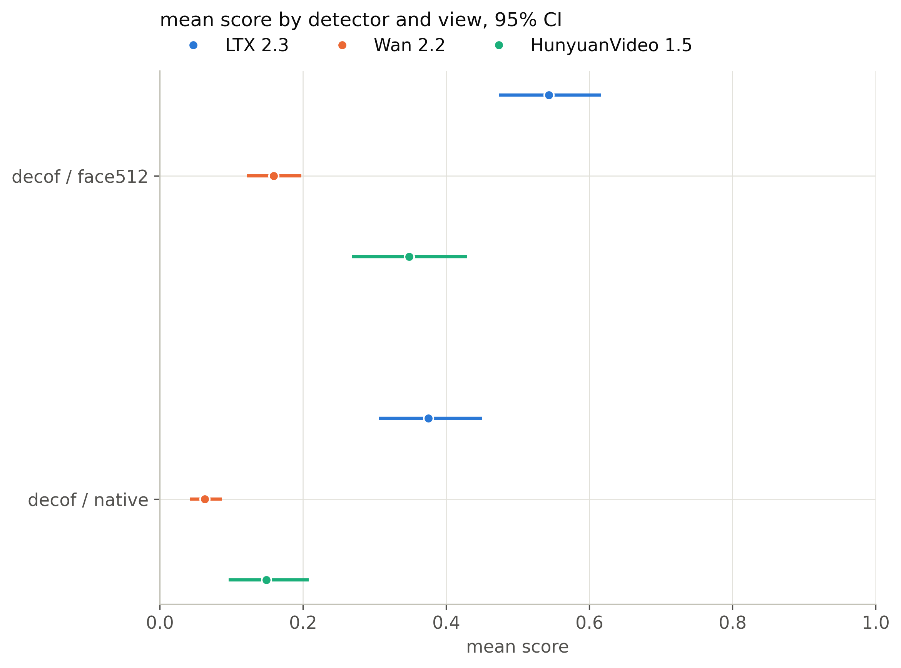
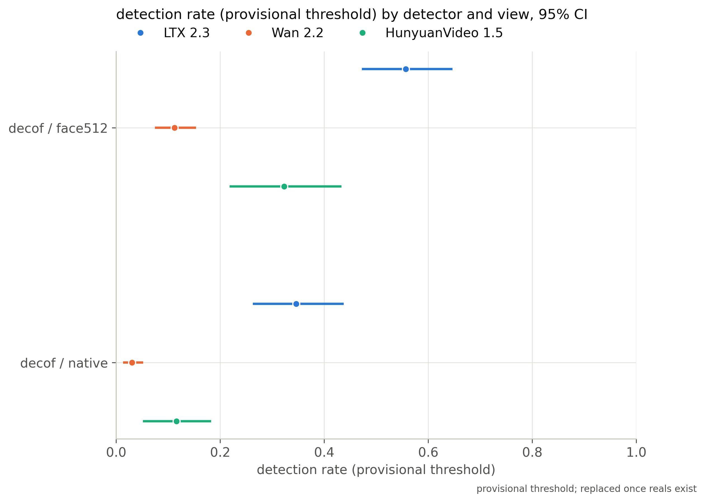

# Cross-detector comparison (2026-10-20T23:20:15Z)

Snapshots: decof/face512 (20261020-2319), decof/native (20261020-2319)

| detector   | view    | snapshot      | generator   |    n |   mean_score |   mean_ci_lo |   mean_ci_hi |   det_rate_provisional |   det_ci_lo |   det_ci_hi |   threshold |   gap_race |   gap_gender |   gap_age_band |   cf_spread |
|:-----------|:--------|:--------------|:------------|-----:|-------------:|-------------:|-------------:|-----------------------:|------------:|------------:|------------:|-----------:|-------------:|---------------:|------------:|
| decof      | face512 | 20261020-2319 | ltx23       | 1874 |       0.5437 |       0.4742 |       0.6167 |                 0.5566 |      0.4723 |      0.6464 |         0.5 |     0.176  |       0.041  |         0.2268 |      0.2564 |
| decof      | face512 | 20261020-2319 | wan22       | 1566 |       0.1589 |       0.1218 |       0.1979 |                 0.1124 |      0.0745 |      0.1534 |         0.5 |     0.2501 |       0.0895 |         0.1499 |      0.1782 |
| decof      | face512 | 20261020-2319 | hunyuan15   |  492 |       0.3484 |       0.2687 |       0.4295 |                 0.3232 |      0.2181 |      0.4331 |         0.5 |     0.253  |       0.1016 |         0.3106 |      0.2897 |
| decof      | face512 | 20261020-2319 | all         | 3932 |       0.366  |       0.3241 |       0.4061 |                 0.3505 |      0.3027 |      0.3969 |         0.5 |     0.212  |       0.0664 |         0.2126 |    nan      |
| decof      | native  | 20261020-2319 | ltx23       | 1878 |       0.3751 |       0.3058 |       0.4497 |                 0.3461 |      0.2626 |      0.4373 |         0.5 |     0.1713 |       0.0354 |         0.2561 |      0.2476 |
| decof      | native  | 20261020-2319 | wan22       | 1566 |       0.063  |       0.0417 |       0.0867 |                 0.0307 |      0.0133 |      0.0517 |         0.5 |     0.1379 |       0.0436 |         0.0689 |      0.0983 |
| decof      | native  | 20261020-2319 | hunyuan15   |  492 |       0.1487 |       0.0962 |       0.2077 |                 0.1159 |      0.0513 |      0.1826 |         0.5 |     0.1554 |       0.0481 |         0.2133 |      0.2003 |
| decof      | native  | 20261020-2319 | all         | 3936 |       0.2226 |       0.1854 |       0.2609 |                 0.1918 |      0.1483 |      0.2374 |         0.5 |     0.1543 |       0.0387 |         0.1778 |    nan      |

Pending until reals exist: AUC/AP/EER/TPR@5%FPR, real FPR, calibrated threshold (needs reals).
