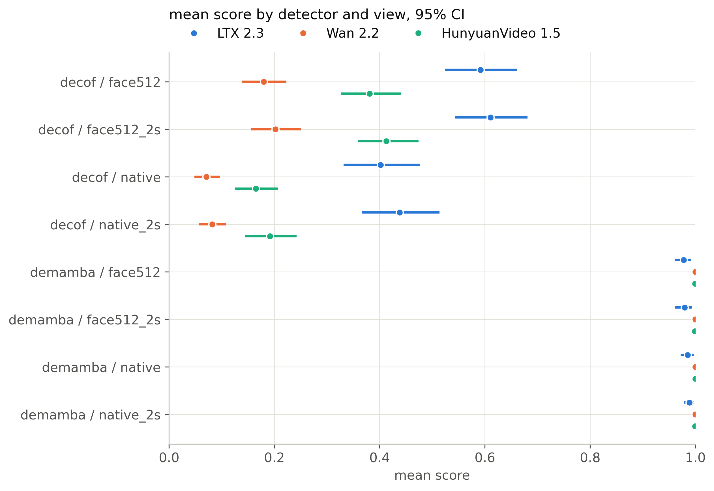
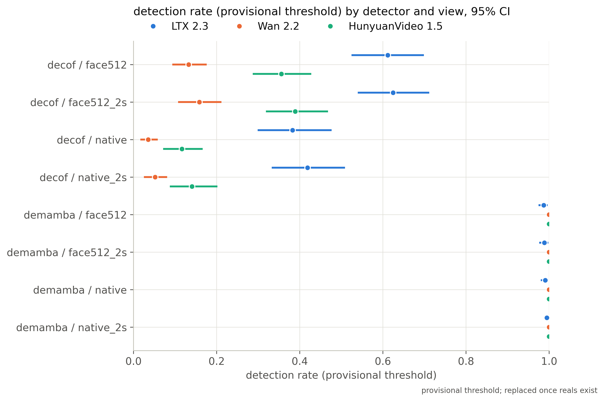

# Cross-detector comparison (2026-10-21T06:19:10Z)

Snapshots: decof/face512 (20261021-0615), decof/face512_2s (20261021-0616), decof/native (20261021-0616), decof/native_2s (20261021-0617), demamba/face512 (20261021-0617), demamba/face512_2s (20261021-0617), demamba/native (20261021-0618), demamba/native_2s (20261021-0618)

| detector   | view       | snapshot      | generator   |    n |   mean_score |   mean_ci_lo |   mean_ci_hi |   det_rate_provisional |   det_ci_lo |   det_ci_hi |   threshold |   gap_race |   gap_gender |   gap_age_band |   cf_spread |
|:-----------|:-----------|:--------------|:------------|-----:|-------------:|-------------:|-------------:|-----------------------:|------------:|------------:|------------:|-----------:|-------------:|---------------:|------------:|
| decof      | face512    | 20261021-0615 | ltx23       | 1874 |       0.5919 |       0.5241 |       0.6611 |                 0.6115 |      0.5244 |      0.6986 |         0.5 |     0.166  |       0.041  |         0.2212 |      0.2521 |
| decof      | face512    | 20261021-0615 | wan22       | 1566 |       0.1798 |       0.1389 |       0.2229 |                 0.1328 |      0.0935 |      0.1761 |         0.5 |     0.2613 |       0.0985 |         0.1645 |      0.1914 |
| decof      | face512    | 20261021-0615 | hunyuan15   |  989 |       0.3809 |       0.327  |       0.4402 |                 0.3559 |      0.2866 |      0.4275 |         0.5 |     0.2318 |       0.0836 |         0.2951 |      0.2918 |
| decof      | face512    | 20261021-0615 | all         | 4429 |       0.3991 |       0.3579 |       0.4388 |                 0.3852 |      0.3374 |      0.4324 |         0.5 |     0.2128 |       0.0694 |         0.2235 |    nan      |
| decof      | face512_2s | 20261021-0616 | ltx23       | 1867 |       0.6104 |       0.5432 |       0.6811 |                 0.6245 |      0.5397 |      0.7118 |         0.5 |     0.1677 |       0.0505 |         0.2154 |      0.2568 |
| decof      | face512_2s | 20261021-0616 | wan22       | 1566 |       0.202  |       0.1551 |       0.251  |                 0.1584 |      0.1073 |      0.2115 |         0.5 |     0.2713 |       0.0971 |         0.1879 |      0.2018 |
| decof      | face512_2s | 20261021-0616 | hunyuan15   |  989 |       0.4127 |       0.3583 |       0.4741 |                 0.3893 |      0.3187 |      0.4678 |         0.5 |     0.2205 |       0.0958 |         0.3021 |      0.3025 |
| decof      | face512_2s | 20261021-0616 | all         | 4422 |       0.4215 |       0.378  |       0.4648 |                 0.4068 |      0.3554 |      0.4585 |         0.5 |     0.214  |       0.0763 |         0.2273 |    nan      |
| decof      | native     | 20261021-0616 | ltx23       | 1878 |       0.4017 |       0.3315 |       0.4764 |                 0.3823 |      0.2985 |      0.4767 |         0.5 |     0.1762 |       0.034  |         0.2621 |      0.2526 |
| decof      | native     | 20261021-0616 | wan22       | 1566 |       0.0709 |       0.0479 |       0.0964 |                 0.0351 |      0.0164 |      0.0583 |         0.5 |     0.1483 |       0.0485 |         0.0764 |      0.1057 |
| decof      | native     | 20261021-0616 | hunyuan15   |  989 |       0.1646 |       0.1249 |       0.207  |                 0.1163 |      0.0713 |      0.1667 |         0.5 |     0.1607 |       0.0466 |         0.2117 |      0.2035 |
| decof      | native     | 20261021-0616 | all         | 4433 |       0.232  |       0.1954 |       0.2698 |                 0.2003 |      0.1573 |      0.2452 |         0.5 |     0.1612 |       0.0404 |         0.186  |    nan      |
| decof      | native_2s  | 20261021-0617 | ltx23       | 1878 |       0.4377 |       0.3662 |       0.5135 |                 0.4185 |      0.3324 |      0.5088 |         0.5 |     0.1802 |       0.04   |         0.2636 |      0.2647 |
| decof      | native_2s  | 20261021-0617 | wan22       | 1566 |       0.0821 |       0.0568 |       0.1085 |                 0.0517 |      0.0253 |      0.0811 |         0.5 |     0.173  |       0.0564 |         0.0899 |      0.1184 |
| decof      | native_2s  | 20261021-0617 | hunyuan15   |  989 |       0.1915 |       0.1447 |       0.2422 |                 0.1405 |      0.0873 |      0.202  |         0.5 |     0.1649 |       0.0517 |         0.2414 |      0.2241 |
| decof      | native_2s  | 20261021-0617 | all         | 4433 |       0.2571 |       0.2177 |       0.2957 |                 0.2269 |      0.1783 |      0.2723 |         0.5 |     0.1722 |       0.0468 |         0.1961 |    nan      |
| demamba    | face512    | 20261021-0617 | ltx23       | 1874 |       0.9778 |       0.9604 |       0.9917 |                 0.9867 |      0.9746 |      0.9966 |         0.5 |     0.0582 |       0.0081 |         0.0256 |      0.0415 |
| demamba    | face512    | 20261021-0617 | wan22       | 1566 |       0.9999 |       0.9998 |       0.9999 |                 1      |      1      |      1      |         0.5 |     0.0003 |       0.0001 |         0.0002 |      0.0002 |
| demamba    | face512    | 20261021-0617 | hunyuan15   |  989 |       0.9993 |       0.9987 |       0.9998 |                 1      |      1      |      1      |         0.5 |     0.003  |       0.0003 |         0.0013 |      0.0026 |
| demamba    | face512    | 20261021-0617 | all         | 4429 |       0.9904 |       0.9828 |       0.9964 |                 0.9944 |      0.9891 |      0.9986 |         0.5 |     0.0254 |       0.0034 |         0.0113 |    nan      |
| demamba    | face512_2s | 20261021-0617 | ltx23       | 1867 |       0.9792 |       0.9618 |       0.9935 |                 0.9888 |      0.976  |      0.9983 |         0.5 |     0.0518 |       0.0094 |         0.0211 |      0.0382 |
| demamba    | face512_2s | 20261021-0617 | wan22       | 1566 |       0.9998 |       0.9996 |       0.9999 |                 1      |      1      |      1      |         0.5 |     0.0005 |       0.0002 |         0.0004 |      0.0005 |
| demamba    | face512_2s | 20261021-0617 | hunyuan15   |  989 |       0.9986 |       0.9971 |       0.9996 |                 1      |      1      |      1      |         0.5 |     0.0064 |       0.0003 |         0.0026 |      0.0052 |
| demamba    | face512_2s | 20261021-0617 | all         | 4422 |       0.9909 |       0.9827 |       0.9971 |                 0.9953 |      0.9901 |      0.9993 |         0.5 |     0.0236 |       0.0039 |         0.0097 |    nan      |
| demamba    | native     | 20261021-0618 | ltx23       | 1878 |       0.9855 |       0.972  |       0.9967 |                 0.9904 |      0.9801 |      0.9989 |         0.5 |     0.045  |       0.0004 |         0.0188 |      0.0321 |
| demamba    | native     | 20261021-0618 | wan22       | 1566 |       0.9998 |       0.9997 |       0.9998 |                 1      |      1      |      1      |         0.5 |     0.0004 |       0.0001 |         0.0002 |      0.0003 |
| demamba    | native     | 20261021-0618 | hunyuan15   |  989 |       0.9996 |       0.9993 |       0.9998 |                 1      |      1      |      1      |         0.5 |     0.0021 |       0.0004 |         0.0009 |      0.0017 |
| demamba    | native     | 20261021-0618 | all         | 4433 |       0.9937 |       0.9878 |       0.9984 |                 0.9959 |      0.9915 |      0.9995 |         0.5 |     0.0196 |       0      |         0.0082 |    nan      |
| demamba    | native_2s  | 20261021-0618 | ltx23       | 1878 |       0.9886 |       0.9781 |       0.9963 |                 0.9941 |      0.9882 |      0.9985 |         0.5 |     0.0375 |       0.0024 |         0.0148 |      0.0299 |
| demamba    | native_2s  | 20261021-0618 | wan22       | 1566 |       0.9998 |       0.9997 |       0.9998 |                 1      |      1      |      1      |         0.5 |     0.0005 |       0.0001 |         0.0002 |      0.0003 |
| demamba    | native_2s  | 20261021-0618 | hunyuan15   |  989 |       0.9994 |       0.9988 |       0.9998 |                 1      |      1      |      1      |         0.5 |     0.0034 |       0.0008 |         0.0014 |      0.003  |
| demamba    | native_2s  | 20261021-0618 | all         | 4433 |       0.9949 |       0.9907 |       0.9982 |                 0.9975 |      0.9952 |      0.9993 |         0.5 |     0.0167 |       0.0008 |         0.0066 |    nan      |

Pending until reals exist: AUC/AP/EER/TPR@5%FPR, real FPR, calibrated threshold (needs reals).
