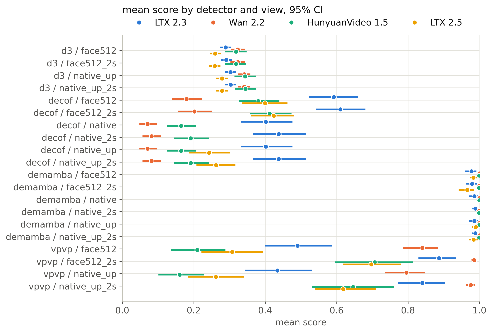
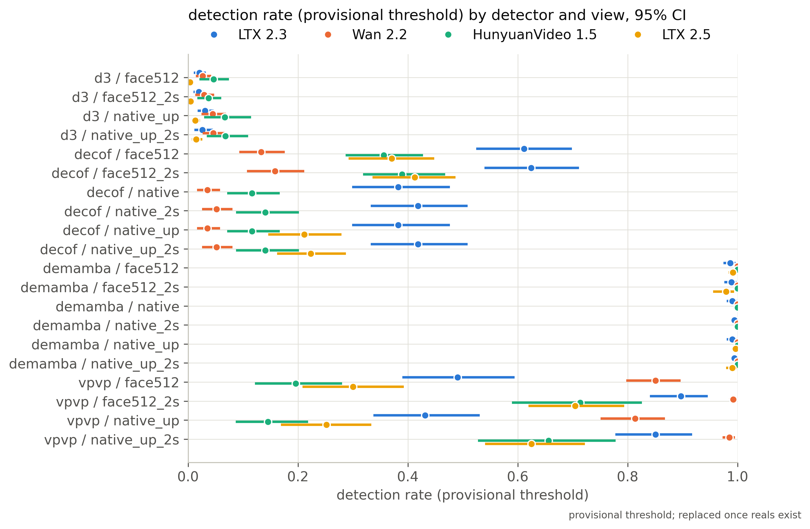

# Cross-detector comparison (2026-10-23T02:48:50Z)

Snapshots: d3/face512 (20261023-0245), d3/face512_2s (20261023-0246), d3/native_up (20261023-0246), d3/native_up_2s (20261023-0246), decof/face512 (20261023-0242), decof/face512_2s (20261023-0243), decof/native (20261021-0616), decof/native_2s (20261021-0617), decof/native_up (20261023-0243), decof/native_up_2s (20261023-0243), demamba/face512 (20261023-0244), demamba/face512_2s (20261023-0244), demamba/native (20261021-0618), demamba/native_2s (20261021-0618), demamba/native_up (20261023-0245), demamba/native_up_2s (20261023-0245), vpvp/face512 (20261023-0247), vpvp/face512_2s (20261023-0247), vpvp/native_up (20261023-0248), vpvp/native_up_2s (20261023-0248)

| detector   | view         | snapshot      | generator   |    n |   mean_score |   mean_ci_lo |   mean_ci_hi |   det_rate_provisional |   det_ci_lo |   det_ci_hi |   threshold |   gap_race |   gap_gender |   gap_age_band |   cf_spread |
|:-----------|:-------------|:--------------|:------------|-----:|-------------:|-------------:|-------------:|-----------------------:|------------:|------------:|------------:|-----------:|-------------:|---------------:|------------:|
| d3         | face512      | 20261023-0245 | ltx23       | 1874 |       0.2897 |       0.2741 |       0.3058 |                 0.0208 |      0.0107 |      0.0326 |         0.5 |     0.0291 |       0.0064 |         0.0525 |      0.0718 |
| d3         | face512      | 20261023-0245 | wan22       | 1566 |       0.3232 |       0.3038 |       0.3426 |                 0.0268 |      0.0143 |      0.0421 |         0.5 |     0.029  |       0.0101 |         0.043  |      0.0687 |
| d3         | face512      | 20261023-0245 | hunyuan15   |  989 |       0.3187 |       0.2885 |       0.3481 |                 0.0465 |      0.0205 |      0.0744 |         0.5 |     0.0209 |       0.0025 |         0.0534 |      0.0815 |
| d3         | face512      | 20261023-0245 | ltx25       | 2002 |       0.2598 |       0.2448 |       0.2755 |                 0.0035 |      0.0005 |      0.0075 |         0.5 |     0.0394 |       0.0066 |         0.0448 |      0.0627 |
| d3         | face512      | 20261023-0245 | all         | 6431 |       0.293  |       0.2784 |       0.308  |                 0.0208 |      0.0132 |      0.029  |         0.5 |     0.0269 |       0.0067 |         0.0478 |    nan      |
| d3         | face512_2s   | 20261023-0246 | ltx23       | 1867 |       0.2909 |       0.2757 |       0.3067 |                 0.0198 |      0.0101 |      0.0297 |         0.5 |     0.0305 |       0.0058 |         0.0498 |      0.0743 |
| d3         | face512_2s   | 20261023-0246 | wan22       | 1566 |       0.3233 |       0.3031 |       0.343  |                 0.0294 |      0.0133 |      0.0474 |         0.5 |     0.0313 |       0.0098 |         0.0384 |      0.0688 |
| d3         | face512_2s   | 20261023-0246 | hunyuan15   |  989 |       0.3183 |       0.2887 |       0.3476 |                 0.0374 |      0.0171 |      0.0604 |         0.5 |     0.0221 |       0.0076 |         0.0536 |      0.0814 |
| d3         | face512_2s   | 20261023-0246 | ltx25       | 2002 |       0.259  |       0.2436 |       0.2751 |                 0.0045 |      0.002  |      0.0075 |         0.5 |     0.0386 |       0.007  |         0.0402 |      0.0609 |
| d3         | face512_2s   | 20261023-0246 | all         | 6424 |       0.2931 |       0.2781 |       0.3077 |                 0.0201 |      0.0118 |      0.0292 |         0.5 |     0.029  |       0.0074 |         0.0444 |    nan      |
| d3         | native_up    | 20261023-0246 | ltx23       | 1878 |       0.3028 |       0.288  |       0.3186 |                 0.0309 |      0.0174 |      0.0465 |         0.5 |     0.0366 |       0.0145 |         0.0552 |      0.0753 |
| d3         | native_up    | 20261023-0246 | wan22       | 1566 |       0.3414 |       0.3238 |       0.3588 |                 0.0447 |      0.0246 |      0.069  |         0.5 |     0.0492 |       0.0107 |         0.0563 |      0.0726 |
| d3         | native_up    | 20261023-0246 | hunyuan15   |  989 |       0.3438 |       0.3143 |       0.3732 |                 0.0667 |      0.0292 |      0.115  |         0.5 |     0.0236 |       0.0069 |         0.0542 |      0.0816 |
| d3         | native_up    | 20261023-0246 | ltx25       | 2002 |       0.2793 |       0.2627 |       0.2963 |                 0.013  |      0.0055 |      0.0219 |         0.5 |     0.044  |       0.0047 |         0.0515 |      0.0676 |
| d3         | native_up    | 20261023-0246 | all         | 6435 |       0.3112 |       0.2968 |       0.3252 |                 0.0342 |      0.021  |      0.0473 |         0.5 |     0.0382 |       0.0092 |         0.0546 |    nan      |
| d3         | native_up_2s | 20261023-0246 | ltx23       | 1878 |       0.3035 |       0.2885 |       0.3194 |                 0.0261 |      0.0118 |      0.0455 |         0.5 |     0.0367 |       0.0149 |         0.0554 |      0.0746 |
| d3         | native_up_2s | 20261023-0246 | wan22       | 1566 |       0.3412 |       0.324  |       0.3586 |                 0.046  |      0.0266 |      0.0679 |         0.5 |     0.051  |       0.0119 |         0.0561 |      0.0733 |
| d3         | native_up_2s | 20261023-0246 | hunyuan15   |  989 |       0.3451 |       0.316  |       0.3737 |                 0.0677 |      0.0343 |      0.1094 |         0.5 |     0.0266 |       0.0077 |         0.0542 |      0.0825 |
| d3         | native_up_2s | 20261023-0246 | ltx25       | 2002 |       0.2792 |       0.2626 |       0.2961 |                 0.015  |      0.0065 |      0.026  |         0.5 |     0.0414 |       0.005  |         0.0509 |      0.0674 |
| d3         | native_up_2s | 20261023-0246 | all         | 6435 |       0.3115 |       0.2973 |       0.3254 |                 0.0339 |      0.0211 |      0.047  |         0.5 |     0.038  |       0.0099 |         0.0544 |    nan      |
| decof      | face512      | 20261023-0242 | ltx23       | 1874 |       0.5919 |       0.5241 |       0.6611 |                 0.6115 |      0.5244 |      0.6986 |         0.5 |     0.166  |       0.041  |         0.2212 |      0.2521 |
| decof      | face512      | 20261023-0242 | wan22       | 1566 |       0.1798 |       0.1389 |       0.2229 |                 0.1328 |      0.0935 |      0.1761 |         0.5 |     0.2613 |       0.0985 |         0.1645 |      0.1914 |
| decof      | face512      | 20261023-0242 | hunyuan15   |  989 |       0.3809 |       0.327  |       0.4402 |                 0.3559 |      0.2866 |      0.4275 |         0.5 |     0.2318 |       0.0836 |         0.2951 |      0.2918 |
| decof      | face512      | 20261023-0242 | ltx25       | 2002 |       0.3997 |       0.3348 |       0.4626 |                 0.3706 |      0.2921 |      0.4479 |         0.5 |     0.207  |       0.0077 |         0.2542 |      0.2685 |
| decof      | face512      | 20261023-0242 | all         | 6431 |       0.3993 |       0.3542 |       0.4414 |                 0.3807 |      0.3282 |      0.4327 |         0.5 |     0.2104 |       0.0454 |         0.2331 |    nan      |
| decof      | face512_2s   | 20261023-0243 | ltx23       | 1867 |       0.6104 |       0.5432 |       0.6811 |                 0.6245 |      0.5397 |      0.7118 |         0.5 |     0.1677 |       0.0505 |         0.2154 |      0.2568 |
| decof      | face512_2s   | 20261023-0243 | wan22       | 1566 |       0.202  |       0.1551 |       0.251  |                 0.1584 |      0.1073 |      0.2115 |         0.5 |     0.2713 |       0.0971 |         0.1879 |      0.2018 |
| decof      | face512_2s   | 20261023-0243 | hunyuan15   |  989 |       0.4127 |       0.3583 |       0.4741 |                 0.3893 |      0.3187 |      0.4678 |         0.5 |     0.2205 |       0.0958 |         0.3021 |      0.3025 |
| decof      | face512_2s   | 20261023-0243 | ltx25       | 2002 |       0.4237 |       0.3615 |       0.4821 |                 0.4126 |      0.336  |      0.487  |         0.5 |     0.2136 |       0.0068 |         0.2553 |      0.2801 |
| decof      | face512_2s   | 20261023-0243 | all         | 6424 |       0.4222 |       0.3766 |       0.4641 |                 0.4086 |      0.3529 |      0.459  |         0.5 |     0.2141 |       0.0546 |         0.2361 |    nan      |
| decof      | native       | 20261021-0616 | ltx23       | 1878 |       0.4017 |       0.3315 |       0.4764 |                 0.3823 |      0.2985 |      0.4767 |         0.5 |     0.1762 |       0.034  |         0.2621 |      0.2526 |
| decof      | native       | 20261021-0616 | wan22       | 1566 |       0.0709 |       0.0479 |       0.0964 |                 0.0351 |      0.0164 |      0.0583 |         0.5 |     0.1483 |       0.0485 |         0.0764 |      0.1057 |
| decof      | native       | 20261021-0616 | hunyuan15   |  989 |       0.1646 |       0.1249 |       0.207  |                 0.1163 |      0.0713 |      0.1667 |         0.5 |     0.1607 |       0.0466 |         0.2117 |      0.2035 |
| decof      | native       | 20261021-0616 | all         | 4433 |       0.232  |       0.1954 |       0.2698 |                 0.2003 |      0.1573 |      0.2452 |         0.5 |     0.1612 |       0.0404 |         0.186  |    nan      |
| decof      | native_2s    | 20261021-0617 | ltx23       | 1878 |       0.4377 |       0.3662 |       0.5135 |                 0.4185 |      0.3324 |      0.5088 |         0.5 |     0.1802 |       0.04   |         0.2636 |      0.2647 |
| decof      | native_2s    | 20261021-0617 | wan22       | 1566 |       0.0821 |       0.0568 |       0.1085 |                 0.0517 |      0.0253 |      0.0811 |         0.5 |     0.173  |       0.0564 |         0.0899 |      0.1184 |
| decof      | native_2s    | 20261021-0617 | hunyuan15   |  989 |       0.1915 |       0.1447 |       0.2422 |                 0.1405 |      0.0873 |      0.202  |         0.5 |     0.1649 |       0.0517 |         0.2414 |      0.2241 |
| decof      | native_2s    | 20261021-0617 | all         | 4433 |       0.2571 |       0.2177 |       0.2957 |                 0.2269 |      0.1783 |      0.2723 |         0.5 |     0.1722 |       0.0468 |         0.1961 |    nan      |
| decof      | native_up    | 20261023-0243 | ltx23       | 1878 |       0.4017 |       0.3315 |       0.4764 |                 0.3823 |      0.2985 |      0.4767 |         0.5 |     0.1762 |       0.034  |         0.2621 |      0.2526 |
| decof      | native_up    | 20261023-0243 | wan22       | 1566 |       0.0709 |       0.0479 |       0.0964 |                 0.0351 |      0.0164 |      0.0583 |         0.5 |     0.1483 |       0.0485 |         0.0764 |      0.1057 |
| decof      | native_up    | 20261023-0243 | hunyuan15   |  989 |       0.1646 |       0.1249 |       0.207  |                 0.1163 |      0.0713 |      0.1667 |         0.5 |     0.1607 |       0.0466 |         0.2117 |      0.2035 |
| decof      | native_up    | 20261023-0243 | ltx25       | 2002 |       0.2431 |       0.1879 |       0.3016 |                 0.2118 |      0.146  |      0.2795 |         0.5 |     0.1974 |       0.0243 |         0.2303 |      0.2176 |
| decof      | native_up    | 20261023-0243 | all         | 6435 |       0.2354 |       0.1942 |       0.2758 |                 0.2039 |      0.1569 |      0.2498 |         0.5 |     0.1695 |       0.0203 |         0.1998 |    nan      |
| decof      | native_up_2s | 20261023-0243 | ltx23       | 1878 |       0.4377 |       0.3662 |       0.5135 |                 0.4185 |      0.3324 |      0.5088 |         0.5 |     0.1802 |       0.04   |         0.2636 |      0.2647 |
| decof      | native_up_2s | 20261023-0243 | wan22       | 1566 |       0.0821 |       0.0568 |       0.1085 |                 0.0517 |      0.0253 |      0.0811 |         0.5 |     0.173  |       0.0564 |         0.0899 |      0.1184 |
| decof      | native_up_2s | 20261023-0243 | hunyuan15   |  989 |       0.1915 |       0.1447 |       0.2422 |                 0.1405 |      0.0873 |      0.202  |         0.5 |     0.1649 |       0.0517 |         0.2414 |      0.2241 |
| decof      | native_up_2s | 20261023-0243 | ltx25       | 2002 |       0.2627 |       0.2076 |       0.3169 |                 0.2233 |      0.1621 |      0.2874 |         0.5 |     0.2077 |       0.012  |         0.2456 |      0.2368 |
| decof      | native_up_2s | 20261023-0243 | all         | 6435 |       0.2589 |       0.2163 |       0.2995 |                 0.2258 |      0.1783 |      0.2726 |         0.5 |     0.1805 |       0.0285 |         0.2115 |    nan      |
| demamba    | face512      | 20261023-0244 | ltx23       | 1874 |       0.9778 |       0.9604 |       0.9917 |                 0.9867 |      0.9746 |      0.9966 |         0.5 |     0.0582 |       0.0081 |         0.0256 |      0.0415 |
| demamba    | face512      | 20261023-0244 | wan22       | 1566 |       0.9999 |       0.9998 |       0.9999 |                 1      |      1      |      1      |         0.5 |     0.0003 |       0.0001 |         0.0002 |      0.0002 |
| demamba    | face512      | 20261023-0244 | hunyuan15   |  989 |       0.9993 |       0.9987 |       0.9998 |                 1      |      1      |      1      |         0.5 |     0.003  |       0.0003 |         0.0013 |      0.0026 |
| demamba    | face512      | 20261023-0244 | ltx25       | 2002 |       0.983  |       0.9727 |       0.9923 |                 0.9915 |      0.9835 |      0.9975 |         0.5 |     0.0495 |       0.0016 |         0.0131 |      0.0404 |
| demamba    | face512      | 20261023-0244 | all         | 6431 |       0.9881 |       0.9804 |       0.9947 |                 0.9935 |      0.9876 |      0.9979 |         0.5 |     0.0323 |       0.0018 |         0.0118 |    nan      |
| demamba    | face512_2s   | 20261023-0244 | ltx23       | 1867 |       0.9792 |       0.9618 |       0.9935 |                 0.9888 |      0.976  |      0.9983 |         0.5 |     0.0518 |       0.0094 |         0.0211 |      0.0382 |
| demamba    | face512_2s   | 20261023-0244 | wan22       | 1566 |       0.9998 |       0.9996 |       0.9999 |                 1      |      1      |      1      |         0.5 |     0.0005 |       0.0002 |         0.0004 |      0.0005 |
| demamba    | face512_2s   | 20261023-0244 | hunyuan15   |  989 |       0.9986 |       0.9971 |       0.9996 |                 1      |      1      |      1      |         0.5 |     0.0064 |       0.0003 |         0.0026 |      0.0052 |
| demamba    | face512_2s   | 20261023-0244 | ltx25       | 2002 |       0.9659 |       0.9418 |       0.9843 |                 0.979  |      0.9554 |      0.994  |         0.5 |     0.0842 |       0.0002 |         0.0294 |      0.0619 |
| demamba    | face512_2s   | 20261023-0244 | all         | 6424 |       0.9831 |       0.9725 |       0.9918 |                 0.9902 |      0.9816 |      0.9965 |         0.5 |     0.0419 |       0.0027 |         0.0159 |    nan      |
| demamba    | native       | 20261021-0618 | ltx23       | 1878 |       0.9855 |       0.972  |       0.9967 |                 0.9904 |      0.9801 |      0.9989 |         0.5 |     0.045  |       0.0004 |         0.0188 |      0.0321 |
| demamba    | native       | 20261021-0618 | wan22       | 1566 |       0.9998 |       0.9997 |       0.9998 |                 1      |      1      |      1      |         0.5 |     0.0004 |       0.0001 |         0.0002 |      0.0003 |
| demamba    | native       | 20261021-0618 | hunyuan15   |  989 |       0.9996 |       0.9993 |       0.9998 |                 1      |      1      |      1      |         0.5 |     0.0021 |       0.0004 |         0.0009 |      0.0017 |
| demamba    | native       | 20261021-0618 | all         | 4433 |       0.9937 |       0.9878 |       0.9984 |                 0.9959 |      0.9915 |      0.9995 |         0.5 |     0.0196 |       0      |         0.0082 |    nan      |
| demamba    | native_2s    | 20261021-0618 | ltx23       | 1878 |       0.9886 |       0.9781 |       0.9963 |                 0.9941 |      0.9882 |      0.9985 |         0.5 |     0.0375 |       0.0024 |         0.0148 |      0.0299 |
| demamba    | native_2s    | 20261021-0618 | wan22       | 1566 |       0.9998 |       0.9997 |       0.9998 |                 1      |      1      |      1      |         0.5 |     0.0005 |       0.0001 |         0.0002 |      0.0003 |
| demamba    | native_2s    | 20261021-0618 | hunyuan15   |  989 |       0.9994 |       0.9988 |       0.9998 |                 1      |      1      |      1      |         0.5 |     0.0034 |       0.0008 |         0.0014 |      0.003  |
| demamba    | native_2s    | 20261021-0618 | all         | 4433 |       0.9949 |       0.9907 |       0.9982 |                 0.9975 |      0.9952 |      0.9993 |         0.5 |     0.0167 |       0.0008 |         0.0066 |    nan      |
| demamba    | native_up    | 20261023-0245 | ltx23       | 1878 |       0.9855 |       0.972  |       0.9967 |                 0.9904 |      0.9801 |      0.9989 |         0.5 |     0.045  |       0.0004 |         0.0188 |      0.0321 |
| demamba    | native_up    | 20261023-0245 | wan22       | 1566 |       0.9998 |       0.9997 |       0.9998 |                 1      |      1      |      1      |         0.5 |     0.0004 |       0.0001 |         0.0002 |      0.0003 |
| demamba    | native_up    | 20261023-0245 | hunyuan15   |  989 |       0.9996 |       0.9993 |       0.9998 |                 1      |      1      |      1      |         0.5 |     0.0021 |       0.0004 |         0.0009 |      0.0017 |
| demamba    | native_up    | 20261023-0245 | ltx25       | 2002 |       0.9895 |       0.9797 |       0.9971 |                 0.9965 |      0.992  |      0.9995 |         0.5 |     0.0254 |       0.0051 |         0.0125 |      0.0216 |
| demamba    | native_up    | 20261023-0245 | all         | 6435 |       0.9924 |       0.9864 |       0.9973 |                 0.9961 |      0.9924 |      0.9994 |         0.5 |     0.0214 |       0.0016 |         0.0096 |    nan      |
| demamba    | native_up_2s | 20261023-0245 | ltx23       | 1878 |       0.9886 |       0.9781 |       0.9963 |                 0.9941 |      0.9882 |      0.9985 |         0.5 |     0.0375 |       0.0024 |         0.0148 |      0.0299 |
| demamba    | native_up_2s | 20261023-0245 | wan22       | 1566 |       0.9998 |       0.9997 |       0.9998 |                 1      |      1      |      1      |         0.5 |     0.0005 |       0.0001 |         0.0002 |      0.0003 |
| demamba    | native_up_2s | 20261023-0245 | hunyuan15   |  989 |       0.9994 |       0.9988 |       0.9998 |                 1      |      1      |      1      |         0.5 |     0.0034 |       0.0008 |         0.0014 |      0.003  |
| demamba    | native_up_2s | 20261023-0245 | ltx25       | 2002 |       0.9836 |       0.97   |       0.9956 |                 0.9905 |      0.9794 |      0.999  |         0.5 |     0.0425 |       0.0051 |         0.0202 |      0.0321 |
| demamba    | native_up_2s | 20261023-0245 | all         | 6435 |       0.9914 |       0.9845 |       0.997  |                 0.9953 |      0.9906 |      0.999  |         0.5 |     0.0247 |       0.001  |         0.0103 |    nan      |
| vpvp       | face512      | 20261023-0247 | ltx23       | 1874 |       0.4907 |       0.3985 |       0.588  |                 0.4904 |      0.3902 |      0.5944 |         0.5 |     0.1099 |       0.0345 |         0.059  |      0.3022 |
| vpvp       | face512      | 20261023-0247 | wan22       | 1566 |       0.8401 |       0.787  |       0.8848 |                 0.8506 |      0.7974 |      0.8967 |         0.5 |     0.085  |       0.1092 |         0.0638 |      0.2207 |
| vpvp       | face512      | 20261023-0247 | hunyuan15   |  989 |       0.2097 |       0.1367 |       0.2889 |                 0.1962 |      0.1217 |      0.2803 |         0.5 |     0.0879 |       0.0696 |         0.1115 |      0.272  |
| vpvp       | face512      | 20261023-0247 | ltx25       | 2002 |       0.3077 |       0.2217 |       0.395  |                 0.3002 |      0.2085 |      0.3926 |         0.5 |     0.0837 |       0.0362 |         0.0386 |      0.2646 |
| vpvp       | face512      | 20261023-0247 | all         | 6431 |       0.4756 |       0.4153 |       0.5417 |                 0.4736 |      0.4085 |      0.5431 |         0.5 |     0.0799 |       0.038  |         0.0399 |    nan      |
| vpvp       | face512_2s   | 20261023-0247 | ltx23       | 1867 |       0.8866 |       0.8293 |       0.9346 |                 0.8972 |      0.8405 |      0.9458 |         0.5 |     0.0394 |       0.0009 |         0.0397 |      0.167  |
| vpvp       | face512_2s   | 20261023-0247 | wan22       | 1566 |       0.9853 |       0.9764 |       0.9925 |                 0.9923 |      0.9844 |      0.9982 |         0.5 |     0.0186 |       0.0093 |         0.0081 |      0.0434 |
| vpvp       | face512_2s   | 20261023-0247 | hunyuan15   |  989 |       0.7069 |       0.5946 |       0.8142 |                 0.7139 |      0.5895 |      0.8259 |         0.5 |     0.147  |       0.0316 |         0.2453 |      0.2823 |
| vpvp       | face512_2s   | 20261023-0247 | ltx25       | 2002 |       0.6969 |       0.6187 |       0.7797 |                 0.7043 |      0.6198 |      0.7936 |         0.5 |     0.1    |       0.055  |         0.0831 |      0.2769 |
| vpvp       | face512_2s   | 20261023-0247 | all         | 6424 |       0.8239 |       0.769  |       0.875  |                 0.832  |      0.7739 |      0.8867 |         0.5 |     0.0578 |       0.0243 |         0.0608 |    nan      |
| vpvp       | native_up    | 20261023-0248 | ltx23       | 1878 |       0.4339 |       0.3432 |       0.5304 |                 0.4313 |      0.3374 |      0.5306 |         0.5 |     0.1187 |       0.0251 |         0.0746 |      0.3068 |
| vpvp       | native_up    | 20261023-0248 | wan22       | 1566 |       0.7956 |       0.7358 |       0.8463 |                 0.8135 |      0.7509 |      0.8681 |         0.5 |     0.0676 |       0.1531 |         0.0649 |      0.2555 |
| vpvp       | native_up    | 20261023-0248 | hunyuan15   |  989 |       0.1604 |       0.1013 |       0.2292 |                 0.1456 |      0.0869 |      0.2187 |         0.5 |     0.0727 |       0.0619 |         0.0668 |      0.2247 |
| vpvp       | native_up    | 20261023-0248 | ltx25       | 2002 |       0.2619 |       0.1846 |       0.3401 |                 0.2517 |      0.1691 |      0.3337 |         0.5 |     0.0894 |       0.0495 |         0.0365 |      0.2564 |
| vpvp       | native_up    | 20261023-0248 | all         | 6435 |       0.4264 |       0.3715 |       0.4868 |                 0.4246 |      0.3658 |      0.4881 |         0.5 |     0.0677 |       0.0543 |         0.0417 |    nan      |
| vpvp       | native_up_2s | 20261023-0248 | ltx23       | 1878 |       0.8398 |       0.7728 |       0.903  |                 0.8509 |      0.7774 |      0.9177 |         0.5 |     0.0551 |       0.0171 |         0.0558 |      0.1938 |
| vpvp       | native_up_2s | 20261023-0248 | wan22       | 1566 |       0.9756 |       0.962  |       0.9867 |                 0.9853 |      0.9728 |      0.9952 |         0.5 |     0.0237 |       0.0194 |         0.0216 |      0.0638 |
| vpvp       | native_up_2s | 20261023-0248 | hunyuan15   |  989 |       0.6467 |       0.5302 |       0.7604 |                 0.6562 |      0.5278 |      0.7782 |         0.5 |     0.1258 |       0.0401 |         0.1974 |      0.3023 |
| vpvp       | native_up_2s | 20261023-0248 | ltx25       | 2002 |       0.6186 |       0.5394 |       0.7108 |                 0.6249 |      0.5406 |      0.7221 |         0.5 |     0.1306 |       0.0518 |         0.0819 |      0.2955 |
| vpvp       | native_up_2s | 20261023-0248 | all         | 6435 |       0.7744 |       0.7158 |       0.833  |                 0.7834 |      0.721  |      0.8441 |         0.5 |     0.0699 |       0.0219 |         0.0688 |    nan      |

Pending until reals exist: AUC/AP/EER/TPR@5%FPR, real FPR, calibrated threshold (needs reals).
