# d3 / face512: snapshot 20261021-2055

> **Detector training data.** D3 is training-free: a statistic of frozen X-CLIP-B/16 features, no detector weights. Its score is 1/(1+std) of the second-order feature; only rank metrics and the calibrated threshold are meaningful, the provisional 0.5 threshold is not.

> **Provisional threshold.** Every detection rate and flip rate below uses the detector's default threshold (0.5; none official (training-free statistic); 0.5 on 1/(1+std) is arbitrary - use the calibrated threshold). They will be replaced by the 5%-real-FPR threshold once reals exist (section 6.3).

## Settings

| setting           | value                                                                                  |
|:------------------|:---------------------------------------------------------------------------------------|
| detector          | d3 1+efab2602                                                                          |
| checkpoint_sha256 | b5db836d57b7e22001cb2bab581719e910b4c571d926fe839b5d07bc0ba2d03e                       |
| view              | face512 (view_hash 330ecb1e37e36e82)                                                   |
| ffmpeg            | ffmpeg version 7.1.1 Copyright (c) 2000-2025 the FFmpeg developers                     |
| batches           | fake_b1, fake_b2, real_all                                                             |
| inclusion set     | primary (technical QC pass AND face QC pass)                                           |
| bootstrap         | 1000 resamples of whole counterfactual groups, seed 20261020, 95% percentile intervals |
| git commit        | 4e41a35865f4-dirty                                                                     |
| created           | 2026-10-21T20:55:55Z                                                                   |

Detector preprocessing on top of the view:

| field       | value                                                                                                           |
|:------------|:----------------------------------------------------------------------------------------------------------------|
| source      | Zig-HS/D3@c798fbc57fe0c4198d63a73732c2c0f9e4b4816c utils/video2frame.py + data/datasets.py + models/D3_model.py |
| frames      | ffmpeg -t 3 -vf fps=8 -> JPEG (ffmpeg default mjpeg), from view start                                           |
| frames_used | first 16 (8 if 8-15 available)                                                                                  |
| channels    | BGR (cv2.imread, as in the official dataset)                                                                    |
| crop        | centre, trim 10% each side of the longer dimension                                                              |
| resize      | [224, 224, 'cv2.INTER_LINEAR']                                                                                  |
| normalize   | {'mean': [0.485, 0.456, 0.406], 'std': [0.229, 0.224, 0.225], 'max_pixel_value': 255}                           |
| encoder     | microsoft/xclip-base-patch16@d6184e3fd8780d04c85d0f1eabe5f94bf44d98f6 vision tower, pooler_output               |
| statistic   | std of first differences of consecutive-frame L2 distances (loss l2)                                            |
| score       | 1 / (1 + std)                                                                                                   |
| precision   | fp32, TF32 off                                                                                                  |

## Coverage

| batch    | generator   |   clips |   primary |   rendered |   view_excluded |   render_failed |   scored |   score_failed |   included |
|:---------|:------------|--------:|----------:|-----------:|----------------:|----------------:|---------:|---------------:|-----------:|
| fake_b1  | hunyuan15   |     504 |       492 |        504 |               0 |               0 |      504 |              0 |        492 |
| fake_b1  | ltx23       |    2016 |      1878 |       2012 |               4 |               0 |     2012 |              0 |       1874 |
| fake_b1  | wan22       |    2016 |      1566 |       2016 |               0 |               0 |     2016 |              0 |       1566 |
| fake_b2  | hunyuan15   |     504 |       497 |        504 |               0 |               0 |      504 |              0 |        497 |
| real_all | real        |    2221 |      2221 |        919 |            1279 |              23 |      928 |              0 |        928 |

face512 window placement (fixed window at the median YuNet face centre, shifted inward at frame edges). The scaled frame is exactly 512 px on its short side, so every window spans it fully and is "shifted" on that axis by construction; the long-axis count is the informative one.

|   rendered |   shifted_long_axis |   shifted_short_axis |   max_shift_long_px |   excluded_no_face |
|-----------:|--------------------:|---------------------:|--------------------:|-------------------:|
|       6883 |                 159 |                 6840 |                 186 |                 12 |

Reals scored: 1847. Fakes included: 4429 of 6883 scored (0 scoring failures).

## Observations

- LTX 2.3: mean score 0.290 [0.274, 0.306], median 0.279, n = 1874.
- Wan 2.2: mean score 0.323 [0.304, 0.343], median 0.321, n = 1566.
- HunyuanVideo 1.5: mean score 0.319 [0.288, 0.348], median 0.316, n = 989.
- Provisional detection rate (score >= 0.5), LTX 2.3: 2.1% [1.1, 3.3].
- Provisional detection rate (score >= 0.5), Wan 2.2: 2.7% [1.4, 4.2].
- Provisional detection rate (score >= 0.5), HunyuanVideo 1.5: 4.7% [2.1, 7.4].
- Provisional detection rate (score >= 0.5), all: 2.9% [1.8, 4.0].
- Largest race score gap: LTX 2.3 0.029 [0.017, 0.044] (black 0.306 vs southeast_asian 0.277).
- Largest gender score gap: Wan 2.2 0.010 [0.001, 0.021] (m 0.328 vs f 0.318).
- Largest age band score gap: HunyuanVideo 1.5 0.053 [0.038, 0.078] (60+ 0.357 vs 45-59 0.303).
- Largest cell score gap: HunyuanVideo 1.5 0.128 [0.119, 0.203] (white__m__60+ 0.388 vs indian__m__45-59 0.260).
- Largest scene-factor gap (all generators): behavior 0.148 [0.117, 0.173] (laugh vs speak).
- Largest partial eta squared: behavior 0.140, age_band 0.050, generator 0.036; residual holds 67.8% of total SS.
- CF spread, LTX 2.3: 0.072 [0.067, 0.076] over 36 groups (max 0.104).
- CF spread, Wan 2.2: 0.069 [0.064, 0.073] over 36 groups (max 0.104).
- CF spread, HunyuanVideo 1.5: 0.082 [0.077, 0.087] over 18 groups (max 0.107).
- Provisional flip rate, LTX 2.3: 41.7% of 36 groups [25.0, 58.3].
- Provisional flip rate, Wan 2.2: 47.2% of 36 groups [30.6, 63.9].
- Provisional flip rate, HunyuanVideo 1.5: 55.6% of 18 groups [31.2, 78.9].

## 6.1 Fakes only, no threshold

### Mean score by generator

| generator   |    n |   n_groups |   estimate |   ci_lo |   ci_hi |    sd |   median |   q05 |   q95 |
|:------------|-----:|-----------:|-----------:|--------:|--------:|------:|---------:|------:|------:|
| ltx23       | 1874 |         36 |      0.29  |   0.274 |   0.306 | 0.089 |    0.279 | 0.162 | 0.454 |
| wan22       | 1566 |         36 |      0.323 |   0.304 |   0.343 | 0.092 |    0.321 | 0.175 | 0.481 |
| hunyuan15   |  989 |         18 |      0.319 |   0.288 |   0.348 | 0.103 |    0.316 | 0.155 | 0.496 |
| all         | 4429 |         36 |      0.308 |   0.292 |   0.324 | 0.095 |    0.303 | 0.163 | 0.476 |

### Mean score by race

| generator   | level           |   n |   estimate |   ci_lo |   ci_hi |   median |
|:------------|:----------------|----:|-----------:|--------:|--------:|---------:|
| ltx23       | black           | 272 |      0.306 |   0.289 |   0.324 |    0.294 |
| ltx23       | east_asian      | 270 |      0.281 |   0.264 |   0.298 |    0.271 |
| ltx23       | indian          | 277 |      0.287 |   0.268 |   0.306 |    0.282 |
| ltx23       | latino          | 262 |      0.288 |   0.271 |   0.306 |    0.272 |
| ltx23       | mena            | 266 |      0.293 |   0.274 |   0.314 |    0.283 |
| ltx23       | southeast_asian | 271 |      0.277 |   0.262 |   0.293 |    0.272 |
| ltx23       | white           | 256 |      0.296 |   0.277 |   0.315 |    0.285 |
| wan22       | black           | 217 |      0.341 |   0.326 |   0.356 |    0.333 |
| wan22       | east_asian      | 226 |      0.312 |   0.284 |   0.341 |    0.304 |
| wan22       | indian          | 230 |      0.318 |   0.298 |   0.338 |    0.318 |
| wan22       | latino          | 219 |      0.329 |   0.309 |   0.348 |    0.327 |
| wan22       | mena            | 225 |      0.316 |   0.293 |   0.338 |    0.318 |
| wan22       | southeast_asian | 229 |      0.318 |   0.294 |   0.343 |    0.319 |
| wan22       | white           | 220 |      0.328 |   0.309 |   0.345 |    0.329 |
| hunyuan15   | black           | 141 |      0.328 |   0.299 |   0.359 |    0.327 |
| hunyuan15   | east_asian      | 141 |      0.325 |   0.294 |   0.354 |    0.327 |
| hunyuan15   | indian          | 142 |      0.307 |   0.279 |   0.336 |    0.318 |
| hunyuan15   | latino          | 142 |      0.311 |   0.277 |   0.342 |    0.299 |
| hunyuan15   | mena            | 139 |      0.317 |   0.282 |   0.351 |    0.316 |
| hunyuan15   | southeast_asian | 143 |      0.323 |   0.29  |   0.355 |    0.331 |
| hunyuan15   | white           | 141 |      0.321 |   0.29  |   0.352 |    0.307 |
| all         | black           | 630 |      0.323 |   0.309 |   0.337 |    0.314 |
| all         | east_asian      | 637 |      0.302 |   0.283 |   0.32  |    0.294 |
| all         | indian          | 649 |      0.302 |   0.285 |   0.318 |    0.299 |
| all         | latino          | 623 |      0.308 |   0.29  |   0.325 |    0.298 |
| all         | mena            | 630 |      0.307 |   0.288 |   0.325 |    0.304 |
| all         | southeast_asian | 643 |      0.302 |   0.285 |   0.319 |    0.304 |
| all         | white           | 617 |      0.313 |   0.297 |   0.329 |    0.308 |

### Mean score by gender

| generator   | level   |    n |   estimate |   ci_lo |   ci_hi |   median |
|:------------|:--------|-----:|-----------:|--------:|--------:|---------:|
| ltx23       | f       |  931 |      0.286 |   0.268 |   0.305 |    0.277 |
| ltx23       | m       |  943 |      0.293 |   0.278 |   0.308 |    0.281 |
| wan22       | f       |  785 |      0.318 |   0.297 |   0.339 |    0.319 |
| wan22       | m       |  781 |      0.328 |   0.309 |   0.347 |    0.323 |
| hunyuan15   | f       |  495 |      0.317 |   0.284 |   0.35  |    0.316 |
| hunyuan15   | m       |  494 |      0.32  |   0.292 |   0.348 |    0.317 |
| all         | f       | 2211 |      0.305 |   0.287 |   0.321 |    0.3   |
| all         | m       | 2218 |      0.311 |   0.296 |   0.326 |    0.306 |

### Mean score by age band

| generator   | level   |    n |   estimate |   ci_lo |   ci_hi |   median |
|:------------|:--------|-----:|-----------:|--------:|--------:|---------:|
| ltx23       | 18-29   |  468 |      0.264 |   0.249 |   0.281 |    0.255 |
| ltx23       | 30-44   |  470 |      0.278 |   0.263 |   0.295 |    0.267 |
| ltx23       | 45-59   |  478 |      0.3   |   0.281 |   0.319 |    0.288 |
| ltx23       | 60+     |  458 |      0.317 |   0.299 |   0.334 |    0.311 |
| wan22       | 18-29   |  388 |      0.304 |   0.285 |   0.324 |    0.299 |
| wan22       | 30-44   |  377 |      0.311 |   0.29  |   0.333 |    0.307 |
| wan22       | 45-59   |  398 |      0.329 |   0.306 |   0.348 |    0.332 |
| wan22       | 60+     |  403 |      0.347 |   0.324 |   0.368 |    0.343 |
| hunyuan15   | 18-29   |  242 |      0.306 |   0.27  |   0.343 |    0.3   |
| hunyuan15   | 30-44   |  248 |      0.308 |   0.275 |   0.34  |    0.302 |
| hunyuan15   | 45-59   |  250 |      0.303 |   0.27  |   0.337 |    0.295 |
| hunyuan15   | 60+     |  249 |      0.357 |   0.332 |   0.382 |    0.359 |
| all         | 18-29   | 1098 |      0.288 |   0.272 |   0.305 |    0.279 |
| all         | 30-44   | 1095 |      0.296 |   0.279 |   0.314 |    0.292 |
| all         | 45-59   | 1126 |      0.311 |   0.292 |   0.328 |    0.308 |
| all         | 60+     | 1110 |      0.337 |   0.321 |   0.352 |    0.332 |

### Mean score by scene factor (all generators pooled)

| factor           | level      |    n |   estimate |   ci_lo |   ci_hi |
|:-----------------|:-----------|-----:|-----------:|--------:|--------:|
| setting          | cafe       |  375 |      0.261 |   0.207 |   0.298 |
| setting          | classroom  |  373 |      0.299 |   0.23  |   0.408 |
| setting          | corridor   |  493 |      0.318 |   0.235 |   0.346 |
| setting          | kitchen    |  441 |      0.278 |   0.25  |   0.303 |
| setting          | library    |  532 |      0.34  |   0.252 |   0.399 |
| setting          | livingroom |  530 |      0.323 |   0.3   |   0.358 |
| setting          | lobby      |  345 |      0.368 |   0.354 |   0.379 |
| setting          | office     |  357 |      0.294 |   0.252 |   0.314 |
| setting          | plainwall  |  553 |      0.274 |   0.236 |   0.302 |
| setting          | studio     |  430 |      0.327 |   0.313 |   0.345 |
| lighting         | backlit    |  786 |      0.339 |   0.306 |   0.375 |
| lighting         | harsh      |  632 |      0.303 |   0.25  |   0.364 |
| lighting         | lowlight   |  784 |      0.319 |   0.274 |   0.366 |
| lighting         | overcast   |  692 |      0.283 |   0.243 |   0.319 |
| lighting         | softwindow |  821 |      0.278 |   0.242 |   0.305 |
| lighting         | warmlamp   |  714 |      0.325 |   0.29  |   0.351 |
| behavior         | laugh      |  498 |      0.387 |   0.346 |   0.407 |
| behavior         | listen     |  679 |      0.313 |   0.3   |   0.329 |
| behavior         | pause      |  520 |      0.285 |   0.245 |   0.299 |
| behavior         | read       |  576 |      0.252 |   0.236 |   0.281 |
| behavior         | smile      |  538 |      0.329 |   0.308 |   0.347 |
| behavior         | speak      |  530 |      0.238 |   0.225 |   0.252 |
| behavior         | think      |  508 |      0.349 |   0.301 |   0.379 |
| behavior         | turn       |  580 |      0.319 |   0.293 |   0.347 |
| camera           | slowsway   | 2224 |      0.305 |   0.282 |   0.327 |
| camera           | static     | 2205 |      0.311 |   0.286 |   0.336 |
| duration_nominal | 5.0        | 2226 |      0.306 |   0.285 |   0.329 |
| duration_nominal | 6.0        | 2203 |      0.31  |   0.282 |   0.335 |

Per-generator scene-factor and 56-cell rows: `tables/score_by_breakdown.csv`.

### Subgroup gap (max - min of level means)

A gap is max - min, so it is never negative and its interval cannot include 0; it is a size, not a test of a difference. Over many levels with few clips each (56 cells; HunyuanVideo has 9 groups per cell) the gap also grows with noise, so compare it with the per-level intervals in `tables/score_by_breakdown.csv`. Levels seen in a single counterfactual group have no interval.

| generator   | attribute        |   n_levels |   gap |   ci_lo |   ci_hi | max_level     | min_level                 |
|:------------|:-----------------|-----------:|------:|--------:|--------:|:--------------|:--------------------------|
| ltx23       | race             |          7 | 0.029 |   0.017 |   0.044 | black         | southeast_asian           |
| ltx23       | gender           |          2 | 0.006 |   0     |   0.017 | m             | f                         |
| ltx23       | age_band         |          4 | 0.052 |   0.037 |   0.066 | 60+           | 18-29                     |
| ltx23       | cell             |         56 | 0.094 |   0.095 |   0.143 | white__m__60+ | indian__m__18-29          |
| ltx23       | setting          |         10 | 0.12  |   0.092 |   0.171 | lobby         | classroom                 |
| ltx23       | lighting         |          6 | 0.078 |   0.065 |   0.14  | lowlight      | overcast                  |
| ltx23       | behavior         |          8 | 0.133 |   0.106 |   0.168 | laugh         | speak                     |
| ltx23       | camera           |          2 | 0.01  |   0.001 |   0.043 | slowsway      | static                    |
| ltx23       | duration_nominal |          2 | 0.004 |   0.001 |   0.038 | 5.0           | 6.0                       |
| wan22       | race             |          7 | 0.029 |   0.016 |   0.05  | black         | east_asian                |
| wan22       | gender           |          2 | 0.01  |   0.001 |   0.021 | m             | f                         |
| wan22       | age_band         |          4 | 0.043 |   0.028 |   0.058 | 60+           | 18-29                     |
| wan22       | cell             |         56 | 0.112 |   0.092 |   0.158 | black__m__60+ | southeast_asian__f__18-29 |
| wan22       | setting          |         10 | 0.111 |   0.093 |   0.234 | lobby         | cafe                      |
| wan22       | lighting         |          6 | 0.047 |   0.039 |   0.142 | backlit       | softwindow                |
| wan22       | behavior         |          8 | 0.142 |   0.119 |   0.209 | laugh         | speak                     |
| wan22       | camera           |          2 | 0.017 |   0.001 |   0.053 | static        | slowsway                  |
| wan22       | duration_nominal |          2 | 0.007 |   0.001 |   0.048 | 6.0           | 5.0                       |
| hunyuan15   | race             |          7 | 0.021 |   0.014 |   0.043 | black         | indian                    |
| hunyuan15   | gender           |          2 | 0.002 |   0     |   0.013 | m             | f                         |
| hunyuan15   | age_band         |          4 | 0.053 |   0.038 |   0.078 | 60+           | 45-59                     |
| hunyuan15   | cell             |         56 | 0.128 |   0.119 |   0.203 | white__m__60+ | indian__m__45-59          |
| hunyuan15   | setting          |         10 | 0.123 |   0.087 |   0.198 | lobby         | cafe                      |
| hunyuan15   | lighting         |          6 | 0.072 |   0.045 |   0.188 | backlit       | softwindow                |
| hunyuan15   | behavior         |          8 | 0.184 |   0.121 |   0.198 | laugh         | read                      |
| hunyuan15   | camera           |          2 | 0.021 |   0.001 |   0.079 | static        | slowsway                  |
| hunyuan15   | duration_nominal |          2 | 0.021 |   0.001 |   0.079 | 6.0           | 5.0                       |
| all         | race             |          7 | 0.022 |   0.014 |   0.033 | black         | east_asian                |
| all         | gender           |          2 | 0.007 |   0.001 |   0.013 | m             | f                         |
| all         | age_band         |          4 | 0.049 |   0.038 |   0.06  | 60+           | 18-29                     |
| all         | cell             |         56 | 0.091 |   0.083 |   0.119 | black__m__60+ | mena__m__18-29            |
| all         | setting          |         10 | 0.106 |   0.085 |   0.166 | lobby         | cafe                      |
| all         | lighting         |          6 | 0.061 |   0.045 |   0.123 | backlit       | softwindow                |
| all         | behavior         |          8 | 0.148 |   0.117 |   0.173 | laugh         | speak                     |
| all         | camera           |          2 | 0.006 |   0.001 |   0.04  | static        | slowsway                  |
| all         | duration_nominal |          2 | 0.003 |   0     |   0.039 | 6.0           | 5.0                       |

### CF spread (mean over groups of the std of score across the group's cells)

| generator   |   n_groups |   cf_spread |   ci_lo |   ci_hi |   median |   max |
|:------------|-----------:|------------:|--------:|--------:|---------:|------:|
| ltx23       |         36 |       0.072 |   0.067 |   0.076 |    0.071 | 0.104 |
| wan22       |         36 |       0.069 |   0.064 |   0.073 |    0.068 | 0.104 |
| hunyuan15   |         18 |       0.082 |   0.077 |   0.087 |    0.077 | 0.107 |

### Factor attribution

OLS with every factor as a fixed effect, type-II ANOVA. `ss_share` is the factor's type-II sum of squares over the total sum of squares (type-II shares need not add to 1). Scene factors are constant within a counterfactual group, so their effects are estimated from between-group differences only. The OLS F tests treat clips as independent although clips are clustered in counterfactual groups, so their p values are optimistic; use the group-bootstrap intervals above for inference.

| factor           |   df |    sum_sq | F       | p          | partial_eta2   |   ss_share |
|:-----------------|-----:|----------:|:--------|:-----------|:---------------|-----------:|
| race             |    6 |  0.2211   | 6.032   | 2.684e-06  | 0.008171       |  0.005589  |
| gender           |    1 |  0.06582  | 10.77   | 0.001038   | 0.002446       |  0.001664  |
| age_band         |    3 |  1.419    | 77.44   | 8.223e-49  | 0.05023        |  0.03588   |
| setting          |    9 |  0.5358   | 9.745   | 6.787e-15  | 0.01957        |  0.01354   |
| lighting         |    5 |  0.2403   | 7.867   | 2.19e-07   | 0.008875       |  0.006075  |
| behavior         |    7 |  4.354    | 101.8   | 1.959e-138 | 0.1396         |  0.1101    |
| camera           |    1 |  0.01566  | 2.564   | 0.1094     | 0.0005833      |  0.000396  |
| duration_nominal |    1 |  8.08e-05 | 0.01322 | 0.9085     | 3.01e-06       |  2.042e-06 |
| generator        |    2 |  1.012    | 82.85   | 4.789e-36  | 0.03635        |  0.02559   |
| Residual         | 4393 | 26.84     |         |            |                |  0.6785    |

Lighting x race interaction (added to the same OLS):

| term            |   df |   sum_sq |     F |        p |   partial_eta2 |
|:----------------|-----:|---------:|------:|---------:|---------------:|
| lighting x race |   30 |   0.3279 | 1.799 | 0.004836 |        0.01222 |

Mixed model `score ~ factors + (1 | counterfactual_group)` (REML) variance components (fixed effects: `tables/factor_mixed_fixed.csv`):

| component                               |   variance | converged   |
|:----------------------------------------|-----------:|:------------|
| counterfactual_group (random intercept) |   0.000429 | True        |
| residual                                |   0.00597  | True        |
| ICC (group share of random variance)    |   0.06703  | True        |

A group variance at or near 0 is a boundary estimate: setting, lighting, behavior, camera and duration are fixed per group and absorb most between-group variation, leaving little for the random intercept. It does not mean scenes do not matter.

## 6.2 Provisional (threshold 0.5, provisional)

### Detection rate by generator (provisional)

| generator   |    n |   estimate |   ci_lo |   ci_hi |
|:------------|-----:|-----------:|--------:|--------:|
| ltx23       | 1874 |      0.021 |   0.011 |   0.033 |
| wan22       | 1566 |      0.027 |   0.014 |   0.042 |
| hunyuan15   |  989 |      0.047 |   0.021 |   0.074 |
| all         | 4429 |      0.029 |   0.018 |   0.04  |

### Detection rate by race (provisional)

| generator   | level           |   n |   estimate |   ci_lo |   ci_hi |
|:------------|:----------------|----:|-----------:|--------:|--------:|
| ltx23       | black           | 272 |      0.022 |   0.004 |   0.045 |
| ltx23       | east_asian      | 270 |      0.015 |   0.004 |   0.031 |
| ltx23       | indian          | 277 |      0.018 |   0.004 |   0.039 |
| ltx23       | latino          | 262 |      0.023 |   0.004 |   0.046 |
| ltx23       | mena            | 266 |      0.019 |   0.004 |   0.038 |
| ltx23       | southeast_asian | 271 |      0.018 |   0.004 |   0.034 |
| ltx23       | white           | 256 |      0.031 |   0.009 |   0.057 |
| wan22       | black           | 217 |      0.041 |   0.018 |   0.071 |
| wan22       | east_asian      | 226 |      0.04  |   0.013 |   0.075 |
| wan22       | indian          | 230 |      0.022 |   0.004 |   0.043 |
| wan22       | latino          | 219 |      0.023 |   0.004 |   0.048 |
| wan22       | mena            | 225 |      0.027 |   0.008 |   0.052 |
| wan22       | southeast_asian | 229 |      0.031 |   0.008 |   0.062 |
| wan22       | white           | 220 |      0.005 |   0     |   0.015 |
| hunyuan15   | black           | 141 |      0.05  |   0.014 |   0.093 |
| hunyuan15   | east_asian      | 141 |      0.035 |   0.006 |   0.071 |
| hunyuan15   | indian          | 142 |      0.042 |   0.01  |   0.078 |
| hunyuan15   | latino          | 142 |      0.049 |   0.016 |   0.087 |
| hunyuan15   | mena            | 139 |      0.065 |   0.02  |   0.119 |
| hunyuan15   | southeast_asian | 143 |      0.035 |   0     |   0.079 |
| hunyuan15   | white           | 141 |      0.05  |   0.01  |   0.102 |
| all         | black           | 630 |      0.035 |   0.019 |   0.052 |
| all         | east_asian      | 637 |      0.028 |   0.015 |   0.044 |
| all         | indian          | 649 |      0.025 |   0.009 |   0.039 |
| all         | latino          | 623 |      0.029 |   0.014 |   0.045 |
| all         | mena            | 630 |      0.032 |   0.015 |   0.052 |
| all         | southeast_asian | 643 |      0.026 |   0.011 |   0.045 |
| all         | white           | 617 |      0.026 |   0.013 |   0.042 |

### Detection rate by gender (provisional)

| generator   | level   |    n |   estimate |   ci_lo |   ci_hi |
|:------------|:--------|-----:|-----------:|--------:|--------:|
| ltx23       | f       |  931 |      0.021 |   0.009 |   0.036 |
| ltx23       | m       |  943 |      0.02  |   0.01  |   0.032 |
| wan22       | f       |  785 |      0.029 |   0.015 |   0.048 |
| wan22       | m       |  781 |      0.024 |   0.01  |   0.041 |
| hunyuan15   | f       |  495 |      0.048 |   0.019 |   0.085 |
| hunyuan15   | m       |  494 |      0.045 |   0.015 |   0.078 |
| all         | f       | 2211 |      0.03  |   0.017 |   0.045 |
| all         | m       | 2218 |      0.027 |   0.016 |   0.039 |

### Detection rate by age band (provisional)

| generator   | level   |    n |   estimate |   ci_lo |   ci_hi |
|:------------|:--------|-----:|-----------:|--------:|--------:|
| ltx23       | 18-29   |  468 |      0.009 |   0.002 |   0.017 |
| ltx23       | 30-44   |  470 |      0.015 |   0.004 |   0.029 |
| ltx23       | 45-59   |  478 |      0.031 |   0.013 |   0.054 |
| ltx23       | 60+     |  458 |      0.028 |   0.013 |   0.046 |
| wan22       | 18-29   |  388 |      0.015 |   0.005 |   0.028 |
| wan22       | 30-44   |  377 |      0.019 |   0.003 |   0.04  |
| wan22       | 45-59   |  398 |      0.018 |   0.005 |   0.036 |
| wan22       | 60+     |  403 |      0.055 |   0.027 |   0.086 |
| hunyuan15   | 18-29   |  242 |      0.037 |   0.01  |   0.069 |
| hunyuan15   | 30-44   |  248 |      0.044 |   0.016 |   0.078 |
| hunyuan15   | 45-59   |  250 |      0.056 |   0.018 |   0.094 |
| hunyuan15   | 60+     |  249 |      0.048 |   0.021 |   0.077 |
| all         | 18-29   | 1098 |      0.017 |   0.008 |   0.028 |
| all         | 30-44   | 1095 |      0.023 |   0.011 |   0.038 |
| all         | 45-59   | 1126 |      0.032 |   0.016 |   0.047 |
| all         | 60+     | 1110 |      0.042 |   0.027 |   0.058 |

### Detection-rate gap (provisional)

| generator   | attribute        |   gap |   ci_lo |   ci_hi | max_level     | min_level        |
|:------------|:-----------------|------:|--------:|--------:|:--------------|:-----------------|
| ltx23       | race             | 0.016 |   0.012 |   0.047 | white         | east_asian       |
| ltx23       | gender           | 0.001 |   0     |   0.013 | f             | m                |
| ltx23       | age_band         | 0.023 |   0.011 |   0.044 | 45-59         | 18-29            |
| ltx23       | cell             | 0.067 |   0.065 |   0.206 | white__m__60+ | black__f__18-29  |
| ltx23       | setting          | 0.054 |   0.036 |   0.127 | lobby         | classroom        |
| ltx23       | lighting         | 0.053 |   0.03  |   0.101 | lowlight      | overcast         |
| ltx23       | behavior         | 0.08  |   0.048 |   0.127 | laugh         | speak            |
| ltx23       | camera           | 0.005 |   0     |   0.028 | slowsway      | static           |
| ltx23       | duration_nominal | 0.007 |   0     |   0.028 | 6.0           | 5.0              |
| wan22       | race             | 0.037 |   0.02  |   0.075 | black         | white            |
| wan22       | gender           | 0.005 |   0     |   0.022 | f             | m                |
| wan22       | age_band         | 0.039 |   0.018 |   0.073 | 60+           | 18-29            |
| wan22       | cell             | 0.133 |   0.103 |   0.286 | black__m__60+ | black__f__60+    |
| wan22       | setting          | 0.2   |   0.054 |   0.545 | office        | cafe             |
| wan22       | lighting         | 0.036 |   0.025 |   0.117 | backlit       | softwindow       |
| wan22       | behavior         | 0.071 |   0.042 |   0.429 | laugh         | speak            |
| wan22       | camera           | 0.018 |   0.001 |   0.051 | static        | slowsway         |
| wan22       | duration_nominal | 0.01  |   0     |   0.043 | 6.0           | 5.0              |
| hunyuan15   | race             | 0.03  |   0.022 |   0.097 | mena          | southeast_asian  |
| hunyuan15   | gender           | 0.004 |   0.001 |   0.042 | f             | m                |
| hunyuan15   | age_band         | 0.019 |   0.008 |   0.054 | 45-59         | 18-29            |
| hunyuan15   | cell             | 0.176 |   0.125 |   0.421 | mena__f__60+  | black__m__30-44  |
| hunyuan15   | setting          | 0.161 |   0.071 |   0.161 | lobby         | office           |
| hunyuan15   | lighting         | 0.047 |   0.041 |   0.161 | backlit       | softwindow       |
| hunyuan15   | behavior         | 0.143 |   0.071 |   0.161 | laugh         | pause            |
| hunyuan15   | camera           | 0.022 |   0.001 |   0.073 | static        | slowsway         |
| hunyuan15   | duration_nominal | 0.004 |   0.001 |   0.061 | 6.0           | 5.0              |
| all         | race             | 0.01  |   0.009 |   0.035 | black         | indian           |
| all         | gender           | 0.003 |   0     |   0.016 | f             | m                |
| all         | age_band         | 0.025 |   0.015 |   0.038 | 60+           | 18-29            |
| all         | cell             | 0.075 |   0.066 |   0.15  | black__m__60+ | indian__m__18-29 |
| all         | setting          | 0.062 |   0.041 |   0.118 | lobby         | kitchen          |
| all         | lighting         | 0.039 |   0.022 |   0.085 | backlit       | softwindow       |
| all         | behavior         | 0.09  |   0.059 |   0.123 | laugh         | speak            |
| all         | camera           | 0.01  |   0     |   0.033 | static        | slowsway         |
| all         | duration_nominal | 0.007 |   0     |   0.031 | 6.0           | 5.0              |

### Flip rate (provisional): share of groups whose clips get different decisions

| generator   |   n_groups |   flip_rate |   ci_lo |   ci_hi |   median |   max |
|:------------|-----------:|------------:|--------:|--------:|---------:|------:|
| ltx23       |         36 |       0.417 |   0.25  |   0.583 |        0 |     1 |
| wan22       |         36 |       0.472 |   0.306 |   0.639 |        0 |     1 |
| hunyuan15   |         18 |       0.556 |   0.312 |   0.789 |        1 |     1 |

### Sensitivity: inclusion set

| set     | generator   |    n |   mean_score |   provisional_detection_rate |
|:--------|:------------|-----:|-------------:|-----------------------------:|
| all     | hunyuan15   | 1008 |        0.319 |                        0.046 |
| all     | ltx23       | 2012 |        0.288 |                        0.019 |
| all     | wan22       | 2016 |        0.327 |                        0.034 |
| primary | hunyuan15   |  989 |        0.319 |                        0.047 |
| primary | ltx23       | 1874 |        0.29  |                        0.021 |
| primary | wan22       | 1566 |        0.323 |                        0.027 |

## 6.3 Real vs generated (calibrated threshold 0.4738)

The threshold is the score at which 5% of primary real renders (24 and 16 fps pooled) are flagged; one per detector and view, never per subgroup. Each generator is compared with reals rendered at its own fps. Intervals: fakes resample counterfactual groups, reals resample identity clusters (source video). Real labels are perceived (FairFace), not self-reported.

### Calibration

| scope            |   n_renders |   n_sources |   n_identities |   threshold |    fpr |
|:-----------------|------------:|------------:|---------------:|------------:|-------:|
| all real renders |        1847 |         928 |            807 |      0.4738 | 0.0504 |
| 16 fps renders   |         928 |         928 |            807 |      0.4738 | 0.0431 |
| 24 fps renders   |         919 |         919 |            798 |      0.4738 | 0.0577 |

### AUC, AP, EER, TPR at 5% FPR

| generator   | real_fps   |   n_fake |   n_real |   auc |   auc_ci_lo |   auc_ci_hi |    ap |   eer |   tpr_at_5fpr |   detection_rate_global_thr |   det_ci_lo |   det_ci_hi |
|:------------|:-----------|---------:|---------:|------:|------------:|------------:|------:|------:|--------------:|----------------------------:|------------:|------------:|
| ltx23       | 24         |     1874 |      919 | 0.438 |       0.386 |       0.492 | 0.626 | 0.539 |         0.03  |                       0.033 |       0.017 |       0.051 |
| wan22       | 16         |     1566 |      928 | 0.55  |       0.486 |       0.614 | 0.658 | 0.454 |         0.061 |                       0.057 |       0.034 |       0.083 |
| hunyuan15   | 24         |      989 |      919 | 0.529 |       0.431 |       0.62  | 0.548 | 0.468 |         0.066 |                       0.079 |       0.037 |       0.125 |
| all         | 24+16      |     4429 |     1847 | 0.497 |       0.444 |       0.552 | 0.703 | 0.496 |         0.052 |                       0.052 |       0.032 |       0.074 |

### Real FPR by perceived subgroup

| attribute   | level              |   n_renders |   n_identities |   fpr |   ci_lo |   ci_hi |
|:------------|:-------------------|------------:|---------------:|------:|--------:|--------:|
| race        | black              |         123 |             59 | 0.089 |   0.039 |   0.149 |
| race        | east_asian         |         163 |             75 | 0.025 |   0.005 |   0.049 |
| race        | indian             |          46 |             23 | 0.065 |   0     |   0.176 |
| race        | latino             |         115 |             55 | 0.061 |   0.02  |   0.112 |
| race        | mena               |         120 |             59 | 0.042 |   0.01  |   0.082 |
| race        | southeast_asian    |          70 |             34 | 0.014 |   0     |   0.052 |
| race        | white              |        1204 |            523 | 0.051 |   0.038 |   0.066 |
| gender      | f                  |         587 |            266 | 0.053 |   0.033 |   0.074 |
| gender      | m                  |        1254 |            553 | 0.049 |   0.036 |   0.063 |
| age_band    | 18-29              |         594 |            275 | 0.061 |   0.037 |   0.086 |
| age_band    | 30-44              |         626 |            290 | 0.043 |   0.026 |   0.063 |
| age_band    | 45-59              |         300 |            134 | 0.05  |   0.026 |   0.079 |
| age_band    | 60+                |         241 |            112 | 0.046 |   0.021 |   0.073 |
| race_gender | black__f           |          20 |             10 | 0     |   0     |   0     |
| race_gender | black__m           |         103 |             50 | 0.107 |   0.047 |   0.179 |
| race_gender | east_asian__f      |          76 |             35 | 0.026 |   0     |   0.067 |
| race_gender | east_asian__m      |          87 |             41 | 0.023 |   0     |   0.057 |
| race_gender | indian__f          |          12 |              6 | 0.167 |   0     |   0.5   |
| race_gender | indian__m          |          34 |             17 | 0.029 |   0     |   0.095 |
| race_gender | latino__f          |          20 |             10 | 0     |   0     |   0     |
| race_gender | latino__m          |          95 |             45 | 0.074 |   0.024 |   0.132 |
| race_gender | mena__f            |          34 |             17 | 0.029 |   0     |   0.104 |
| race_gender | mena__m            |          86 |             42 | 0.047 |   0.011 |   0.092 |
| race_gender | southeast_asian__f |          20 |              9 | 0     |   0     |   0     |
| race_gender | southeast_asian__m |          50 |             25 | 0.02  |   0     |   0.072 |
| race_gender | white__f           |         405 |            183 | 0.064 |   0.037 |   0.093 |
| race_gender | white__m           |         799 |            350 | 0.045 |   0.028 |   0.062 |

### Real FPR gap (max - min across levels; non-negative by construction)

| attribute   |   n_levels |   fpr_gap |   ci_lo |   ci_hi | max_level   |   max_fpr | min_level       |   min_fpr |
|:------------|-----------:|----------:|--------:|--------:|:------------|----------:|:----------------|----------:|
| race        |          7 |     0.075 |   0.047 |   0.173 | black       |     0.089 | southeast_asian |     0.014 |
| gender      |          2 |     0.003 |   0     |   0.032 | f           |     0.053 | m               |     0.049 |
| age_band    |          4 |     0.017 |   0.009 |   0.056 | 18-29       |     0.061 | 30-44           |     0.043 |
| race_gender |         14 |     0.167 |   0.077 |   0.5   | indian__f   |     0.167 | black__f        |     0     |

### Worst-subgroup AUC and AUC gap

| generator   | attribute   |   n_levels | worst_level   |   worst_auc |   worst_ci_lo |   worst_ci_hi | best_level    |   best_auc |   auc_gap |   gap_ci_lo |   gap_ci_hi |
|:------------|:------------|-----------:|:--------------|------------:|--------------:|--------------:|:--------------|-----------:|----------:|------------:|------------:|
| ltx23       | race        |          6 | latino        |       0.354 |         0.261 |         0.418 | white         |      0.469 |     0.115 |       0.076 |       0.233 |
| ltx23       | gender      |          2 | m             |       0.436 |         0.381 |         0.486 | f             |      0.454 |     0.018 |       0.001 |       0.067 |
| ltx23       | age_band    |          4 | 30-44         |       0.384 |         0.325 |         0.438 | 60+           |      0.503 |     0.119 |       0.059 |       0.191 |
| ltx23       | race_gender |          7 | latino__m     |       0.299 |         0.209 |         0.39  | white__m      |      0.486 |     0.187 |       0.129 |       0.312 |
| wan22       | race        |          6 | latino        |       0.512 |         0.395 |         0.569 | white         |      0.581 |     0.069 |       0.055 |       0.204 |
| wan22       | gender      |          2 | m             |       0.552 |         0.477 |         0.615 | f             |      0.562 |     0.01  |       0.001 |       0.065 |
| wan22       | age_band    |          4 | 30-44         |       0.502 |         0.424 |         0.574 | 45-59         |      0.566 |     0.065 |       0.031 |       0.142 |
| wan22       | race_gender |          7 | latino__m     |       0.485 |         0.367 |         0.551 | white__m      |      0.585 |     0.099 |       0.085 |       0.267 |
| hunyuan15   | race        |          6 | latino        |       0.438 |         0.313 |         0.546 | east_asian    |      0.582 |     0.144 |       0.077 |       0.246 |
| hunyuan15   | gender      |          2 | m             |       0.521 |         0.427 |         0.606 | f             |      0.548 |     0.028 |       0.001 |       0.078 |
| hunyuan15   | age_band    |          4 | 45-59         |       0.463 |         0.351 |         0.56  | 60+           |      0.628 |     0.166 |       0.093 |       0.27  |
| hunyuan15   | race_gender |          7 | latino__m     |       0.393 |         0.263 |         0.514 | east_asian__m |      0.614 |     0.221 |       0.13  |       0.345 |
| all         | race        |          7 | indian        |       0.417 |         0.286 |         0.473 | white         |      0.523 |     0.106 |       0.08  |       0.248 |
| all         | gender      |          2 | m             |       0.495 |         0.44  |         0.545 | f             |      0.514 |     0.019 |       0.001 |       0.058 |
| all         | age_band    |          4 | 30-44         |       0.447 |         0.384 |         0.505 | 60+           |      0.54  |     0.093 |       0.043 |       0.154 |
| all         | race_gender |         10 | latino__m     |       0.384 |         0.252 |         0.435 | white__m      |      0.534 |     0.15  |       0.133 |       0.337 |

### Detection rate at the calibrated threshold

| generator   |    n |   estimate |   ci_lo |   ci_hi |
|:------------|-----:|-----------:|--------:|--------:|
| ltx23       | 1874 |      0.033 |   0.017 |   0.051 |
| wan22       | 1566 |      0.057 |   0.034 |   0.083 |
| hunyuan15   |  989 |      0.079 |   0.037 |   0.125 |
| all         | 4429 |      0.052 |   0.032 |   0.074 |

#### by race

| generator   | level           |   n |   estimate |   ci_lo |   ci_hi |
|:------------|:----------------|----:|-----------:|--------:|--------:|
| ltx23       | black           | 272 |      0.044 |   0.018 |   0.077 |
| ltx23       | east_asian      | 270 |      0.033 |   0.011 |   0.062 |
| ltx23       | indian          | 277 |      0.025 |   0.007 |   0.049 |
| ltx23       | latino          | 262 |      0.027 |   0.008 |   0.048 |
| ltx23       | mena            | 266 |      0.034 |   0.008 |   0.065 |
| ltx23       | southeast_asian | 271 |      0.026 |   0.007 |   0.048 |
| ltx23       | white           | 256 |      0.043 |   0.015 |   0.076 |
| wan22       | black           | 217 |      0.088 |   0.047 |   0.13  |
| wan22       | east_asian      | 226 |      0.062 |   0.023 |   0.11  |
| wan22       | indian          | 230 |      0.057 |   0.022 |   0.092 |
| wan22       | latino          | 219 |      0.055 |   0.025 |   0.09  |
| wan22       | mena            | 225 |      0.058 |   0.025 |   0.096 |
| wan22       | southeast_asian | 229 |      0.044 |   0.013 |   0.083 |
| wan22       | white           | 220 |      0.041 |   0.019 |   0.064 |
| hunyuan15   | black           | 141 |      0.064 |   0.017 |   0.121 |
| hunyuan15   | east_asian      | 141 |      0.064 |   0.024 |   0.104 |
| hunyuan15   | indian          | 142 |      0.042 |   0.01  |   0.078 |
| hunyuan15   | latino          | 142 |      0.092 |   0.032 |   0.167 |
| hunyuan15   | mena            | 139 |      0.108 |   0.047 |   0.181 |
| hunyuan15   | southeast_asian | 143 |      0.091 |   0.032 |   0.154 |
| hunyuan15   | white           | 141 |      0.092 |   0.027 |   0.178 |
| all         | black           | 630 |      0.063 |   0.037 |   0.093 |
| all         | east_asian      | 637 |      0.05  |   0.028 |   0.076 |
| all         | indian          | 649 |      0.04  |   0.02  |   0.061 |
| all         | latino          | 623 |      0.051 |   0.026 |   0.078 |
| all         | mena            | 630 |      0.059 |   0.032 |   0.09  |
| all         | southeast_asian | 643 |      0.047 |   0.023 |   0.073 |
| all         | white           | 617 |      0.053 |   0.028 |   0.08  |

#### by gender

| generator   | level   |    n |   estimate |   ci_lo |   ci_hi |
|:------------|:--------|-----:|-----------:|--------:|--------:|
| ltx23       | f       |  931 |      0.033 |   0.013 |   0.056 |
| ltx23       | m       |  943 |      0.033 |   0.018 |   0.05  |
| wan22       | f       |  785 |      0.061 |   0.038 |   0.088 |
| wan22       | m       |  781 |      0.054 |   0.027 |   0.084 |
| hunyuan15   | f       |  495 |      0.071 |   0.034 |   0.113 |
| hunyuan15   | m       |  494 |      0.087 |   0.036 |   0.143 |
| all         | f       | 2211 |      0.052 |   0.031 |   0.074 |
| all         | m       | 2218 |      0.052 |   0.03  |   0.076 |

#### by age band

| generator   | level   |    n |   estimate |   ci_lo |   ci_hi |
|:------------|:--------|-----:|-----------:|--------:|--------:|
| ltx23       | 18-29   |  468 |      0.013 |   0.004 |   0.023 |
| ltx23       | 30-44   |  470 |      0.021 |   0.006 |   0.039 |
| ltx23       | 45-59   |  478 |      0.048 |   0.022 |   0.078 |
| ltx23       | 60+     |  458 |      0.05  |   0.024 |   0.076 |
| wan22       | 18-29   |  388 |      0.034 |   0.013 |   0.055 |
| wan22       | 30-44   |  377 |      0.042 |   0.017 |   0.073 |
| wan22       | 45-59   |  398 |      0.05  |   0.023 |   0.082 |
| wan22       | 60+     |  403 |      0.102 |   0.058 |   0.155 |
| hunyuan15   | 18-29   |  242 |      0.079 |   0.026 |   0.135 |
| hunyuan15   | 30-44   |  248 |      0.065 |   0.027 |   0.106 |
| hunyuan15   | 45-59   |  250 |      0.088 |   0.027 |   0.149 |
| hunyuan15   | 60+     |  249 |      0.084 |   0.042 |   0.131 |
| all         | 18-29   | 1098 |      0.035 |   0.016 |   0.055 |
| all         | 30-44   | 1095 |      0.038 |   0.021 |   0.057 |
| all         | 45-59   | 1126 |      0.058 |   0.029 |   0.087 |
| all         | 60+     | 1110 |      0.077 |   0.048 |   0.104 |

### Detection-rate gap at the calibrated threshold

| generator   | attribute        |   gap |   ci_lo |   ci_hi | max_level       | min_level        |
|:------------|:-----------------|------:|--------:|--------:|:----------------|:-----------------|
| ltx23       | race             | 0.019 |   0.014 |   0.062 | black           | indian           |
| ltx23       | gender           | 0     |   0     |   0.019 | f               | m                |
| ltx23       | age_band         | 0.037 |   0.019 |   0.064 | 60+             | 18-29            |
| ltx23       | cell             | 0.118 |   0.097 |   0.273 | black__m__45-59 | black__f__18-29  |
| ltx23       | setting          | 0.091 |   0.062 |   0.2   | library         | classroom        |
| ltx23       | lighting         | 0.075 |   0.044 |   0.145 | lowlight        | overcast         |
| ltx23       | behavior         | 0.121 |   0.081 |   0.2   | laugh           | turn             |
| ltx23       | camera           | 0.003 |   0     |   0.039 | static          | slowsway         |
| ltx23       | duration_nominal | 0.013 |   0.001 |   0.046 | 6.0             | 5.0              |
| wan22       | race             | 0.047 |   0.026 |   0.094 | black           | white            |
| wan22       | gender           | 0.007 |   0     |   0.028 | f               | m                |
| wan22       | age_band         | 0.068 |   0.035 |   0.115 | 60+             | 18-29            |
| wan22       | cell             | 0.2   |   0.172 |   0.379 | black__m__60+   | black__m__30-44  |
| wan22       | setting          | 0.2   |   0.104 |   0.545 | office          | cafe             |
| wan22       | lighting         | 0.076 |   0.044 |   0.208 | harsh           | softwindow       |
| wan22       | behavior         | 0.16  |   0.077 |   0.426 | laugh           | speak            |
| wan22       | camera           | 0.016 |   0.001 |   0.066 | static          | slowsway         |
| wan22       | duration_nominal | 0.031 |   0.002 |   0.085 | 6.0             | 5.0              |
| hunyuan15   | race             | 0.066 |   0.04  |   0.142 | mena            | indian           |
| hunyuan15   | gender           | 0.016 |   0.001 |   0.051 | m               | f                |
| hunyuan15   | age_band         | 0.023 |   0.013 |   0.068 | 45-59           | 30-44            |
| hunyuan15   | cell             | 0.235 |   0.176 |   0.5   | mena__f__60+    | black__m__45-59  |
| hunyuan15   | setting          | 0.241 |   0.107 |   0.268 | lobby           | cafe             |
| hunyuan15   | lighting         | 0.089 |   0.064 |   0.268 | backlit         | softwindow       |
| hunyuan15   | behavior         | 0.268 |   0.121 |   0.268 | laugh           | speak            |
| hunyuan15   | camera           | 0.037 |   0.003 |   0.122 | static          | slowsway         |
| hunyuan15   | duration_nominal | 0.009 |   0.002 |   0.102 | 6.0             | 5.0              |
| all         | race             | 0.023 |   0.016 |   0.049 | black           | indian           |
| all         | gender           | 0.001 |   0     |   0.018 | m               | f                |
| all         | age_band         | 0.042 |   0.026 |   0.064 | 60+             | 18-29            |
| all         | cell             | 0.113 |   0.1   |   0.206 | black__m__60+   | indian__m__18-29 |
| all         | setting          | 0.112 |   0.073 |   0.233 | lobby           | kitchen          |
| all         | lighting         | 0.062 |   0.038 |   0.158 | backlit         | softwindow       |
| all         | behavior         | 0.169 |   0.091 |   0.231 | laugh           | speak            |
| all         | camera           | 0.016 |   0.001 |   0.058 | static          | slowsway         |
| all         | duration_nominal | 0.017 |   0.001 |   0.06  | 6.0             | 5.0              |

### Flip rate at the calibrated threshold

| generator   |   n_groups |   flip_rate |   ci_lo |   ci_hi |   median |   max |
|:------------|-----------:|------------:|--------:|--------:|---------:|------:|
| ltx23       |         36 |       0.528 |   0.361 |   0.694 |        1 |     1 |
| wan22       |         36 |       0.667 |   0.528 |   0.833 |        1 |     1 |
| hunyuan15   |         18 |       0.778 |   0.571 |   0.947 |        1 |     1 |

## Figures

**Score distribution by generator.** (`figures/score_distribution_by_generator.pdf`)

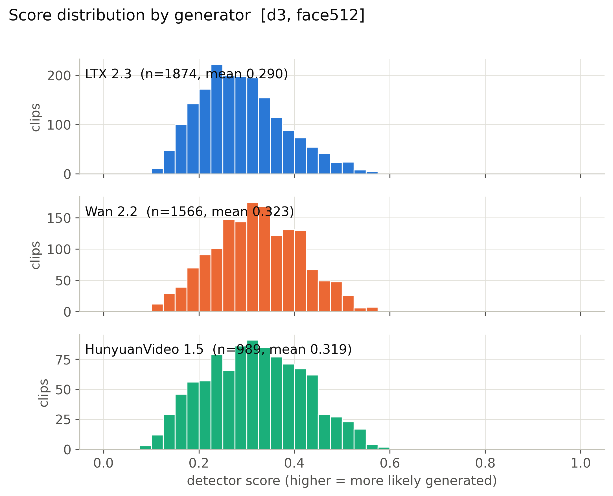

**Mean score, 56 cells x generator.** (`figures/heatmap_mean_score_cells.pdf`)

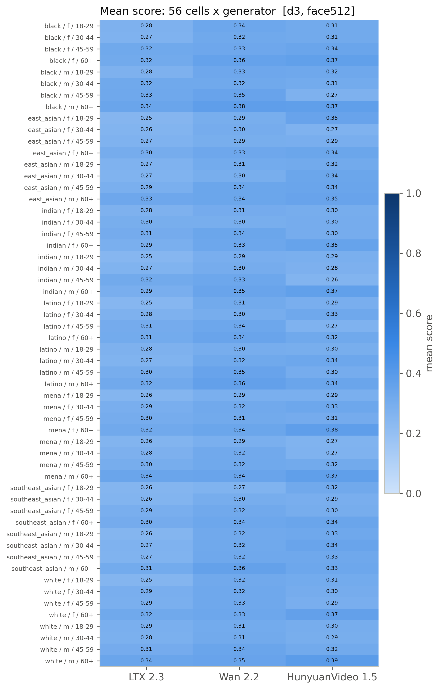

**Detection rate, 56 cells x generator (provisional threshold).** (`figures/heatmap_detection_rate_cells_provisional.pdf`)

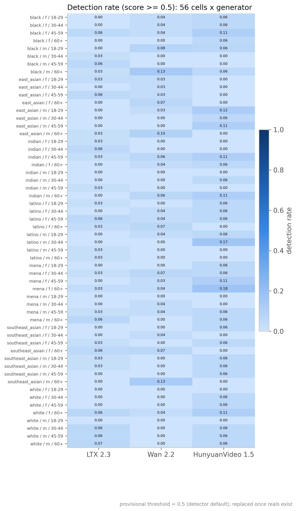

**Mean score by race, gender, age band with 95% CI.** (`figures/subgroup_mean_score.pdf`)

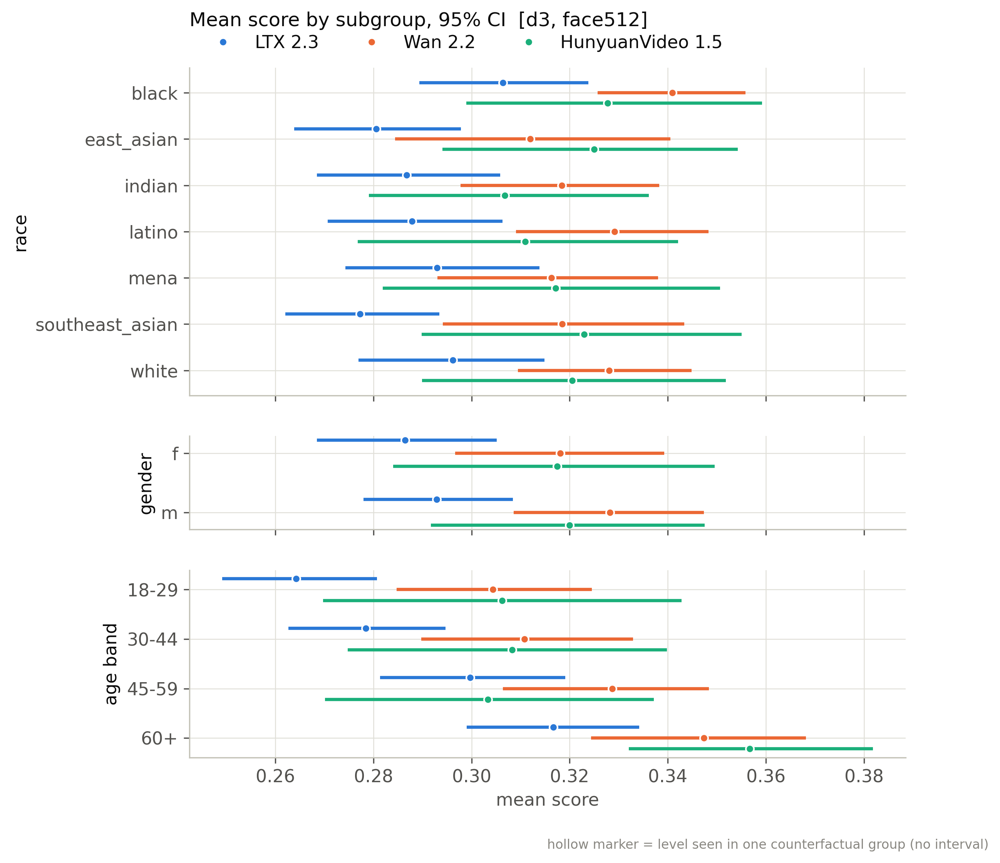

**Mean score by scene factor with 95% CI.** (`figures/scene_factor_mean_score.pdf`)

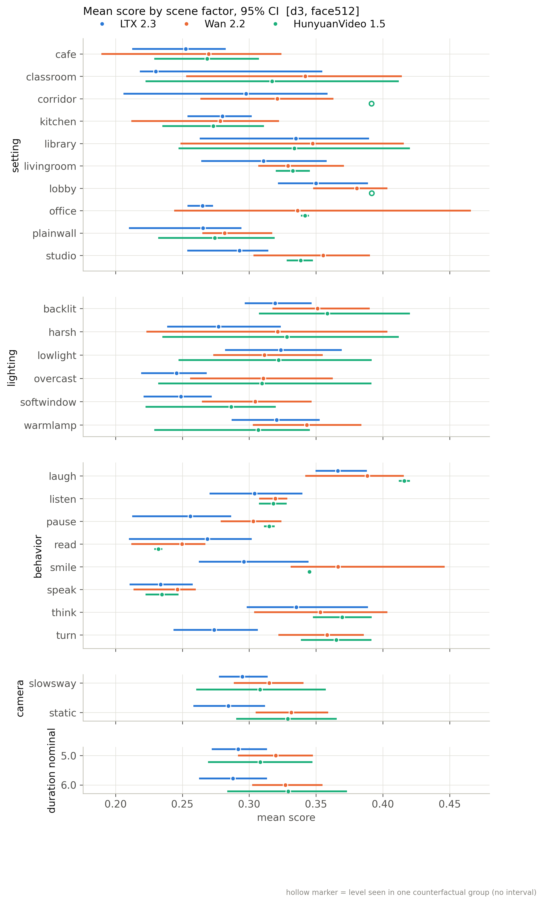

**Detection rate by subgroup (provisional threshold).** (`figures/subgroup_detection_rate_provisional.pdf`)

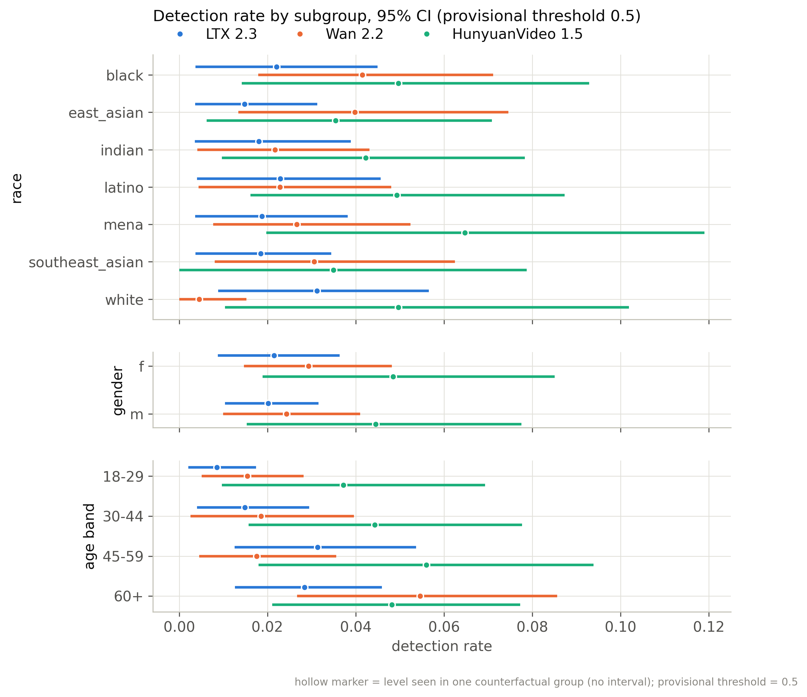

**Distribution of per-group CF spread.** (`figures/cf_spread_distribution.pdf`)

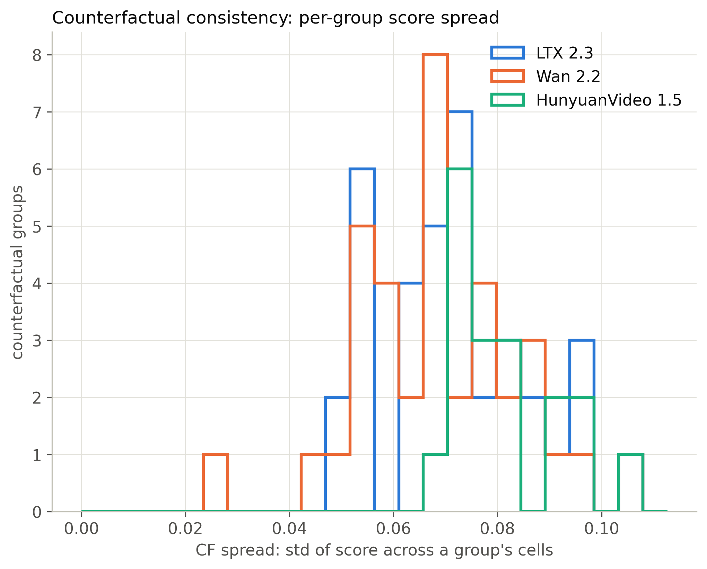

**Flip rate by generator (provisional threshold).** (`figures/flip_rate_by_generator_provisional.pdf`)

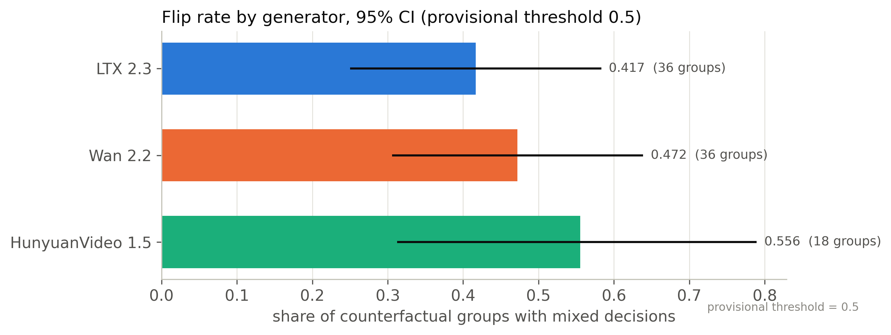

**Partial eta squared by factor.** (`figures/factor_attribution_variance_share.pdf`)

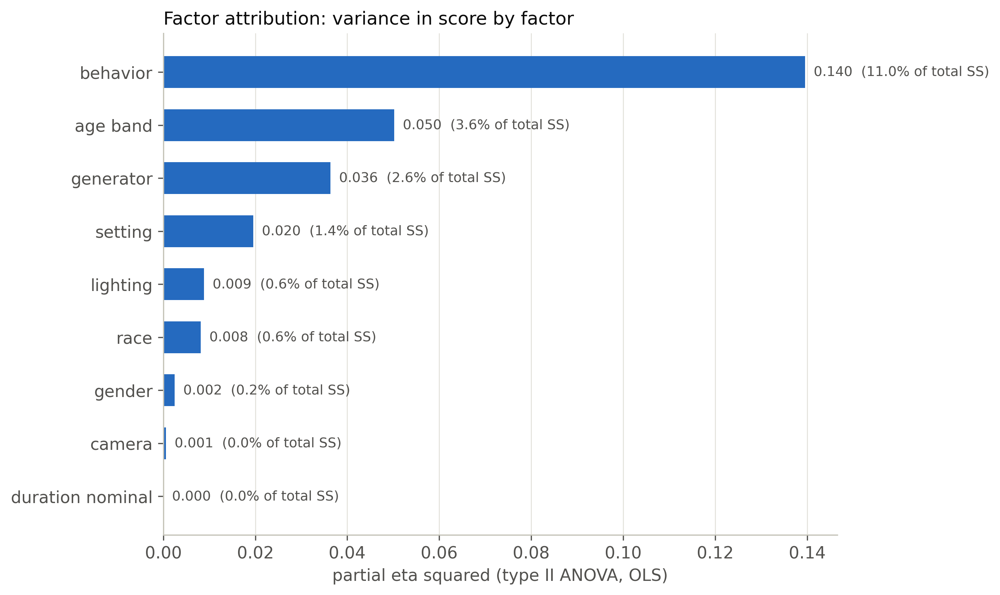

**Highest- and lowest-scoring included clips.** (`figures/example_strip.pdf`)

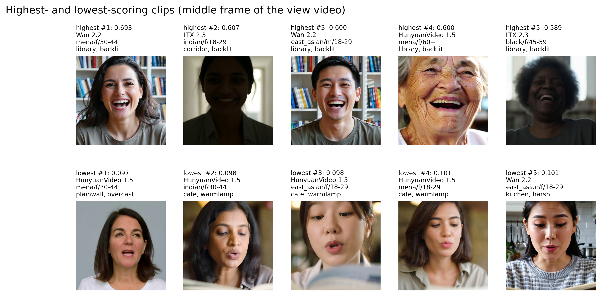

**ROC per generator against fps-matched reals.** (`figures/roc_per_generator.pdf`)

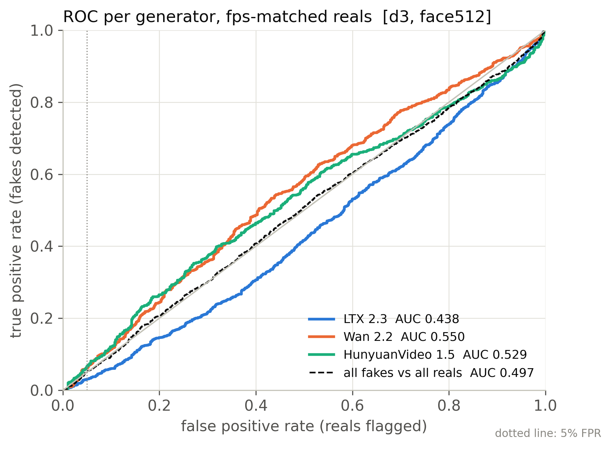

**Real FPR by perceived subgroup at the calibrated threshold.** (`figures/real_fpr_by_subgroup.pdf`)

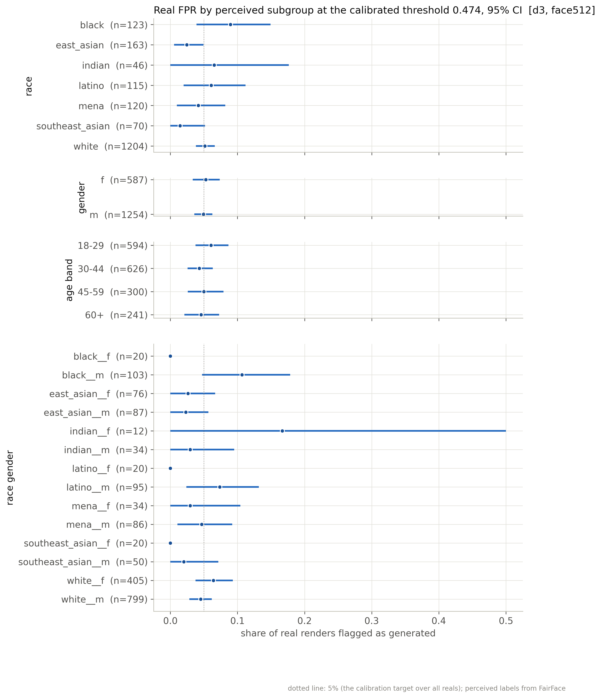

**AUC by subgroup: each subgroup's fakes vs same-subgroup reals.** (`figures/subgroup_auc.pdf`)

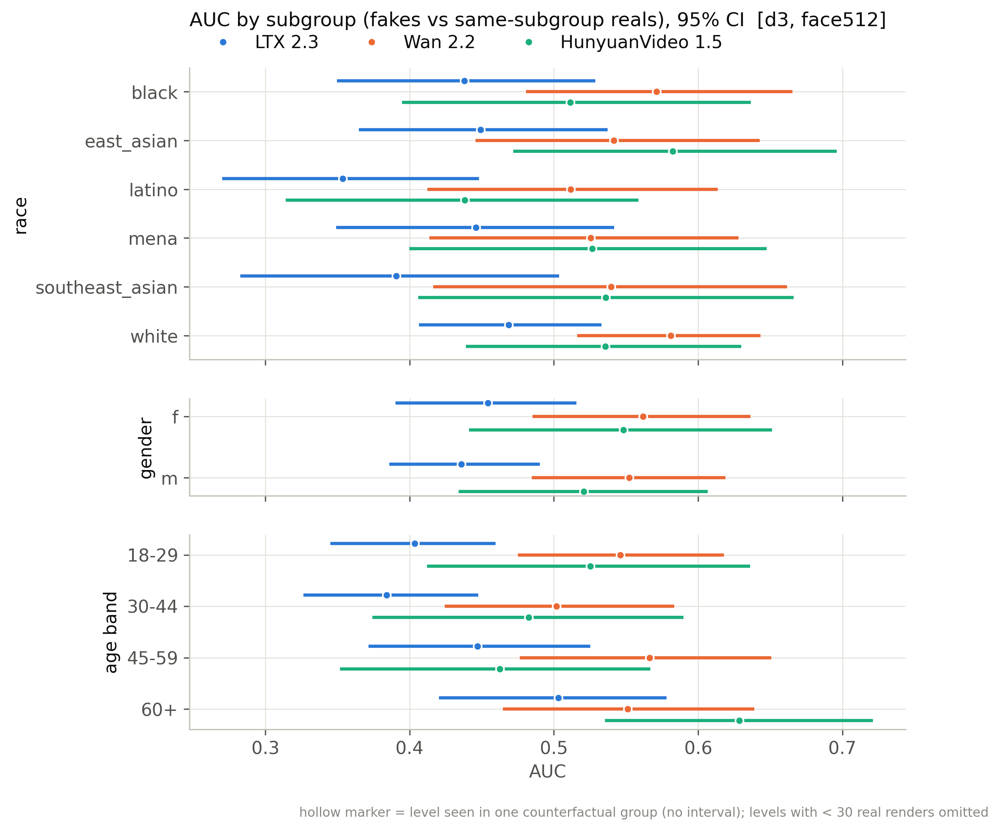

## Files

`manifest_used.csv` (every clip of the active batches with render/score/inclusion flags), `scores.csv` (score per scored clip), `tables/*.csv`, `figures/*`, `snapshot_meta.json`.

