# d3 / face512_2s: snapshot 20261023-0246

> **Detector training data.** D3 is training-free: a statistic of frozen X-CLIP-B/16 features, no detector weights. Its score is 1/(1+std) of the second-order feature; only rank metrics and the calibrated threshold are meaningful, the provisional 0.5 threshold is not.

> **Provisional threshold.** Every detection rate and flip rate below uses the detector's default threshold (0.5; none official (training-free statistic); 0.5 on 1/(1+std) is arbitrary - use the calibrated threshold). They will be replaced by the 5%-real-FPR threshold once reals exist (section 6.3).

## Settings

| setting           | value                                                                                  |
|:------------------|:---------------------------------------------------------------------------------------|
| detector          | d3 1+efab2602                                                                          |
| checkpoint_sha256 | b5db836d57b7e22001cb2bab581719e910b4c571d926fe839b5d07bc0ba2d03e                       |
| view              | face512_2s (view_hash 92b6f25d9ce9e5f4)                                                |
| ffmpeg            | ffmpeg version 7.1.1 Copyright (c) 2000-2025 the FFmpeg developers                     |
| batches           | fake_b1, fake_b2, fake_b3, real_all                                                    |
| inclusion set     | primary (technical QC pass AND face QC pass)                                           |
| bootstrap         | 1000 resamples of whole counterfactual groups, seed 20261020, 95% percentile intervals |
| git commit        | 2949de581861-dirty                                                                     |
| created           | 2026-10-23T02:46:25Z                                                                   |

Detector preprocessing on top of the view:

| field       | value                                                                                                           |
|:------------|:----------------------------------------------------------------------------------------------------------------|
| source      | Zig-HS/D3@c798fbc57fe0c4198d63a73732c2c0f9e4b4816c utils/video2frame.py + data/datasets.py + models/D3_model.py |
| frames      | ffmpeg -t 3 -vf fps=8 -> JPEG (ffmpeg default mjpeg), from view start                                           |
| frames_used | first 16 (8 if 8-15 available)                                                                                  |
| channels    | BGR (cv2.imread, as in the official dataset)                                                                    |
| crop        | centre, trim 10% each side of the longer dimension                                                              |
| resize      | [224, 224, 'cv2.INTER_LINEAR']                                                                                  |
| normalize   | {'mean': [0.485, 0.456, 0.406], 'std': [0.229, 0.224, 0.225], 'max_pixel_value': 255}                           |
| encoder     | microsoft/xclip-base-patch16@d6184e3fd8780d04c85d0f1eabe5f94bf44d98f6 vision tower, pooler_output               |
| statistic   | std of first differences of consecutive-frame L2 distances (loss l2)                                            |
| score       | 1 / (1 + std)                                                                                                   |
| precision   | fp32, TF32 off                                                                                                  |

## Coverage

| batch    | generator   |   clips |   primary |   rendered |   view_excluded |   render_failed |   scored |   score_failed |   included |
|:---------|:------------|--------:|----------:|-----------:|----------------:|----------------:|---------:|---------------:|-----------:|
| fake_b1  | hunyuan15   |     504 |       492 |        504 |               0 |               0 |      504 |              0 |        492 |
| fake_b1  | ltx23       |    2016 |      1878 |       2005 |              11 |               0 |     2005 |              0 |       1867 |
| fake_b1  | wan22       |    2016 |      1566 |       2016 |               0 |               0 |     2016 |              0 |       1566 |
| fake_b2  | hunyuan15   |     504 |       497 |        504 |               0 |               0 |      504 |              0 |        497 |
| fake_b3  | ltx25       |    2016 |      2002 |       2016 |               0 |               0 |     2016 |              0 |       2002 |
| real_all | real        |    2221 |      2221 |       2206 |              15 |               0 |     2206 |              0 |       2206 |

face512 window placement (fixed window at the median YuNet face centre, shifted inward at frame edges). The scaled frame is exactly 512 px on its short side, so every window spans it fully and is "shifted" on that axis by construction; the long-axis count is the informative one.

|   rendered |   shifted_long_axis |   shifted_short_axis |   max_shift_long_px |   excluded_no_face |
|-----------:|--------------------:|---------------------:|--------------------:|-------------------:|
|      11457 |                 439 |                11403 |                 203 |                 41 |

Reals scored: 4412. Fakes included: 6424 of 11457 scored (0 scoring failures).

## Observations

- LTX 2.3: mean score 0.291 [0.276, 0.307], median 0.284, n = 1867.
- Wan 2.2: mean score 0.323 [0.303, 0.343], median 0.325, n = 1566.
- HunyuanVideo 1.5: mean score 0.318 [0.289, 0.348], median 0.314, n = 989.
- LTX 2.5: mean score 0.259 [0.244, 0.275], median 0.248, n = 2002.
- Provisional detection rate (score >= 0.5), LTX 2.3: 2.0% [1.0, 3.0].
- Provisional detection rate (score >= 0.5), Wan 2.2: 2.9% [1.3, 4.7].
- Provisional detection rate (score >= 0.5), HunyuanVideo 1.5: 3.7% [1.7, 6.0].
- Provisional detection rate (score >= 0.5), LTX 2.5: 0.4% [0.2, 0.7].
- Provisional detection rate (score >= 0.5), all: 2.0% [1.2, 2.9].
- Largest race score gap: LTX 2.5 0.039 [0.030, 0.050] (black 0.288 vs east_asian 0.249).
- Largest gender score gap: Wan 2.2 0.010 [0.001, 0.021] (m 0.328 vs f 0.318).
- Largest age band score gap: HunyuanVideo 1.5 0.054 [0.036, 0.078] (60+ 0.356 vs 45-59 0.303).
- Largest cell score gap: HunyuanVideo 1.5 0.136 [0.124, 0.209] (mena__m__60+ 0.389 vs latino__f__45-59 0.253).
- Largest scene-factor gap (all generators): behavior 0.149 [0.124, 0.167] (laugh vs speak).
- Largest partial eta squared: behavior 0.154, generator 0.107, age_band 0.047; residual holds 64.7% of total SS.
- CF spread, LTX 2.3: 0.074 [0.070, 0.079] over 36 groups (max 0.101).
- CF spread, Wan 2.2: 0.069 [0.064, 0.073] over 36 groups (max 0.101).
- CF spread, HunyuanVideo 1.5: 0.081 [0.077, 0.087] over 18 groups (max 0.112).
- CF spread, LTX 2.5: 0.061 [0.057, 0.065] over 36 groups (max 0.093).
- Provisional flip rate, LTX 2.3: 44.4% of 36 groups [27.8, 61.1].
- Provisional flip rate, Wan 2.2: 44.4% of 36 groups [27.8, 61.1].
- Provisional flip rate, HunyuanVideo 1.5: 61.1% of 18 groups [38.9, 82.4].
- Provisional flip rate, LTX 2.5: 22.2% of 36 groups [8.3, 36.1].

## 6.1 Fakes only, no threshold

### Mean score by generator

| generator   |    n |   n_groups |   estimate |   ci_lo |   ci_hi |    sd |   median |   q05 |   q95 |
|:------------|-----:|-----------:|-----------:|--------:|--------:|------:|---------:|------:|------:|
| ltx23       | 1867 |         36 |      0.291 |   0.276 |   0.307 | 0.09  |    0.284 | 0.161 | 0.455 |
| wan22       | 1566 |         36 |      0.323 |   0.303 |   0.343 | 0.093 |    0.325 | 0.17  | 0.475 |
| hunyuan15   |  989 |         18 |      0.318 |   0.289 |   0.348 | 0.102 |    0.314 | 0.155 | 0.487 |
| ltx25       | 2002 |         36 |      0.259 |   0.244 |   0.275 | 0.079 |    0.248 | 0.144 | 0.402 |
| all         | 6424 |         36 |      0.293 |   0.278 |   0.308 | 0.093 |    0.285 | 0.156 | 0.46  |

### Mean score by race

| generator   | level           |   n |   estimate |   ci_lo |   ci_hi |   median |
|:------------|:----------------|----:|-----------:|--------:|--------:|---------:|
| ltx23       | black           | 270 |      0.309 |   0.291 |   0.326 |    0.302 |
| ltx23       | east_asian      | 270 |      0.279 |   0.261 |   0.298 |    0.26  |
| ltx23       | indian          | 276 |      0.293 |   0.274 |   0.313 |    0.289 |
| ltx23       | latino          | 261 |      0.286 |   0.269 |   0.304 |    0.273 |
| ltx23       | mena            | 266 |      0.294 |   0.277 |   0.313 |    0.293 |
| ltx23       | southeast_asian | 271 |      0.278 |   0.262 |   0.295 |    0.274 |
| ltx23       | white           | 253 |      0.297 |   0.28  |   0.314 |    0.287 |
| wan22       | black           | 217 |      0.344 |   0.326 |   0.361 |    0.348 |
| wan22       | east_asian      | 226 |      0.312 |   0.287 |   0.339 |    0.316 |
| wan22       | indian          | 230 |      0.322 |   0.3   |   0.343 |    0.326 |
| wan22       | latino          | 219 |      0.328 |   0.307 |   0.348 |    0.324 |
| wan22       | mena            | 225 |      0.313 |   0.291 |   0.333 |    0.318 |
| wan22       | southeast_asian | 229 |      0.32  |   0.295 |   0.346 |    0.314 |
| wan22       | white           | 220 |      0.326 |   0.306 |   0.343 |    0.324 |
| hunyuan15   | black           | 141 |      0.329 |   0.296 |   0.363 |    0.327 |
| hunyuan15   | east_asian      | 141 |      0.322 |   0.288 |   0.353 |    0.329 |
| hunyuan15   | indian          | 142 |      0.307 |   0.282 |   0.332 |    0.308 |
| hunyuan15   | latino          | 142 |      0.309 |   0.278 |   0.34  |    0.296 |
| hunyuan15   | mena            | 139 |      0.317 |   0.282 |   0.35  |    0.324 |
| hunyuan15   | southeast_asian | 143 |      0.319 |   0.285 |   0.351 |    0.313 |
| hunyuan15   | white           | 141 |      0.324 |   0.294 |   0.356 |    0.318 |
| ltx25       | black           | 287 |      0.288 |   0.271 |   0.304 |    0.286 |
| ltx25       | east_asian      | 286 |      0.249 |   0.232 |   0.267 |    0.243 |
| ltx25       | indian          | 284 |      0.256 |   0.238 |   0.273 |    0.246 |
| ltx25       | latino          | 286 |      0.256 |   0.241 |   0.273 |    0.248 |
| ltx25       | mena            | 286 |      0.255 |   0.239 |   0.272 |    0.237 |
| ltx25       | southeast_asian | 286 |      0.25  |   0.233 |   0.266 |    0.24  |
| ltx25       | white           | 287 |      0.258 |   0.242 |   0.274 |    0.247 |
| all         | black           | 915 |      0.314 |   0.299 |   0.327 |    0.308 |
| all         | east_asian      | 923 |      0.285 |   0.267 |   0.302 |    0.273 |
| all         | indian          | 932 |      0.291 |   0.276 |   0.306 |    0.284 |
| all         | latino          | 908 |      0.29  |   0.275 |   0.306 |    0.279 |
| all         | mena            | 916 |      0.29  |   0.274 |   0.306 |    0.281 |
| all         | southeast_asian | 929 |      0.286 |   0.269 |   0.303 |    0.275 |
| all         | white           | 901 |      0.296 |   0.281 |   0.31  |    0.286 |

### Mean score by gender

| generator   | level   |    n |   estimate |   ci_lo |   ci_hi |   median |
|:------------|:--------|-----:|-----------:|--------:|--------:|---------:|
| ltx23       | f       |  931 |      0.288 |   0.27  |   0.305 |    0.283 |
| ltx23       | m       |  936 |      0.294 |   0.279 |   0.309 |    0.285 |
| wan22       | f       |  785 |      0.318 |   0.297 |   0.34  |    0.319 |
| wan22       | m       |  781 |      0.328 |   0.307 |   0.348 |    0.328 |
| hunyuan15   | f       |  495 |      0.314 |   0.284 |   0.345 |    0.311 |
| hunyuan15   | m       |  494 |      0.322 |   0.294 |   0.351 |    0.32  |
| ltx25       | f       |  999 |      0.255 |   0.24  |   0.273 |    0.245 |
| ltx25       | m       | 1003 |      0.262 |   0.246 |   0.278 |    0.253 |
| all         | f       | 3210 |      0.289 |   0.273 |   0.306 |    0.281 |
| all         | m       | 3214 |      0.297 |   0.282 |   0.311 |    0.289 |

### Mean score by age band

| generator   | level   |    n |   estimate |   ci_lo |   ci_hi |   median |
|:------------|:--------|-----:|-----------:|--------:|--------:|---------:|
| ltx23       | 18-29   |  464 |      0.267 |   0.25  |   0.285 |    0.253 |
| ltx23       | 30-44   |  469 |      0.28  |   0.265 |   0.296 |    0.269 |
| ltx23       | 45-59   |  477 |      0.301 |   0.284 |   0.319 |    0.295 |
| ltx23       | 60+     |  457 |      0.316 |   0.298 |   0.334 |    0.315 |
| wan22       | 18-29   |  388 |      0.307 |   0.289 |   0.327 |    0.31  |
| wan22       | 30-44   |  377 |      0.309 |   0.288 |   0.33  |    0.311 |
| wan22       | 45-59   |  398 |      0.33  |   0.305 |   0.352 |    0.328 |
| wan22       | 60+     |  403 |      0.346 |   0.322 |   0.367 |    0.348 |
| hunyuan15   | 18-29   |  242 |      0.306 |   0.271 |   0.342 |    0.296 |
| hunyuan15   | 30-44   |  248 |      0.308 |   0.277 |   0.339 |    0.299 |
| hunyuan15   | 45-59   |  250 |      0.303 |   0.269 |   0.336 |    0.289 |
| hunyuan15   | 60+     |  249 |      0.356 |   0.331 |   0.379 |    0.351 |
| ltx25       | 18-29   |  500 |      0.245 |   0.228 |   0.262 |    0.229 |
| ltx25       | 30-44   |  497 |      0.248 |   0.231 |   0.265 |    0.238 |
| ltx25       | 45-59   |  501 |      0.259 |   0.241 |   0.277 |    0.249 |
| ltx25       | 60+     |  504 |      0.285 |   0.269 |   0.301 |    0.275 |
| all         | 18-29   | 1594 |      0.276 |   0.261 |   0.291 |    0.261 |
| all         | 30-44   | 1591 |      0.281 |   0.265 |   0.297 |    0.271 |
| all         | 45-59   | 1626 |      0.295 |   0.278 |   0.312 |    0.286 |
| all         | 60+     | 1613 |      0.32  |   0.305 |   0.333 |    0.316 |

### Mean score by scene factor (all generators pooled)

| factor           | level      |    n |   estimate |   ci_lo |   ci_hi |
|:-----------------|:-----------|-----:|-----------:|--------:|--------:|
| setting          | cafe       |  590 |      0.255 |   0.199 |   0.283 |
| setting          | classroom  |  541 |      0.294 |   0.218 |   0.384 |
| setting          | corridor   |  716 |      0.298 |   0.212 |   0.347 |
| setting          | kitchen    |  603 |      0.264 |   0.241 |   0.28  |
| setting          | library    |  755 |      0.318 |   0.231 |   0.373 |
| setting          | livingroom |  753 |      0.3   |   0.284 |   0.323 |
| setting          | lobby      |  513 |      0.34  |   0.333 |   0.345 |
| setting          | office     |  580 |      0.279 |   0.227 |   0.302 |
| setting          | plainwall  |  777 |      0.263 |   0.227 |   0.288 |
| setting          | studio     |  596 |      0.325 |   0.307 |   0.343 |
| lighting         | backlit    | 1118 |      0.325 |   0.289 |   0.356 |
| lighting         | harsh      |  967 |      0.293 |   0.249 |   0.345 |
| lighting         | lowlight   | 1113 |      0.298 |   0.255 |   0.34  |
| lighting         | overcast   | 1022 |      0.272 |   0.234 |   0.302 |
| lighting         | softwindow | 1157 |      0.268 |   0.229 |   0.301 |
| lighting         | warmlamp   | 1047 |      0.303 |   0.277 |   0.323 |
| behavior         | laugh      |  721 |      0.369 |   0.347 |   0.383 |
| behavior         | listen     |  956 |      0.297 |   0.285 |   0.307 |
| behavior         | pause      |  744 |      0.279 |   0.263 |   0.286 |
| behavior         | read       |  796 |      0.244 |   0.227 |   0.266 |
| behavior         | smile      |  817 |      0.309 |   0.291 |   0.324 |
| behavior         | speak      |  806 |      0.22  |   0.208 |   0.229 |
| behavior         | think      |  730 |      0.329 |   0.283 |   0.345 |
| behavior         | turn       |  854 |      0.306 |   0.287 |   0.326 |
| camera           | slowsway   | 3217 |      0.292 |   0.271 |   0.313 |
| camera           | static     | 3207 |      0.294 |   0.272 |   0.315 |
| duration_nominal | 5.0        | 3222 |      0.293 |   0.272 |   0.314 |
| duration_nominal | 6.0        | 3202 |      0.293 |   0.27  |   0.316 |

Per-generator scene-factor and 56-cell rows: `tables/score_by_breakdown.csv`.

### Subgroup gap (max - min of level means)

A gap is max - min, so it is never negative and its interval cannot include 0; it is a size, not a test of a difference. Over many levels with few clips each (56 cells; HunyuanVideo has 9 groups per cell) the gap also grows with noise, so compare it with the per-level intervals in `tables/score_by_breakdown.csv`. Levels seen in a single counterfactual group have no interval.

| generator   | attribute        |   n_levels |   gap |   ci_lo |   ci_hi | max_level      | min_level                 |
|:------------|:-----------------|-----------:|------:|--------:|--------:|:---------------|:--------------------------|
| ltx23       | race             |          7 | 0.031 |   0.019 |   0.049 | black          | southeast_asian           |
| ltx23       | gender           |          2 | 0.006 |   0     |   0.015 | m              | f                         |
| ltx23       | age_band         |          4 | 0.05  |   0.032 |   0.066 | 60+            | 18-29                     |
| ltx23       | cell             |         56 | 0.101 |   0.099 |   0.15  | black__m__60+  | latino__f__18-29          |
| ltx23       | setting          |         10 | 0.11  |   0.088 |   0.166 | lobby          | classroom                 |
| ltx23       | lighting         |          6 | 0.075 |   0.062 |   0.135 | warmlamp       | overcast                  |
| ltx23       | behavior         |          8 | 0.13  |   0.101 |   0.169 | laugh          | speak                     |
| ltx23       | camera           |          2 | 0.012 |   0.001 |   0.044 | slowsway       | static                    |
| ltx23       | duration_nominal |          2 | 0.009 |   0.001 |   0.04  | 5.0            | 6.0                       |
| wan22       | race             |          7 | 0.031 |   0.021 |   0.05  | black          | east_asian                |
| wan22       | gender           |          2 | 0.01  |   0.001 |   0.021 | m              | f                         |
| wan22       | age_band         |          4 | 0.038 |   0.025 |   0.053 | 60+            | 18-29                     |
| wan22       | cell             |         56 | 0.106 |   0.095 |   0.151 | latino__m__60+ | mena__m__18-29            |
| wan22       | setting          |         10 | 0.112 |   0.096 |   0.261 | lobby          | cafe                      |
| wan22       | lighting         |          6 | 0.051 |   0.042 |   0.143 | backlit        | softwindow                |
| wan22       | behavior         |          8 | 0.143 |   0.122 |   0.241 | laugh          | speak                     |
| wan22       | camera           |          2 | 0.017 |   0.001 |   0.054 | static         | slowsway                  |
| wan22       | duration_nominal |          2 | 0.008 |   0.001 |   0.05  | 6.0            | 5.0                       |
| hunyuan15   | race             |          7 | 0.022 |   0.015 |   0.045 | black          | indian                    |
| hunyuan15   | gender           |          2 | 0.008 |   0     |   0.018 | m              | f                         |
| hunyuan15   | age_band         |          4 | 0.054 |   0.036 |   0.078 | 60+            | 45-59                     |
| hunyuan15   | cell             |         56 | 0.136 |   0.124 |   0.209 | mena__m__60+   | latino__f__45-59          |
| hunyuan15   | setting          |         10 | 0.123 |   0.089 |   0.194 | lobby          | cafe                      |
| hunyuan15   | lighting         |          6 | 0.069 |   0.047 |   0.185 | backlit        | softwindow                |
| hunyuan15   | behavior         |          8 | 0.182 |   0.128 |   0.194 | laugh          | read                      |
| hunyuan15   | camera           |          2 | 0.02  |   0.001 |   0.076 | static         | slowsway                  |
| hunyuan15   | duration_nominal |          2 | 0.022 |   0.001 |   0.08  | 6.0            | 5.0                       |
| ltx25       | race             |          7 | 0.039 |   0.03  |   0.05  | black          | east_asian                |
| ltx25       | gender           |          2 | 0.007 |   0     |   0.017 | m              | f                         |
| ltx25       | age_band         |          4 | 0.04  |   0.027 |   0.053 | 60+            | 18-29                     |
| ltx25       | cell             |         56 | 0.091 |   0.083 |   0.129 | white__m__60+  | southeast_asian__m__18-29 |
| ltx25       | setting          |         10 | 0.09  |   0.074 |   0.159 | studio         | kitchen                   |
| ltx25       | lighting         |          6 | 0.051 |   0.031 |   0.122 | backlit        | softwindow                |
| ltx25       | behavior         |          8 | 0.149 |   0.121 |   0.174 | laugh          | speak                     |
| ltx25       | camera           |          2 | 0.006 |   0     |   0.039 | slowsway       | static                    |
| ltx25       | duration_nominal |          2 | 0.005 |   0     |   0.039 | 5.0            | 6.0                       |
| all         | race             |          7 | 0.029 |   0.023 |   0.036 | black          | east_asian                |
| all         | gender           |          2 | 0.007 |   0.002 |   0.013 | m              | f                         |
| all         | age_band         |          4 | 0.044 |   0.036 |   0.053 | 60+            | 18-29                     |
| all         | cell             |         56 | 0.087 |   0.077 |   0.108 | black__m__60+  | mena__m__18-29            |
| all         | setting          |         10 | 0.085 |   0.074 |   0.153 | lobby          | cafe                      |
| all         | lighting         |          6 | 0.057 |   0.037 |   0.115 | backlit        | softwindow                |
| all         | behavior         |          8 | 0.149 |   0.124 |   0.167 | laugh          | speak                     |
| all         | camera           |          2 | 0.002 |   0.001 |   0.034 | static         | slowsway                  |
| all         | duration_nominal |          2 | 0     |   0.001 |   0.033 | 5.0            | 6.0                       |

### CF spread (mean over groups of the std of score across the group's cells)

| generator   |   n_groups |   cf_spread |   ci_lo |   ci_hi |   median |   max |
|:------------|-----------:|------------:|--------:|--------:|---------:|------:|
| ltx23       |         36 |       0.074 |   0.07  |   0.079 |    0.073 | 0.101 |
| wan22       |         36 |       0.069 |   0.064 |   0.073 |    0.067 | 0.101 |
| hunyuan15   |         18 |       0.081 |   0.077 |   0.087 |    0.079 | 0.112 |
| ltx25       |         36 |       0.061 |   0.057 |   0.065 |    0.057 | 0.093 |

### Factor attribution

OLS with every factor as a fixed effect, type-II ANOVA. `ss_share` is the factor's type-II sum of squares over the total sum of squares (type-II shares need not add to 1). Scene factors are constant within a counterfactual group, so their effects are estimated from between-group differences only. The OLS F tests treat clips as independent although clips are clustered in counterfactual groups, so their p values are optimistic; use the group-bootstrap intervals above for inference.

| factor           |   df |     sum_sq | F       | p          | partial_eta2   |   ss_share |
|:-----------------|-----:|-----------:|:--------|:-----------|:---------------|-----------:|
| race             |    6 |  0.5256    | 15.53   | 8.994e-18  | 0.01438        |  0.009444  |
| gender           |    1 |  0.11      | 19.5    | 1.022e-05  | 0.003044       |  0.001976  |
| age_band         |    3 |  1.792     | 105.9   | 6.27e-67   | 0.0474         |  0.03221   |
| setting          |    9 |  0.6838    | 13.47   | 1.237e-21  | 0.01863        |  0.01229   |
| lighting         |    5 |  0.1419    | 5.031   | 0.0001327  | 0.003923       |  0.002549  |
| behavior         |    7 |  6.566     | 166.3   | 9.648e-227 | 0.1542         |  0.118     |
| camera           |    1 |  0.0002755 | 0.04885 | 0.8251     | 7.648e-06      |  4.951e-06 |
| duration_nominal |    1 |  0.03928   | 6.964   | 0.008335   | 0.001089       |  0.0007058 |
| generator        |    3 |  4.296     | 253.9   | 1.143e-155 | 0.1066         |  0.0772    |
| Residual         | 6387 | 36.02      |         |            |                |  0.6473    |

Lighting x race interaction (added to the same OLS):

| term            |   df |   sum_sq |     F |      p |   partial_eta2 |
|:----------------|-----:|---------:|------:|-------:|---------------:|
| lighting x race |   30 |   0.1839 | 1.087 | 0.3397 |       0.005106 |

Mixed model `score ~ factors + (1 | counterfactual_group)` (REML) variance components (fixed effects: `tables/factor_mixed_fixed.csv`):

| component                               |   variance | converged   |
|:----------------------------------------|-----------:|:------------|
| counterfactual_group (random intercept) |  0.0001792 | True        |
| residual                                |  0.00558   | True        |
| ICC (group share of random variance)    |  0.03112   | True        |

A group variance at or near 0 is a boundary estimate: setting, lighting, behavior, camera and duration are fixed per group and absorb most between-group variation, leaving little for the random intercept. It does not mean scenes do not matter.

## 6.2 Provisional (threshold 0.5, provisional)

### Detection rate by generator (provisional)

| generator   |    n |   estimate |   ci_lo |   ci_hi |
|:------------|-----:|-----------:|--------:|--------:|
| ltx23       | 1867 |      0.02  |   0.01  |   0.03  |
| wan22       | 1566 |      0.029 |   0.013 |   0.047 |
| hunyuan15   |  989 |      0.037 |   0.017 |   0.06  |
| ltx25       | 2002 |      0.004 |   0.002 |   0.007 |
| all         | 6424 |      0.02  |   0.012 |   0.029 |

### Detection rate by race (provisional)

| generator   | level           |   n |   estimate |   ci_lo |   ci_hi |
|:------------|:----------------|----:|-----------:|--------:|--------:|
| ltx23       | black           | 270 |      0.03  |   0.007 |   0.056 |
| ltx23       | east_asian      | 270 |      0.019 |   0.004 |   0.039 |
| ltx23       | indian          | 276 |      0.029 |   0.007 |   0.054 |
| ltx23       | latino          | 261 |      0.011 |   0     |   0.025 |
| ltx23       | mena            | 266 |      0.015 |   0     |   0.038 |
| ltx23       | southeast_asian | 271 |      0.007 |   0     |   0.023 |
| ltx23       | white           | 253 |      0.028 |   0.011 |   0.047 |
| wan22       | black           | 217 |      0.028 |   0.009 |   0.049 |
| wan22       | east_asian      | 226 |      0.022 |   0     |   0.056 |
| wan22       | indian          | 230 |      0.03  |   0.008 |   0.058 |
| wan22       | latino          | 219 |      0.023 |   0.004 |   0.045 |
| wan22       | mena            | 225 |      0.027 |   0.004 |   0.051 |
| wan22       | southeast_asian | 229 |      0.052 |   0.021 |   0.091 |
| wan22       | white           | 220 |      0.023 |   0.005 |   0.042 |
| hunyuan15   | black           | 141 |      0.028 |   0     |   0.061 |
| hunyuan15   | east_asian      | 141 |      0.043 |   0.008 |   0.082 |
| hunyuan15   | indian          | 142 |      0.028 |   0.007 |   0.056 |
| hunyuan15   | latino          | 142 |      0.021 |   0     |   0.047 |
| hunyuan15   | mena            | 139 |      0.05  |   0.01  |   0.093 |
| hunyuan15   | southeast_asian | 143 |      0.021 |   0     |   0.045 |
| hunyuan15   | white           | 141 |      0.071 |   0.017 |   0.139 |
| ltx25       | black           | 287 |      0.007 |   0     |   0.017 |
| ltx25       | east_asian      | 286 |      0     |   0     |   0     |
| ltx25       | indian          | 284 |      0.004 |   0     |   0.011 |
| ltx25       | latino          | 286 |      0.003 |   0     |   0.011 |
| ltx25       | mena            | 286 |      0.003 |   0     |   0.011 |
| ltx25       | southeast_asian | 286 |      0.003 |   0     |   0.011 |
| ltx25       | white           | 287 |      0.01  |   0     |   0.024 |
| all         | black           | 915 |      0.022 |   0.01  |   0.035 |
| all         | east_asian      | 923 |      0.017 |   0.005 |   0.035 |
| all         | indian          | 932 |      0.021 |   0.011 |   0.033 |
| all         | latino          | 908 |      0.013 |   0.005 |   0.022 |
| all         | mena            | 916 |      0.02  |   0.008 |   0.032 |
| all         | southeast_asian | 929 |      0.019 |   0.01  |   0.031 |
| all         | white           | 901 |      0.028 |   0.015 |   0.043 |

### Detection rate by gender (provisional)

| generator   | level   |    n |   estimate |   ci_lo |   ci_hi |
|:------------|:--------|-----:|-----------:|--------:|--------:|
| ltx23       | f       |  931 |      0.018 |   0.006 |   0.033 |
| ltx23       | m       |  936 |      0.021 |   0.01  |   0.035 |
| wan22       | f       |  785 |      0.031 |   0.011 |   0.052 |
| wan22       | m       |  781 |      0.028 |   0.013 |   0.044 |
| hunyuan15   | f       |  495 |      0.034 |   0.014 |   0.058 |
| hunyuan15   | m       |  494 |      0.04  |   0.018 |   0.065 |
| ltx25       | f       |  999 |      0.005 |   0.001 |   0.011 |
| ltx25       | m       | 1003 |      0.004 |   0.001 |   0.008 |
| all         | f       | 3210 |      0.02  |   0.01  |   0.032 |
| all         | m       | 3214 |      0.021 |   0.013 |   0.028 |

### Detection rate by age band (provisional)

| generator   | level   |    n |   estimate |   ci_lo |   ci_hi |
|:------------|:--------|-----:|-----------:|--------:|--------:|
| ltx23       | 18-29   |  464 |      0.013 |   0.002 |   0.027 |
| ltx23       | 30-44   |  469 |      0.021 |   0.008 |   0.038 |
| ltx23       | 45-59   |  477 |      0.027 |   0.012 |   0.045 |
| ltx23       | 60+     |  457 |      0.018 |   0.007 |   0.03  |
| wan22       | 18-29   |  388 |      0.018 |   0.007 |   0.032 |
| wan22       | 30-44   |  377 |      0.013 |   0     |   0.033 |
| wan22       | 45-59   |  398 |      0.045 |   0.017 |   0.077 |
| wan22       | 60+     |  403 |      0.04  |   0.015 |   0.071 |
| hunyuan15   | 18-29   |  242 |      0.029 |   0.005 |   0.061 |
| hunyuan15   | 30-44   |  248 |      0.036 |   0.01  |   0.068 |
| hunyuan15   | 45-59   |  250 |      0.04  |   0.008 |   0.077 |
| hunyuan15   | 60+     |  249 |      0.044 |   0.023 |   0.068 |
| ltx25       | 18-29   |  500 |      0.008 |   0     |   0.018 |
| ltx25       | 30-44   |  497 |      0     |   0     |   0     |
| ltx25       | 45-59   |  501 |      0.006 |   0     |   0.014 |
| ltx25       | 60+     |  504 |      0.004 |   0     |   0.01  |
| all         | 18-29   | 1594 |      0.015 |   0.007 |   0.024 |
| all         | 30-44   | 1591 |      0.015 |   0.006 |   0.025 |
| all         | 45-59   | 1626 |      0.027 |   0.014 |   0.041 |
| all         | 60+     | 1613 |      0.023 |   0.015 |   0.032 |

### Detection-rate gap (provisional)

| generator   | attribute        |   gap |   ci_lo |   ci_hi | max_level               | min_level       |
|:------------|:-----------------|------:|--------:|--------:|:------------------------|:----------------|
| ltx23       | race             | 0.022 |   0.016 |   0.058 | black                   | southeast_asian |
| ltx23       | gender           | 0.003 |   0     |   0.019 | m                       | f               |
| ltx23       | age_band         | 0.014 |   0.006 |   0.033 | 45-59                   | 18-29           |
| ltx23       | cell             | 0.088 |   0.074 |   0.206 | indian__f__45-59        | black__f__18-29 |
| ltx23       | setting          | 0.048 |   0.034 |   0.111 | library                 | cafe            |
| ltx23       | lighting         | 0.039 |   0.027 |   0.086 | warmlamp                | overcast        |
| ltx23       | behavior         | 0.069 |   0.041 |   0.109 | laugh                   | pause           |
| ltx23       | camera           | 0.01  |   0.001 |   0.03  | static                  | slowsway        |
| ltx23       | duration_nominal | 0.001 |   0     |   0.024 | 6.0                     | 5.0             |
| wan22       | race             | 0.03  |   0.016 |   0.075 | southeast_asian         | east_asian      |
| wan22       | gender           | 0.002 |   0     |   0.016 | f                       | m               |
| wan22       | age_band         | 0.032 |   0.018 |   0.062 | 45-59                   | 30-44           |
| wan22       | cell             | 0.194 |   0.107 |   0.344 | southeast_asian__m__60+ | black__f__18-29 |
| wan22       | setting          | 0.2   |   0.074 |   0.545 | office                  | studio          |
| wan22       | lighting         | 0.058 |   0.035 |   0.155 | harsh                   | softwindow      |
| wan22       | behavior         | 0.094 |   0.038 |   0.429 | laugh                   | speak           |
| wan22       | camera           | 0.018 |   0.001 |   0.054 | static                  | slowsway        |
| wan22       | duration_nominal | 0.029 |   0.003 |   0.067 | 6.0                     | 5.0             |
| hunyuan15   | race             | 0.05  |   0.025 |   0.126 | white                   | southeast_asian |
| hunyuan15   | gender           | 0.006 |   0     |   0.02  | m                       | f               |
| hunyuan15   | age_band         | 0.015 |   0.008 |   0.051 | 60+                     | 18-29           |
| hunyuan15   | cell             | 0.118 |   0.125 |   0.357 | white__m__60+           | black__f__18-29 |
| hunyuan15   | setting          | 0.107 |   0.054 |   0.161 | lobby                   | cafe            |
| hunyuan15   | lighting         | 0.054 |   0.036 |   0.161 | backlit                 | warmlamp        |
| hunyuan15   | behavior         | 0.143 |   0.051 |   0.161 | laugh                   | speak           |
| hunyuan15   | camera           | 0.017 |   0.001 |   0.06  | static                  | slowsway        |
| hunyuan15   | duration_nominal | 0.018 |   0.001 |   0.065 | 6.0                     | 5.0             |
| ltx25       | race             | 0.01  |   0.007 |   0.024 | white                   | east_asian      |
| ltx25       | gender           | 0.001 |   0     |   0.008 | f                       | m               |
| ltx25       | age_band         | 0.008 |   0.004 |   0.018 | 18-29                   | 30-44           |
| ltx25       | cell             | 0.029 |   0.028 |   0.139 | white__f__18-29         | black__f__18-29 |
| ltx25       | setting          | 0.013 |   0.007 |   0.036 | library                 | cafe            |
| ltx25       | lighting         | 0.009 |   0.006 |   0.023 | lowlight                | softwindow      |
| ltx25       | behavior         | 0.018 |   0.009 |   0.032 | laugh                   | listen          |
| ltx25       | camera           | 0.001 |   0     |   0.008 | slowsway                | static          |
| ltx25       | duration_nominal | 0.001 |   0     |   0.007 | 6.0                     | 5.0             |
| all         | race             | 0.015 |   0.009 |   0.03  | white                   | latino          |
| all         | gender           | 0.001 |   0     |   0.009 | m                       | f               |
| all         | age_band         | 0.012 |   0.007 |   0.023 | 45-59                   | 18-29           |
| all         | cell             | 0.059 |   0.051 |   0.119 | southeast_asian__m__60+ | black__f__18-29 |
| all         | setting          | 0.045 |   0.034 |   0.108 | lobby                   | cafe            |
| all         | lighting         | 0.025 |   0.017 |   0.069 | backlit                 | softwindow      |
| all         | behavior         | 0.072 |   0.032 |   0.11  | laugh                   | speak           |
| all         | camera           | 0.01  |   0.001 |   0.027 | static                  | slowsway        |
| all         | duration_nominal | 0.01  |   0.001 |   0.028 | 6.0                     | 5.0             |

### Flip rate (provisional): share of groups whose clips get different decisions

| generator   |   n_groups |   flip_rate |   ci_lo |   ci_hi |   median |   max |
|:------------|-----------:|------------:|--------:|--------:|---------:|------:|
| ltx23       |         36 |       0.444 |   0.278 |   0.611 |        0 |     1 |
| wan22       |         36 |       0.444 |   0.278 |   0.611 |        0 |     1 |
| hunyuan15   |         18 |       0.611 |   0.389 |   0.824 |        1 |     1 |
| ltx25       |         36 |       0.222 |   0.083 |   0.361 |        0 |     1 |

### Sensitivity: inclusion set

| set     | generator   |    n |   mean_score |   provisional_detection_rate |
|:--------|:------------|-----:|-------------:|-----------------------------:|
| all     | hunyuan15   | 1008 |        0.319 |                        0.037 |
| all     | ltx23       | 2005 |        0.289 |                        0.018 |
| all     | ltx25       | 2016 |        0.259 |                        0.004 |
| all     | wan22       | 2016 |        0.326 |                        0.035 |
| primary | hunyuan15   |  989 |        0.318 |                        0.037 |
| primary | ltx23       | 1867 |        0.291 |                        0.02  |
| primary | ltx25       | 2002 |        0.259 |                        0.004 |
| primary | wan22       | 1566 |        0.323 |                        0.029 |

## 6.3 Real vs generated (calibrated threshold 0.4779)

The threshold is the score at which 5% of primary real renders (24 and 16 fps pooled) are flagged; one per detector and view, never per subgroup. Each generator is compared with reals rendered at its own fps. Intervals: fakes resample counterfactual groups, reals resample identity clusters (source video). Real labels are perceived (FairFace), not self-reported.

### Calibration

| scope            |   n_renders |   n_sources |   n_identities |   threshold |    fpr |
|:-----------------|------------:|------------:|---------------:|------------:|-------:|
| all real renders |        4412 |        2206 |           1809 |      0.4779 | 0.0501 |
| 16 fps renders   |        2206 |        2206 |           1809 |      0.4779 | 0.0485 |
| 24 fps renders   |        2206 |        2206 |           1809 |      0.4779 | 0.0517 |

### AUC, AP, EER, TPR at 5% FPR

| generator   | real_fps   |   n_fake |   n_real |   auc |   auc_ci_lo |   auc_ci_hi |    ap |   eer |   tpr_at_5fpr |   detection_rate_global_thr |   det_ci_lo |   det_ci_hi |
|:------------|:-----------|---------:|---------:|------:|------------:|------------:|------:|------:|--------------:|----------------------------:|------------:|------------:|
| ltx23       | 24         |     1867 |     2206 | 0.429 |       0.379 |       0.478 | 0.409 | 0.538 |         0.035 |                       0.036 |       0.021 |       0.052 |
| wan22       | 16         |     1566 |     2206 | 0.537 |       0.471 |       0.599 | 0.438 | 0.463 |         0.05  |                       0.049 |       0.026 |       0.073 |
| hunyuan15   | 24         |      989 |     2206 | 0.518 |       0.422 |       0.607 | 0.331 | 0.476 |         0.057 |                       0.058 |       0.025 |       0.094 |
| ltx25       | 24         |     2002 |     2206 | 0.327 |       0.273 |       0.379 | 0.367 | 0.627 |         0.01  |                       0.01  |       0.004 |       0.017 |
| all         | 24+16      |     6424 |     4412 | 0.437 |       0.387 |       0.485 | 0.551 | 0.536 |         0.034 |                       0.034 |       0.021 |       0.047 |

### Real FPR by perceived subgroup

| attribute   | level              |   n_renders |   n_identities |   fpr |   ci_lo |   ci_hi |
|:------------|:-------------------|------------:|---------------:|------:|--------:|--------:|
| race        | black              |         378 |            173 | 0.048 |   0.023 |   0.074 |
| race        | east_asian         |         380 |            169 | 0.055 |   0.031 |   0.085 |
| race        | indian             |         112 |             54 | 0.062 |   0.012 |   0.127 |
| race        | latino             |         254 |            119 | 0.047 |   0.021 |   0.077 |
| race        | mena               |         258 |            124 | 0.047 |   0.021 |   0.078 |
| race        | southeast_asian    |         184 |             85 | 0.054 |   0.021 |   0.098 |
| race        | white              |        2836 |           1179 | 0.049 |   0.04  |   0.06  |
| gender      | f                  |        1378 |            604 | 0.033 |   0.022 |   0.044 |
| gender      | m                  |        3024 |           1263 | 0.058 |   0.048 |   0.068 |
| age_band    | 18-29              |        1380 |            624 | 0.037 |   0.025 |   0.05  |
| age_band    | 30-44              |        1518 |            679 | 0.047 |   0.034 |   0.06  |
| age_band    | 45-59              |         644 |            274 | 0.054 |   0.033 |   0.076 |
| age_band    | 60+                |         624 |            268 | 0.08  |   0.054 |   0.109 |
| race_gender | black__f           |          64 |             30 | 0.016 |   0     |   0.052 |
| race_gender | black__m           |         314 |            144 | 0.054 |   0.025 |   0.085 |
| race_gender | east_asian__f      |         136 |             62 | 0.007 |   0     |   0.024 |
| race_gender | east_asian__m      |         244 |            110 | 0.082 |   0.043 |   0.126 |
| race_gender | indian__f          |          32 |             16 | 0     |   0     |   0     |
| race_gender | indian__m          |          80 |             38 | 0.087 |   0.017 |   0.177 |
| race_gender | latino__f          |          62 |             30 | 0     |   0     |   0     |
| race_gender | latino__m          |         192 |             89 | 0.062 |   0.028 |   0.101 |
| race_gender | mena__f            |          60 |             30 | 0.017 |   0     |   0.056 |
| race_gender | mena__m            |         198 |             94 | 0.056 |   0.024 |   0.099 |
| race_gender | southeast_asian__f |          64 |             30 | 0.062 |   0     |   0.15  |
| race_gender | southeast_asian__m |         120 |             56 | 0.05  |   0.01  |   0.106 |
| race_gender | white__f           |         960 |            425 | 0.04  |   0.026 |   0.055 |
| race_gender | white__m           |        1876 |            789 | 0.054 |   0.041 |   0.067 |

### Real FPR gap (max - min across levels; non-negative by construction)

| attribute   |   n_levels |   fpr_gap |   ci_lo |   ci_hi | max_level   |   max_fpr | min_level   |   min_fpr |
|:------------|-----------:|----------:|--------:|--------:|:------------|----------:|:------------|----------:|
| race        |          7 |     0.016 |   0.019 |   0.097 | indian      |     0.062 | mena        |     0.047 |
| gender      |          2 |     0.025 |   0.009 |   0.04  | m           |     0.058 | f           |     0.033 |
| age_band    |          4 |     0.043 |   0.019 |   0.074 | 60+         |     0.08  | 18-29       |     0.037 |
| race_gender |         14 |     0.087 |   0.071 |   0.183 | indian__m   |     0.087 | indian__f   |     0     |

### Worst-subgroup AUC and AUC gap

| generator   | attribute   |   n_levels | worst_level   |   worst_auc |   worst_ci_lo |   worst_ci_hi | best_level   |   best_auc |   auc_gap |   gap_ci_lo |   gap_ci_hi |
|:------------|:------------|-----------:|:--------------|------------:|--------------:|--------------:|:-------------|-----------:|----------:|------------:|------------:|
| ltx23       | race        |          7 | latino        |       0.379 |         0.3   |         0.428 | black        |      0.49  |     0.111 |       0.067 |       0.2   |
| ltx23       | gender      |          2 | m             |       0.426 |         0.375 |         0.474 | f            |      0.444 |     0.017 |       0.001 |       0.058 |
| ltx23       | age_band    |          4 | 18-29         |       0.379 |         0.321 |         0.429 | 45-59        |      0.453 |     0.073 |       0.037 |       0.141 |
| ltx23       | race_gender |         13 | latino__m     |       0.342 |         0.255 |         0.391 | black__m     |      0.537 |     0.194 |       0.146 |       0.314 |
| wan22       | race        |          7 | mena          |       0.503 |         0.394 |         0.556 | black        |      0.584 |     0.08  |       0.056 |       0.192 |
| wan22       | gender      |          2 | f             |       0.539 |         0.464 |         0.595 | m            |      0.545 |     0.006 |       0.001 |       0.053 |
| wan22       | age_band    |          4 | 30-44         |       0.498 |         0.423 |         0.565 | 60+          |      0.547 |     0.049 |       0.023 |       0.116 |
| wan22       | race_gender |         13 | mena__m       |       0.481 |         0.357 |         0.533 | black__m     |      0.605 |     0.124 |       0.117 |       0.292 |
| hunyuan15   | race        |          7 | latino        |       0.456 |         0.342 |         0.547 | black        |      0.561 |     0.105 |       0.076 |       0.198 |
| hunyuan15   | gender      |          2 | m             |       0.518 |         0.422 |         0.604 | f            |      0.53  |     0.013 |       0.001 |       0.057 |
| hunyuan15   | age_band    |          4 | 45-59         |       0.458 |         0.352 |         0.559 | 60+          |      0.575 |     0.117 |       0.047 |       0.209 |
| hunyuan15   | race_gender |         13 | indian__m     |       0.423 |         0.278 |         0.498 | black__f     |      0.619 |     0.196 |       0.156 |       0.379 |
| ltx25       | race        |          7 | latino        |       0.284 |         0.206 |         0.332 | black        |      0.429 |     0.144 |       0.095 |       0.225 |
| ltx25       | gender      |          2 | m             |       0.33  |         0.272 |         0.38  | f            |      0.333 |     0.003 |       0.001 |       0.046 |
| ltx25       | age_band    |          4 | 30-44         |       0.292 |         0.232 |         0.348 | 60+          |      0.342 |     0.05  |       0.016 |       0.11  |
| ltx25       | race_gender |         13 | latino__m     |       0.258 |         0.176 |         0.301 | black__m     |      0.455 |     0.197 |       0.156 |       0.309 |
| all         | race        |          7 | latino        |       0.41  |         0.328 |         0.447 | black        |      0.497 |     0.087 |       0.058 |       0.163 |
| all         | gender      |          2 | m             |       0.44  |         0.386 |         0.484 | f            |      0.445 |     0.005 |       0     |       0.035 |
| all         | age_band    |          4 | 30-44         |       0.4   |         0.344 |         0.45  | 60+          |      0.46  |     0.06  |       0.025 |       0.107 |
| all         | race_gender |         14 | latino__m     |       0.391 |         0.296 |         0.424 | black__m     |      0.522 |     0.131 |       0.118 |       0.257 |

### Detection rate at the calibrated threshold

| generator   |    n |   estimate |   ci_lo |   ci_hi |
|:------------|-----:|-----------:|--------:|--------:|
| ltx23       | 1867 |      0.036 |   0.021 |   0.052 |
| wan22       | 1566 |      0.049 |   0.026 |   0.073 |
| hunyuan15   |  989 |      0.058 |   0.025 |   0.094 |
| ltx25       | 2002 |      0.01  |   0.004 |   0.017 |
| all         | 6424 |      0.034 |   0.021 |   0.047 |

#### by race

| generator   | level           |   n |   estimate |   ci_lo |   ci_hi |
|:------------|:----------------|----:|-----------:|--------:|--------:|
| ltx23       | black           | 270 |      0.048 |   0.018 |   0.085 |
| ltx23       | east_asian      | 270 |      0.03  |   0.007 |   0.061 |
| ltx23       | indian          | 276 |      0.043 |   0.017 |   0.076 |
| ltx23       | latino          | 261 |      0.038 |   0.016 |   0.063 |
| ltx23       | mena            | 266 |      0.023 |   0     |   0.054 |
| ltx23       | southeast_asian | 271 |      0.03  |   0.011 |   0.051 |
| ltx23       | white           | 253 |      0.04  |   0.019 |   0.061 |
| wan22       | black           | 217 |      0.046 |   0.023 |   0.07  |
| wan22       | east_asian      | 226 |      0.044 |   0.017 |   0.08  |
| wan22       | indian          | 230 |      0.052 |   0.025 |   0.083 |
| wan22       | latino          | 219 |      0.05  |   0.016 |   0.09  |
| wan22       | mena            | 225 |      0.031 |   0.009 |   0.057 |
| wan22       | southeast_asian | 229 |      0.074 |   0.031 |   0.124 |
| wan22       | white           | 220 |      0.041 |   0.014 |   0.069 |
| hunyuan15   | black           | 141 |      0.05  |   0.012 |   0.092 |
| hunyuan15   | east_asian      | 141 |      0.064 |   0.014 |   0.123 |
| hunyuan15   | indian          | 142 |      0.049 |   0.013 |   0.093 |
| hunyuan15   | latino          | 142 |      0.042 |   0.013 |   0.079 |
| hunyuan15   | mena            | 139 |      0.058 |   0.019 |   0.1   |
| hunyuan15   | southeast_asian | 143 |      0.056 |   0.012 |   0.106 |
| hunyuan15   | white           | 141 |      0.085 |   0.025 |   0.15  |
| ltx25       | black           | 287 |      0.01  |   0     |   0.028 |
| ltx25       | east_asian      | 286 |      0     |   0     |   0     |
| ltx25       | indian          | 284 |      0.007 |   0     |   0.018 |
| ltx25       | latino          | 286 |      0.01  |   0     |   0.024 |
| ltx25       | mena            | 286 |      0.017 |   0.003 |   0.035 |
| ltx25       | southeast_asian | 286 |      0.003 |   0     |   0.011 |
| ltx25       | white           | 287 |      0.021 |   0.007 |   0.038 |
| all         | black           | 915 |      0.036 |   0.02  |   0.053 |
| all         | east_asian      | 923 |      0.029 |   0.012 |   0.051 |
| all         | indian          | 932 |      0.035 |   0.019 |   0.051 |
| all         | latino          | 908 |      0.033 |   0.017 |   0.05  |
| all         | mena            | 916 |      0.028 |   0.015 |   0.042 |
| all         | southeast_asian | 929 |      0.037 |   0.021 |   0.054 |
| all         | white           | 901 |      0.041 |   0.026 |   0.058 |

#### by gender

| generator   | level   |    n |   estimate |   ci_lo |   ci_hi |
|:------------|:--------|-----:|-----------:|--------:|--------:|
| ltx23       | f       |  931 |      0.033 |   0.014 |   0.055 |
| ltx23       | m       |  936 |      0.038 |   0.021 |   0.059 |
| wan22       | f       |  785 |      0.047 |   0.024 |   0.075 |
| wan22       | m       |  781 |      0.05  |   0.026 |   0.077 |
| hunyuan15   | f       |  495 |      0.055 |   0.024 |   0.092 |
| hunyuan15   | m       |  494 |      0.061 |   0.024 |   0.102 |
| ltx25       | f       |  999 |      0.01  |   0.003 |   0.019 |
| ltx25       | m       | 1003 |      0.01  |   0.002 |   0.019 |
| all         | f       | 3210 |      0.033 |   0.018 |   0.049 |
| all         | m       | 3214 |      0.036 |   0.023 |   0.048 |

#### by age band

| generator   | level   |    n |   estimate |   ci_lo |   ci_hi |
|:------------|:--------|-----:|-----------:|--------:|--------:|
| ltx23       | 18-29   |  464 |      0.028 |   0.011 |   0.05  |
| ltx23       | 30-44   |  469 |      0.032 |   0.015 |   0.05  |
| ltx23       | 45-59   |  477 |      0.038 |   0.019 |   0.057 |
| ltx23       | 60+     |  457 |      0.046 |   0.022 |   0.071 |
| wan22       | 18-29   |  388 |      0.031 |   0.013 |   0.056 |
| wan22       | 30-44   |  377 |      0.029 |   0.007 |   0.056 |
| wan22       | 45-59   |  398 |      0.068 |   0.029 |   0.113 |
| wan22       | 60+     |  403 |      0.065 |   0.034 |   0.098 |
| hunyuan15   | 18-29   |  242 |      0.05  |   0.011 |   0.095 |
| hunyuan15   | 30-44   |  248 |      0.052 |   0.012 |   0.102 |
| hunyuan15   | 45-59   |  250 |      0.056 |   0.01  |   0.107 |
| hunyuan15   | 60+     |  249 |      0.072 |   0.044 |   0.101 |
| ltx25       | 18-29   |  500 |      0.01  |   0.002 |   0.022 |
| ltx25       | 30-44   |  497 |      0.002 |   0     |   0.006 |
| ltx25       | 45-59   |  501 |      0.01  |   0.002 |   0.022 |
| ltx25       | 60+     |  504 |      0.018 |   0     |   0.042 |
| all         | 18-29   | 1594 |      0.026 |   0.014 |   0.042 |
| all         | 30-44   | 1591 |      0.025 |   0.011 |   0.042 |
| all         | 45-59   | 1626 |      0.039 |   0.02  |   0.059 |
| all         | 60+     | 1613 |      0.046 |   0.032 |   0.059 |

### Detection-rate gap at the calibrated threshold

| generator   | attribute        |   gap |   ci_lo |   ci_hi | max_level               | min_level        |
|:------------|:-----------------|------:|--------:|--------:|:------------------------|:-----------------|
| ltx23       | race             | 0.026 |   0.018 |   0.074 | black                   | mena             |
| ltx23       | gender           | 0.005 |   0     |   0.027 | m                       | f                |
| ltx23       | age_band         | 0.018 |   0.006 |   0.043 | 60+                     | 18-29            |
| ltx23       | cell             | 0.125 |   0.103 |   0.265 | latino__m__60+          | black__f__18-29  |
| ltx23       | setting          | 0.082 |   0.063 |   0.222 | library                 | cafe             |
| ltx23       | lighting         | 0.069 |   0.049 |   0.132 | warmlamp                | overcast         |
| ltx23       | behavior         | 0.121 |   0.089 |   0.188 | laugh                   | speak            |
| ltx23       | camera           | 0.008 |   0.001 |   0.041 | static                  | slowsway         |
| ltx23       | duration_nominal | 0.01  |   0.001 |   0.042 | 5.0                     | 6.0              |
| wan22       | race             | 0.043 |   0.02  |   0.091 | southeast_asian         | mena             |
| wan22       | gender           | 0.003 |   0     |   0.026 | m                       | f                |
| wan22       | age_band         | 0.039 |   0.025 |   0.083 | 45-59                   | 30-44            |
| wan22       | cell             | 0.194 |   0.138 |   0.346 | southeast_asian__m__60+ | black__f__30-44  |
| wan22       | setting          | 0.258 |   0.102 |   0.711 | office                  | plainwall        |
| wan22       | lighting         | 0.071 |   0.044 |   0.206 | harsh                   | softwindow       |
| wan22       | behavior         | 0.146 |   0.07  |   0.598 | laugh                   | speak            |
| wan22       | camera           | 0.016 |   0.001 |   0.065 | static                  | slowsway         |
| wan22       | duration_nominal | 0.027 |   0.002 |   0.078 | 6.0                     | 5.0              |
| hunyuan15   | race             | 0.043 |   0.021 |   0.124 | white                   | latino           |
| hunyuan15   | gender           | 0.006 |   0     |   0.027 | m                       | f                |
| hunyuan15   | age_band         | 0.023 |   0.009 |   0.065 | 60+                     | 18-29            |
| hunyuan15   | cell             | 0.222 |   0.158 |   0.444 | east_asian__m__30-44    | black__f__45-59  |
| hunyuan15   | setting          | 0.161 |   0.083 |   0.25  | lobby                   | cafe             |
| hunyuan15   | lighting         | 0.095 |   0.051 |   0.25  | backlit                 | warmlamp         |
| hunyuan15   | behavior         | 0.232 |   0.077 |   0.25  | laugh                   | speak            |
| hunyuan15   | camera           | 0.02  |   0.002 |   0.088 | static                  | slowsway         |
| hunyuan15   | duration_nominal | 0.023 |   0.001 |   0.098 | 6.0                     | 5.0              |
| ltx25       | race             | 0.021 |   0.01  |   0.039 | white                   | east_asian       |
| ltx25       | gender           | 0     |   0     |   0.012 | f                       | m                |
| ltx25       | age_band         | 0.016 |   0.008 |   0.04  | 60+                     | 30-44            |
| ltx25       | cell             | 0.083 |   0.056 |   0.194 | white__m__60+           | black__f__30-44  |
| ltx25       | setting          | 0.036 |   0.018 |   0.089 | classroom               | cafe             |
| ltx25       | lighting         | 0.015 |   0.01  |   0.045 | backlit                 | warmlamp         |
| ltx25       | behavior         | 0.036 |   0.022 |   0.06  | laugh                   | listen           |
| ltx25       | camera           | 0     |   0     |   0.015 | slowsway                | static           |
| ltx25       | duration_nominal | 0.002 |   0     |   0.015 | 5.0                     | 6.0              |
| all         | race             | 0.013 |   0.01  |   0.033 | white                   | mena             |
| all         | gender           | 0.003 |   0     |   0.013 | m                       | f                |
| all         | age_band         | 0.021 |   0.012 |   0.038 | 60+                     | 30-44            |
| all         | cell             | 0.096 |   0.073 |   0.159 | latino__m__60+          | indian__m__30-44 |
| all         | setting          | 0.074 |   0.049 |   0.159 | library                 | cafe             |
| all         | lighting         | 0.038 |   0.024 |   0.103 | backlit                 | softwindow       |
| all         | behavior         | 0.119 |   0.055 |   0.156 | laugh                   | speak            |
| all         | camera           | 0.009 |   0.001 |   0.036 | static                  | slowsway         |
| all         | duration_nominal | 0.006 |   0     |   0.033 | 6.0                     | 5.0              |

### Flip rate at the calibrated threshold

| generator   |   n_groups |   flip_rate |   ci_lo |   ci_hi |   median |   max |
|:------------|-----------:|------------:|--------:|--------:|---------:|------:|
| ltx23       |         36 |       0.528 |   0.361 |   0.694 |        1 |     1 |
| wan22       |         36 |       0.611 |   0.444 |   0.778 |        1 |     1 |
| hunyuan15   |         18 |       0.667 |   0.438 |   0.875 |        1 |     1 |
| ltx25       |         36 |       0.278 |   0.139 |   0.417 |        0 |     1 |

## Figures

**Score distribution by generator.** (`figures/score_distribution_by_generator.pdf`)

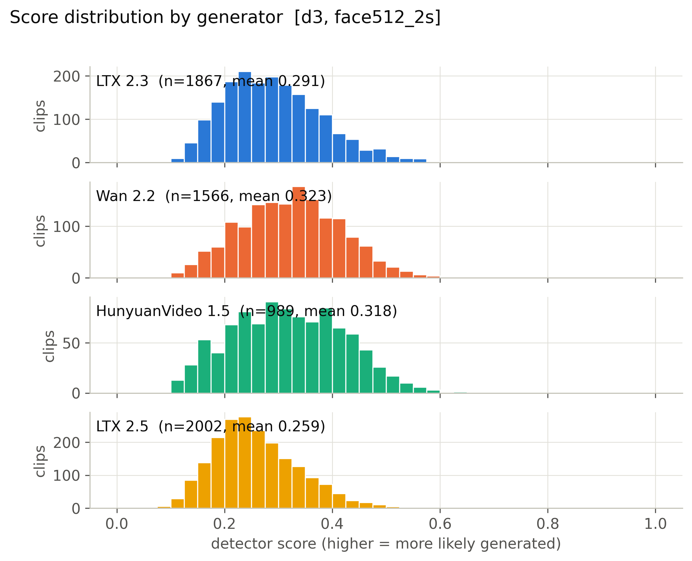

**Mean score, 56 cells x generator.** (`figures/heatmap_mean_score_cells.pdf`)

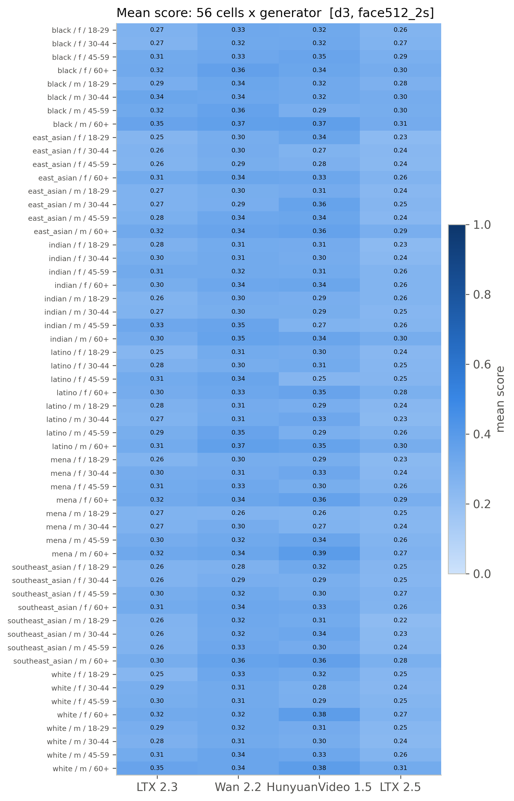

**Detection rate, 56 cells x generator (provisional threshold).** (`figures/heatmap_detection_rate_cells_provisional.pdf`)

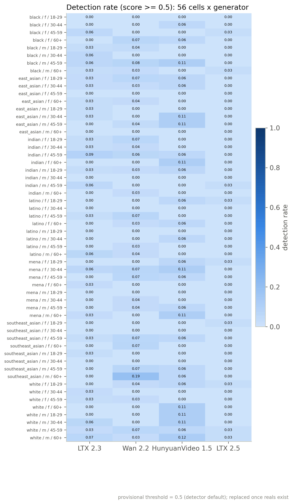

**Mean score by race, gender, age band with 95% CI.** (`figures/subgroup_mean_score.pdf`)

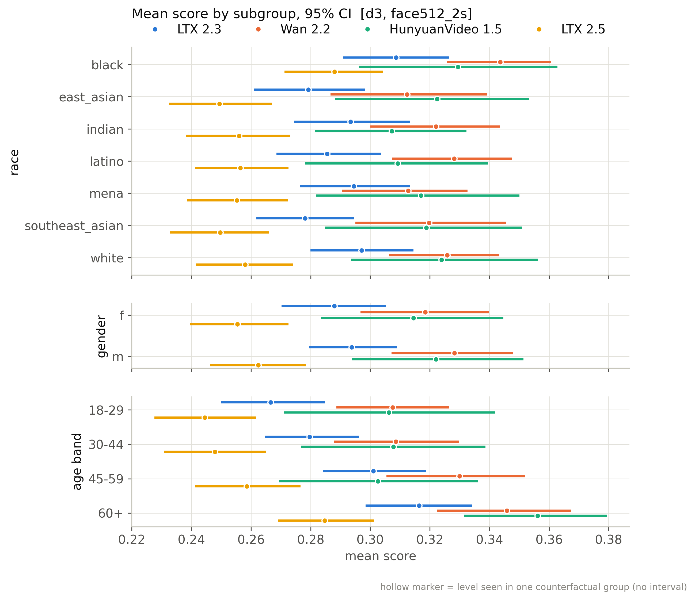

**Mean score by scene factor with 95% CI.** (`figures/scene_factor_mean_score.pdf`)

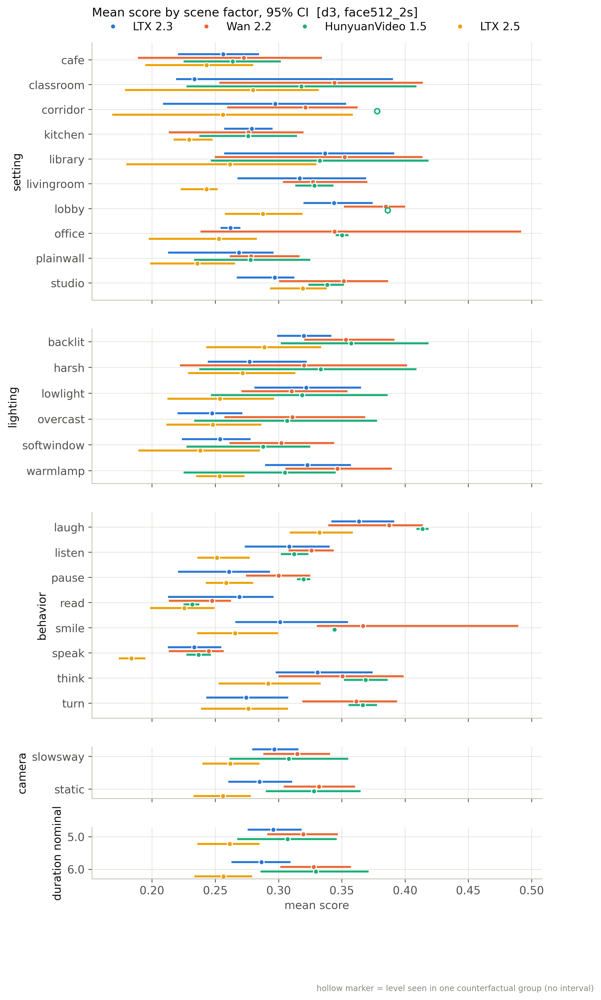

**Detection rate by subgroup (provisional threshold).** (`figures/subgroup_detection_rate_provisional.pdf`)

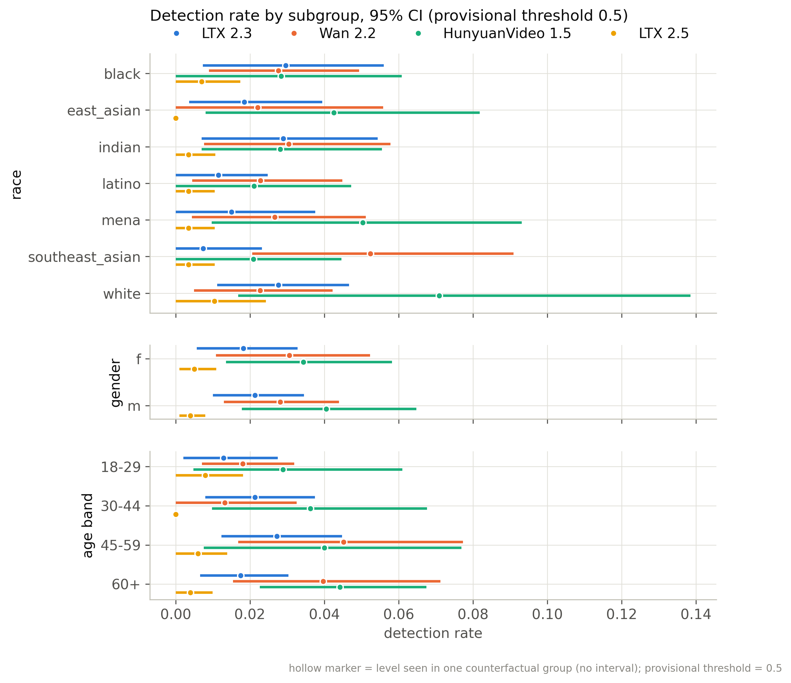

**Distribution of per-group CF spread.** (`figures/cf_spread_distribution.pdf`)

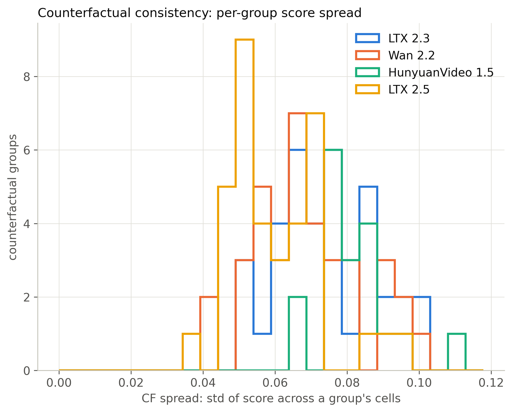

**Flip rate by generator (provisional threshold).** (`figures/flip_rate_by_generator_provisional.pdf`)

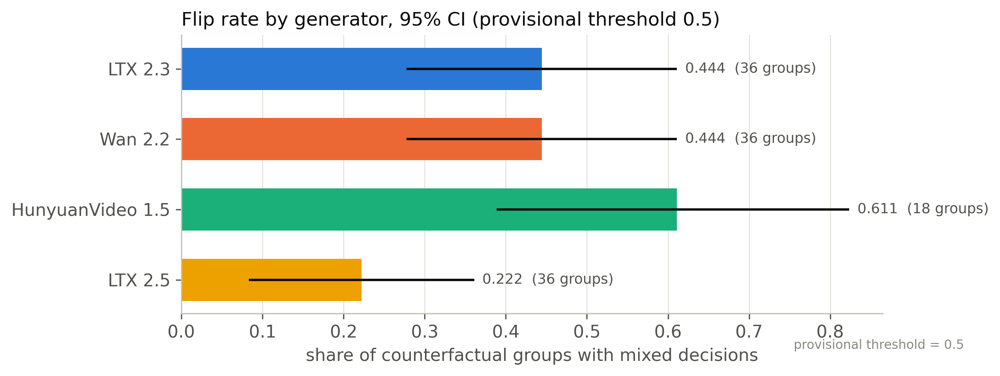

**Partial eta squared by factor.** (`figures/factor_attribution_variance_share.pdf`)

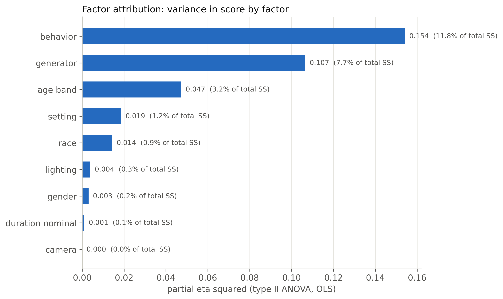

**Highest- and lowest-scoring included clips.** (`figures/example_strip.pdf`)

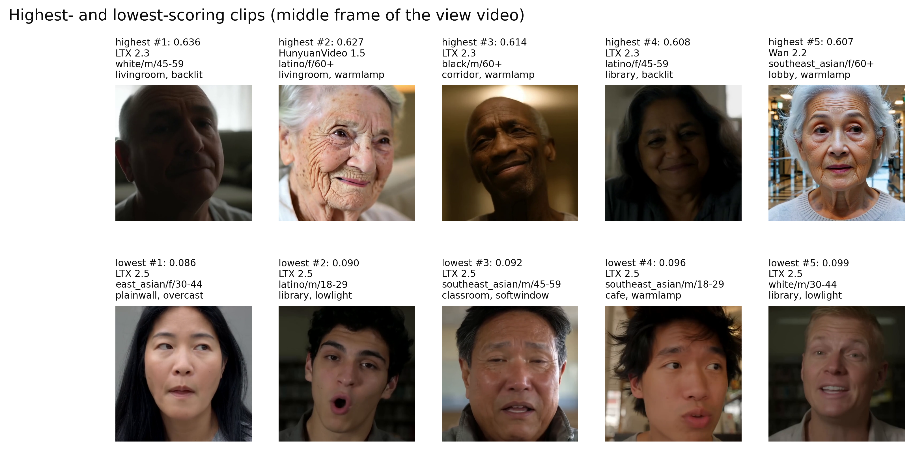

**ROC per generator against fps-matched reals.** (`figures/roc_per_generator.pdf`)

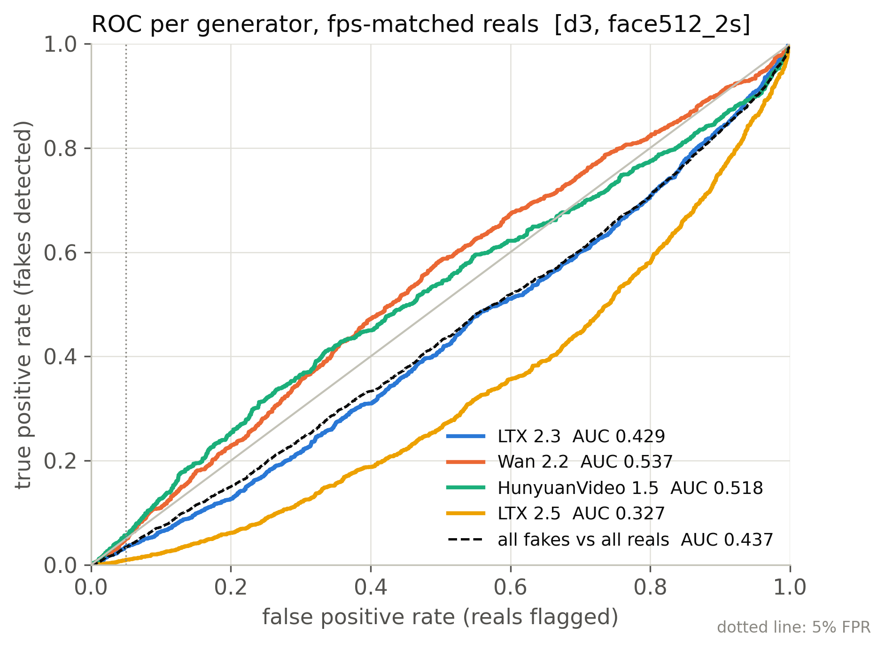

**Real FPR by perceived subgroup at the calibrated threshold.** (`figures/real_fpr_by_subgroup.pdf`)

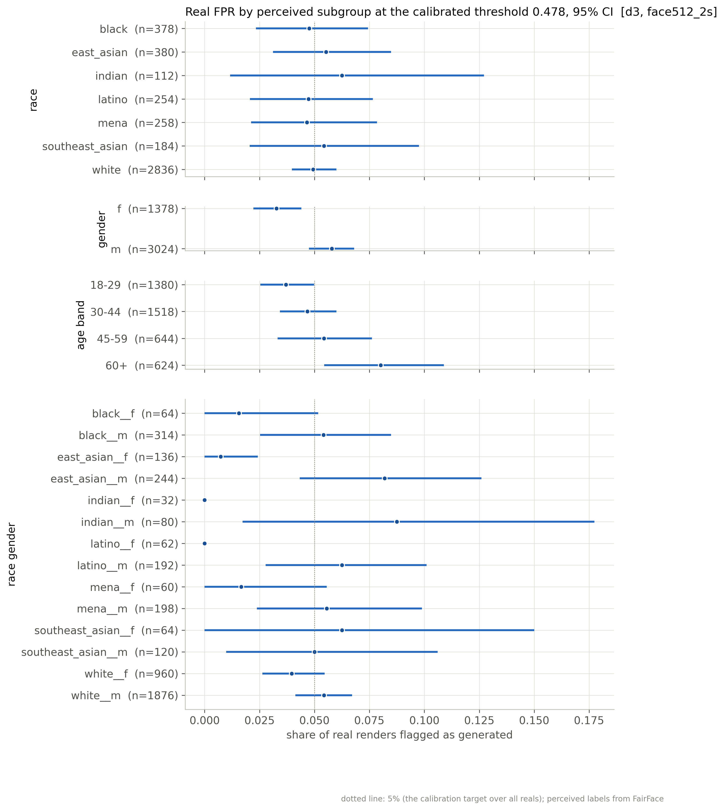

**AUC by subgroup: each subgroup's fakes vs same-subgroup reals.** (`figures/subgroup_auc.pdf`)

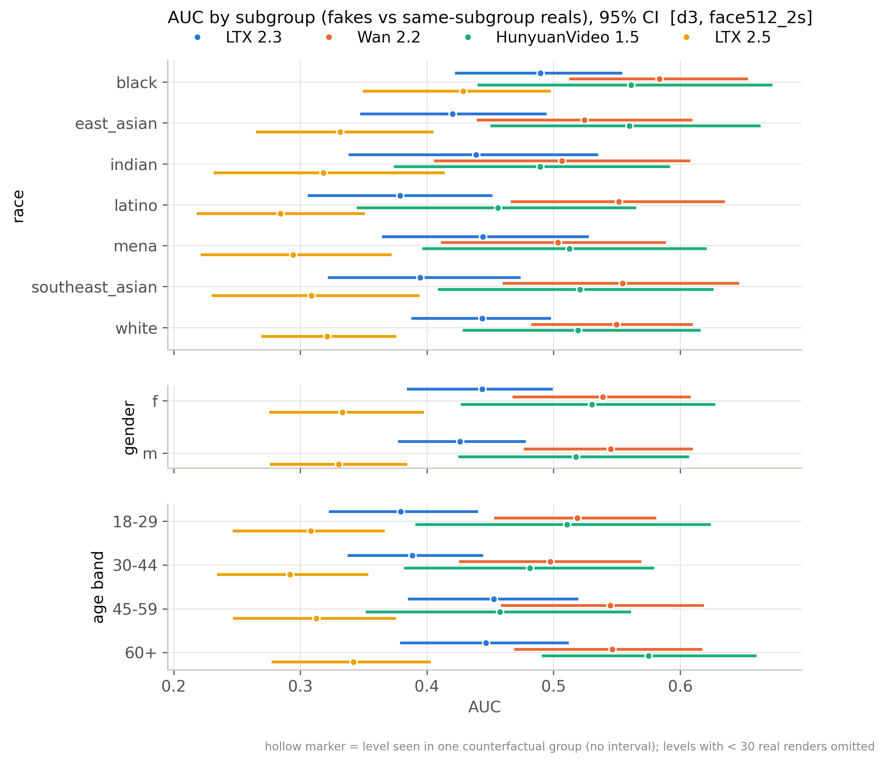

## Files

`manifest_used.csv` (every clip of the active batches with render/score/inclusion flags), `scores.csv` (score per scored clip), `tables/*.csv`, `figures/*`, `snapshot_meta.json`.

