# d3 / native_up: snapshot 20261023-0246

> **Detector training data.** D3 is training-free: a statistic of frozen X-CLIP-B/16 features, no detector weights. Its score is 1/(1+std) of the second-order feature; only rank metrics and the calibrated threshold are meaningful, the provisional 0.5 threshold is not.

> **Provisional threshold.** Every detection rate and flip rate below uses the detector's default threshold (0.5; none official (training-free statistic); 0.5 on 1/(1+std) is arbitrary - use the calibrated threshold). They will be replaced by the 5%-real-FPR threshold once reals exist (section 6.3).

## Settings

| setting           | value                                                                                  |
|:------------------|:---------------------------------------------------------------------------------------|
| detector          | d3 1+efab2602                                                                          |
| checkpoint_sha256 | b5db836d57b7e22001cb2bab581719e910b4c571d926fe839b5d07bc0ba2d03e                       |
| view              | native_up (view_hash 4db0c07a46c4b8d9)                                                 |
| ffmpeg            | ffmpeg version 7.1.1 Copyright (c) 2000-2025 the FFmpeg developers                     |
| batches           | fake_b1, fake_b2, fake_b3, real_all                                                    |
| inclusion set     | primary (technical QC pass AND face QC pass)                                           |
| bootstrap         | 1000 resamples of whole counterfactual groups, seed 20261020, 95% percentile intervals |
| git commit        | 2949de581861-dirty                                                                     |
| created           | 2026-10-23T02:46:46Z                                                                   |

Detector preprocessing on top of the view:

| field       | value                                                                                                           |
|:------------|:----------------------------------------------------------------------------------------------------------------|
| source      | Zig-HS/D3@c798fbc57fe0c4198d63a73732c2c0f9e4b4816c utils/video2frame.py + data/datasets.py + models/D3_model.py |
| frames      | ffmpeg -t 3 -vf fps=8 -> JPEG (ffmpeg default mjpeg), from view start                                           |
| frames_used | first 16 (8 if 8-15 available)                                                                                  |
| channels    | BGR (cv2.imread, as in the official dataset)                                                                    |
| crop        | centre, trim 10% each side of the longer dimension                                                              |
| resize      | [224, 224, 'cv2.INTER_LINEAR']                                                                                  |
| normalize   | {'mean': [0.485, 0.456, 0.406], 'std': [0.229, 0.224, 0.225], 'max_pixel_value': 255}                           |
| encoder     | microsoft/xclip-base-patch16@d6184e3fd8780d04c85d0f1eabe5f94bf44d98f6 vision tower, pooler_output               |
| statistic   | std of first differences of consecutive-frame L2 distances (loss l2)                                            |
| score       | 1 / (1 + std)                                                                                                   |
| precision   | fp32, TF32 off                                                                                                  |

## Coverage

| batch    | generator   |   clips |   primary |   rendered |   view_excluded |   render_failed |   scored |   score_failed |   included |
|:---------|:------------|--------:|----------:|-----------:|----------------:|----------------:|---------:|---------------:|-----------:|
| fake_b1  | hunyuan15   |     504 |       492 |        504 |               0 |               0 |      504 |              0 |        492 |
| fake_b1  | ltx23       |    2016 |      1878 |       2016 |               0 |               0 |     2016 |              0 |       1878 |
| fake_b1  | wan22       |    2016 |      1566 |       2016 |               0 |               0 |     2016 |              0 |       1566 |
| fake_b2  | hunyuan15   |     504 |       497 |        504 |               0 |               0 |      504 |              0 |        497 |
| fake_b3  | ltx25       |    2016 |      2002 |       2016 |               0 |               0 |     2016 |              0 |       2002 |
| real_all | real        |    2221 |      2221 |        923 |            1275 |              23 |      932 |              0 |        932 |

Reals scored: 1855. Fakes included: 6435 of 8911 scored (0 scoring failures).

## Observations

- LTX 2.3: mean score 0.303 [0.288, 0.319], median 0.295, n = 1878.
- Wan 2.2: mean score 0.341 [0.324, 0.359], median 0.339, n = 1566.
- HunyuanVideo 1.5: mean score 0.344 [0.314, 0.373], median 0.344, n = 989.
- LTX 2.5: mean score 0.279 [0.263, 0.296], median 0.269, n = 2002.
- Provisional detection rate (score >= 0.5), LTX 2.3: 3.1% [1.7, 4.7].
- Provisional detection rate (score >= 0.5), Wan 2.2: 4.5% [2.5, 6.9].
- Provisional detection rate (score >= 0.5), HunyuanVideo 1.5: 6.7% [2.9, 11.5].
- Provisional detection rate (score >= 0.5), LTX 2.5: 1.3% [0.6, 2.2].
- Provisional detection rate (score >= 0.5), all: 3.4% [2.1, 4.7].
- Largest race score gap: Wan 2.2 0.049 [0.034, 0.068] (black 0.374 vs east_asian 0.325).
- Largest gender score gap: LTX 2.3 0.015 [0.004, 0.026] (m 0.310 vs f 0.296).
- Largest age band score gap: Wan 2.2 0.056 [0.037, 0.071] (60+ 0.369 vs 18-29 0.313).
- Largest cell score gap: HunyuanVideo 1.5 0.124 [0.116, 0.196] (white__m__60+ 0.409 vs east_asian__f__30-44 0.285).
- Largest scene-factor gap (all generators): behavior 0.142 [0.117, 0.166] (laugh vs speak).
- Largest partial eta squared: behavior 0.131, generator 0.107, age_band 0.062; residual holds 65.7% of total SS.
- CF spread, LTX 2.3: 0.075 [0.071, 0.080] over 36 groups (max 0.114).
- CF spread, Wan 2.2: 0.073 [0.068, 0.077] over 36 groups (max 0.106).
- CF spread, HunyuanVideo 1.5: 0.082 [0.077, 0.087] over 18 groups (max 0.106).
- CF spread, LTX 2.5: 0.068 [0.064, 0.072] over 36 groups (max 0.105).
- Provisional flip rate, LTX 2.3: 52.8% of 36 groups [36.1, 69.4].
- Provisional flip rate, Wan 2.2: 58.3% of 36 groups [41.7, 72.2].
- Provisional flip rate, HunyuanVideo 1.5: 72.2% of 18 groups [50.0, 92.9].
- Provisional flip rate, LTX 2.5: 27.8% of 36 groups [13.9, 44.4].

## 6.1 Fakes only, no threshold

### Mean score by generator

| generator   |    n |   n_groups |   estimate |   ci_lo |   ci_hi |    sd |   median |   q05 |   q95 |
|:------------|-----:|-----------:|-----------:|--------:|--------:|------:|---------:|------:|------:|
| ltx23       | 1878 |         36 |      0.303 |   0.288 |   0.319 | 0.091 |    0.295 | 0.166 | 0.467 |
| wan22       | 1566 |         36 |      0.341 |   0.324 |   0.359 | 0.091 |    0.339 | 0.194 | 0.493 |
| hunyuan15   |  989 |         18 |      0.344 |   0.314 |   0.373 | 0.104 |    0.344 | 0.18  | 0.517 |
| ltx25       | 2002 |         36 |      0.279 |   0.263 |   0.296 | 0.086 |    0.269 | 0.157 | 0.431 |
| all         | 6435 |         36 |      0.311 |   0.297 |   0.325 | 0.095 |    0.303 | 0.17  | 0.48  |

### Mean score by race

| generator   | level           |   n |   estimate |   ci_lo |   ci_hi |   median |
|:------------|:----------------|----:|-----------:|--------:|--------:|---------:|
| ltx23       | black           | 273 |      0.323 |   0.306 |   0.34  |    0.32  |
| ltx23       | east_asian      | 270 |      0.286 |   0.27  |   0.304 |    0.273 |
| ltx23       | indian          | 277 |      0.298 |   0.28  |   0.316 |    0.29  |
| ltx23       | latino          | 262 |      0.306 |   0.289 |   0.324 |    0.296 |
| ltx23       | mena            | 267 |      0.309 |   0.29  |   0.328 |    0.299 |
| ltx23       | southeast_asian | 271 |      0.289 |   0.273 |   0.304 |    0.288 |
| ltx23       | white           | 258 |      0.31  |   0.292 |   0.328 |    0.305 |
| wan22       | black           | 217 |      0.374 |   0.356 |   0.392 |    0.371 |
| wan22       | east_asian      | 226 |      0.325 |   0.303 |   0.347 |    0.323 |
| wan22       | indian          | 230 |      0.343 |   0.323 |   0.363 |    0.337 |
| wan22       | latino          | 219 |      0.348 |   0.327 |   0.368 |    0.345 |
| wan22       | mena            | 225 |      0.327 |   0.308 |   0.344 |    0.324 |
| wan22       | southeast_asian | 229 |      0.334 |   0.312 |   0.358 |    0.328 |
| wan22       | white           | 220 |      0.341 |   0.322 |   0.358 |    0.34  |
| hunyuan15   | black           | 141 |      0.357 |   0.328 |   0.387 |    0.361 |
| hunyuan15   | east_asian      | 141 |      0.342 |   0.308 |   0.375 |    0.339 |
| hunyuan15   | indian          | 142 |      0.337 |   0.309 |   0.363 |    0.345 |
| hunyuan15   | latino          | 142 |      0.342 |   0.309 |   0.377 |    0.332 |
| hunyuan15   | mena            | 139 |      0.35  |   0.316 |   0.382 |    0.35  |
| hunyuan15   | southeast_asian | 143 |      0.333 |   0.301 |   0.366 |    0.34  |
| hunyuan15   | white           | 141 |      0.346 |   0.317 |   0.375 |    0.342 |
| ltx25       | black           | 287 |      0.309 |   0.289 |   0.328 |    0.306 |
| ltx25       | east_asian      | 286 |      0.265 |   0.247 |   0.283 |    0.257 |
| ltx25       | indian          | 284 |      0.275 |   0.257 |   0.294 |    0.26  |
| ltx25       | latino          | 286 |      0.276 |   0.261 |   0.291 |    0.272 |
| ltx25       | mena            | 286 |      0.278 |   0.26  |   0.294 |    0.266 |
| ltx25       | southeast_asian | 286 |      0.269 |   0.251 |   0.287 |    0.261 |
| ltx25       | white           | 287 |      0.283 |   0.265 |   0.302 |    0.276 |
| all         | black           | 918 |      0.336 |   0.322 |   0.349 |    0.333 |
| all         | east_asian      | 923 |      0.298 |   0.282 |   0.313 |    0.28  |
| all         | indian          | 933 |      0.308 |   0.294 |   0.322 |    0.3   |
| all         | latino          | 909 |      0.312 |   0.297 |   0.328 |    0.301 |
| all         | mena            | 917 |      0.31  |   0.294 |   0.325 |    0.302 |
| all         | southeast_asian | 929 |      0.301 |   0.285 |   0.316 |    0.297 |
| all         | white           | 906 |      0.315 |   0.3   |   0.329 |    0.308 |

### Mean score by gender

| generator   | level   |    n |   estimate |   ci_lo |   ci_hi |   median |
|:------------|:--------|-----:|-----------:|--------:|--------:|---------:|
| ltx23       | f       |  931 |      0.296 |   0.278 |   0.313 |    0.284 |
| ltx23       | m       |  947 |      0.31  |   0.294 |   0.326 |    0.306 |
| wan22       | f       |  785 |      0.336 |   0.318 |   0.353 |    0.334 |
| wan22       | m       |  781 |      0.347 |   0.327 |   0.365 |    0.345 |
| hunyuan15   | f       |  495 |      0.34  |   0.309 |   0.37  |    0.342 |
| hunyuan15   | m       |  494 |      0.347 |   0.319 |   0.376 |    0.347 |
| ltx25       | f       |  999 |      0.277 |   0.26  |   0.295 |    0.267 |
| ltx25       | m       | 1003 |      0.282 |   0.264 |   0.299 |    0.271 |
| all         | f       | 3210 |      0.307 |   0.292 |   0.321 |    0.297 |
| all         | m       | 3225 |      0.316 |   0.301 |   0.33  |    0.309 |

### Mean score by age band

| generator   | level   |    n |   estimate |   ci_lo |   ci_hi |   median |
|:------------|:--------|-----:|-----------:|--------:|--------:|---------:|
| ltx23       | 18-29   |  469 |      0.276 |   0.26  |   0.294 |    0.264 |
| ltx23       | 30-44   |  471 |      0.293 |   0.279 |   0.311 |    0.286 |
| ltx23       | 45-59   |  478 |      0.312 |   0.295 |   0.329 |    0.299 |
| ltx23       | 60+     |  460 |      0.331 |   0.311 |   0.349 |    0.324 |
| wan22       | 18-29   |  388 |      0.313 |   0.294 |   0.332 |    0.308 |
| wan22       | 30-44   |  377 |      0.329 |   0.309 |   0.35  |    0.329 |
| wan22       | 45-59   |  398 |      0.353 |   0.335 |   0.372 |    0.351 |
| wan22       | 60+     |  403 |      0.369 |   0.347 |   0.388 |    0.372 |
| hunyuan15   | 18-29   |  242 |      0.325 |   0.293 |   0.358 |    0.323 |
| hunyuan15   | 30-44   |  248 |      0.339 |   0.308 |   0.37  |    0.337 |
| hunyuan15   | 45-59   |  250 |      0.332 |   0.299 |   0.366 |    0.32  |
| hunyuan15   | 60+     |  249 |      0.379 |   0.353 |   0.404 |    0.378 |
| ltx25       | 18-29   |  500 |      0.259 |   0.242 |   0.277 |    0.247 |
| ltx25       | 30-44   |  497 |      0.264 |   0.246 |   0.283 |    0.252 |
| ltx25       | 45-59   |  501 |      0.283 |   0.264 |   0.302 |    0.27  |
| ltx25       | 60+     |  504 |      0.311 |   0.294 |   0.329 |    0.3   |
| all         | 18-29   | 1599 |      0.287 |   0.273 |   0.301 |    0.275 |
| all         | 30-44   | 1593 |      0.3   |   0.285 |   0.315 |    0.29  |
| all         | 45-59   | 1627 |      0.316 |   0.3   |   0.331 |    0.307 |
| all         | 60+     | 1616 |      0.342 |   0.326 |   0.356 |    0.336 |

### Mean score by scene factor (all generators pooled)

| factor           | level      |    n |   estimate |   ci_lo |   ci_hi |
|:-----------------|:-----------|-----:|-----------:|--------:|--------:|
| setting          | cafe       |  593 |      0.273 |   0.228 |   0.296 |
| setting          | classroom  |  541 |      0.319 |   0.244 |   0.407 |
| setting          | corridor   |  716 |      0.311 |   0.224 |   0.357 |
| setting          | kitchen    |  605 |      0.286 |   0.266 |   0.303 |
| setting          | library    |  757 |      0.334 |   0.252 |   0.385 |
| setting          | livingroom |  754 |      0.317 |   0.299 |   0.338 |
| setting          | lobby      |  513 |      0.359 |   0.344 |   0.366 |
| setting          | office     |  580 |      0.301 |   0.251 |   0.319 |
| setting          | plainwall  |  777 |      0.28  |   0.259 |   0.294 |
| setting          | studio     |  599 |      0.339 |   0.311 |   0.365 |
| lighting         | backlit    | 1126 |      0.339 |   0.304 |   0.371 |
| lighting         | harsh      |  967 |      0.315 |   0.272 |   0.366 |
| lighting         | lowlight   | 1116 |      0.314 |   0.273 |   0.357 |
| lighting         | overcast   | 1022 |      0.298 |   0.266 |   0.325 |
| lighting         | softwindow | 1157 |      0.282 |   0.245 |   0.314 |
| lighting         | warmlamp   | 1047 |      0.319 |   0.292 |   0.338 |
| behavior         | laugh      |  723 |      0.383 |   0.357 |   0.404 |
| behavior         | listen     |  960 |      0.309 |   0.3   |   0.319 |
| behavior         | pause      |  744 |      0.293 |   0.282 |   0.303 |
| behavior         | read       |  796 |      0.267 |   0.259 |   0.283 |
| behavior         | smile      |  817 |      0.329 |   0.317 |   0.339 |
| behavior         | speak      |  806 |      0.241 |   0.225 |   0.252 |
| behavior         | think      |  733 |      0.351 |   0.298 |   0.366 |
| behavior         | turn       |  856 |      0.324 |   0.304 |   0.34  |
| camera           | slowsway   | 3224 |      0.308 |   0.288 |   0.329 |
| camera           | static     | 3211 |      0.314 |   0.293 |   0.334 |
| duration_nominal | 5.0        | 3226 |      0.312 |   0.292 |   0.332 |
| duration_nominal | 6.0        | 3209 |      0.31  |   0.289 |   0.332 |

Per-generator scene-factor and 56-cell rows: `tables/score_by_breakdown.csv`.

### Subgroup gap (max - min of level means)

A gap is max - min, so it is never negative and its interval cannot include 0; it is a size, not a test of a difference. Over many levels with few clips each (56 cells; HunyuanVideo has 9 groups per cell) the gap also grows with noise, so compare it with the per-level intervals in `tables/score_by_breakdown.csv`. Levels seen in a single counterfactual group have no interval.

| generator   | attribute        |   n_levels |   gap |   ci_lo |   ci_hi | max_level     | min_level            |
|:------------|:-----------------|-----------:|------:|--------:|--------:|:--------------|:---------------------|
| ltx23       | race             |          7 | 0.037 |   0.023 |   0.053 | black         | east_asian           |
| ltx23       | gender           |          2 | 0.015 |   0.004 |   0.026 | m             | f                    |
| ltx23       | age_band         |          4 | 0.055 |   0.036 |   0.073 | 60+           | 18-29                |
| ltx23       | cell             |         56 | 0.117 |   0.103 |   0.161 | white__m__60+ | east_asian__f__18-29 |
| ltx23       | setting          |         10 | 0.103 |   0.083 |   0.166 | lobby         | classroom            |
| ltx23       | lighting         |          6 | 0.083 |   0.062 |   0.14  | warmlamp      | softwindow           |
| ltx23       | behavior         |          8 | 0.121 |   0.089 |   0.172 | laugh         | speak                |
| ltx23       | camera           |          2 | 0.007 |   0.001 |   0.041 | slowsway      | static               |
| ltx23       | duration_nominal |          2 | 0.009 |   0.001 |   0.042 | 5.0           | 6.0                  |
| wan22       | race             |          7 | 0.049 |   0.034 |   0.068 | black         | east_asian           |
| wan22       | gender           |          2 | 0.011 |   0.001 |   0.022 | m             | f                    |
| wan22       | age_band         |          4 | 0.056 |   0.037 |   0.071 | 60+           | 18-29                |
| wan22       | cell             |         56 | 0.117 |   0.11  |   0.165 | black__m__60+ | mena__m__18-29       |
| wan22       | setting          |         10 | 0.109 |   0.088 |   0.199 | lobby         | cafe                 |
| wan22       | lighting         |          6 | 0.05  |   0.037 |   0.137 | backlit       | softwindow           |
| wan22       | behavior         |          8 | 0.118 |   0.102 |   0.178 | laugh         | speak                |
| wan22       | camera           |          2 | 0.015 |   0.001 |   0.049 | static        | slowsway             |
| wan22       | duration_nominal |          2 | 0.002 |   0.001 |   0.042 | 6.0           | 5.0                  |
| hunyuan15   | race             |          7 | 0.024 |   0.016 |   0.044 | black         | southeast_asian      |
| hunyuan15   | gender           |          2 | 0.007 |   0     |   0.017 | m             | f                    |
| hunyuan15   | age_band         |          4 | 0.054 |   0.039 |   0.07  | 60+           | 18-29                |
| hunyuan15   | cell             |         56 | 0.124 |   0.116 |   0.196 | white__m__60+ | east_asian__f__30-44 |
| hunyuan15   | setting          |         10 | 0.163 |   0.096 |   0.193 | lobby         | cafe                 |
| hunyuan15   | lighting         |          6 | 0.06  |   0.044 |   0.188 | backlit       | softwindow           |
| hunyuan15   | behavior         |          8 | 0.179 |   0.122 |   0.192 | laugh         | read                 |
| hunyuan15   | camera           |          2 | 0.029 |   0.003 |   0.085 | static        | slowsway             |
| hunyuan15   | duration_nominal |          2 | 0.018 |   0.001 |   0.076 | 6.0           | 5.0                  |
| ltx25       | race             |          7 | 0.044 |   0.034 |   0.056 | black         | east_asian           |
| ltx25       | gender           |          2 | 0.005 |   0     |   0.016 | m             | f                    |
| ltx25       | age_band         |          4 | 0.051 |   0.039 |   0.063 | 60+           | 18-29                |
| ltx25       | cell             |         56 | 0.108 |   0.098 |   0.143 | black__f__60+ | east_asian__f__18-29 |
| ltx25       | setting          |         10 | 0.082 |   0.07  |   0.167 | studio        | plainwall            |
| ltx25       | lighting         |          6 | 0.055 |   0.033 |   0.131 | backlit       | softwindow           |
| ltx25       | behavior         |          8 | 0.158 |   0.126 |   0.188 | laugh         | speak                |
| ltx25       | camera           |          2 | 0.001 |   0     |   0.038 | static        | slowsway             |
| ltx25       | duration_nominal |          2 | 0.001 |   0     |   0.039 | 5.0           | 6.0                  |
| all         | race             |          7 | 0.038 |   0.031 |   0.045 | black         | east_asian           |
| all         | gender           |          2 | 0.009 |   0.004 |   0.015 | m             | f                    |
| all         | age_band         |          4 | 0.055 |   0.045 |   0.064 | 60+           | 18-29                |
| all         | cell             |         56 | 0.097 |   0.084 |   0.119 | black__m__60+ | east_asian__f__18-29 |
| all         | setting          |         10 | 0.086 |   0.071 |   0.145 | lobby         | cafe                 |
| all         | lighting         |          6 | 0.058 |   0.036 |   0.11  | backlit       | softwindow           |
| all         | behavior         |          8 | 0.142 |   0.117 |   0.166 | laugh         | speak                |
| all         | camera           |          2 | 0.006 |   0.001 |   0.035 | static        | slowsway             |
| all         | duration_nominal |          2 | 0.001 |   0     |   0.033 | 5.0           | 6.0                  |

### CF spread (mean over groups of the std of score across the group's cells)

| generator   |   n_groups |   cf_spread |   ci_lo |   ci_hi |   median |   max |
|:------------|-----------:|------------:|--------:|--------:|---------:|------:|
| ltx23       |         36 |       0.075 |   0.071 |   0.08  |    0.074 | 0.114 |
| wan22       |         36 |       0.073 |   0.068 |   0.077 |    0.072 | 0.106 |
| hunyuan15   |         18 |       0.082 |   0.077 |   0.087 |    0.079 | 0.106 |
| ltx25       |         36 |       0.068 |   0.064 |   0.072 |    0.064 | 0.105 |

### Factor attribution

OLS with every factor as a fixed effect, type-II ANOVA. `ss_share` is the factor's type-II sum of squares over the total sum of squares (type-II shares need not add to 1). Scene factors are constant within a counterfactual group, so their effects are estimated from between-group differences only. The OLS F tests treat clips as independent although clips are clustered in counterfactual groups, so their p values are optimistic; use the group-bootstrap intervals above for inference.

| factor           |   df |    sum_sq | F     | p          | partial_eta2   |   ss_share |
|:-----------------|-----:|----------:|:------|:-----------|:---------------|-----------:|
| race             |    6 |  0.8458   | 23.42 | 1.601e-27  | 0.02149        |  0.01442   |
| gender           |    1 |  0.165    | 27.41 | 1.701e-07  | 0.004265       |  0.002813  |
| age_band         |    3 |  2.544    | 140.9 | 2.107e-88  | 0.06197        |  0.04338   |
| setting          |    9 |  0.6234   | 11.51 | 4.283e-18  | 0.01593        |  0.01063   |
| lighting         |    5 |  0.1387   | 4.608 | 0.0003367  | 0.003589       |  0.002365  |
| behavior         |    7 |  5.831    | 138.4 | 1.531e-190 | 0.1315         |  0.09942   |
| camera           |    1 |  0.008421 | 1.399 | 0.237      | 0.0002186      |  0.0001436 |
| duration_nominal |    1 |  0.05261  | 8.739 | 0.003126   | 0.001364       |  0.000897  |
| generator        |    3 |  4.607    | 255.1 | 2.151e-156 | 0.1068         |  0.07856   |
| Residual         | 6398 | 38.51     |       |            |                |  0.6567    |

Lighting x race interaction (added to the same OLS):

| term            |   df |   sum_sq |     F |      p |   partial_eta2 |
|:----------------|-----:|---------:|------:|-------:|---------------:|
| lighting x race |   30 |   0.2049 | 1.135 | 0.2793 |       0.005319 |

Mixed model `score ~ factors + (1 | counterfactual_group)` (REML) variance components (fixed effects: `tables/factor_mixed_fixed.csv`):

| component                               |   variance | converged   |
|:----------------------------------------|-----------:|:------------|
| counterfactual_group (random intercept) |   0        | True        |
| residual                                |   0.005946 | True        |
| ICC (group share of random variance)    |   0        | True        |

A group variance at or near 0 is a boundary estimate: setting, lighting, behavior, camera and duration are fixed per group and absorb most between-group variation, leaving little for the random intercept. It does not mean scenes do not matter.

## 6.2 Provisional (threshold 0.5, provisional)

### Detection rate by generator (provisional)

| generator   |    n |   estimate |   ci_lo |   ci_hi |
|:------------|-----:|-----------:|--------:|--------:|
| ltx23       | 1878 |      0.031 |   0.017 |   0.047 |
| wan22       | 1566 |      0.045 |   0.025 |   0.069 |
| hunyuan15   |  989 |      0.067 |   0.029 |   0.115 |
| ltx25       | 2002 |      0.013 |   0.006 |   0.022 |
| all         | 6435 |      0.034 |   0.021 |   0.047 |

### Detection rate by race (provisional)

| generator   | level           |   n |   estimate |   ci_lo |   ci_hi |
|:------------|:----------------|----:|-----------:|--------:|--------:|
| ltx23       | black           | 273 |      0.048 |   0.022 |   0.078 |
| ltx23       | east_asian      | 270 |      0.015 |   0     |   0.034 |
| ltx23       | indian          | 277 |      0.018 |   0.003 |   0.037 |
| ltx23       | latino          | 262 |      0.027 |   0.008 |   0.051 |
| ltx23       | mena            | 267 |      0.041 |   0.015 |   0.069 |
| ltx23       | southeast_asian | 271 |      0.026 |   0.008 |   0.048 |
| ltx23       | white           | 258 |      0.043 |   0.018 |   0.073 |
| wan22       | black           | 217 |      0.078 |   0.032 |   0.134 |
| wan22       | east_asian      | 226 |      0.027 |   0.008 |   0.053 |
| wan22       | indian          | 230 |      0.057 |   0.023 |   0.098 |
| wan22       | latino          | 219 |      0.064 |   0.031 |   0.104 |
| wan22       | mena            | 225 |      0.022 |   0.004 |   0.048 |
| wan22       | southeast_asian | 229 |      0.044 |   0.009 |   0.096 |
| wan22       | white           | 220 |      0.023 |   0.004 |   0.049 |
| hunyuan15   | black           | 141 |      0.057 |   0.015 |   0.105 |
| hunyuan15   | east_asian      | 141 |      0.099 |   0.032 |   0.173 |
| hunyuan15   | indian          | 142 |      0.049 |   0     |   0.117 |
| hunyuan15   | latino          | 142 |      0.092 |   0.036 |   0.153 |
| hunyuan15   | mena            | 139 |      0.079 |   0.036 |   0.125 |
| hunyuan15   | southeast_asian | 143 |      0.028 |   0     |   0.077 |
| hunyuan15   | white           | 141 |      0.064 |   0.019 |   0.11  |
| ltx25       | black           | 287 |      0.014 |   0.003 |   0.028 |
| ltx25       | east_asian      | 286 |      0.007 |   0     |   0.021 |
| ltx25       | indian          | 284 |      0.018 |   0.003 |   0.039 |
| ltx25       | latino          | 286 |      0.003 |   0     |   0.011 |
| ltx25       | mena            | 286 |      0.01  |   0     |   0.021 |
| ltx25       | southeast_asian | 286 |      0.017 |   0.003 |   0.035 |
| ltx25       | white           | 287 |      0.021 |   0.007 |   0.038 |
| all         | black           | 918 |      0.046 |   0.026 |   0.068 |
| all         | east_asian      | 923 |      0.028 |   0.014 |   0.045 |
| all         | indian          | 933 |      0.032 |   0.015 |   0.051 |
| all         | latino          | 909 |      0.039 |   0.023 |   0.054 |
| all         | mena            | 917 |      0.033 |   0.018 |   0.046 |
| all         | southeast_asian | 929 |      0.028 |   0.012 |   0.049 |
| all         | white           | 906 |      0.034 |   0.019 |   0.049 |

### Detection rate by gender (provisional)

| generator   | level   |    n |   estimate |   ci_lo |   ci_hi |
|:------------|:--------|-----:|-----------:|--------:|--------:|
| ltx23       | f       |  931 |      0.031 |   0.015 |   0.053 |
| ltx23       | m       |  947 |      0.031 |   0.017 |   0.046 |
| wan22       | f       |  785 |      0.041 |   0.022 |   0.067 |
| wan22       | m       |  781 |      0.049 |   0.023 |   0.077 |
| hunyuan15   | f       |  495 |      0.055 |   0.02  |   0.102 |
| hunyuan15   | m       |  494 |      0.079 |   0.032 |   0.132 |
| ltx25       | f       |  999 |      0.007 |   0.002 |   0.013 |
| ltx25       | m       | 1003 |      0.019 |   0.007 |   0.034 |
| all         | f       | 3210 |      0.03  |   0.018 |   0.042 |
| all         | m       | 3225 |      0.039 |   0.024 |   0.054 |

### Detection rate by age band (provisional)

| generator   | level   |    n |   estimate |   ci_lo |   ci_hi |
|:------------|:--------|-----:|-----------:|--------:|--------:|
| ltx23       | 18-29   |  469 |      0.013 |   0.004 |   0.025 |
| ltx23       | 30-44   |  471 |      0.034 |   0.017 |   0.057 |
| ltx23       | 45-59   |  478 |      0.029 |   0.012 |   0.051 |
| ltx23       | 60+     |  460 |      0.048 |   0.024 |   0.074 |
| wan22       | 18-29   |  388 |      0.021 |   0.007 |   0.039 |
| wan22       | 30-44   |  377 |      0.04  |   0.016 |   0.07  |
| wan22       | 45-59   |  398 |      0.045 |   0.016 |   0.084 |
| wan22       | 60+     |  403 |      0.072 |   0.038 |   0.109 |
| hunyuan15   | 18-29   |  242 |      0.033 |   0     |   0.079 |
| hunyuan15   | 30-44   |  248 |      0.081 |   0.034 |   0.137 |
| hunyuan15   | 45-59   |  250 |      0.064 |   0.025 |   0.106 |
| hunyuan15   | 60+     |  249 |      0.088 |   0.031 |   0.155 |
| ltx25       | 18-29   |  500 |      0.004 |   0     |   0.01  |
| ltx25       | 30-44   |  497 |      0.008 |   0.002 |   0.016 |
| ltx25       | 45-59   |  501 |      0.018 |   0.006 |   0.03  |
| ltx25       | 60+     |  504 |      0.022 |   0.006 |   0.042 |
| all         | 18-29   | 1599 |      0.015 |   0.008 |   0.024 |
| all         | 30-44   | 1593 |      0.035 |   0.019 |   0.051 |
| all         | 45-59   | 1627 |      0.035 |   0.019 |   0.051 |
| all         | 60+     | 1616 |      0.052 |   0.031 |   0.073 |

### Detection-rate gap (provisional)

| generator   | attribute        |   gap |   ci_lo |   ci_hi | max_level            | min_level            |
|:------------|:-----------------|------:|--------:|--------:|:---------------------|:---------------------|
| ltx23       | race             | 0.033 |   0.022 |   0.066 | black                | east_asian           |
| ltx23       | gender           | 0.001 |   0     |   0.018 | f                    | m                    |
| ltx23       | age_band         | 0.035 |   0.017 |   0.06  | 60+                  | 18-29                |
| ltx23       | cell             | 0.1   |   0.091 |   0.242 | white__m__60+        | black__m__30-44      |
| ltx23       | setting          | 0.083 |   0.047 |   0.333 | livingroom           | cafe                 |
| ltx23       | lighting         | 0.076 |   0.037 |   0.147 | warmlamp             | softwindow           |
| ltx23       | behavior         | 0.097 |   0.065 |   0.211 | laugh                | pause                |
| ltx23       | camera           | 0.022 |   0.002 |   0.052 | static               | slowsway             |
| ltx23       | duration_nominal | 0.011 |   0.001 |   0.043 | 5.0                  | 6.0                  |
| wan22       | race             | 0.056 |   0.035 |   0.117 | black                | mena                 |
| wan22       | gender           | 0.008 |   0     |   0.031 | m                    | f                    |
| wan22       | age_band         | 0.051 |   0.021 |   0.082 | 60+                  | 18-29                |
| wan22       | cell             | 0.167 |   0.13  |   0.323 | black__m__60+        | black__f__18-29      |
| wan22       | setting          | 0.094 |   0.075 |   0.429 | office               | kitchen              |
| wan22       | lighting         | 0.067 |   0.037 |   0.183 | backlit              | warmlamp             |
| wan22       | behavior         | 0.127 |   0.057 |   0.226 | laugh                | speak                |
| wan22       | camera           | 0.021 |   0.001 |   0.07  | static               | slowsway             |
| wan22       | duration_nominal | 0.003 |   0.001 |   0.05  | 6.0                  | 5.0                  |
| hunyuan15   | race             | 0.071 |   0.041 |   0.145 | east_asian           | southeast_asian      |
| hunyuan15   | gender           | 0.024 |   0.002 |   0.056 | m                    | f                    |
| hunyuan15   | age_band         | 0.055 |   0.021 |   0.115 | 60+                  | 18-29                |
| hunyuan15   | cell             | 0.222 |   0.167 |   0.471 | east_asian__m__30-44 | black__f__18-29      |
| hunyuan15   | setting          | 0.321 |   0.093 |   0.321 | lobby                | cafe                 |
| hunyuan15   | lighting         | 0.106 |   0.05  |   0.321 | lowlight             | overcast             |
| hunyuan15   | behavior         | 0.208 |   0.082 |   0.321 | laugh                | read                 |
| hunyuan15   | camera           | 0.058 |   0.003 |   0.14  | static               | slowsway             |
| hunyuan15   | duration_nominal | 0.013 |   0.002 |   0.107 | 6.0                  | 5.0                  |
| ltx25       | race             | 0.017 |   0.01  |   0.038 | white                | latino               |
| ltx25       | gender           | 0.012 |   0.001 |   0.025 | m                    | f                    |
| ltx25       | age_band         | 0.018 |   0.008 |   0.034 | 60+                  | 18-29                |
| ltx25       | cell             | 0.057 |   0.056 |   0.167 | mena__m__30-44       | black__f__18-29      |
| ltx25       | setting          | 0.06  |   0.018 |   0.125 | classroom            | cafe                 |
| ltx25       | lighting         | 0.024 |   0.013 |   0.071 | overcast             | softwindow           |
| ltx25       | behavior         | 0.049 |   0.036 |   0.083 | laugh                | listen               |
| ltx25       | camera           | 0.004 |   0     |   0.022 | static               | slowsway             |
| ltx25       | duration_nominal | 0.002 |   0     |   0.02  | 5.0                  | 6.0                  |
| all         | race             | 0.018 |   0.01  |   0.044 | black                | southeast_asian      |
| all         | gender           | 0.009 |   0.001 |   0.019 | m                    | f                    |
| all         | age_band         | 0.037 |   0.02  |   0.054 | 60+                  | 18-29                |
| all         | cell             | 0.085 |   0.065 |   0.149 | black__m__60+        | east_asian__f__18-29 |
| all         | setting          | 0.067 |   0.049 |   0.153 | library              | cafe                 |
| all         | lighting         | 0.043 |   0.026 |   0.101 | backlit              | softwindow           |
| all         | behavior         | 0.108 |   0.06  |   0.15  | laugh                | speak                |
| all         | camera           | 0.022 |   0.002 |   0.048 | static               | slowsway             |
| all         | duration_nominal | 0.002 |   0     |   0.031 | 5.0                  | 6.0                  |

### Flip rate (provisional): share of groups whose clips get different decisions

| generator   |   n_groups |   flip_rate |   ci_lo |   ci_hi |   median |   max |
|:------------|-----------:|------------:|--------:|--------:|---------:|------:|
| ltx23       |         36 |       0.528 |   0.361 |   0.694 |        1 |     1 |
| wan22       |         36 |       0.583 |   0.417 |   0.722 |        1 |     1 |
| hunyuan15   |         18 |       0.722 |   0.5   |   0.929 |        1 |     1 |
| ltx25       |         36 |       0.278 |   0.139 |   0.444 |        0 |     1 |

### Sensitivity: inclusion set

| set     | generator   |    n |   mean_score |   provisional_detection_rate |
|:--------|:------------|-----:|-------------:|-----------------------------:|
| all     | hunyuan15   | 1008 |        0.344 |                        0.065 |
| all     | ltx23       | 2016 |        0.302 |                        0.029 |
| all     | ltx25       | 2016 |        0.279 |                        0.013 |
| all     | wan22       | 2016 |        0.346 |                        0.058 |
| primary | hunyuan15   |  989 |        0.344 |                        0.067 |
| primary | ltx23       | 1878 |        0.303 |                        0.031 |
| primary | ltx25       | 2002 |        0.279 |                        0.013 |
| primary | wan22       | 1566 |        0.341 |                        0.045 |

## 6.3 Real vs generated (calibrated threshold 0.5042)

The threshold is the score at which 5% of primary real renders (24 and 16 fps pooled) are flagged; one per detector and view, never per subgroup. Each generator is compared with reals rendered at its own fps. Intervals: fakes resample counterfactual groups, reals resample identity clusters (source video). Real labels are perceived (FairFace), not self-reported.

### Calibration

| scope            |   n_renders |   n_sources |   n_identities |   threshold |    fpr |
|:-----------------|------------:|------------:|---------------:|------------:|-------:|
| all real renders |        1855 |         932 |            811 |      0.5042 | 0.0501 |
| 16 fps renders   |         932 |         932 |            811 |      0.5042 | 0.0451 |
| 24 fps renders   |         923 |         923 |            802 |      0.5042 | 0.0553 |

### AUC, AP, EER, TPR at 5% FPR

| generator   | real_fps   |   n_fake |   n_real |   auc |   auc_ci_lo |   auc_ci_hi |    ap |   eer |   tpr_at_5fpr |   detection_rate_global_thr |   det_ci_lo |   det_ci_hi |
|:------------|:-----------|---------:|---------:|------:|------------:|------------:|------:|------:|--------------:|----------------------------:|------------:|------------:|
| ltx23       | 24         |     1878 |      923 | 0.398 |       0.349 |       0.452 | 0.602 | 0.575 |         0.024 |                       0.029 |       0.016 |       0.044 |
| wan22       | 16         |     1566 |      932 | 0.53  |       0.474 |       0.588 | 0.639 | 0.478 |         0.047 |                       0.041 |       0.022 |       0.063 |
| hunyuan15   | 24         |      989 |      923 | 0.523 |       0.438 |       0.613 | 0.543 | 0.48  |         0.059 |                       0.065 |       0.027 |       0.112 |
| ltx25       | 24         |     2002 |      923 | 0.327 |       0.276 |       0.383 | 0.576 | 0.63  |         0.011 |                       0.013 |       0.006 |       0.022 |
| all         | 24+16      |     6435 |     1855 | 0.43  |       0.387 |       0.475 | 0.739 | 0.55  |         0.032 |                       0.032 |       0.019 |       0.045 |

### Real FPR by perceived subgroup

| attribute   | level              |   n_renders |   n_identities |   fpr |   ci_lo |   ci_hi |
|:------------|:-------------------|------------:|---------------:|------:|--------:|--------:|
| race        | black              |         123 |             59 | 0.073 |   0.025 |   0.134 |
| race        | east_asian         |         163 |             75 | 0.025 |   0     |   0.058 |
| race        | indian             |          46 |             23 | 0.152 |   0.045 |   0.275 |
| race        | latino             |         115 |             55 | 0.07  |   0.019 |   0.132 |
| race        | mena               |         120 |             59 | 0.058 |   0.011 |   0.123 |
| race        | southeast_asian    |          70 |             34 | 0.043 |   0     |   0.095 |
| race        | white              |        1204 |            523 | 0.045 |   0.032 |   0.059 |
| gender      | f                  |         587 |            266 | 0.043 |   0.023 |   0.065 |
| gender      | m                  |        1254 |            553 | 0.053 |   0.039 |   0.069 |
| age_band    | 18-29              |         594 |            275 | 0.042 |   0.023 |   0.063 |
| age_band    | 30-44              |         626 |            290 | 0.051 |   0.031 |   0.073 |
| age_band    | 45-59              |         300 |            134 | 0.05  |   0.021 |   0.083 |
| age_band    | 60+                |         241 |            112 | 0.058 |   0.029 |   0.094 |
| race_gender | black__f           |          20 |             10 | 0     |   0     |   0     |
| race_gender | black__m           |         103 |             50 | 0.087 |   0.03  |   0.156 |
| race_gender | east_asian__f      |          76 |             35 | 0     |   0     |   0     |
| race_gender | east_asian__m      |          87 |             41 | 0.046 |   0     |   0.104 |
| race_gender | indian__f          |          12 |              6 | 0.167 |   0     |   0.5   |
| race_gender | indian__m          |          34 |             17 | 0.147 |   0.042 |   0.25  |
| race_gender | latino__f          |          20 |             10 | 0     |   0     |   0     |
| race_gender | latino__m          |          95 |             45 | 0.084 |   0.023 |   0.156 |
| race_gender | mena__f            |          34 |             17 | 0.029 |   0     |   0.1   |
| race_gender | mena__m            |          86 |             42 | 0.07  |   0.011 |   0.16  |
| race_gender | southeast_asian__f |          20 |              9 | 0.05  |   0     |   0.167 |
| race_gender | southeast_asian__m |          50 |             25 | 0.04  |   0     |   0.1   |
| race_gender | white__f           |         405 |            183 | 0.052 |   0.027 |   0.08  |
| race_gender | white__m           |         799 |            350 | 0.041 |   0.025 |   0.06  |

### Real FPR gap (max - min across levels; non-negative by construction)

| attribute   |   n_levels |   fpr_gap |   ci_lo |   ci_hi | max_level   |   max_fpr | min_level   |   min_fpr |
|:------------|-----------:|----------:|--------:|--------:|:------------|----------:|:------------|----------:|
| race        |          7 |     0.128 |   0.056 |   0.253 | indian      |     0.152 | east_asian  |     0.025 |
| gender      |          2 |     0.011 |   0.001 |   0.036 | m           |     0.053 | f           |     0.043 |
| age_band    |          4 |     0.016 |   0.009 |   0.063 | 60+         |     0.058 | 18-29       |     0.042 |
| race_gender |         14 |     0.167 |   0.1   |   0.5   | indian__f   |     0.167 | black__f    |     0     |

### Worst-subgroup AUC and AUC gap

| generator   | attribute   |   n_levels | worst_level   |   worst_auc |   worst_ci_lo |   worst_ci_hi | best_level    |   best_auc |   auc_gap |   gap_ci_lo |   gap_ci_hi |
|:------------|:------------|-----------:|:--------------|------------:|--------------:|--------------:|:--------------|-----------:|----------:|------------:|------------:|
| ltx23       | race        |          6 | latino        |       0.351 |         0.254 |         0.398 | east_asian    |      0.428 |     0.077 |       0.055 |       0.218 |
| ltx23       | gender      |          2 | m             |       0.401 |         0.344 |         0.451 | f             |      0.416 |     0.014 |       0.001 |       0.069 |
| ltx23       | age_band    |          4 | 30-44         |       0.356 |         0.3   |         0.405 | 60+           |      0.415 |     0.059 |       0.024 |       0.141 |
| ltx23       | race_gender |          7 | latino__m     |       0.338 |         0.249 |         0.392 | white__m      |      0.447 |     0.109 |       0.083 |       0.249 |
| wan22       | race        |          6 | latino        |       0.46  |         0.355 |         0.523 | east_asian    |      0.577 |     0.117 |       0.081 |       0.246 |
| wan22       | gender      |          2 | m             |       0.535 |         0.463 |         0.588 | f             |      0.541 |     0.006 |       0.001 |       0.062 |
| wan22       | age_band    |          4 | 30-44         |       0.467 |         0.394 |         0.539 | 45-59         |      0.562 |     0.095 |       0.04  |       0.178 |
| wan22       | race_gender |          7 | latino__m     |       0.453 |         0.336 |         0.524 | east_asian__f |      0.601 |     0.148 |       0.104 |       0.307 |
| hunyuan15   | race        |          6 | latino        |       0.46  |         0.336 |         0.552 | east_asian    |      0.588 |     0.128 |       0.075 |       0.25  |
| hunyuan15   | gender      |          2 | m             |       0.512 |         0.428 |         0.603 | f             |      0.559 |     0.047 |       0.004 |       0.1   |
| hunyuan15   | age_band    |          4 | 45-59         |       0.454 |         0.346 |         0.557 | 60+           |      0.568 |     0.114 |       0.04  |       0.205 |
| hunyuan15   | race_gender |          7 | latino__m     |       0.426 |         0.295 |         0.522 | east_asian__f |      0.611 |     0.185 |       0.114 |       0.343 |
| ltx25       | race        |          6 | latino        |       0.264 |         0.185 |         0.327 | east_asian    |      0.358 |     0.093 |       0.058 |       0.218 |
| ltx25       | gender      |          2 | m             |       0.318 |         0.262 |         0.372 | f             |      0.357 |     0.038 |       0.003 |       0.088 |
| ltx25       | age_band    |          4 | 30-44         |       0.272 |         0.212 |         0.329 | 60+           |      0.355 |     0.083 |       0.036 |       0.157 |
| ltx25       | race_gender |          7 | latino__m     |       0.216 |         0.144 |         0.283 | east_asian__f |      0.424 |     0.208 |       0.122 |       0.326 |
| all         | race        |          7 | indian        |       0.348 |         0.234 |         0.403 | east_asian    |      0.469 |     0.121 |       0.081 |       0.251 |
| all         | gender      |          2 | m             |       0.429 |         0.38  |         0.471 | f             |      0.449 |     0.021 |       0.001 |       0.063 |
| all         | age_band    |          4 | 30-44         |       0.377 |         0.325 |         0.431 | 60+           |      0.447 |     0.069 |       0.031 |       0.132 |
| all         | race_gender |         10 | indian__m     |       0.319 |         0.192 |         0.374 | east_asian__f |      0.504 |     0.185 |       0.141 |       0.349 |

### Detection rate at the calibrated threshold

| generator   |    n |   estimate |   ci_lo |   ci_hi |
|:------------|-----:|-----------:|--------:|--------:|
| ltx23       | 1878 |      0.029 |   0.016 |   0.044 |
| wan22       | 1566 |      0.041 |   0.022 |   0.063 |
| hunyuan15   |  989 |      0.065 |   0.027 |   0.112 |
| ltx25       | 2002 |      0.013 |   0.006 |   0.022 |
| all         | 6435 |      0.032 |   0.019 |   0.045 |

#### by race

| generator   | level           |   n |   estimate |   ci_lo |   ci_hi |
|:------------|:----------------|----:|-----------:|--------:|--------:|
| ltx23       | black           | 273 |      0.044 |   0.019 |   0.073 |
| ltx23       | east_asian      | 270 |      0.015 |   0     |   0.034 |
| ltx23       | indian          | 277 |      0.018 |   0.003 |   0.037 |
| ltx23       | latino          | 262 |      0.023 |   0.007 |   0.045 |
| ltx23       | mena            | 267 |      0.041 |   0.015 |   0.069 |
| ltx23       | southeast_asian | 271 |      0.022 |   0.007 |   0.045 |
| ltx23       | white           | 258 |      0.039 |   0.018 |   0.062 |
| wan22       | black           | 217 |      0.078 |   0.032 |   0.134 |
| wan22       | east_asian      | 226 |      0.027 |   0.008 |   0.053 |
| wan22       | indian          | 230 |      0.057 |   0.023 |   0.098 |
| wan22       | latino          | 219 |      0.05  |   0.02  |   0.093 |
| wan22       | mena            | 225 |      0.013 |   0     |   0.028 |
| wan22       | southeast_asian | 229 |      0.039 |   0.005 |   0.09  |
| wan22       | white           | 220 |      0.023 |   0.004 |   0.049 |
| hunyuan15   | black           | 141 |      0.057 |   0.015 |   0.105 |
| hunyuan15   | east_asian      | 141 |      0.099 |   0.032 |   0.173 |
| hunyuan15   | indian          | 142 |      0.049 |   0     |   0.117 |
| hunyuan15   | latino          | 142 |      0.085 |   0.03  |   0.148 |
| hunyuan15   | mena            | 139 |      0.072 |   0.029 |   0.118 |
| hunyuan15   | southeast_asian | 143 |      0.028 |   0     |   0.077 |
| hunyuan15   | white           | 141 |      0.064 |   0.019 |   0.11  |
| ltx25       | black           | 287 |      0.014 |   0.003 |   0.028 |
| ltx25       | east_asian      | 286 |      0.007 |   0     |   0.021 |
| ltx25       | indian          | 284 |      0.018 |   0.003 |   0.039 |
| ltx25       | latino          | 286 |      0.003 |   0     |   0.011 |
| ltx25       | mena            | 286 |      0.01  |   0     |   0.021 |
| ltx25       | southeast_asian | 286 |      0.017 |   0.003 |   0.035 |
| ltx25       | white           | 287 |      0.021 |   0.007 |   0.038 |
| all         | black           | 918 |      0.045 |   0.025 |   0.068 |
| all         | east_asian      | 923 |      0.028 |   0.014 |   0.045 |
| all         | indian          | 933 |      0.032 |   0.015 |   0.051 |
| all         | latino          | 909 |      0.033 |   0.018 |   0.048 |
| all         | mena            | 917 |      0.029 |   0.016 |   0.043 |
| all         | southeast_asian | 929 |      0.026 |   0.011 |   0.045 |
| all         | white           | 906 |      0.033 |   0.018 |   0.047 |

#### by gender

| generator   | level   |    n |   estimate |   ci_lo |   ci_hi |
|:------------|:--------|-----:|-----------:|--------:|--------:|
| ltx23       | f       |  931 |      0.029 |   0.015 |   0.049 |
| ltx23       | m       |  947 |      0.029 |   0.015 |   0.044 |
| wan22       | f       |  785 |      0.036 |   0.019 |   0.057 |
| wan22       | m       |  781 |      0.046 |   0.02  |   0.075 |
| hunyuan15   | f       |  495 |      0.051 |   0.017 |   0.096 |
| hunyuan15   | m       |  494 |      0.079 |   0.032 |   0.132 |
| ltx25       | f       |  999 |      0.007 |   0.002 |   0.013 |
| ltx25       | m       | 1003 |      0.019 |   0.007 |   0.034 |
| all         | f       | 3210 |      0.027 |   0.016 |   0.039 |
| all         | m       | 3225 |      0.038 |   0.022 |   0.053 |

#### by age band

| generator   | level   |    n |   estimate |   ci_lo |   ci_hi |
|:------------|:--------|-----:|-----------:|--------:|--------:|
| ltx23       | 18-29   |  469 |      0.011 |   0.002 |   0.023 |
| ltx23       | 30-44   |  471 |      0.028 |   0.012 |   0.047 |
| ltx23       | 45-59   |  478 |      0.029 |   0.012 |   0.051 |
| ltx23       | 60+     |  460 |      0.048 |   0.024 |   0.074 |
| wan22       | 18-29   |  388 |      0.021 |   0.007 |   0.039 |
| wan22       | 30-44   |  377 |      0.037 |   0.013 |   0.068 |
| wan22       | 45-59   |  398 |      0.038 |   0.013 |   0.069 |
| wan22       | 60+     |  403 |      0.067 |   0.034 |   0.103 |
| hunyuan15   | 18-29   |  242 |      0.033 |   0     |   0.079 |
| hunyuan15   | 30-44   |  248 |      0.073 |   0.027 |   0.126 |
| hunyuan15   | 45-59   |  250 |      0.064 |   0.025 |   0.106 |
| hunyuan15   | 60+     |  249 |      0.088 |   0.031 |   0.155 |
| ltx25       | 18-29   |  500 |      0.004 |   0     |   0.01  |
| ltx25       | 30-44   |  497 |      0.008 |   0.002 |   0.016 |
| ltx25       | 45-59   |  501 |      0.018 |   0.006 |   0.03  |
| ltx25       | 60+     |  504 |      0.022 |   0.006 |   0.042 |
| all         | 18-29   | 1599 |      0.014 |   0.007 |   0.023 |
| all         | 30-44   | 1593 |      0.031 |   0.016 |   0.047 |
| all         | 45-59   | 1627 |      0.033 |   0.018 |   0.048 |
| all         | 60+     | 1616 |      0.051 |   0.03  |   0.071 |

### Detection-rate gap at the calibrated threshold

| generator   | attribute        |   gap |   ci_lo |   ci_hi | max_level            | min_level            |
|:------------|:-----------------|------:|--------:|--------:|:---------------------|:---------------------|
| ltx23       | race             | 0.029 |   0.022 |   0.063 | black                | east_asian           |
| ltx23       | gender           | 0     |   0     |   0.017 | f                    | m                    |
| ltx23       | age_band         | 0.037 |   0.018 |   0.061 | 60+                  | 18-29                |
| ltx23       | cell             | 0.1   |   0.088 |   0.235 | white__m__60+        | black__m__18-29      |
| ltx23       | setting          | 0.078 |   0.046 |   0.333 | livingroom           | cafe                 |
| ltx23       | lighting         | 0.072 |   0.038 |   0.138 | warmlamp             | softwindow           |
| ltx23       | behavior         | 0.091 |   0.062 |   0.201 | laugh                | pause                |
| ltx23       | camera           | 0.02  |   0.001 |   0.048 | static               | slowsway             |
| ltx23       | duration_nominal | 0.01  |   0.001 |   0.042 | 5.0                  | 6.0                  |
| wan22       | race             | 0.065 |   0.035 |   0.123 | black                | mena                 |
| wan22       | gender           | 0.01  |   0     |   0.033 | m                    | f                    |
| wan22       | age_band         | 0.046 |   0.02  |   0.079 | 60+                  | 18-29                |
| wan22       | cell             | 0.167 |   0.129 |   0.323 | black__m__60+        | black__f__18-29      |
| wan22       | setting          | 0.092 |   0.073 |   0.286 | classroom            | cafe                 |
| wan22       | lighting         | 0.056 |   0.032 |   0.169 | backlit              | warmlamp             |
| wan22       | behavior         | 0.122 |   0.054 |   0.223 | laugh                | speak                |
| wan22       | camera           | 0.023 |   0.002 |   0.07  | static               | slowsway             |
| wan22       | duration_nominal | 0.002 |   0.001 |   0.047 | 6.0                  | 5.0                  |
| hunyuan15   | race             | 0.071 |   0.039 |   0.145 | east_asian           | southeast_asian      |
| hunyuan15   | gender           | 0.028 |   0.003 |   0.058 | m                    | f                    |
| hunyuan15   | age_band         | 0.055 |   0.021 |   0.115 | 60+                  | 18-29                |
| hunyuan15   | cell             | 0.222 |   0.167 |   0.471 | east_asian__m__30-44 | black__f__18-29      |
| hunyuan15   | setting          | 0.321 |   0.079 |   0.321 | lobby                | cafe                 |
| hunyuan15   | lighting         | 0.1   |   0.05  |   0.321 | lowlight             | softwindow           |
| hunyuan15   | behavior         | 0.214 |   0.077 |   0.321 | laugh                | speak                |
| hunyuan15   | camera           | 0.054 |   0.004 |   0.139 | static               | slowsway             |
| hunyuan15   | duration_nominal | 0.017 |   0.001 |   0.112 | 6.0                  | 5.0                  |
| ltx25       | race             | 0.017 |   0.01  |   0.038 | white                | latino               |
| ltx25       | gender           | 0.012 |   0.001 |   0.025 | m                    | f                    |
| ltx25       | age_band         | 0.018 |   0.008 |   0.034 | 60+                  | 18-29                |
| ltx25       | cell             | 0.057 |   0.056 |   0.167 | mena__m__30-44       | black__f__18-29      |
| ltx25       | setting          | 0.06  |   0.018 |   0.125 | classroom            | cafe                 |
| ltx25       | lighting         | 0.024 |   0.013 |   0.071 | overcast             | softwindow           |
| ltx25       | behavior         | 0.049 |   0.036 |   0.083 | laugh                | listen               |
| ltx25       | camera           | 0.004 |   0     |   0.022 | static               | slowsway             |
| ltx25       | duration_nominal | 0.002 |   0     |   0.02  | 5.0                  | 6.0                  |
| all         | race             | 0.019 |   0.009 |   0.045 | black                | southeast_asian      |
| all         | gender           | 0.01  |   0.002 |   0.02  | m                    | f                    |
| all         | age_band         | 0.036 |   0.02  |   0.053 | 60+                  | 18-29                |
| all         | cell             | 0.085 |   0.063 |   0.149 | black__m__60+        | east_asian__f__18-29 |
| all         | setting          | 0.068 |   0.049 |   0.153 | classroom            | cafe                 |
| all         | lighting         | 0.04  |   0.026 |   0.098 | backlit              | softwindow           |
| all         | behavior         | 0.107 |   0.059 |   0.149 | laugh                | speak                |
| all         | camera           | 0.021 |   0.002 |   0.047 | static               | slowsway             |
| all         | duration_nominal | 0.001 |   0     |   0.03  | 5.0                  | 6.0                  |

### Flip rate at the calibrated threshold

| generator   |   n_groups |   flip_rate |   ci_lo |   ci_hi |   median |   max |
|:------------|-----------:|------------:|--------:|--------:|---------:|------:|
| ltx23       |         36 |       0.472 |   0.306 |   0.639 |        0 |     1 |
| wan22       |         36 |       0.556 |   0.389 |   0.722 |        1 |     1 |
| hunyuan15   |         18 |       0.667 |   0.444 |   0.875 |        1 |     1 |
| ltx25       |         36 |       0.278 |   0.139 |   0.444 |        0 |     1 |

## Figures

**Score distribution by generator.** (`figures/score_distribution_by_generator.pdf`)

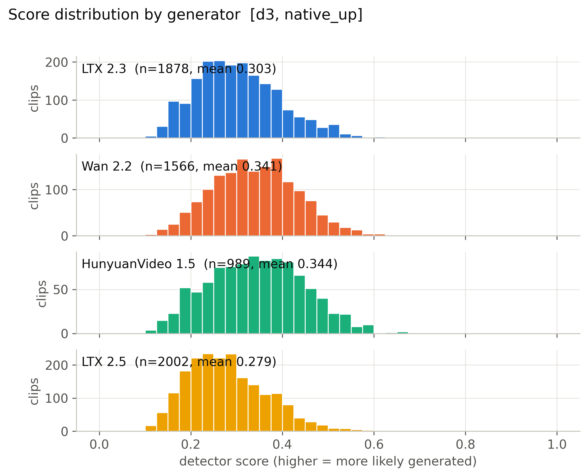

**Mean score, 56 cells x generator.** (`figures/heatmap_mean_score_cells.pdf`)

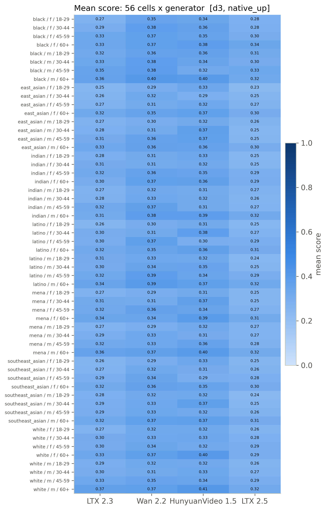

**Detection rate, 56 cells x generator (provisional threshold).** (`figures/heatmap_detection_rate_cells_provisional.pdf`)

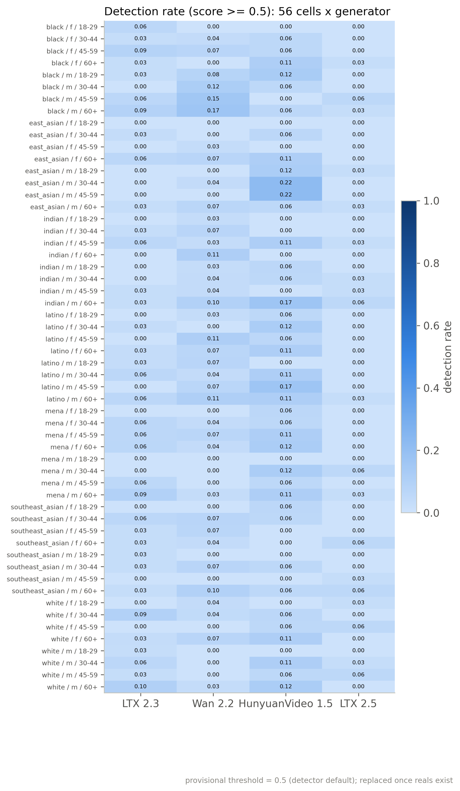

**Mean score by race, gender, age band with 95% CI.** (`figures/subgroup_mean_score.pdf`)

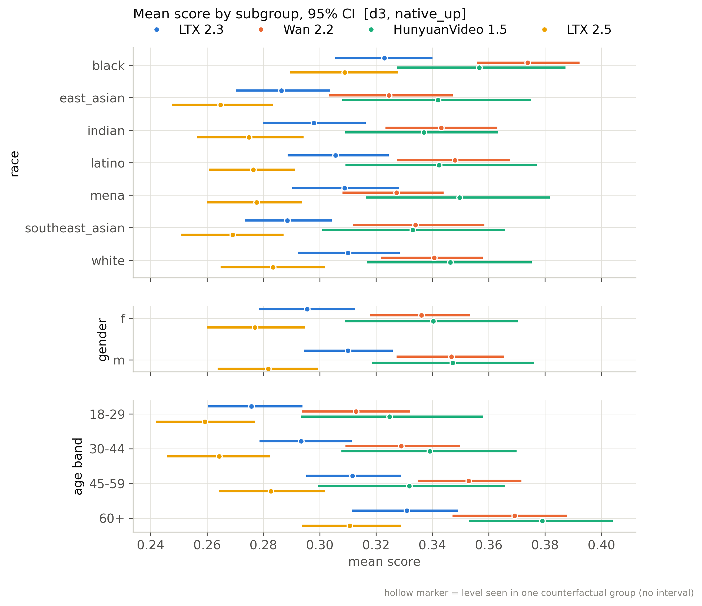

**Mean score by scene factor with 95% CI.** (`figures/scene_factor_mean_score.pdf`)

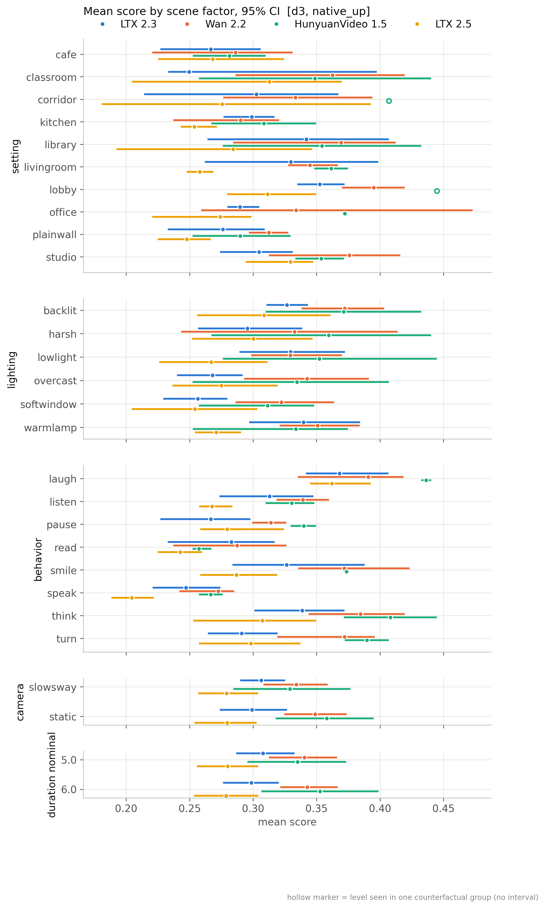

**Detection rate by subgroup (provisional threshold).** (`figures/subgroup_detection_rate_provisional.pdf`)

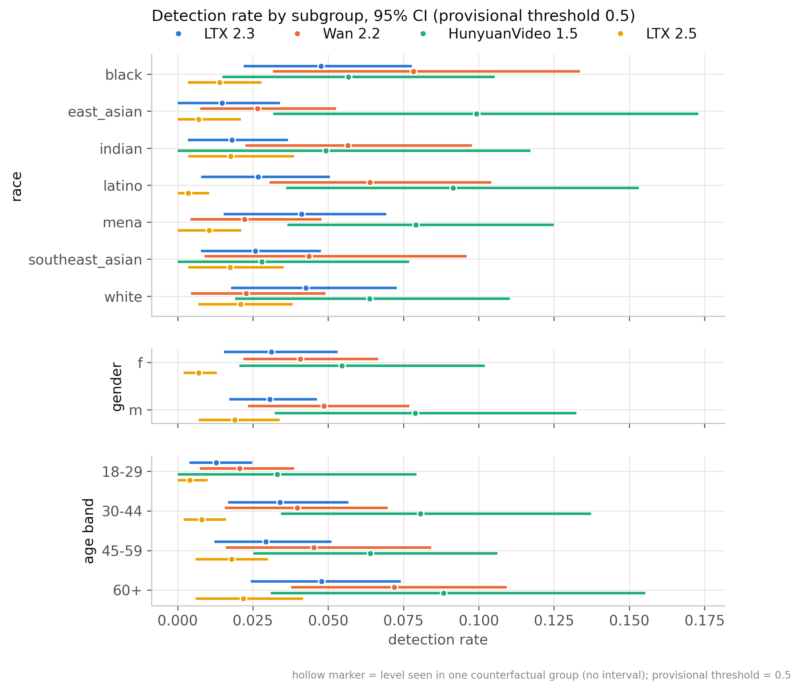

**Distribution of per-group CF spread.** (`figures/cf_spread_distribution.pdf`)

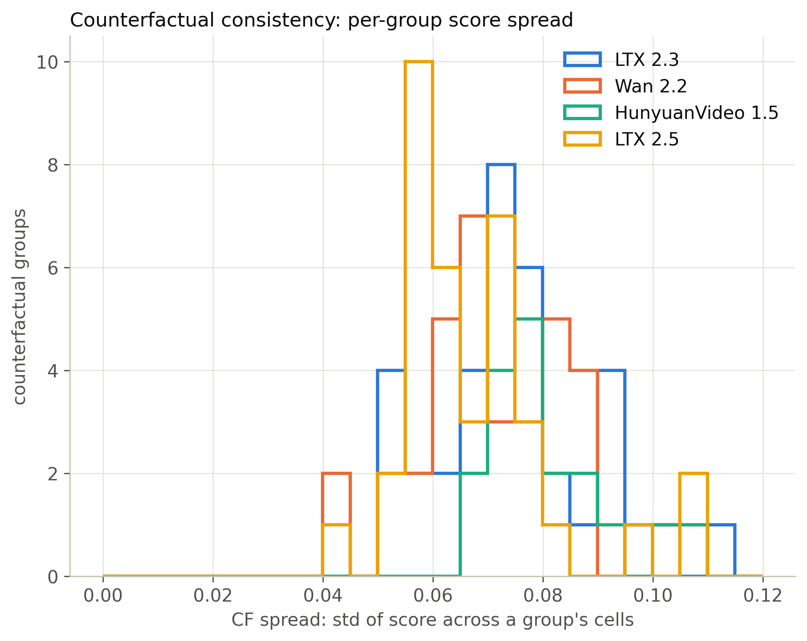

**Flip rate by generator (provisional threshold).** (`figures/flip_rate_by_generator_provisional.pdf`)

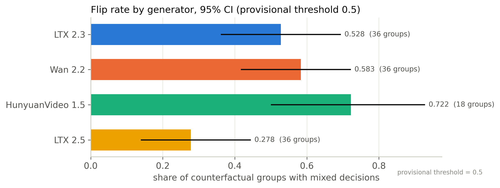

**Partial eta squared by factor.** (`figures/factor_attribution_variance_share.pdf`)

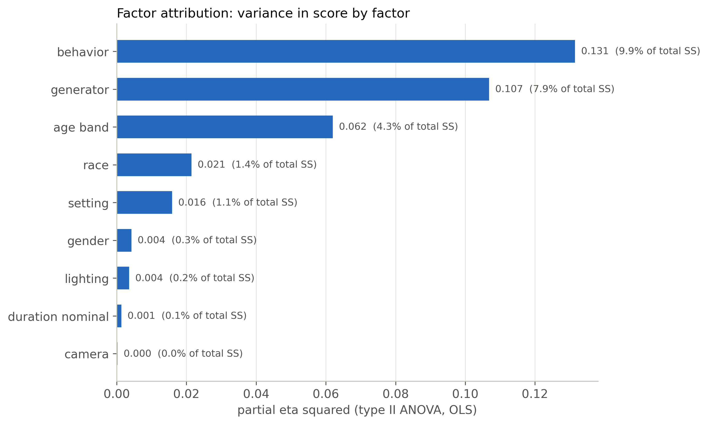

**Highest- and lowest-scoring included clips.** (`figures/example_strip.pdf`)

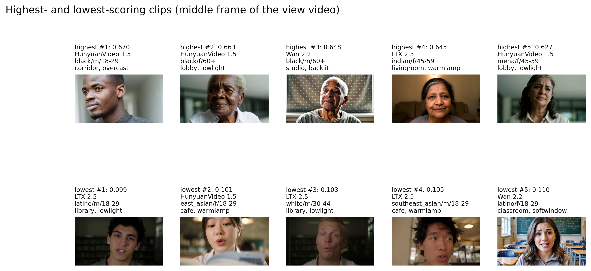

**ROC per generator against fps-matched reals.** (`figures/roc_per_generator.pdf`)

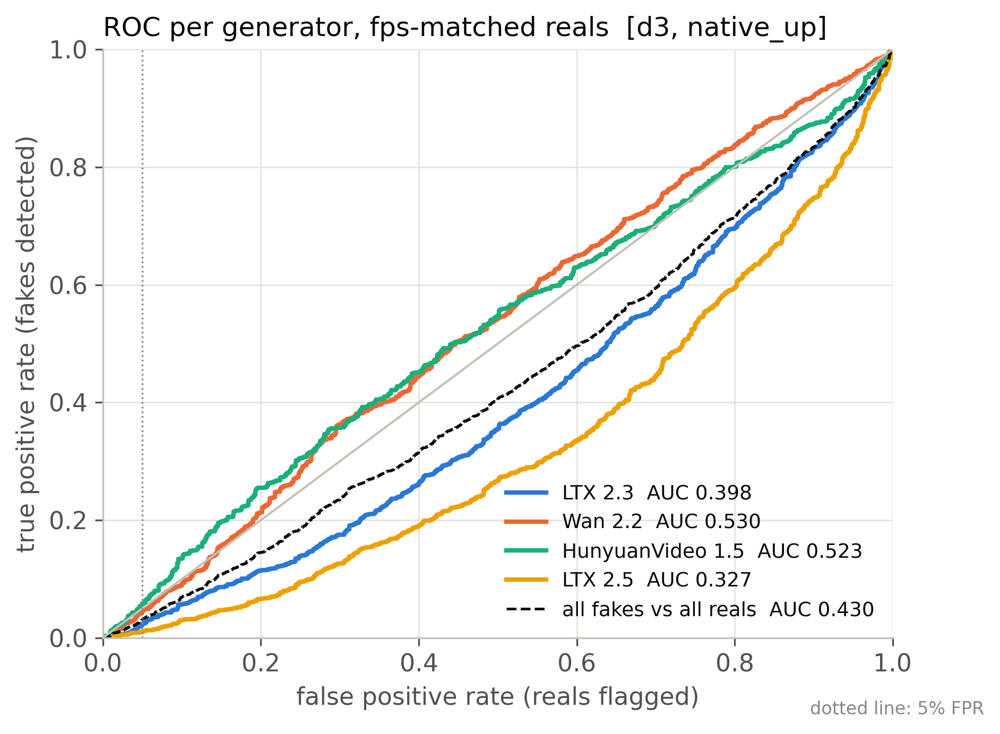

**Real FPR by perceived subgroup at the calibrated threshold.** (`figures/real_fpr_by_subgroup.pdf`)

**AUC by subgroup: each subgroup's fakes vs same-subgroup reals.** (`figures/subgroup_auc.pdf`)

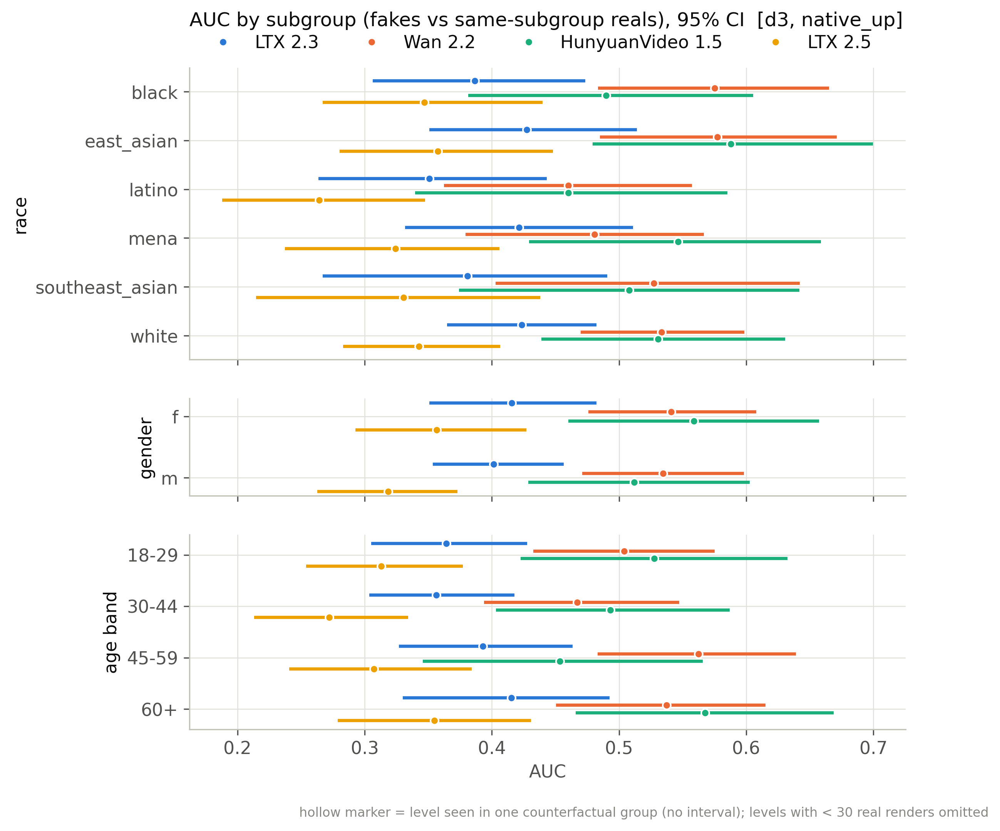

## Files

`manifest_used.csv` (every clip of the active batches with render/score/inclusion flags), `scores.csv` (score per scored clip), `tables/*.csv`, `figures/*`, `snapshot_meta.json`.

