# d3 / native_up_2s: snapshot 20261021-2056

> **Detector training data.** D3 is training-free: a statistic of frozen X-CLIP-B/16 features, no detector weights. Its score is 1/(1+std) of the second-order feature; only rank metrics and the calibrated threshold are meaningful, the provisional 0.5 threshold is not.

> **Provisional threshold.** Every detection rate and flip rate below uses the detector's default threshold (0.5; none official (training-free statistic); 0.5 on 1/(1+std) is arbitrary - use the calibrated threshold). They will be replaced by the 5%-real-FPR threshold once reals exist (section 6.3).

## Settings

| setting           | value                                                                                  |
|:------------------|:---------------------------------------------------------------------------------------|
| detector          | d3 1+efab2602                                                                          |
| checkpoint_sha256 | b5db836d57b7e22001cb2bab581719e910b4c571d926fe839b5d07bc0ba2d03e                       |
| view              | native_up_2s (view_hash f48f13e3eb9c049d)                                              |
| ffmpeg            | ffmpeg version 7.1.1 Copyright (c) 2000-2025 the FFmpeg developers                     |
| batches           | fake_b1, fake_b2, real_all                                                             |
| inclusion set     | primary (technical QC pass AND face QC pass)                                           |
| bootstrap         | 1000 resamples of whole counterfactual groups, seed 20261020, 95% percentile intervals |
| git commit        | 4e41a35865f4-dirty                                                                     |
| created           | 2026-10-21T20:57:17Z                                                                   |

Detector preprocessing on top of the view:

| field       | value                                                                                                           |
|:------------|:----------------------------------------------------------------------------------------------------------------|
| source      | Zig-HS/D3@c798fbc57fe0c4198d63a73732c2c0f9e4b4816c utils/video2frame.py + data/datasets.py + models/D3_model.py |
| frames      | ffmpeg -t 3 -vf fps=8 -> JPEG (ffmpeg default mjpeg), from view start                                           |
| frames_used | first 16 (8 if 8-15 available)                                                                                  |
| channels    | BGR (cv2.imread, as in the official dataset)                                                                    |
| crop        | centre, trim 10% each side of the longer dimension                                                              |
| resize      | [224, 224, 'cv2.INTER_LINEAR']                                                                                  |
| normalize   | {'mean': [0.485, 0.456, 0.406], 'std': [0.229, 0.224, 0.225], 'max_pixel_value': 255}                           |
| encoder     | microsoft/xclip-base-patch16@d6184e3fd8780d04c85d0f1eabe5f94bf44d98f6 vision tower, pooler_output               |
| statistic   | std of first differences of consecutive-frame L2 distances (loss l2)                                            |
| score       | 1 / (1 + std)                                                                                                   |
| precision   | fp32, TF32 off                                                                                                  |

## Coverage

| batch    | generator   |   clips |   primary |   rendered |   view_excluded |   render_failed |   scored |   score_failed |   included |
|:---------|:------------|--------:|----------:|-----------:|----------------:|----------------:|---------:|---------------:|-----------:|
| fake_b1  | hunyuan15   |     504 |       492 |        504 |               0 |               0 |      504 |              0 |        492 |
| fake_b1  | ltx23       |    2016 |      1878 |       2016 |               0 |               0 |     2016 |              0 |       1878 |
| fake_b1  | wan22       |    2016 |      1566 |       2016 |               0 |               0 |     2016 |              0 |       1566 |
| fake_b2  | hunyuan15   |     504 |       497 |        504 |               0 |               0 |      504 |              0 |        497 |
| real_all | real        |    2221 |      2221 |       2221 |               0 |               0 |     2221 |              0 |       2221 |

Reals scored: 4442. Fakes included: 4433 of 9482 scored (0 scoring failures).

## Observations

- LTX 2.3: mean score 0.303 [0.288, 0.319], median 0.296, n = 1878.
- Wan 2.2: mean score 0.341 [0.324, 0.359], median 0.339, n = 1566.
- HunyuanVideo 1.5: mean score 0.345 [0.316, 0.374], median 0.345, n = 989.
- Provisional detection rate (score >= 0.5), LTX 2.3: 2.6% [1.2, 4.6].
- Provisional detection rate (score >= 0.5), Wan 2.2: 4.6% [2.7, 6.8].
- Provisional detection rate (score >= 0.5), HunyuanVideo 1.5: 6.8% [3.4, 10.9].
- Provisional detection rate (score >= 0.5), all: 4.2% [2.6, 5.9].
- Largest race score gap: Wan 2.2 0.051 [0.036, 0.070] (black 0.375 vs east_asian 0.324).
- Largest gender score gap: LTX 2.3 0.015 [0.004, 0.027] (m 0.311 vs f 0.296).
- Largest age band score gap: Wan 2.2 0.056 [0.035, 0.073] (60+ 0.369 vs 18-29 0.313).
- Largest cell score gap: HunyuanVideo 1.5 0.140 [0.123, 0.213] (white__m__60+ 0.424 vs east_asian__f__30-44 0.284).
- Largest scene-factor gap (all generators): behavior 0.131 [0.102, 0.167] (laugh vs speak).
- Largest partial eta squared: behavior 0.107, age_band 0.060, generator 0.056; residual holds 68.5% of total SS.
- CF spread, LTX 2.3: 0.075 [0.070, 0.079] over 36 groups (max 0.118).
- CF spread, Wan 2.2: 0.073 [0.069, 0.078] over 36 groups (max 0.107).
- CF spread, HunyuanVideo 1.5: 0.082 [0.078, 0.087] over 18 groups (max 0.105).
- Provisional flip rate, LTX 2.3: 41.7% of 36 groups [25.0, 58.3].
- Provisional flip rate, Wan 2.2: 55.6% of 36 groups [38.9, 72.2].
- Provisional flip rate, HunyuanVideo 1.5: 77.8% of 18 groups [57.1, 95.0].

## 6.1 Fakes only, no threshold

### Mean score by generator

| generator   |    n |   n_groups |   estimate |   ci_lo |   ci_hi |    sd |   median |   q05 |   q95 |
|:------------|-----:|-----------:|-----------:|--------:|--------:|------:|---------:|------:|------:|
| ltx23       | 1878 |         36 |      0.303 |   0.288 |   0.319 | 0.09  |    0.296 | 0.168 | 0.463 |
| wan22       | 1566 |         36 |      0.341 |   0.324 |   0.359 | 0.091 |    0.339 | 0.192 | 0.495 |
| hunyuan15   |  989 |         18 |      0.345 |   0.316 |   0.374 | 0.104 |    0.345 | 0.178 | 0.519 |
| all         | 4433 |         36 |      0.326 |   0.311 |   0.341 | 0.096 |    0.322 | 0.178 | 0.491 |

### Mean score by race

| generator   | level           |   n |   estimate |   ci_lo |   ci_hi |   median |
|:------------|:----------------|----:|-----------:|--------:|--------:|---------:|
| ltx23       | black           | 273 |      0.323 |   0.306 |   0.34  |    0.317 |
| ltx23       | east_asian      | 270 |      0.286 |   0.27  |   0.304 |    0.273 |
| ltx23       | indian          | 277 |      0.3   |   0.282 |   0.318 |    0.293 |
| ltx23       | latino          | 262 |      0.305 |   0.288 |   0.324 |    0.3   |
| ltx23       | mena            | 267 |      0.308 |   0.29  |   0.327 |    0.303 |
| ltx23       | southeast_asian | 271 |      0.289 |   0.274 |   0.305 |    0.283 |
| ltx23       | white           | 258 |      0.313 |   0.295 |   0.332 |    0.308 |
| wan22       | black           | 217 |      0.375 |   0.356 |   0.393 |    0.371 |
| wan22       | east_asian      | 226 |      0.324 |   0.301 |   0.345 |    0.32  |
| wan22       | indian          | 230 |      0.343 |   0.324 |   0.363 |    0.335 |
| wan22       | latino          | 219 |      0.344 |   0.325 |   0.363 |    0.343 |
| wan22       | mena            | 225 |      0.326 |   0.307 |   0.342 |    0.329 |
| wan22       | southeast_asian | 229 |      0.334 |   0.312 |   0.358 |    0.336 |
| wan22       | white           | 220 |      0.344 |   0.325 |   0.36  |    0.345 |
| hunyuan15   | black           | 141 |      0.36  |   0.331 |   0.39  |    0.364 |
| hunyuan15   | east_asian      | 141 |      0.344 |   0.311 |   0.378 |    0.348 |
| hunyuan15   | indian          | 142 |      0.338 |   0.311 |   0.363 |    0.351 |
| hunyuan15   | latino          | 142 |      0.346 |   0.311 |   0.381 |    0.336 |
| hunyuan15   | mena            | 139 |      0.343 |   0.31  |   0.375 |    0.346 |
| hunyuan15   | southeast_asian | 143 |      0.333 |   0.302 |   0.365 |    0.34  |
| hunyuan15   | white           | 141 |      0.352 |   0.323 |   0.379 |    0.348 |
| all         | black           | 631 |      0.349 |   0.336 |   0.362 |    0.344 |
| all         | east_asian      | 637 |      0.312 |   0.295 |   0.33  |    0.3   |
| all         | indian          | 649 |      0.324 |   0.309 |   0.339 |    0.319 |
| all         | latino          | 623 |      0.328 |   0.311 |   0.346 |    0.322 |
| all         | mena            | 631 |      0.322 |   0.304 |   0.338 |    0.32  |
| all         | southeast_asian | 643 |      0.315 |   0.299 |   0.332 |    0.315 |
| all         | white           | 619 |      0.333 |   0.317 |   0.348 |    0.331 |

### Mean score by gender

| generator   | level   |    n |   estimate |   ci_lo |   ci_hi |   median |
|:------------|:--------|-----:|-----------:|--------:|--------:|---------:|
| ltx23       | f       |  931 |      0.296 |   0.279 |   0.313 |    0.286 |
| ltx23       | m       |  947 |      0.311 |   0.295 |   0.327 |    0.305 |
| wan22       | f       |  785 |      0.335 |   0.318 |   0.352 |    0.334 |
| wan22       | m       |  781 |      0.347 |   0.328 |   0.366 |    0.345 |
| hunyuan15   | f       |  495 |      0.341 |   0.309 |   0.372 |    0.343 |
| hunyuan15   | m       |  494 |      0.349 |   0.322 |   0.377 |    0.353 |
| all         | f       | 2211 |      0.32  |   0.305 |   0.336 |    0.316 |
| all         | m       | 2222 |      0.332 |   0.317 |   0.347 |    0.33  |

### Mean score by age band

| generator   | level   |    n |   estimate |   ci_lo |   ci_hi |   median |
|:------------|:--------|-----:|-----------:|--------:|--------:|---------:|
| ltx23       | 18-29   |  469 |      0.276 |   0.261 |   0.295 |    0.262 |
| ltx23       | 30-44   |  471 |      0.293 |   0.278 |   0.31  |    0.282 |
| ltx23       | 45-59   |  478 |      0.313 |   0.296 |   0.331 |    0.308 |
| ltx23       | 60+     |  460 |      0.332 |   0.314 |   0.35  |    0.328 |
| wan22       | 18-29   |  388 |      0.313 |   0.294 |   0.333 |    0.306 |
| wan22       | 30-44   |  377 |      0.326 |   0.307 |   0.347 |    0.323 |
| wan22       | 45-59   |  398 |      0.354 |   0.335 |   0.373 |    0.353 |
| wan22       | 60+     |  403 |      0.369 |   0.348 |   0.388 |    0.37  |
| hunyuan15   | 18-29   |  242 |      0.326 |   0.295 |   0.359 |    0.33  |
| hunyuan15   | 30-44   |  248 |      0.34  |   0.309 |   0.371 |    0.339 |
| hunyuan15   | 45-59   |  250 |      0.333 |   0.3   |   0.365 |    0.32  |
| hunyuan15   | 60+     |  249 |      0.381 |   0.354 |   0.405 |    0.386 |
| all         | 18-29   | 1099 |      0.3   |   0.286 |   0.316 |    0.288 |
| all         | 30-44   | 1096 |      0.315 |   0.299 |   0.331 |    0.311 |
| all         | 45-59   | 1126 |      0.332 |   0.315 |   0.349 |    0.328 |
| all         | 60+     | 1112 |      0.356 |   0.339 |   0.372 |    0.36  |

### Mean score by scene factor (all generators pooled)

| factor           | level      |    n |   estimate |   ci_lo |   ci_hi |
|:-----------------|:-----------|-----:|-----------:|--------:|--------:|
| setting          | cafe       |  376 |      0.277 |   0.232 |   0.311 |
| setting          | classroom  |  373 |      0.322 |   0.261 |   0.428 |
| setting          | corridor   |  493 |      0.326 |   0.246 |   0.356 |
| setting          | kitchen    |  441 |      0.298 |   0.274 |   0.313 |
| setting          | library    |  534 |      0.357 |   0.277 |   0.406 |
| setting          | livingroom |  530 |      0.343 |   0.316 |   0.382 |
| setting          | lobby      |  345 |      0.384 |   0.363 |   0.4   |
| setting          | office     |  357 |      0.32  |   0.276 |   0.336 |
| setting          | plainwall  |  553 |      0.294 |   0.271 |   0.308 |
| setting          | studio     |  431 |      0.343 |   0.318 |   0.372 |
| lighting         | backlit    |  790 |      0.353 |   0.322 |   0.381 |
| lighting         | harsh      |  632 |      0.324 |   0.274 |   0.383 |
| lighting         | lowlight   |  784 |      0.335 |   0.294 |   0.382 |
| lighting         | overcast   |  692 |      0.307 |   0.274 |   0.338 |
| lighting         | softwindow |  821 |      0.295 |   0.263 |   0.319 |
| lighting         | warmlamp   |  714 |      0.343 |   0.306 |   0.37  |
| behavior         | laugh      |  500 |      0.394 |   0.34  |   0.426 |
| behavior         | listen     |  680 |      0.327 |   0.313 |   0.348 |
| behavior         | pause      |  520 |      0.3   |   0.253 |   0.313 |
| behavior         | read       |  576 |      0.278 |   0.27  |   0.302 |
| behavior         | smile      |  538 |      0.352 |   0.331 |   0.371 |
| behavior         | speak      |  530 |      0.262 |   0.244 |   0.277 |
| behavior         | think      |  509 |      0.37  |   0.319 |   0.4   |
| behavior         | turn       |  580 |      0.334 |   0.308 |   0.359 |
| camera           | slowsway   | 2225 |      0.322 |   0.302 |   0.344 |
| camera           | static     | 2208 |      0.33  |   0.307 |   0.352 |
| duration_nominal | 5.0        | 2227 |      0.327 |   0.306 |   0.349 |
| duration_nominal | 6.0        | 2206 |      0.325 |   0.302 |   0.348 |

Per-generator scene-factor and 56-cell rows: `tables/score_by_breakdown.csv`.

### Subgroup gap (max - min of level means)

A gap is max - min, so it is never negative and its interval cannot include 0; it is a size, not a test of a difference. Over many levels with few clips each (56 cells; HunyuanVideo has 9 groups per cell) the gap also grows with noise, so compare it with the per-level intervals in `tables/score_by_breakdown.csv`. Levels seen in a single counterfactual group have no interval.

| generator   | attribute        |   n_levels |   gap |   ci_lo |   ci_hi | max_level     | min_level            |
|:------------|:-----------------|-----------:|------:|--------:|--------:|:--------------|:---------------------|
| ltx23       | race             |          7 | 0.037 |   0.025 |   0.052 | black         | east_asian           |
| ltx23       | gender           |          2 | 0.015 |   0.004 |   0.027 | m             | f                    |
| ltx23       | age_band         |          4 | 0.055 |   0.037 |   0.072 | 60+           | 18-29                |
| ltx23       | cell             |         56 | 0.118 |   0.107 |   0.163 | white__m__60+ | east_asian__f__18-29 |
| ltx23       | setting          |         10 | 0.105 |   0.086 |   0.168 | lobby         | classroom            |
| ltx23       | lighting         |          6 | 0.085 |   0.063 |   0.143 | warmlamp      | softwindow           |
| ltx23       | behavior         |          8 | 0.123 |   0.091 |   0.175 | laugh         | speak                |
| ltx23       | camera           |          2 | 0.007 |   0.001 |   0.042 | slowsway      | static               |
| ltx23       | duration_nominal |          2 | 0.009 |   0.001 |   0.043 | 5.0           | 6.0                  |
| wan22       | race             |          7 | 0.051 |   0.036 |   0.07  | black         | east_asian           |
| wan22       | gender           |          2 | 0.012 |   0.001 |   0.023 | m             | f                    |
| wan22       | age_band         |          4 | 0.056 |   0.035 |   0.073 | 60+           | 18-29                |
| wan22       | cell             |         56 | 0.113 |   0.108 |   0.165 | black__m__60+ | mena__m__18-29       |
| wan22       | setting          |         10 | 0.108 |   0.087 |   0.195 | lobby         | cafe                 |
| wan22       | lighting         |          6 | 0.046 |   0.035 |   0.134 | backlit       | softwindow           |
| wan22       | behavior         |          8 | 0.115 |   0.097 |   0.177 | laugh         | speak                |
| wan22       | camera           |          2 | 0.012 |   0.001 |   0.045 | static        | slowsway             |
| wan22       | duration_nominal |          2 | 0.001 |   0     |   0.04  | 6.0           | 5.0                  |
| hunyuan15   | race             |          7 | 0.027 |   0.016 |   0.047 | black         | southeast_asian      |
| hunyuan15   | gender           |          2 | 0.008 |   0     |   0.019 | m             | f                    |
| hunyuan15   | age_band         |          4 | 0.054 |   0.04  |   0.07  | 60+           | 18-29                |
| hunyuan15   | cell             |         56 | 0.14  |   0.123 |   0.213 | white__m__60+ | east_asian__f__30-44 |
| hunyuan15   | setting          |         10 | 0.16  |   0.091 |   0.19  | lobby         | cafe                 |
| hunyuan15   | lighting         |          6 | 0.063 |   0.045 |   0.183 | backlit       | softwindow           |
| hunyuan15   | behavior         |          8 | 0.179 |   0.119 |   0.189 | laugh         | read                 |
| hunyuan15   | camera           |          2 | 0.03  |   0.002 |   0.086 | static        | slowsway             |
| hunyuan15   | duration_nominal |          2 | 0.018 |   0.001 |   0.076 | 6.0           | 5.0                  |
| all         | race             |          7 | 0.037 |   0.028 |   0.046 | black         | east_asian           |
| all         | gender           |          2 | 0.012 |   0.006 |   0.018 | m             | f                    |
| all         | age_band         |          4 | 0.056 |   0.041 |   0.068 | 60+           | 18-29                |
| all         | cell             |         56 | 0.106 |   0.099 |   0.139 | white__m__60+ | latino__f__18-29     |
| all         | setting          |         10 | 0.107 |   0.081 |   0.162 | lobby         | cafe                 |
| all         | lighting         |          6 | 0.059 |   0.043 |   0.115 | backlit       | softwindow           |
| all         | behavior         |          8 | 0.131 |   0.102 |   0.167 | laugh         | speak                |
| all         | camera           |          2 | 0.008 |   0     |   0.037 | static        | slowsway             |
| all         | duration_nominal |          2 | 0.002 |   0     |   0.034 | 5.0           | 6.0                  |

### CF spread (mean over groups of the std of score across the group's cells)

| generator   |   n_groups |   cf_spread |   ci_lo |   ci_hi |   median |   max |
|:------------|-----------:|------------:|--------:|--------:|---------:|------:|
| ltx23       |         36 |       0.075 |   0.07  |   0.079 |    0.075 | 0.118 |
| wan22       |         36 |       0.073 |   0.069 |   0.078 |    0.073 | 0.107 |
| hunyuan15   |         18 |       0.082 |   0.078 |   0.087 |    0.08  | 0.105 |

### Factor attribution

OLS with every factor as a fixed effect, type-II ANOVA. `ss_share` is the factor's type-II sum of squares over the total sum of squares (type-II shares need not add to 1). Scene factors are constant within a counterfactual group, so their effects are estimated from between-group differences only. The OLS F tests treat clips as independent although clips are clustered in counterfactual groups, so their p values are optimistic; use the group-bootstrap intervals above for inference.

| factor           |   df |   sum_sq | F     | p          | partial_eta2   |   ss_share |
|:-----------------|-----:|---------:|:------|:-----------|:---------------|-----------:|
| race             |    6 |  0.5638  | 14.8  | 8.023e-17  | 0.0198         |  0.01383   |
| gender           |    1 |  0.1891  | 29.78 | 5.101e-08  | 0.006728       |  0.004637  |
| age_band         |    3 |  1.796   | 94.29 | 3.853e-59  | 0.06044        |  0.04405   |
| setting          |    9 |  0.6992  | 12.24 | 2.504e-19  | 0.02444        |  0.01715   |
| lighting         |    5 |  0.214   | 6.741 | 2.877e-06  | 0.007607       |  0.005248  |
| behavior         |    7 |  3.358   | 75.57 | 8.991e-104 | 0.1074         |  0.08237   |
| camera           |    1 |  0.02371 | 3.734 | 0.05337    | 0.0008486      |  0.0005815 |
| duration_nominal |    1 |  0.01122 | 1.767 | 0.1838     | 0.0004017      |  0.0002752 |
| generator        |    2 |  1.651   | 130   | 1.361e-55  | 0.05584        |  0.0405    |
| Residual         | 4397 | 27.92    |       |            |                |  0.6847    |

Lighting x race interaction (added to the same OLS):

| term            |   df |   sum_sq |     F |      p |   partial_eta2 |
|:----------------|-----:|---------:|------:|-------:|---------------:|
| lighting x race |   30 |   0.2592 | 1.364 | 0.0891 |       0.009285 |

Mixed model `score ~ factors + (1 | counterfactual_group)` (REML) variance components (fixed effects: `tables/factor_mixed_fixed.csv`):

| component                               |   variance | converged   |
|:----------------------------------------|-----------:|:------------|
| counterfactual_group (random intercept) |   0        | True        |
| residual                                |   0.006168 | True        |
| ICC (group share of random variance)    |   0        | True        |

A group variance at or near 0 is a boundary estimate: setting, lighting, behavior, camera and duration are fixed per group and absorb most between-group variation, leaving little for the random intercept. It does not mean scenes do not matter.

## 6.2 Provisional (threshold 0.5, provisional)

### Detection rate by generator (provisional)

| generator   |    n |   estimate |   ci_lo |   ci_hi |
|:------------|-----:|-----------:|--------:|--------:|
| ltx23       | 1878 |      0.026 |   0.012 |   0.046 |
| wan22       | 1566 |      0.046 |   0.027 |   0.068 |
| hunyuan15   |  989 |      0.068 |   0.034 |   0.109 |
| all         | 4433 |      0.042 |   0.026 |   0.059 |

### Detection rate by race (provisional)

| generator   | level           |   n |   estimate |   ci_lo |   ci_hi |
|:------------|:----------------|----:|-----------:|--------:|--------:|
| ltx23       | black           | 273 |      0.033 |   0.014 |   0.057 |
| ltx23       | east_asian      | 270 |      0.019 |   0     |   0.046 |
| ltx23       | indian          | 277 |      0.029 |   0.004 |   0.062 |
| ltx23       | latino          | 262 |      0.034 |   0.011 |   0.068 |
| ltx23       | mena            | 267 |      0.026 |   0.007 |   0.051 |
| ltx23       | southeast_asian | 271 |      0.018 |   0.004 |   0.039 |
| ltx23       | white           | 258 |      0.023 |   0.008 |   0.042 |
| wan22       | black           | 217 |      0.083 |   0.04  |   0.132 |
| wan22       | east_asian      | 226 |      0.035 |   0.013 |   0.061 |
| wan22       | indian          | 230 |      0.057 |   0.026 |   0.091 |
| wan22       | latino          | 219 |      0.041 |   0.014 |   0.073 |
| wan22       | mena            | 225 |      0.018 |   0.004 |   0.039 |
| wan22       | southeast_asian | 229 |      0.044 |   0.018 |   0.077 |
| wan22       | white           | 220 |      0.045 |   0.02  |   0.073 |
| hunyuan15   | black           | 141 |      0.064 |   0.029 |   0.099 |
| hunyuan15   | east_asian      | 141 |      0.085 |   0.022 |   0.154 |
| hunyuan15   | indian          | 142 |      0.028 |   0     |   0.077 |
| hunyuan15   | latino          | 142 |      0.127 |   0.047 |   0.212 |
| hunyuan15   | mena            | 139 |      0.058 |   0.013 |   0.112 |
| hunyuan15   | southeast_asian | 143 |      0.028 |   0     |   0.077 |
| hunyuan15   | white           | 141 |      0.085 |   0.047 |   0.127 |
| all         | black           | 631 |      0.057 |   0.032 |   0.084 |
| all         | east_asian      | 637 |      0.039 |   0.019 |   0.06  |
| all         | indian          | 649 |      0.039 |   0.02  |   0.059 |
| all         | latino          | 623 |      0.058 |   0.031 |   0.085 |
| all         | mena            | 631 |      0.03  |   0.014 |   0.05  |
| all         | southeast_asian | 643 |      0.03  |   0.011 |   0.051 |
| all         | white           | 619 |      0.045 |   0.027 |   0.064 |

### Detection rate by gender (provisional)

| generator   | level   |    n |   estimate |   ci_lo |   ci_hi |
|:------------|:--------|-----:|-----------:|--------:|--------:|
| ltx23       | f       |  931 |      0.024 |   0.007 |   0.045 |
| ltx23       | m       |  947 |      0.029 |   0.013 |   0.048 |
| wan22       | f       |  785 |      0.042 |   0.024 |   0.065 |
| wan22       | m       |  781 |      0.05  |   0.025 |   0.078 |
| hunyuan15   | f       |  495 |      0.053 |   0.021 |   0.096 |
| hunyuan15   | m       |  494 |      0.083 |   0.041 |   0.128 |
| all         | f       | 2211 |      0.037 |   0.022 |   0.053 |
| all         | m       | 2222 |      0.048 |   0.029 |   0.069 |

### Detection rate by age band (provisional)

| generator   | level   |    n |   estimate |   ci_lo |   ci_hi |
|:------------|:--------|-----:|-----------:|--------:|--------:|
| ltx23       | 18-29   |  469 |      0.015 |   0.002 |   0.034 |
| ltx23       | 30-44   |  471 |      0.019 |   0.004 |   0.038 |
| ltx23       | 45-59   |  478 |      0.031 |   0.012 |   0.057 |
| ltx23       | 60+     |  460 |      0.039 |   0.017 |   0.068 |
| wan22       | 18-29   |  388 |      0.021 |   0.008 |   0.036 |
| wan22       | 30-44   |  377 |      0.029 |   0.011 |   0.052 |
| wan22       | 45-59   |  398 |      0.045 |   0.018 |   0.08  |
| wan22       | 60+     |  403 |      0.087 |   0.046 |   0.129 |
| hunyuan15   | 18-29   |  242 |      0.05  |   0.012 |   0.101 |
| hunyuan15   | 30-44   |  248 |      0.073 |   0.027 |   0.124 |
| hunyuan15   | 45-59   |  250 |      0.072 |   0.026 |   0.125 |
| hunyuan15   | 60+     |  249 |      0.076 |   0.04  |   0.115 |
| all         | 18-29   | 1099 |      0.025 |   0.013 |   0.037 |
| all         | 30-44   | 1096 |      0.035 |   0.018 |   0.051 |
| all         | 45-59   | 1126 |      0.045 |   0.024 |   0.068 |
| all         | 60+     | 1112 |      0.065 |   0.039 |   0.091 |

### Detection-rate gap (provisional)

| generator   | attribute        |   gap |   ci_lo |   ci_hi | max_level      | min_level       |
|:------------|:-----------------|------:|--------:|--------:|:---------------|:----------------|
| ltx23       | race             | 0.016 |   0.012 |   0.052 | latino         | southeast_asian |
| ltx23       | gender           | 0.005 |   0     |   0.019 | m              | f               |
| ltx23       | age_band         | 0.024 |   0.008 |   0.047 | 60+            | 18-29           |
| ltx23       | cell             | 0.091 |   0.086 |   0.229 | latino__m__60+ | black__f__60+   |
| ltx23       | setting          | 0.098 |   0.043 |   0.264 | livingroom     | cafe            |
| ltx23       | lighting         | 0.075 |   0.03  |   0.179 | warmlamp       | overcast        |
| ltx23       | behavior         | 0.091 |   0.056 |   0.222 | laugh          | pause           |
| ltx23       | camera           | 0.017 |   0.001 |   0.053 | static         | slowsway        |
| ltx23       | duration_nominal | 0.017 |   0.001 |   0.057 | 5.0            | 6.0             |
| wan22       | race             | 0.065 |   0.03  |   0.114 | black          | mena            |
| wan22       | gender           | 0.008 |   0     |   0.029 | m              | f               |
| wan22       | age_band         | 0.066 |   0.028 |   0.105 | 60+            | 18-29           |
| wan22       | cell             | 0.233 |   0.148 |   0.393 | black__m__60+  | black__f__30-44 |
| wan22       | setting          | 0.1   |   0.074 |   0.429 | office         | cafe            |
| wan22       | lighting         | 0.085 |   0.051 |   0.178 | backlit        | softwindow      |
| wan22       | behavior         | 0.123 |   0.073 |   0.226 | laugh          | pause           |
| wan22       | camera           | 0.016 |   0.001 |   0.064 | static         | slowsway        |
| wan22       | duration_nominal | 0.008 |   0.001 |   0.054 | 6.0            | 5.0             |
| hunyuan15   | race             | 0.099 |   0.054 |   0.166 | latino         | southeast_asian |
| hunyuan15   | gender           | 0.03  |   0.003 |   0.061 | m              | f               |
| hunyuan15   | age_band         | 0.027 |   0.011 |   0.084 | 60+            | 18-29           |
| hunyuan15   | cell             | 0.278 |   0.188 |   0.5   | latino__m__60+ | black__m__45-59 |
| hunyuan15   | setting          | 0.304 |   0.071 |   0.304 | lobby          | cafe            |
| hunyuan15   | lighting         | 0.088 |   0.044 |   0.299 | lowlight       | softwindow      |
| hunyuan15   | behavior         | 0.196 |   0.071 |   0.304 | laugh          | speak           |
| hunyuan15   | camera           | 0.052 |   0.003 |   0.127 | static         | slowsway        |
| hunyuan15   | duration_nominal | 0.027 |   0.002 |   0.111 | 6.0            | 5.0             |
| all         | race             | 0.028 |   0.018 |   0.059 | latino         | southeast_asian |
| all         | gender           | 0.012 |   0.003 |   0.022 | m              | f               |
| all         | age_band         | 0.04  |   0.019 |   0.063 | 60+            | 18-29           |
| all         | cell             | 0.127 |   0.095 |   0.218 | latino__m__60+ | mena__m__18-29  |
| all         | setting          | 0.096 |   0.066 |   0.184 | lobby          | cafe            |
| all         | lighting         | 0.056 |   0.035 |   0.136 | backlit        | softwindow      |
| all         | behavior         | 0.126 |   0.079 |   0.181 | laugh          | speak           |
| all         | camera           | 0.025 |   0.001 |   0.057 | static         | slowsway        |
| all         | duration_nominal | 0     |   0.001 |   0.04  | 6.0            | 5.0             |

### Flip rate (provisional): share of groups whose clips get different decisions

| generator   |   n_groups |   flip_rate |   ci_lo |   ci_hi |   median |   max |
|:------------|-----------:|------------:|--------:|--------:|---------:|------:|
| ltx23       |         36 |       0.417 |   0.25  |   0.583 |        0 |     1 |
| wan22       |         36 |       0.556 |   0.389 |   0.722 |        1 |     1 |
| hunyuan15   |         18 |       0.778 |   0.571 |   0.95  |        1 |     1 |

### Sensitivity: inclusion set

| set     | generator   |    n |   mean_score |   provisional_detection_rate |
|:--------|:------------|-----:|-------------:|-----------------------------:|
| all     | hunyuan15   | 1008 |        0.345 |                        0.066 |
| all     | ltx23       | 2016 |        0.303 |                        0.024 |
| all     | wan22       | 2016 |        0.346 |                        0.06  |
| primary | hunyuan15   |  989 |        0.345 |                        0.068 |
| primary | ltx23       | 1878 |        0.303 |                        0.026 |
| primary | wan22       | 1566 |        0.341 |                        0.046 |

## 6.3 Real vs generated (calibrated threshold 0.5186)

The threshold is the score at which 5% of primary real renders (24 and 16 fps pooled) are flagged; one per detector and view, never per subgroup. Each generator is compared with reals rendered at its own fps. Intervals: fakes resample counterfactual groups, reals resample identity clusters (source video). Real labels are perceived (FairFace), not self-reported.

### Calibration

| scope            |   n_renders |   n_sources |   n_identities |   threshold |    fpr |
|:-----------------|------------:|------------:|---------------:|------------:|-------:|
| all real renders |        4442 |        2221 |           1822 |      0.5186 | 0.0502 |
| 16 fps renders   |        2221 |        2221 |           1822 |      0.5186 | 0.0531 |
| 24 fps renders   |        2221 |        2221 |           1822 |      0.5186 | 0.0473 |

### AUC, AP, EER, TPR at 5% FPR

| generator   | real_fps   |   n_fake |   n_real |   auc |   auc_ci_lo |   auc_ci_hi |    ap |   eer |   tpr_at_5fpr |   detection_rate_global_thr |   det_ci_lo |   det_ci_hi |
|:------------|:-----------|---------:|---------:|------:|------------:|------------:|------:|------:|--------------:|----------------------------:|------------:|------------:|
| ltx23       | 24         |     1878 |     2221 | 0.396 |       0.349 |       0.448 | 0.386 | 0.571 |         0.017 |                       0.014 |       0.005 |       0.027 |
| wan22       | 16         |     1566 |     2221 | 0.516 |       0.462 |       0.569 | 0.409 | 0.48  |         0.029 |                       0.03  |       0.015 |       0.046 |
| hunyuan15   | 24         |      989 |     2221 | 0.523 |       0.435 |       0.607 | 0.326 | 0.473 |         0.055 |                       0.051 |       0.025 |       0.081 |
| all         | 24+16      |     4433 |     4442 | 0.467 |       0.421 |       0.514 | 0.469 | 0.517 |         0.028 |                       0.028 |       0.017 |       0.04  |

### Real FPR by perceived subgroup

| attribute   | level              |   n_renders |   n_identities |   fpr |   ci_lo |   ci_hi |
|:------------|:-------------------|------------:|---------------:|------:|--------:|--------:|
| race        | black              |         378 |            173 | 0.056 |   0.029 |   0.087 |
| race        | east_asian         |         382 |            170 | 0.042 |   0.019 |   0.068 |
| race        | indian             |         112 |             54 | 0.036 |   0     |   0.08  |
| race        | latino             |         254 |            119 | 0.043 |   0.018 |   0.074 |
| race        | mena               |         258 |            124 | 0.035 |   0.012 |   0.06  |
| race        | southeast_asian    |         184 |             85 | 0.065 |   0.027 |   0.112 |
| race        | white              |        2836 |           1179 | 0.052 |   0.041 |   0.061 |
| gender      | f                  |        1380 |            605 | 0.043 |   0.032 |   0.056 |
| gender      | m                  |        3024 |           1263 | 0.053 |   0.043 |   0.062 |
| age_band    | 18-29              |        1382 |            625 | 0.036 |   0.025 |   0.047 |
| age_band    | 30-44              |        1518 |            679 | 0.05  |   0.037 |   0.064 |
| age_band    | 45-59              |         644 |            274 | 0.056 |   0.037 |   0.078 |
| age_band    | 60+                |         624 |            268 | 0.074 |   0.049 |   0.101 |
| race_gender | black__f           |          64 |             30 | 0     |   0     |   0     |
| race_gender | black__m           |         314 |            144 | 0.067 |   0.035 |   0.104 |
| race_gender | east_asian__f      |         138 |             63 | 0.014 |   0     |   0.049 |
| race_gender | east_asian__m      |         244 |            110 | 0.057 |   0.027 |   0.095 |
| race_gender | indian__f          |          32 |             16 | 0     |   0     |   0     |
| race_gender | indian__m          |          80 |             38 | 0.05  |   0     |   0.113 |
| race_gender | latino__f          |          62 |             30 | 0.032 |   0     |   0.077 |
| race_gender | latino__m          |         192 |             89 | 0.047 |   0.017 |   0.085 |
| race_gender | mena__f            |          60 |             30 | 0.017 |   0     |   0.053 |
| race_gender | mena__m            |         198 |             94 | 0.04  |   0.013 |   0.072 |
| race_gender | southeast_asian__f |          64 |             30 | 0.062 |   0     |   0.143 |
| race_gender | southeast_asian__m |         120 |             56 | 0.067 |   0.019 |   0.122 |
| race_gender | white__f           |         960 |            425 | 0.053 |   0.037 |   0.07  |
| race_gender | white__m           |        1876 |            789 | 0.051 |   0.038 |   0.064 |

### Real FPR gap (max - min across levels; non-negative by construction)

| attribute   |   n_levels |   fpr_gap |   ci_lo |   ci_hi | max_level       |   max_fpr | min_level   |   min_fpr |
|:------------|-----------:|----------:|--------:|--------:|:----------------|----------:|:------------|----------:|
| race        |          7 |     0.03  |   0.024 |   0.098 | southeast_asian |     0.065 | mena        |     0.035 |
| gender      |          2 |     0.009 |   0     |   0.026 | m               |     0.053 | f           |     0.043 |
| age_band    |          4 |     0.038 |   0.017 |   0.066 | 60+             |     0.074 | 18-29       |     0.036 |
| race_gender |         14 |     0.067 |   0.061 |   0.148 | black__m        |     0.067 | black__f    |     0     |

### Worst-subgroup AUC and AUC gap

| generator   | attribute   |   n_levels | worst_level        |   worst_auc |   worst_ci_lo |   worst_ci_hi | best_level   |   best_auc |   auc_gap |   gap_ci_lo |   gap_ci_hi |
|:------------|:------------|-----------:|:-------------------|------------:|--------------:|--------------:|:-------------|-----------:|----------:|------------:|------------:|
| ltx23       | race        |          7 | east_asian         |       0.357 |         0.282 |         0.407 | black        |      0.431 |     0.074 |       0.061 |       0.178 |
| ltx23       | gender      |          2 | f                  |       0.399 |         0.345 |         0.444 | m            |      0.407 |     0.008 |       0.001 |       0.053 |
| ltx23       | age_band    |          4 | 18-29              |       0.344 |         0.29  |         0.399 | 60+          |      0.416 |     0.071 |       0.03  |       0.144 |
| ltx23       | race_gender |         13 | southeast_asian__f |       0.336 |         0.219 |         0.372 | black__m     |      0.48  |     0.143 |       0.139 |       0.325 |
| wan22       | race        |          7 | mena               |       0.481 |         0.379 |         0.517 | black        |      0.617 |     0.136 |       0.086 |       0.246 |
| wan22       | gender      |          2 | m                  |       0.522 |         0.456 |         0.568 | f            |      0.524 |     0.002 |       0.001 |       0.051 |
| wan22       | age_band    |          4 | 18-29              |       0.468 |         0.401 |         0.523 | 60+          |      0.526 |     0.057 |       0.023 |       0.137 |
| wan22       | race_gender |         13 | southeast_asian__m |       0.467 |         0.342 |         0.501 | black__f     |      0.667 |     0.2   |       0.159 |       0.359 |
| hunyuan15   | race        |          7 | mena               |       0.504 |         0.37  |         0.569 | indian       |      0.554 |     0.05  |       0.049 |       0.181 |
| hunyuan15   | gender      |          2 | m                  |       0.521 |         0.433 |         0.603 | f            |      0.542 |     0.021 |       0.001 |       0.063 |
| hunyuan15   | age_band    |          4 | 45-59              |       0.462 |         0.365 |         0.556 | 60+          |      0.566 |     0.104 |       0.045 |       0.183 |
| hunyuan15   | race_gender |         13 | southeast_asian__f |       0.452 |         0.3   |         0.518 | black__f     |      0.639 |     0.186 |       0.15  |       0.36  |
| all         | race        |          7 | southeast_asian    |       0.438 |         0.358 |         0.472 | black        |      0.526 |     0.088 |       0.062 |       0.172 |
| all         | gender      |          2 | m                  |       0.473 |         0.418 |         0.515 | f            |      0.475 |     0.002 |       0.001 |       0.035 |
| all         | age_band    |          4 | 18-29              |       0.425 |         0.372 |         0.47  | 60+          |      0.489 |     0.064 |       0.024 |       0.12  |
| all         | race_gender |         14 | mena__m            |       0.429 |         0.314 |         0.456 | indian__f    |      0.581 |     0.152 |       0.14  |       0.317 |

### Detection rate at the calibrated threshold

| generator   |    n |   estimate |   ci_lo |   ci_hi |
|:------------|-----:|-----------:|--------:|--------:|
| ltx23       | 1878 |      0.014 |   0.005 |   0.027 |
| wan22       | 1566 |      0.03  |   0.015 |   0.046 |
| hunyuan15   |  989 |      0.051 |   0.025 |   0.081 |
| all         | 4433 |      0.028 |   0.017 |   0.04  |

#### by race

| generator   | level           |   n |   estimate |   ci_lo |   ci_hi |
|:------------|:----------------|----:|-----------:|--------:|--------:|
| ltx23       | black           | 273 |      0.007 |   0     |   0.019 |
| ltx23       | east_asian      | 270 |      0.004 |   0     |   0.011 |
| ltx23       | indian          | 277 |      0.018 |   0.003 |   0.037 |
| ltx23       | latino          | 262 |      0.019 |   0     |   0.047 |
| ltx23       | mena            | 267 |      0.019 |   0.004 |   0.04  |
| ltx23       | southeast_asian | 271 |      0.011 |   0     |   0.029 |
| ltx23       | white           | 258 |      0.023 |   0.008 |   0.042 |
| wan22       | black           | 217 |      0.06  |   0.026 |   0.094 |
| wan22       | east_asian      | 226 |      0.013 |   0     |   0.029 |
| wan22       | indian          | 230 |      0.048 |   0.019 |   0.084 |
| wan22       | latino          | 219 |      0.037 |   0.01  |   0.07  |
| wan22       | mena            | 225 |      0.004 |   0     |   0.015 |
| wan22       | southeast_asian | 229 |      0.026 |   0.005 |   0.052 |
| wan22       | white           | 220 |      0.023 |   0.004 |   0.047 |
| hunyuan15   | black           | 141 |      0.043 |   0.011 |   0.079 |
| hunyuan15   | east_asian      | 141 |      0.064 |   0.018 |   0.115 |
| hunyuan15   | indian          | 142 |      0.014 |   0     |   0.047 |
| hunyuan15   | latino          | 142 |      0.106 |   0.042 |   0.169 |
| hunyuan15   | mena            | 139 |      0.05  |   0.013 |   0.094 |
| hunyuan15   | southeast_asian | 143 |      0.014 |   0     |   0.034 |
| hunyuan15   | white           | 141 |      0.064 |   0.029 |   0.098 |
| all         | black           | 631 |      0.033 |   0.019 |   0.049 |
| all         | east_asian      | 637 |      0.02  |   0.008 |   0.035 |
| all         | indian          | 649 |      0.028 |   0.014 |   0.044 |
| all         | latino          | 623 |      0.045 |   0.023 |   0.067 |
| all         | mena            | 631 |      0.021 |   0.01  |   0.033 |
| all         | southeast_asian | 643 |      0.017 |   0.006 |   0.03  |
| all         | white           | 619 |      0.032 |   0.018 |   0.048 |

#### by gender

| generator   | level   |    n |   estimate |   ci_lo |   ci_hi |
|:------------|:--------|-----:|-----------:|--------:|--------:|
| ltx23       | f       |  931 |      0.015 |   0.004 |   0.031 |
| ltx23       | m       |  947 |      0.014 |   0.005 |   0.024 |
| wan22       | f       |  785 |      0.023 |   0.011 |   0.038 |
| wan22       | m       |  781 |      0.037 |   0.017 |   0.06  |
| hunyuan15   | f       |  495 |      0.038 |   0.014 |   0.071 |
| hunyuan15   | m       |  494 |      0.063 |   0.031 |   0.097 |
| all         | f       | 2211 |      0.023 |   0.014 |   0.033 |
| all         | m       | 2222 |      0.033 |   0.019 |   0.048 |

#### by age band

| generator   | level   |    n |   estimate |   ci_lo |   ci_hi |
|:------------|:--------|-----:|-----------:|--------:|--------:|
| ltx23       | 18-29   |  469 |      0.009 |   0     |   0.021 |
| ltx23       | 30-44   |  471 |      0.011 |   0     |   0.023 |
| ltx23       | 45-59   |  478 |      0.017 |   0.004 |   0.033 |
| ltx23       | 60+     |  460 |      0.022 |   0.007 |   0.041 |
| wan22       | 18-29   |  388 |      0.015 |   0.005 |   0.028 |
| wan22       | 30-44   |  377 |      0.016 |   0.003 |   0.03  |
| wan22       | 45-59   |  398 |      0.033 |   0.011 |   0.063 |
| wan22       | 60+     |  403 |      0.055 |   0.026 |   0.085 |
| hunyuan15   | 18-29   |  242 |      0.041 |   0.004 |   0.096 |
| hunyuan15   | 30-44   |  248 |      0.056 |   0.021 |   0.098 |
| hunyuan15   | 45-59   |  250 |      0.044 |   0.016 |   0.072 |
| hunyuan15   | 60+     |  249 |      0.06  |   0.031 |   0.091 |
| all         | 18-29   | 1099 |      0.018 |   0.008 |   0.031 |
| all         | 30-44   | 1096 |      0.023 |   0.011 |   0.036 |
| all         | 45-59   | 1126 |      0.028 |   0.017 |   0.041 |
| all         | 60+     | 1112 |      0.042 |   0.024 |   0.061 |

### Detection-rate gap at the calibrated threshold

| generator   | attribute        |   gap |   ci_lo |   ci_hi | max_level      | min_level       |
|:------------|:-----------------|------:|--------:|--------:|:---------------|:----------------|
| ltx23       | race             | 0.02  |   0.012 |   0.046 | white          | east_asian      |
| ltx23       | gender           | 0.001 |   0     |   0.013 | f              | m               |
| ltx23       | age_band         | 0.013 |   0.005 |   0.031 | 60+            | 18-29           |
| ltx23       | cell             | 0.062 |   0.059 |   0.179 | mena__f__60+   | black__f__18-29 |
| ltx23       | setting          | 0.059 |   0.018 |   0.17  | livingroom     | cafe            |
| ltx23       | lighting         | 0.049 |   0.016 |   0.109 | warmlamp       | overcast        |
| ltx23       | behavior         | 0.051 |   0.021 |   0.124 | smile          | pause           |
| ltx23       | camera           | 0.008 |   0.001 |   0.032 | static         | slowsway        |
| ltx23       | duration_nominal | 0.016 |   0.001 |   0.041 | 5.0            | 6.0             |
| wan22       | race             | 0.055 |   0.029 |   0.094 | black          | mena            |
| wan22       | gender           | 0.014 |   0.001 |   0.033 | m              | f               |
| wan22       | age_band         | 0.039 |   0.018 |   0.068 | 60+            | 18-29           |
| wan22       | cell             | 0.2   |   0.111 |   0.348 | black__m__60+  | black__f__30-44 |
| wan22       | setting          | 0.071 |   0.056 |   0.286 | classroom      | cafe            |
| wan22       | lighting         | 0.064 |   0.036 |   0.135 | backlit        | softwindow      |
| wan22       | behavior         | 0.094 |   0.055 |   0.17  | laugh          | pause           |
| wan22       | camera           | 0.009 |   0.001 |   0.044 | static         | slowsway        |
| wan22       | duration_nominal | 0.002 |   0.001 |   0.037 | 6.0            | 5.0             |
| hunyuan15   | race             | 0.092 |   0.049 |   0.154 | latino         | southeast_asian |
| hunyuan15   | gender           | 0.024 |   0.002 |   0.051 | m              | f               |
| hunyuan15   | age_band         | 0.019 |   0.01  |   0.076 | 60+            | 18-29           |
| hunyuan15   | cell             | 0.222 |   0.15  |   0.45  | latino__m__60+ | black__f__30-44 |
| hunyuan15   | setting          | 0.214 |   0.054 |   0.214 | lobby          | cafe            |
| hunyuan15   | lighting         | 0.063 |   0.033 |   0.21  | lowlight       | softwindow      |
| hunyuan15   | behavior         | 0.152 |   0.054 |   0.214 | laugh          | speak           |
| hunyuan15   | camera           | 0.034 |   0.002 |   0.089 | static         | slowsway        |
| hunyuan15   | duration_nominal | 0.016 |   0.001 |   0.076 | 6.0            | 5.0             |
| all         | race             | 0.028 |   0.013 |   0.05  | latino         | southeast_asian |
| all         | gender           | 0.01  |   0.001 |   0.02  | m              | f               |
| all         | age_band         | 0.024 |   0.009 |   0.043 | 60+            | 18-29           |
| all         | cell             | 0.089 |   0.064 |   0.167 | latino__m__60+ | black__f__30-44 |
| all         | setting          | 0.056 |   0.042 |   0.14  | library        | cafe            |
| all         | lighting         | 0.04  |   0.024 |   0.089 | backlit        | softwindow      |
| all         | behavior         | 0.09  |   0.053 |   0.134 | laugh          | speak           |
| all         | camera           | 0.015 |   0.001 |   0.037 | static         | slowsway        |
| all         | duration_nominal | 0.003 |   0     |   0.028 | 5.0            | 6.0             |

### Flip rate at the calibrated threshold

| generator   |   n_groups |   flip_rate |   ci_lo |   ci_hi |   median |   max |
|:------------|-----------:|------------:|--------:|--------:|---------:|------:|
| ltx23       |         36 |       0.333 |   0.194 |   0.5   |        0 |     1 |
| wan22       |         36 |       0.444 |   0.278 |   0.611 |        0 |     1 |
| hunyuan15   |         18 |       0.778 |   0.571 |   0.95  |        1 |     1 |

## Figures

**Score distribution by generator.** (`figures/score_distribution_by_generator.pdf`)

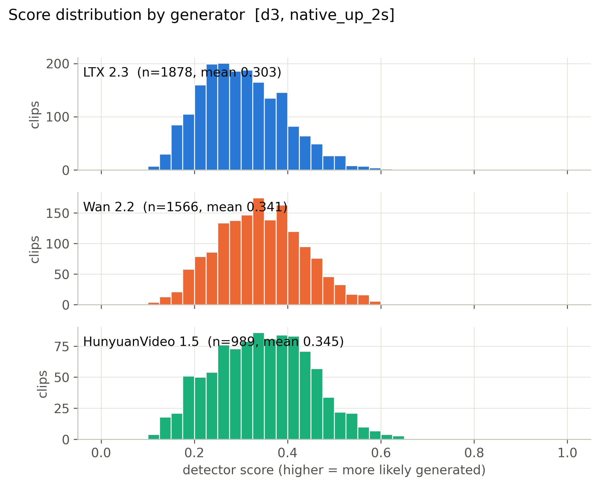

**Mean score, 56 cells x generator.** (`figures/heatmap_mean_score_cells.pdf`)

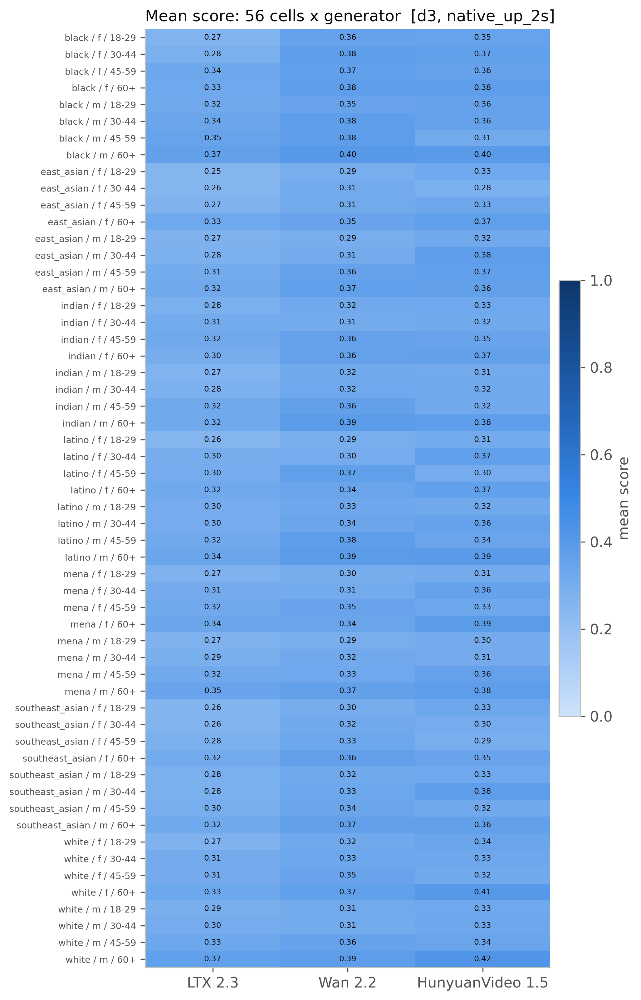

**Detection rate, 56 cells x generator (provisional threshold).** (`figures/heatmap_detection_rate_cells_provisional.pdf`)

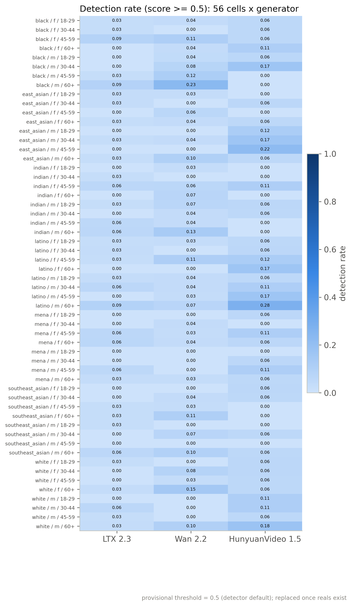

**Mean score by race, gender, age band with 95% CI.** (`figures/subgroup_mean_score.pdf`)

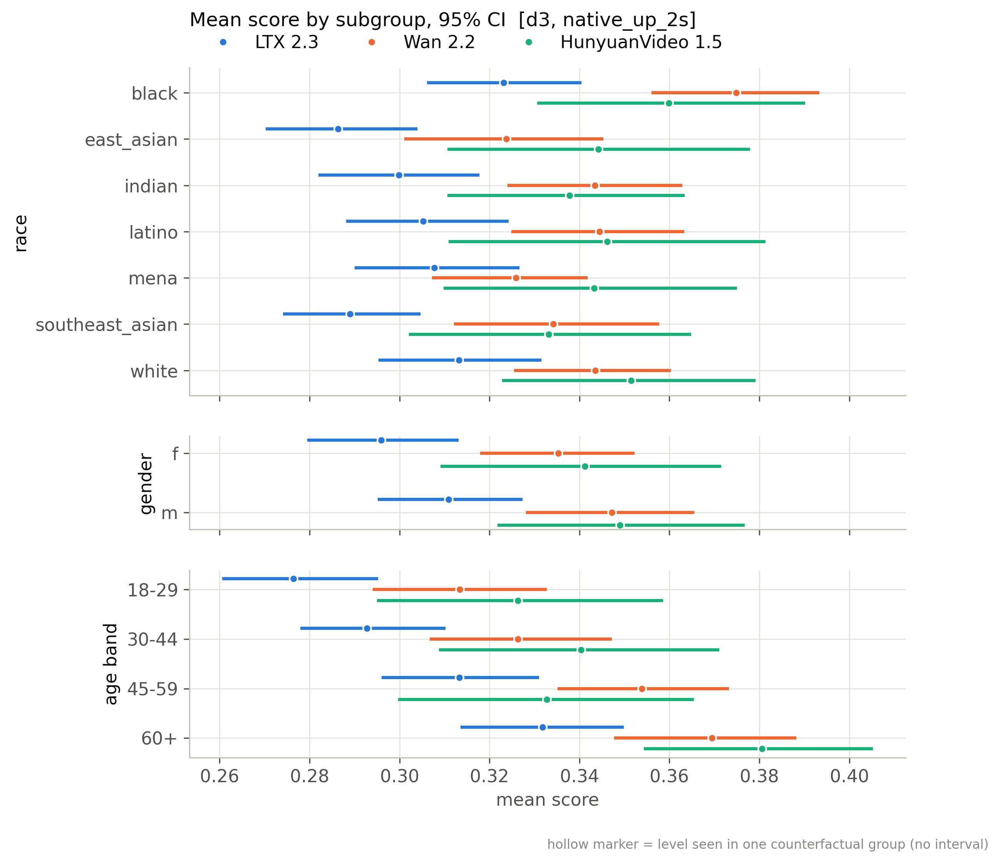

**Mean score by scene factor with 95% CI.** (`figures/scene_factor_mean_score.pdf`)

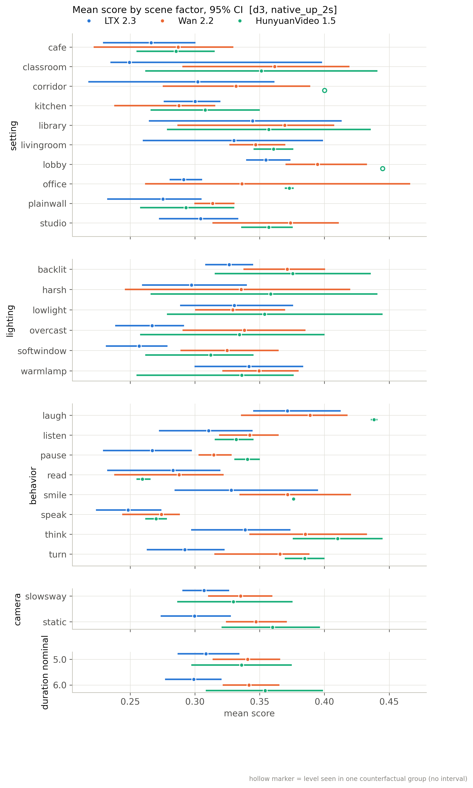

**Detection rate by subgroup (provisional threshold).** (`figures/subgroup_detection_rate_provisional.pdf`)

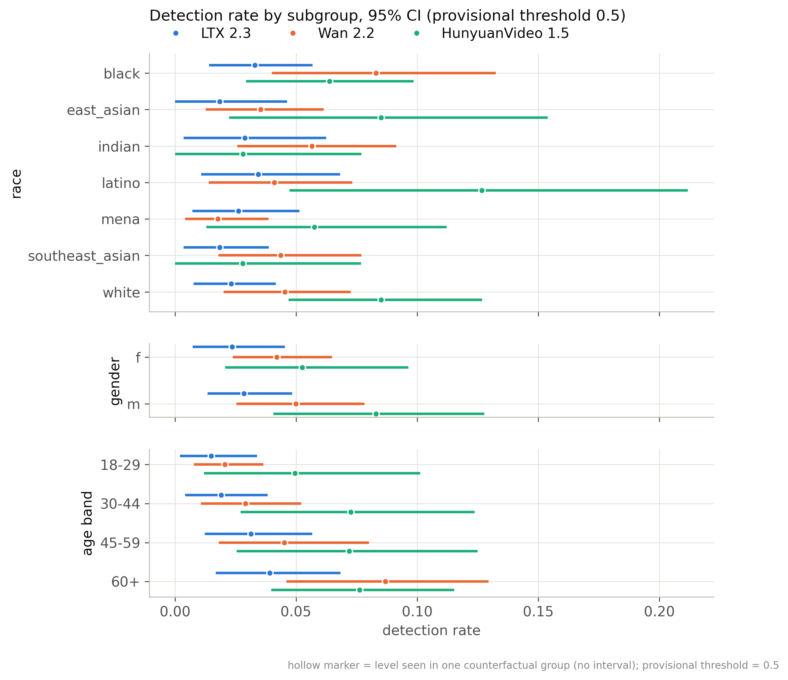

**Distribution of per-group CF spread.** (`figures/cf_spread_distribution.pdf`)

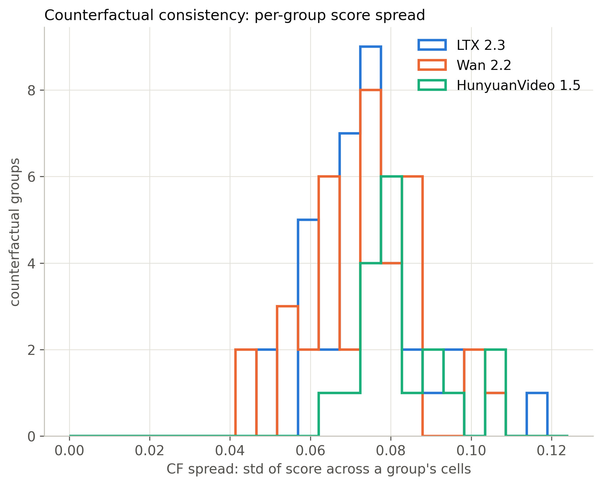

**Flip rate by generator (provisional threshold).** (`figures/flip_rate_by_generator_provisional.pdf`)

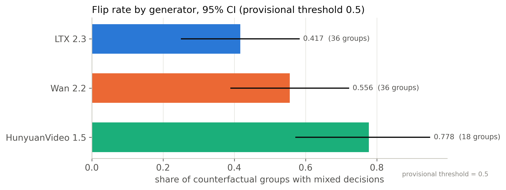

**Partial eta squared by factor.** (`figures/factor_attribution_variance_share.pdf`)

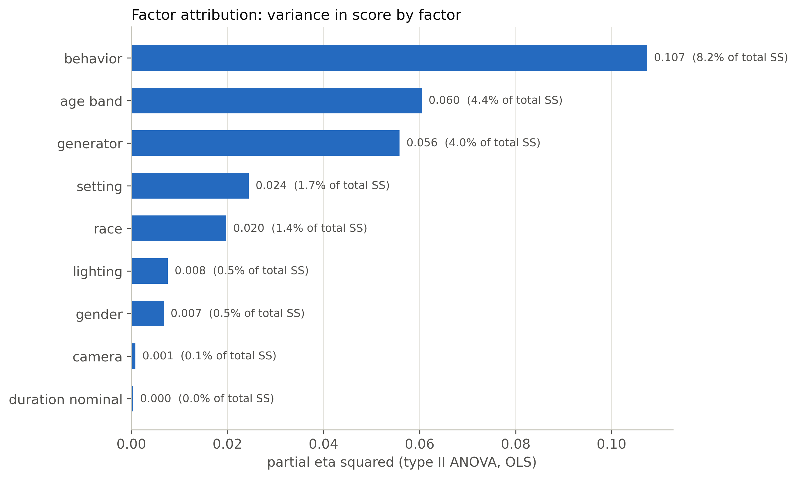

**Highest- and lowest-scoring included clips.** (`figures/example_strip.pdf`)

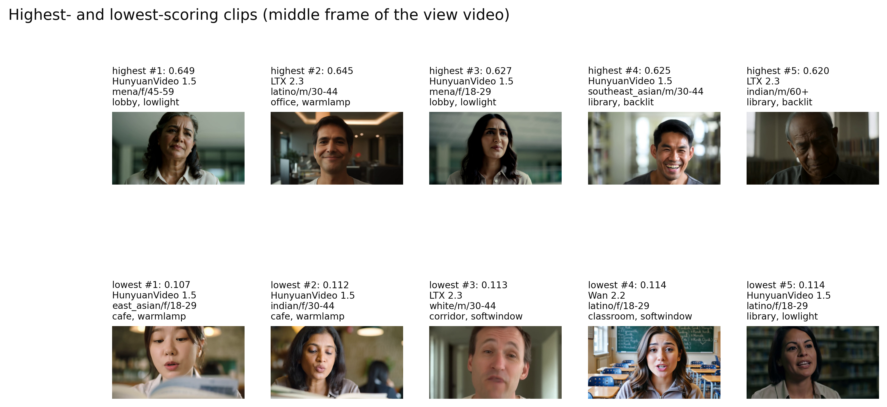

**ROC per generator against fps-matched reals.** (`figures/roc_per_generator.pdf`)

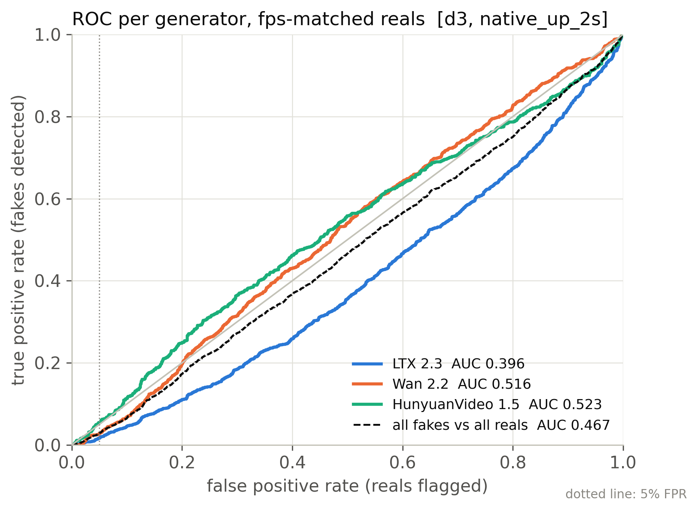

**Real FPR by perceived subgroup at the calibrated threshold.** (`figures/real_fpr_by_subgroup.pdf`)

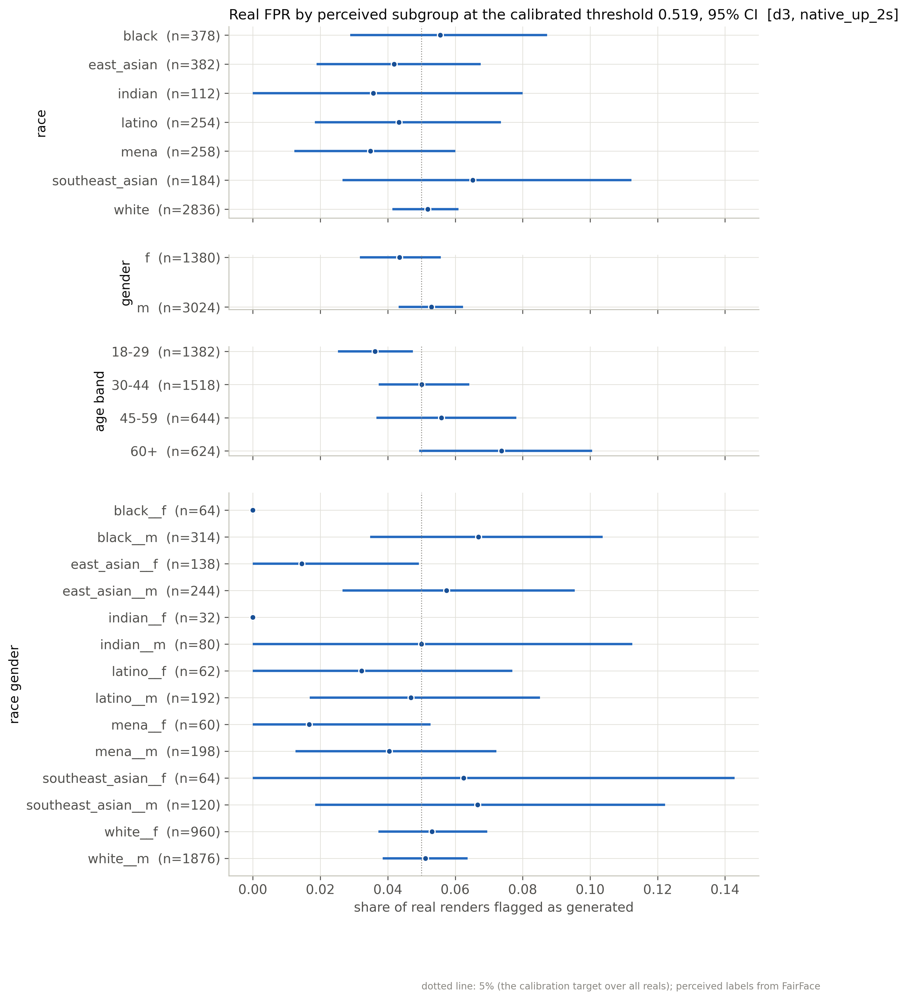

**AUC by subgroup: each subgroup's fakes vs same-subgroup reals.** (`figures/subgroup_auc.pdf`)

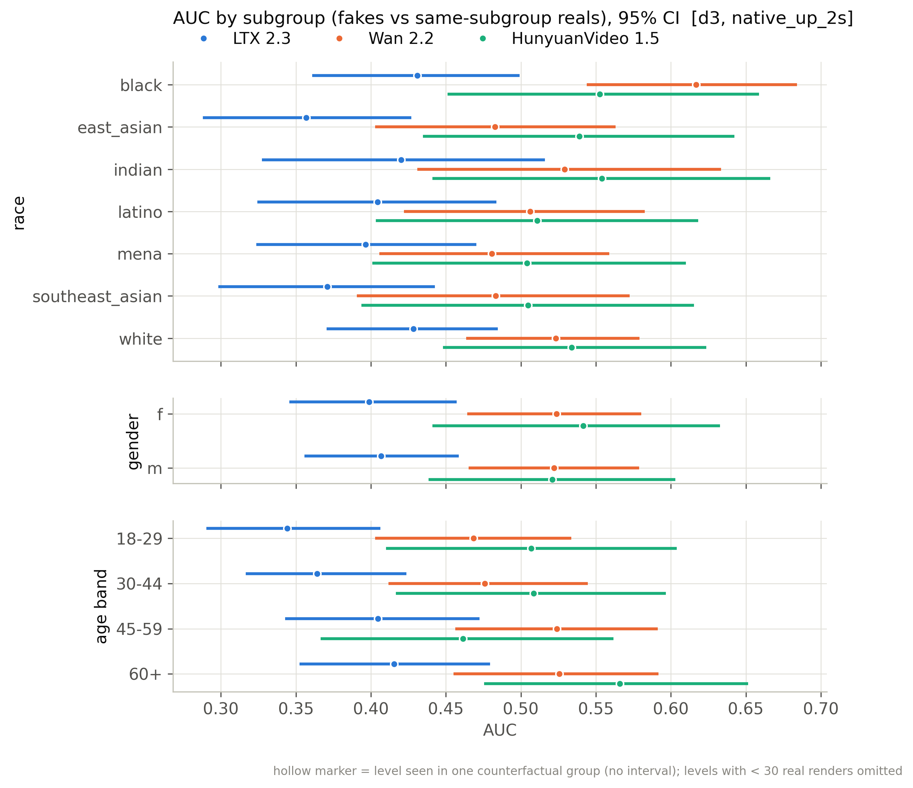

## Files

`manifest_used.csv` (every clip of the active batches with render/score/inclusion flags), `scores.csv` (score per scored clip), `tables/*.csv`, `figures/*`, `snapshot_meta.json`.

