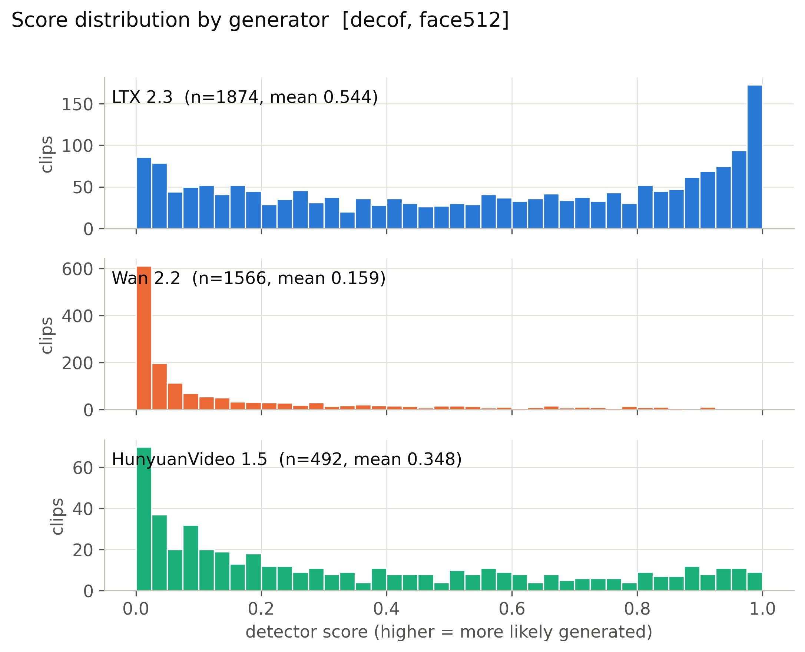
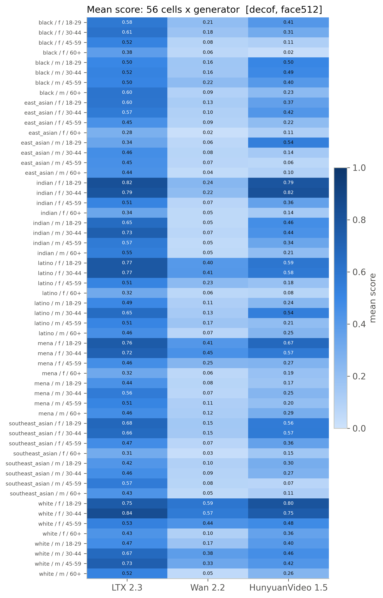
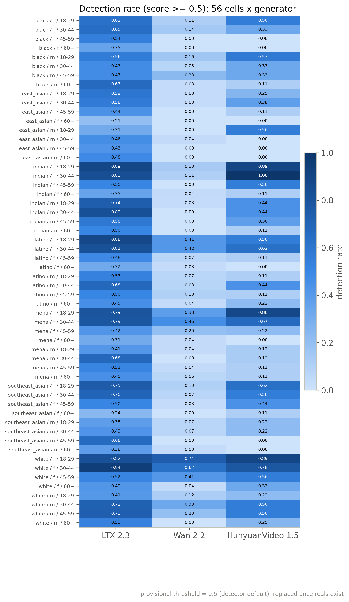
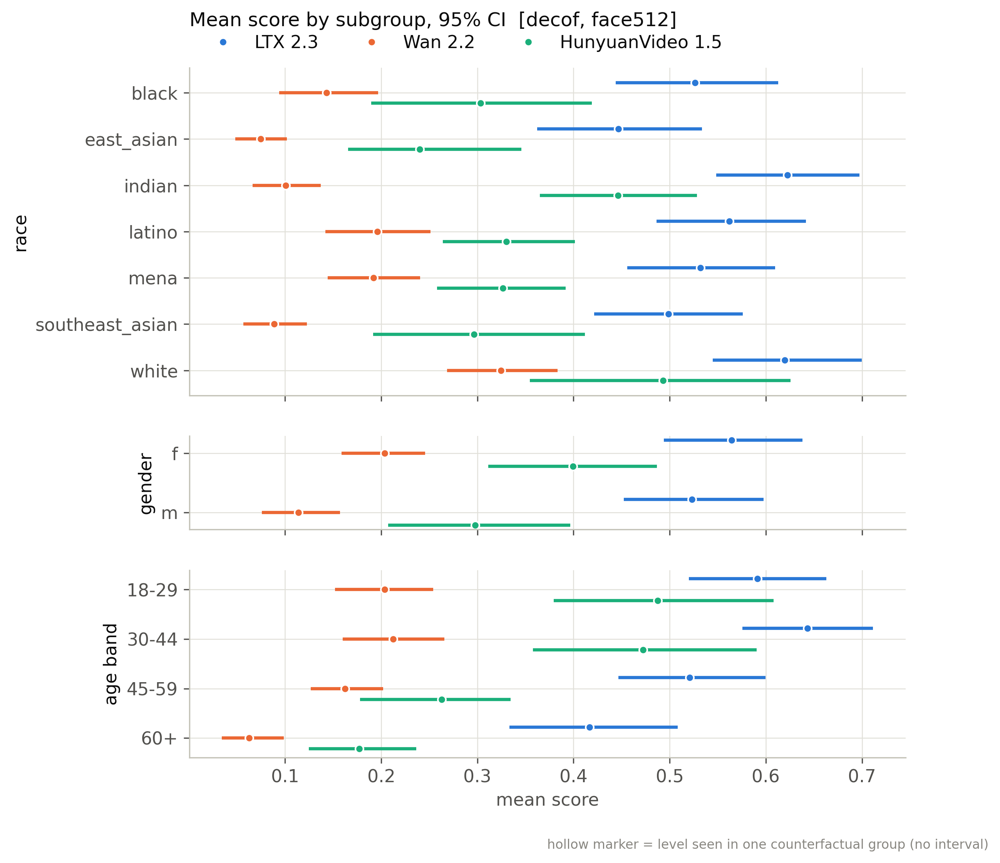
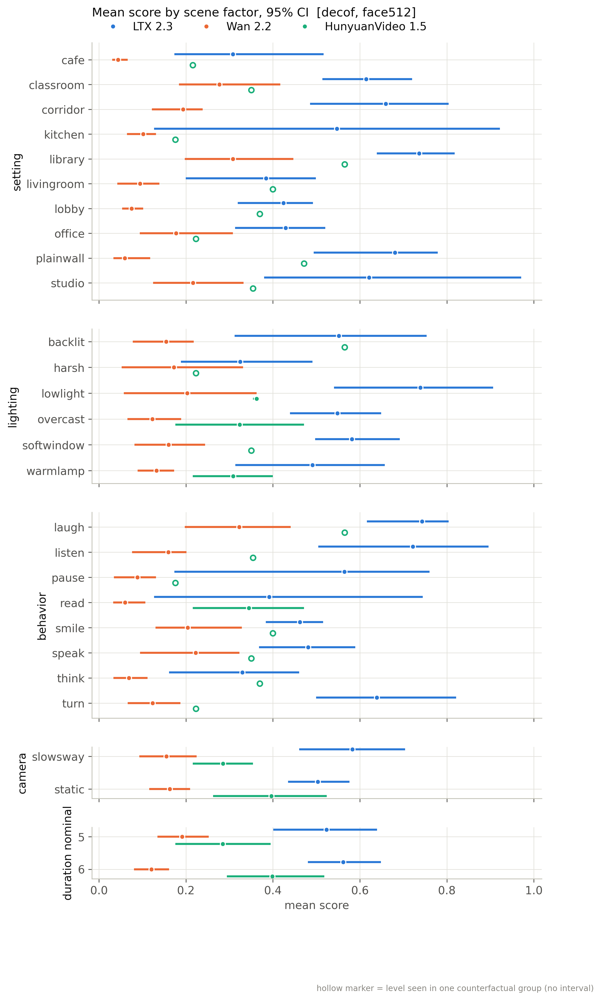
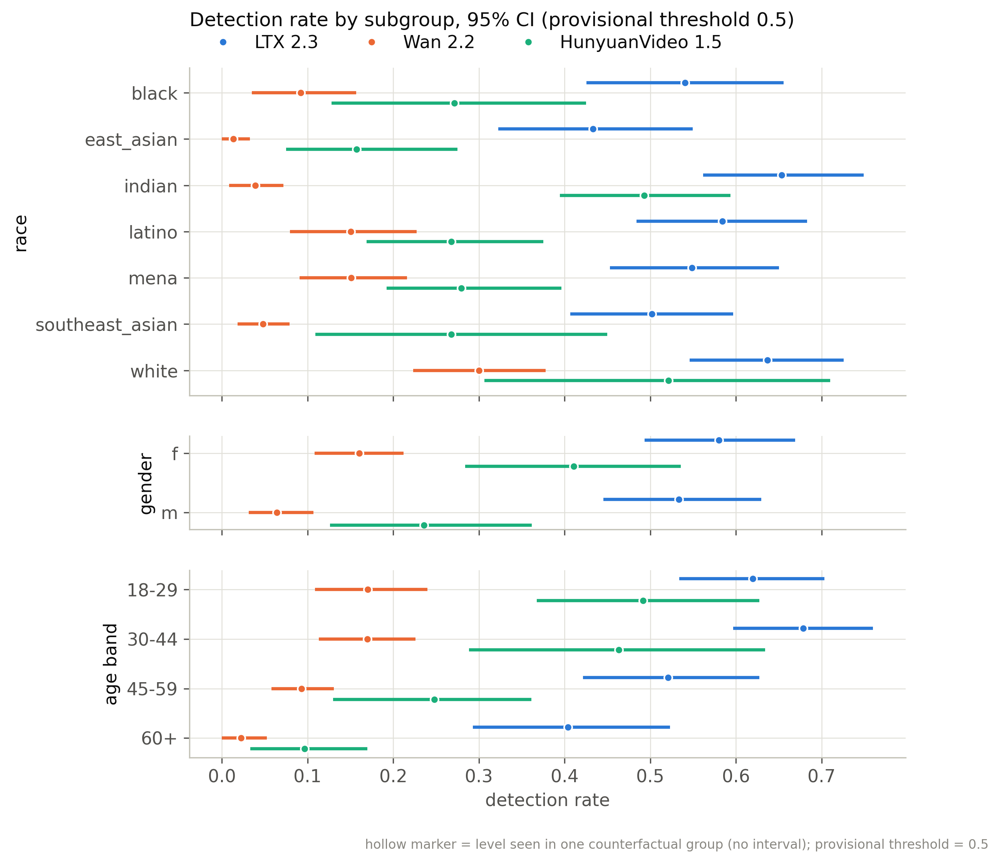
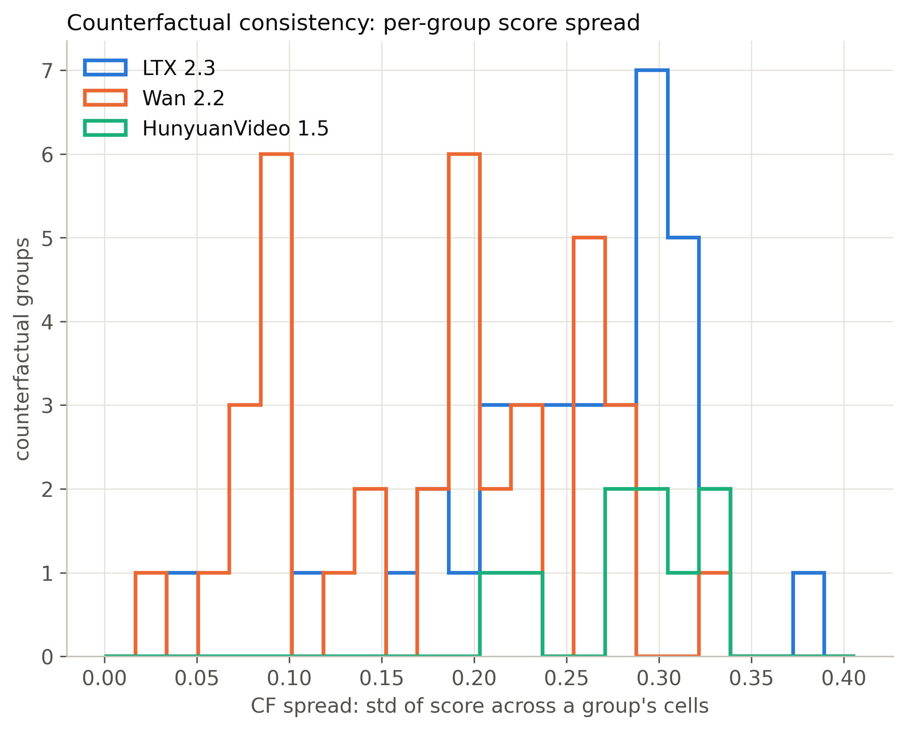
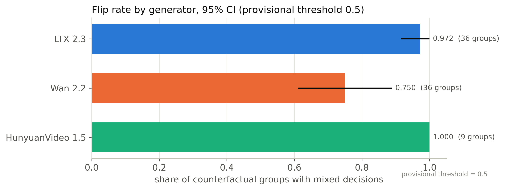
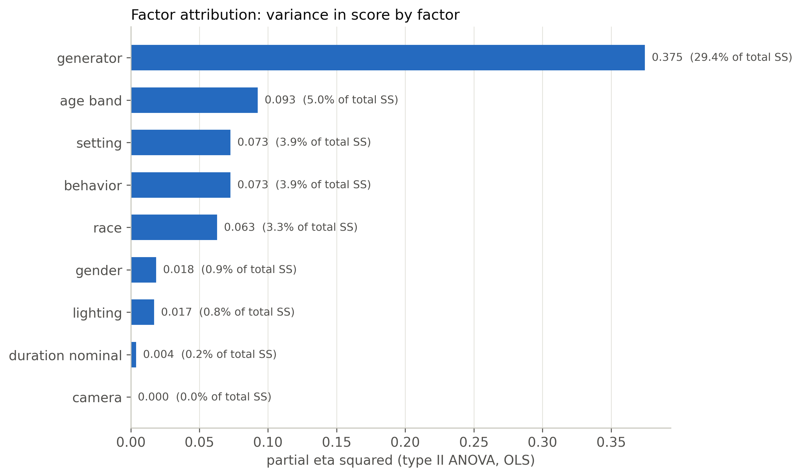
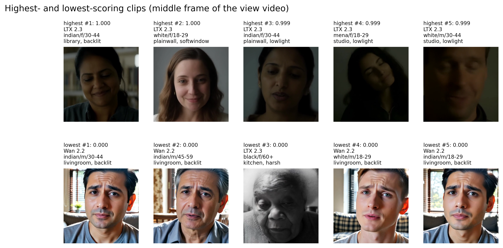

# decof / face512: snapshot 20261020-2319

> **Detector training data.** The released DeCoF checkpoint is most likely trained on AIGVDBench's Open-Sora split (per the paper's default training set and the checkpoint name); our generators are therefore likely unseen. Not confirmed by the authors. Our curated GenBuster subset includes LTX-Video and HunyuanVideo, which are separate from DeCoF's training data but not from AIGVDBench as a whole.

> **Provisional threshold.** Every detection rate and flip rate below uses the detector's default threshold (0.5; official: argmax over 2 logits (DeCoF test.py) == softmax[:,1] >= 0.5). They will be replaced by the 5%-real-FPR threshold once reals exist (section 6.3).

## Settings

| setting           | value                                                                                  |
|:------------------|:---------------------------------------------------------------------------------------|
| detector          | decof 1+b75d2cbe                                                                       |
| checkpoint_sha256 | 4edb7b310cc729771e74b93f658c7fdc4f2e31fdfa617a88372a540d4f9e7b4a                       |
| view              | face512 (view_hash 330ecb1e37e36e82)                                                   |
| ffmpeg            | ffmpeg version 7.1.1 Copyright (c) 2000-2025 the FFmpeg developers                     |
| batches           | fake_b1                                                                                |
| inclusion set     | primary (technical QC pass AND face QC pass)                                           |
| bootstrap         | 1000 resamples of whole counterfactual groups, seed 20261020, 95% percentile intervals |
| git commit        | fd27ce0b293a-dirty                                                                     |
| created           | 2026-10-20T23:20:12Z                                                                   |

Detector preprocessing on top of the view:

| field               | value                                                                           |
|:--------------------|:--------------------------------------------------------------------------------|
| source              | AIGVDBench section 7 + DeCoF src/utils/data.py (test phase)                     |
| frames_window       | 128                                                                             |
| frames_sampled      | 32                                                                              |
| frames_used         | 8                                                                               |
| sampling            | np.linspace(0, n-1, 32).astype(int)[:8], n = min(128, frames)                   |
| crop                | centre square, side = shorter side                                              |
| resize_1            | [256, 256, 'PIL.BILINEAR']                                                      |
| intermediate_format | lossless (PNG-equivalent, kept in memory)                                       |
| resize_2            | [224, 224, 'torchvision Resize default (bilinear, antialias)']                  |
| centre_crop         | 224                                                                             |
| normalize           | {'mean': [0.485, 0.456, 0.406], 'std': [0.229, 0.224, 0.225]}                   |
| backbone            | OpenAI CLIP ViT-L/14 (frozen), fp32                                             |
| head                | DeCoF vit.ViT(num_patches=8, dim=768, depth=2, heads=4, mlp_dim=768, pool=mean) |
| score               | softmax(logits)[:, 1]                                                           |
| precision           | fp32, TF32 off                                                                  |
| code                | LongMa-2025/DeCoF@5f73e8dc4f8cd9faeed07d767c9517e3f2c66044                      |
| clip_sha256         | b8cca3fd41ae0c99ba7e8951adf17d267cdb84cd88be6f7c2e0eca1737a03836                |

## Coverage

| batch   | generator   |   clips |   primary |   rendered |   view_excluded |   render_failed |   scored |   score_failed |   included |
|:--------|:------------|--------:|----------:|-----------:|----------------:|----------------:|---------:|---------------:|-----------:|
| fake_b1 | hunyuan15   |     504 |       492 |        504 |               0 |               0 |      504 |              0 |        492 |
| fake_b1 | ltx23       |    2016 |      1878 |       2012 |               4 |               0 |     2012 |              0 |       1874 |
| fake_b1 | wan22       |    2016 |      1566 |       2016 |               0 |               0 |     2016 |              0 |       1566 |

face512 window placement (fixed window at the median YuNet face centre, shifted inward at frame edges). The scaled frame is exactly 512 px on its short side, so every window spans it fully and is "shifted" on that axis by construction; the long-axis count is the informative one.

|   rendered |   shifted_long_axis |   shifted_short_axis |   max_shift_long_px |   excluded_no_face |
|-----------:|--------------------:|---------------------:|--------------------:|-------------------:|
|       4532 |                   4 |                 4505 |                 142 |                  4 |

Reals scored: 0. Fakes included: 3932 of 4532 scored (0 scoring failures).

## Observations

- LTX 2.3: mean score 0.544 [0.474, 0.617], median 0.576, n = 1874.
- Wan 2.2: mean score 0.159 [0.122, 0.198], median 0.046, n = 1566.
- HunyuanVideo 1.5: mean score 0.348 [0.269, 0.430], median 0.236, n = 492.
- Provisional detection rate (score >= 0.5), LTX 2.3: 55.7% [47.2, 64.6].
- Provisional detection rate (score >= 0.5), Wan 2.2: 11.2% [7.4, 15.3].
- Provisional detection rate (score >= 0.5), HunyuanVideo 1.5: 32.3% [21.8, 43.3].
- Provisional detection rate (score >= 0.5), all: 35.0% [30.3, 39.7].
- Largest race score gap: HunyuanVideo 1.5 0.253 [0.172, 0.377] (white 0.493 vs east_asian 0.240).
- Largest gender score gap: HunyuanVideo 1.5 0.102 [0.018, 0.191] (f 0.399 vs m 0.298).
- Largest age band score gap: HunyuanVideo 1.5 0.311 [0.251, 0.392] (18-29 0.488 vs 60+ 0.177).
- Largest cell score gap: HunyuanVideo 1.5 0.792 [0.758, 0.922] (indian__f__30-44 0.816 vs black__f__60+ 0.023).
- Largest scene-factor gap (all generators): setting 0.307 [0.233, 0.449] (library vs cafe).
- Largest partial eta squared: generator 0.375, age_band 0.093, setting 0.073; residual holds 49.2% of total SS.
- CF spread, LTX 2.3: 0.256 [0.233, 0.278] over 36 groups (max 0.387).
- CF spread, Wan 2.2: 0.178 [0.153, 0.203] over 36 groups (max 0.325).
- CF spread, HunyuanVideo 1.5: 0.290 [0.262, 0.315] over 9 groups (max 0.338).
- Provisional flip rate, LTX 2.3: 97.2% of 36 groups [91.7, 100.0].
- Provisional flip rate, Wan 2.2: 75.0% of 36 groups [61.1, 88.9].
- Provisional flip rate, HunyuanVideo 1.5: 100.0% of 9 groups [100.0, 100.0].

## 6.1 Fakes only, no threshold

### Mean score by generator

| generator   |    n |   n_groups |   estimate |   ci_lo |   ci_hi |    sd |   median |   q05 |   q95 |
|:------------|-----:|-----------:|-----------:|--------:|--------:|------:|---------:|------:|------:|
| ltx23       | 1874 |         36 |      0.544 |   0.474 |   0.617 | 0.337 |    0.576 | 0.028 | 0.988 |
| wan22       | 1566 |         36 |      0.159 |   0.122 |   0.198 | 0.229 |    0.046 | 0.002 | 0.725 |
| hunyuan15   |  492 |          9 |      0.348 |   0.269 |   0.43  | 0.317 |    0.236 | 0.01  | 0.93  |
| all         | 3932 |         36 |      0.366 |   0.324 |   0.406 | 0.346 |    0.243 | 0.004 | 0.972 |

### Mean score by race

| generator   | level           |   n |   estimate |   ci_lo |   ci_hi |   median |
|:------------|:----------------|----:|-----------:|--------:|--------:|---------:|
| ltx23       | black           | 272 |      0.527 |   0.444 |   0.613 |    0.591 |
| ltx23       | east_asian      | 270 |      0.447 |   0.362 |   0.533 |    0.394 |
| ltx23       | indian          | 277 |      0.623 |   0.548 |   0.697 |    0.715 |
| ltx23       | latino          | 262 |      0.562 |   0.486 |   0.642 |    0.613 |
| ltx23       | mena            | 266 |      0.532 |   0.456 |   0.609 |    0.559 |
| ltx23       | southeast_asian | 271 |      0.499 |   0.421 |   0.576 |    0.502 |
| ltx23       | white           | 256 |      0.62  |   0.545 |   0.7   |    0.68  |
| wan22       | black           | 217 |      0.143 |   0.094 |   0.197 |    0.049 |
| wan22       | east_asian      | 226 |      0.074 |   0.048 |   0.102 |    0.027 |
| wan22       | indian          | 230 |      0.101 |   0.066 |   0.137 |    0.021 |
| wan22       | latino          | 219 |      0.196 |   0.142 |   0.251 |    0.062 |
| wan22       | mena            | 225 |      0.192 |   0.144 |   0.24  |    0.064 |
| wan22       | southeast_asian | 229 |      0.089 |   0.057 |   0.123 |    0.024 |
| wan22       | white           | 220 |      0.325 |   0.269 |   0.383 |    0.224 |
| hunyuan15   | black           |  70 |      0.303 |   0.189 |   0.419 |    0.151 |
| hunyuan15   | east_asian      |  70 |      0.24  |   0.165 |   0.346 |    0.159 |
| hunyuan15   | indian          |  71 |      0.446 |   0.365 |   0.529 |    0.345 |
| hunyuan15   | latino          |  71 |      0.33  |   0.264 |   0.401 |    0.194 |
| hunyuan15   | mena            |  68 |      0.326 |   0.258 |   0.392 |    0.239 |
| hunyuan15   | southeast_asian |  71 |      0.296 |   0.191 |   0.412 |    0.137 |
| hunyuan15   | white           |  71 |      0.493 |   0.355 |   0.626 |    0.501 |
| all         | black           | 559 |      0.35  |   0.3   |   0.399 |    0.228 |
| all         | east_asian      | 566 |      0.272 |   0.229 |   0.318 |    0.117 |
| all         | indian          | 578 |      0.393 |   0.354 |   0.43  |    0.249 |
| all         | latino          | 552 |      0.387 |   0.335 |   0.436 |    0.265 |
| all         | mena            | 559 |      0.37  |   0.324 |   0.413 |    0.273 |
| all         | southeast_asian | 571 |      0.309 |   0.268 |   0.352 |    0.146 |
| all         | white           | 547 |      0.484 |   0.437 |   0.537 |    0.473 |

### Mean score by gender

| generator   | level   |    n |   estimate |   ci_lo |   ci_hi |   median |
|:------------|:--------|-----:|-----------:|--------:|--------:|---------:|
| ltx23       | f       |  931 |      0.564 |   0.494 |   0.638 |    0.618 |
| ltx23       | m       |  943 |      0.523 |   0.452 |   0.597 |    0.548 |
| wan22       | f       |  785 |      0.204 |   0.159 |   0.246 |    0.075 |
| wan22       | m       |  781 |      0.114 |   0.076 |   0.157 |    0.029 |
| hunyuan15   | f       |  246 |      0.399 |   0.311 |   0.487 |    0.322 |
| hunyuan15   | m       |  246 |      0.298 |   0.207 |   0.396 |    0.191 |
| all         | f       | 1962 |      0.399 |   0.354 |   0.442 |    0.292 |
| all         | m       | 1970 |      0.333 |   0.291 |   0.374 |    0.197 |

### Mean score by age band

| generator   | level   |    n |   estimate |   ci_lo |   ci_hi |   median |
|:------------|:--------|-----:|-----------:|--------:|--------:|---------:|
| ltx23       | 18-29   |  468 |      0.591 |   0.52  |   0.663 |    0.653 |
| ltx23       | 30-44   |  470 |      0.643 |   0.576 |   0.711 |    0.744 |
| ltx23       | 45-59   |  478 |      0.521 |   0.447 |   0.6   |    0.549 |
| ltx23       | 60+     |  458 |      0.417 |   0.333 |   0.508 |    0.354 |
| wan22       | 18-29   |  388 |      0.204 |   0.152 |   0.254 |    0.077 |
| wan22       | 30-44   |  377 |      0.212 |   0.16  |   0.266 |    0.072 |
| wan22       | 45-59   |  398 |      0.162 |   0.127 |   0.202 |    0.063 |
| wan22       | 60+     |  403 |      0.063 |   0.034 |   0.099 |    0.016 |
| hunyuan15   | 18-29   |  120 |      0.488 |   0.38  |   0.608 |    0.484 |
| hunyuan15   | 30-44   |  123 |      0.472 |   0.358 |   0.59  |    0.469 |
| hunyuan15   | 45-59   |  125 |      0.263 |   0.178 |   0.335 |    0.165 |
| hunyuan15   | 60+     |  124 |      0.177 |   0.125 |   0.236 |    0.108 |
| all         | 18-29   |  976 |      0.424 |   0.375 |   0.472 |    0.356 |
| all         | 30-44   |  970 |      0.454 |   0.41  |   0.495 |    0.412 |
| all         | 45-59   | 1001 |      0.346 |   0.301 |   0.389 |    0.236 |
| all         | 60+     |  985 |      0.242 |   0.201 |   0.284 |    0.096 |

### Mean score by scene factor (all generators pooled)

| factor           | level      |    n |   estimate |   ci_lo |   ci_hi |
|:-----------------|:-----------|-----:|-----------:|--------:|--------:|
| setting          | cafe       |  319 |      0.218 |   0.135 |   0.391 |
| setting          | classroom  |  317 |      0.418 |   0.357 |   0.502 |
| setting          | corridor   |  441 |      0.43  |   0.349 |   0.513 |
| setting          | kitchen    |  385 |      0.306 |   0.117 |   0.51  |
| setting          | library    |  476 |      0.526 |   0.474 |   0.631 |
| setting          | livingroom |  474 |      0.255 |   0.132 |   0.305 |
| setting          | lobby      |  345 |      0.292 |   0.271 |   0.309 |
| setting          | office     |  301 |      0.368 |   0.268 |   0.469 |
| setting          | plainwall  |  500 |      0.384 |   0.335 |   0.416 |
| setting          | studio     |  374 |      0.414 |   0.258 |   0.511 |
| lighting         | backlit    |  674 |      0.384 |   0.207 |   0.497 |
| lighting         | harsh      |  520 |      0.262 |   0.164 |   0.363 |
| lighting         | lowlight   |  728 |      0.462 |   0.36  |   0.559 |
| lighting         | overcast   |  640 |      0.353 |   0.303 |   0.418 |
| lighting         | softwindow |  712 |      0.374 |   0.332 |   0.414 |
| lighting         | warmlamp   |  658 |      0.328 |   0.236 |   0.439 |
| behavior         | laugh      |  442 |      0.519 |   0.452 |   0.605 |
| behavior         | listen     |  567 |      0.453 |   0.334 |   0.512 |
| behavior         | pause      |  467 |      0.327 |   0.135 |   0.415 |
| behavior         | read       |  520 |      0.26  |   0.117 |   0.398 |
| behavior         | smile      |  482 |      0.363 |   0.305 |   0.451 |
| behavior         | speak      |  474 |      0.36  |   0.266 |   0.439 |
| behavior         | think      |  452 |      0.234 |   0.099 |   0.309 |
| behavior         | turn       |  528 |      0.405 |   0.322 |   0.505 |
| camera           | slowsway   | 1951 |      0.378 |   0.303 |   0.444 |
| camera           | static     | 1981 |      0.354 |   0.314 |   0.401 |
| duration_nominal | 5          | 1946 |      0.351 |   0.281 |   0.423 |
| duration_nominal | 6          | 1986 |      0.381 |   0.339 |   0.425 |

Per-generator scene-factor and 56-cell rows: `tables/score_by_breakdown.csv`.

### Subgroup gap (max - min of level means)

A gap is max - min, so it is never negative and its interval cannot include 0; it is a size, not a test of a difference. Over many levels with few clips each (56 cells; HunyuanVideo has 9 groups per cell) the gap also grows with noise, so compare it with the per-level intervals in `tables/score_by_breakdown.csv`. Levels seen in a single counterfactual group have no interval.

| generator   | attribute        |   n_levels |   gap |   ci_lo |   ci_hi | max_level        | min_level          |
|:------------|:-----------------|-----------:|------:|--------:|--------:|:-----------------|:-------------------|
| ltx23       | race             |          7 | 0.176 |   0.14  |   0.235 | indian           | east_asian         |
| ltx23       | gender           |          2 | 0.041 |   0.009 |   0.075 | f                | m                  |
| ltx23       | age_band         |          4 | 0.227 |   0.172 |   0.281 | 30-44            | 60+                |
| ltx23       | cell             |         56 | 0.559 |   0.503 |   0.662 | white__f__30-44  | east_asian__f__60+ |
| ltx23       | setting          |         10 | 0.428 |   0.331 |   0.761 | library          | cafe               |
| ltx23       | lighting         |          6 | 0.414 |   0.218 |   0.639 | lowlight         | harsh              |
| ltx23       | behavior         |          8 | 0.413 |   0.31  |   0.688 | laugh            | think              |
| ltx23       | camera           |          2 | 0.08  |   0.004 |   0.222 | slowsway         | static             |
| ltx23       | duration_nominal |          2 | 0.038 |   0.003 |   0.185 | 6                | 5                  |
| wan22       | race             |          7 | 0.25  |   0.208 |   0.291 | white            | east_asian         |
| wan22       | gender           |          2 | 0.089 |   0.057 |   0.12  | f                | m                  |
| wan22       | age_band         |          4 | 0.15  |   0.11  |   0.193 | 30-44            | 60+                |
| wan22       | cell             |         56 | 0.578 |   0.487 |   0.687 | white__f__18-29  | east_asian__f__60+ |
| wan22       | setting          |         10 | 0.265 |   0.202 |   0.398 | library          | cafe               |
| wan22       | lighting         |          6 | 0.08  |   0.062 |   0.289 | lowlight         | overcast           |
| wan22       | behavior         |          8 | 0.262 |   0.173 |   0.397 | laugh            | read               |
| wan22       | camera           |          2 | 0.008 |   0.001 |   0.094 | static           | slowsway           |
| wan22       | duration_nominal |          2 | 0.071 |   0.007 |   0.141 | 5                | 6                  |
| hunyuan15   | race             |          7 | 0.253 |   0.172 |   0.377 | white            | east_asian         |
| hunyuan15   | gender           |          2 | 0.102 |   0.018 |   0.191 | f                | m                  |
| hunyuan15   | age_band         |          4 | 0.311 |   0.251 |   0.392 | 18-29            | 60+                |
| hunyuan15   | cell             |         56 | 0.792 |   0.758 |   0.922 | indian__f__30-44 | black__f__60+      |
| hunyuan15   | setting          |          9 | 0.389 |   0.175 |   0.389 | library          | kitchen            |
| hunyuan15   | lighting         |          6 | 0.342 |   0.049 |   0.389 | backlit          | harsh              |
| hunyuan15   | behavior         |          8 | 0.389 |   0.121 |   0.389 | laugh            | pause              |
| hunyuan15   | camera           |          2 | 0.111 |   0.007 |   0.26  | static           | slowsway           |
| hunyuan15   | duration_nominal |          2 | 0.114 |   0.007 |   0.261 | 6                | 5                  |
| all         | race             |          7 | 0.212 |   0.177 |   0.249 | white            | east_asian         |
| all         | gender           |          2 | 0.066 |   0.039 |   0.09  | f                | m                  |
| all         | age_band         |          4 | 0.213 |   0.182 |   0.241 | 30-44            | 60+                |
| all         | cell             |         56 | 0.57  |   0.521 |   0.63  | white__f__30-44  | east_asian__f__60+ |
| all         | setting          |         10 | 0.307 |   0.233 |   0.449 | library          | cafe               |
| all         | lighting         |          6 | 0.199 |   0.1   |   0.35  | lowlight         | harsh              |
| all         | behavior         |          8 | 0.284 |   0.204 |   0.44  | laugh            | think              |
| all         | camera           |          2 | 0.024 |   0.002 |   0.102 | slowsway         | static             |
| all         | duration_nominal |          2 | 0.03  |   0.002 |   0.11  | 6                | 5                  |

### CF spread (mean over groups of the std of score across the group's cells)

| generator   |   n_groups |   cf_spread |   ci_lo |   ci_hi |   median |   max |
|:------------|-----------:|------------:|--------:|--------:|---------:|------:|
| ltx23       |         36 |       0.256 |   0.233 |   0.278 |    0.272 | 0.387 |
| wan22       |         36 |       0.178 |   0.153 |   0.203 |    0.19  | 0.325 |
| hunyuan15   |          9 |       0.29  |   0.262 |   0.315 |    0.3   | 0.338 |

### Factor attribution

OLS with every factor as a fixed effect, type-II ANOVA. `ss_share` is the factor's type-II sum of squares over the total sum of squares (type-II shares need not add to 1). Scene factors are constant within a counterfactual group, so their effects are estimated from between-group differences only. The OLS F tests treat clips as independent although clips are clustered in counterfactual groups, so their p values are optimistic; use the group-bootstrap intervals above for inference.

| factor           |   df |     sum_sq | F       | p         | partial_eta2   |   ss_share |
|:-----------------|-----:|-----------:|:--------|:----------|:---------------|-----------:|
| race             |    6 |  15.5      | 43.52   | 1.012e-51 | 0.06281        |  0.03295   |
| gender           |    1 |   4.346    | 73.2    | 1.658e-17 | 0.01844        |  0.009239  |
| age_band         |    3 |  23.6      | 132.5   | 9.603e-82 | 0.09259        |  0.05017   |
| setting          |    9 |  18.14     | 33.95   | 3.993e-58 | 0.07272        |  0.03856   |
| lighting         |    5 |   3.988    | 13.43   | 5.154e-13 | 0.01695        |  0.008478  |
| behavior         |    7 |  18.12     | 43.6    | 1.135e-59 | 0.07265        |  0.03852   |
| camera           |    1 |   0.001776 | 0.02991 | 0.8627    | 7.678e-06      |  3.775e-06 |
| duration_nominal |    1 |   0.8841   | 14.89   | 0.0001157 | 0.003808       |  0.001879  |
| generator        |    2 | 138.5      | 1167    | 0         | 0.3746         |  0.2945    |
| Residual         | 3896 | 231.3      |         |           |                |  0.4917    |

Lighting x race interaction (added to the same OLS):

| term            |   df |   sum_sq |     F |        p |   partial_eta2 |
|:----------------|-----:|---------:|------:|---------:|---------------:|
| lighting x race |   30 |    3.519 | 1.991 | 0.001061 |        0.01522 |

Mixed model `score ~ factors + (1 | counterfactual_group)` (REML) variance components (fixed effects: `tables/factor_mixed_fixed.csv`):

| component                               |   variance | converged   |
|:----------------------------------------|-----------:|:------------|
| counterfactual_group (random intercept) |    0       | True        |
| residual                                |    0.05862 | True        |
| ICC (group share of random variance)    |    0       | True        |

A group variance at or near 0 is a boundary estimate: setting, lighting, behavior, camera and duration are fixed per group and absorb most between-group variation, leaving little for the random intercept. It does not mean scenes do not matter.

## 6.2 Provisional (threshold 0.5, provisional)

### Detection rate by generator (provisional)

| generator   |    n |   estimate |   ci_lo |   ci_hi |
|:------------|-----:|-----------:|--------:|--------:|
| ltx23       | 1874 |      0.557 |   0.472 |   0.646 |
| wan22       | 1566 |      0.112 |   0.074 |   0.153 |
| hunyuan15   |  492 |      0.323 |   0.218 |   0.433 |
| all         | 3932 |      0.35  |   0.303 |   0.397 |

### Detection rate by race (provisional)

| generator   | level           |   n |   estimate |   ci_lo |   ci_hi |
|:------------|:----------------|----:|-----------:|--------:|--------:|
| ltx23       | black           | 272 |      0.54  |   0.426 |   0.656 |
| ltx23       | east_asian      | 270 |      0.433 |   0.322 |   0.55  |
| ltx23       | indian          | 277 |      0.653 |   0.562 |   0.749 |
| ltx23       | latino          | 262 |      0.584 |   0.484 |   0.683 |
| ltx23       | mena            | 266 |      0.549 |   0.453 |   0.65  |
| ltx23       | southeast_asian | 271 |      0.502 |   0.407 |   0.597 |
| ltx23       | white           | 256 |      0.637 |   0.546 |   0.726 |
| wan22       | black           | 217 |      0.092 |   0.035 |   0.157 |
| wan22       | east_asian      | 226 |      0.013 |   0     |   0.033 |
| wan22       | indian          | 230 |      0.039 |   0.008 |   0.072 |
| wan22       | latino          | 219 |      0.151 |   0.08  |   0.227 |
| wan22       | mena            | 225 |      0.151 |   0.091 |   0.216 |
| wan22       | southeast_asian | 229 |      0.048 |   0.018 |   0.079 |
| wan22       | white           | 220 |      0.3   |   0.223 |   0.378 |
| hunyuan15   | black           |  70 |      0.271 |   0.128 |   0.425 |
| hunyuan15   | east_asian      |  70 |      0.157 |   0.075 |   0.275 |
| hunyuan15   | indian          |  71 |      0.493 |   0.394 |   0.594 |
| hunyuan15   | latino          |  71 |      0.268 |   0.169 |   0.375 |
| hunyuan15   | mena            |  68 |      0.279 |   0.192 |   0.396 |
| hunyuan15   | southeast_asian |  71 |      0.268 |   0.109 |   0.45  |
| hunyuan15   | white           |  71 |      0.521 |   0.306 |   0.71  |
| all         | black           | 559 |      0.333 |   0.27  |   0.394 |
| all         | east_asian      | 566 |      0.231 |   0.178 |   0.287 |
| all         | indian          | 578 |      0.389 |   0.339 |   0.435 |
| all         | latino          | 552 |      0.371 |   0.304 |   0.434 |
| all         | mena            | 559 |      0.356 |   0.297 |   0.412 |
| all         | southeast_asian | 571 |      0.291 |   0.238 |   0.343 |
| all         | white           | 547 |      0.486 |   0.429 |   0.547 |

### Detection rate by gender (provisional)

| generator   | level   |    n |   estimate |   ci_lo |   ci_hi |
|:------------|:--------|-----:|-----------:|--------:|--------:|
| ltx23       | f       |  931 |      0.58  |   0.493 |   0.669 |
| ltx23       | m       |  943 |      0.533 |   0.445 |   0.63  |
| wan22       | f       |  785 |      0.161 |   0.108 |   0.212 |
| wan22       | m       |  781 |      0.064 |   0.031 |   0.107 |
| hunyuan15   | f       |  246 |      0.411 |   0.284 |   0.536 |
| hunyuan15   | m       |  246 |      0.236 |   0.126 |   0.362 |
| all         | f       | 1962 |      0.391 |   0.338 |   0.44  |
| all         | m       | 1970 |      0.31  |   0.261 |   0.36  |

### Detection rate by age band (provisional)

| generator   | level   |    n |   estimate |   ci_lo |   ci_hi |
|:------------|:--------|-----:|-----------:|--------:|--------:|
| ltx23       | 18-29   |  468 |      0.62  |   0.534 |   0.703 |
| ltx23       | 30-44   |  470 |      0.679 |   0.597 |   0.76  |
| ltx23       | 45-59   |  478 |      0.521 |   0.422 |   0.627 |
| ltx23       | 60+     |  458 |      0.404 |   0.293 |   0.523 |
| wan22       | 18-29   |  388 |      0.17  |   0.109 |   0.24  |
| wan22       | 30-44   |  377 |      0.17  |   0.113 |   0.226 |
| wan22       | 45-59   |  398 |      0.093 |   0.058 |   0.131 |
| wan22       | 60+     |  403 |      0.022 |   0     |   0.052 |
| hunyuan15   | 18-29   |  120 |      0.492 |   0.368 |   0.627 |
| hunyuan15   | 30-44   |  123 |      0.463 |   0.289 |   0.634 |
| hunyuan15   | 45-59   |  125 |      0.248 |   0.13  |   0.361 |
| hunyuan15   | 60+     |  124 |      0.097 |   0.033 |   0.17  |
| all         | 18-29   |  976 |      0.425 |   0.369 |   0.48  |
| all         | 30-44   |  970 |      0.454 |   0.401 |   0.504 |
| all         | 45-59   | 1001 |      0.317 |   0.261 |   0.372 |
| all         | 60+     |  985 |      0.209 |   0.159 |   0.267 |

### Detection-rate gap (provisional)

| generator   | attribute        |   gap |   ci_lo |   ci_hi | max_level        | min_level          |
|:------------|:-----------------|------:|--------:|--------:|:-----------------|:-------------------|
| ltx23       | race             | 0.22  |   0.163 |   0.301 | indian           | east_asian         |
| ltx23       | gender           | 0.047 |   0.004 |   0.094 | f                | m                  |
| ltx23       | age_band         | 0.275 |   0.192 |   0.36  | 30-44            | 60+                |
| ltx23       | cell             | 0.732 |   0.63  |   0.884 | white__f__30-44  | east_asian__f__60+ |
| ltx23       | setting          | 0.544 |   0.422 |   0.882 | library          | cafe               |
| ltx23       | lighting         | 0.481 |   0.263 |   0.732 | lowlight         | harsh              |
| ltx23       | behavior         | 0.56  |   0.406 |   0.821 | laugh            | think              |
| ltx23       | camera           | 0.092 |   0.005 |   0.271 | slowsway         | static             |
| ltx23       | duration_nominal | 0.05  |   0.003 |   0.234 | 6                | 5                  |
| wan22       | race             | 0.287 |   0.213 |   0.36  | white            | east_asian         |
| wan22       | gender           | 0.096 |   0.053 |   0.137 | f                | m                  |
| wan22       | age_band         | 0.148 |   0.108 |   0.207 | 18-29            | 60+                |
| wan22       | cell             | 0.741 |   0.581 |   0.893 | white__f__18-29  | black__f__45-59    |
| wan22       | setting          | 0.251 |   0.184 |   0.408 | classroom        | cafe               |
| wan22       | lighting         | 0.07  |   0.06  |   0.302 | lowlight         | warmlamp           |
| wan22       | behavior         | 0.255 |   0.148 |   0.418 | laugh            | think              |
| wan22       | camera           | 0.004 |   0.001 |   0.096 | slowsway         | static             |
| wan22       | duration_nominal | 0.062 |   0.005 |   0.134 | 5                | 6                  |
| hunyuan15   | race             | 0.364 |   0.281 |   0.55  | white            | east_asian         |
| hunyuan15   | gender           | 0.175 |   0.069 |   0.291 | f                | m                  |
| hunyuan15   | age_band         | 0.395 |   0.337 |   0.502 | 18-29            | 60+                |
| hunyuan15   | cell             | 1     |   1     |   1     | indian__f__30-44 | black__f__45-59    |
| hunyuan15   | setting          | 0.536 |   0.193 |   0.536 | library          | kitchen            |
| hunyuan15   | lighting         | 0.49  |   0.068 |   0.536 | backlit          | harsh              |
| hunyuan15   | behavior         | 0.536 |   0.139 |   0.536 | laugh            | pause              |
| hunyuan15   | camera           | 0.153 |   0.009 |   0.343 | static           | slowsway           |
| hunyuan15   | duration_nominal | 0.147 |   0.009 |   0.344 | 6                | 5                  |
| all         | race             | 0.255 |   0.205 |   0.306 | white            | east_asian         |
| all         | gender           | 0.081 |   0.045 |   0.111 | f                | m                  |
| all         | age_band         | 0.244 |   0.199 |   0.291 | 30-44            | 60+                |
| all         | cell             | 0.7   |   0.634 |   0.817 | white__f__30-44  | east_asian__f__60+ |
| all         | setting          | 0.357 |   0.274 |   0.532 | library          | cafe               |
| all         | lighting         | 0.223 |   0.113 |   0.401 | lowlight         | harsh              |
| all         | behavior         | 0.351 |   0.246 |   0.521 | laugh            | think              |
| all         | camera           | 0.03  |   0.001 |   0.121 | slowsway         | static             |
| all         | duration_nominal | 0.047 |   0.003 |   0.14  | 6                | 5                  |

### Flip rate (provisional): share of groups whose clips get different decisions

| generator   |   n_groups |   flip_rate |   ci_lo |   ci_hi |   median |   max |
|:------------|-----------:|------------:|--------:|--------:|---------:|------:|
| ltx23       |         36 |       0.972 |   0.917 |   1     |        1 |     1 |
| wan22       |         36 |       0.75  |   0.611 |   0.889 |        1 |     1 |
| hunyuan15   |          9 |       1     |   1     |   1     |        1 |     1 |

### Sensitivity: inclusion set

| set     | generator   |    n |   mean_score |   provisional_detection_rate |
|:--------|:------------|-----:|-------------:|-----------------------------:|
| all     | hunyuan15   |  504 |        0.351 |                        0.329 |
| all     | ltx23       | 2012 |        0.546 |                        0.558 |
| all     | wan22       | 2016 |        0.169 |                        0.125 |
| primary | hunyuan15   |  492 |        0.348 |                        0.323 |
| primary | ltx23       | 1874 |        0.544 |                        0.557 |
| primary | wan22       | 1566 |        0.159 |                        0.112 |

## 6.3 Pending until reals exist

| metric                                                      | status   | reason                |
|:------------------------------------------------------------|:---------|:----------------------|
| AUC, AP, EER, TPR@5%FPR (overall, per generator)            | pending  | needs reals (real_b1) |
| Calibrated threshold (5% FPR on fps-matched reals)          | pending  | needs reals (real_b1) |
| Real FPR by perceived race, gender, age band, race x gender | pending  | needs reals (real_b1) |
| Detection rate and flip rate at the calibrated threshold    | pending  | needs reals (real_b1) |
| Worst-subgroup AUC, subgroup AUC gap                        | pending  | needs reals (real_b1) |
| ROC curves per generator; real FPR by subgroup (figures)    | pending  | needs reals (real_b1) |

## Figures

**Score distribution by generator.** (`figures/score_distribution_by_generator.pdf`)

**Mean score, 56 cells x generator.** (`figures/heatmap_mean_score_cells.pdf`)

**Detection rate, 56 cells x generator (provisional threshold).** (`figures/heatmap_detection_rate_cells_provisional.pdf`)

**Mean score by race, gender, age band with 95% CI.** (`figures/subgroup_mean_score.pdf`)

**Mean score by scene factor with 95% CI.** (`figures/scene_factor_mean_score.pdf`)

**Detection rate by subgroup (provisional threshold).** (`figures/subgroup_detection_rate_provisional.pdf`)

**Distribution of per-group CF spread.** (`figures/cf_spread_distribution.pdf`)

**Flip rate by generator (provisional threshold).** (`figures/flip_rate_by_generator_provisional.pdf`)

**Partial eta squared by factor.** (`figures/factor_attribution_variance_share.pdf`)

**Highest- and lowest-scoring included clips.** (`figures/example_strip.pdf`)

## Files

`manifest_used.csv` (every clip of the active batches with render/score/inclusion flags), `scores.csv` (score per scored clip), `tables/*.csv`, `figures/*`, `snapshot_meta.json`.

