# decof / face512: snapshot 20261021-1554

> **Detector training data.** The released DeCoF checkpoint is most likely trained on AIGVDBench's Open-Sora split (per the paper's default training set and the checkpoint name); our generators are therefore likely unseen. Not confirmed by the authors. Our curated GenBuster subset includes LTX-Video and HunyuanVideo, which are separate from DeCoF's training data but not from AIGVDBench as a whole.

> **Provisional threshold.** Every detection rate and flip rate below uses the detector's default threshold (0.5; official: argmax over 2 logits (DeCoF test.py) == softmax[:,1] >= 0.5). They will be replaced by the 5%-real-FPR threshold once reals exist (section 6.3).

## Settings

| setting           | value                                                                                  |
|:------------------|:---------------------------------------------------------------------------------------|
| detector          | decof 1+b75d2cbe                                                                       |
| checkpoint_sha256 | 4edb7b310cc729771e74b93f658c7fdc4f2e31fdfa617a88372a540d4f9e7b4a                       |
| view              | face512 (view_hash 330ecb1e37e36e82)                                                   |
| ffmpeg            | ffmpeg version 7.1.1 Copyright (c) 2000-2025 the FFmpeg developers                     |
| batches           | fake_b1, fake_b2, real_all                                                             |
| inclusion set     | primary (technical QC pass AND face QC pass)                                           |
| bootstrap         | 1000 resamples of whole counterfactual groups, seed 20261020, 95% percentile intervals |
| git commit        | fe7fdc074da1-dirty                                                                     |
| created           | 2026-10-21T15:54:16Z                                                                   |

Detector preprocessing on top of the view:

| field               | value                                                                           |
|:--------------------|:--------------------------------------------------------------------------------|
| source              | AIGVDBench section 7 + DeCoF src/utils/data.py (test phase)                     |
| frames_window       | 128                                                                             |
| frames_sampled      | 32                                                                              |
| frames_used         | 8                                                                               |
| sampling            | np.linspace(0, n-1, 32).astype(int)[:8], n = min(128, frames)                   |
| crop                | centre square, side = shorter side                                              |
| resize_1            | [256, 256, 'PIL.BILINEAR']                                                      |
| intermediate_format | lossless (PNG-equivalent, kept in memory)                                       |
| resize_2            | [224, 224, 'torchvision Resize default (bilinear, antialias)']                  |
| centre_crop         | 224                                                                             |
| normalize           | {'mean': [0.485, 0.456, 0.406], 'std': [0.229, 0.224, 0.225]}                   |
| backbone            | OpenAI CLIP ViT-L/14 (frozen), fp32                                             |
| head                | DeCoF vit.ViT(num_patches=8, dim=768, depth=2, heads=4, mlp_dim=768, pool=mean) |
| score               | softmax(logits)[:, 1]                                                           |
| precision           | fp32, TF32 off                                                                  |
| code                | LongMa-2025/DeCoF@5f73e8dc4f8cd9faeed07d767c9517e3f2c66044                      |
| clip_sha256         | b8cca3fd41ae0c99ba7e8951adf17d267cdb84cd88be6f7c2e0eca1737a03836                |

## Coverage

| batch    | generator   |   clips |   primary |   rendered |   view_excluded |   render_failed |   scored |   score_failed |   included |
|:---------|:------------|--------:|----------:|-----------:|----------------:|----------------:|---------:|---------------:|-----------:|
| fake_b1  | hunyuan15   |     504 |       492 |        504 |               0 |               0 |      504 |              0 |        492 |
| fake_b1  | ltx23       |    2016 |      1878 |       2012 |               4 |               0 |     2012 |              0 |       1874 |
| fake_b1  | wan22       |    2016 |      1566 |       2016 |               0 |               0 |     2016 |              0 |       1566 |
| fake_b2  | hunyuan15   |     504 |       497 |        504 |               0 |               0 |      504 |              0 |        497 |
| real_all | real        |    2221 |      2221 |        919 |            1279 |              23 |      928 |              0 |        928 |

face512 window placement (fixed window at the median YuNet face centre, shifted inward at frame edges). The scaled frame is exactly 512 px on its short side, so every window spans it fully and is "shifted" on that axis by construction; the long-axis count is the informative one.

|   rendered |   shifted_long_axis |   shifted_short_axis |   max_shift_long_px |   excluded_no_face |
|-----------:|--------------------:|---------------------:|--------------------:|-------------------:|
|       6883 |                 159 |                 6840 |                 186 |                 12 |

Reals scored: 1847. Fakes included: 4429 of 6883 scored (0 scoring failures).

## Observations

- LTX 2.3: mean score 0.592 [0.524, 0.661], median 0.665, n = 1874.
- Wan 2.2: mean score 0.180 [0.139, 0.223], median 0.058, n = 1566.
- HunyuanVideo 1.5: mean score 0.381 [0.327, 0.440], median 0.291, n = 989.
- Provisional detection rate (score >= 0.5), LTX 2.3: 61.2% [52.4, 69.9].
- Provisional detection rate (score >= 0.5), Wan 2.2: 13.3% [9.4, 17.6].
- Provisional detection rate (score >= 0.5), HunyuanVideo 1.5: 35.6% [28.7, 42.7].
- Provisional detection rate (score >= 0.5), all: 38.5% [33.7, 43.2].
- Largest race score gap: Wan 2.2 0.261 [0.221, 0.302] (white 0.353 vs east_asian 0.091).
- Largest gender score gap: Wan 2.2 0.098 [0.062, 0.132] (f 0.229 vs m 0.130).
- Largest age band score gap: HunyuanVideo 1.5 0.295 [0.243, 0.364] (18-29 0.505 vs 60+ 0.210).
- Largest cell score gap: HunyuanVideo 1.5 0.782 [0.717, 0.874] (white__f__18-29 0.838 vs black__f__60+ 0.056).
- Largest scene-factor gap (all generators): setting 0.310 [0.243, 0.441] (library vs cafe).
- Largest partial eta squared: generator 0.369, age_band 0.103, setting 0.070; residual holds 49.5% of total SS.
- CF spread, LTX 2.3: 0.252 [0.229, 0.274] over 36 groups (max 0.386).
- CF spread, Wan 2.2: 0.191 [0.166, 0.216] over 36 groups (max 0.324).
- CF spread, HunyuanVideo 1.5: 0.292 [0.274, 0.309] over 18 groups (max 0.349).
- Provisional flip rate, LTX 2.3: 94.4% of 36 groups [86.1, 100.0].
- Provisional flip rate, Wan 2.2: 77.8% of 36 groups [63.9, 91.7].
- Provisional flip rate, HunyuanVideo 1.5: 100.0% of 18 groups [100.0, 100.0].

## 6.1 Fakes only, no threshold

### Mean score by generator

| generator   |    n |   n_groups |   estimate |   ci_lo |   ci_hi |    sd |   median |   q05 |   q95 |
|:------------|-----:|-----------:|-----------:|--------:|--------:|------:|---------:|------:|------:|
| ltx23       | 1874 |         36 |      0.592 |   0.524 |   0.661 | 0.331 |    0.665 | 0.036 | 0.992 |
| wan22       | 1566 |         36 |      0.18  |   0.139 |   0.223 | 0.244 |    0.058 | 0.003 | 0.766 |
| hunyuan15   |  989 |         18 |      0.381 |   0.327 |   0.44  | 0.319 |    0.291 | 0.013 | 0.947 |
| all         | 4429 |         36 |      0.399 |   0.358 |   0.439 | 0.351 |    0.308 | 0.006 | 0.977 |

### Mean score by race

| generator   | level           |   n |   estimate |   ci_lo |   ci_hi |   median |
|:------------|:----------------|----:|-----------:|--------:|--------:|---------:|
| ltx23       | black           | 272 |      0.578 |   0.495 |   0.662 |    0.661 |
| ltx23       | east_asian      | 270 |      0.498 |   0.415 |   0.581 |    0.482 |
| ltx23       | indian          | 277 |      0.664 |   0.593 |   0.733 |    0.799 |
| ltx23       | latino          | 262 |      0.606 |   0.528 |   0.682 |    0.67  |
| ltx23       | mena            | 266 |      0.585 |   0.508 |   0.663 |    0.655 |
| ltx23       | southeast_asian | 271 |      0.55  |   0.474 |   0.625 |    0.583 |
| ltx23       | white           | 256 |      0.664 |   0.59  |   0.742 |    0.763 |
| wan22       | black           | 217 |      0.165 |   0.11  |   0.224 |    0.055 |
| wan22       | east_asian      | 226 |      0.091 |   0.059 |   0.123 |    0.031 |
| wan22       | indian          | 230 |      0.118 |   0.079 |   0.157 |    0.024 |
| wan22       | latino          | 219 |      0.221 |   0.163 |   0.277 |    0.08  |
| wan22       | mena            | 225 |      0.215 |   0.163 |   0.267 |    0.077 |
| wan22       | southeast_asian | 229 |      0.103 |   0.067 |   0.141 |    0.03  |
| wan22       | white           | 220 |      0.353 |   0.295 |   0.412 |    0.283 |
| hunyuan15   | black           | 141 |      0.311 |   0.234 |   0.391 |    0.191 |
| hunyuan15   | east_asian      | 141 |      0.288 |   0.231 |   0.348 |    0.182 |
| hunyuan15   | indian          | 142 |      0.449 |   0.382 |   0.523 |    0.412 |
| hunyuan15   | latino          | 142 |      0.368 |   0.301 |   0.441 |    0.28  |
| hunyuan15   | mena            | 139 |      0.4   |   0.344 |   0.456 |    0.349 |
| hunyuan15   | southeast_asian | 143 |      0.332 |   0.265 |   0.401 |    0.22  |
| hunyuan15   | white           | 141 |      0.519 |   0.445 |   0.594 |    0.526 |
| all         | black           | 630 |      0.376 |   0.328 |   0.429 |    0.283 |
| all         | east_asian      | 637 |      0.307 |   0.264 |   0.35  |    0.16  |
| all         | indian          | 649 |      0.423 |   0.382 |   0.459 |    0.317 |
| all         | latino          | 623 |      0.417 |   0.364 |   0.467 |    0.338 |
| all         | mena            | 630 |      0.412 |   0.366 |   0.453 |    0.352 |
| all         | southeast_asian | 643 |      0.343 |   0.302 |   0.384 |    0.209 |
| all         | white           | 617 |      0.52  |   0.473 |   0.57  |    0.529 |

### Mean score by gender

| generator   | level   |    n |   estimate |   ci_lo |   ci_hi |   median |
|:------------|:--------|-----:|-----------:|--------:|--------:|---------:|
| ltx23       | f       |  931 |      0.613 |   0.541 |   0.684 |    0.715 |
| ltx23       | m       |  943 |      0.572 |   0.504 |   0.642 |    0.628 |
| wan22       | f       |  785 |      0.229 |   0.18  |   0.276 |    0.092 |
| wan22       | m       |  781 |      0.13  |   0.089 |   0.176 |    0.034 |
| hunyuan15   | f       |  495 |      0.423 |   0.361 |   0.483 |    0.38  |
| hunyuan15   | m       |  494 |      0.339 |   0.273 |   0.412 |    0.238 |
| all         | f       | 2211 |      0.434 |   0.39  |   0.477 |    0.362 |
| all         | m       | 2218 |      0.364 |   0.322 |   0.407 |    0.247 |

### Mean score by age band

| generator   | level   |    n |   estimate |   ci_lo |   ci_hi |   median |
|:------------|:--------|-----:|-----------:|--------:|--------:|---------:|
| ltx23       | 18-29   |  468 |      0.644 |   0.574 |   0.71  |    0.761 |
| ltx23       | 30-44   |  470 |      0.686 |   0.622 |   0.752 |    0.798 |
| ltx23       | 45-59   |  478 |      0.571 |   0.494 |   0.647 |    0.626 |
| ltx23       | 60+     |  458 |      0.465 |   0.381 |   0.556 |    0.431 |
| wan22       | 18-29   |  388 |      0.23  |   0.176 |   0.284 |    0.09  |
| wan22       | 30-44   |  377 |      0.237 |   0.179 |   0.295 |    0.103 |
| wan22       | 45-59   |  398 |      0.185 |   0.146 |   0.226 |    0.079 |
| wan22       | 60+     |  403 |      0.072 |   0.041 |   0.113 |    0.019 |
| hunyuan15   | 18-29   |  242 |      0.505 |   0.437 |   0.585 |    0.493 |
| hunyuan15   | 30-44   |  248 |      0.497 |   0.415 |   0.582 |    0.524 |
| hunyuan15   | 45-59   |  250 |      0.316 |   0.26  |   0.369 |    0.211 |
| hunyuan15   | 60+     |  249 |      0.21  |   0.165 |   0.261 |    0.124 |
| all         | 18-29   | 1098 |      0.467 |   0.418 |   0.515 |    0.432 |
| all         | 30-44   | 1095 |      0.489 |   0.443 |   0.534 |    0.498 |
| all         | 45-59   | 1126 |      0.378 |   0.335 |   0.421 |    0.297 |
| all         | 60+     | 1110 |      0.265 |   0.226 |   0.306 |    0.115 |

### Mean score by scene factor (all generators pooled)

| factor           | level      |    n |   estimate |   ci_lo |   ci_hi |
|:-----------------|:-----------|-----:|-----------:|--------:|--------:|
| setting          | cafe       |  375 |      0.249 |   0.178 |   0.343 |
| setting          | classroom  |  373 |      0.48  |   0.407 |   0.545 |
| setting          | corridor   |  493 |      0.458 |   0.379 |   0.564 |
| setting          | kitchen    |  441 |      0.325 |   0.171 |   0.525 |
| setting          | library    |  532 |      0.559 |   0.519 |   0.658 |
| setting          | livingroom |  530 |      0.296 |   0.163 |   0.353 |
| setting          | lobby      |  345 |      0.325 |   0.302 |   0.35  |
| setting          | office     |  357 |      0.421 |   0.307 |   0.486 |
| setting          | plainwall  |  553 |      0.403 |   0.371 |   0.45  |
| setting          | studio     |  430 |      0.434 |   0.299 |   0.552 |
| lighting         | backlit    |  786 |      0.399 |   0.253 |   0.539 |
| lighting         | harsh      |  632 |      0.319 |   0.204 |   0.447 |
| lighting         | lowlight   |  784 |      0.495 |   0.397 |   0.592 |
| lighting         | overcast   |  692 |      0.393 |   0.348 |   0.459 |
| lighting         | softwindow |  821 |      0.399 |   0.359 |   0.438 |
| lighting         | warmlamp   |  714 |      0.371 |   0.276 |   0.468 |
| behavior         | laugh      |  498 |      0.562 |   0.519 |   0.632 |
| behavior         | listen     |  679 |      0.451 |   0.333 |   0.547 |
| behavior         | pause      |  520 |      0.36  |   0.178 |   0.45  |
| behavior         | read       |  576 |      0.283 |   0.171 |   0.421 |
| behavior         | smile      |  538 |      0.413 |   0.352 |   0.479 |
| behavior         | speak      |  530 |      0.418 |   0.304 |   0.497 |
| behavior         | think      |  508 |      0.27  |   0.118 |   0.35  |
| behavior         | turn       |  580 |      0.432 |   0.355 |   0.525 |
| camera           | slowsway   | 2224 |      0.403 |   0.336 |   0.467 |
| camera           | static     | 2205 |      0.395 |   0.355 |   0.444 |
| duration_nominal | 5.0        | 2226 |      0.389 |   0.318 |   0.46  |
| duration_nominal | 6.0        | 2203 |      0.41  |   0.373 |   0.449 |

Per-generator scene-factor and 56-cell rows: `tables/score_by_breakdown.csv`.

### Subgroup gap (max - min of level means)

A gap is max - min, so it is never negative and its interval cannot include 0; it is a size, not a test of a difference. Over many levels with few clips each (56 cells; HunyuanVideo has 9 groups per cell) the gap also grows with noise, so compare it with the per-level intervals in `tables/score_by_breakdown.csv`. Levels seen in a single counterfactual group have no interval.

| generator   | attribute        |   n_levels |   gap |   ci_lo |   ci_hi | max_level       | min_level          |
|:------------|:-----------------|-----------:|------:|--------:|--------:|:----------------|:-------------------|
| ltx23       | race             |          7 | 0.166 |   0.131 |   0.225 | white           | east_asian         |
| ltx23       | gender           |          2 | 0.041 |   0.011 |   0.073 | f               | m                  |
| ltx23       | age_band         |          4 | 0.221 |   0.167 |   0.275 | 30-44           | 60+                |
| ltx23       | cell             |         56 | 0.545 |   0.483 |   0.652 | white__f__30-44 | east_asian__f__60+ |
| ltx23       | setting          |         10 | 0.417 |   0.326 |   0.733 | library         | cafe               |
| ltx23       | lighting         |          6 | 0.388 |   0.215 |   0.604 | lowlight        | harsh              |
| ltx23       | behavior         |          8 | 0.419 |   0.304 |   0.659 | laugh           | think              |
| ltx23       | camera           |          2 | 0.062 |   0.004 |   0.205 | slowsway        | static             |
| ltx23       | duration_nominal |          2 | 0.045 |   0.003 |   0.194 | 6.0             | 5.0                |
| wan22       | race             |          7 | 0.261 |   0.221 |   0.302 | white           | east_asian         |
| wan22       | gender           |          2 | 0.098 |   0.062 |   0.132 | f               | m                  |
| wan22       | age_band         |          4 | 0.165 |   0.121 |   0.214 | 30-44           | 60+                |
| wan22       | cell             |         56 | 0.617 |   0.521 |   0.726 | white__f__18-29 | east_asian__f__60+ |
| wan22       | setting          |         10 | 0.291 |   0.229 |   0.444 | library         | cafe               |
| wan22       | lighting         |          6 | 0.091 |   0.067 |   0.315 | lowlight        | overcast           |
| wan22       | behavior         |          8 | 0.292 |   0.192 |   0.435 | laugh           | read               |
| wan22       | camera           |          2 | 0.004 |   0.001 |   0.103 | static          | slowsway           |
| wan22       | duration_nominal |          2 | 0.083 |   0.011 |   0.158 | 5.0             | 6.0                |
| hunyuan15   | race             |          7 | 0.232 |   0.175 |   0.306 | white           | east_asian         |
| hunyuan15   | gender           |          2 | 0.084 |   0.023 |   0.146 | f               | m                  |
| hunyuan15   | age_band         |          4 | 0.295 |   0.243 |   0.364 | 18-29           | 60+                |
| hunyuan15   | cell             |         56 | 0.782 |   0.717 |   0.874 | white__f__18-29 | black__f__60+      |
| hunyuan15   | setting          |         10 | 0.373 |   0.224 |   0.411 | library         | kitchen            |
| hunyuan15   | lighting         |          6 | 0.134 |   0.11  |   0.362 | lowlight        | softwindow         |
| hunyuan15   | behavior         |          8 | 0.328 |   0.186 |   0.401 | laugh           | pause              |
| hunyuan15   | camera           |          2 | 0.087 |   0.007 |   0.193 | static          | slowsway           |
| hunyuan15   | duration_nominal |          2 | 0.031 |   0.003 |   0.148 | 6.0             | 5.0                |
| all         | race             |          7 | 0.213 |   0.179 |   0.249 | white           | east_asian         |
| all         | gender           |          2 | 0.069 |   0.043 |   0.094 | f               | m                  |
| all         | age_band         |          4 | 0.223 |   0.194 |   0.255 | 30-44           | 60+                |
| all         | cell             |         56 | 0.584 |   0.537 |   0.652 | white__f__30-44 | east_asian__f__60+ |
| all         | setting          |         10 | 0.31  |   0.243 |   0.441 | library         | cafe               |
| all         | lighting         |          6 | 0.177 |   0.082 |   0.336 | lowlight        | harsh              |
| all         | behavior         |          8 | 0.292 |   0.22  |   0.44  | laugh           | think              |
| all         | camera           |          2 | 0.007 |   0.001 |   0.093 | slowsway        | static             |
| all         | duration_nominal |          2 | 0.021 |   0.002 |   0.104 | 6.0             | 5.0                |

### CF spread (mean over groups of the std of score across the group's cells)

| generator   |   n_groups |   cf_spread |   ci_lo |   ci_hi |   median |   max |
|:------------|-----------:|------------:|--------:|--------:|---------:|------:|
| ltx23       |         36 |       0.252 |   0.229 |   0.274 |    0.265 | 0.386 |
| wan22       |         36 |       0.191 |   0.166 |   0.216 |    0.205 | 0.324 |
| hunyuan15   |         18 |       0.292 |   0.274 |   0.309 |    0.302 | 0.349 |

### Factor attribution

OLS with every factor as a fixed effect, type-II ANOVA. `ss_share` is the factor's type-II sum of squares over the total sum of squares (type-II shares need not add to 1). Scene factors are constant within a counterfactual group, so their effects are estimated from between-group differences only. The OLS F tests treat clips as independent although clips are clustered in counterfactual groups, so their p values are optimistic; use the group-bootstrap intervals above for inference.

| factor           |   df |    sum_sq | F     | p          | partial_eta2   |   ss_share |
|:-----------------|-----:|----------:|:------|:-----------|:---------------|-----------:|
| race             |    6 |  17.88    | 48.55 | 5.364e-58  | 0.06219        |  0.03284   |
| gender           |    1 |   5.357   | 87.26 | 1.47e-20   | 0.01948        |  0.009839  |
| age_band         |    3 |  31.06    | 168.7 | 1.718e-103 | 0.1033         |  0.05705   |
| setting          |    9 |  20.16    | 36.48 | 6.767e-63  | 0.06954        |  0.03702   |
| lighting         |    5 |   4.978   | 16.22 | 6.975e-16  | 0.01813        |  0.009143  |
| behavior         |    7 |  19.53    | 45.44 | 1.705e-62  | 0.06752        |  0.03586   |
| camera           |    1 |   0.07213 | 1.175 | 0.2784     | 0.0002674      |  0.0001325 |
| duration_nominal |    1 |   0.7581  | 12.35 | 0.0004456  | 0.002803       |  0.001392  |
| generator        |    2 | 158       | 1287  | 0          | 0.3695         |  0.2902    |
| Residual         | 4393 | 269.7     |       |            |                |  0.4953    |

Lighting x race interaction (added to the same OLS):

| term            |   df |   sum_sq |     F |      p |   partial_eta2 |
|:----------------|-----:|---------:|------:|-------:|---------------:|
| lighting x race |   30 |    2.846 | 1.551 | 0.0282 |        0.01055 |

Mixed model `score ~ factors + (1 | counterfactual_group)` (REML) variance components (fixed effects: `tables/factor_mixed_fixed.csv`):

| component                               |   variance | converged   |
|:----------------------------------------|-----------:|:------------|
| counterfactual_group (random intercept) |    0       | True        |
| residual                                |    0.06043 | True        |
| ICC (group share of random variance)    |    0       | True        |

A group variance at or near 0 is a boundary estimate: setting, lighting, behavior, camera and duration are fixed per group and absorb most between-group variation, leaving little for the random intercept. It does not mean scenes do not matter.

## 6.2 Provisional (threshold 0.5, provisional)

### Detection rate by generator (provisional)

| generator   |    n |   estimate |   ci_lo |   ci_hi |
|:------------|-----:|-----------:|--------:|--------:|
| ltx23       | 1874 |      0.612 |   0.524 |   0.699 |
| wan22       | 1566 |      0.133 |   0.094 |   0.176 |
| hunyuan15   |  989 |      0.356 |   0.287 |   0.427 |
| all         | 4429 |      0.385 |   0.337 |   0.432 |

### Detection rate by race (provisional)

| generator   | level           |   n |   estimate |   ci_lo |   ci_hi |
|:------------|:----------------|----:|-----------:|--------:|--------:|
| ltx23       | black           | 272 |      0.592 |   0.48  |   0.703 |
| ltx23       | east_asian      | 270 |      0.496 |   0.383 |   0.603 |
| ltx23       | indian          | 277 |      0.682 |   0.59  |   0.777 |
| ltx23       | latino          | 262 |      0.634 |   0.534 |   0.732 |
| ltx23       | mena            | 266 |      0.617 |   0.508 |   0.72  |
| ltx23       | southeast_asian | 271 |      0.565 |   0.46  |   0.669 |
| ltx23       | white           | 256 |      0.699 |   0.606 |   0.789 |
| wan22       | black           | 217 |      0.111 |   0.045 |   0.182 |
| wan22       | east_asian      | 226 |      0.031 |   0.008 |   0.061 |
| wan22       | indian          | 230 |      0.065 |   0.026 |   0.104 |
| wan22       | latino          | 219 |      0.183 |   0.114 |   0.255 |
| wan22       | mena            | 225 |      0.182 |   0.119 |   0.247 |
| wan22       | southeast_asian | 229 |      0.052 |   0.019 |   0.088 |
| wan22       | white           | 220 |      0.314 |   0.239 |   0.39  |
| hunyuan15   | black           | 141 |      0.27  |   0.161 |   0.391 |
| hunyuan15   | east_asian      | 141 |      0.234 |   0.161 |   0.316 |
| hunyuan15   | indian          | 142 |      0.43  |   0.333 |   0.523 |
| hunyuan15   | latino          | 142 |      0.352 |   0.247 |   0.47  |
| hunyuan15   | mena            | 139 |      0.353 |   0.277 |   0.425 |
| hunyuan15   | southeast_asian | 143 |      0.315 |   0.231 |   0.401 |
| hunyuan15   | white           | 141 |      0.539 |   0.436 |   0.636 |
| all         | black           | 630 |      0.354 |   0.297 |   0.414 |
| all         | east_asian      | 637 |      0.273 |   0.217 |   0.327 |
| all         | indian          | 649 |      0.408 |   0.356 |   0.456 |
| all         | latino          | 623 |      0.411 |   0.339 |   0.479 |
| all         | mena            | 630 |      0.403 |   0.345 |   0.459 |
| all         | southeast_asian | 643 |      0.327 |   0.276 |   0.375 |
| all         | white           | 617 |      0.525 |   0.47  |   0.581 |

### Detection rate by gender (provisional)

| generator   | level   |    n |   estimate |   ci_lo |   ci_hi |
|:------------|:--------|-----:|-----------:|--------:|--------:|
| ltx23       | f       |  931 |      0.629 |   0.542 |   0.716 |
| ltx23       | m       |  943 |      0.594 |   0.502 |   0.69  |
| wan22       | f       |  785 |      0.192 |   0.137 |   0.244 |
| wan22       | m       |  781 |      0.073 |   0.033 |   0.119 |
| hunyuan15   | f       |  495 |      0.43  |   0.349 |   0.508 |
| hunyuan15   | m       |  494 |      0.281 |   0.191 |   0.375 |
| all         | f       | 2211 |      0.43  |   0.378 |   0.479 |
| all         | m       | 2218 |      0.341 |   0.29  |   0.393 |

### Detection rate by age band (provisional)

| generator   | level   |    n |   estimate |   ci_lo |   ci_hi |
|:------------|:--------|-----:|-----------:|--------:|--------:|
| ltx23       | 18-29   |  468 |      0.669 |   0.58  |   0.753 |
| ltx23       | 30-44   |  470 |      0.726 |   0.642 |   0.807 |
| ltx23       | 45-59   |  478 |      0.594 |   0.485 |   0.698 |
| ltx23       | 60+     |  458 |      0.454 |   0.344 |   0.57  |
| wan22       | 18-29   |  388 |      0.204 |   0.138 |   0.27  |
| wan22       | 30-44   |  377 |      0.204 |   0.14  |   0.27  |
| wan22       | 45-59   |  398 |      0.108 |   0.065 |   0.151 |
| wan22       | 60+     |  403 |      0.022 |   0     |   0.049 |
| hunyuan15   | 18-29   |  242 |      0.496 |   0.398 |   0.602 |
| hunyuan15   | 30-44   |  248 |      0.52  |   0.404 |   0.636 |
| hunyuan15   | 45-59   |  250 |      0.288 |   0.22  |   0.355 |
| hunyuan15   | 60+     |  249 |      0.124 |   0.065 |   0.186 |
| all         | 18-29   | 1098 |      0.466 |   0.405 |   0.528 |
| all         | 30-44   | 1095 |      0.5   |   0.447 |   0.554 |
| all         | 45-59   | 1126 |      0.354 |   0.302 |   0.409 |
| all         | 60+     | 1110 |      0.223 |   0.175 |   0.277 |

### Detection-rate gap (provisional)

| generator   | attribute        |   gap |   ci_lo |   ci_hi | max_level       | min_level          |
|:------------|:-----------------|------:|--------:|--------:|:----------------|:-------------------|
| ltx23       | race             | 0.203 |   0.147 |   0.284 | white           | east_asian         |
| ltx23       | gender           | 0.036 |   0.002 |   0.085 | f               | m                  |
| ltx23       | age_band         | 0.271 |   0.191 |   0.35  | 30-44           | 60+                |
| ltx23       | cell             | 0.643 |   0.575 |   0.829 | white__f__30-44 | east_asian__f__60+ |
| ltx23       | setting          | 0.57  |   0.435 |   0.868 | library         | cafe               |
| ltx23       | lighting         | 0.465 |   0.248 |   0.742 | lowlight        | harsh              |
| ltx23       | behavior         | 0.543 |   0.383 |   0.838 | laugh           | think              |
| ltx23       | camera           | 0.07  |   0.004 |   0.246 | slowsway        | static             |
| ltx23       | duration_nominal | 0.059 |   0.003 |   0.244 | 6.0             | 5.0                |
| wan22       | race             | 0.283 |   0.208 |   0.356 | white           | east_asian         |
| wan22       | gender           | 0.119 |   0.071 |   0.166 | f               | m                  |
| wan22       | age_band         | 0.182 |   0.139 |   0.247 | 30-44           | 60+                |
| wan22       | cell             | 0.741 |   0.591 |   0.897 | white__f__18-29 | black__f__45-59    |
| wan22       | setting          | 0.272 |   0.203 |   0.449 | classroom       | cafe               |
| wan22       | lighting         | 0.08  |   0.063 |   0.321 | harsh           | overcast           |
| wan22       | behavior         | 0.267 |   0.169 |   0.437 | laugh           | think              |
| wan22       | camera           | 0.004 |   0.001 |   0.099 | slowsway        | static             |
| wan22       | duration_nominal | 0.079 |   0.009 |   0.152 | 5.0             | 6.0                |
| hunyuan15   | race             | 0.305 |   0.227 |   0.418 | white           | east_asian         |
| hunyuan15   | gender           | 0.149 |   0.057 |   0.241 | f               | m                  |
| hunyuan15   | age_band         | 0.396 |   0.328 |   0.495 | 30-44           | 60+                |
| hunyuan15   | cell             | 0.941 |   0.869 |   1     | white__f__18-29 | black__f__60+      |
| hunyuan15   | setting          | 0.491 |   0.286 |   0.554 | library         | kitchen            |
| hunyuan15   | lighting         | 0.175 |   0.137 |   0.464 | lowlight        | softwindow         |
| hunyuan15   | behavior         | 0.423 |   0.236 |   0.536 | laugh           | pause              |
| hunyuan15   | camera           | 0.112 |   0.009 |   0.246 | static          | slowsway           |
| hunyuan15   | duration_nominal | 0.043 |   0.004 |   0.199 | 6.0             | 5.0                |
| all         | race             | 0.252 |   0.203 |   0.3   | white           | east_asian         |
| all         | gender           | 0.089 |   0.051 |   0.121 | f               | m                  |
| all         | age_band         | 0.276 |   0.229 |   0.325 | 30-44           | 60+                |
| all         | cell             | 0.731 |   0.658 |   0.834 | white__f__18-29 | east_asian__f__60+ |
| all         | setting          | 0.375 |   0.291 |   0.539 | library         | cafe               |
| all         | lighting         | 0.202 |   0.093 |   0.4   | lowlight        | harsh              |
| all         | behavior         | 0.34  |   0.244 |   0.532 | laugh           | think              |
| all         | camera           | 0.008 |   0.002 |   0.11  | slowsway        | static             |
| all         | duration_nominal | 0.036 |   0.002 |   0.13  | 6.0             | 5.0                |

### Flip rate (provisional): share of groups whose clips get different decisions

| generator   |   n_groups |   flip_rate |   ci_lo |   ci_hi |   median |   max |
|:------------|-----------:|------------:|--------:|--------:|---------:|------:|
| ltx23       |         36 |       0.944 |   0.861 |   1     |        1 |     1 |
| wan22       |         36 |       0.778 |   0.639 |   0.917 |        1 |     1 |
| hunyuan15   |         18 |       1     |   1     |   1     |        1 |     1 |

### Sensitivity: inclusion set

| set     | generator   |    n |   mean_score |   provisional_detection_rate |
|:--------|:------------|-----:|-------------:|-----------------------------:|
| all     | hunyuan15   | 1008 |        0.384 |                        0.36  |
| all     | ltx23       | 2012 |        0.593 |                        0.611 |
| all     | wan22       | 2016 |        0.188 |                        0.145 |
| primary | hunyuan15   |  989 |        0.381 |                        0.356 |
| primary | ltx23       | 1874 |        0.592 |                        0.612 |
| primary | wan22       | 1566 |        0.18  |                        0.133 |

## 6.3 Real vs generated (calibrated threshold 0.8563)

The threshold is the score at which 5% of primary real renders (24 and 16 fps pooled) are flagged; one per detector and view, never per subgroup. Each generator is compared with reals rendered at its own fps. Intervals: fakes resample counterfactual groups, reals resample identity clusters (source video). Real labels are perceived (FairFace), not self-reported.

### Calibration

| scope            |   n_renders |   n_sources |   n_identities |   threshold |    fpr |
|:-----------------|------------:|------------:|---------------:|------------:|-------:|
| all real renders |        1847 |         928 |            807 |      0.8563 | 0.0504 |
| 16 fps renders   |         928 |         928 |            807 |      0.8563 | 0.0496 |
| 24 fps renders   |         919 |         919 |            798 |      0.8563 | 0.0511 |

### AUC, AP, EER, TPR at 5% FPR

| generator   | real_fps   |   n_fake |   n_real |   auc |   auc_ci_lo |   auc_ci_hi |    ap |   eer |   tpr_at_5fpr |   detection_rate_global_thr |   det_ci_lo |   det_ci_hi |
|:------------|:-----------|---------:|---------:|------:|------------:|------------:|------:|------:|--------------:|----------------------------:|------------:|------------:|
| ltx23       | 24         |     1874 |      919 | 0.83  |       0.79  |       0.87  | 0.892 | 0.245 |         0.316 |                       0.317 |       0.242 |       0.411 |
| wan22       | 16         |     1566 |      928 | 0.532 |       0.478 |       0.587 | 0.625 | 0.487 |         0.029 |                       0.026 |       0.014 |       0.038 |
| hunyuan15   | 24         |      989 |      919 | 0.712 |       0.667 |       0.755 | 0.676 | 0.344 |         0.121 |                       0.122 |       0.084 |       0.164 |
| all         | 24+16      |     4429 |     1847 | 0.699 |       0.663 |       0.732 | 0.834 | 0.357 |         0.17  |                       0.17  |       0.135 |       0.213 |

### Real FPR by perceived subgroup

| attribute   | level              |   n_renders |   n_identities |   fpr |   ci_lo |   ci_hi |
|:------------|:-------------------|------------:|---------------:|------:|--------:|--------:|
| race        | black              |         123 |             59 | 0.016 |   0     |   0.057 |
| race        | east_asian         |         163 |             75 | 0.043 |   0.006 |   0.09  |
| race        | indian             |          46 |             23 | 0.043 |   0     |   0.148 |
| race        | latino             |         115 |             55 | 0.043 |   0     |   0.107 |
| race        | mena               |         120 |             59 | 0.125 |   0.044 |   0.213 |
| race        | southeast_asian    |          70 |             34 | 0     |   0     |   0     |
| race        | white              |        1204 |            523 | 0.05  |   0.034 |   0.069 |
| gender      | f                  |         587 |            266 | 0.043 |   0.022 |   0.066 |
| gender      | m                  |        1254 |            553 | 0.053 |   0.036 |   0.071 |
| age_band    | 18-29              |         594 |            275 | 0.051 |   0.027 |   0.078 |
| age_band    | 30-44              |         626 |            290 | 0.051 |   0.028 |   0.074 |
| age_band    | 45-59              |         300 |            134 | 0.037 |   0.011 |   0.069 |
| age_band    | 60+                |         241 |            112 | 0.05  |   0.013 |   0.095 |
| race_gender | __                 |           6 |              3 | 0.333 |   0     |   1     |
| race_gender | black__f           |          20 |             10 | 0     |   0     |   0     |
| race_gender | black__m           |         103 |             50 | 0.019 |   0     |   0.068 |
| race_gender | east_asian__f      |          76 |             35 | 0.026 |   0     |   0.08  |
| race_gender | east_asian__m      |          87 |             41 | 0.057 |   0     |   0.138 |
| race_gender | indian__f          |          12 |              6 | 0     |   0     |   0     |
| race_gender | indian__m          |          34 |             17 | 0.059 |   0     |   0.19  |
| race_gender | latino__f          |          20 |             10 | 0.15  |   0     |   0.417 |
| race_gender | latino__m          |          95 |             45 | 0.021 |   0     |   0.074 |
| race_gender | mena__f            |          34 |             17 | 0.088 |   0     |   0.233 |
| race_gender | mena__m            |          86 |             42 | 0.14  |   0.043 |   0.25  |
| race_gender | southeast_asian__f |          20 |              9 | 0     |   0     |   0     |
| race_gender | southeast_asian__m |          50 |             25 | 0     |   0     |   0     |
| race_gender | white__f           |         405 |            183 | 0.042 |   0.018 |   0.072 |
| race_gender | white__m           |         799 |            350 | 0.054 |   0.033 |   0.077 |

### Real FPR gap (max - min across levels; non-negative by construction)

| attribute   |   n_levels |   fpr_gap |   ci_lo |   ci_hi | max_level   |   max_fpr | min_level       |   min_fpr |
|:------------|-----------:|----------:|--------:|--------:|:------------|----------:|:----------------|----------:|
| race        |          7 |     0.125 |   0.06  |   0.213 | mena        |     0.125 | southeast_asian |     0     |
| gender      |          2 |     0.01  |   0.001 |   0.038 | m           |     0.053 | f               |     0.043 |
| age_band    |          4 |     0.014 |   0.009 |   0.069 | 30-44       |     0.051 | 45-59           |     0.037 |
| race_gender |         15 |     0.333 |   0.111 |   1     | __          |     0.333 | black__f        |     0     |

### Worst-subgroup AUC and AUC gap

| generator   | attribute   |   n_levels | worst_level   |   worst_auc |   worst_ci_lo |   worst_ci_hi | best_level    |   best_auc |   auc_gap |   gap_ci_lo |   gap_ci_hi |
|:------------|:------------|-----------:|:--------------|------------:|--------------:|--------------:|:--------------|-----------:|----------:|------------:|------------:|
| ltx23       | race        |          6 | mena          |       0.746 |         0.652 |         0.831 | east_asian    |      0.896 |     0.15  |       0.075 |       0.256 |
| ltx23       | gender      |          2 | m             |       0.825 |         0.782 |         0.866 | f             |      0.841 |     0.016 |       0.001 |       0.048 |
| ltx23       | age_band    |          4 | 60+           |       0.77  |         0.695 |         0.84  | 30-44         |      0.878 |     0.108 |       0.053 |       0.176 |
| ltx23       | race_gender |          7 | mena__m       |       0.694 |         0.579 |         0.806 | east_asian__m |      0.903 |     0.209 |       0.108 |       0.348 |
| wan22       | race        |          6 | mena          |       0.483 |         0.379 |         0.555 | white         |      0.685 |     0.202 |       0.146 |       0.302 |
| wan22       | gender      |          2 | m             |       0.48  |         0.414 |         0.545 | f             |      0.592 |     0.112 |       0.057 |       0.171 |
| wan22       | age_band    |          4 | 60+           |       0.388 |         0.304 |         0.473 | 30-44         |      0.604 |     0.216 |       0.134 |       0.301 |
| wan22       | race_gender |          7 | mena__m       |       0.361 |         0.235 |         0.488 | white__f      |      0.745 |     0.384 |       0.262 |       0.515 |
| hunyuan15   | race        |          6 | mena          |       0.642 |         0.529 |         0.697 | east_asian    |      0.816 |     0.174 |       0.128 |       0.304 |
| hunyuan15   | gender      |          2 | m             |       0.693 |         0.638 |         0.744 | f             |      0.737 |     0.044 |       0.003 |       0.105 |
| hunyuan15   | age_band    |          4 | 60+           |       0.619 |         0.53  |         0.687 | 18-29         |      0.786 |     0.166 |       0.106 |       0.264 |
| hunyuan15   | race_gender |          7 | mena__m       |       0.549 |         0.416 |         0.668 | white__f      |      0.827 |     0.278 |       0.186 |       0.44  |
| all         | race        |          7 | mena          |       0.629 |         0.513 |         0.681 | east_asian    |      0.786 |     0.157 |       0.116 |       0.291 |
| all         | gender      |          2 | m             |       0.674 |         0.632 |         0.715 | f             |      0.73  |     0.055 |       0.011 |       0.1   |
| all         | age_band    |          4 | 60+           |       0.599 |         0.532 |         0.659 | 30-44         |      0.762 |     0.163 |       0.104 |       0.231 |
| all         | race_gender |         10 | indian__m     |       0.531 |         0.395 |         0.614 | white__f      |      0.812 |     0.281 |       0.219 |       0.452 |

### Detection rate at the calibrated threshold

| generator   |    n |   estimate |   ci_lo |   ci_hi |
|:------------|-----:|-----------:|--------:|--------:|
| ltx23       | 1874 |      0.317 |   0.242 |   0.411 |
| wan22       | 1566 |      0.026 |   0.014 |   0.038 |
| hunyuan15   |  989 |      0.122 |   0.084 |   0.164 |
| all         | 4429 |      0.17  |   0.135 |   0.213 |

#### by race

| generator   | level           |   n |   estimate |   ci_lo |   ci_hi |
|:------------|:----------------|----:|-----------:|--------:|--------:|
| ltx23       | black           | 272 |      0.265 |   0.168 |   0.374 |
| ltx23       | east_asian      | 270 |      0.222 |   0.133 |   0.328 |
| ltx23       | indian          | 277 |      0.412 |   0.322 |   0.511 |
| ltx23       | latino          | 262 |      0.344 |   0.258 |   0.447 |
| ltx23       | mena            | 266 |      0.297 |   0.213 |   0.392 |
| ltx23       | southeast_asian | 271 |      0.251 |   0.165 |   0.345 |
| ltx23       | white           | 256 |      0.434 |   0.328 |   0.544 |
| wan22       | black           | 217 |      0     |   0     |   0     |
| wan22       | east_asian      | 226 |      0     |   0     |   0     |
| wan22       | indian          | 230 |      0.017 |   0     |   0.038 |
| wan22       | latino          | 219 |      0.027 |   0.009 |   0.046 |
| wan22       | mena            | 225 |      0.031 |   0.005 |   0.06  |
| wan22       | southeast_asian | 229 |      0     |   0     |   0     |
| wan22       | white           | 220 |      0.105 |   0.048 |   0.17  |
| hunyuan15   | black           | 141 |      0.064 |   0.025 |   0.114 |
| hunyuan15   | east_asian      | 141 |      0.057 |   0.007 |   0.126 |
| hunyuan15   | indian          | 142 |      0.211 |   0.139 |   0.282 |
| hunyuan15   | latino          | 142 |      0.113 |   0.054 |   0.175 |
| hunyuan15   | mena            | 139 |      0.086 |   0.036 |   0.143 |
| hunyuan15   | southeast_asian | 143 |      0.105 |   0.049 |   0.176 |
| hunyuan15   | white           | 141 |      0.22  |   0.153 |   0.295 |
| all         | black           | 630 |      0.129 |   0.086 |   0.178 |
| all         | east_asian      | 637 |      0.107 |   0.066 |   0.154 |
| all         | indian          | 649 |      0.228 |   0.185 |   0.273 |
| all         | latino          | 623 |      0.18  |   0.14  |   0.225 |
| all         | mena            | 630 |      0.156 |   0.114 |   0.199 |
| all         | southeast_asian | 643 |      0.129 |   0.091 |   0.171 |
| all         | white           | 617 |      0.267 |   0.21  |   0.33  |

#### by gender

| generator   | level   |    n |   estimate |   ci_lo |   ci_hi |
|:------------|:--------|-----:|-----------:|--------:|--------:|
| ltx23       | f       |  931 |      0.368 |   0.285 |   0.463 |
| ltx23       | m       |  943 |      0.266 |   0.19  |   0.357 |
| wan22       | f       |  785 |      0.038 |   0.019 |   0.056 |
| wan22       | m       |  781 |      0.013 |   0.005 |   0.024 |
| hunyuan15   | f       |  495 |      0.156 |   0.111 |   0.204 |
| hunyuan15   | m       |  494 |      0.089 |   0.045 |   0.14  |
| all         | f       | 2211 |      0.204 |   0.163 |   0.247 |
| all         | m       | 2218 |      0.138 |   0.103 |   0.179 |

#### by age band

| generator   | level   |    n |   estimate |   ci_lo |   ci_hi |
|:------------|:--------|-----:|-----------:|--------:|--------:|
| ltx23       | 18-29   |  468 |      0.376 |   0.282 |   0.478 |
| ltx23       | 30-44   |  470 |      0.438 |   0.345 |   0.535 |
| ltx23       | 45-59   |  478 |      0.276 |   0.194 |   0.377 |
| ltx23       | 60+     |  458 |      0.175 |   0.101 |   0.265 |
| wan22       | 18-29   |  388 |      0.041 |   0.021 |   0.067 |
| wan22       | 30-44   |  377 |      0.042 |   0.017 |   0.07  |
| wan22       | 45-59   |  398 |      0.013 |   0.003 |   0.023 |
| wan22       | 60+     |  403 |      0.007 |   0     |   0.022 |
| hunyuan15   | 18-29   |  242 |      0.223 |   0.141 |   0.322 |
| hunyuan15   | 30-44   |  248 |      0.214 |   0.15  |   0.286 |
| hunyuan15   | 45-59   |  250 |      0.048 |   0.026 |   0.072 |
| hunyuan15   | 60+     |  249 |      0.008 |   0     |   0.025 |
| all         | 18-29   | 1098 |      0.224 |   0.176 |   0.275 |
| all         | 30-44   | 1095 |      0.251 |   0.208 |   0.3   |
| all         | 45-59   | 1126 |      0.132 |   0.095 |   0.176 |
| all         | 60+     | 1110 |      0.077 |   0.045 |   0.116 |

### Detection-rate gap at the calibrated threshold

| generator   | attribute        |   gap |   ci_lo |   ci_hi | max_level        | min_level       |
|:------------|:-----------------|------:|--------:|--------:|:-----------------|:----------------|
| ltx23       | race             | 0.211 |   0.153 |   0.295 | white            | east_asian      |
| ltx23       | gender           | 0.102 |   0.055 |   0.151 | f                | m               |
| ltx23       | age_band         | 0.264 |   0.19  |   0.337 | 30-44            | 60+             |
| ltx23       | cell             | 0.719 |   0.611 |   0.875 | white__f__30-44  | mena__f__60+    |
| ltx23       | setting          | 0.394 |   0.363 |   0.948 | corridor         | cafe            |
| ltx23       | lighting         | 0.46  |   0.245 |   0.763 | lowlight         | harsh           |
| ltx23       | behavior         | 0.494 |   0.353 |   0.828 | listen           | think           |
| ltx23       | camera           | 0.131 |   0.008 |   0.302 | slowsway         | static          |
| ltx23       | duration_nominal | 0.019 |   0.003 |   0.19  | 6.0              | 5.0             |
| wan22       | race             | 0.105 |   0.048 |   0.17  | white            | black           |
| wan22       | gender           | 0.025 |   0.008 |   0.041 | f                | m               |
| wan22       | age_band         | 0.035 |   0.016 |   0.07  | 30-44            | 60+             |
| wan22       | cell             | 0.296 |   0.16  |   0.482 | white__f__18-29  | black__f__18-29 |
| wan22       | setting          | 0.066 |   0.047 |   0.154 | library          | cafe            |
| wan22       | lighting         | 0.033 |   0.019 |   0.088 | lowlight         | overcast        |
| wan22       | behavior         | 0.057 |   0.042 |   0.111 | laugh            | read            |
| wan22       | camera           | 0.002 |   0     |   0.027 | slowsway         | static          |
| wan22       | duration_nominal | 0.019 |   0.001 |   0.041 | 5.0              | 6.0             |
| hunyuan15   | race             | 0.163 |   0.127 |   0.264 | white            | east_asian      |
| hunyuan15   | gender           | 0.066 |   0.017 |   0.118 | f                | m               |
| hunyuan15   | age_band         | 0.215 |   0.153 |   0.313 | 18-29            | 60+             |
| hunyuan15   | cell             | 0.611 |   0.522 |   0.867 | indian__f__30-44 | black__f__30-44 |
| hunyuan15   | setting          | 0.241 |   0.132 |   0.339 | library          | kitchen         |
| hunyuan15   | lighting         | 0.089 |   0.072 |   0.32  | lowlight         | softwindow      |
| hunyuan15   | behavior         | 0.249 |   0.118 |   0.322 | laugh            | pause           |
| hunyuan15   | camera           | 0.046 |   0.002 |   0.128 | static           | slowsway        |
| hunyuan15   | duration_nominal | 0.047 |   0.003 |   0.126 | 6.0              | 5.0             |
| all         | race             | 0.161 |   0.116 |   0.212 | white            | east_asian      |
| all         | gender           | 0.066 |   0.041 |   0.089 | f                | m               |
| all         | age_band         | 0.175 |   0.14  |   0.209 | 30-44            | 60+             |
| all         | cell             | 0.481 |   0.42  |   0.603 | white__f__30-44  | mena__f__60+    |
| all         | setting          | 0.19  |   0.167 |   0.417 | library          | cafe            |
| all         | lighting         | 0.208 |   0.1   |   0.348 | lowlight         | harsh           |
| all         | behavior         | 0.211 |   0.161 |   0.37  | listen           | think           |
| all         | camera           | 0.048 |   0.002 |   0.129 | slowsway         | static          |
| all         | duration_nominal | 0.029 |   0.002 |   0.103 | 6.0              | 5.0             |

### Flip rate at the calibrated threshold

| generator   |   n_groups |   flip_rate |   ci_lo |   ci_hi |   median |   max |
|:------------|-----------:|------------:|--------:|--------:|---------:|------:|
| ltx23       |         36 |       0.917 |   0.833 |   1     |        1 |     1 |
| wan22       |         36 |       0.417 |   0.25  |   0.583 |        0 |     1 |
| hunyuan15   |         18 |       0.944 |   0.824 |   1     |        1 |     1 |

## Figures

**Score distribution by generator.** (`figures/score_distribution_by_generator.pdf`)

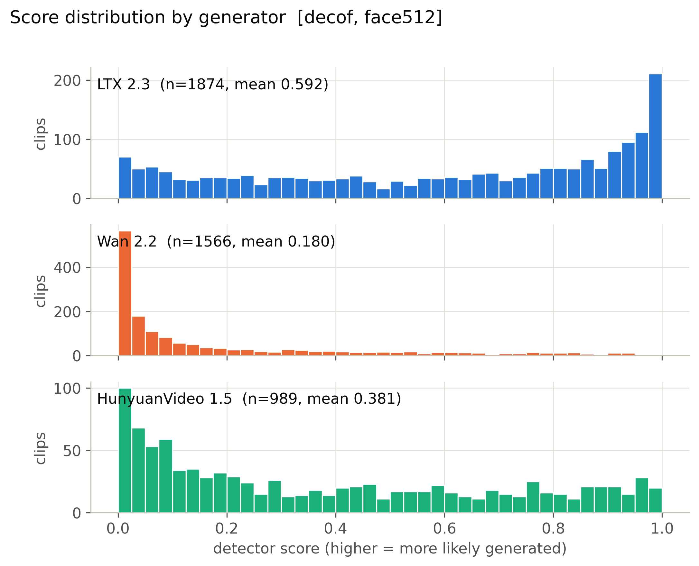

**Mean score, 56 cells x generator.** (`figures/heatmap_mean_score_cells.pdf`)

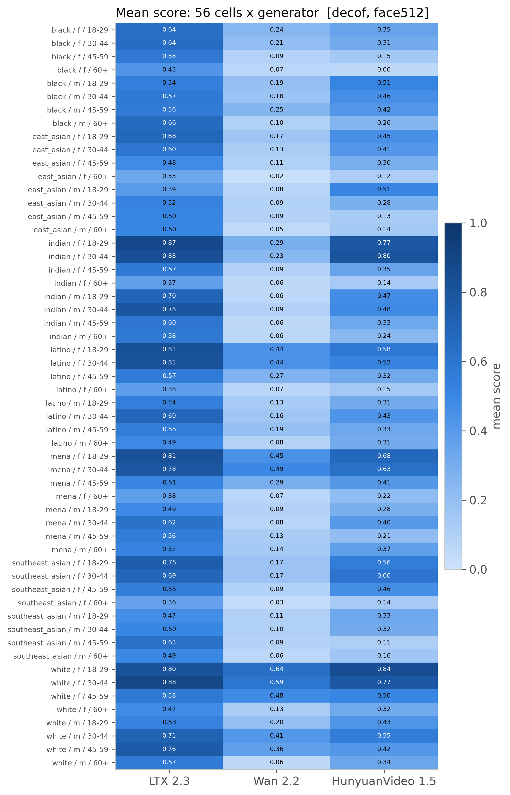

**Detection rate, 56 cells x generator (provisional threshold).** (`figures/heatmap_detection_rate_cells_provisional.pdf`)

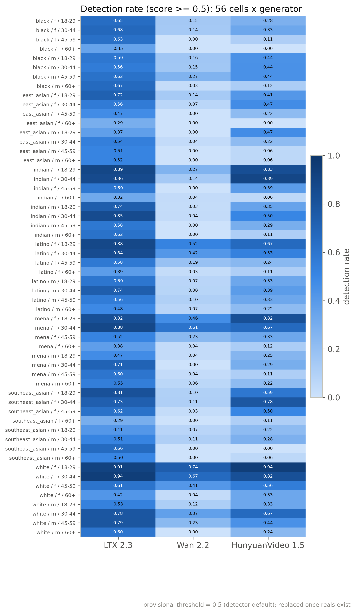

**Mean score by race, gender, age band with 95% CI.** (`figures/subgroup_mean_score.pdf`)

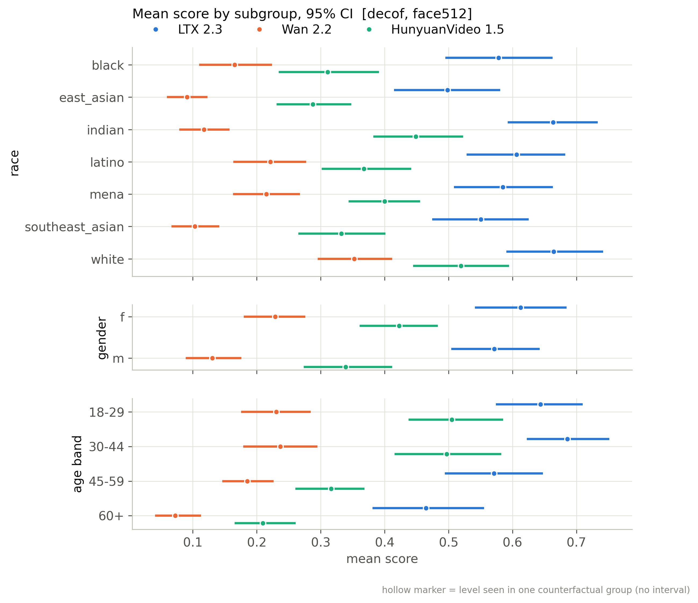

**Mean score by scene factor with 95% CI.** (`figures/scene_factor_mean_score.pdf`)

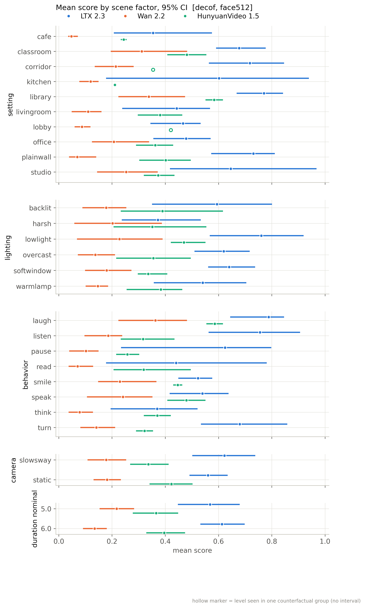

**Detection rate by subgroup (provisional threshold).** (`figures/subgroup_detection_rate_provisional.pdf`)

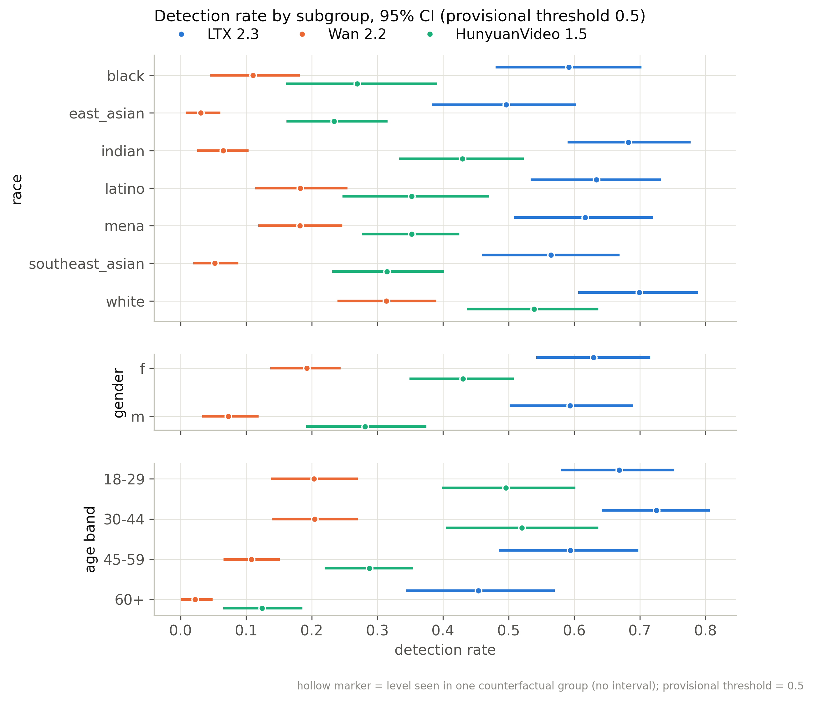

**Distribution of per-group CF spread.** (`figures/cf_spread_distribution.pdf`)

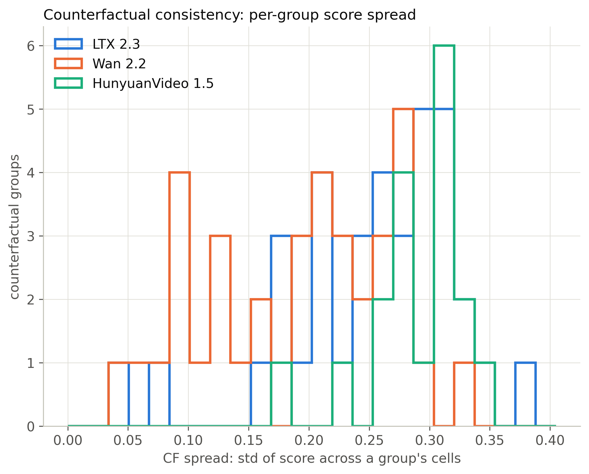

**Flip rate by generator (provisional threshold).** (`figures/flip_rate_by_generator_provisional.pdf`)

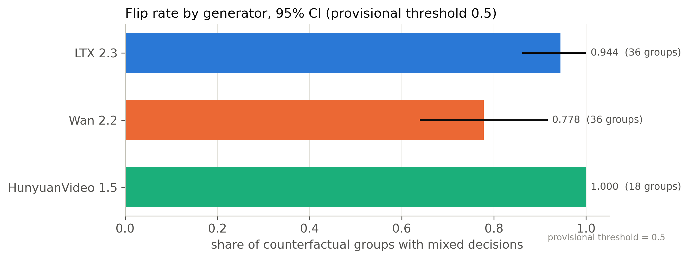

**Partial eta squared by factor.** (`figures/factor_attribution_variance_share.pdf`)

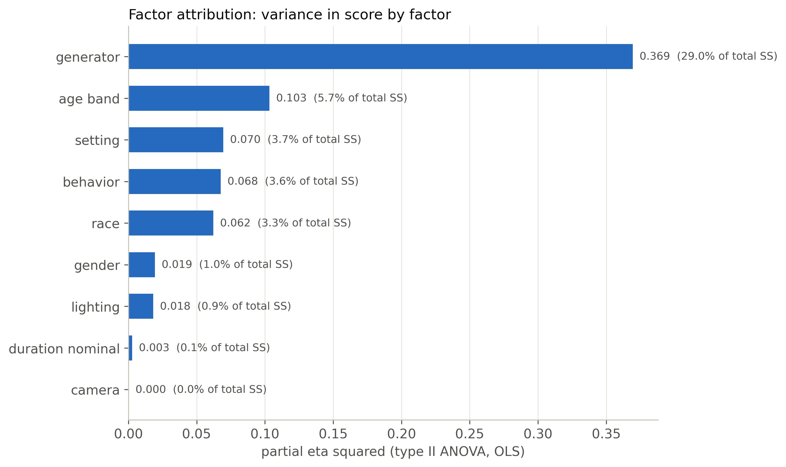

**Highest- and lowest-scoring included clips.** (`figures/example_strip.pdf`)

**ROC per generator against fps-matched reals.** (`figures/roc_per_generator.pdf`)

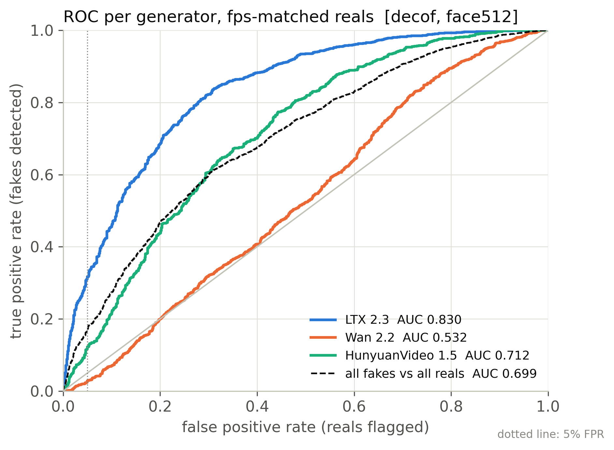

**Real FPR by perceived subgroup at the calibrated threshold.** (`figures/real_fpr_by_subgroup.pdf`)

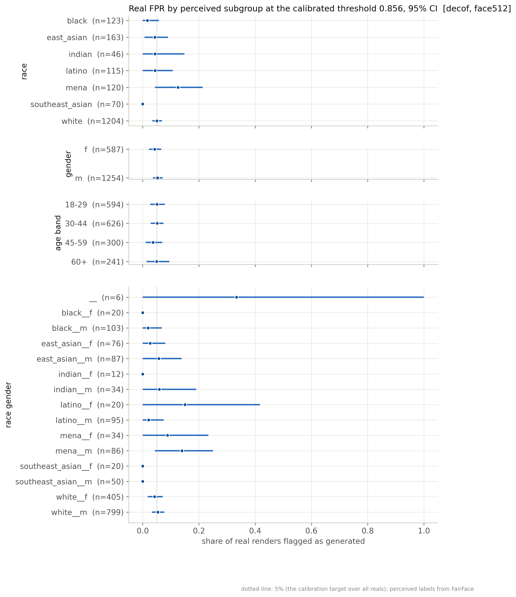

**AUC by subgroup: each subgroup's fakes vs same-subgroup reals.** (`figures/subgroup_auc.pdf`)

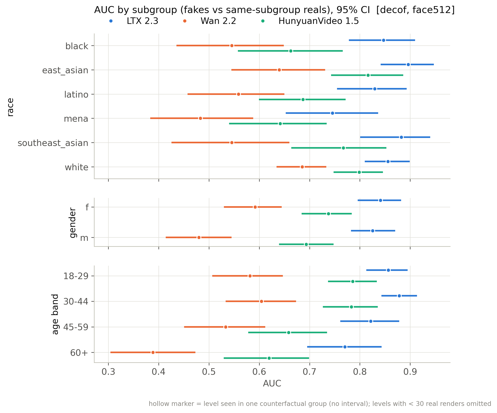

## Files

`manifest_used.csv` (every clip of the active batches with render/score/inclusion flags), `scores.csv` (score per scored clip), `tables/*.csv`, `figures/*`, `snapshot_meta.json`.

