# decof / face512_2s: snapshot 20261021-0616

> **Detector training data.** The released DeCoF checkpoint is most likely trained on AIGVDBench's Open-Sora split (per the paper's default training set and the checkpoint name); our generators are therefore likely unseen. Not confirmed by the authors. Our curated GenBuster subset includes LTX-Video and HunyuanVideo, which are separate from DeCoF's training data but not from AIGVDBench as a whole.

> **Provisional threshold.** Every detection rate and flip rate below uses the detector's default threshold (0.5; official: argmax over 2 logits (DeCoF test.py) == softmax[:,1] >= 0.5). They will be replaced by the 5%-real-FPR threshold once reals exist (section 6.3).

## Settings

| setting           | value                                                                                  |
|:------------------|:---------------------------------------------------------------------------------------|
| detector          | decof 1+b75d2cbe                                                                       |
| checkpoint_sha256 | 4edb7b310cc729771e74b93f658c7fdc4f2e31fdfa617a88372a540d4f9e7b4a                       |
| view              | face512_2s (view_hash 92b6f25d9ce9e5f4)                                                |
| ffmpeg            | ffmpeg version 7.1.1 Copyright (c) 2000-2025 the FFmpeg developers                     |
| batches           | fake_b1, fake_b2, real_b1                                                              |
| inclusion set     | primary (technical QC pass AND face QC pass)                                           |
| bootstrap         | 1000 resamples of whole counterfactual groups, seed 20261020, 95% percentile intervals |
| git commit        | ac1140ab3053-dirty                                                                     |
| created           | 2026-10-21T06:16:28Z                                                                   |

Detector preprocessing on top of the view:

| field               | value                                                                           |
|:--------------------|:--------------------------------------------------------------------------------|
| source              | AIGVDBench section 7 + DeCoF src/utils/data.py (test phase)                     |
| frames_window       | 128                                                                             |
| frames_sampled      | 32                                                                              |
| frames_used         | 8                                                                               |
| sampling            | np.linspace(0, n-1, 32).astype(int)[:8], n = min(128, frames)                   |
| crop                | centre square, side = shorter side                                              |
| resize_1            | [256, 256, 'PIL.BILINEAR']                                                      |
| intermediate_format | lossless (PNG-equivalent, kept in memory)                                       |
| resize_2            | [224, 224, 'torchvision Resize default (bilinear, antialias)']                  |
| centre_crop         | 224                                                                             |
| normalize           | {'mean': [0.485, 0.456, 0.406], 'std': [0.229, 0.224, 0.225]}                   |
| backbone            | OpenAI CLIP ViT-L/14 (frozen), fp32                                             |
| head                | DeCoF vit.ViT(num_patches=8, dim=768, depth=2, heads=4, mlp_dim=768, pool=mean) |
| score               | softmax(logits)[:, 1]                                                           |
| precision           | fp32, TF32 off                                                                  |
| code                | LongMa-2025/DeCoF@5f73e8dc4f8cd9faeed07d767c9517e3f2c66044                      |
| clip_sha256         | b8cca3fd41ae0c99ba7e8951adf17d267cdb84cd88be6f7c2e0eca1737a03836                |

## Coverage

| batch   | generator   |   clips |   primary |   rendered |   view_excluded |   render_failed |   scored |   score_failed |   included |
|:--------|:------------|--------:|----------:|-----------:|----------------:|----------------:|---------:|---------------:|-----------:|
| fake_b1 | hunyuan15   |     504 |       492 |        504 |               0 |               0 |      504 |              0 |        492 |
| fake_b1 | ltx23       |    2016 |      1878 |       2005 |              11 |               0 |     2005 |              0 |       1867 |
| fake_b1 | wan22       |    2016 |      1566 |       2016 |               0 |               0 |     2016 |              0 |       1566 |
| fake_b2 | hunyuan15   |     504 |       497 |        504 |               0 |               0 |      504 |              0 |        497 |
| real_b1 | real        |    1785 |      1684 |       1768 |               0 |              17 |     1768 |              0 |       1668 |

face512 window placement (fixed window at the median YuNet face centre, shifted inward at frame edges). The scaled frame is exactly 512 px on its short side, so every window spans it fully and is "shifted" on that axis by construction; the long-axis count is the informative one.

|   rendered |   shifted_long_axis |   shifted_short_axis |   max_shift_long_px |   excluded_no_face |
|-----------:|--------------------:|---------------------:|--------------------:|-------------------:|
|       8565 |                 231 |                 8531 |                 170 |                 11 |

Reals scored: 3536. Fakes included: 4422 of 8565 scored (0 scoring failures).

## Observations

- LTX 2.3: mean score 0.610 [0.543, 0.681], median 0.705, n = 1867.
- Wan 2.2: mean score 0.202 [0.155, 0.251], median 0.065, n = 1566.
- HunyuanVideo 1.5: mean score 0.413 [0.358, 0.474], median 0.362, n = 989.
- Provisional detection rate (score >= 0.5), LTX 2.3: 62.5% [54.0, 71.2].
- Provisional detection rate (score >= 0.5), Wan 2.2: 15.8% [10.7, 21.1].
- Provisional detection rate (score >= 0.5), HunyuanVideo 1.5: 38.9% [31.9, 46.8].
- Provisional detection rate (score >= 0.5), all: 40.7% [35.5, 45.9].
- Largest race score gap: Wan 2.2 0.271 [0.233, 0.308] (white 0.381 vs east_asian 0.109).
- Largest gender score gap: Wan 2.2 0.097 [0.060, 0.132] (f 0.250 vs m 0.153).
- Largest age band score gap: HunyuanVideo 1.5 0.302 [0.236, 0.378] (18-29 0.541 vs 60+ 0.239).
- Largest cell score gap: HunyuanVideo 1.5 0.790 [0.726, 0.885] (white__f__18-29 0.888 vs black__f__60+ 0.098).
- Largest scene-factor gap (all generators): setting 0.338 [0.261, 0.467] (library vs cafe).
- Largest partial eta squared: generator 0.351, age_band 0.100, setting 0.069; residual holds 50.9% of total SS.
- CF spread, LTX 2.3: 0.257 [0.233, 0.280] over 36 groups (max 0.372).
- CF spread, Wan 2.2: 0.202 [0.175, 0.229] over 36 groups (max 0.330).
- CF spread, HunyuanVideo 1.5: 0.303 [0.288, 0.316] over 18 groups (max 0.348).
- Provisional flip rate, LTX 2.3: 100.0% of 36 groups [100.0, 100.0].
- Provisional flip rate, Wan 2.2: 86.1% of 36 groups [75.0, 97.2].
- Provisional flip rate, HunyuanVideo 1.5: 100.0% of 18 groups [100.0, 100.0].

## 6.1 Fakes only, no threshold

### Mean score by generator

| generator   |    n |   n_groups |   estimate |   ci_lo |   ci_hi |    sd |   median |   q05 |   q95 |
|:------------|-----:|-----------:|-----------:|--------:|--------:|------:|---------:|------:|------:|
| ltx23       | 1867 |         36 |      0.61  |   0.543 |   0.681 | 0.335 |    0.705 | 0.045 | 0.994 |
| wan22       | 1566 |         36 |      0.202 |   0.155 |   0.251 | 0.263 |    0.065 | 0.003 | 0.826 |
| hunyuan15   |  989 |         18 |      0.413 |   0.358 |   0.474 | 0.328 |    0.362 | 0.014 | 0.957 |
| all         | 4422 |         36 |      0.422 |   0.378 |   0.465 | 0.358 |    0.348 | 0.007 | 0.984 |

### Mean score by race

| generator   | level           |   n |   estimate |   ci_lo |   ci_hi |   median |
|:------------|:----------------|----:|-----------:|--------:|--------:|---------:|
| ltx23       | black           | 270 |      0.602 |   0.521 |   0.686 |    0.694 |
| ltx23       | east_asian      | 270 |      0.514 |   0.426 |   0.597 |    0.535 |
| ltx23       | indian          | 276 |      0.668 |   0.6   |   0.739 |    0.784 |
| ltx23       | latino          | 261 |      0.634 |   0.562 |   0.708 |    0.755 |
| ltx23       | mena            | 266 |      0.6   |   0.527 |   0.679 |    0.688 |
| ltx23       | southeast_asian | 271 |      0.577 |   0.501 |   0.657 |    0.608 |
| ltx23       | white           | 253 |      0.681 |   0.61  |   0.756 |    0.791 |
| wan22       | black           | 217 |      0.178 |   0.119 |   0.241 |    0.059 |
| wan22       | east_asian      | 226 |      0.109 |   0.073 |   0.147 |    0.04  |
| wan22       | indian          | 230 |      0.13  |   0.089 |   0.173 |    0.036 |
| wan22       | latino          | 219 |      0.245 |   0.184 |   0.305 |    0.091 |
| wan22       | mena            | 225 |      0.248 |   0.186 |   0.312 |    0.087 |
| wan22       | southeast_asian | 229 |      0.13  |   0.089 |   0.175 |    0.042 |
| wan22       | white           | 220 |      0.381 |   0.319 |   0.446 |    0.269 |
| hunyuan15   | black           | 141 |      0.353 |   0.272 |   0.438 |    0.266 |
| hunyuan15   | east_asian      | 141 |      0.328 |   0.272 |   0.392 |    0.203 |
| hunyuan15   | indian          | 142 |      0.463 |   0.398 |   0.531 |    0.402 |
| hunyuan15   | latino          | 142 |      0.395 |   0.331 |   0.465 |    0.337 |
| hunyuan15   | mena            | 139 |      0.443 |   0.372 |   0.511 |    0.421 |
| hunyuan15   | southeast_asian | 143 |      0.36  |   0.298 |   0.428 |    0.211 |
| hunyuan15   | white           | 141 |      0.549 |   0.485 |   0.612 |    0.538 |
| all         | black           | 628 |      0.4   |   0.345 |   0.453 |    0.323 |
| all         | east_asian      | 637 |      0.329 |   0.283 |   0.376 |    0.195 |
| all         | indian          | 648 |      0.432 |   0.392 |   0.47  |    0.337 |
| all         | latino          | 622 |      0.442 |   0.389 |   0.494 |    0.402 |
| all         | mena            | 630 |      0.44  |   0.39  |   0.487 |    0.408 |
| all         | southeast_asian | 643 |      0.37  |   0.327 |   0.414 |    0.209 |
| all         | white           | 614 |      0.543 |   0.497 |   0.593 |    0.586 |

### Mean score by gender

| generator   | level   |    n |   estimate |   ci_lo |   ci_hi |   median |
|:------------|:--------|-----:|-----------:|--------:|--------:|---------:|
| ltx23       | f       |  931 |      0.636 |   0.566 |   0.708 |    0.76  |
| ltx23       | m       |  936 |      0.585 |   0.514 |   0.661 |    0.646 |
| wan22       | f       |  785 |      0.25  |   0.194 |   0.307 |    0.106 |
| wan22       | m       |  781 |      0.153 |   0.108 |   0.202 |    0.048 |
| hunyuan15   | f       |  495 |      0.461 |   0.402 |   0.52  |    0.473 |
| hunyuan15   | m       |  494 |      0.365 |   0.296 |   0.442 |    0.288 |
| all         | f       | 2211 |      0.46  |   0.416 |   0.506 |    0.416 |
| all         | m       | 2211 |      0.383 |   0.34  |   0.428 |    0.289 |

### Mean score by age band

| generator   | level   |    n |   estimate |   ci_lo |   ci_hi |   median |
|:------------|:--------|-----:|-----------:|--------:|--------:|---------:|
| ltx23       | 18-29   |  464 |      0.658 |   0.591 |   0.724 |    0.776 |
| ltx23       | 30-44   |  469 |      0.705 |   0.643 |   0.771 |    0.824 |
| ltx23       | 45-59   |  477 |      0.586 |   0.508 |   0.663 |    0.664 |
| ltx23       | 60+     |  457 |      0.49  |   0.401 |   0.584 |    0.471 |
| wan22       | 18-29   |  388 |      0.254 |   0.19  |   0.315 |    0.105 |
| wan22       | 30-44   |  377 |      0.273 |   0.209 |   0.336 |    0.14  |
| wan22       | 45-59   |  398 |      0.202 |   0.156 |   0.253 |    0.091 |
| wan22       | 60+     |  403 |      0.085 |   0.047 |   0.134 |    0.024 |
| hunyuan15   | 18-29   |  242 |      0.541 |   0.468 |   0.623 |    0.583 |
| hunyuan15   | 30-44   |  248 |      0.517 |   0.436 |   0.604 |    0.571 |
| hunyuan15   | 45-59   |  250 |      0.359 |   0.299 |   0.415 |    0.322 |
| hunyuan15   | 60+     |  249 |      0.239 |   0.19  |   0.295 |    0.151 |
| all         | 18-29   | 1094 |      0.489 |   0.439 |   0.538 |    0.471 |
| all         | 30-44   | 1094 |      0.514 |   0.467 |   0.56  |    0.55  |
| all         | 45-59   | 1125 |      0.4   |   0.353 |   0.446 |    0.338 |
| all         | 60+     | 1109 |      0.286 |   0.244 |   0.33  |    0.135 |

### Mean score by scene factor (all generators pooled)

| factor           | level      |    n |   estimate |   ci_lo |   ci_hi |
|:-----------------|:-----------|-----:|-----------:|--------:|--------:|
| setting          | cafe       |  373 |      0.263 |   0.168 |   0.35  |
| setting          | classroom  |  373 |      0.523 |   0.447 |   0.588 |
| setting          | corridor   |  493 |      0.475 |   0.355 |   0.608 |
| setting          | kitchen    |  439 |      0.344 |   0.195 |   0.482 |
| setting          | library    |  532 |      0.6   |   0.562 |   0.714 |
| setting          | livingroom |  529 |      0.316 |   0.199 |   0.373 |
| setting          | lobby      |  345 |      0.347 |   0.329 |   0.381 |
| setting          | office     |  357 |      0.44  |   0.309 |   0.5   |
| setting          | plainwall  |  553 |      0.42  |   0.397 |   0.462 |
| setting          | studio     |  428 |      0.446 |   0.304 |   0.572 |
| lighting         | backlit    |  782 |      0.431 |   0.269 |   0.585 |
| lighting         | harsh      |  632 |      0.346 |   0.218 |   0.489 |
| lighting         | lowlight   |  781 |      0.513 |   0.413 |   0.617 |
| lighting         | overcast   |  692 |      0.413 |   0.361 |   0.488 |
| lighting         | softwindow |  821 |      0.418 |   0.375 |   0.458 |
| lighting         | warmlamp   |  714 |      0.39  |   0.295 |   0.492 |
| behavior         | laugh      |  498 |      0.609 |   0.562 |   0.686 |
| behavior         | listen     |  676 |      0.475 |   0.345 |   0.58  |
| behavior         | pause      |  520 |      0.38  |   0.168 |   0.462 |
| behavior         | read       |  576 |      0.308 |   0.195 |   0.443 |
| behavior         | smile      |  538 |      0.424 |   0.368 |   0.492 |
| behavior         | speak      |  530 |      0.445 |   0.308 |   0.521 |
| behavior         | think      |  506 |      0.294 |   0.159 |   0.381 |
| behavior         | turn       |  578 |      0.435 |   0.35  |   0.533 |
| camera           | slowsway   | 2218 |      0.426 |   0.355 |   0.493 |
| camera           | static     | 2204 |      0.418 |   0.372 |   0.469 |
| duration_nominal | 5.0        | 2223 |      0.415 |   0.342 |   0.491 |
| duration_nominal | 6.0        | 2199 |      0.428 |   0.386 |   0.469 |

Per-generator scene-factor and 56-cell rows: `tables/score_by_breakdown.csv`.

### Subgroup gap (max - min of level means)

A gap is max - min, so it is never negative and its interval cannot include 0; it is a size, not a test of a difference. Over many levels with few clips each (56 cells; HunyuanVideo has 9 groups per cell) the gap also grows with noise, so compare it with the per-level intervals in `tables/score_by_breakdown.csv`. Levels seen in a single counterfactual group have no interval.

| generator   | attribute        |   n_levels |   gap |   ci_lo |   ci_hi | max_level       | min_level          |
|:------------|:-----------------|-----------:|------:|--------:|--------:|:----------------|:-------------------|
| ltx23       | race             |          7 | 0.168 |   0.124 |   0.226 | white           | east_asian         |
| ltx23       | gender           |          2 | 0.05  |   0.014 |   0.088 | f               | m                  |
| ltx23       | age_band         |          4 | 0.215 |   0.159 |   0.27  | 30-44           | 60+                |
| ltx23       | cell             |         56 | 0.52  |   0.483 |   0.649 | white__f__30-44 | east_asian__f__60+ |
| ltx23       | setting          |         10 | 0.434 |   0.32  |   0.692 | library         | cafe               |
| ltx23       | lighting         |          6 | 0.372 |   0.19  |   0.594 | lowlight        | harsh              |
| ltx23       | behavior         |          8 | 0.417 |   0.298 |   0.661 | laugh           | think              |
| ltx23       | camera           |          2 | 0.063 |   0.004 |   0.205 | slowsway        | static             |
| ltx23       | duration_nominal |          2 | 0.04  |   0.002 |   0.183 | 6.0             | 5.0                |
| wan22       | race             |          7 | 0.271 |   0.233 |   0.308 | white           | east_asian         |
| wan22       | gender           |          2 | 0.097 |   0.06  |   0.132 | f               | m                  |
| wan22       | age_band         |          4 | 0.188 |   0.136 |   0.242 | 30-44           | 60+                |
| wan22       | cell             |         56 | 0.627 |   0.539 |   0.737 | white__f__18-29 | east_asian__f__60+ |
| wan22       | setting          |         10 | 0.325 |   0.249 |   0.488 | library         | cafe               |
| wan22       | lighting         |          6 | 0.09  |   0.08  |   0.349 | lowlight        | overcast           |
| wan22       | behavior         |          8 | 0.335 |   0.222 |   0.488 | laugh           | think              |
| wan22       | camera           |          2 | 0.002 |   0.001 |   0.117 | static          | slowsway           |
| wan22       | duration_nominal |          2 | 0.096 |   0.014 |   0.184 | 5.0             | 6.0                |
| hunyuan15   | race             |          7 | 0.22  |   0.161 |   0.295 | white           | east_asian         |
| hunyuan15   | gender           |          2 | 0.096 |   0.028 |   0.164 | f               | m                  |
| hunyuan15   | age_band         |          4 | 0.302 |   0.236 |   0.378 | 18-29           | 60+                |
| hunyuan15   | cell             |         56 | 0.79  |   0.726 |   0.885 | white__f__18-29 | black__f__60+      |
| hunyuan15   | setting          |         10 | 0.367 |   0.196 |   0.405 | library         | cafe               |
| hunyuan15   | lighting         |          6 | 0.134 |   0.098 |   0.368 | lowlight        | softwindow         |
| hunyuan15   | behavior         |          8 | 0.326 |   0.173 |   0.401 | laugh           | pause              |
| hunyuan15   | camera           |          2 | 0.086 |   0.007 |   0.194 | static          | slowsway           |
| hunyuan15   | duration_nominal |          2 | 0.022 |   0.002 |   0.143 | 6.0             | 5.0                |
| all         | race             |          7 | 0.214 |   0.176 |   0.25  | white           | east_asian         |
| all         | gender           |          2 | 0.076 |   0.047 |   0.102 | f               | m                  |
| all         | age_band         |          4 | 0.227 |   0.197 |   0.257 | 30-44           | 60+                |
| all         | cell             |         56 | 0.579 |   0.54  |   0.659 | white__f__30-44 | east_asian__f__60+ |
| all         | setting          |         10 | 0.338 |   0.261 |   0.467 | library         | cafe               |
| all         | lighting         |          6 | 0.168 |   0.087 |   0.344 | lowlight        | harsh              |
| all         | behavior         |          8 | 0.314 |   0.238 |   0.463 | laugh           | think              |
| all         | camera           |          2 | 0.008 |   0.002 |   0.097 | slowsway        | static             |
| all         | duration_nominal |          2 | 0.013 |   0.001 |   0.097 | 6.0             | 5.0                |

### CF spread (mean over groups of the std of score across the group's cells)

| generator   |   n_groups |   cf_spread |   ci_lo |   ci_hi |   median |   max |
|:------------|-----------:|------------:|--------:|--------:|---------:|------:|
| ltx23       |         36 |       0.257 |   0.233 |   0.28  |    0.267 | 0.372 |
| wan22       |         36 |       0.202 |   0.175 |   0.229 |    0.231 | 0.33  |
| hunyuan15   |         18 |       0.303 |   0.288 |   0.316 |    0.302 | 0.348 |

### Factor attribution

OLS with every factor as a fixed effect, type-II ANOVA. `ss_share` is the factor's type-II sum of squares over the total sum of squares (type-II shares need not add to 1). Scene factors are constant within a counterfactual group, so their effects are estimated from between-group differences only. The OLS F tests treat clips as independent although clips are clustered in counterfactual groups, so their p values are optimistic; use the group-bootstrap intervals above for inference.

| factor           |   df |    sum_sq | F     | p         | partial_eta2   |   ss_share |
|:-----------------|-----:|----------:|:------|:----------|:---------------|-----------:|
| race             |    6 |  17.55    | 44.56 | 3.555e-53 | 0.05746        |  0.03101   |
| gender           |    1 |   6.303   | 96.01 | 1.94e-22  | 0.02142        |  0.01114   |
| age_band         |    3 |  31.95    | 162.2 | 1.045e-99 | 0.09987        |  0.05645   |
| setting          |    9 |  21.41    | 36.23 | 1.894e-62 | 0.0692         |  0.03783   |
| lighting         |    5 |   4.665   | 14.21 | 8.008e-14 | 0.01594        |  0.008243  |
| behavior         |    7 |  19.1     | 41.56 | 4.501e-57 | 0.06221        |  0.03375   |
| camera           |    1 |   0.06637 | 1.011 | 0.3147    | 0.0002304      |  0.0001173 |
| duration_nominal |    1 |   1.099   | 16.74 | 4.374e-05 | 0.003801       |  0.001941  |
| generator        |    2 | 156.1     | 1188  | 0         | 0.3515         |  0.2757    |
| Residual         | 4386 | 288       |       |           |                |  0.5088    |

Lighting x race interaction (added to the same OLS):

| term            |   df |   sum_sq |     F |      p |   partial_eta2 |
|:----------------|-----:|---------:|------:|-------:|---------------:|
| lighting x race |   30 |    3.018 | 1.538 | 0.0308 |        0.01048 |

Mixed model `score ~ factors + (1 | counterfactual_group)` (REML) variance components (fixed effects: `tables/factor_mixed_fixed.csv`):

| component                               |   variance | converged   |
|:----------------------------------------|-----------:|:------------|
| counterfactual_group (random intercept) |      0     | True        |
| residual                                |      0.064 | True        |
| ICC (group share of random variance)    |      0     | True        |

A group variance at or near 0 is a boundary estimate: setting, lighting, behavior, camera and duration are fixed per group and absorb most between-group variation, leaving little for the random intercept. It does not mean scenes do not matter.

## 6.2 Provisional (threshold 0.5, provisional)

### Detection rate by generator (provisional)

| generator   |    n |   estimate |   ci_lo |   ci_hi |
|:------------|-----:|-----------:|--------:|--------:|
| ltx23       | 1867 |      0.625 |   0.54  |   0.712 |
| wan22       | 1566 |      0.158 |   0.107 |   0.211 |
| hunyuan15   |  989 |      0.389 |   0.319 |   0.468 |
| all         | 4422 |      0.407 |   0.355 |   0.459 |

### Detection rate by race (provisional)

| generator   | level           |   n |   estimate |   ci_lo |   ci_hi |
|:------------|:----------------|----:|-----------:|--------:|--------:|
| ltx23       | black           | 270 |      0.633 |   0.528 |   0.739 |
| ltx23       | east_asian      | 270 |      0.522 |   0.411 |   0.627 |
| ltx23       | indian          | 276 |      0.688 |   0.604 |   0.774 |
| ltx23       | latino          | 261 |      0.628 |   0.536 |   0.725 |
| ltx23       | mena            | 266 |      0.594 |   0.48  |   0.704 |
| ltx23       | southeast_asian | 271 |      0.59  |   0.49  |   0.693 |
| ltx23       | white           | 253 |      0.719 |   0.636 |   0.806 |
| wan22       | black           | 217 |      0.134 |   0.062 |   0.21  |
| wan22       | east_asian      | 226 |      0.031 |   0.004 |   0.065 |
| wan22       | indian          | 230 |      0.078 |   0.033 |   0.128 |
| wan22       | latino          | 219 |      0.192 |   0.115 |   0.269 |
| wan22       | mena            | 225 |      0.236 |   0.159 |   0.323 |
| wan22       | southeast_asian | 229 |      0.083 |   0.032 |   0.139 |
| wan22       | white           | 220 |      0.364 |   0.282 |   0.444 |
| hunyuan15   | black           | 141 |      0.312 |   0.2   |   0.434 |
| hunyuan15   | east_asian      | 141 |      0.262 |   0.185 |   0.348 |
| hunyuan15   | indian          | 142 |      0.458 |   0.381 |   0.536 |
| hunyuan15   | latino          | 142 |      0.366 |   0.268 |   0.473 |
| hunyuan15   | mena            | 139 |      0.453 |   0.359 |   0.553 |
| hunyuan15   | southeast_asian | 143 |      0.336 |   0.266 |   0.415 |
| hunyuan15   | white           | 141 |      0.539 |   0.452 |   0.627 |
| all         | black           | 628 |      0.389 |   0.326 |   0.454 |
| all         | east_asian      | 637 |      0.29  |   0.234 |   0.344 |
| all         | indian          | 648 |      0.421 |   0.372 |   0.471 |
| all         | latino          | 622 |      0.415 |   0.344 |   0.483 |
| all         | mena            | 630 |      0.435 |   0.37  |   0.498 |
| all         | southeast_asian | 643 |      0.353 |   0.3   |   0.407 |
| all         | white           | 614 |      0.55  |   0.492 |   0.608 |

### Detection rate by gender (provisional)

| generator   | level   |    n |   estimate |   ci_lo |   ci_hi |
|:------------|:--------|-----:|-----------:|--------:|--------:|
| ltx23       | f       |  931 |      0.653 |   0.571 |   0.738 |
| ltx23       | m       |  936 |      0.596 |   0.499 |   0.696 |
| wan22       | f       |  785 |      0.22  |   0.15  |   0.289 |
| wan22       | m       |  781 |      0.096 |   0.051 |   0.146 |
| hunyuan15   | f       |  495 |      0.471 |   0.393 |   0.545 |
| hunyuan15   | m       |  494 |      0.308 |   0.214 |   0.414 |
| all         | f       | 2211 |      0.459 |   0.405 |   0.512 |
| all         | m       | 2211 |      0.355 |   0.302 |   0.41  |

### Detection rate by age band (provisional)

| generator   | level   |    n |   estimate |   ci_lo |   ci_hi |
|:------------|:--------|-----:|-----------:|--------:|--------:|
| ltx23       | 18-29   |  464 |      0.666 |   0.585 |   0.746 |
| ltx23       | 30-44   |  469 |      0.748 |   0.669 |   0.829 |
| ltx23       | 45-59   |  477 |      0.597 |   0.495 |   0.695 |
| ltx23       | 60+     |  457 |      0.484 |   0.369 |   0.605 |
| wan22       | 18-29   |  388 |      0.222 |   0.145 |   0.301 |
| wan22       | 30-44   |  377 |      0.236 |   0.163 |   0.311 |
| wan22       | 45-59   |  398 |      0.143 |   0.094 |   0.197 |
| wan22       | 60+     |  403 |      0.04  |   0.005 |   0.087 |
| hunyuan15   | 18-29   |  242 |      0.541 |   0.436 |   0.658 |
| hunyuan15   | 30-44   |  248 |      0.544 |   0.445 |   0.651 |
| hunyuan15   | 45-59   |  250 |      0.324 |   0.24  |   0.405 |
| hunyuan15   | 60+     |  249 |      0.153 |   0.08  |   0.238 |
| all         | 18-29   | 1094 |      0.481 |   0.42  |   0.541 |
| all         | 30-44   | 1094 |      0.526 |   0.465 |   0.583 |
| all         | 45-59   | 1125 |      0.376 |   0.321 |   0.432 |
| all         | 60+     | 1109 |      0.248 |   0.192 |   0.307 |

### Detection-rate gap (provisional)

| generator   | attribute        |   gap |   ci_lo |   ci_hi | max_level        | min_level            |
|:------------|:-----------------|------:|--------:|--------:|:-----------------|:---------------------|
| ltx23       | race             | 0.197 |   0.139 |   0.273 | white            | east_asian           |
| ltx23       | gender           | 0.057 |   0.006 |   0.116 | f                | m                    |
| ltx23       | age_band         | 0.265 |   0.181 |   0.353 | 30-44            | 60+                  |
| ltx23       | cell             | 0.629 |   0.594 |   0.825 | indian__f__18-29 | east_asian__m__18-29 |
| ltx23       | setting          | 0.537 |   0.417 |   0.829 | library          | cafe                 |
| ltx23       | lighting         | 0.434 |   0.222 |   0.719 | lowlight         | harsh                |
| ltx23       | behavior         | 0.518 |   0.389 |   0.812 | laugh            | think                |
| ltx23       | camera           | 0.08  |   0.004 |   0.249 | slowsway         | static               |
| ltx23       | duration_nominal | 0.052 |   0.004 |   0.224 | 6.0              | 5.0                  |
| wan22       | race             | 0.333 |   0.26  |   0.402 | white            | east_asian           |
| wan22       | gender           | 0.124 |   0.071 |   0.176 | f                | m                    |
| wan22       | age_band         | 0.196 |   0.138 |   0.265 | 30-44            | 60+                  |
| wan22       | cell             | 0.75  |   0.633 |   0.929 | white__f__30-44  | east_asian__f__60+   |
| wan22       | setting          | 0.331 |   0.247 |   0.586 | library          | cafe                 |
| wan22       | lighting         | 0.104 |   0.089 |   0.412 | lowlight         | warmlamp             |
| wan22       | behavior         | 0.356 |   0.214 |   0.56  | laugh            | read                 |
| wan22       | camera           | 0.001 |   0.002 |   0.13  | slowsway         | static               |
| wan22       | duration_nominal | 0.097 |   0.012 |   0.194 | 5.0              | 6.0                  |
| hunyuan15   | race             | 0.277 |   0.196 |   0.375 | white            | east_asian           |
| hunyuan15   | gender           | 0.163 |   0.065 |   0.26  | f                | m                    |
| hunyuan15   | age_band         | 0.392 |   0.311 |   0.513 | 30-44            | 60+                  |
| hunyuan15   | cell             | 0.941 |   0.917 |   1     | white__f__18-29  | east_asian__f__60+   |
| hunyuan15   | setting          | 0.491 |   0.277 |   0.571 | library          | kitchen              |
| hunyuan15   | lighting         | 0.182 |   0.137 |   0.48  | lowlight         | softwindow           |
| hunyuan15   | behavior         | 0.422 |   0.228 |   0.561 | laugh            | pause                |
| hunyuan15   | camera           | 0.121 |   0.014 |   0.26  | static           | slowsway             |
| hunyuan15   | duration_nominal | 0.025 |   0.002 |   0.187 | 6.0              | 5.0                  |
| all         | race             | 0.26  |   0.21  |   0.31  | white            | east_asian           |
| all         | gender           | 0.104 |   0.064 |   0.141 | f                | m                    |
| all         | age_band         | 0.278 |   0.228 |   0.33  | 30-44            | 60+                  |
| all         | cell             | 0.725 |   0.667 |   0.836 | white__f__30-44  | east_asian__f__60+   |
| all         | setting          | 0.401 |   0.317 |   0.554 | library          | cafe                 |
| all         | lighting         | 0.195 |   0.104 |   0.41  | lowlight         | harsh                |
| all         | behavior         | 0.366 |   0.282 |   0.559 | laugh            | think                |
| all         | camera           | 0.009 |   0.002 |   0.116 | slowsway         | static               |
| all         | duration_nominal | 0.021 |   0.002 |   0.123 | 6.0              | 5.0                  |

### Flip rate (provisional): share of groups whose clips get different decisions

| generator   |   n_groups |   flip_rate |   ci_lo |   ci_hi |   median |   max |
|:------------|-----------:|------------:|--------:|--------:|---------:|------:|
| ltx23       |         36 |       1     |    1    |   1     |        1 |     1 |
| wan22       |         36 |       0.861 |    0.75 |   0.972 |        1 |     1 |
| hunyuan15   |         18 |       1     |    1    |   1     |        1 |     1 |

### Sensitivity: inclusion set

| set     | generator   |    n |   mean_score |   provisional_detection_rate |
|:--------|:------------|-----:|-------------:|-----------------------------:|
| all     | hunyuan15   | 1008 |        0.415 |                        0.394 |
| all     | ltx23       | 2005 |        0.612 |                        0.625 |
| all     | wan22       | 2016 |        0.211 |                        0.166 |
| primary | hunyuan15   |  989 |        0.413 |                        0.389 |
| primary | ltx23       | 1867 |        0.61  |                        0.625 |
| primary | wan22       | 1566 |        0.202 |                        0.158 |

## 6.3 Real vs generated (calibrated threshold 0.8848)

The threshold is the score at which 5% of primary real renders (24 and 16 fps pooled) are flagged; one per detector and view, never per subgroup. Each generator is compared with reals rendered at its own fps. Intervals: fakes resample counterfactual groups, reals resample identity clusters (source video). Real labels are perceived (FairFace), not self-reported.

### Calibration

| scope            |   n_renders |   n_sources |   n_identities |   threshold |    fpr |
|:-----------------|------------:|------------:|---------------:|------------:|-------:|
| all real renders |        3336 |        1668 |           1407 |      0.8848 | 0.0501 |
| 16 fps renders   |        1668 |        1668 |           1407 |      0.8848 | 0.0468 |
| 24 fps renders   |        1668 |        1668 |           1407 |      0.8848 | 0.0534 |

### AUC, AP, EER, TPR at 5% FPR

| generator   | real_fps   |   n_fake |   n_real |   auc |   auc_ci_lo |   auc_ci_hi |    ap |   eer |   tpr_at_5fpr |   detection_rate_global_thr |   det_ci_lo |   det_ci_hi |
|:------------|:-----------|---------:|---------:|------:|------------:|------------:|------:|------:|--------------:|----------------------------:|------------:|------------:|
| ltx23       | 24         |     1867 |     1668 | 0.807 |       0.761 |       0.849 | 0.812 | 0.268 |         0.319 |                       0.325 |       0.246 |       0.415 |
| wan22       | 16         |     1566 |     1668 | 0.49  |       0.428 |       0.553 | 0.466 | 0.519 |         0.039 |                       0.031 |       0.016 |       0.046 |
| hunyuan15   | 24         |      989 |     1668 | 0.681 |       0.637 |       0.726 | 0.518 | 0.376 |         0.121 |                       0.125 |       0.087 |       0.172 |
| all         | 24+16      |     4422 |     3336 | 0.668 |       0.63  |       0.703 | 0.727 | 0.382 |         0.176 |                       0.176 |       0.137 |       0.22  |

### Real FPR by perceived subgroup

| attribute   | level              |   n_renders |   n_identities |   fpr |   ci_lo |   ci_hi |
|:------------|:-------------------|------------:|---------------:|------:|--------:|--------:|
| race        | black              |         280 |            126 | 0.036 |   0.007 |   0.072 |
| race        | east_asian         |         230 |            102 | 0.035 |   0.008 |   0.068 |
| race        | indian             |          84 |             41 | 0.083 |   0.011 |   0.172 |
| race        | latino             |         192 |             90 | 0.062 |   0.018 |   0.113 |
| race        | mena               |         210 |            100 | 0.076 |   0.028 |   0.13  |
| race        | southeast_asian    |         140 |             67 | 0.029 |   0     |   0.074 |
| race        | white              |        2200 |            938 | 0.05  |   0.037 |   0.064 |
| gender      | f                  |        1068 |            475 | 0.049 |   0.03  |   0.067 |
| gender      | m                  |        2268 |            964 | 0.051 |   0.038 |   0.063 |
| age_band    | 18-29              |        1070 |            492 | 0.059 |   0.039 |   0.08  |
| age_band    | 30-44              |        1208 |            548 | 0.06  |   0.042 |   0.079 |
| age_band    | 45-59              |         532 |            232 | 0.039 |   0.019 |   0.062 |
| age_band    | 60+                |         526 |            228 | 0.019 |   0.006 |   0.036 |
| race_gender | black__f           |          44 |             21 | 0.045 |   0     |   0.158 |
| race_gender | black__m           |         236 |            106 | 0.034 |   0.008 |   0.071 |
| race_gender | east_asian__f      |          88 |             40 | 0     |   0     |   0     |
| race_gender | east_asian__m      |         142 |             64 | 0.056 |   0.012 |   0.106 |
| race_gender | indian__f          |          30 |             15 | 0.133 |   0     |   0.333 |
| race_gender | indian__m          |          54 |             26 | 0.056 |   0     |   0.155 |
| race_gender | latino__f          |          48 |             24 | 0.125 |   0     |   0.28  |
| race_gender | latino__m          |         144 |             66 | 0.042 |   0.006 |   0.09  |
| race_gender | mena__f            |          52 |             26 | 0     |   0     |   0     |
| race_gender | mena__m            |         158 |             74 | 0.101 |   0.039 |   0.171 |
| race_gender | southeast_asian__f |          48 |             23 | 0.042 |   0     |   0.136 |
| race_gender | southeast_asian__m |          92 |             45 | 0.022 |   0     |   0.073 |
| race_gender | white__f           |         758 |            338 | 0.05  |   0.029 |   0.075 |
| race_gender | white__m           |        1442 |            616 | 0.05  |   0.035 |   0.065 |

### Real FPR gap (max - min across levels; non-negative by construction)

| attribute   |   n_levels |   fpr_gap |   ci_lo |   ci_hi | max_level   |   max_fpr | min_level       |   min_fpr |
|:------------|-----------:|----------:|--------:|--------:|:------------|----------:|:----------------|----------:|
| race        |          7 |     0.055 |   0.035 |   0.155 | indian      |     0.083 | southeast_asian |     0.029 |
| gender      |          2 |     0.002 |   0     |   0.025 | m           |     0.051 | f               |     0.049 |
| age_band    |          4 |     0.041 |   0.025 |   0.067 | 30-44       |     0.06  | 60+             |     0.019 |
| race_gender |         14 |     0.133 |   0.086 |   0.333 | indian__f   |     0.133 | east_asian__f   |     0     |

### Worst-subgroup AUC and AUC gap

| generator   | attribute   |   n_levels | worst_level   |   worst_auc |   worst_ci_lo |   worst_ci_hi | best_level         |   best_auc |   auc_gap |   gap_ci_lo |   gap_ci_hi |
|:------------|:------------|-----------:|:--------------|------------:|--------------:|--------------:|:-------------------|-----------:|----------:|------------:|------------:|
| ltx23       | race        |          7 | mena          |       0.751 |         0.669 |         0.804 | white              |      0.839 |     0.088 |       0.063 |       0.18  |
| ltx23       | gender      |          2 | m             |       0.801 |         0.752 |         0.842 | f                  |      0.811 |     0.01  |       0.001 |       0.043 |
| ltx23       | age_band    |          4 | 60+           |       0.781 |         0.714 |         0.837 | 30-44              |      0.857 |     0.075 |       0.037 |       0.126 |
| ltx23       | race_gender |          8 | mena__m       |       0.705 |         0.612 |         0.785 | southeast_asian__m |      0.844 |     0.139 |       0.086 |       0.258 |
| wan22       | race        |          7 | indian        |       0.333 |         0.229 |         0.442 | white              |      0.656 |     0.322 |       0.221 |       0.416 |
| wan22       | gender      |          2 | m             |       0.443 |         0.376 |         0.506 | f                  |      0.537 |     0.095 |       0.045 |       0.144 |
| wan22       | age_band    |          4 | 60+           |       0.399 |         0.324 |         0.476 | 30-44              |      0.56  |     0.161 |       0.094 |       0.238 |
| wan22       | race_gender |          8 | mena__m       |       0.337 |         0.241 |         0.438 | white__f           |      0.71  |     0.374 |       0.284 |       0.474 |
| hunyuan15   | race        |          7 | indian        |       0.625 |         0.514 |         0.663 | white              |      0.778 |     0.153 |       0.125 |       0.262 |
| hunyuan15   | gender      |          2 | m             |       0.656 |         0.599 |         0.711 | f                  |      0.704 |     0.048 |       0.003 |       0.114 |
| hunyuan15   | age_band    |          4 | 60+           |       0.631 |         0.56  |         0.691 | 30-44              |      0.741 |     0.11  |       0.056 |       0.187 |
| hunyuan15   | race_gender |          8 | mena__m       |       0.551 |         0.437 |         0.639 | white__f           |      0.808 |     0.257 |       0.17  |       0.38  |
| all         | race        |          7 | indian        |       0.587 |         0.499 |         0.644 | white              |      0.76  |     0.173 |       0.119 |       0.257 |
| all         | gender      |          2 | m             |       0.643 |         0.601 |         0.681 | f                  |      0.691 |     0.048 |       0.012 |       0.083 |
| all         | age_band    |          4 | 60+           |       0.611 |         0.558 |         0.663 | 30-44              |      0.729 |     0.119 |       0.069 |       0.166 |
| all         | race_gender |         14 | indian__m     |       0.517 |         0.416 |         0.577 | white__f           |      0.786 |     0.27  |       0.216 |       0.402 |

### Detection rate at the calibrated threshold

| generator   |    n |   estimate |   ci_lo |   ci_hi |
|:------------|-----:|-----------:|--------:|--------:|
| ltx23       | 1867 |      0.325 |   0.246 |   0.415 |
| wan22       | 1566 |      0.031 |   0.016 |   0.046 |
| hunyuan15   |  989 |      0.125 |   0.087 |   0.172 |
| all         | 4422 |      0.176 |   0.137 |   0.22  |

#### by race

| generator   | level           |   n |   estimate |   ci_lo |   ci_hi |
|:------------|:----------------|----:|-----------:|--------:|--------:|
| ltx23       | black           | 270 |      0.285 |   0.198 |   0.389 |
| ltx23       | east_asian      | 270 |      0.237 |   0.147 |   0.339 |
| ltx23       | indian          | 276 |      0.395 |   0.311 |   0.482 |
| ltx23       | latino          | 261 |      0.36  |   0.274 |   0.461 |
| ltx23       | mena            | 266 |      0.289 |   0.207 |   0.38  |
| ltx23       | southeast_asian | 271 |      0.303 |   0.21  |   0.402 |
| ltx23       | white           | 253 |      0.407 |   0.301 |   0.517 |
| wan22       | black           | 217 |      0.005 |   0     |   0.015 |
| wan22       | east_asian      | 226 |      0     |   0     |   0     |
| wan22       | indian          | 230 |      0.013 |   0     |   0.031 |
| wan22       | latino          | 219 |      0.032 |   0.013 |   0.053 |
| wan22       | mena            | 225 |      0.049 |   0.016 |   0.083 |
| wan22       | southeast_asian | 229 |      0     |   0     |   0     |
| wan22       | white           | 220 |      0.118 |   0.06  |   0.182 |
| hunyuan15   | black           | 141 |      0.064 |   0.014 |   0.134 |
| hunyuan15   | east_asian      | 141 |      0.071 |   0.015 |   0.145 |
| hunyuan15   | indian          | 142 |      0.197 |   0.125 |   0.276 |
| hunyuan15   | latino          | 142 |      0.12  |   0.061 |   0.183 |
| hunyuan15   | mena            | 139 |      0.101 |   0.04  |   0.167 |
| hunyuan15   | southeast_asian | 143 |      0.105 |   0.05  |   0.168 |
| hunyuan15   | white           | 141 |      0.22  |   0.157 |   0.288 |
| all         | black           | 628 |      0.139 |   0.095 |   0.189 |
| all         | east_asian      | 637 |      0.116 |   0.074 |   0.166 |
| all         | indian          | 648 |      0.216 |   0.178 |   0.258 |
| all         | latino          | 622 |      0.19  |   0.147 |   0.236 |
| all         | mena            | 630 |      0.162 |   0.116 |   0.207 |
| all         | southeast_asian | 643 |      0.151 |   0.109 |   0.196 |
| all         | white           | 614 |      0.261 |   0.201 |   0.331 |

#### by gender

| generator   | level   |    n |   estimate |   ci_lo |   ci_hi |
|:------------|:--------|-----:|-----------:|--------:|--------:|
| ltx23       | f       |  931 |      0.379 |   0.299 |   0.47  |
| ltx23       | m       |  936 |      0.27  |   0.188 |   0.367 |
| wan22       | f       |  785 |      0.048 |   0.024 |   0.074 |
| wan22       | m       |  781 |      0.013 |   0.005 |   0.023 |
| hunyuan15   | f       |  495 |      0.152 |   0.111 |   0.2   |
| hunyuan15   | m       |  494 |      0.099 |   0.046 |   0.161 |
| all         | f       | 2211 |      0.211 |   0.169 |   0.257 |
| all         | m       | 2211 |      0.141 |   0.103 |   0.184 |

#### by age band

| generator   | level   |    n |   estimate |   ci_lo |   ci_hi |
|:------------|:--------|-----:|-----------:|--------:|--------:|
| ltx23       | 18-29   |  464 |      0.381 |   0.292 |   0.476 |
| ltx23       | 30-44   |  469 |      0.437 |   0.346 |   0.535 |
| ltx23       | 45-59   |  477 |      0.285 |   0.194 |   0.383 |
| ltx23       | 60+     |  457 |      0.193 |   0.104 |   0.3   |
| wan22       | 18-29   |  388 |      0.044 |   0.022 |   0.067 |
| wan22       | 30-44   |  377 |      0.056 |   0.025 |   0.088 |
| wan22       | 45-59   |  398 |      0.018 |   0.007 |   0.029 |
| wan22       | 60+     |  403 |      0.007 |   0     |   0.022 |
| hunyuan15   | 18-29   |  242 |      0.231 |   0.155 |   0.324 |
| hunyuan15   | 30-44   |  248 |      0.185 |   0.124 |   0.255 |
| hunyuan15   | 45-59   |  250 |      0.068 |   0.038 |   0.103 |
| hunyuan15   | 60+     |  249 |      0.02  |   0     |   0.048 |
| all         | 18-29   | 1094 |      0.229 |   0.183 |   0.278 |
| all         | 30-44   | 1094 |      0.249 |   0.203 |   0.299 |
| all         | 45-59   | 1125 |      0.142 |   0.102 |   0.188 |
| all         | 60+     | 1109 |      0.087 |   0.048 |   0.131 |

### Detection-rate gap at the calibrated threshold

| generator   | attribute        |   gap |   ci_lo |   ci_hi | max_level       | min_level       |
|:------------|:-----------------|------:|--------:|--------:|:----------------|:----------------|
| ltx23       | race             | 0.17  |   0.117 |   0.252 | white           | east_asian      |
| ltx23       | gender           | 0.109 |   0.059 |   0.157 | f               | m               |
| ltx23       | age_band         | 0.245 |   0.171 |   0.324 | 30-44           | 60+             |
| ltx23       | cell             | 0.688 |   0.609 |   0.862 | white__f__30-44 | mena__f__60+    |
| ltx23       | setting          | 0.393 |   0.366 |   0.909 | corridor        | cafe            |
| ltx23       | lighting         | 0.41  |   0.23  |   0.704 | lowlight        | harsh           |
| ltx23       | behavior         | 0.482 |   0.341 |   0.785 | laugh           | think           |
| ltx23       | camera           | 0.124 |   0.009 |   0.293 | slowsway        | static          |
| ltx23       | duration_nominal | 0.014 |   0.002 |   0.195 | 6.0             | 5.0             |
| wan22       | race             | 0.118 |   0.06  |   0.182 | white           | east_asian      |
| wan22       | gender           | 0.036 |   0.011 |   0.058 | f               | m               |
| wan22       | age_band         | 0.048 |   0.021 |   0.082 | 30-44           | 60+             |
| wan22       | cell             | 0.259 |   0.167 |   0.464 | white__f__18-29 | black__f__18-29 |
| wan22       | setting          | 0.085 |   0.055 |   0.154 | library         | cafe            |
| wan22       | lighting         | 0.04  |   0.024 |   0.102 | lowlight        | overcast        |
| wan22       | behavior         | 0.075 |   0.051 |   0.13  | laugh           | read            |
| wan22       | camera           | 0.01  |   0.001 |   0.038 | slowsway        | static          |
| wan22       | duration_nominal | 0.018 |   0.001 |   0.045 | 5.0             | 6.0             |
| hunyuan15   | race             | 0.156 |   0.107 |   0.254 | white           | black           |
| hunyuan15   | gender           | 0.052 |   0.006 |   0.106 | f               | m               |
| hunyuan15   | age_band         | 0.211 |   0.145 |   0.296 | 18-29           | 60+             |
| hunyuan15   | cell             | 0.647 |   0.5   |   0.875 | white__f__18-29 | black__f__30-44 |
| hunyuan15   | setting          | 0.304 |   0.132 |   0.393 | library         | kitchen         |
| hunyuan15   | lighting         | 0.1   |   0.071 |   0.343 | backlit         | softwindow      |
| hunyuan15   | behavior         | 0.258 |   0.097 |   0.375 | laugh           | pause           |
| hunyuan15   | camera           | 0.072 |   0.008 |   0.158 | static          | slowsway        |
| hunyuan15   | duration_nominal | 0.045 |   0.003 |   0.135 | 6.0             | 5.0             |
| all         | race             | 0.144 |   0.097 |   0.199 | white           | east_asian      |
| all         | gender           | 0.07  |   0.039 |   0.098 | f               | m               |
| all         | age_band         | 0.162 |   0.13  |   0.197 | 30-44           | 60+             |
| all         | cell             | 0.483 |   0.41  |   0.616 | white__f__30-44 | black__f__60+   |
| all         | setting          | 0.209 |   0.179 |   0.402 | library         | cafe            |
| all         | lighting         | 0.187 |   0.098 |   0.324 | lowlight        | harsh           |
| all         | behavior         | 0.236 |   0.162 |   0.388 | laugh           | think           |
| all         | camera           | 0.041 |   0.002 |   0.121 | slowsway        | static          |
| all         | duration_nominal | 0.027 |   0.002 |   0.102 | 6.0             | 5.0             |

### Flip rate at the calibrated threshold

| generator   |   n_groups |   flip_rate |   ci_lo |   ci_hi |   median |   max |
|:------------|-----------:|------------:|--------:|--------:|---------:|------:|
| ltx23       |         36 |       0.944 |   0.861 |   1     |        1 |     1 |
| wan22       |         36 |       0.389 |   0.222 |   0.556 |        0 |     1 |
| hunyuan15   |         18 |       0.944 |   0.824 |   1     |        1 |     1 |

## Figures

**Score distribution by generator.** (`figures/score_distribution_by_generator.pdf`)

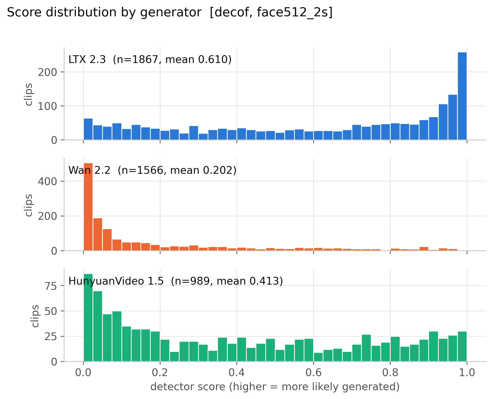

**Mean score, 56 cells x generator.** (`figures/heatmap_mean_score_cells.pdf`)

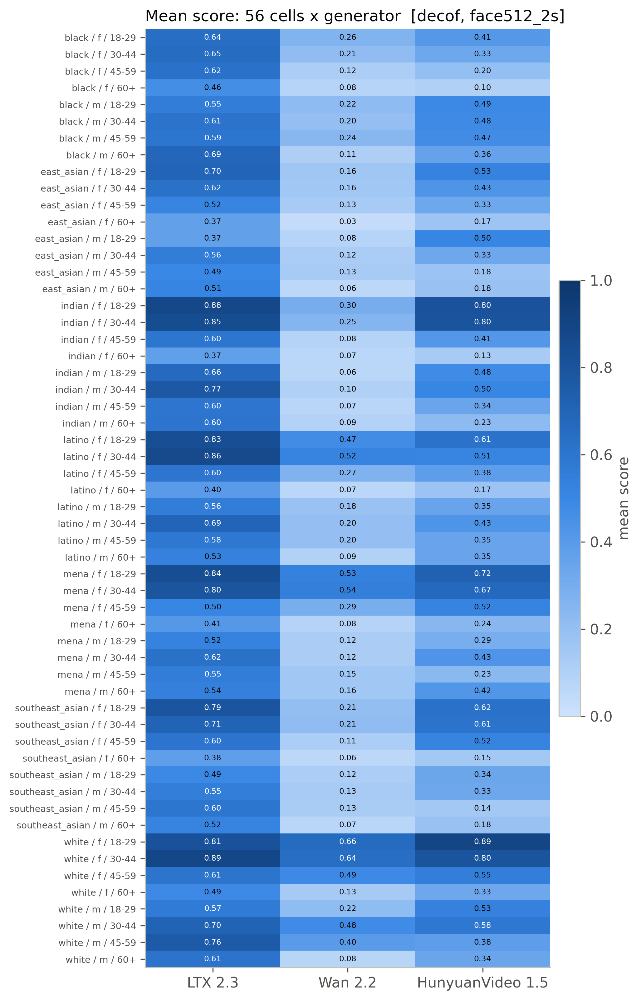

**Detection rate, 56 cells x generator (provisional threshold).** (`figures/heatmap_detection_rate_cells_provisional.pdf`)

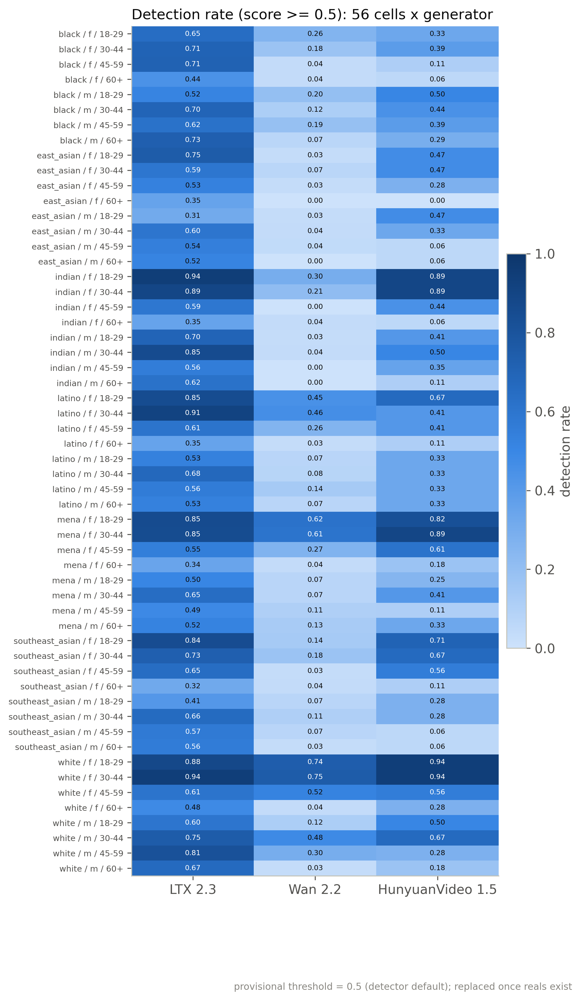

**Mean score by race, gender, age band with 95% CI.** (`figures/subgroup_mean_score.pdf`)

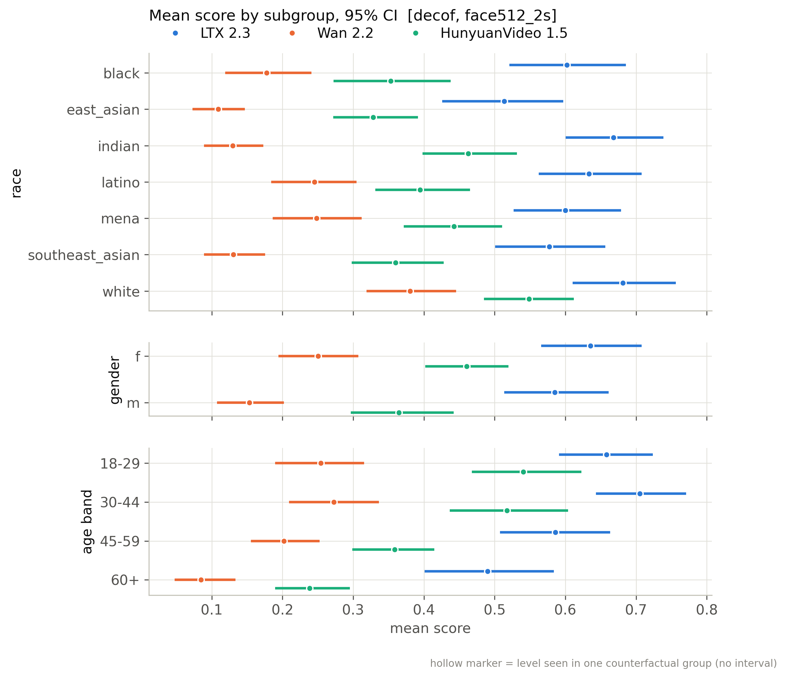

**Mean score by scene factor with 95% CI.** (`figures/scene_factor_mean_score.pdf`)

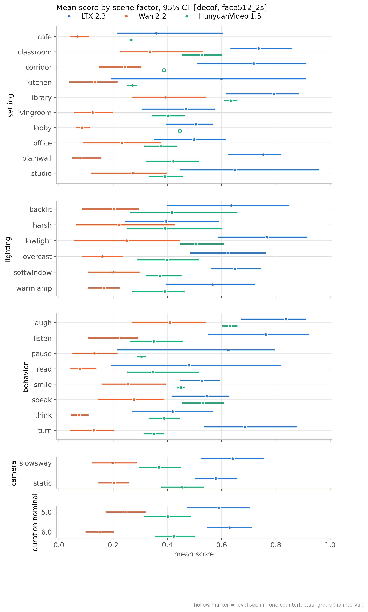

**Detection rate by subgroup (provisional threshold).** (`figures/subgroup_detection_rate_provisional.pdf`)

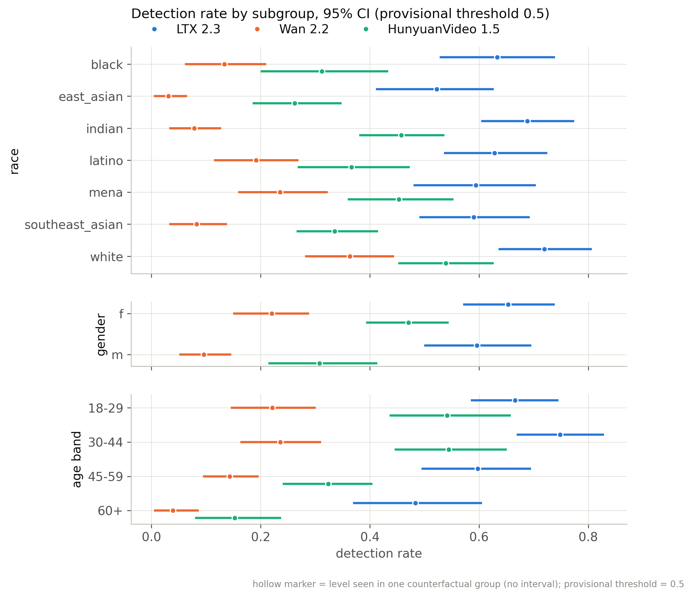

**Distribution of per-group CF spread.** (`figures/cf_spread_distribution.pdf`)

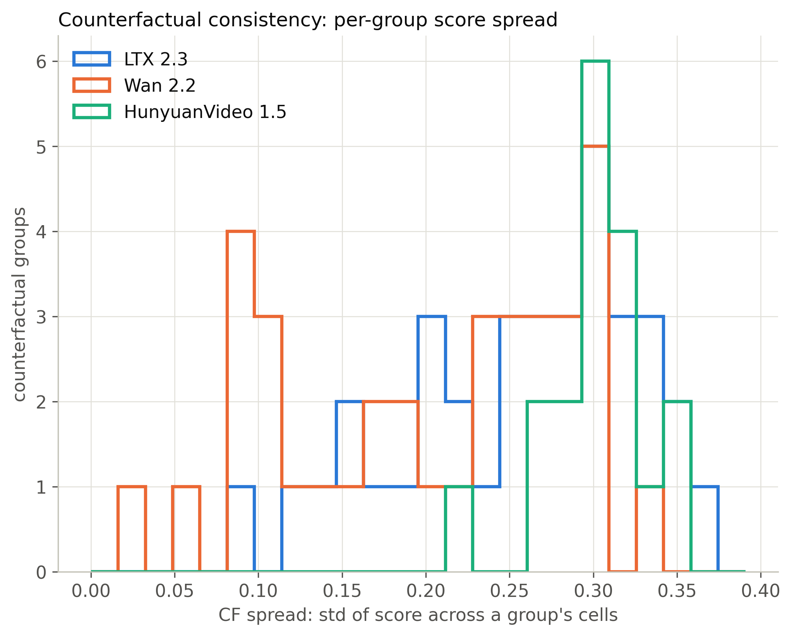

**Flip rate by generator (provisional threshold).** (`figures/flip_rate_by_generator_provisional.pdf`)

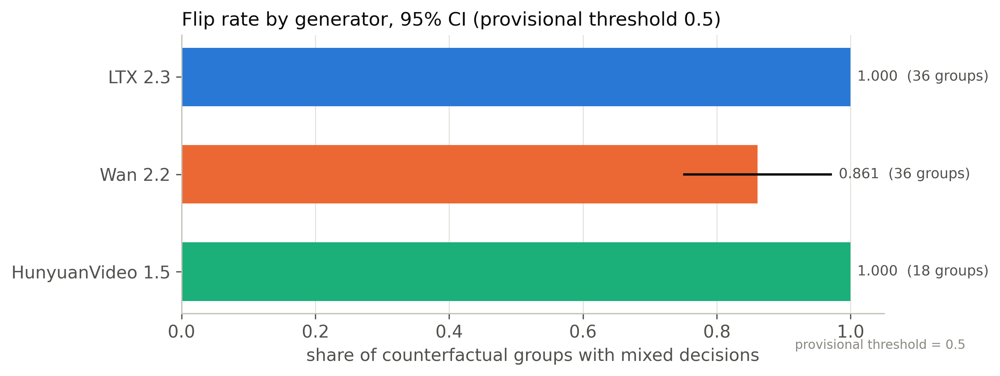

**Partial eta squared by factor.** (`figures/factor_attribution_variance_share.pdf`)

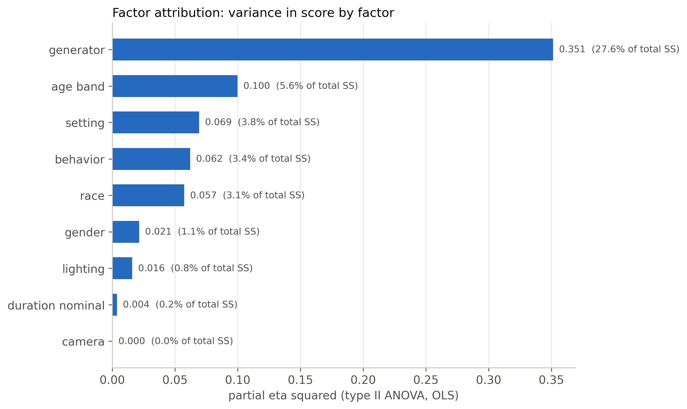

**Highest- and lowest-scoring included clips.** (`figures/example_strip.pdf`)

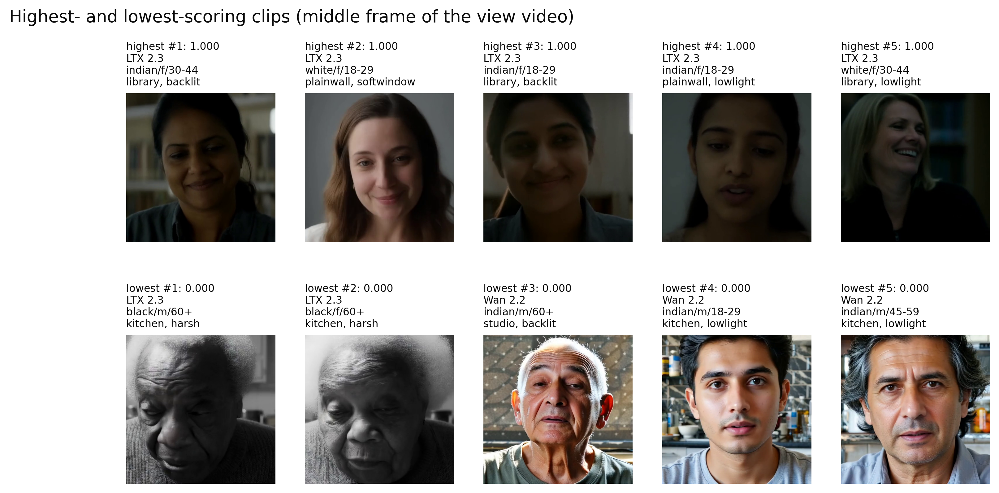

**ROC per generator against fps-matched reals.** (`figures/roc_per_generator.pdf`)

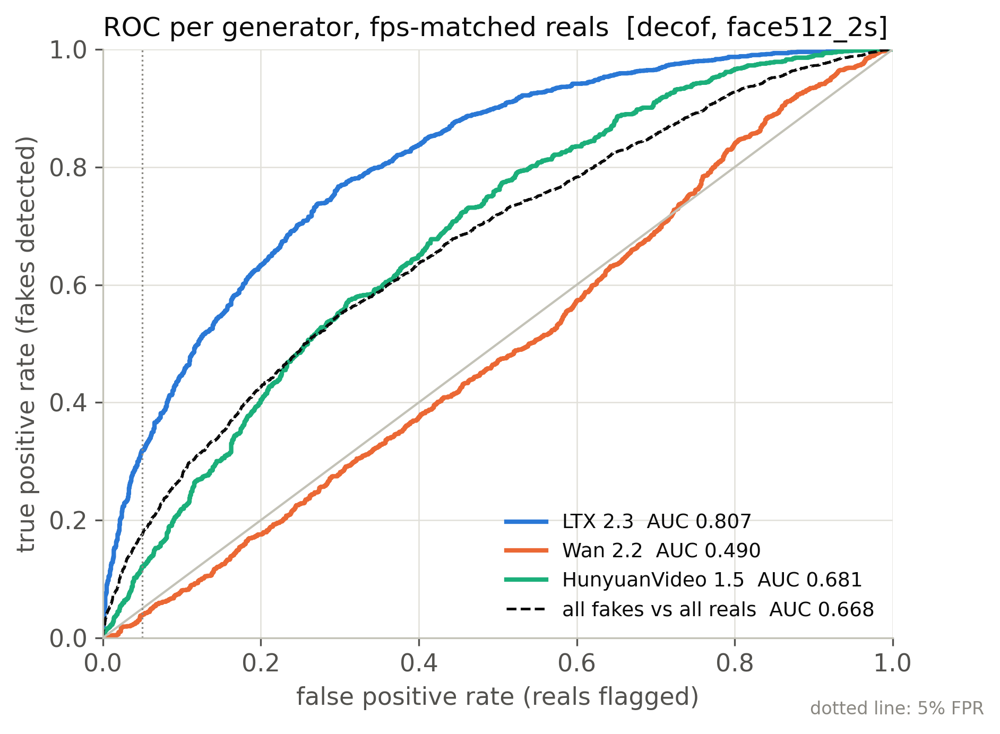

**Real FPR by perceived subgroup at the calibrated threshold.** (`figures/real_fpr_by_subgroup.pdf`)

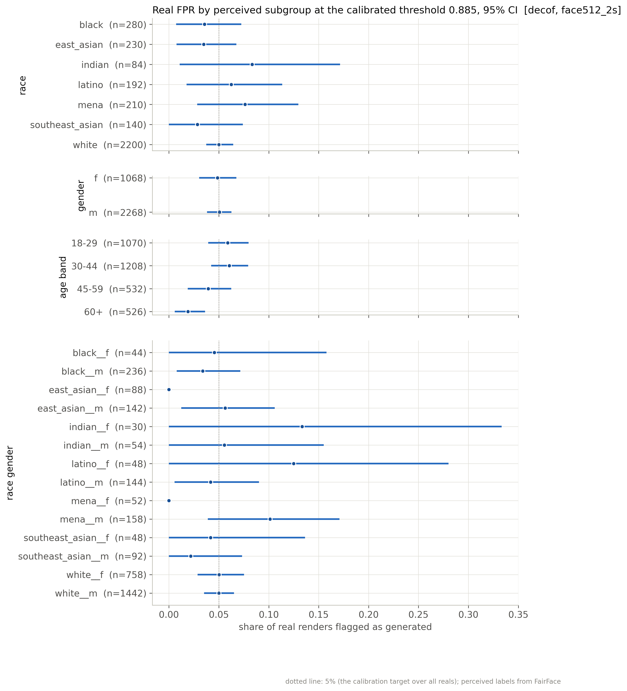

**AUC by subgroup: each subgroup's fakes vs same-subgroup reals.** (`figures/subgroup_auc.pdf`)

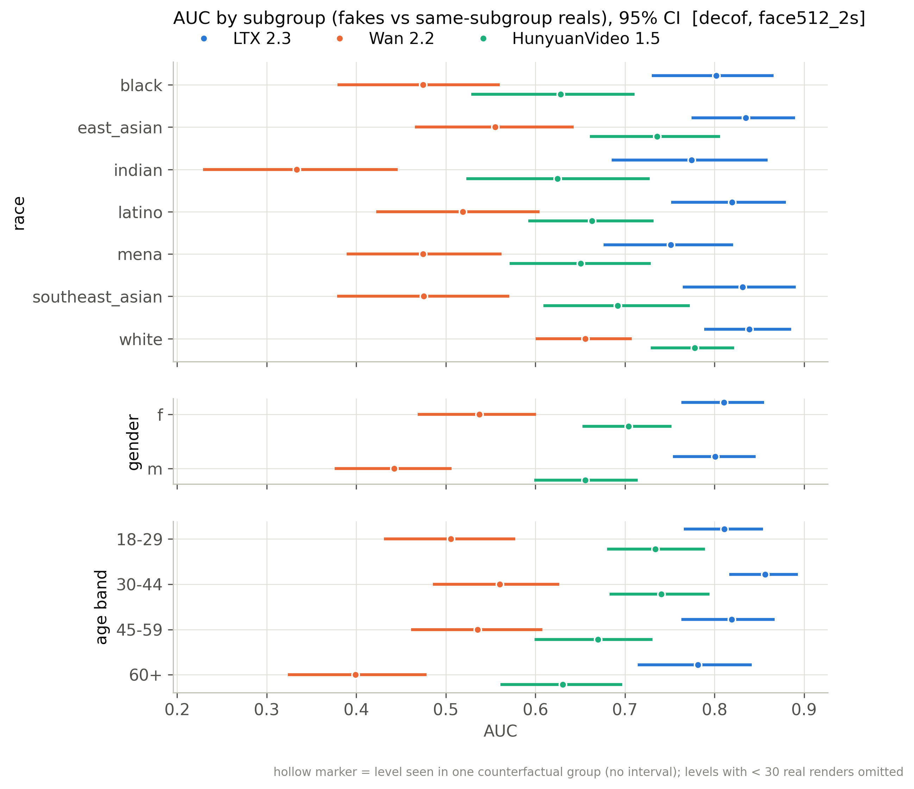

## Files

`manifest_used.csv` (every clip of the active batches with render/score/inclusion flags), `scores.csv` (score per scored clip), `tables/*.csv`, `figures/*`, `snapshot_meta.json`.

