# decof / face512_2s: snapshot 20261023-0243

> **Detector training data.** The released DeCoF checkpoint is most likely trained on AIGVDBench's Open-Sora split (per the paper's default training set and the checkpoint name); our generators are therefore likely unseen. Not confirmed by the authors. Our curated GenBuster subset includes LTX-Video and HunyuanVideo, which are separate from DeCoF's training data but not from AIGVDBench as a whole.

> **Provisional threshold.** Every detection rate and flip rate below uses the detector's default threshold (0.5; official: argmax over 2 logits (DeCoF test.py) == softmax[:,1] >= 0.5). They will be replaced by the 5%-real-FPR threshold once reals exist (section 6.3).

## Settings

| setting           | value                                                                                  |
|:------------------|:---------------------------------------------------------------------------------------|
| detector          | decof 1+b75d2cbe                                                                       |
| checkpoint_sha256 | 4edb7b310cc729771e74b93f658c7fdc4f2e31fdfa617a88372a540d4f9e7b4a                       |
| view              | face512_2s (view_hash 92b6f25d9ce9e5f4)                                                |
| ffmpeg            | ffmpeg version 7.1.1 Copyright (c) 2000-2025 the FFmpeg developers                     |
| batches           | fake_b1, fake_b2, fake_b3, real_all                                                    |
| inclusion set     | primary (technical QC pass AND face QC pass)                                           |
| bootstrap         | 1000 resamples of whole counterfactual groups, seed 20261020, 95% percentile intervals |
| git commit        | 2949de581861-dirty                                                                     |
| created           | 2026-10-23T02:43:25Z                                                                   |

Detector preprocessing on top of the view:

| field               | value                                                                           |
|:--------------------|:--------------------------------------------------------------------------------|
| source              | AIGVDBench section 7 + DeCoF src/utils/data.py (test phase)                     |
| frames_window       | 128                                                                             |
| frames_sampled      | 32                                                                              |
| frames_used         | 8                                                                               |
| sampling            | np.linspace(0, n-1, 32).astype(int)[:8], n = min(128, frames)                   |
| crop                | centre square, side = shorter side                                              |
| resize_1            | [256, 256, 'PIL.BILINEAR']                                                      |
| intermediate_format | lossless (PNG-equivalent, kept in memory)                                       |
| resize_2            | [224, 224, 'torchvision Resize default (bilinear, antialias)']                  |
| centre_crop         | 224                                                                             |
| normalize           | {'mean': [0.485, 0.456, 0.406], 'std': [0.229, 0.224, 0.225]}                   |
| backbone            | OpenAI CLIP ViT-L/14 (frozen), fp32                                             |
| head                | DeCoF vit.ViT(num_patches=8, dim=768, depth=2, heads=4, mlp_dim=768, pool=mean) |
| score               | softmax(logits)[:, 1]                                                           |
| precision           | fp32, TF32 off                                                                  |
| code                | LongMa-2025/DeCoF@5f73e8dc4f8cd9faeed07d767c9517e3f2c66044                      |
| clip_sha256         | b8cca3fd41ae0c99ba7e8951adf17d267cdb84cd88be6f7c2e0eca1737a03836                |

## Coverage

| batch    | generator   |   clips |   primary |   rendered |   view_excluded |   render_failed |   scored |   score_failed |   included |
|:---------|:------------|--------:|----------:|-----------:|----------------:|----------------:|---------:|---------------:|-----------:|
| fake_b1  | hunyuan15   |     504 |       492 |        504 |               0 |               0 |      504 |              0 |        492 |
| fake_b1  | ltx23       |    2016 |      1878 |       2005 |              11 |               0 |     2005 |              0 |       1867 |
| fake_b1  | wan22       |    2016 |      1566 |       2016 |               0 |               0 |     2016 |              0 |       1566 |
| fake_b2  | hunyuan15   |     504 |       497 |        504 |               0 |               0 |      504 |              0 |        497 |
| fake_b3  | ltx25       |    2016 |      2002 |       2016 |               0 |               0 |     2016 |              0 |       2002 |
| real_all | real        |    2221 |      2221 |       2206 |              15 |               0 |     2206 |              0 |       2206 |

face512 window placement (fixed window at the median YuNet face centre, shifted inward at frame edges). The scaled frame is exactly 512 px on its short side, so every window spans it fully and is "shifted" on that axis by construction; the long-axis count is the informative one.

|   rendered |   shifted_long_axis |   shifted_short_axis |   max_shift_long_px |   excluded_no_face |
|-----------:|--------------------:|---------------------:|--------------------:|-------------------:|
|      11457 |                 439 |                11403 |                 203 |                 41 |

Reals scored: 4412. Fakes included: 6424 of 11457 scored (0 scoring failures).

## Observations

- LTX 2.3: mean score 0.610 [0.543, 0.681], median 0.705, n = 1867.
- Wan 2.2: mean score 0.202 [0.155, 0.251], median 0.065, n = 1566.
- HunyuanVideo 1.5: mean score 0.413 [0.358, 0.474], median 0.362, n = 989.
- LTX 2.5: mean score 0.424 [0.362, 0.482], median 0.345, n = 2002.
- Provisional detection rate (score >= 0.5), LTX 2.3: 62.5% [54.0, 71.2].
- Provisional detection rate (score >= 0.5), Wan 2.2: 15.8% [10.7, 21.1].
- Provisional detection rate (score >= 0.5), HunyuanVideo 1.5: 38.9% [31.9, 46.8].
- Provisional detection rate (score >= 0.5), LTX 2.5: 41.3% [33.6, 48.7].
- Provisional detection rate (score >= 0.5), all: 40.9% [35.3, 45.9].
- Largest race score gap: Wan 2.2 0.271 [0.233, 0.308] (white 0.381 vs east_asian 0.109).
- Largest gender score gap: Wan 2.2 0.097 [0.060, 0.132] (f 0.250 vs m 0.153).
- Largest age band score gap: HunyuanVideo 1.5 0.302 [0.236, 0.378] (18-29 0.541 vs 60+ 0.239).
- Largest cell score gap: HunyuanVideo 1.5 0.790 [0.726, 0.885] (white__f__18-29 0.888 vs black__f__60+ 0.098).
- Largest scene-factor gap (all generators): behavior 0.347 [0.273, 0.481] (laugh vs think).
- Largest partial eta squared: generator 0.253, age_band 0.099, behavior 0.070; residual holds 57.1% of total SS.
- CF spread, LTX 2.3: 0.257 [0.233, 0.280] over 36 groups (max 0.372).
- CF spread, Wan 2.2: 0.202 [0.175, 0.229] over 36 groups (max 0.330).
- CF spread, HunyuanVideo 1.5: 0.303 [0.288, 0.316] over 18 groups (max 0.348).
- CF spread, LTX 2.5: 0.280 [0.263, 0.297] over 36 groups (max 0.360).
- Provisional flip rate, LTX 2.3: 100.0% of 36 groups [100.0, 100.0].
- Provisional flip rate, Wan 2.2: 86.1% of 36 groups [75.0, 97.2].
- Provisional flip rate, HunyuanVideo 1.5: 100.0% of 18 groups [100.0, 100.0].
- Provisional flip rate, LTX 2.5: 100.0% of 36 groups [100.0, 100.0].

## 6.1 Fakes only, no threshold

### Mean score by generator

| generator   |    n |   n_groups |   estimate |   ci_lo |   ci_hi |    sd |   median |   q05 |   q95 |
|:------------|-----:|-----------:|-----------:|--------:|--------:|------:|---------:|------:|------:|
| ltx23       | 1867 |         36 |      0.61  |   0.543 |   0.681 | 0.335 |    0.705 | 0.045 | 0.994 |
| wan22       | 1566 |         36 |      0.202 |   0.155 |   0.251 | 0.263 |    0.065 | 0.003 | 0.826 |
| hunyuan15   |  989 |         18 |      0.413 |   0.358 |   0.474 | 0.328 |    0.362 | 0.014 | 0.957 |
| ltx25       | 2002 |         36 |      0.424 |   0.362 |   0.482 | 0.341 |    0.345 | 0.013 | 0.969 |
| all         | 6424 |         36 |      0.422 |   0.377 |   0.464 | 0.353 |    0.346 | 0.008 | 0.98  |

### Mean score by race

| generator   | level           |   n |   estimate |   ci_lo |   ci_hi |   median |
|:------------|:----------------|----:|-----------:|--------:|--------:|---------:|
| ltx23       | black           | 270 |      0.602 |   0.521 |   0.686 |    0.694 |
| ltx23       | east_asian      | 270 |      0.514 |   0.426 |   0.597 |    0.535 |
| ltx23       | indian          | 276 |      0.668 |   0.6   |   0.739 |    0.784 |
| ltx23       | latino          | 261 |      0.634 |   0.562 |   0.708 |    0.755 |
| ltx23       | mena            | 266 |      0.6   |   0.527 |   0.679 |    0.688 |
| ltx23       | southeast_asian | 271 |      0.577 |   0.501 |   0.657 |    0.608 |
| ltx23       | white           | 253 |      0.681 |   0.61  |   0.756 |    0.791 |
| wan22       | black           | 217 |      0.178 |   0.119 |   0.241 |    0.059 |
| wan22       | east_asian      | 226 |      0.109 |   0.073 |   0.147 |    0.04  |
| wan22       | indian          | 230 |      0.13  |   0.089 |   0.173 |    0.036 |
| wan22       | latino          | 219 |      0.245 |   0.184 |   0.305 |    0.091 |
| wan22       | mena            | 225 |      0.248 |   0.186 |   0.312 |    0.087 |
| wan22       | southeast_asian | 229 |      0.13  |   0.089 |   0.175 |    0.042 |
| wan22       | white           | 220 |      0.381 |   0.319 |   0.446 |    0.269 |
| hunyuan15   | black           | 141 |      0.353 |   0.272 |   0.438 |    0.266 |
| hunyuan15   | east_asian      | 141 |      0.328 |   0.272 |   0.392 |    0.203 |
| hunyuan15   | indian          | 142 |      0.463 |   0.398 |   0.531 |    0.402 |
| hunyuan15   | latino          | 142 |      0.395 |   0.331 |   0.465 |    0.337 |
| hunyuan15   | mena            | 139 |      0.443 |   0.372 |   0.511 |    0.421 |
| hunyuan15   | southeast_asian | 143 |      0.36  |   0.298 |   0.428 |    0.211 |
| hunyuan15   | white           | 141 |      0.549 |   0.485 |   0.612 |    0.538 |
| ltx25       | black           | 287 |      0.428 |   0.355 |   0.504 |    0.362 |
| ltx25       | east_asian      | 286 |      0.359 |   0.288 |   0.428 |    0.258 |
| ltx25       | indian          | 284 |      0.406 |   0.343 |   0.47  |    0.319 |
| ltx25       | latino          | 286 |      0.375 |   0.312 |   0.443 |    0.259 |
| ltx25       | mena            | 286 |      0.462 |   0.394 |   0.532 |    0.43  |
| ltx25       | southeast_asian | 286 |      0.361 |   0.297 |   0.427 |    0.274 |
| ltx25       | white           | 287 |      0.573 |   0.502 |   0.642 |    0.646 |
| all         | black           | 915 |      0.408 |   0.355 |   0.462 |    0.335 |
| all         | east_asian      | 923 |      0.339 |   0.291 |   0.383 |    0.211 |
| all         | indian          | 932 |      0.424 |   0.386 |   0.46  |    0.327 |
| all         | latino          | 908 |      0.421 |   0.371 |   0.469 |    0.349 |
| all         | mena            | 916 |      0.447 |   0.398 |   0.494 |    0.414 |
| all         | southeast_asian | 929 |      0.367 |   0.321 |   0.412 |    0.233 |
| all         | white           | 901 |      0.553 |   0.503 |   0.601 |    0.602 |

### Mean score by gender

| generator   | level   |    n |   estimate |   ci_lo |   ci_hi |   median |
|:------------|:--------|-----:|-----------:|--------:|--------:|---------:|
| ltx23       | f       |  931 |      0.636 |   0.566 |   0.708 |    0.76  |
| ltx23       | m       |  936 |      0.585 |   0.514 |   0.661 |    0.646 |
| wan22       | f       |  785 |      0.25  |   0.194 |   0.307 |    0.106 |
| wan22       | m       |  781 |      0.153 |   0.108 |   0.202 |    0.048 |
| hunyuan15   | f       |  495 |      0.461 |   0.402 |   0.52  |    0.473 |
| hunyuan15   | m       |  494 |      0.365 |   0.296 |   0.442 |    0.288 |
| ltx25       | f       |  999 |      0.427 |   0.367 |   0.491 |    0.347 |
| ltx25       | m       | 1003 |      0.42  |   0.355 |   0.482 |    0.344 |
| all         | f       | 3210 |      0.45  |   0.404 |   0.493 |    0.396 |
| all         | m       | 3214 |      0.395 |   0.349 |   0.44  |    0.306 |

### Mean score by age band

| generator   | level   |    n |   estimate |   ci_lo |   ci_hi |   median |
|:------------|:--------|-----:|-----------:|--------:|--------:|---------:|
| ltx23       | 18-29   |  464 |      0.658 |   0.591 |   0.724 |    0.776 |
| ltx23       | 30-44   |  469 |      0.705 |   0.643 |   0.771 |    0.824 |
| ltx23       | 45-59   |  477 |      0.586 |   0.508 |   0.663 |    0.664 |
| ltx23       | 60+     |  457 |      0.49  |   0.401 |   0.584 |    0.471 |
| wan22       | 18-29   |  388 |      0.254 |   0.19  |   0.315 |    0.105 |
| wan22       | 30-44   |  377 |      0.273 |   0.209 |   0.336 |    0.14  |
| wan22       | 45-59   |  398 |      0.202 |   0.156 |   0.253 |    0.091 |
| wan22       | 60+     |  403 |      0.085 |   0.047 |   0.134 |    0.024 |
| hunyuan15   | 18-29   |  242 |      0.541 |   0.468 |   0.623 |    0.583 |
| hunyuan15   | 30-44   |  248 |      0.517 |   0.436 |   0.604 |    0.571 |
| hunyuan15   | 45-59   |  250 |      0.359 |   0.299 |   0.415 |    0.322 |
| hunyuan15   | 60+     |  249 |      0.239 |   0.19  |   0.295 |    0.151 |
| ltx25       | 18-29   |  500 |      0.48  |   0.406 |   0.551 |    0.454 |
| ltx25       | 30-44   |  497 |      0.531 |   0.462 |   0.6   |    0.572 |
| ltx25       | 45-59   |  501 |      0.41  |   0.336 |   0.482 |    0.326 |
| ltx25       | 60+     |  504 |      0.276 |   0.216 |   0.336 |    0.163 |
| all         | 18-29   | 1594 |      0.486 |   0.435 |   0.537 |    0.461 |
| all         | 30-44   | 1591 |      0.519 |   0.469 |   0.566 |    0.556 |
| all         | 45-59   | 1626 |      0.403 |   0.358 |   0.447 |    0.331 |
| all         | 60+     | 1613 |      0.283 |   0.242 |   0.325 |    0.143 |

### Mean score by scene factor (all generators pooled)

| factor           | level      |    n |   estimate |   ci_lo |   ci_hi |
|:-----------------|:-----------|-----:|-----------:|--------:|--------:|
| setting          | cafe       |  590 |      0.279 |   0.18  |   0.449 |
| setting          | classroom  |  541 |      0.541 |   0.45  |   0.644 |
| setting          | corridor   |  716 |      0.506 |   0.427 |   0.607 |
| setting          | kitchen    |  603 |      0.341 |   0.188 |   0.527 |
| setting          | library    |  755 |      0.599 |   0.546 |   0.717 |
| setting          | livingroom |  753 |      0.305 |   0.195 |   0.393 |
| setting          | lobby      |  513 |      0.358 |   0.292 |   0.421 |
| setting          | office     |  580 |      0.417 |   0.338 |   0.488 |
| setting          | plainwall  |  777 |      0.406 |   0.391 |   0.435 |
| setting          | studio     |  596 |      0.443 |   0.305 |   0.605 |
| lighting         | backlit    | 1118 |      0.448 |   0.279 |   0.586 |
| lighting         | harsh      |  967 |      0.345 |   0.221 |   0.505 |
| lighting         | lowlight   | 1113 |      0.517 |   0.404 |   0.636 |
| lighting         | overcast   | 1022 |      0.412 |   0.338 |   0.481 |
| lighting         | softwindow | 1157 |      0.423 |   0.402 |   0.451 |
| lighting         | warmlamp   | 1047 |      0.376 |   0.277 |   0.473 |
| behavior         | laugh      |  721 |      0.633 |   0.582 |   0.699 |
| behavior         | listen     |  956 |      0.512 |   0.424 |   0.589 |
| behavior         | pause      |  744 |      0.35  |   0.18  |   0.415 |
| behavior         | read       |  796 |      0.304 |   0.188 |   0.435 |
| behavior         | smile      |  817 |      0.391 |   0.311 |   0.485 |
| behavior         | speak      |  806 |      0.434 |   0.303 |   0.512 |
| behavior         | think      |  730 |      0.286 |   0.168 |   0.382 |
| behavior         | turn       |  854 |      0.453 |   0.388 |   0.528 |
| camera           | slowsway   | 3217 |      0.436 |   0.365 |   0.503 |
| camera           | static     | 3207 |      0.408 |   0.361 |   0.458 |
| duration_nominal | 5.0        | 3222 |      0.406 |   0.333 |   0.483 |
| duration_nominal | 6.0        | 3202 |      0.439 |   0.396 |   0.482 |

Per-generator scene-factor and 56-cell rows: `tables/score_by_breakdown.csv`.

### Subgroup gap (max - min of level means)

A gap is max - min, so it is never negative and its interval cannot include 0; it is a size, not a test of a difference. Over many levels with few clips each (56 cells; HunyuanVideo has 9 groups per cell) the gap also grows with noise, so compare it with the per-level intervals in `tables/score_by_breakdown.csv`. Levels seen in a single counterfactual group have no interval.

| generator   | attribute        |   n_levels |   gap |   ci_lo |   ci_hi | max_level       | min_level               |
|:------------|:-----------------|-----------:|------:|--------:|--------:|:----------------|:------------------------|
| ltx23       | race             |          7 | 0.168 |   0.124 |   0.226 | white           | east_asian              |
| ltx23       | gender           |          2 | 0.05  |   0.014 |   0.088 | f               | m                       |
| ltx23       | age_band         |          4 | 0.215 |   0.159 |   0.27  | 30-44           | 60+                     |
| ltx23       | cell             |         56 | 0.52  |   0.483 |   0.649 | white__f__30-44 | east_asian__f__60+      |
| ltx23       | setting          |         10 | 0.434 |   0.32  |   0.692 | library         | cafe                    |
| ltx23       | lighting         |          6 | 0.372 |   0.19  |   0.594 | lowlight        | harsh                   |
| ltx23       | behavior         |          8 | 0.417 |   0.298 |   0.661 | laugh           | think                   |
| ltx23       | camera           |          2 | 0.063 |   0.004 |   0.205 | slowsway        | static                  |
| ltx23       | duration_nominal |          2 | 0.04  |   0.002 |   0.183 | 6.0             | 5.0                     |
| wan22       | race             |          7 | 0.271 |   0.233 |   0.308 | white           | east_asian              |
| wan22       | gender           |          2 | 0.097 |   0.06  |   0.132 | f               | m                       |
| wan22       | age_band         |          4 | 0.188 |   0.136 |   0.242 | 30-44           | 60+                     |
| wan22       | cell             |         56 | 0.627 |   0.539 |   0.737 | white__f__18-29 | east_asian__f__60+      |
| wan22       | setting          |         10 | 0.325 |   0.249 |   0.488 | library         | cafe                    |
| wan22       | lighting         |          6 | 0.09  |   0.08  |   0.349 | lowlight        | overcast                |
| wan22       | behavior         |          8 | 0.335 |   0.222 |   0.488 | laugh           | think                   |
| wan22       | camera           |          2 | 0.002 |   0.001 |   0.117 | static          | slowsway                |
| wan22       | duration_nominal |          2 | 0.096 |   0.014 |   0.184 | 5.0             | 6.0                     |
| hunyuan15   | race             |          7 | 0.22  |   0.161 |   0.295 | white           | east_asian              |
| hunyuan15   | gender           |          2 | 0.096 |   0.028 |   0.164 | f               | m                       |
| hunyuan15   | age_band         |          4 | 0.302 |   0.236 |   0.378 | 18-29           | 60+                     |
| hunyuan15   | cell             |         56 | 0.79  |   0.726 |   0.885 | white__f__18-29 | black__f__60+           |
| hunyuan15   | setting          |         10 | 0.367 |   0.196 |   0.405 | library         | cafe                    |
| hunyuan15   | lighting         |          6 | 0.134 |   0.098 |   0.368 | lowlight        | softwindow              |
| hunyuan15   | behavior         |          8 | 0.326 |   0.173 |   0.401 | laugh           | pause                   |
| hunyuan15   | camera           |          2 | 0.086 |   0.007 |   0.194 | static          | slowsway                |
| hunyuan15   | duration_nominal |          2 | 0.022 |   0.002 |   0.143 | 6.0             | 5.0                     |
| ltx25       | race             |          7 | 0.214 |   0.182 |   0.26  | white           | east_asian              |
| ltx25       | gender           |          2 | 0.007 |   0.001 |   0.047 | f               | m                       |
| ltx25       | age_band         |          4 | 0.255 |   0.187 |   0.328 | 30-44           | 60+                     |
| ltx25       | cell             |         56 | 0.675 |   0.602 |   0.767 | white__f__30-44 | southeast_asian__f__60+ |
| ltx25       | setting          |         10 | 0.314 |   0.286 |   0.605 | library         | livingroom              |
| ltx25       | lighting         |          6 | 0.181 |   0.136 |   0.444 | lowlight        | harsh                   |
| ltx25       | behavior         |          8 | 0.421 |   0.352 |   0.567 | laugh           | think                   |
| ltx25       | camera           |          2 | 0.073 |   0.004 |   0.193 | slowsway        | static                  |
| ltx25       | duration_nominal |          2 | 0.078 |   0.006 |   0.202 | 6.0             | 5.0                     |
| all         | race             |          7 | 0.214 |   0.184 |   0.246 | white           | east_asian              |
| all         | gender           |          2 | 0.055 |   0.027 |   0.079 | f               | m                       |
| all         | age_band         |          4 | 0.236 |   0.204 |   0.268 | 30-44           | 60+                     |
| all         | cell             |         56 | 0.606 |   0.558 |   0.671 | white__f__30-44 | southeast_asian__f__60+ |
| all         | setting          |         10 | 0.32  |   0.253 |   0.464 | library         | cafe                    |
| all         | lighting         |          6 | 0.172 |   0.095 |   0.354 | lowlight        | harsh                   |
| all         | behavior         |          8 | 0.347 |   0.273 |   0.481 | laugh           | think                   |
| all         | camera           |          2 | 0.028 |   0.001 |   0.114 | slowsway        | static                  |
| all         | duration_nominal |          2 | 0.033 |   0.002 |   0.117 | 6.0             | 5.0                     |

### CF spread (mean over groups of the std of score across the group's cells)

| generator   |   n_groups |   cf_spread |   ci_lo |   ci_hi |   median |   max |
|:------------|-----------:|------------:|--------:|--------:|---------:|------:|
| ltx23       |         36 |       0.257 |   0.233 |   0.28  |    0.267 | 0.372 |
| wan22       |         36 |       0.202 |   0.175 |   0.229 |    0.231 | 0.33  |
| hunyuan15   |         18 |       0.303 |   0.288 |   0.316 |    0.302 | 0.348 |
| ltx25       |         36 |       0.28  |   0.263 |   0.297 |    0.299 | 0.36  |

### Factor attribution

OLS with every factor as a fixed effect, type-II ANOVA. `ss_share` is the factor's type-II sum of squares over the total sum of squares (type-II shares need not add to 1). Scene factors are constant within a counterfactual group, so their effects are estimated from between-group differences only. The OLS F tests treat clips as independent although clips are clustered in counterfactual groups, so their p values are optimistic; use the group-bootstrap intervals above for inference.

| factor           |   df |    sum_sq | F      | p          | partial_eta2   |   ss_share |
|:-----------------|-----:|----------:|:-------|:-----------|:---------------|-----------:|
| race             |    6 |  25.85    | 60.32  | 5.371e-73  | 0.05362        |  0.03235   |
| gender           |    1 |   4.58    | 64.11  | 1.385e-15  | 0.009938       |  0.00573   |
| age_band         |    3 |  50.28    | 234.6  | 2.016e-144 | 0.09927        |  0.06291   |
| setting          |    9 |  22.69    | 35.3   | 1.794e-61  | 0.04738        |  0.02839   |
| lighting         |    5 |   5.222   | 14.62  | 2.8e-14    | 0.01132        |  0.006534  |
| behavior         |    7 |  34.3     | 68.59  | 6.716e-96  | 0.06992        |  0.04291   |
| camera           |    1 |   0.01926 | 0.2696 | 0.6036     | 4.221e-05      |  2.41e-05  |
| duration_nominal |    1 |   0.1275  | 1.785  | 0.1816     | 0.0002794      |  0.0001596 |
| generator        |    3 | 154.7     | 721.6  | 0          | 0.2531         |  0.1935    |
| Residual         | 6387 | 456.3     |        |            |                |  0.5708    |

Lighting x race interaction (added to the same OLS):

| term            |   df |   sum_sq |     F |       p |   partial_eta2 |
|:----------------|-----:|---------:|------:|--------:|---------------:|
| lighting x race |   30 |    2.917 | 1.364 | 0.08919 |       0.006394 |

Mixed model `score ~ factors + (1 | counterfactual_group)` (REML) variance components (fixed effects: `tables/factor_mixed_fixed.csv`):

| component                               |   variance | converged   |
|:----------------------------------------|-----------:|:------------|
| counterfactual_group (random intercept) |    0       | True        |
| residual                                |    0.07035 | True        |
| ICC (group share of random variance)    |    0       | True        |

A group variance at or near 0 is a boundary estimate: setting, lighting, behavior, camera and duration are fixed per group and absorb most between-group variation, leaving little for the random intercept. It does not mean scenes do not matter.

## 6.2 Provisional (threshold 0.5, provisional)

### Detection rate by generator (provisional)

| generator   |    n |   estimate |   ci_lo |   ci_hi |
|:------------|-----:|-----------:|--------:|--------:|
| ltx23       | 1867 |      0.625 |   0.54  |   0.712 |
| wan22       | 1566 |      0.158 |   0.107 |   0.211 |
| hunyuan15   |  989 |      0.389 |   0.319 |   0.468 |
| ltx25       | 2002 |      0.413 |   0.336 |   0.487 |
| all         | 6424 |      0.409 |   0.353 |   0.459 |

### Detection rate by race (provisional)

| generator   | level           |   n |   estimate |   ci_lo |   ci_hi |
|:------------|:----------------|----:|-----------:|--------:|--------:|
| ltx23       | black           | 270 |      0.633 |   0.528 |   0.739 |
| ltx23       | east_asian      | 270 |      0.522 |   0.411 |   0.627 |
| ltx23       | indian          | 276 |      0.688 |   0.604 |   0.774 |
| ltx23       | latino          | 261 |      0.628 |   0.536 |   0.725 |
| ltx23       | mena            | 266 |      0.594 |   0.48  |   0.704 |
| ltx23       | southeast_asian | 271 |      0.59  |   0.49  |   0.693 |
| ltx23       | white           | 253 |      0.719 |   0.636 |   0.806 |
| wan22       | black           | 217 |      0.134 |   0.062 |   0.21  |
| wan22       | east_asian      | 226 |      0.031 |   0.004 |   0.065 |
| wan22       | indian          | 230 |      0.078 |   0.033 |   0.128 |
| wan22       | latino          | 219 |      0.192 |   0.115 |   0.269 |
| wan22       | mena            | 225 |      0.236 |   0.159 |   0.323 |
| wan22       | southeast_asian | 229 |      0.083 |   0.032 |   0.139 |
| wan22       | white           | 220 |      0.364 |   0.282 |   0.444 |
| hunyuan15   | black           | 141 |      0.312 |   0.2   |   0.434 |
| hunyuan15   | east_asian      | 141 |      0.262 |   0.185 |   0.348 |
| hunyuan15   | indian          | 142 |      0.458 |   0.381 |   0.536 |
| hunyuan15   | latino          | 142 |      0.366 |   0.268 |   0.473 |
| hunyuan15   | mena            | 139 |      0.453 |   0.359 |   0.553 |
| hunyuan15   | southeast_asian | 143 |      0.336 |   0.266 |   0.415 |
| hunyuan15   | white           | 141 |      0.539 |   0.452 |   0.627 |
| ltx25       | black           | 287 |      0.432 |   0.33  |   0.532 |
| ltx25       | east_asian      | 286 |      0.322 |   0.227 |   0.417 |
| ltx25       | indian          | 284 |      0.384 |   0.304 |   0.469 |
| ltx25       | latino          | 286 |      0.35  |   0.263 |   0.446 |
| ltx25       | mena            | 286 |      0.458 |   0.373 |   0.546 |
| ltx25       | southeast_asian | 286 |      0.332 |   0.242 |   0.421 |
| ltx25       | white           | 287 |      0.61  |   0.521 |   0.698 |
| all         | black           | 915 |      0.402 |   0.338 |   0.467 |
| all         | east_asian      | 923 |      0.3   |   0.243 |   0.355 |
| all         | indian          | 932 |      0.41  |   0.363 |   0.455 |
| all         | latino          | 908 |      0.394 |   0.327 |   0.456 |
| all         | mena            | 916 |      0.442 |   0.379 |   0.503 |
| all         | southeast_asian | 929 |      0.347 |   0.293 |   0.403 |
| all         | white           | 901 |      0.569 |   0.507 |   0.629 |

### Detection rate by gender (provisional)

| generator   | level   |    n |   estimate |   ci_lo |   ci_hi |
|:------------|:--------|-----:|-----------:|--------:|--------:|
| ltx23       | f       |  931 |      0.653 |   0.571 |   0.738 |
| ltx23       | m       |  936 |      0.596 |   0.499 |   0.696 |
| wan22       | f       |  785 |      0.22  |   0.15  |   0.289 |
| wan22       | m       |  781 |      0.096 |   0.051 |   0.146 |
| hunyuan15   | f       |  495 |      0.471 |   0.393 |   0.545 |
| hunyuan15   | m       |  494 |      0.308 |   0.214 |   0.414 |
| ltx25       | f       |  999 |      0.415 |   0.34  |   0.495 |
| ltx25       | m       | 1003 |      0.41  |   0.328 |   0.49  |
| all         | f       | 3210 |      0.445 |   0.391 |   0.497 |
| all         | m       | 3214 |      0.372 |   0.317 |   0.429 |

### Detection rate by age band (provisional)

| generator   | level   |    n |   estimate |   ci_lo |   ci_hi |
|:------------|:--------|-----:|-----------:|--------:|--------:|
| ltx23       | 18-29   |  464 |      0.666 |   0.585 |   0.746 |
| ltx23       | 30-44   |  469 |      0.748 |   0.669 |   0.829 |
| ltx23       | 45-59   |  477 |      0.597 |   0.495 |   0.695 |
| ltx23       | 60+     |  457 |      0.484 |   0.369 |   0.605 |
| wan22       | 18-29   |  388 |      0.222 |   0.145 |   0.301 |
| wan22       | 30-44   |  377 |      0.236 |   0.163 |   0.311 |
| wan22       | 45-59   |  398 |      0.143 |   0.094 |   0.197 |
| wan22       | 60+     |  403 |      0.04  |   0.005 |   0.087 |
| hunyuan15   | 18-29   |  242 |      0.541 |   0.436 |   0.658 |
| hunyuan15   | 30-44   |  248 |      0.544 |   0.445 |   0.651 |
| hunyuan15   | 45-59   |  250 |      0.324 |   0.24  |   0.405 |
| hunyuan15   | 60+     |  249 |      0.153 |   0.08  |   0.238 |
| ltx25       | 18-29   |  500 |      0.472 |   0.38  |   0.564 |
| ltx25       | 30-44   |  497 |      0.533 |   0.444 |   0.625 |
| ltx25       | 45-59   |  501 |      0.417 |   0.321 |   0.512 |
| ltx25       | 60+     |  504 |      0.23  |   0.157 |   0.308 |
| all         | 18-29   | 1594 |      0.478 |   0.414 |   0.541 |
| all         | 30-44   | 1591 |      0.528 |   0.467 |   0.588 |
| all         | 45-59   | 1626 |      0.389 |   0.334 |   0.443 |
| all         | 60+     | 1613 |      0.242 |   0.192 |   0.294 |

### Detection-rate gap (provisional)

| generator   | attribute        |   gap |   ci_lo |   ci_hi | max_level        | min_level            |
|:------------|:-----------------|------:|--------:|--------:|:-----------------|:---------------------|
| ltx23       | race             | 0.197 |   0.139 |   0.273 | white            | east_asian           |
| ltx23       | gender           | 0.057 |   0.006 |   0.116 | f                | m                    |
| ltx23       | age_band         | 0.265 |   0.181 |   0.353 | 30-44            | 60+                  |
| ltx23       | cell             | 0.629 |   0.594 |   0.825 | indian__f__18-29 | east_asian__m__18-29 |
| ltx23       | setting          | 0.537 |   0.417 |   0.829 | library          | cafe                 |
| ltx23       | lighting         | 0.434 |   0.222 |   0.719 | lowlight         | harsh                |
| ltx23       | behavior         | 0.518 |   0.389 |   0.812 | laugh            | think                |
| ltx23       | camera           | 0.08  |   0.004 |   0.249 | slowsway         | static               |
| ltx23       | duration_nominal | 0.052 |   0.004 |   0.224 | 6.0              | 5.0                  |
| wan22       | race             | 0.333 |   0.26  |   0.402 | white            | east_asian           |
| wan22       | gender           | 0.124 |   0.071 |   0.176 | f                | m                    |
| wan22       | age_band         | 0.196 |   0.138 |   0.265 | 30-44            | 60+                  |
| wan22       | cell             | 0.75  |   0.633 |   0.929 | white__f__30-44  | east_asian__f__60+   |
| wan22       | setting          | 0.331 |   0.247 |   0.586 | library          | cafe                 |
| wan22       | lighting         | 0.104 |   0.089 |   0.412 | lowlight         | warmlamp             |
| wan22       | behavior         | 0.356 |   0.214 |   0.56  | laugh            | read                 |
| wan22       | camera           | 0.001 |   0.002 |   0.13  | slowsway         | static               |
| wan22       | duration_nominal | 0.097 |   0.012 |   0.194 | 5.0              | 6.0                  |
| hunyuan15   | race             | 0.277 |   0.196 |   0.375 | white            | east_asian           |
| hunyuan15   | gender           | 0.163 |   0.065 |   0.26  | f                | m                    |
| hunyuan15   | age_band         | 0.392 |   0.311 |   0.513 | 30-44            | 60+                  |
| hunyuan15   | cell             | 0.941 |   0.917 |   1     | white__f__18-29  | east_asian__f__60+   |
| hunyuan15   | setting          | 0.491 |   0.277 |   0.571 | library          | kitchen              |
| hunyuan15   | lighting         | 0.182 |   0.137 |   0.48  | lowlight         | softwindow           |
| hunyuan15   | behavior         | 0.422 |   0.228 |   0.561 | laugh            | pause                |
| hunyuan15   | camera           | 0.121 |   0.014 |   0.26  | static           | slowsway             |
| hunyuan15   | duration_nominal | 0.025 |   0.002 |   0.187 | 6.0              | 5.0                  |
| ltx25       | race             | 0.288 |   0.235 |   0.358 | white            | east_asian           |
| ltx25       | gender           | 0.006 |   0.001 |   0.063 | f                | m                    |
| ltx25       | age_band         | 0.303 |   0.21  |   0.401 | 30-44            | 60+                  |
| ltx25       | cell             | 0.861 |   0.778 |   0.972 | white__f__30-44  | indian__f__60+       |
| ltx25       | setting          | 0.391 |   0.349 |   0.8   | library          | livingroom           |
| ltx25       | lighting         | 0.214 |   0.169 |   0.555 | lowlight         | harsh                |
| ltx25       | behavior         | 0.535 |   0.432 |   0.745 | laugh            | think                |
| ltx25       | camera           | 0.08  |   0.003 |   0.229 | slowsway         | static               |
| ltx25       | duration_nominal | 0.094 |   0.007 |   0.249 | 6.0              | 5.0                  |
| all         | race             | 0.269 |   0.229 |   0.307 | white            | east_asian           |
| all         | gender           | 0.073 |   0.037 |   0.108 | f                | m                    |
| all         | age_band         | 0.286 |   0.239 |   0.333 | 30-44            | 60+                  |
| all         | cell             | 0.751 |   0.698 |   0.839 | white__f__30-44  | indian__f__60+       |
| all         | setting          | 0.385 |   0.301 |   0.603 | library          | cafe                 |
| all         | lighting         | 0.201 |   0.111 |   0.431 | lowlight         | harsh                |
| all         | behavior         | 0.418 |   0.322 |   0.599 | laugh            | think                |
| all         | camera           | 0.031 |   0.002 |   0.133 | slowsway         | static               |
| all         | duration_nominal | 0.044 |   0.003 |   0.147 | 6.0              | 5.0                  |

### Flip rate (provisional): share of groups whose clips get different decisions

| generator   |   n_groups |   flip_rate |   ci_lo |   ci_hi |   median |   max |
|:------------|-----------:|------------:|--------:|--------:|---------:|------:|
| ltx23       |         36 |       1     |    1    |   1     |        1 |     1 |
| wan22       |         36 |       0.861 |    0.75 |   0.972 |        1 |     1 |
| hunyuan15   |         18 |       1     |    1    |   1     |        1 |     1 |
| ltx25       |         36 |       1     |    1    |   1     |        1 |     1 |

### Sensitivity: inclusion set

| set     | generator   |    n |   mean_score |   provisional_detection_rate |
|:--------|:------------|-----:|-------------:|-----------------------------:|
| all     | hunyuan15   | 1008 |        0.415 |                        0.394 |
| all     | ltx23       | 2005 |        0.612 |                        0.625 |
| all     | ltx25       | 2016 |        0.423 |                        0.413 |
| all     | wan22       | 2016 |        0.211 |                        0.166 |
| primary | hunyuan15   |  989 |        0.413 |                        0.389 |
| primary | ltx23       | 1867 |        0.61  |                        0.625 |
| primary | ltx25       | 2002 |        0.424 |                        0.413 |
| primary | wan22       | 1566 |        0.202 |                        0.158 |

## 6.3 Real vs generated (calibrated threshold 0.8811)

The threshold is the score at which 5% of primary real renders (24 and 16 fps pooled) are flagged; one per detector and view, never per subgroup. Each generator is compared with reals rendered at its own fps. Intervals: fakes resample counterfactual groups, reals resample identity clusters (source video). Real labels are perceived (FairFace), not self-reported.

### Calibration

| scope            |   n_renders |   n_sources |   n_identities |   threshold |    fpr |
|:-----------------|------------:|------------:|---------------:|------------:|-------:|
| all real renders |        4412 |        2206 |           1809 |      0.8811 | 0.0501 |
| 16 fps renders   |        2206 |        2206 |           1809 |      0.8811 | 0.0481 |
| 24 fps renders   |        2206 |        2206 |           1809 |      0.8811 | 0.0521 |

### AUC, AP, EER, TPR at 5% FPR

| generator   | real_fps   |   n_fake |   n_real |   auc |   auc_ci_lo |   auc_ci_hi |    ap |   eer |   tpr_at_5fpr |   detection_rate_global_thr |   det_ci_lo |   det_ci_hi |
|:------------|:-----------|---------:|---------:|------:|------------:|------------:|------:|------:|--------------:|----------------------------:|------------:|------------:|
| ltx23       | 24         |     1867 |     2206 | 0.813 |       0.771 |       0.856 | 0.776 | 0.267 |         0.32  |                       0.328 |       0.249 |       0.419 |
| wan22       | 16         |     1566 |     2206 | 0.509 |       0.45  |       0.566 | 0.405 | 0.509 |         0.04  |                       0.036 |       0.019 |       0.052 |
| hunyuan15   | 24         |      989 |     2206 | 0.693 |       0.652 |       0.735 | 0.46  | 0.368 |         0.121 |                       0.126 |       0.088 |       0.173 |
| ltx25       | 24         |     2002 |     2206 | 0.693 |       0.648 |       0.736 | 0.644 | 0.368 |         0.144 |                       0.151 |       0.108 |       0.194 |
| all         | 24+16      |     6424 |     4412 | 0.686 |       0.65  |       0.718 | 0.749 | 0.372 |         0.171 |                       0.171 |       0.134 |       0.21  |

### Real FPR by perceived subgroup

| attribute   | level              |   n_renders |   n_identities |   fpr |   ci_lo |   ci_hi |
|:------------|:-------------------|------------:|---------------:|------:|--------:|--------:|
| race        | black              |         378 |            173 | 0.032 |   0.01  |   0.061 |
| race        | east_asian         |         380 |            169 | 0.037 |   0.014 |   0.065 |
| race        | indian             |         112 |             54 | 0.098 |   0.029 |   0.187 |
| race        | latino             |         254 |            119 | 0.063 |   0.026 |   0.106 |
| race        | mena               |         258 |            124 | 0.074 |   0.032 |   0.12  |
| race        | southeast_asian    |         184 |             85 | 0.022 |   0     |   0.055 |
| race        | white              |        2836 |           1179 | 0.05  |   0.039 |   0.062 |
| gender      | f                  |        1378 |            604 | 0.054 |   0.037 |   0.071 |
| gender      | m                  |        3024 |           1263 | 0.048 |   0.037 |   0.059 |
| age_band    | 18-29              |        1380 |            624 | 0.058 |   0.041 |   0.076 |
| age_band    | 30-44              |        1518 |            679 | 0.052 |   0.037 |   0.068 |
| age_band    | 45-59              |         644 |            274 | 0.045 |   0.023 |   0.068 |
| age_band    | 60+                |         624 |            268 | 0.019 |   0.007 |   0.034 |
| race_gender | black__f           |          64 |             30 | 0.062 |   0     |   0.167 |
| race_gender | black__m           |         314 |            144 | 0.025 |   0.006 |   0.052 |
| race_gender | east_asian__f      |         136 |             62 | 0.015 |   0     |   0.049 |
| race_gender | east_asian__m      |         244 |            110 | 0.049 |   0.014 |   0.09  |
| race_gender | indian__f          |          32 |             16 | 0.125 |   0     |   0.319 |
| race_gender | indian__m          |          80 |             38 | 0.087 |   0.013 |   0.188 |
| race_gender | latino__f          |          62 |             30 | 0.113 |   0.019 |   0.227 |
| race_gender | latino__m          |         192 |             89 | 0.047 |   0.011 |   0.09  |
| race_gender | mena__f            |          60 |             30 | 0.033 |   0     |   0.111 |
| race_gender | mena__m            |         198 |             94 | 0.086 |   0.034 |   0.146 |
| race_gender | southeast_asian__f |          64 |             30 | 0.031 |   0     |   0.103 |
| race_gender | southeast_asian__m |         120 |             56 | 0.017 |   0     |   0.057 |
| race_gender | white__f           |         960 |            425 | 0.055 |   0.034 |   0.078 |
| race_gender | white__m           |        1876 |            789 | 0.048 |   0.035 |   0.061 |

### Real FPR gap (max - min across levels; non-negative by construction)

| attribute   |   n_levels |   fpr_gap |   ci_lo |   ci_hi | max_level   |   max_fpr | min_level       |   min_fpr |
|:------------|-----------:|----------:|--------:|--------:|:------------|----------:|:----------------|----------:|
| race        |          7 |     0.076 |   0.042 |   0.171 | indian      |     0.098 | southeast_asian |     0.022 |
| gender      |          2 |     0.006 |   0     |   0.026 | f           |     0.054 | m               |     0.048 |
| age_band    |          4 |     0.039 |   0.023 |   0.062 | 18-29       |     0.058 | 60+             |     0.019 |
| race_gender |         14 |     0.11  |   0.088 |   0.319 | indian__f   |     0.125 | east_asian__f   |     0.015 |

### Worst-subgroup AUC and AUC gap

| generator   | attribute   |   n_levels | worst_level   |   worst_auc |   worst_ci_lo |   worst_ci_hi | best_level         |   best_auc |   auc_gap |   gap_ci_lo |   gap_ci_hi |
|:------------|:------------|-----------:|:--------------|------------:|--------------:|--------------:|:-------------------|-----------:|----------:|------------:|------------:|
| ltx23       | race        |          7 | mena          |       0.763 |         0.672 |         0.802 | southeast_asian    |      0.862 |     0.099 |       0.075 |       0.188 |
| ltx23       | gender      |          2 | m             |       0.81  |         0.763 |         0.849 | f                  |      0.815 |     0.004 |       0     |       0.037 |
| ltx23       | age_band    |          4 | 60+           |       0.794 |         0.735 |         0.848 | 30-44              |      0.867 |     0.073 |       0.038 |       0.118 |
| ltx23       | race_gender |         13 | mena__m       |       0.735 |         0.626 |         0.784 | southeast_asian__m |      0.883 |     0.148 |       0.117 |       0.258 |
| wan22       | race        |          7 | indian        |       0.345 |         0.236 |         0.442 | white              |      0.664 |     0.319 |       0.226 |       0.417 |
| wan22       | gender      |          2 | m             |       0.466 |         0.401 |         0.529 | f                  |      0.551 |     0.086 |       0.039 |       0.129 |
| wan22       | age_band    |          4 | 60+           |       0.428 |         0.356 |         0.502 | 30-44              |      0.577 |     0.149 |       0.081 |       0.222 |
| wan22       | race_gender |         13 | indian__m     |       0.245 |         0.134 |         0.359 | white__f           |      0.717 |     0.473 |       0.356 |       0.601 |
| hunyuan15   | race        |          7 | indian        |       0.624 |         0.511 |         0.675 | white              |      0.782 |     0.158 |       0.127 |       0.266 |
| hunyuan15   | gender      |          2 | m             |       0.672 |         0.617 |         0.72  | f                  |      0.711 |     0.039 |       0.003 |       0.1   |
| hunyuan15   | age_band    |          4 | 60+           |       0.654 |         0.585 |         0.702 | 30-44              |      0.756 |     0.102 |       0.056 |       0.181 |
| hunyuan15   | race_gender |         13 | indian__m     |       0.545 |         0.39  |         0.613 | white__f           |      0.812 |     0.267 |       0.213 |       0.444 |
| ltx25       | race        |          7 | indian        |       0.579 |         0.48  |         0.655 | white              |      0.782 |     0.203 |       0.137 |       0.305 |
| ltx25       | gender      |          2 | f             |       0.685 |         0.632 |         0.728 | m                  |      0.699 |     0.014 |       0.001 |       0.054 |
| ltx25       | age_band    |          4 | 60+           |       0.65  |         0.583 |         0.705 | 30-44              |      0.769 |     0.119 |       0.062 |       0.186 |
| ltx25       | race_gender |         13 | indian__m     |       0.519 |         0.39  |         0.612 | white__m           |      0.797 |     0.278 |       0.2   |       0.42  |
| all         | race        |          7 | indian        |       0.587 |         0.501 |         0.653 | white              |      0.772 |     0.185 |       0.126 |       0.269 |
| all         | gender      |          2 | m             |       0.673 |         0.633 |         0.708 | f                  |      0.696 |     0.023 |       0.002 |       0.054 |
| all         | age_band    |          4 | 60+           |       0.639 |         0.59  |         0.687 | 30-44              |      0.752 |     0.113 |       0.069 |       0.157 |
| all         | race_gender |         14 | indian__m     |       0.526 |         0.422 |         0.607 | white__f           |      0.783 |     0.256 |       0.183 |       0.377 |

### Detection rate at the calibrated threshold

| generator   |    n |   estimate |   ci_lo |   ci_hi |
|:------------|-----:|-----------:|--------:|--------:|
| ltx23       | 1867 |      0.328 |   0.249 |   0.419 |
| wan22       | 1566 |      0.036 |   0.019 |   0.052 |
| hunyuan15   |  989 |      0.126 |   0.088 |   0.173 |
| ltx25       | 2002 |      0.151 |   0.108 |   0.194 |
| all         | 6424 |      0.171 |   0.134 |   0.21  |

#### by race

| generator   | level           |   n |   estimate |   ci_lo |   ci_hi |
|:------------|:----------------|----:|-----------:|--------:|--------:|
| ltx23       | black           | 270 |      0.289 |   0.199 |   0.394 |
| ltx23       | east_asian      | 270 |      0.244 |   0.151 |   0.353 |
| ltx23       | indian          | 276 |      0.395 |   0.311 |   0.482 |
| ltx23       | latino          | 261 |      0.368 |   0.279 |   0.47  |
| ltx23       | mena            | 266 |      0.289 |   0.207 |   0.38  |
| ltx23       | southeast_asian | 271 |      0.306 |   0.213 |   0.408 |
| ltx23       | white           | 253 |      0.411 |   0.304 |   0.524 |
| wan22       | black           | 217 |      0.009 |   0     |   0.022 |
| wan22       | east_asian      | 226 |      0     |   0     |   0     |
| wan22       | indian          | 230 |      0.013 |   0     |   0.031 |
| wan22       | latino          | 219 |      0.046 |   0.02  |   0.074 |
| wan22       | mena            | 225 |      0.062 |   0.021 |   0.111 |
| wan22       | southeast_asian | 229 |      0     |   0     |   0     |
| wan22       | white           | 220 |      0.123 |   0.061 |   0.19  |
| hunyuan15   | black           | 141 |      0.064 |   0.014 |   0.134 |
| hunyuan15   | east_asian      | 141 |      0.078 |   0.022 |   0.15  |
| hunyuan15   | indian          | 142 |      0.197 |   0.125 |   0.276 |
| hunyuan15   | latino          | 142 |      0.12  |   0.061 |   0.183 |
| hunyuan15   | mena            | 139 |      0.101 |   0.04  |   0.167 |
| hunyuan15   | southeast_asian | 143 |      0.105 |   0.05  |   0.168 |
| hunyuan15   | white           | 141 |      0.22  |   0.157 |   0.288 |
| ltx25       | black           | 287 |      0.122 |   0.073 |   0.175 |
| ltx25       | east_asian      | 286 |      0.084 |   0.045 |   0.122 |
| ltx25       | indian          | 284 |      0.158 |   0.105 |   0.216 |
| ltx25       | latino          | 286 |      0.129 |   0.088 |   0.171 |
| ltx25       | mena            | 286 |      0.192 |   0.132 |   0.254 |
| ltx25       | southeast_asian | 286 |      0.084 |   0.045 |   0.129 |
| ltx25       | white           | 287 |      0.286 |   0.215 |   0.359 |
| all         | black           | 915 |      0.136 |   0.095 |   0.182 |
| all         | east_asian      | 923 |      0.109 |   0.073 |   0.148 |
| all         | indian          | 932 |      0.198 |   0.164 |   0.235 |
| all         | latino          | 908 |      0.176 |   0.138 |   0.221 |
| all         | mena            | 916 |      0.175 |   0.125 |   0.223 |
| all         | southeast_asian | 929 |      0.131 |   0.096 |   0.17  |
| all         | white           | 901 |      0.271 |   0.21  |   0.333 |

#### by gender

| generator   | level   |    n |   estimate |   ci_lo |   ci_hi |
|:------------|:--------|-----:|-----------:|--------:|--------:|
| ltx23       | f       |  931 |      0.386 |   0.304 |   0.475 |
| ltx23       | m       |  936 |      0.271 |   0.189 |   0.367 |
| wan22       | f       |  785 |      0.056 |   0.029 |   0.082 |
| wan22       | m       |  781 |      0.015 |   0.005 |   0.029 |
| hunyuan15   | f       |  495 |      0.152 |   0.111 |   0.2   |
| hunyuan15   | m       |  494 |      0.101 |   0.047 |   0.163 |
| ltx25       | f       |  999 |      0.161 |   0.113 |   0.214 |
| ltx25       | m       | 1003 |      0.141 |   0.095 |   0.188 |
| all         | f       | 3210 |      0.199 |   0.159 |   0.241 |
| all         | m       | 3214 |      0.142 |   0.105 |   0.182 |

#### by age band

| generator   | level   |    n |   estimate |   ci_lo |   ci_hi |
|:------------|:--------|-----:|-----------:|--------:|--------:|
| ltx23       | 18-29   |  464 |      0.384 |   0.295 |   0.478 |
| ltx23       | 30-44   |  469 |      0.443 |   0.353 |   0.543 |
| ltx23       | 45-59   |  477 |      0.289 |   0.198 |   0.388 |
| ltx23       | 60+     |  457 |      0.195 |   0.107 |   0.303 |
| wan22       | 18-29   |  388 |      0.052 |   0.027 |   0.077 |
| wan22       | 30-44   |  377 |      0.066 |   0.032 |   0.103 |
| wan22       | 45-59   |  398 |      0.018 |   0.007 |   0.029 |
| wan22       | 60+     |  403 |      0.01  |   0     |   0.027 |
| hunyuan15   | 18-29   |  242 |      0.236 |   0.16  |   0.327 |
| hunyuan15   | 30-44   |  248 |      0.185 |   0.124 |   0.255 |
| hunyuan15   | 45-59   |  250 |      0.068 |   0.038 |   0.103 |
| hunyuan15   | 60+     |  249 |      0.02  |   0     |   0.048 |
| ltx25       | 18-29   |  500 |      0.194 |   0.132 |   0.261 |
| ltx25       | 30-44   |  497 |      0.247 |   0.188 |   0.311 |
| ltx25       | 45-59   |  501 |      0.114 |   0.069 |   0.159 |
| ltx25       | 60+     |  504 |      0.05  |   0.026 |   0.077 |
| all         | 18-29   | 1594 |      0.221 |   0.174 |   0.272 |
| all         | 30-44   | 1591 |      0.253 |   0.206 |   0.302 |
| all         | 45-59   | 1626 |      0.135 |   0.1   |   0.173 |
| all         | 60+     | 1613 |      0.076 |   0.046 |   0.111 |

### Detection-rate gap at the calibrated threshold

| generator   | attribute        |   gap |   ci_lo |   ci_hi | max_level       | min_level       |
|:------------|:-----------------|------:|--------:|--------:|:----------------|:----------------|
| ltx23       | race             | 0.167 |   0.114 |   0.252 | white           | east_asian      |
| ltx23       | gender           | 0.114 |   0.064 |   0.164 | f               | m               |
| ltx23       | age_band         | 0.249 |   0.175 |   0.324 | 30-44           | 60+             |
| ltx23       | cell             | 0.688 |   0.609 |   0.862 | white__f__30-44 | mena__f__60+    |
| ltx23       | setting          | 0.398 |   0.371 |   0.909 | corridor        | cafe            |
| ltx23       | lighting         | 0.413 |   0.231 |   0.704 | lowlight        | harsh           |
| ltx23       | behavior         | 0.489 |   0.343 |   0.785 | laugh           | think           |
| ltx23       | camera           | 0.127 |   0.009 |   0.297 | slowsway        | static          |
| ltx23       | duration_nominal | 0.019 |   0.003 |   0.197 | 6.0             | 5.0             |
| wan22       | race             | 0.123 |   0.062 |   0.19  | white           | east_asian      |
| wan22       | gender           | 0.041 |   0.015 |   0.064 | f               | m               |
| wan22       | age_band         | 0.056 |   0.03  |   0.093 | 30-44           | 60+             |
| wan22       | cell             | 0.296 |   0.2   |   0.5   | white__f__18-29 | black__f__30-44 |
| wan22       | setting          | 0.099 |   0.069 |   0.167 | library         | cafe            |
| wan22       | lighting         | 0.038 |   0.027 |   0.118 | lowlight        | overcast        |
| wan22       | behavior         | 0.099 |   0.06  |   0.167 | laugh           | read            |
| wan22       | camera           | 0.01  |   0     |   0.044 | slowsway        | static          |
| wan22       | duration_nominal | 0.022 |   0.001 |   0.053 | 5.0             | 6.0             |
| hunyuan15   | race             | 0.156 |   0.104 |   0.252 | white           | black           |
| hunyuan15   | gender           | 0.05  |   0.005 |   0.103 | f               | m               |
| hunyuan15   | age_band         | 0.215 |   0.148 |   0.296 | 18-29           | 60+             |
| hunyuan15   | cell             | 0.647 |   0.5   |   0.875 | white__f__18-29 | black__f__30-44 |
| hunyuan15   | setting          | 0.304 |   0.134 |   0.393 | library         | kitchen         |
| hunyuan15   | lighting         | 0.094 |   0.069 |   0.343 | backlit         | softwindow      |
| hunyuan15   | behavior         | 0.258 |   0.1   |   0.375 | laugh           | pause           |
| hunyuan15   | camera           | 0.07  |   0.007 |   0.157 | static          | slowsway        |
| hunyuan15   | duration_nominal | 0.047 |   0.003 |   0.137 | 6.0             | 5.0             |
| ltx25       | race             | 0.202 |   0.147 |   0.266 | white           | east_asian      |
| ltx25       | gender           | 0.021 |   0.001 |   0.07  | f               | m               |
| ltx25       | age_band         | 0.198 |   0.144 |   0.255 | 30-44           | 60+             |
| ltx25       | cell             | 0.611 |   0.472 |   0.75  | white__f__30-44 | black__f__60+   |
| ltx25       | setting          | 0.216 |   0.21  |   0.416 | corridor        | plainwall       |
| ltx25       | lighting         | 0.142 |   0.087 |   0.321 | lowlight        | harsh           |
| ltx25       | behavior         | 0.3   |   0.25  |   0.382 | laugh           | read            |
| ltx25       | camera           | 0.065 |   0.004 |   0.147 | slowsway        | static          |
| ltx25       | duration_nominal | 0.021 |   0.001 |   0.105 | 6.0             | 5.0             |
| all         | race             | 0.161 |   0.117 |   0.21  | white           | east_asian      |
| all         | gender           | 0.057 |   0.028 |   0.084 | f               | m               |
| all         | age_band         | 0.176 |   0.145 |   0.208 | 30-44           | 60+             |
| all         | cell             | 0.525 |   0.437 |   0.641 | white__f__30-44 | black__f__60+   |
| all         | setting          | 0.209 |   0.185 |   0.373 | library         | cafe            |
| all         | lighting         | 0.175 |   0.087 |   0.318 | lowlight        | harsh           |
| all         | behavior         | 0.26  |   0.195 |   0.363 | laugh           | think           |
| all         | camera           | 0.05  |   0.003 |   0.125 | slowsway        | static          |
| all         | duration_nominal | 0.026 |   0.001 |   0.097 | 6.0             | 5.0             |

### Flip rate at the calibrated threshold

| generator   |   n_groups |   flip_rate |   ci_lo |   ci_hi |   median |   max |
|:------------|-----------:|------------:|--------:|--------:|---------:|------:|
| ltx23       |         36 |       0.944 |   0.861 |   1     |        1 |     1 |
| wan22       |         36 |       0.417 |   0.25  |   0.583 |        0 |     1 |
| hunyuan15   |         18 |       0.944 |   0.824 |   1     |        1 |     1 |
| ltx25       |         36 |       0.889 |   0.778 |   0.972 |        1 |     1 |

## Figures

**Score distribution by generator.** (`figures/score_distribution_by_generator.pdf`)

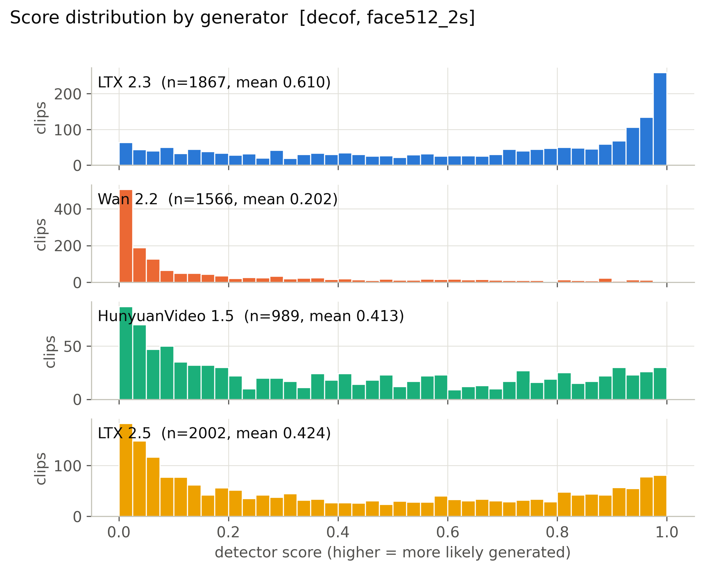

**Mean score, 56 cells x generator.** (`figures/heatmap_mean_score_cells.pdf`)

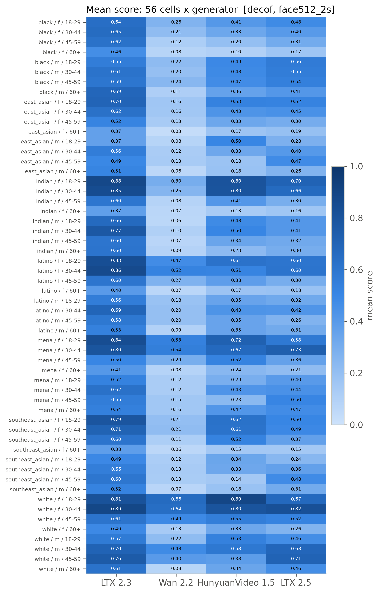

**Detection rate, 56 cells x generator (provisional threshold).** (`figures/heatmap_detection_rate_cells_provisional.pdf`)

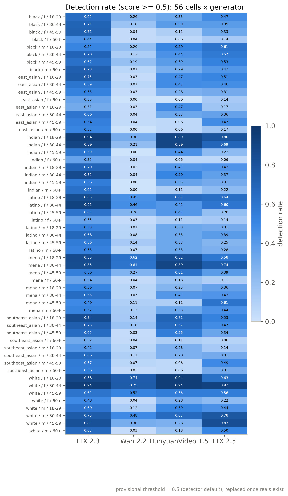

**Mean score by race, gender, age band with 95% CI.** (`figures/subgroup_mean_score.pdf`)

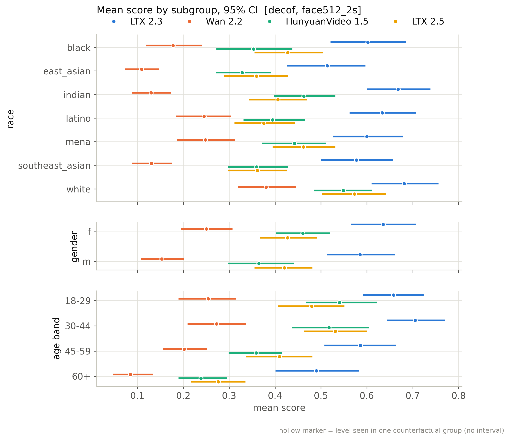

**Mean score by scene factor with 95% CI.** (`figures/scene_factor_mean_score.pdf`)

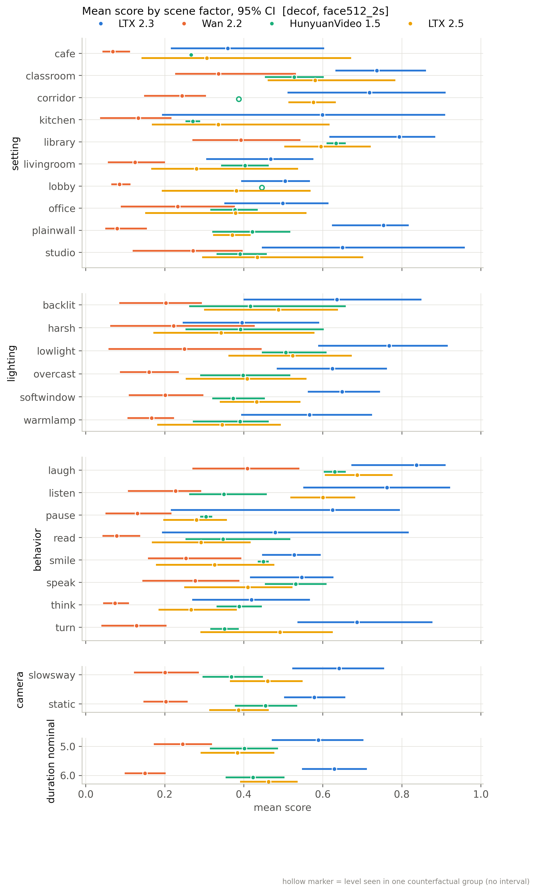

**Detection rate by subgroup (provisional threshold).** (`figures/subgroup_detection_rate_provisional.pdf`)

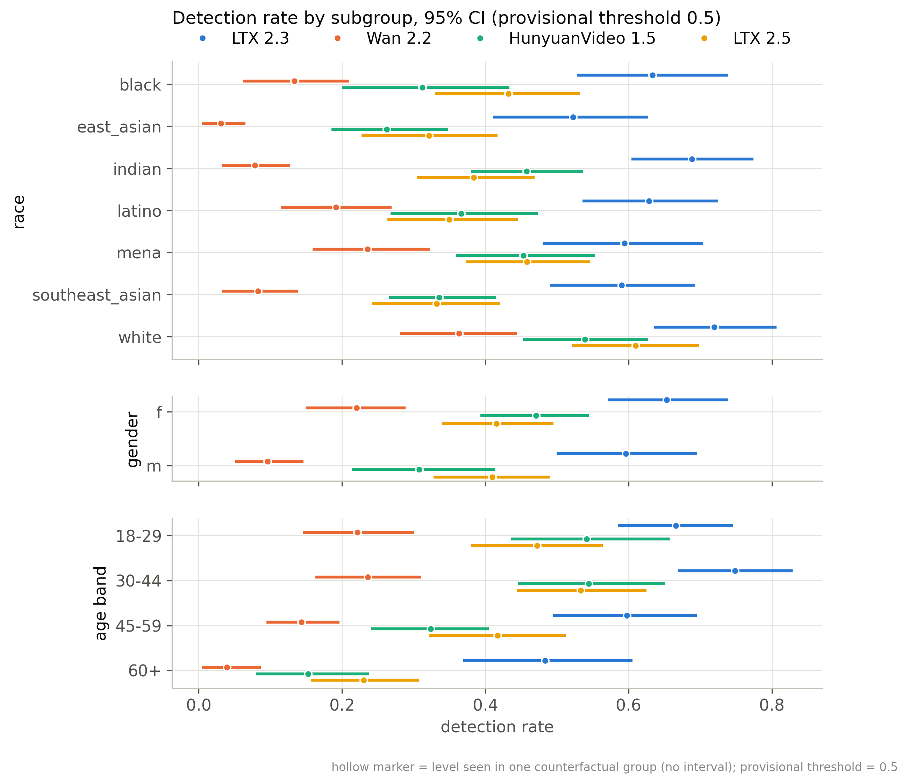

**Distribution of per-group CF spread.** (`figures/cf_spread_distribution.pdf`)

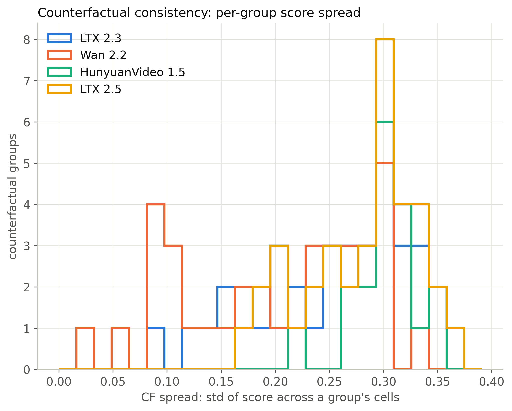

**Flip rate by generator (provisional threshold).** (`figures/flip_rate_by_generator_provisional.pdf`)

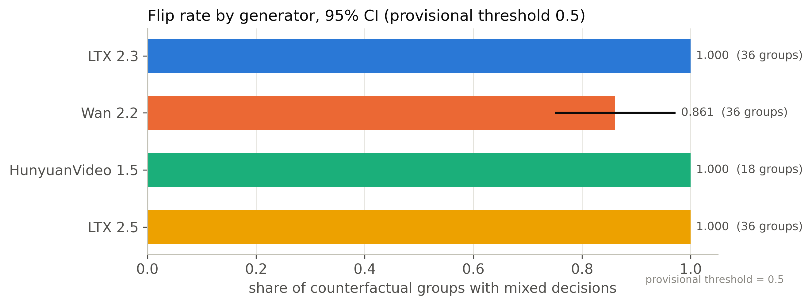

**Partial eta squared by factor.** (`figures/factor_attribution_variance_share.pdf`)

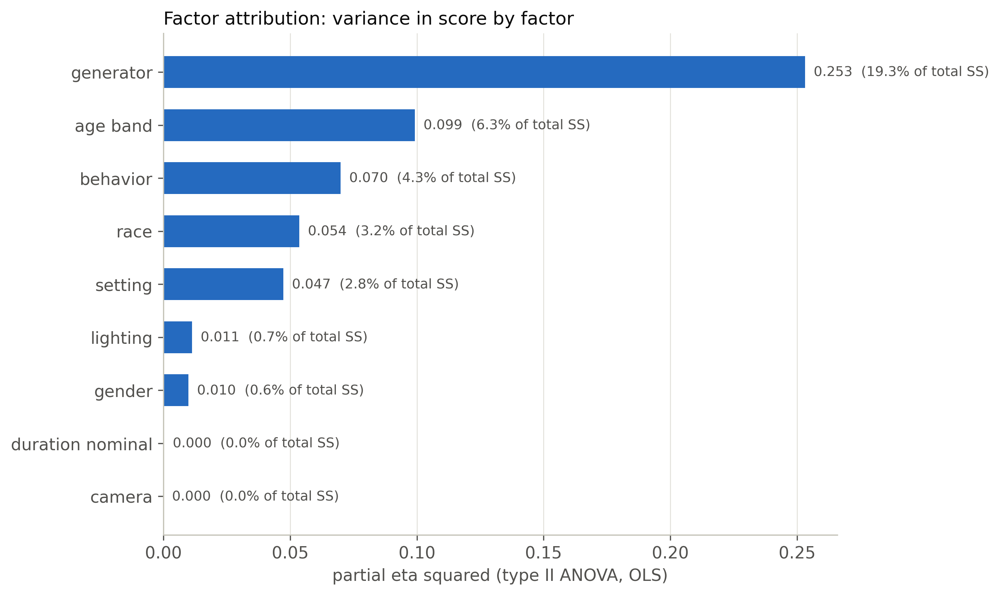

**Highest- and lowest-scoring included clips.** (`figures/example_strip.pdf`)

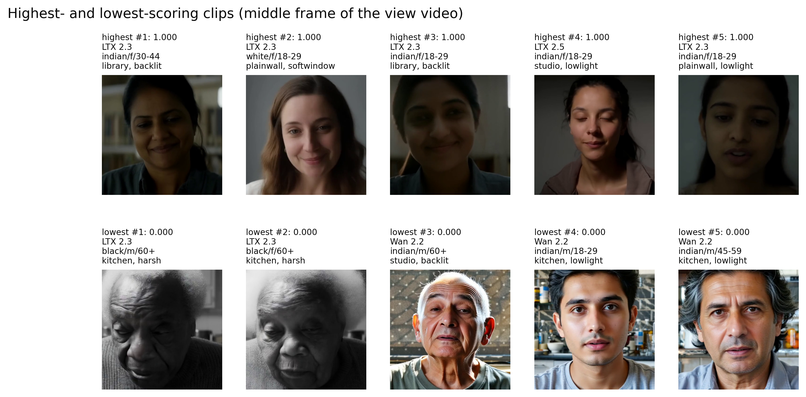

**ROC per generator against fps-matched reals.** (`figures/roc_per_generator.pdf`)

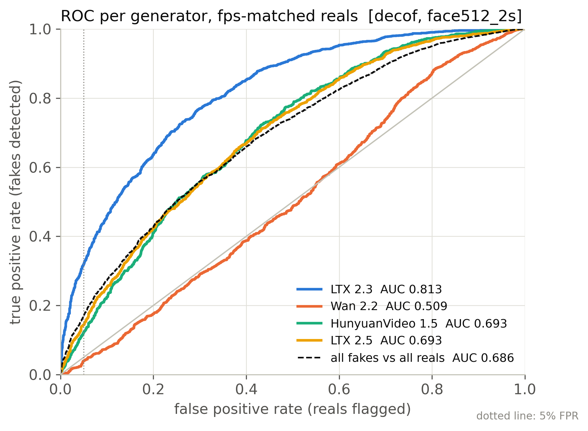

**Real FPR by perceived subgroup at the calibrated threshold.** (`figures/real_fpr_by_subgroup.pdf`)

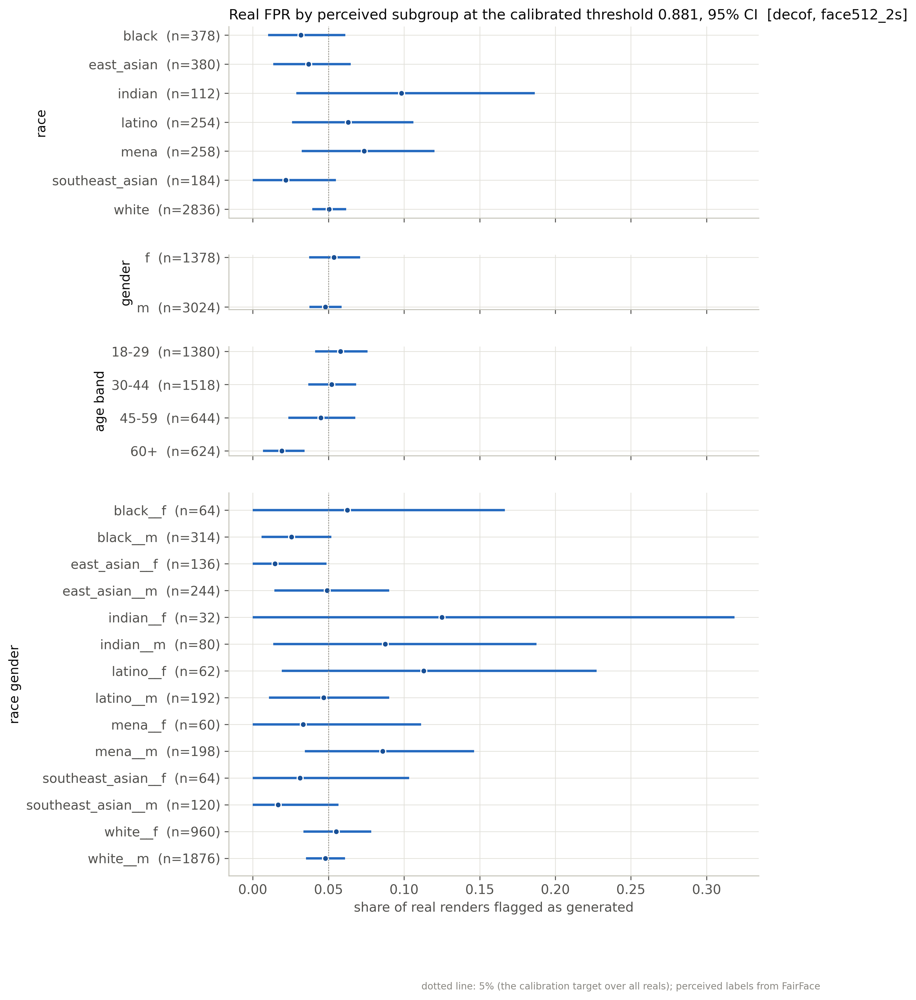

**AUC by subgroup: each subgroup's fakes vs same-subgroup reals.** (`figures/subgroup_auc.pdf`)

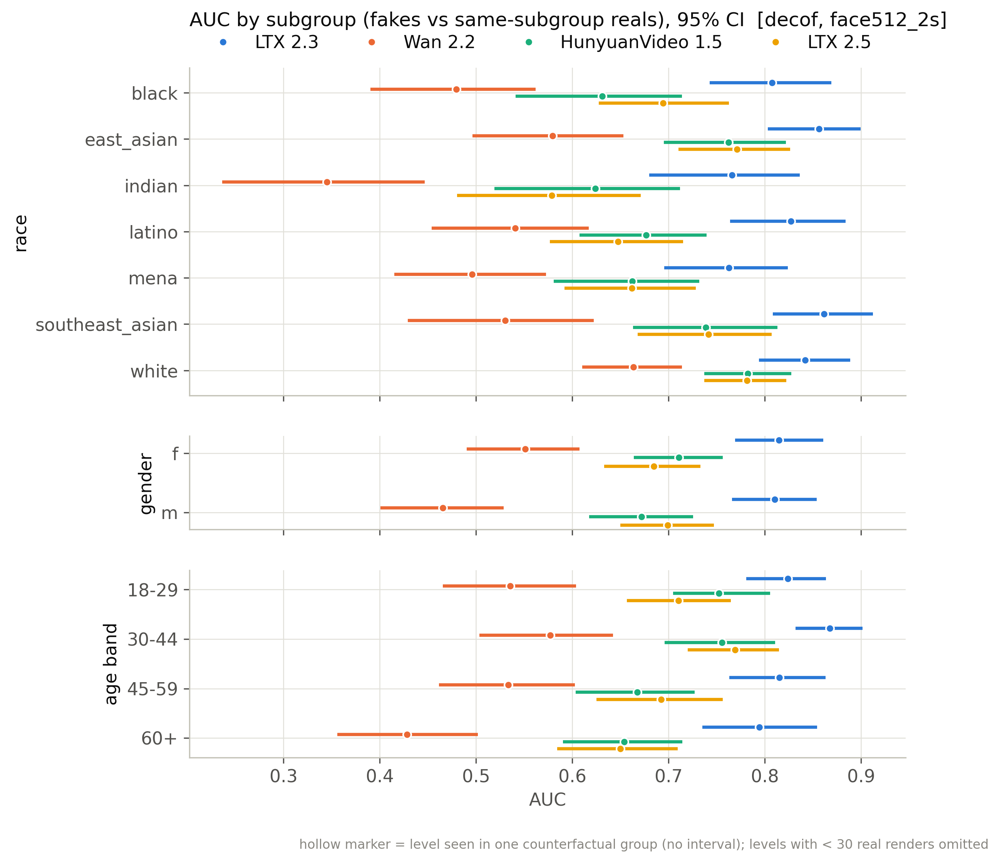

## Files

`manifest_used.csv` (every clip of the active batches with render/score/inclusion flags), `scores.csv` (score per scored clip), `tables/*.csv`, `figures/*`, `snapshot_meta.json`.

