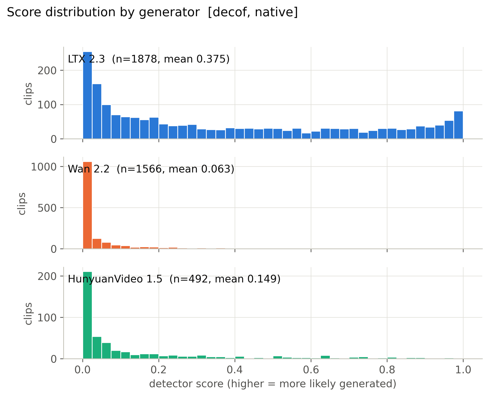
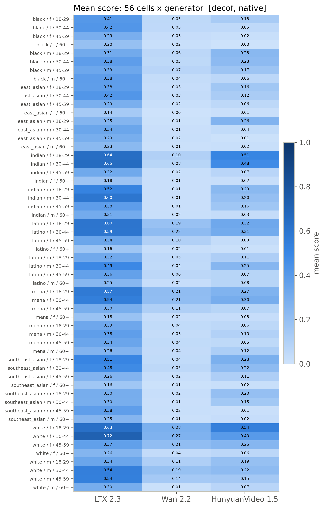
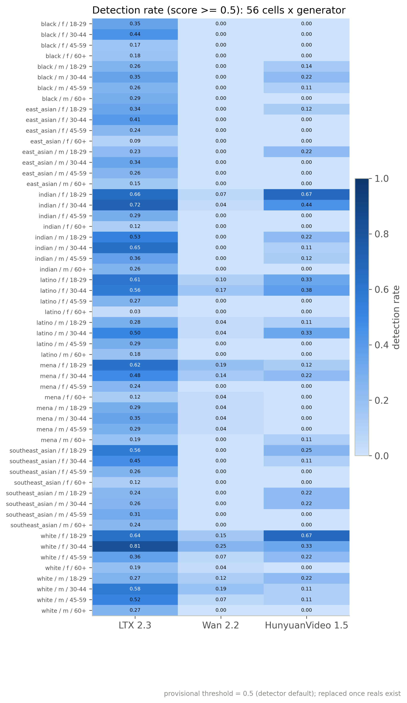
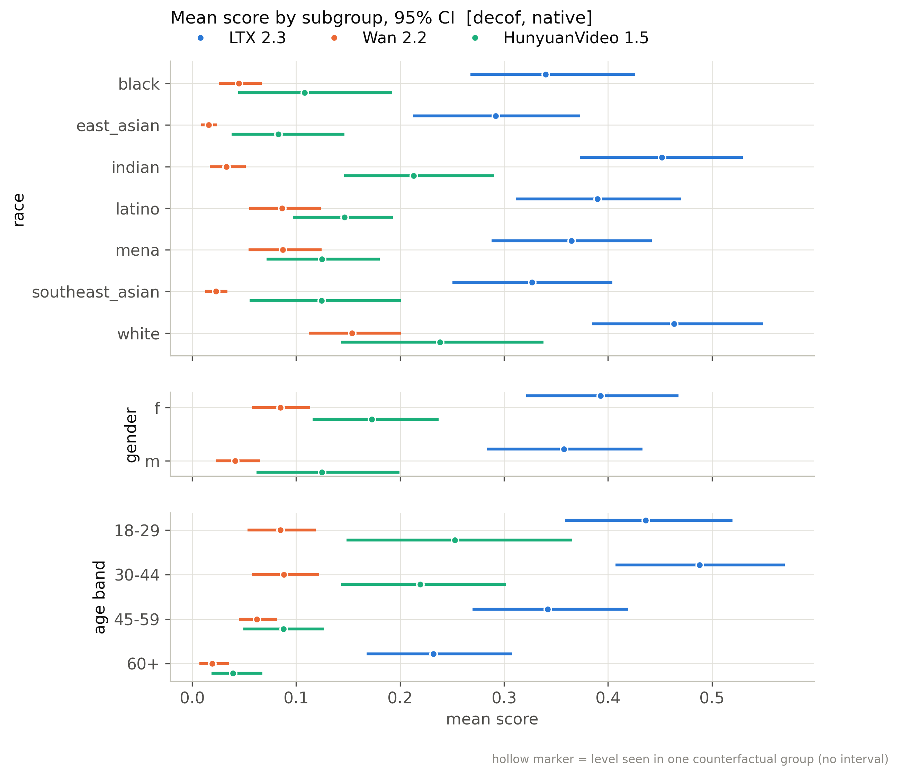
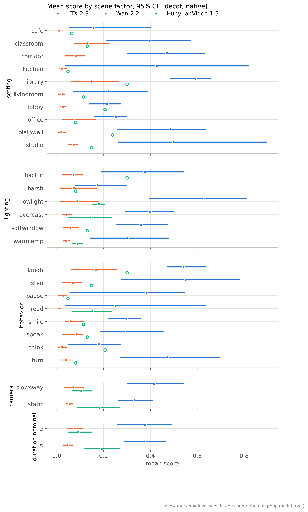
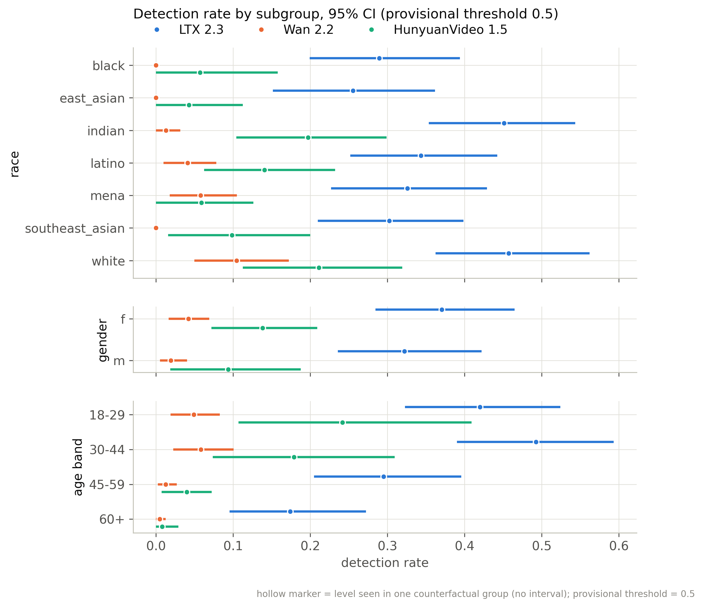
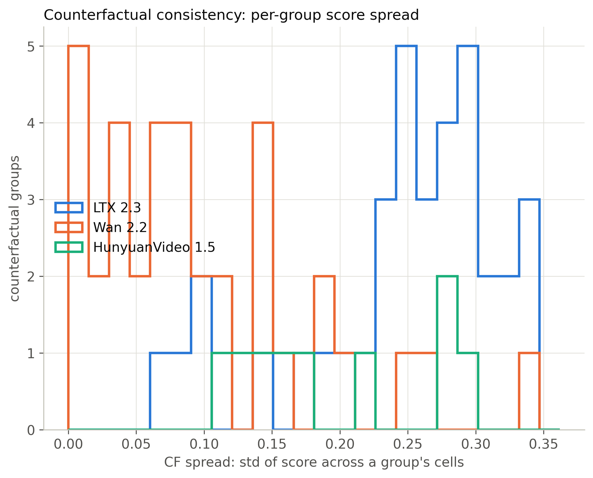
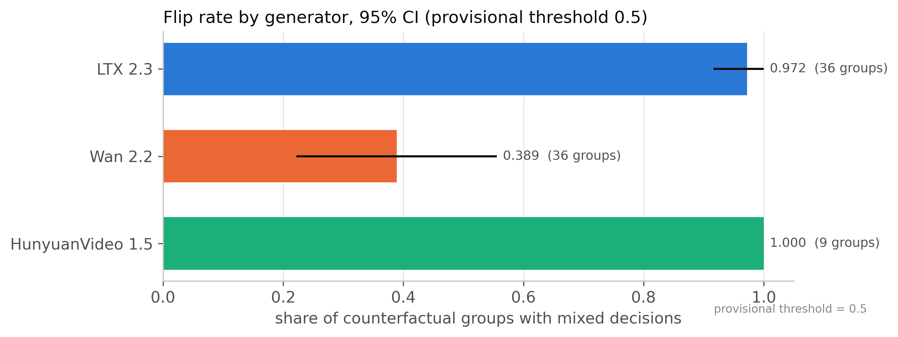
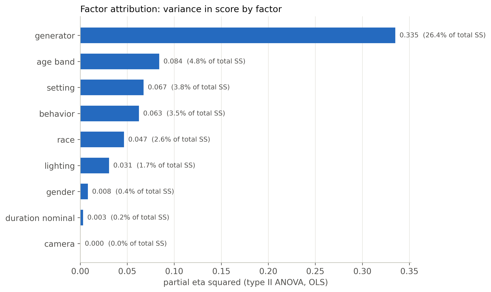
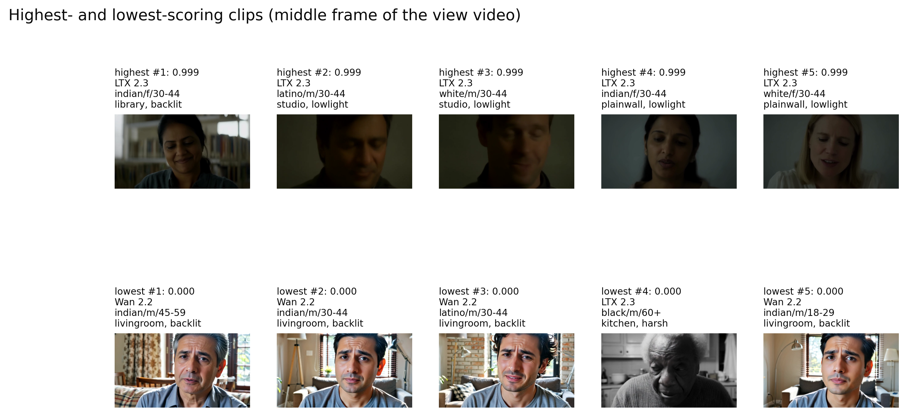

# decof / native: snapshot 20261020-2319

> **Detector training data.** The released DeCoF checkpoint is most likely trained on AIGVDBench's Open-Sora split (per the paper's default training set and the checkpoint name); our generators are therefore likely unseen. Not confirmed by the authors. Our curated GenBuster subset includes LTX-Video and HunyuanVideo, which are separate from DeCoF's training data but not from AIGVDBench as a whole.

> **Provisional threshold.** Every detection rate and flip rate below uses the detector's default threshold (0.5; official: argmax over 2 logits (DeCoF test.py) == softmax[:,1] >= 0.5). They will be replaced by the 5%-real-FPR threshold once reals exist (section 6.3).

## Settings

| setting           | value                                                                                  |
|:------------------|:---------------------------------------------------------------------------------------|
| detector          | decof 1+b75d2cbe                                                                       |
| checkpoint_sha256 | 4edb7b310cc729771e74b93f658c7fdc4f2e31fdfa617a88372a540d4f9e7b4a                       |
| view              | native (view_hash 1e7dfa0b3c412dce)                                                    |
| ffmpeg            | ffmpeg version 7.1.1 Copyright (c) 2000-2025 the FFmpeg developers                     |
| batches           | fake_b1                                                                                |
| inclusion set     | primary (technical QC pass AND face QC pass)                                           |
| bootstrap         | 1000 resamples of whole counterfactual groups, seed 20261020, 95% percentile intervals |
| git commit        | fd27ce0b293a-dirty                                                                     |
| created           | 2026-10-20T23:19:53Z                                                                   |

Detector preprocessing on top of the view:

| field               | value                                                                           |
|:--------------------|:--------------------------------------------------------------------------------|
| source              | AIGVDBench section 7 + DeCoF src/utils/data.py (test phase)                     |
| frames_window       | 128                                                                             |
| frames_sampled      | 32                                                                              |
| frames_used         | 8                                                                               |
| sampling            | np.linspace(0, n-1, 32).astype(int)[:8], n = min(128, frames)                   |
| crop                | centre square, side = shorter side                                              |
| resize_1            | [256, 256, 'PIL.BILINEAR']                                                      |
| intermediate_format | lossless (PNG-equivalent, kept in memory)                                       |
| resize_2            | [224, 224, 'torchvision Resize default (bilinear, antialias)']                  |
| centre_crop         | 224                                                                             |
| normalize           | {'mean': [0.485, 0.456, 0.406], 'std': [0.229, 0.224, 0.225]}                   |
| backbone            | OpenAI CLIP ViT-L/14 (frozen), fp32                                             |
| head                | DeCoF vit.ViT(num_patches=8, dim=768, depth=2, heads=4, mlp_dim=768, pool=mean) |
| score               | softmax(logits)[:, 1]                                                           |
| precision           | fp32, TF32 off                                                                  |
| code                | LongMa-2025/DeCoF@5f73e8dc4f8cd9faeed07d767c9517e3f2c66044                      |
| clip_sha256         | b8cca3fd41ae0c99ba7e8951adf17d267cdb84cd88be6f7c2e0eca1737a03836                |

## Coverage

| batch   | generator   |   clips |   primary |   rendered |   view_excluded |   render_failed |   scored |   score_failed |   included |
|:--------|:------------|--------:|----------:|-----------:|----------------:|----------------:|---------:|---------------:|-----------:|
| fake_b1 | hunyuan15   |     504 |       492 |        504 |               0 |               0 |      504 |              0 |        492 |
| fake_b1 | ltx23       |    2016 |      1878 |       2016 |               0 |               0 |     2016 |              0 |       1878 |
| fake_b1 | wan22       |    2016 |      1566 |       2016 |               0 |               0 |     2016 |              0 |       1566 |

Reals scored: 0. Fakes included: 3936 of 4536 scored (0 scoring failures).

## Observations

- LTX 2.3: mean score 0.375 [0.306, 0.450], median 0.268, n = 1878.
- Wan 2.2: mean score 0.063 [0.042, 0.087], median 0.008, n = 1566.
- HunyuanVideo 1.5: mean score 0.149 [0.096, 0.208], median 0.036, n = 492.
- Provisional detection rate (score >= 0.5), LTX 2.3: 34.6% [26.3, 43.7].
- Provisional detection rate (score >= 0.5), Wan 2.2: 3.1% [1.3, 5.2].
- Provisional detection rate (score >= 0.5), HunyuanVideo 1.5: 11.6% [5.1, 18.3].
- Provisional detection rate (score >= 0.5), all: 19.2% [14.8, 23.7].
- Largest race score gap: LTX 2.3 0.171 [0.133, 0.224] (white 0.463 vs east_asian 0.292).
- Largest gender score gap: HunyuanVideo 1.5 0.048 [0.002, 0.118] (f 0.173 vs m 0.125).
- Largest age band score gap: LTX 2.3 0.256 [0.204, 0.309] (30-44 0.488 vs 60+ 0.232).
- Largest cell score gap: LTX 2.3 0.582 [0.512, 0.680] (white__f__30-44 0.719 vs east_asian__f__60+ 0.137).
- Largest scene-factor gap (all generators): setting 0.261 [0.194, 0.386] (library vs cafe).
- Largest partial eta squared: generator 0.335, age_band 0.084, setting 0.067; residual holds 52.4% of total SS.
- CF spread, LTX 2.3: 0.248 [0.223, 0.270] over 36 groups (max 0.344).
- CF spread, Wan 2.2: 0.098 [0.073, 0.123] over 36 groups (max 0.345).
- CF spread, HunyuanVideo 1.5: 0.200 [0.158, 0.246] over 9 groups (max 0.295).
- Provisional flip rate, LTX 2.3: 97.2% of 36 groups [91.7, 100.0].
- Provisional flip rate, Wan 2.2: 38.9% of 36 groups [22.2, 55.6].
- Provisional flip rate, HunyuanVideo 1.5: 100.0% of 9 groups [100.0, 100.0].

## 6.1 Fakes only, no threshold

### Mean score by generator

| generator   |    n |   n_groups |   estimate |   ci_lo |   ci_hi |    sd |   median |   q05 |   q95 |
|:------------|-----:|-----------:|-----------:|--------:|--------:|------:|---------:|------:|------:|
| ltx23       | 1878 |         36 |      0.375 |   0.306 |   0.45  | 0.335 |    0.268 | 0.006 | 0.967 |
| wan22       | 1566 |         36 |      0.063 |   0.042 |   0.087 | 0.138 |    0.008 | 0     | 0.366 |
| hunyuan15   |  492 |          9 |      0.149 |   0.096 |   0.208 | 0.226 |    0.036 | 0.001 | 0.711 |
| all         | 3936 |         36 |      0.223 |   0.185 |   0.261 | 0.299 |    0.06  | 0.001 | 0.909 |

### Mean score by race

| generator   | level           |   n |   estimate |   ci_lo |   ci_hi |   median |
|:------------|:----------------|----:|-----------:|--------:|--------:|---------:|
| ltx23       | black           | 273 |      0.34  |   0.268 |   0.426 |    0.254 |
| ltx23       | east_asian      | 270 |      0.292 |   0.213 |   0.373 |    0.153 |
| ltx23       | indian          | 277 |      0.452 |   0.373 |   0.53  |    0.403 |
| ltx23       | latino          | 262 |      0.39  |   0.311 |   0.471 |    0.303 |
| ltx23       | mena            | 267 |      0.365 |   0.288 |   0.442 |    0.243 |
| ltx23       | southeast_asian | 271 |      0.327 |   0.25  |   0.404 |    0.205 |
| ltx23       | white           | 258 |      0.463 |   0.384 |   0.549 |    0.401 |
| wan22       | black           | 217 |      0.045 |   0.026 |   0.067 |    0.011 |
| wan22       | east_asian      | 226 |      0.016 |   0.009 |   0.024 |    0.004 |
| wan22       | indian          | 230 |      0.033 |   0.017 |   0.052 |    0.004 |
| wan22       | latino          | 219 |      0.087 |   0.055 |   0.124 |    0.012 |
| wan22       | mena            | 225 |      0.087 |   0.054 |   0.125 |    0.01  |
| wan22       | southeast_asian | 229 |      0.023 |   0.013 |   0.034 |    0.004 |
| wan22       | white           | 220 |      0.154 |   0.112 |   0.201 |    0.045 |
| hunyuan15   | black           |  70 |      0.108 |   0.044 |   0.193 |    0.026 |
| hunyuan15   | east_asian      |  70 |      0.083 |   0.038 |   0.146 |    0.016 |
| hunyuan15   | indian          |  71 |      0.213 |   0.146 |   0.291 |    0.065 |
| hunyuan15   | latino          |  71 |      0.146 |   0.097 |   0.193 |    0.029 |
| hunyuan15   | mena            |  68 |      0.125 |   0.072 |   0.18  |    0.035 |
| hunyuan15   | southeast_asian |  71 |      0.125 |   0.055 |   0.201 |    0.027 |
| hunyuan15   | white           |  71 |      0.238 |   0.144 |   0.338 |    0.116 |
| all         | black           | 560 |      0.197 |   0.157 |   0.24  |    0.055 |
| all         | east_asian      | 566 |      0.156 |   0.116 |   0.198 |    0.026 |
| all         | indian          | 578 |      0.256 |   0.22  |   0.292 |    0.059 |
| all         | latino          | 552 |      0.238 |   0.196 |   0.283 |    0.07  |
| all         | mena            | 560 |      0.224 |   0.182 |   0.266 |    0.071 |
| all         | southeast_asian | 571 |      0.18  |   0.14  |   0.217 |    0.031 |
| all         | white           | 549 |      0.31  |   0.26  |   0.36  |    0.174 |

### Mean score by gender

| generator   | level   |    n |   estimate |   ci_lo |   ci_hi |   median |
|:------------|:--------|-----:|-----------:|--------:|--------:|---------:|
| ltx23       | f       |  931 |      0.393 |   0.321 |   0.468 |    0.288 |
| ltx23       | m       |  947 |      0.358 |   0.284 |   0.433 |    0.253 |
| wan22       | f       |  785 |      0.085 |   0.057 |   0.114 |    0.012 |
| wan22       | m       |  781 |      0.041 |   0.023 |   0.065 |    0.005 |
| hunyuan15   | f       |  246 |      0.173 |   0.116 |   0.237 |    0.053 |
| hunyuan15   | m       |  246 |      0.125 |   0.062 |   0.199 |    0.029 |
| all         | f       | 1962 |      0.242 |   0.203 |   0.282 |    0.073 |
| all         | m       | 1974 |      0.203 |   0.166 |   0.243 |    0.048 |

### Mean score by age band

| generator   | level   |    n |   estimate |   ci_lo |   ci_hi |   median |
|:------------|:--------|-----:|-----------:|--------:|--------:|---------:|
| ltx23       | 18-29   |  469 |      0.436 |   0.358 |   0.52  |    0.38  |
| ltx23       | 30-44   |  471 |      0.488 |   0.407 |   0.57  |    0.492 |
| ltx23       | 45-59   |  478 |      0.342 |   0.27  |   0.419 |    0.227 |
| ltx23       | 60+     |  460 |      0.232 |   0.168 |   0.308 |    0.122 |
| wan22       | 18-29   |  388 |      0.085 |   0.053 |   0.119 |    0.011 |
| wan22       | 30-44   |  377 |      0.088 |   0.057 |   0.122 |    0.011 |
| wan22       | 45-59   |  398 |      0.062 |   0.045 |   0.082 |    0.012 |
| wan22       | 60+     |  403 |      0.019 |   0.007 |   0.036 |    0.003 |
| hunyuan15   | 18-29   |  120 |      0.253 |   0.148 |   0.365 |    0.13  |
| hunyuan15   | 30-44   |  123 |      0.219 |   0.143 |   0.302 |    0.093 |
| hunyuan15   | 45-59   |  125 |      0.088 |   0.049 |   0.126 |    0.023 |
| hunyuan15   | 60+     |  124 |      0.039 |   0.018 |   0.068 |    0.014 |
| all         | 18-29   |  977 |      0.274 |   0.228 |   0.319 |    0.108 |
| all         | 30-44   |  971 |      0.299 |   0.253 |   0.341 |    0.121 |
| all         | 45-59   | 1001 |      0.199 |   0.162 |   0.24  |    0.057 |
| all         | 60+     |  987 |      0.121 |   0.09  |   0.158 |    0.017 |

### Mean score by scene factor (all generators pooled)

| factor           | level      |    n |   estimate |   ci_lo |   ci_hi |
|:-----------------|:-----------|-----:|-----------:|--------:|--------:|
| setting          | cafe       |  320 |      0.1   |   0.045 |   0.22  |
| setting          | classroom  |  317 |      0.231 |   0.141 |   0.36  |
| setting          | corridor   |  441 |      0.279 |   0.207 |   0.346 |
| setting          | kitchen    |  385 |      0.202 |   0.025 |   0.431 |
| setting          | library    |  478 |      0.361 |   0.285 |   0.459 |
| setting          | livingroom |  474 |      0.12  |   0.046 |   0.21  |
| setting          | lobby      |  345 |      0.147 |   0.134 |   0.177 |
| setting          | office     |  301 |      0.204 |   0.13  |   0.274 |
| setting          | plainwall  |  500 |      0.253 |   0.171 |   0.329 |
| setting          | studio     |  375 |      0.272 |   0.16  |   0.384 |
| lighting         | backlit    |  678 |      0.242 |   0.115 |   0.331 |
| lighting         | harsh      |  520 |      0.13  |   0.06  |   0.202 |
| lighting         | lowlight   |  728 |      0.335 |   0.232 |   0.421 |
| lighting         | overcast   |  640 |      0.223 |   0.172 |   0.294 |
| lighting         | softwindow |  712 |      0.206 |   0.157 |   0.259 |
| lighting         | warmlamp   |  658 |      0.17  |   0.091 |   0.275 |
| behavior         | laugh      |  444 |      0.332 |   0.267 |   0.432 |
| behavior         | listen     |  568 |      0.313 |   0.176 |   0.389 |
| behavior         | pause      |  467 |      0.201 |   0.045 |   0.286 |
| behavior         | read       |  520 |      0.143 |   0.025 |   0.329 |
| behavior         | smile      |  482 |      0.192 |   0.134 |   0.253 |
| behavior         | speak      |  474 |      0.192 |   0.138 |   0.277 |
| behavior         | think      |  453 |      0.123 |   0.027 |   0.177 |
| behavior         | turn       |  528 |      0.272 |   0.167 |   0.394 |
| camera           | slowsway   | 1952 |      0.243 |   0.179 |   0.306 |
| camera           | static     | 1984 |      0.203 |   0.17  |   0.243 |
| duration_nominal | 5          | 1947 |      0.214 |   0.15  |   0.277 |
| duration_nominal | 6          | 1989 |      0.231 |   0.189 |   0.277 |

Per-generator scene-factor and 56-cell rows: `tables/score_by_breakdown.csv`.

### Subgroup gap (max - min of level means)

A gap is max - min, so it is never negative and its interval cannot include 0; it is a size, not a test of a difference. Over many levels with few clips each (56 cells; HunyuanVideo has 9 groups per cell) the gap also grows with noise, so compare it with the per-level intervals in `tables/score_by_breakdown.csv`. Levels seen in a single counterfactual group have no interval.

| generator   | attribute        |   n_levels |   gap |   ci_lo |   ci_hi | max_level       | min_level          |
|:------------|:-----------------|-----------:|------:|--------:|--------:|:----------------|:-------------------|
| ltx23       | race             |          7 | 0.171 |   0.133 |   0.224 | white           | east_asian         |
| ltx23       | gender           |          2 | 0.035 |   0.004 |   0.074 | f               | m                  |
| ltx23       | age_band         |          4 | 0.256 |   0.204 |   0.309 | 30-44           | 60+                |
| ltx23       | cell             |         56 | 0.582 |   0.512 |   0.68  | white__f__30-44 | east_asian__f__60+ |
| ltx23       | setting          |         10 | 0.435 |   0.362 |   0.81  | library         | cafe               |
| ltx23       | lighting         |          6 | 0.446 |   0.233 |   0.666 | lowlight        | harsh              |
| ltx23       | behavior         |          8 | 0.37  |   0.282 |   0.694 | listen          | think              |
| ltx23       | camera           |          2 | 0.083 |   0.004 |   0.227 | slowsway        | static             |
| ltx23       | duration_nominal |          2 | 0.005 |   0.002 |   0.163 | 5               | 6                  |
| wan22       | race             |          7 | 0.138 |   0.101 |   0.178 | white           | east_asian         |
| wan22       | gender           |          2 | 0.044 |   0.021 |   0.066 | f               | m                  |
| wan22       | age_band         |          4 | 0.069 |   0.046 |   0.096 | 30-44           | 60+                |
| wan22       | cell             |         56 | 0.279 |   0.219 |   0.374 | white__f__18-29 | east_asian__f__60+ |
| wan22       | setting          |         10 | 0.139 |   0.091 |   0.25  | library         | cafe               |
| wan22       | lighting         |          6 | 0.048 |   0.034 |   0.176 | lowlight        | warmlamp           |
| wan22       | behavior         |          8 | 0.152 |   0.077 |   0.245 | laugh           | read               |
| wan22       | camera           |          2 | 0.016 |   0.001 |   0.064 | slowsway        | static             |
| wan22       | duration_nominal |          2 | 0.032 |   0.002 |   0.075 | 5               | 6                  |
| hunyuan15   | race             |          7 | 0.155 |   0.108 |   0.256 | white           | east_asian         |
| hunyuan15   | gender           |          2 | 0.048 |   0.002 |   0.118 | f               | m                  |
| hunyuan15   | age_band         |          4 | 0.213 |   0.131 |   0.309 | 18-29           | 60+                |
| hunyuan15   | cell             |         56 | 0.539 |   0.486 |   0.735 | white__f__18-29 | black__f__60+      |
| hunyuan15   | setting          |          9 | 0.252 |   0.085 |   0.252 | library         | kitchen            |
| hunyuan15   | lighting         |          6 | 0.22  |   0.056 |   0.252 | backlit         | harsh              |
| hunyuan15   | behavior         |          8 | 0.252 |   0.077 |   0.252 | laugh           | pause              |
| hunyuan15   | camera           |          2 | 0.076 |   0.006 |   0.176 | static          | slowsway           |
| hunyuan15   | duration_nominal |          2 | 0.101 |   0.017 |   0.188 | 6               | 5                  |
| all         | race             |          7 | 0.154 |   0.122 |   0.189 | white           | east_asian         |
| all         | gender           |          2 | 0.039 |   0.016 |   0.059 | f               | m                  |
| all         | age_band         |          4 | 0.178 |   0.15  |   0.205 | 30-44           | 60+                |
| all         | cell             |         56 | 0.44  |   0.388 |   0.511 | white__f__30-44 | east_asian__f__60+ |
| all         | setting          |         10 | 0.261 |   0.194 |   0.386 | library         | cafe               |
| all         | lighting         |          6 | 0.205 |   0.107 |   0.325 | lowlight        | harsh              |
| all         | behavior         |          8 | 0.209 |   0.149 |   0.364 | laugh           | think              |
| all         | camera           |          2 | 0.041 |   0.002 |   0.114 | slowsway        | static             |
| all         | duration_nominal |          2 | 0.016 |   0.002 |   0.093 | 6               | 5                  |

### CF spread (mean over groups of the std of score across the group's cells)

| generator   |   n_groups |   cf_spread |   ci_lo |   ci_hi |   median |   max |
|:------------|-----------:|------------:|--------:|--------:|---------:|------:|
| ltx23       |         36 |       0.248 |   0.223 |   0.27  |    0.259 | 0.344 |
| wan22       |         36 |       0.098 |   0.073 |   0.123 |    0.08  | 0.345 |
| hunyuan15   |          9 |       0.2   |   0.158 |   0.246 |    0.175 | 0.295 |

### Factor attribution

OLS with every factor as a fixed effect, type-II ANOVA. `ss_share` is the factor's type-II sum of squares over the total sum of squares (type-II shares need not add to 1). Scene factors are constant within a counterfactual group, so their effects are estimated from between-group differences only. The OLS F tests treat clips as independent although clips are clustered in counterfactual groups, so their p values are optimistic; use the group-bootstrap intervals above for inference.

| factor           |   df |    sum_sq | F     | p         | partial_eta2   |   ss_share |
|:-----------------|-----:|----------:|:------|:----------|:---------------|-----------:|
| race             |    6 |   9.017   | 31.78 | 1.595e-37 | 0.04661        |  0.02563   |
| gender           |    1 |   1.516   | 32.05 | 1.609e-08 | 0.008152       |  0.004309  |
| age_band         |    3 |  16.93    | 119.3 | 6.052e-74 | 0.08408        |  0.04813   |
| setting          |    9 |  13.35    | 31.36 | 1.557e-53 | 0.06749        |  0.03794   |
| lighting         |    5 |   5.842   | 24.7  | 1.402e-24 | 0.0307         |  0.01661   |
| behavior         |    7 |  12.31    | 37.2  | 9.386e-51 | 0.06258        |  0.035     |
| camera           |    1 |   0.07712 | 1.631 | 0.2017    | 0.0004179      |  0.0002192 |
| duration_nominal |    1 |   0.5843  | 12.35 | 0.0004448 | 0.003158       |  0.001661  |
| generator        |    2 |  92.93    | 982.4 | 0         | 0.335          |  0.2641    |
| Residual         | 3900 | 184.4     |       |           |                |  0.5243    |

Lighting x race interaction (added to the same OLS):

| term            |   df |   sum_sq |     F |      p |   partial_eta2 |
|:----------------|-----:|---------:|------:|-------:|---------------:|
| lighting x race |   30 |    1.879 | 1.327 | 0.1096 |        0.01018 |

Mixed model `score ~ factors + (1 | counterfactual_group)` (REML) variance components (fixed effects: `tables/factor_mixed_fixed.csv`):

| component                               |   variance | converged   |
|:----------------------------------------|-----------:|:------------|
| counterfactual_group (random intercept) |    0       | True        |
| residual                                |    0.04633 | True        |
| ICC (group share of random variance)    |    0       | True        |

A group variance at or near 0 is a boundary estimate: setting, lighting, behavior, camera and duration are fixed per group and absorb most between-group variation, leaving little for the random intercept. It does not mean scenes do not matter.

## 6.2 Provisional (threshold 0.5, provisional)

### Detection rate by generator (provisional)

| generator   |    n |   estimate |   ci_lo |   ci_hi |
|:------------|-----:|-----------:|--------:|--------:|
| ltx23       | 1878 |      0.346 |   0.263 |   0.437 |
| wan22       | 1566 |      0.031 |   0.013 |   0.052 |
| hunyuan15   |  492 |      0.116 |   0.051 |   0.183 |
| all         | 3936 |      0.192 |   0.148 |   0.237 |

### Detection rate by race (provisional)

| generator   | level           |   n |   estimate |   ci_lo |   ci_hi |
|:------------|:----------------|----:|-----------:|--------:|--------:|
| ltx23       | black           | 273 |      0.289 |   0.199 |   0.394 |
| ltx23       | east_asian      | 270 |      0.256 |   0.152 |   0.362 |
| ltx23       | indian          | 277 |      0.451 |   0.354 |   0.543 |
| ltx23       | latino          | 262 |      0.344 |   0.252 |   0.442 |
| ltx23       | mena            | 267 |      0.326 |   0.227 |   0.429 |
| ltx23       | southeast_asian | 271 |      0.303 |   0.21  |   0.399 |
| ltx23       | white           | 258 |      0.457 |   0.363 |   0.562 |
| wan22       | black           | 217 |      0     |   0     |   0     |
| wan22       | east_asian      | 226 |      0     |   0     |   0     |
| wan22       | indian          | 230 |      0.013 |   0     |   0.032 |
| wan22       | latino          | 219 |      0.041 |   0.01  |   0.078 |
| wan22       | mena            | 225 |      0.058 |   0.018 |   0.105 |
| wan22       | southeast_asian | 229 |      0     |   0     |   0     |
| wan22       | white           | 220 |      0.105 |   0.05  |   0.172 |
| hunyuan15   | black           |  70 |      0.057 |   0     |   0.158 |
| hunyuan15   | east_asian      |  70 |      0.043 |   0     |   0.113 |
| hunyuan15   | indian          |  71 |      0.197 |   0.104 |   0.299 |
| hunyuan15   | latino          |  71 |      0.141 |   0.062 |   0.232 |
| hunyuan15   | mena            |  68 |      0.059 |   0     |   0.126 |
| hunyuan15   | southeast_asian |  71 |      0.099 |   0.016 |   0.2   |
| hunyuan15   | white           |  71 |      0.211 |   0.113 |   0.319 |
| all         | black           | 560 |      0.148 |   0.103 |   0.199 |
| all         | east_asian      | 566 |      0.127 |   0.076 |   0.18  |
| all         | indian          | 578 |      0.246 |   0.199 |   0.29  |
| all         | latino          | 552 |      0.197 |   0.15  |   0.249 |
| all         | mena            | 560 |      0.186 |   0.132 |   0.237 |
| all         | southeast_asian | 571 |      0.156 |   0.109 |   0.203 |
| all         | white           | 549 |      0.284 |   0.224 |   0.349 |

### Detection rate by gender (provisional)

| generator   | level   |    n |   estimate |   ci_lo |   ci_hi |
|:------------|:--------|-----:|-----------:|--------:|--------:|
| ltx23       | f       |  931 |      0.371 |   0.284 |   0.465 |
| ltx23       | m       |  947 |      0.322 |   0.236 |   0.422 |
| wan22       | f       |  785 |      0.042 |   0.017 |   0.069 |
| wan22       | m       |  781 |      0.019 |   0.005 |   0.04  |
| hunyuan15   | f       |  246 |      0.138 |   0.072 |   0.209 |
| hunyuan15   | m       |  246 |      0.093 |   0.019 |   0.188 |
| all         | f       | 1962 |      0.21  |   0.166 |   0.258 |
| all         | m       | 1974 |      0.174 |   0.129 |   0.222 |

### Detection rate by age band (provisional)

| generator   | level   |    n |   estimate |   ci_lo |   ci_hi |
|:------------|:--------|-----:|-----------:|--------:|--------:|
| ltx23       | 18-29   |  469 |      0.42  |   0.323 |   0.524 |
| ltx23       | 30-44   |  471 |      0.493 |   0.39  |   0.593 |
| ltx23       | 45-59   |  478 |      0.295 |   0.205 |   0.396 |
| ltx23       | 60+     |  460 |      0.174 |   0.095 |   0.272 |
| wan22       | 18-29   |  388 |      0.049 |   0.019 |   0.083 |
| wan22       | 30-44   |  377 |      0.058 |   0.023 |   0.101 |
| wan22       | 45-59   |  398 |      0.013 |   0.002 |   0.027 |
| wan22       | 60+     |  403 |      0.005 |   0     |   0.012 |
| hunyuan15   | 18-29   |  120 |      0.242 |   0.107 |   0.409 |
| hunyuan15   | 30-44   |  123 |      0.179 |   0.074 |   0.309 |
| hunyuan15   | 45-59   |  125 |      0.04  |   0.007 |   0.072 |
| hunyuan15   | 60+     |  124 |      0.008 |   0     |   0.029 |
| all         | 18-29   |  977 |      0.251 |   0.195 |   0.306 |
| all         | 30-44   |  971 |      0.284 |   0.232 |   0.339 |
| all         | 45-59   | 1001 |      0.151 |   0.108 |   0.2   |
| all         | 60+     |  987 |      0.084 |   0.048 |   0.13  |

### Detection-rate gap (provisional)

| generator   | attribute        |   gap |   ci_lo |   ci_hi | max_level        | min_level       |
|:------------|:-----------------|------:|--------:|--------:|:-----------------|:----------------|
| ltx23       | race             | 0.202 |   0.154 |   0.285 | white            | east_asian      |
| ltx23       | gender           | 0.048 |   0.003 |   0.098 | f                | m               |
| ltx23       | age_band         | 0.319 |   0.235 |   0.398 | 30-44            | 60+             |
| ltx23       | cell             | 0.78  |   0.662 |   0.909 | white__f__30-44  | latino__f__60+  |
| ltx23       | setting          | 0.477 |   0.431 |   0.935 | library          | cafe            |
| ltx23       | lighting         | 0.53  |   0.277 |   0.787 | lowlight         | harsh           |
| ltx23       | behavior         | 0.445 |   0.349 |   0.815 | laugh            | think           |
| ltx23       | camera           | 0.122 |   0.005 |   0.295 | slowsway         | static          |
| ltx23       | duration_nominal | 0.022 |   0.003 |   0.204 | 5                | 6               |
| wan22       | race             | 0.105 |   0.05  |   0.172 | white            | black           |
| wan22       | gender           | 0.023 |   0.002 |   0.048 | f                | m               |
| wan22       | age_band         | 0.053 |   0.023 |   0.093 | 30-44            | 60+             |
| wan22       | cell             | 0.25  |   0.154 |   0.435 | white__f__30-44  | black__f__18-29 |
| wan22       | setting          | 0.104 |   0.046 |   0.259 | library          | cafe            |
| wan22       | lighting         | 0.051 |   0.027 |   0.153 | lowlight         | warmlamp        |
| wan22       | behavior         | 0.113 |   0.042 |   0.223 | laugh            | read            |
| wan22       | camera           | 0.028 |   0.002 |   0.072 | slowsway         | static          |
| wan22       | duration_nominal | 0.025 |   0.001 |   0.064 | 5                | 6               |
| hunyuan15   | race             | 0.168 |   0.128 |   0.286 | white            | east_asian      |
| hunyuan15   | gender           | 0.045 |   0.002 |   0.129 | f                | m               |
| hunyuan15   | age_band         | 0.234 |   0.107 |   0.386 | 18-29            | 60+             |
| hunyuan15   | cell             | 0.667 |   0.6   |   1     | indian__f__18-29 | black__f__18-29 |
| hunyuan15   | setting          | 0.266 |   0.087 |   0.266 | library          | office          |
| hunyuan15   | lighting         | 0.266 |   0.086 |   0.266 | backlit          | harsh           |
| hunyuan15   | behavior         | 0.266 |   0.086 |   0.266 | laugh            | turn            |
| hunyuan15   | camera           | 0.104 |   0.008 |   0.215 | static           | slowsway        |
| hunyuan15   | duration_nominal | 0.099 |   0.01  |   0.204 | 6                | 5               |
| all         | race             | 0.157 |   0.117 |   0.205 | white            | east_asian      |
| all         | gender           | 0.036 |   0.009 |   0.06  | f                | m               |
| all         | age_band         | 0.2   |   0.159 |   0.244 | 30-44            | 60+             |
| all         | cell             | 0.524 |   0.446 |   0.622 | white__f__30-44  | latino__f__60+  |
| all         | setting          | 0.27  |   0.214 |   0.454 | library          | cafe            |
| all         | lighting         | 0.255 |   0.14  |   0.382 | lowlight         | harsh           |
| all         | behavior         | 0.231 |   0.166 |   0.405 | laugh            | think           |
| all         | camera           | 0.061 |   0.004 |   0.144 | slowsway         | static          |
| all         | duration_nominal | 0.011 |   0.002 |   0.101 | 6                | 5               |

### Flip rate (provisional): share of groups whose clips get different decisions

| generator   |   n_groups |   flip_rate |   ci_lo |   ci_hi |   median |   max |
|:------------|-----------:|------------:|--------:|--------:|---------:|------:|
| ltx23       |         36 |       0.972 |   0.917 |   1     |        1 |     1 |
| wan22       |         36 |       0.389 |   0.222 |   0.556 |        0 |     1 |
| hunyuan15   |          9 |       1     |   1     |   1     |        1 |     1 |

### Sensitivity: inclusion set

| set     | generator   |    n |   mean_score |   provisional_detection_rate |
|:--------|:------------|-----:|-------------:|-----------------------------:|
| all     | hunyuan15   |  504 |        0.151 |                        0.121 |
| all     | ltx23       | 2016 |        0.381 |                        0.355 |
| all     | wan22       | 2016 |        0.072 |                        0.039 |
| primary | hunyuan15   |  492 |        0.149 |                        0.116 |
| primary | ltx23       | 1878 |        0.375 |                        0.346 |
| primary | wan22       | 1566 |        0.063 |                        0.031 |

## 6.3 Pending until reals exist

| metric                                                      | status   | reason                |
|:------------------------------------------------------------|:---------|:----------------------|
| AUC, AP, EER, TPR@5%FPR (overall, per generator)            | pending  | needs reals (real_b1) |
| Calibrated threshold (5% FPR on fps-matched reals)          | pending  | needs reals (real_b1) |
| Real FPR by perceived race, gender, age band, race x gender | pending  | needs reals (real_b1) |
| Detection rate and flip rate at the calibrated threshold    | pending  | needs reals (real_b1) |
| Worst-subgroup AUC, subgroup AUC gap                        | pending  | needs reals (real_b1) |
| ROC curves per generator; real FPR by subgroup (figures)    | pending  | needs reals (real_b1) |

## Figures

**Score distribution by generator.** (`figures/score_distribution_by_generator.pdf`)

**Mean score, 56 cells x generator.** (`figures/heatmap_mean_score_cells.pdf`)

**Detection rate, 56 cells x generator (provisional threshold).** (`figures/heatmap_detection_rate_cells_provisional.pdf`)

**Mean score by race, gender, age band with 95% CI.** (`figures/subgroup_mean_score.pdf`)

**Mean score by scene factor with 95% CI.** (`figures/scene_factor_mean_score.pdf`)

**Detection rate by subgroup (provisional threshold).** (`figures/subgroup_detection_rate_provisional.pdf`)

**Distribution of per-group CF spread.** (`figures/cf_spread_distribution.pdf`)

**Flip rate by generator (provisional threshold).** (`figures/flip_rate_by_generator_provisional.pdf`)

**Partial eta squared by factor.** (`figures/factor_attribution_variance_share.pdf`)

**Highest- and lowest-scoring included clips.** (`figures/example_strip.pdf`)

## Files

`manifest_used.csv` (every clip of the active batches with render/score/inclusion flags), `scores.csv` (score per scored clip), `tables/*.csv`, `figures/*`, `snapshot_meta.json`.

