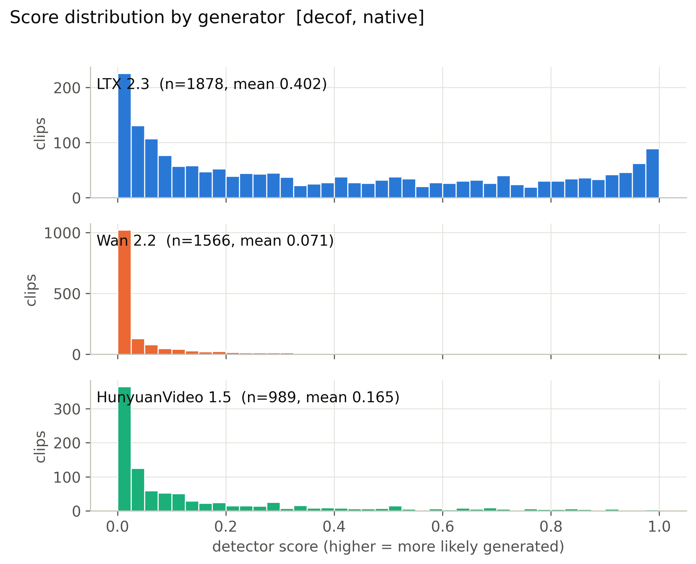
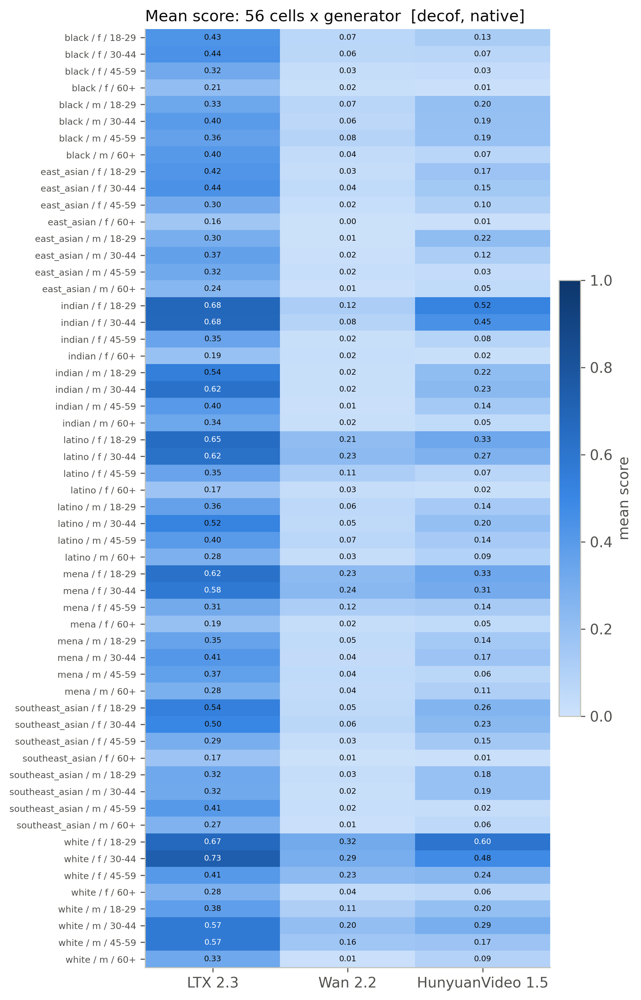
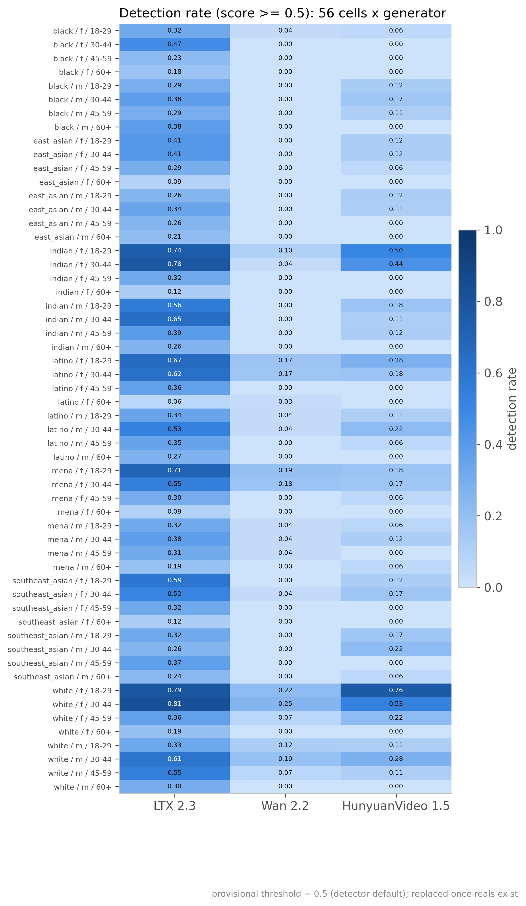
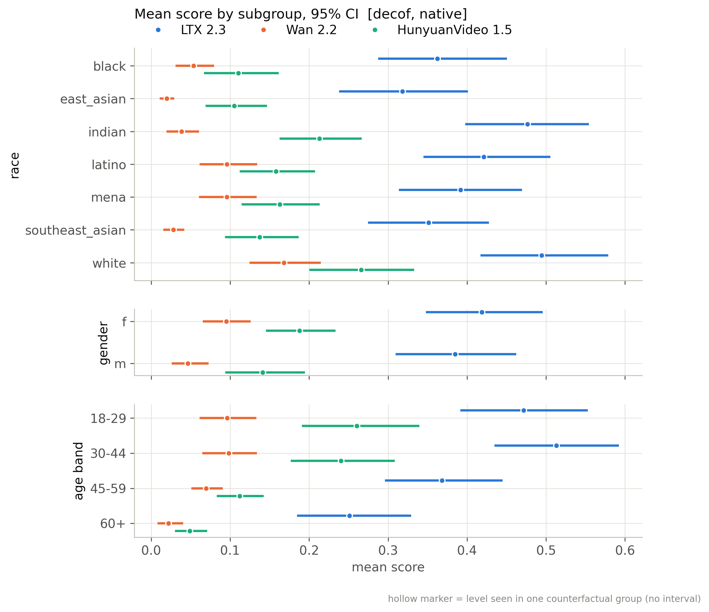
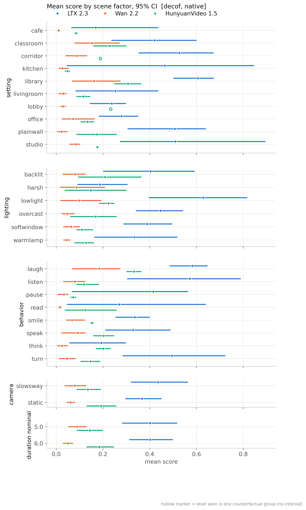
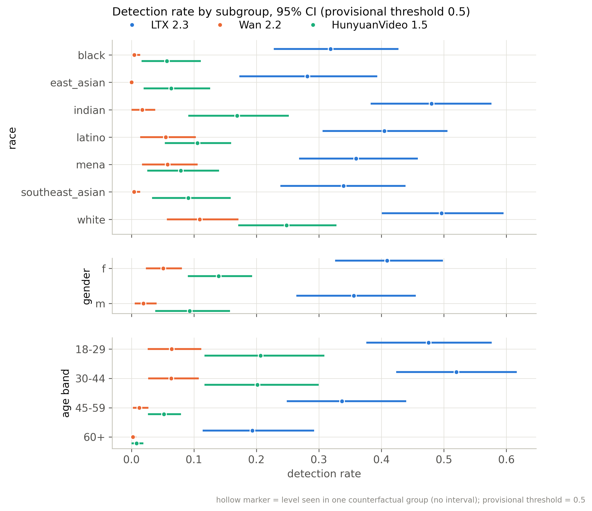
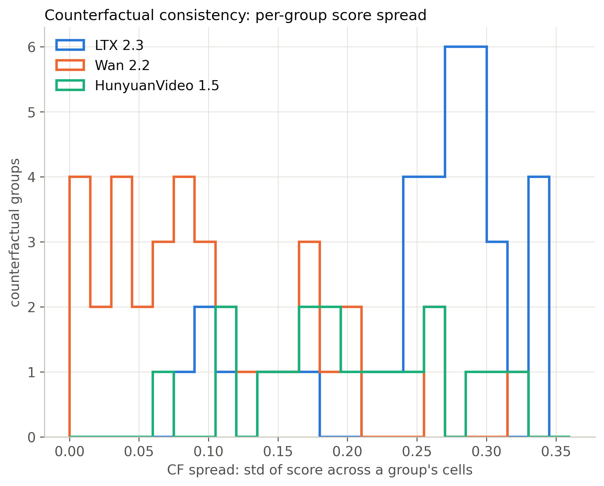
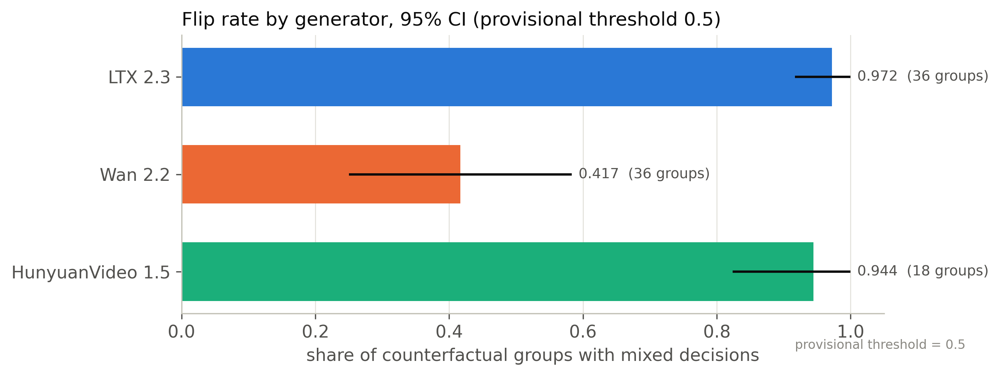
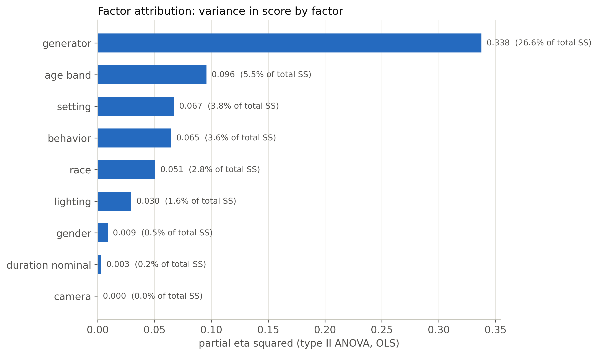
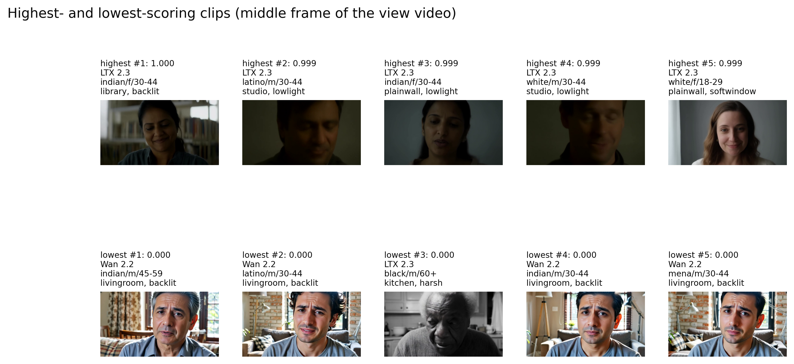

# decof / native: snapshot 20261021-0616

> **Detector training data.** The released DeCoF checkpoint is most likely trained on AIGVDBench's Open-Sora split (per the paper's default training set and the checkpoint name); our generators are therefore likely unseen. Not confirmed by the authors. Our curated GenBuster subset includes LTX-Video and HunyuanVideo, which are separate from DeCoF's training data but not from AIGVDBench as a whole.

> **Provisional threshold.** Every detection rate and flip rate below uses the detector's default threshold (0.5; official: argmax over 2 logits (DeCoF test.py) == softmax[:,1] >= 0.5). They will be replaced by the 5%-real-FPR threshold once reals exist (section 6.3).

## Settings

| setting           | value                                                                                  |
|:------------------|:---------------------------------------------------------------------------------------|
| detector          | decof 1+b75d2cbe                                                                       |
| checkpoint_sha256 | 4edb7b310cc729771e74b93f658c7fdc4f2e31fdfa617a88372a540d4f9e7b4a                       |
| view              | native (view_hash 1e7dfa0b3c412dce)                                                    |
| ffmpeg            | ffmpeg version 7.1.1 Copyright (c) 2000-2025 the FFmpeg developers                     |
| batches           | fake_b1, fake_b2, real_b1                                                              |
| inclusion set     | primary (technical QC pass AND face QC pass)                                           |
| bootstrap         | 1000 resamples of whole counterfactual groups, seed 20261020, 95% percentile intervals |
| git commit        | ac1140ab3053-dirty                                                                     |
| created           | 2026-10-21T06:16:54Z                                                                   |

Detector preprocessing on top of the view:

| field               | value                                                                           |
|:--------------------|:--------------------------------------------------------------------------------|
| source              | AIGVDBench section 7 + DeCoF src/utils/data.py (test phase)                     |
| frames_window       | 128                                                                             |
| frames_sampled      | 32                                                                              |
| frames_used         | 8                                                                               |
| sampling            | np.linspace(0, n-1, 32).astype(int)[:8], n = min(128, frames)                   |
| crop                | centre square, side = shorter side                                              |
| resize_1            | [256, 256, 'PIL.BILINEAR']                                                      |
| intermediate_format | lossless (PNG-equivalent, kept in memory)                                       |
| resize_2            | [224, 224, 'torchvision Resize default (bilinear, antialias)']                  |
| centre_crop         | 224                                                                             |
| normalize           | {'mean': [0.485, 0.456, 0.406], 'std': [0.229, 0.224, 0.225]}                   |
| backbone            | OpenAI CLIP ViT-L/14 (frozen), fp32                                             |
| head                | DeCoF vit.ViT(num_patches=8, dim=768, depth=2, heads=4, mlp_dim=768, pool=mean) |
| score               | softmax(logits)[:, 1]                                                           |
| precision           | fp32, TF32 off                                                                  |
| code                | LongMa-2025/DeCoF@5f73e8dc4f8cd9faeed07d767c9517e3f2c66044                      |
| clip_sha256         | b8cca3fd41ae0c99ba7e8951adf17d267cdb84cd88be6f7c2e0eca1737a03836                |

## Coverage

| batch   | generator   |   clips |   primary |   rendered |   view_excluded |   render_failed |   scored |   score_failed |   included |
|:--------|:------------|--------:|----------:|-----------:|----------------:|----------------:|---------:|---------------:|-----------:|
| fake_b1 | hunyuan15   |     504 |       492 |        504 |               0 |               0 |      504 |              0 |        492 |
| fake_b1 | ltx23       |    2016 |      1878 |       2016 |               0 |               0 |     2016 |              0 |       1878 |
| fake_b1 | wan22       |    2016 |      1566 |       2016 |               0 |               0 |     2016 |              0 |       1566 |
| fake_b2 | hunyuan15   |     504 |       497 |        504 |               0 |               0 |      504 |              0 |        497 |
| real_b1 | real        |    1785 |      1684 |          0 |            1785 |               0 |        0 |              0 |          0 |

Reals scored: 0. Fakes included: 4433 of 5040 scored (0 scoring failures).

## Observations

- LTX 2.3: mean score 0.402 [0.332, 0.476], median 0.309, n = 1878.
- Wan 2.2: mean score 0.071 [0.048, 0.096], median 0.009, n = 1566.
- HunyuanVideo 1.5: mean score 0.165 [0.125, 0.207], median 0.052, n = 989.
- Provisional detection rate (score >= 0.5), LTX 2.3: 38.2% [29.8, 47.7].
- Provisional detection rate (score >= 0.5), Wan 2.2: 3.5% [1.6, 5.8].
- Provisional detection rate (score >= 0.5), HunyuanVideo 1.5: 11.6% [7.1, 16.7].
- Provisional detection rate (score >= 0.5), all: 20.0% [15.7, 24.5].
- Largest race score gap: LTX 2.3 0.176 [0.136, 0.229] (white 0.494 vs east_asian 0.318).
- Largest gender score gap: Wan 2.2 0.049 [0.023, 0.073] (f 0.095 vs m 0.047).
- Largest age band score gap: LTX 2.3 0.262 [0.211, 0.314] (30-44 0.513 vs 60+ 0.251).
- Largest cell score gap: HunyuanVideo 1.5 0.596 [0.488, 0.721] (white__f__18-29 0.604 vs black__f__60+ 0.008).
- Largest scene-factor gap (all generators): setting 0.260 [0.195, 0.387] (library vs cafe).
- Largest partial eta squared: generator 0.338, age_band 0.096, setting 0.067; residual holds 52.2% of total SS.
- CF spread, LTX 2.3: 0.253 [0.229, 0.273] over 36 groups (max 0.343).
- CF spread, Wan 2.2: 0.106 [0.081, 0.131] over 36 groups (max 0.330).
- CF spread, HunyuanVideo 1.5: 0.204 [0.170, 0.237] over 18 groups (max 0.316).
- Provisional flip rate, LTX 2.3: 97.2% of 36 groups [91.7, 100.0].
- Provisional flip rate, Wan 2.2: 41.7% of 36 groups [25.0, 58.3].
- Provisional flip rate, HunyuanVideo 1.5: 94.4% of 18 groups [82.4, 100.0].

## 6.1 Fakes only, no threshold

### Mean score by generator

| generator   |    n |   n_groups |   estimate |   ci_lo |   ci_hi |    sd |   median |   q05 |   q95 |
|:------------|-----:|-----------:|-----------:|--------:|--------:|------:|---------:|------:|------:|
| ltx23       | 1878 |         36 |      0.402 |   0.332 |   0.476 | 0.339 |    0.309 | 0.006 | 0.972 |
| wan22       | 1566 |         36 |      0.071 |   0.048 |   0.096 | 0.149 |    0.009 | 0     | 0.431 |
| hunyuan15   |  989 |         18 |      0.165 |   0.125 |   0.207 | 0.232 |    0.052 | 0.001 | 0.718 |
| all         | 4433 |         36 |      0.232 |   0.195 |   0.27  | 0.301 |    0.072 | 0.001 | 0.92  |

### Mean score by race

| generator   | level           |   n |   estimate |   ci_lo |   ci_hi |   median |
|:------------|:----------------|----:|-----------:|--------:|--------:|---------:|
| ltx23       | black           | 273 |      0.362 |   0.287 |   0.451 |    0.285 |
| ltx23       | east_asian      | 270 |      0.318 |   0.238 |   0.401 |    0.175 |
| ltx23       | indian          | 277 |      0.477 |   0.398 |   0.554 |    0.45  |
| ltx23       | latino          | 262 |      0.421 |   0.345 |   0.506 |    0.342 |
| ltx23       | mena            | 267 |      0.392 |   0.314 |   0.469 |    0.294 |
| ltx23       | southeast_asian | 271 |      0.351 |   0.274 |   0.428 |    0.24  |
| ltx23       | white           | 258 |      0.494 |   0.417 |   0.579 |    0.494 |
| wan22       | black           | 217 |      0.054 |   0.031 |   0.08  |    0.012 |
| wan22       | east_asian      | 226 |      0.02  |   0.011 |   0.029 |    0.004 |
| wan22       | indian          | 230 |      0.038 |   0.02  |   0.06  |    0.005 |
| wan22       | latino          | 219 |      0.096 |   0.061 |   0.134 |    0.015 |
| wan22       | mena            | 225 |      0.096 |   0.061 |   0.134 |    0.012 |
| wan22       | southeast_asian | 229 |      0.028 |   0.015 |   0.042 |    0.004 |
| wan22       | white           | 220 |      0.168 |   0.125 |   0.215 |    0.058 |
| hunyuan15   | black           | 141 |      0.11  |   0.067 |   0.162 |    0.038 |
| hunyuan15   | east_asian      | 141 |      0.105 |   0.069 |   0.147 |    0.025 |
| hunyuan15   | indian          | 142 |      0.213 |   0.163 |   0.267 |    0.076 |
| hunyuan15   | latino          | 142 |      0.158 |   0.112 |   0.207 |    0.042 |
| hunyuan15   | mena            | 139 |      0.163 |   0.114 |   0.213 |    0.063 |
| hunyuan15   | southeast_asian | 143 |      0.137 |   0.094 |   0.187 |    0.04  |
| hunyuan15   | white           | 141 |      0.266 |   0.2   |   0.333 |    0.137 |
| all         | black           | 631 |      0.2   |   0.163 |   0.242 |    0.065 |
| all         | east_asian      | 637 |      0.165 |   0.126 |   0.205 |    0.031 |
| all         | indian          | 649 |      0.264 |   0.228 |   0.299 |    0.071 |
| all         | latino          | 623 |      0.247 |   0.205 |   0.291 |    0.082 |
| all         | mena            | 631 |      0.236 |   0.192 |   0.274 |    0.093 |
| all         | southeast_asian | 643 |      0.189 |   0.151 |   0.224 |    0.041 |
| all         | white           | 619 |      0.326 |   0.28  |   0.376 |    0.193 |

### Mean score by gender

| generator   | level   |    n |   estimate |   ci_lo |   ci_hi |   median |
|:------------|:--------|-----:|-----------:|--------:|--------:|---------:|
| ltx23       | f       |  931 |      0.419 |   0.348 |   0.496 |    0.328 |
| ltx23       | m       |  947 |      0.385 |   0.31  |   0.462 |    0.293 |
| wan22       | f       |  785 |      0.095 |   0.065 |   0.126 |    0.014 |
| wan22       | m       |  781 |      0.047 |   0.026 |   0.073 |    0.006 |
| hunyuan15   | f       |  495 |      0.188 |   0.145 |   0.234 |    0.067 |
| hunyuan15   | m       |  494 |      0.141 |   0.094 |   0.195 |    0.042 |
| all         | f       | 2211 |      0.252 |   0.213 |   0.293 |    0.09  |
| all         | m       | 2222 |      0.212 |   0.175 |   0.251 |    0.057 |

### Mean score by age band

| generator   | level   |    n |   estimate |   ci_lo |   ci_hi |   median |
|:------------|:--------|-----:|-----------:|--------:|--------:|---------:|
| ltx23       | 18-29   |  469 |      0.472 |   0.391 |   0.553 |    0.445 |
| ltx23       | 30-44   |  471 |      0.513 |   0.435 |   0.592 |    0.526 |
| ltx23       | 45-59   |  478 |      0.368 |   0.296 |   0.445 |    0.279 |
| ltx23       | 60+     |  460 |      0.251 |   0.185 |   0.329 |    0.132 |
| wan22       | 18-29   |  388 |      0.096 |   0.061 |   0.133 |    0.013 |
| wan22       | 30-44   |  377 |      0.098 |   0.065 |   0.134 |    0.014 |
| wan22       | 45-59   |  398 |      0.07  |   0.051 |   0.091 |    0.014 |
| wan22       | 60+     |  403 |      0.022 |   0.008 |   0.041 |    0.003 |
| hunyuan15   | 18-29   |  242 |      0.26  |   0.191 |   0.34  |    0.135 |
| hunyuan15   | 30-44   |  248 |      0.24  |   0.177 |   0.308 |    0.123 |
| hunyuan15   | 45-59   |  250 |      0.112 |   0.083 |   0.142 |    0.039 |
| hunyuan15   | 60+     |  249 |      0.049 |   0.03  |   0.071 |    0.017 |
| all         | 18-29   | 1099 |      0.293 |   0.246 |   0.338 |    0.131 |
| all         | 30-44   | 1096 |      0.309 |   0.263 |   0.352 |    0.139 |
| all         | 45-59   | 1126 |      0.206 |   0.17  |   0.243 |    0.069 |
| all         | 60+     | 1112 |      0.123 |   0.093 |   0.156 |    0.02  |

### Mean score by scene factor (all generators pooled)

| factor           | level      |    n |   estimate |   ci_lo |   ci_hi |
|:-----------------|:-----------|-----:|-----------:|--------:|--------:|
| setting          | cafe       |  376 |      0.107 |   0.053 |   0.17  |
| setting          | classroom  |  373 |      0.262 |   0.161 |   0.381 |
| setting          | corridor   |  493 |      0.298 |   0.234 |   0.371 |
| setting          | kitchen    |  441 |      0.198 |   0.033 |   0.444 |
| setting          | library    |  534 |      0.367 |   0.309 |   0.467 |
| setting          | livingroom |  530 |      0.134 |   0.056 |   0.236 |
| setting          | lobby      |  345 |      0.163 |   0.146 |   0.194 |
| setting          | office     |  357 |      0.218 |   0.149 |   0.324 |
| setting          | plainwall  |  553 |      0.249 |   0.194 |   0.333 |
| setting          | studio     |  431 |      0.272 |   0.171 |   0.4   |
| lighting         | backlit    |  790 |      0.245 |   0.133 |   0.358 |
| lighting         | harsh      |  632 |      0.149 |   0.064 |   0.244 |
| lighting         | lowlight   |  784 |      0.34  |   0.244 |   0.427 |
| lighting         | overcast   |  692 |      0.245 |   0.199 |   0.321 |
| lighting         | softwindow |  821 |      0.206 |   0.164 |   0.248 |
| lighting         | warmlamp   |  714 |      0.188 |   0.111 |   0.283 |
| behavior         | laugh      |  500 |      0.358 |   0.304 |   0.438 |
| behavior         | listen     |  680 |      0.291 |   0.155 |   0.405 |
| behavior         | pause      |  520 |      0.206 |   0.053 |   0.276 |
| behavior         | read       |  576 |      0.144 |   0.033 |   0.333 |
| behavior         | smile      |  538 |      0.212 |   0.155 |   0.272 |
| behavior         | speak      |  530 |      0.217 |   0.156 |   0.28  |
| behavior         | think      |  509 |      0.138 |   0.032 |   0.194 |
| behavior         | turn       |  580 |      0.28  |   0.181 |   0.404 |
| camera           | slowsway   | 2225 |      0.244 |   0.185 |   0.31  |
| camera           | static     | 2208 |      0.22  |   0.185 |   0.259 |
| duration_nominal | 5.0        | 2227 |      0.224 |   0.163 |   0.285 |
| duration_nominal | 6.0        | 2206 |      0.24  |   0.202 |   0.284 |

Per-generator scene-factor and 56-cell rows: `tables/score_by_breakdown.csv`.

### Subgroup gap (max - min of level means)

A gap is max - min, so it is never negative and its interval cannot include 0; it is a size, not a test of a difference. Over many levels with few clips each (56 cells; HunyuanVideo has 9 groups per cell) the gap also grows with noise, so compare it with the per-level intervals in `tables/score_by_breakdown.csv`. Levels seen in a single counterfactual group have no interval.

| generator   | attribute        |   n_levels |   gap |   ci_lo |   ci_hi | max_level       | min_level          |
|:------------|:-----------------|-----------:|------:|--------:|--------:|:----------------|:-------------------|
| ltx23       | race             |          7 | 0.176 |   0.136 |   0.229 | white           | east_asian         |
| ltx23       | gender           |          2 | 0.034 |   0.003 |   0.071 | f               | m                  |
| ltx23       | age_band         |          4 | 0.262 |   0.211 |   0.314 | 30-44           | 60+                |
| ltx23       | cell             |         56 | 0.575 |   0.514 |   0.678 | white__f__30-44 | east_asian__f__60+ |
| ltx23       | setting          |         10 | 0.436 |   0.361 |   0.793 | library         | cafe               |
| ltx23       | lighting         |          6 | 0.441 |   0.238 |   0.664 | lowlight        | harsh              |
| ltx23       | behavior         |          8 | 0.389 |   0.296 |   0.689 | laugh           | think              |
| ltx23       | camera           |          2 | 0.068 |   0.003 |   0.215 | slowsway        | static             |
| ltx23       | duration_nominal |          2 | 0.001 |   0.003 |   0.169 | 6.0             | 5.0                |
| wan22       | race             |          7 | 0.148 |   0.111 |   0.188 | white           | east_asian         |
| wan22       | gender           |          2 | 0.049 |   0.023 |   0.073 | f               | m                  |
| wan22       | age_band         |          4 | 0.076 |   0.053 |   0.105 | 30-44           | 60+                |
| wan22       | cell             |         56 | 0.311 |   0.245 |   0.406 | white__f__18-29 | east_asian__f__60+ |
| wan22       | setting          |         10 | 0.151 |   0.103 |   0.264 | library         | cafe               |
| wan22       | lighting         |          6 | 0.053 |   0.04  |   0.194 | lowlight        | warmlamp           |
| wan22       | behavior         |          8 | 0.168 |   0.084 |   0.263 | laugh           | read               |
| wan22       | camera           |          2 | 0.018 |   0.001 |   0.07  | slowsway        | static             |
| wan22       | duration_nominal |          2 | 0.039 |   0.003 |   0.085 | 5.0             | 6.0                |
| hunyuan15   | race             |          7 | 0.161 |   0.113 |   0.225 | white           | east_asian         |
| hunyuan15   | gender           |          2 | 0.047 |   0.006 |   0.094 | f               | m                  |
| hunyuan15   | age_band         |          4 | 0.212 |   0.154 |   0.277 | 18-29           | 60+                |
| hunyuan15   | cell             |         56 | 0.596 |   0.488 |   0.721 | white__f__18-29 | black__f__60+      |
| hunyuan15   | setting          |         10 | 0.258 |   0.162 |   0.328 | library         | kitchen            |
| hunyuan15   | lighting         |          6 | 0.113 |   0.09  |   0.287 | lowlight        | softwindow         |
| hunyuan15   | behavior         |          8 | 0.26  |   0.118 |   0.319 | laugh           | pause              |
| hunyuan15   | camera           |          2 | 0.056 |   0.005 |   0.134 | static          | slowsway           |
| hunyuan15   | duration_nominal |          2 | 0.04  |   0.002 |   0.126 | 6.0             | 5.0                |
| all         | race             |          7 | 0.161 |   0.13  |   0.195 | white           | east_asian         |
| all         | gender           |          2 | 0.04  |   0.018 |   0.062 | f               | m                  |
| all         | age_band         |          4 | 0.186 |   0.158 |   0.214 | 30-44           | 60+                |
| all         | cell             |         56 | 0.458 |   0.414 |   0.536 | white__f__18-29 | east_asian__f__60+ |
| all         | setting          |         10 | 0.26  |   0.195 |   0.387 | library         | cafe               |
| all         | lighting         |          6 | 0.191 |   0.093 |   0.321 | lowlight        | harsh              |
| all         | behavior         |          8 | 0.22  |   0.163 |   0.367 | laugh           | think              |
| all         | camera           |          2 | 0.025 |   0.002 |   0.099 | slowsway        | static             |
| all         | duration_nominal |          2 | 0.015 |   0.002 |   0.091 | 6.0             | 5.0                |

### CF spread (mean over groups of the std of score across the group's cells)

| generator   |   n_groups |   cf_spread |   ci_lo |   ci_hi |   median |   max |
|:------------|-----------:|------------:|--------:|--------:|---------:|------:|
| ltx23       |         36 |       0.253 |   0.229 |   0.273 |    0.271 | 0.343 |
| wan22       |         36 |       0.106 |   0.081 |   0.131 |    0.086 | 0.33  |
| hunyuan15   |         18 |       0.204 |   0.17  |   0.237 |    0.197 | 0.316 |

### Factor attribution

OLS with every factor as a fixed effect, type-II ANOVA. `ss_share` is the factor's type-II sum of squares over the total sum of squares (type-II shares need not add to 1). Scene factors are constant within a counterfactual group, so their effects are estimated from between-group differences only. The OLS F tests treat clips as independent although clips are clustered in counterfactual groups, so their p values are optimistic; use the group-bootstrap intervals above for inference.

| factor           |   df |     sum_sq | F       | p         | partial_eta2   |   ss_share |
|:-----------------|-----:|-----------:|:--------|:----------|:---------------|-----------:|
| race             |    6 |  11.21     | 39.05   | 1.714e-46 | 0.05059        |  0.02784   |
| gender           |    1 |   1.865    | 38.98   | 4.695e-10 | 0.008786       |  0.004631  |
| age_band         |    3 |  22.27     | 155.2   | 1.355e-95 | 0.09573        |  0.05531   |
| setting          |    9 |  15.15     | 35.19   | 1.373e-60 | 0.06718        |  0.03762   |
| lighting         |    5 |   6.418    | 26.83   | 8.236e-27 | 0.0296         |  0.01594   |
| behavior         |    7 |  14.55     | 43.43   | 1.088e-59 | 0.06467        |  0.03612   |
| camera           |    1 |   0.001831 | 0.03827 | 0.8449    | 8.704e-06      |  4.547e-06 |
| duration_nominal |    1 |   0.658    | 13.75   | 0.0002113 | 0.003118       |  0.001634  |
| generator        |    2 | 107.2      | 1121    | 0         | 0.3376         |  0.2663    |
| Residual         | 4397 | 210.4      |         |           |                |  0.5224    |

Lighting x race interaction (added to the same OLS):

| term            |   df |   sum_sq |     F |       p |   partial_eta2 |
|:----------------|-----:|---------:|------:|--------:|---------------:|
| lighting x race |   30 |    1.955 | 1.365 | 0.08875 |        0.00929 |

Mixed model `score ~ factors + (1 | counterfactual_group)` (REML) variance components (fixed effects: `tables/factor_mixed_fixed.csv`):

| component                               |   variance | converged   |
|:----------------------------------------|-----------:|:------------|
| counterfactual_group (random intercept) |    0       | True        |
| residual                                |    0.04681 | True        |
| ICC (group share of random variance)    |    0       | True        |

A group variance at or near 0 is a boundary estimate: setting, lighting, behavior, camera and duration are fixed per group and absorb most between-group variation, leaving little for the random intercept. It does not mean scenes do not matter.

## 6.2 Provisional (threshold 0.5, provisional)

### Detection rate by generator (provisional)

| generator   |    n |   estimate |   ci_lo |   ci_hi |
|:------------|-----:|-----------:|--------:|--------:|
| ltx23       | 1878 |      0.382 |   0.298 |   0.477 |
| wan22       | 1566 |      0.035 |   0.016 |   0.058 |
| hunyuan15   |  989 |      0.116 |   0.071 |   0.167 |
| all         | 4433 |      0.2   |   0.157 |   0.245 |

### Detection rate by race (provisional)

| generator   | level           |   n |   estimate |   ci_lo |   ci_hi |
|:------------|:----------------|----:|-----------:|--------:|--------:|
| ltx23       | black           | 273 |      0.319 |   0.228 |   0.427 |
| ltx23       | east_asian      | 270 |      0.281 |   0.173 |   0.393 |
| ltx23       | indian          | 277 |      0.48  |   0.383 |   0.576 |
| ltx23       | latino          | 262 |      0.405 |   0.306 |   0.506 |
| ltx23       | mena            | 267 |      0.36  |   0.268 |   0.458 |
| ltx23       | southeast_asian | 271 |      0.339 |   0.238 |   0.438 |
| ltx23       | white           | 258 |      0.496 |   0.401 |   0.595 |
| wan22       | black           | 217 |      0.005 |   0     |   0.014 |
| wan22       | east_asian      | 226 |      0     |   0     |   0     |
| wan22       | indian          | 230 |      0.017 |   0     |   0.038 |
| wan22       | latino          | 219 |      0.055 |   0.014 |   0.103 |
| wan22       | mena            | 225 |      0.058 |   0.017 |   0.106 |
| wan22       | southeast_asian | 229 |      0.004 |   0     |   0.014 |
| wan22       | white           | 220 |      0.109 |   0.057 |   0.171 |
| hunyuan15   | black           | 141 |      0.057 |   0.016 |   0.111 |
| hunyuan15   | east_asian      | 141 |      0.064 |   0.02  |   0.126 |
| hunyuan15   | indian          | 142 |      0.169 |   0.091 |   0.252 |
| hunyuan15   | latino          | 142 |      0.106 |   0.054 |   0.16  |
| hunyuan15   | mena            | 139 |      0.079 |   0.025 |   0.14  |
| hunyuan15   | southeast_asian | 143 |      0.091 |   0.033 |   0.159 |
| hunyuan15   | white           | 141 |      0.248 |   0.171 |   0.328 |
| all         | black           | 631 |      0.152 |   0.109 |   0.202 |
| all         | east_asian      | 637 |      0.133 |   0.085 |   0.186 |
| all         | indian          | 649 |      0.248 |   0.202 |   0.291 |
| all         | latino          | 623 |      0.213 |   0.165 |   0.267 |
| all         | mena            | 631 |      0.19  |   0.144 |   0.235 |
| all         | southeast_asian | 643 |      0.165 |   0.119 |   0.21  |
| all         | white           | 619 |      0.302 |   0.246 |   0.361 |

### Detection rate by gender (provisional)

| generator   | level   |    n |   estimate |   ci_lo |   ci_hi |
|:------------|:--------|-----:|-----------:|--------:|--------:|
| ltx23       | f       |  931 |      0.409 |   0.326 |   0.498 |
| ltx23       | m       |  947 |      0.356 |   0.264 |   0.455 |
| wan22       | f       |  785 |      0.051 |   0.023 |   0.081 |
| wan22       | m       |  781 |      0.019 |   0.005 |   0.04  |
| hunyuan15   | f       |  495 |      0.139 |   0.09  |   0.193 |
| hunyuan15   | m       |  494 |      0.093 |   0.038 |   0.158 |
| all         | f       | 2211 |      0.222 |   0.18  |   0.268 |
| all         | m       | 2222 |      0.179 |   0.135 |   0.226 |

### Detection rate by age band (provisional)

| generator   | level   |    n |   estimate |   ci_lo |   ci_hi |
|:------------|:--------|-----:|-----------:|--------:|--------:|
| ltx23       | 18-29   |  469 |      0.475 |   0.376 |   0.577 |
| ltx23       | 30-44   |  471 |      0.52  |   0.424 |   0.617 |
| ltx23       | 45-59   |  478 |      0.337 |   0.248 |   0.44  |
| ltx23       | 60+     |  460 |      0.193 |   0.114 |   0.293 |
| wan22       | 18-29   |  388 |      0.064 |   0.026 |   0.112 |
| wan22       | 30-44   |  377 |      0.064 |   0.027 |   0.108 |
| wan22       | 45-59   |  398 |      0.013 |   0.002 |   0.027 |
| wan22       | 60+     |  403 |      0.002 |   0     |   0.007 |
| hunyuan15   | 18-29   |  242 |      0.207 |   0.117 |   0.309 |
| hunyuan15   | 30-44   |  248 |      0.202 |   0.117 |   0.3   |
| hunyuan15   | 45-59   |  250 |      0.052 |   0.027 |   0.079 |
| hunyuan15   | 60+     |  249 |      0.008 |   0     |   0.019 |
| all         | 18-29   | 1099 |      0.271 |   0.213 |   0.326 |
| all         | 30-44   | 1096 |      0.291 |   0.238 |   0.345 |
| all         | 45-59   | 1126 |      0.159 |   0.119 |   0.205 |
| all         | 60+     | 1112 |      0.083 |   0.05  |   0.124 |

### Detection-rate gap (provisional)

| generator   | attribute        |   gap |   ci_lo |   ci_hi | max_level       | min_level          |
|:------------|:-----------------|------:|--------:|--------:|:----------------|:-------------------|
| ltx23       | race             | 0.215 |   0.163 |   0.298 | white           | east_asian         |
| ltx23       | gender           | 0.053 |   0.004 |   0.104 | f               | m                  |
| ltx23       | age_band         | 0.327 |   0.246 |   0.408 | 30-44           | 60+                |
| ltx23       | cell             | 0.748 |   0.677 |   0.909 | white__f__30-44 | latino__f__60+     |
| ltx23       | setting          | 0.5   |   0.449 |   0.929 | library         | cafe               |
| ltx23       | lighting         | 0.524 |   0.289 |   0.782 | lowlight        | harsh              |
| ltx23       | behavior         | 0.472 |   0.348 |   0.826 | laugh           | think              |
| ltx23       | camera           | 0.093 |   0.004 |   0.272 | slowsway        | static             |
| ltx23       | duration_nominal | 0.016 |   0.003 |   0.202 | 5.0             | 6.0                |
| wan22       | race             | 0.109 |   0.057 |   0.171 | white           | east_asian         |
| wan22       | gender           | 0.032 |   0.008 |   0.056 | f               | m                  |
| wan22       | age_band         | 0.062 |   0.031 |   0.111 | 18-29           | 60+                |
| wan22       | cell             | 0.25  |   0.167 |   0.44  | white__f__30-44 | black__f__30-44    |
| wan22       | setting          | 0.108 |   0.054 |   0.259 | library         | cafe               |
| wan22       | lighting         | 0.054 |   0.031 |   0.157 | lowlight        | warmlamp           |
| wan22       | behavior         | 0.127 |   0.047 |   0.237 | laugh           | read               |
| wan22       | camera           | 0.026 |   0.002 |   0.073 | slowsway        | static             |
| wan22       | duration_nominal | 0.033 |   0.003 |   0.075 | 5.0             | 6.0                |
| hunyuan15   | race             | 0.191 |   0.136 |   0.27  | white           | black              |
| hunyuan15   | gender           | 0.046 |   0.003 |   0.106 | f               | m                  |
| hunyuan15   | age_band         | 0.199 |   0.127 |   0.303 | 18-29           | 60+                |
| hunyuan15   | cell             | 0.765 |   0.565 |   0.941 | white__f__18-29 | black__f__30-44    |
| hunyuan15   | setting          | 0.241 |   0.144 |   0.357 | library         | kitchen            |
| hunyuan15   | lighting         | 0.125 |   0.107 |   0.339 | lowlight        | softwindow         |
| hunyuan15   | behavior         | 0.276 |   0.115 |   0.348 | laugh           | pause              |
| hunyuan15   | camera           | 0.054 |   0.003 |   0.149 | static          | slowsway           |
| hunyuan15   | duration_nominal | 0.055 |   0.003 |   0.148 | 6.0             | 5.0                |
| all         | race             | 0.169 |   0.132 |   0.213 | white           | east_asian         |
| all         | gender           | 0.043 |   0.016 |   0.067 | f               | m                  |
| all         | age_band         | 0.208 |   0.167 |   0.254 | 30-44           | 60+                |
| all         | cell             | 0.546 |   0.488 |   0.667 | white__f__18-29 | east_asian__f__60+ |
| all         | setting          | 0.272 |   0.21  |   0.451 | library         | cafe               |
| all         | lighting         | 0.231 |   0.118 |   0.374 | lowlight        | harsh              |
| all         | behavior         | 0.242 |   0.166 |   0.405 | laugh           | think              |
| all         | camera           | 0.039 |   0.002 |   0.124 | slowsway        | static             |
| all         | duration_nominal | 0.015 |   0.002 |   0.102 | 6.0             | 5.0                |

### Flip rate (provisional): share of groups whose clips get different decisions

| generator   |   n_groups |   flip_rate |   ci_lo |   ci_hi |   median |   max |
|:------------|-----------:|------------:|--------:|--------:|---------:|------:|
| ltx23       |         36 |       0.972 |   0.917 |   1     |        1 |     1 |
| wan22       |         36 |       0.417 |   0.25  |   0.583 |        0 |     1 |
| hunyuan15   |         18 |       0.944 |   0.824 |   1     |        1 |     1 |

### Sensitivity: inclusion set

| set     | generator   |    n |   mean_score |   provisional_detection_rate |
|:--------|:------------|-----:|-------------:|-----------------------------:|
| all     | hunyuan15   | 1008 |        0.167 |                        0.12  |
| all     | ltx23       | 2016 |        0.408 |                        0.389 |
| all     | wan22       | 2016 |        0.079 |                        0.044 |
| primary | hunyuan15   |  989 |        0.165 |                        0.116 |
| primary | ltx23       | 1878 |        0.402 |                        0.382 |
| primary | wan22       | 1566 |        0.071 |                        0.035 |

## 6.3 Pending until reals exist

| metric                                                      | status   | reason                |
|:------------------------------------------------------------|:---------|:----------------------|
| AUC, AP, EER, TPR@5%FPR (overall, per generator)            | pending  | needs reals (real_b1) |
| Calibrated threshold (5% FPR on fps-matched reals)          | pending  | needs reals (real_b1) |
| Real FPR by perceived race, gender, age band, race x gender | pending  | needs reals (real_b1) |
| Detection rate and flip rate at the calibrated threshold    | pending  | needs reals (real_b1) |
| Worst-subgroup AUC, subgroup AUC gap                        | pending  | needs reals (real_b1) |
| ROC curves per generator; real FPR by subgroup (figures)    | pending  | needs reals (real_b1) |

## Figures

**Score distribution by generator.** (`figures/score_distribution_by_generator.pdf`)

**Mean score, 56 cells x generator.** (`figures/heatmap_mean_score_cells.pdf`)

**Detection rate, 56 cells x generator (provisional threshold).** (`figures/heatmap_detection_rate_cells_provisional.pdf`)

**Mean score by race, gender, age band with 95% CI.** (`figures/subgroup_mean_score.pdf`)

**Mean score by scene factor with 95% CI.** (`figures/scene_factor_mean_score.pdf`)

**Detection rate by subgroup (provisional threshold).** (`figures/subgroup_detection_rate_provisional.pdf`)

**Distribution of per-group CF spread.** (`figures/cf_spread_distribution.pdf`)

**Flip rate by generator (provisional threshold).** (`figures/flip_rate_by_generator_provisional.pdf`)

**Partial eta squared by factor.** (`figures/factor_attribution_variance_share.pdf`)

**Highest- and lowest-scoring included clips.** (`figures/example_strip.pdf`)

## Files

`manifest_used.csv` (every clip of the active batches with render/score/inclusion flags), `scores.csv` (score per scored clip), `tables/*.csv`, `figures/*`, `snapshot_meta.json`.

