# decof / native_up: snapshot 20261023-0243

> **Detector training data.** The released DeCoF checkpoint is most likely trained on AIGVDBench's Open-Sora split (per the paper's default training set and the checkpoint name); our generators are therefore likely unseen. Not confirmed by the authors. Our curated GenBuster subset includes LTX-Video and HunyuanVideo, which are separate from DeCoF's training data but not from AIGVDBench as a whole.

> **Provisional threshold.** Every detection rate and flip rate below uses the detector's default threshold (0.5; official: argmax over 2 logits (DeCoF test.py) == softmax[:,1] >= 0.5). They will be replaced by the 5%-real-FPR threshold once reals exist (section 6.3).

## Settings

| setting           | value                                                                                  |
|:------------------|:---------------------------------------------------------------------------------------|
| detector          | decof 1+b75d2cbe                                                                       |
| checkpoint_sha256 | 4edb7b310cc729771e74b93f658c7fdc4f2e31fdfa617a88372a540d4f9e7b4a                       |
| view              | native_up (view_hash 4db0c07a46c4b8d9)                                                 |
| ffmpeg            | ffmpeg version 7.1.1 Copyright (c) 2000-2025 the FFmpeg developers                     |
| batches           | fake_b1, fake_b2, fake_b3, real_all                                                    |
| inclusion set     | primary (technical QC pass AND face QC pass)                                           |
| bootstrap         | 1000 resamples of whole counterfactual groups, seed 20261020, 95% percentile intervals |
| git commit        | 2949de581861-dirty                                                                     |
| created           | 2026-10-23T02:43:47Z                                                                   |

Detector preprocessing on top of the view:

| field               | value                                                                           |
|:--------------------|:--------------------------------------------------------------------------------|
| source              | AIGVDBench section 7 + DeCoF src/utils/data.py (test phase)                     |
| frames_window       | 128                                                                             |
| frames_sampled      | 32                                                                              |
| frames_used         | 8                                                                               |
| sampling            | np.linspace(0, n-1, 32).astype(int)[:8], n = min(128, frames)                   |
| crop                | centre square, side = shorter side                                              |
| resize_1            | [256, 256, 'PIL.BILINEAR']                                                      |
| intermediate_format | lossless (PNG-equivalent, kept in memory)                                       |
| resize_2            | [224, 224, 'torchvision Resize default (bilinear, antialias)']                  |
| centre_crop         | 224                                                                             |
| normalize           | {'mean': [0.485, 0.456, 0.406], 'std': [0.229, 0.224, 0.225]}                   |
| backbone            | OpenAI CLIP ViT-L/14 (frozen), fp32                                             |
| head                | DeCoF vit.ViT(num_patches=8, dim=768, depth=2, heads=4, mlp_dim=768, pool=mean) |
| score               | softmax(logits)[:, 1]                                                           |
| precision           | fp32, TF32 off                                                                  |
| code                | LongMa-2025/DeCoF@5f73e8dc4f8cd9faeed07d767c9517e3f2c66044                      |
| clip_sha256         | b8cca3fd41ae0c99ba7e8951adf17d267cdb84cd88be6f7c2e0eca1737a03836                |

## Coverage

| batch    | generator   |   clips |   primary |   rendered |   view_excluded |   render_failed |   scored |   score_failed |   included |
|:---------|:------------|--------:|----------:|-----------:|----------------:|----------------:|---------:|---------------:|-----------:|
| fake_b1  | hunyuan15   |     504 |       492 |        504 |               0 |               0 |      504 |              0 |        492 |
| fake_b1  | ltx23       |    2016 |      1878 |       2016 |               0 |               0 |     2016 |              0 |       1878 |
| fake_b1  | wan22       |    2016 |      1566 |       2016 |               0 |               0 |     2016 |              0 |       1566 |
| fake_b2  | hunyuan15   |     504 |       497 |        504 |               0 |               0 |      504 |              0 |        497 |
| fake_b3  | ltx25       |    2016 |      2002 |       2016 |               0 |               0 |     2016 |              0 |       2002 |
| real_all | real        |    2221 |      2221 |        923 |            1275 |              23 |      932 |              0 |        932 |

Reals scored: 1855. Fakes included: 6435 of 8911 scored (0 scoring failures).

## Observations

- LTX 2.3: mean score 0.402 [0.332, 0.476], median 0.309, n = 1878.
- Wan 2.2: mean score 0.071 [0.048, 0.096], median 0.009, n = 1566.
- HunyuanVideo 1.5: mean score 0.165 [0.125, 0.207], median 0.052, n = 989.
- LTX 2.5: mean score 0.243 [0.188, 0.302], median 0.092, n = 2002.
- Provisional detection rate (score >= 0.5), LTX 2.3: 38.2% [29.8, 47.7].
- Provisional detection rate (score >= 0.5), Wan 2.2: 3.5% [1.6, 5.8].
- Provisional detection rate (score >= 0.5), HunyuanVideo 1.5: 11.6% [7.1, 16.7].
- Provisional detection rate (score >= 0.5), LTX 2.5: 21.2% [14.6, 28.0].
- Provisional detection rate (score >= 0.5), all: 20.4% [15.7, 25.0].
- Largest race score gap: LTX 2.5 0.197 [0.156, 0.245] (white 0.380 vs southeast_asian 0.182).
- Largest gender score gap: Wan 2.2 0.049 [0.023, 0.073] (f 0.095 vs m 0.047).
- Largest age band score gap: LTX 2.3 0.262 [0.211, 0.314] (30-44 0.513 vs 60+ 0.251).
- Largest cell score gap: HunyuanVideo 1.5 0.596 [0.488, 0.721] (white__f__18-29 0.604 vs black__f__60+ 0.008).
- Largest scene-factor gap (all generators): setting 0.282 [0.215, 0.431] (library vs cafe).
- Largest partial eta squared: generator 0.247, age_band 0.102, behavior 0.078; residual holds 56.6% of total SS.
- CF spread, LTX 2.3: 0.253 [0.229, 0.273] over 36 groups (max 0.343).
- CF spread, Wan 2.2: 0.106 [0.081, 0.131] over 36 groups (max 0.330).
- CF spread, HunyuanVideo 1.5: 0.204 [0.170, 0.237] over 18 groups (max 0.316).
- CF spread, LTX 2.5: 0.218 [0.187, 0.247] over 36 groups (max 0.355).
- Provisional flip rate, LTX 2.3: 97.2% of 36 groups [91.7, 100.0].
- Provisional flip rate, Wan 2.2: 41.7% of 36 groups [25.0, 58.3].
- Provisional flip rate, HunyuanVideo 1.5: 94.4% of 18 groups [82.4, 100.0].
- Provisional flip rate, LTX 2.5: 88.9% of 36 groups [77.8, 97.2].

## 6.1 Fakes only, no threshold

### Mean score by generator

| generator   |    n |   n_groups |   estimate |   ci_lo |   ci_hi |    sd |   median |   q05 |   q95 |
|:------------|-----:|-----------:|-----------:|--------:|--------:|------:|---------:|------:|------:|
| ltx23       | 1878 |         36 |      0.402 |   0.332 |   0.476 | 0.339 |    0.309 | 0.006 | 0.972 |
| wan22       | 1566 |         36 |      0.071 |   0.048 |   0.096 | 0.149 |    0.009 | 0     | 0.431 |
| hunyuan15   |  989 |         18 |      0.165 |   0.125 |   0.207 | 0.232 |    0.052 | 0.001 | 0.718 |
| ltx25       | 2002 |         36 |      0.243 |   0.188 |   0.302 | 0.296 |    0.092 | 0.002 | 0.893 |
| all         | 6435 |         36 |      0.235 |   0.194 |   0.276 | 0.3   |    0.079 | 0.001 | 0.91  |

### Mean score by race

| generator   | level           |   n |   estimate |   ci_lo |   ci_hi |   median |
|:------------|:----------------|----:|-----------:|--------:|--------:|---------:|
| ltx23       | black           | 273 |      0.362 |   0.287 |   0.451 |    0.285 |
| ltx23       | east_asian      | 270 |      0.318 |   0.238 |   0.401 |    0.175 |
| ltx23       | indian          | 277 |      0.477 |   0.398 |   0.554 |    0.45  |
| ltx23       | latino          | 262 |      0.421 |   0.345 |   0.506 |    0.342 |
| ltx23       | mena            | 267 |      0.392 |   0.314 |   0.469 |    0.294 |
| ltx23       | southeast_asian | 271 |      0.351 |   0.274 |   0.428 |    0.24  |
| ltx23       | white           | 258 |      0.494 |   0.417 |   0.579 |    0.494 |
| wan22       | black           | 217 |      0.054 |   0.031 |   0.08  |    0.012 |
| wan22       | east_asian      | 226 |      0.02  |   0.011 |   0.029 |    0.004 |
| wan22       | indian          | 230 |      0.038 |   0.02  |   0.06  |    0.005 |
| wan22       | latino          | 219 |      0.096 |   0.061 |   0.134 |    0.015 |
| wan22       | mena            | 225 |      0.096 |   0.061 |   0.134 |    0.012 |
| wan22       | southeast_asian | 229 |      0.028 |   0.015 |   0.042 |    0.004 |
| wan22       | white           | 220 |      0.168 |   0.125 |   0.215 |    0.058 |
| hunyuan15   | black           | 141 |      0.11  |   0.067 |   0.162 |    0.038 |
| hunyuan15   | east_asian      | 141 |      0.105 |   0.069 |   0.147 |    0.025 |
| hunyuan15   | indian          | 142 |      0.213 |   0.163 |   0.267 |    0.076 |
| hunyuan15   | latino          | 142 |      0.158 |   0.112 |   0.207 |    0.042 |
| hunyuan15   | mena            | 139 |      0.163 |   0.114 |   0.213 |    0.063 |
| hunyuan15   | southeast_asian | 143 |      0.137 |   0.094 |   0.187 |    0.04  |
| hunyuan15   | white           | 141 |      0.266 |   0.2   |   0.333 |    0.137 |
| ltx25       | black           | 287 |      0.226 |   0.165 |   0.29  |    0.09  |
| ltx25       | east_asian      | 286 |      0.193 |   0.133 |   0.251 |    0.07  |
| ltx25       | indian          | 284 |      0.23  |   0.175 |   0.288 |    0.082 |
| ltx25       | latino          | 286 |      0.216 |   0.159 |   0.278 |    0.067 |
| ltx25       | mena            | 286 |      0.274 |   0.207 |   0.342 |    0.115 |
| ltx25       | southeast_asian | 286 |      0.182 |   0.131 |   0.24  |    0.063 |
| ltx25       | white           | 287 |      0.38  |   0.306 |   0.45  |    0.273 |
| all         | black           | 918 |      0.208 |   0.167 |   0.252 |    0.07  |
| all         | east_asian      | 923 |      0.174 |   0.133 |   0.215 |    0.04  |
| all         | indian          | 933 |      0.253 |   0.215 |   0.291 |    0.075 |
| all         | latino          | 909 |      0.237 |   0.192 |   0.281 |    0.077 |
| all         | mena            | 917 |      0.248 |   0.201 |   0.293 |    0.096 |
| all         | southeast_asian | 929 |      0.187 |   0.149 |   0.223 |    0.048 |
| all         | white           | 906 |      0.343 |   0.291 |   0.396 |    0.211 |

### Mean score by gender

| generator   | level   |    n |   estimate |   ci_lo |   ci_hi |   median |
|:------------|:--------|-----:|-----------:|--------:|--------:|---------:|
| ltx23       | f       |  931 |      0.419 |   0.348 |   0.496 |    0.328 |
| ltx23       | m       |  947 |      0.385 |   0.31  |   0.462 |    0.293 |
| wan22       | f       |  785 |      0.095 |   0.065 |   0.126 |    0.014 |
| wan22       | m       |  781 |      0.047 |   0.026 |   0.073 |    0.006 |
| hunyuan15   | f       |  495 |      0.188 |   0.145 |   0.234 |    0.067 |
| hunyuan15   | m       |  494 |      0.141 |   0.094 |   0.195 |    0.042 |
| ltx25       | f       |  999 |      0.231 |   0.175 |   0.285 |    0.077 |
| ltx25       | m       | 1003 |      0.255 |   0.194 |   0.317 |    0.113 |
| all         | f       | 3210 |      0.246 |   0.205 |   0.286 |    0.086 |
| all         | m       | 3225 |      0.225 |   0.184 |   0.268 |    0.071 |

### Mean score by age band

| generator   | level   |    n |   estimate |   ci_lo |   ci_hi |   median |
|:------------|:--------|-----:|-----------:|--------:|--------:|---------:|
| ltx23       | 18-29   |  469 |      0.472 |   0.391 |   0.553 |    0.445 |
| ltx23       | 30-44   |  471 |      0.513 |   0.435 |   0.592 |    0.526 |
| ltx23       | 45-59   |  478 |      0.368 |   0.296 |   0.445 |    0.279 |
| ltx23       | 60+     |  460 |      0.251 |   0.185 |   0.329 |    0.132 |
| wan22       | 18-29   |  388 |      0.096 |   0.061 |   0.133 |    0.013 |
| wan22       | 30-44   |  377 |      0.098 |   0.065 |   0.134 |    0.014 |
| wan22       | 45-59   |  398 |      0.07  |   0.051 |   0.091 |    0.014 |
| wan22       | 60+     |  403 |      0.022 |   0.008 |   0.041 |    0.003 |
| hunyuan15   | 18-29   |  242 |      0.26  |   0.191 |   0.34  |    0.135 |
| hunyuan15   | 30-44   |  248 |      0.24  |   0.177 |   0.308 |    0.123 |
| hunyuan15   | 45-59   |  250 |      0.112 |   0.083 |   0.142 |    0.039 |
| hunyuan15   | 60+     |  249 |      0.049 |   0.03  |   0.071 |    0.017 |
| ltx25       | 18-29   |  500 |      0.295 |   0.224 |   0.369 |    0.156 |
| ltx25       | 30-44   |  497 |      0.343 |   0.272 |   0.414 |    0.222 |
| ltx25       | 45-59   |  501 |      0.223 |   0.166 |   0.283 |    0.088 |
| ltx25       | 60+     |  504 |      0.113 |   0.072 |   0.154 |    0.026 |
| all         | 18-29   | 1599 |      0.293 |   0.242 |   0.344 |    0.138 |
| all         | 30-44   | 1593 |      0.32  |   0.269 |   0.369 |    0.167 |
| all         | 45-59   | 1627 |      0.211 |   0.174 |   0.251 |    0.072 |
| all         | 60+     | 1616 |      0.12  |   0.09  |   0.152 |    0.022 |

### Mean score by scene factor (all generators pooled)

| factor           | level      |    n |   estimate |   ci_lo |   ci_hi |
|:-----------------|:-----------|-----:|-----------:|--------:|--------:|
| setting          | cafe       |  593 |      0.113 |   0.044 |   0.234 |
| setting          | classroom  |  541 |      0.29  |   0.174 |   0.415 |
| setting          | corridor   |  716 |      0.305 |   0.229 |   0.378 |
| setting          | kitchen    |  605 |      0.203 |   0.038 |   0.485 |
| setting          | library    |  757 |      0.395 |   0.327 |   0.506 |
| setting          | livingroom |  754 |      0.136 |   0.059 |   0.192 |
| setting          | lobby      |  513 |      0.188 |   0.157 |   0.213 |
| setting          | office     |  580 |      0.209 |   0.146 |   0.351 |
| setting          | plainwall  |  777 |      0.216 |   0.174 |   0.312 |
| setting          | studio     |  599 |      0.273 |   0.164 |   0.439 |
| lighting         | backlit    | 1126 |      0.265 |   0.131 |   0.378 |
| lighting         | harsh      |  967 |      0.164 |   0.064 |   0.295 |
| lighting         | lowlight   | 1116 |      0.364 |   0.255 |   0.467 |
| lighting         | overcast   | 1022 |      0.218 |   0.159 |   0.286 |
| lighting         | softwindow | 1157 |      0.203 |   0.184 |   0.235 |
| lighting         | warmlamp   | 1047 |      0.185 |   0.105 |   0.279 |
| behavior         | laugh      |  723 |      0.411 |   0.363 |   0.484 |
| behavior         | listen     |  960 |      0.324 |   0.211 |   0.423 |
| behavior         | pause      |  744 |      0.161 |   0.044 |   0.208 |
| behavior         | read       |  796 |      0.137 |   0.038 |   0.312 |
| behavior         | smile      |  817 |      0.199 |   0.142 |   0.28  |
| behavior         | speak      |  806 |      0.221 |   0.134 |   0.294 |
| behavior         | think      |  733 |      0.142 |   0.039 |   0.202 |
| behavior         | turn       |  856 |      0.273 |   0.179 |   0.401 |
| camera           | slowsway   | 3224 |      0.253 |   0.183 |   0.323 |
| camera           | static     | 3211 |      0.218 |   0.18  |   0.259 |
| duration_nominal | 5.0        | 3226 |      0.224 |   0.159 |   0.288 |
| duration_nominal | 6.0        | 3209 |      0.247 |   0.205 |   0.298 |

Per-generator scene-factor and 56-cell rows: `tables/score_by_breakdown.csv`.

### Subgroup gap (max - min of level means)

A gap is max - min, so it is never negative and its interval cannot include 0; it is a size, not a test of a difference. Over many levels with few clips each (56 cells; HunyuanVideo has 9 groups per cell) the gap also grows with noise, so compare it with the per-level intervals in `tables/score_by_breakdown.csv`. Levels seen in a single counterfactual group have no interval.

| generator   | attribute        |   n_levels |   gap |   ci_lo |   ci_hi | max_level       | min_level               |
|:------------|:-----------------|-----------:|------:|--------:|--------:|:----------------|:------------------------|
| ltx23       | race             |          7 | 0.176 |   0.136 |   0.229 | white           | east_asian              |
| ltx23       | gender           |          2 | 0.034 |   0.003 |   0.071 | f               | m                       |
| ltx23       | age_band         |          4 | 0.262 |   0.211 |   0.314 | 30-44           | 60+                     |
| ltx23       | cell             |         56 | 0.575 |   0.514 |   0.678 | white__f__30-44 | east_asian__f__60+      |
| ltx23       | setting          |         10 | 0.436 |   0.361 |   0.793 | library         | cafe                    |
| ltx23       | lighting         |          6 | 0.441 |   0.238 |   0.664 | lowlight        | harsh                   |
| ltx23       | behavior         |          8 | 0.389 |   0.296 |   0.689 | laugh           | think                   |
| ltx23       | camera           |          2 | 0.068 |   0.003 |   0.215 | slowsway        | static                  |
| ltx23       | duration_nominal |          2 | 0.001 |   0.003 |   0.169 | 6.0             | 5.0                     |
| wan22       | race             |          7 | 0.148 |   0.111 |   0.188 | white           | east_asian              |
| wan22       | gender           |          2 | 0.049 |   0.023 |   0.073 | f               | m                       |
| wan22       | age_band         |          4 | 0.076 |   0.053 |   0.105 | 30-44           | 60+                     |
| wan22       | cell             |         56 | 0.311 |   0.245 |   0.406 | white__f__18-29 | east_asian__f__60+      |
| wan22       | setting          |         10 | 0.151 |   0.103 |   0.264 | library         | cafe                    |
| wan22       | lighting         |          6 | 0.053 |   0.04  |   0.194 | lowlight        | warmlamp                |
| wan22       | behavior         |          8 | 0.168 |   0.084 |   0.263 | laugh           | read                    |
| wan22       | camera           |          2 | 0.018 |   0.001 |   0.07  | slowsway        | static                  |
| wan22       | duration_nominal |          2 | 0.039 |   0.003 |   0.085 | 5.0             | 6.0                     |
| hunyuan15   | race             |          7 | 0.161 |   0.113 |   0.225 | white           | east_asian              |
| hunyuan15   | gender           |          2 | 0.047 |   0.006 |   0.094 | f               | m                       |
| hunyuan15   | age_band         |          4 | 0.212 |   0.154 |   0.277 | 18-29           | 60+                     |
| hunyuan15   | cell             |         56 | 0.596 |   0.488 |   0.721 | white__f__18-29 | black__f__60+           |
| hunyuan15   | setting          |         10 | 0.258 |   0.162 |   0.328 | library         | kitchen                 |
| hunyuan15   | lighting         |          6 | 0.113 |   0.09  |   0.287 | lowlight        | softwindow              |
| hunyuan15   | behavior         |          8 | 0.26  |   0.118 |   0.319 | laugh           | pause                   |
| hunyuan15   | camera           |          2 | 0.056 |   0.005 |   0.134 | static          | slowsway                |
| hunyuan15   | duration_nominal |          2 | 0.04  |   0.002 |   0.126 | 6.0             | 5.0                     |
| ltx25       | race             |          7 | 0.197 |   0.156 |   0.245 | white           | southeast_asian         |
| ltx25       | gender           |          2 | 0.024 |   0.002 |   0.054 | m               | f                       |
| ltx25       | age_band         |          4 | 0.23  |   0.173 |   0.291 | 30-44           | 60+                     |
| ltx25       | cell             |         56 | 0.548 |   0.454 |   0.646 | white__f__30-44 | indian__f__60+          |
| ltx25       | setting          |         10 | 0.339 |   0.295 |   0.605 | library         | cafe                    |
| ltx25       | lighting         |          6 | 0.26  |   0.17  |   0.449 | lowlight        | overcast                |
| ltx25       | behavior         |          8 | 0.473 |   0.353 |   0.581 | laugh           | pause                   |
| ltx25       | camera           |          2 | 0.058 |   0.003 |   0.172 | slowsway        | static                  |
| ltx25       | duration_nominal |          2 | 0.041 |   0.002 |   0.154 | 6.0             | 5.0                     |
| all         | race             |          7 | 0.169 |   0.142 |   0.2   | white           | east_asian              |
| all         | gender           |          2 | 0.02  |   0.002 |   0.04  | f               | m                       |
| all         | age_band         |          4 | 0.2   |   0.167 |   0.233 | 30-44           | 60+                     |
| all         | cell             |         56 | 0.481 |   0.421 |   0.552 | white__f__30-44 | southeast_asian__f__60+ |
| all         | setting          |         10 | 0.282 |   0.215 |   0.431 | library         | cafe                    |
| all         | lighting         |          6 | 0.2   |   0.114 |   0.354 | lowlight        | harsh                   |
| all         | behavior         |          8 | 0.274 |   0.219 |   0.408 | laugh           | read                    |
| all         | camera           |          2 | 0.035 |   0.001 |   0.115 | slowsway        | static                  |
| all         | duration_nominal |          2 | 0.023 |   0.001 |   0.107 | 6.0             | 5.0                     |

### CF spread (mean over groups of the std of score across the group's cells)

| generator   |   n_groups |   cf_spread |   ci_lo |   ci_hi |   median |   max |
|:------------|-----------:|------------:|--------:|--------:|---------:|------:|
| ltx23       |         36 |       0.253 |   0.229 |   0.273 |    0.271 | 0.343 |
| wan22       |         36 |       0.106 |   0.081 |   0.131 |    0.086 | 0.33  |
| hunyuan15   |         18 |       0.204 |   0.17  |   0.237 |    0.197 | 0.316 |
| ltx25       |         36 |       0.218 |   0.187 |   0.247 |    0.24  | 0.355 |

### Factor attribution

OLS with every factor as a fixed effect, type-II ANOVA. `ss_share` is the factor's type-II sum of squares over the total sum of squares (type-II shares need not add to 1). Scene factors are constant within a counterfactual group, so their effects are estimated from between-group differences only. The OLS F tests treat clips as independent although clips are clustered in counterfactual groups, so their p values are optimistic; use the group-bootstrap intervals above for inference.

| factor           |   df |    sum_sq | F      | p          | partial_eta2   |   ss_share |
|:-----------------|-----:|----------:|:-------|:-----------|:---------------|-----------:|
| race             |    6 |  17.66    | 57.49  | 1.498e-69  | 0.05116        |  0.03054   |
| gender           |    1 |   0.658   | 12.85  | 0.0003395  | 0.002005       |  0.001138  |
| age_band         |    3 |  37.02    | 241    | 3.45e-148  | 0.1015         |  0.06403   |
| setting          |    9 |  15.95    | 34.62  | 3.05e-60   | 0.04644        |  0.02759   |
| lighting         |    5 |   9.827   | 38.39  | 5.828e-39  | 0.02913        |  0.017     |
| behavior         |    7 |  27.59    | 76.98  | 1.336e-107 | 0.07768        |  0.04771   |
| camera           |    1 |   0.01271 | 0.2483 | 0.6183     | 3.881e-05      |  2.199e-05 |
| duration_nominal |    1 |   0.08717 | 1.703  | 0.192      | 0.0002661      |  0.0001508 |
| generator        |    3 | 107.5     | 699.7  | 0          | 0.247          |  0.1859    |
| Residual         | 6398 | 327.5     |        |            |                |  0.5665    |

Lighting x race interaction (added to the same OLS):

| term            |   df |   sum_sq |     F |      p |   partial_eta2 |
|:----------------|-----:|---------:|------:|-------:|---------------:|
| lighting x race |   30 |    2.018 | 1.316 | 0.1163 |        0.00616 |

Mixed model `score ~ factors + (1 | counterfactual_group)` (REML) variance components (fixed effects: `tables/factor_mixed_fixed.csv`):

| component                               |   variance | converged   |
|:----------------------------------------|-----------:|:------------|
| counterfactual_group (random intercept) |    0       | True        |
| residual                                |    0.04992 | True        |
| ICC (group share of random variance)    |    0       | True        |

A group variance at or near 0 is a boundary estimate: setting, lighting, behavior, camera and duration are fixed per group and absorb most between-group variation, leaving little for the random intercept. It does not mean scenes do not matter.

## 6.2 Provisional (threshold 0.5, provisional)

### Detection rate by generator (provisional)

| generator   |    n |   estimate |   ci_lo |   ci_hi |
|:------------|-----:|-----------:|--------:|--------:|
| ltx23       | 1878 |      0.382 |   0.298 |   0.477 |
| wan22       | 1566 |      0.035 |   0.016 |   0.058 |
| hunyuan15   |  989 |      0.116 |   0.071 |   0.167 |
| ltx25       | 2002 |      0.212 |   0.146 |   0.28  |
| all         | 6435 |      0.204 |   0.157 |   0.25  |

### Detection rate by race (provisional)

| generator   | level           |   n |   estimate |   ci_lo |   ci_hi |
|:------------|:----------------|----:|-----------:|--------:|--------:|
| ltx23       | black           | 273 |      0.319 |   0.228 |   0.427 |
| ltx23       | east_asian      | 270 |      0.281 |   0.173 |   0.393 |
| ltx23       | indian          | 277 |      0.48  |   0.383 |   0.576 |
| ltx23       | latino          | 262 |      0.405 |   0.306 |   0.506 |
| ltx23       | mena            | 267 |      0.36  |   0.268 |   0.458 |
| ltx23       | southeast_asian | 271 |      0.339 |   0.238 |   0.438 |
| ltx23       | white           | 258 |      0.496 |   0.401 |   0.595 |
| wan22       | black           | 217 |      0.005 |   0     |   0.014 |
| wan22       | east_asian      | 226 |      0     |   0     |   0     |
| wan22       | indian          | 230 |      0.017 |   0     |   0.038 |
| wan22       | latino          | 219 |      0.055 |   0.014 |   0.103 |
| wan22       | mena            | 225 |      0.058 |   0.017 |   0.106 |
| wan22       | southeast_asian | 229 |      0.004 |   0     |   0.014 |
| wan22       | white           | 220 |      0.109 |   0.057 |   0.171 |
| hunyuan15   | black           | 141 |      0.057 |   0.016 |   0.111 |
| hunyuan15   | east_asian      | 141 |      0.064 |   0.02  |   0.126 |
| hunyuan15   | indian          | 142 |      0.169 |   0.091 |   0.252 |
| hunyuan15   | latino          | 142 |      0.106 |   0.054 |   0.16  |
| hunyuan15   | mena            | 139 |      0.079 |   0.025 |   0.14  |
| hunyuan15   | southeast_asian | 143 |      0.091 |   0.033 |   0.159 |
| hunyuan15   | white           | 141 |      0.248 |   0.171 |   0.328 |
| ltx25       | black           | 287 |      0.185 |   0.115 |   0.255 |
| ltx25       | east_asian      | 286 |      0.164 |   0.088 |   0.234 |
| ltx25       | indian          | 284 |      0.194 |   0.126 |   0.266 |
| ltx25       | latino          | 286 |      0.189 |   0.116 |   0.267 |
| ltx25       | mena            | 286 |      0.245 |   0.161 |   0.334 |
| ltx25       | southeast_asian | 286 |      0.143 |   0.074 |   0.214 |
| ltx25       | white           | 287 |      0.362 |   0.271 |   0.451 |
| all         | black           | 918 |      0.162 |   0.117 |   0.213 |
| all         | east_asian      | 923 |      0.143 |   0.092 |   0.195 |
| all         | indian          | 933 |      0.232 |   0.183 |   0.277 |
| all         | latino          | 909 |      0.206 |   0.157 |   0.256 |
| all         | mena            | 917 |      0.207 |   0.154 |   0.261 |
| all         | southeast_asian | 929 |      0.158 |   0.114 |   0.205 |
| all         | white           | 906 |      0.321 |   0.26  |   0.386 |

### Detection rate by gender (provisional)

| generator   | level   |    n |   estimate |   ci_lo |   ci_hi |
|:------------|:--------|-----:|-----------:|--------:|--------:|
| ltx23       | f       |  931 |      0.409 |   0.326 |   0.498 |
| ltx23       | m       |  947 |      0.356 |   0.264 |   0.455 |
| wan22       | f       |  785 |      0.051 |   0.023 |   0.081 |
| wan22       | m       |  781 |      0.019 |   0.005 |   0.04  |
| hunyuan15   | f       |  495 |      0.139 |   0.09  |   0.193 |
| hunyuan15   | m       |  494 |      0.093 |   0.038 |   0.158 |
| ltx25       | f       |  999 |      0.198 |   0.135 |   0.258 |
| ltx25       | m       | 1003 |      0.225 |   0.15  |   0.306 |
| all         | f       | 3210 |      0.214 |   0.17  |   0.26  |
| all         | m       | 3225 |      0.193 |   0.144 |   0.244 |

### Detection rate by age band (provisional)

| generator   | level   |    n |   estimate |   ci_lo |   ci_hi |
|:------------|:--------|-----:|-----------:|--------:|--------:|
| ltx23       | 18-29   |  469 |      0.475 |   0.376 |   0.577 |
| ltx23       | 30-44   |  471 |      0.52  |   0.424 |   0.617 |
| ltx23       | 45-59   |  478 |      0.337 |   0.248 |   0.44  |
| ltx23       | 60+     |  460 |      0.193 |   0.114 |   0.293 |
| wan22       | 18-29   |  388 |      0.064 |   0.026 |   0.112 |
| wan22       | 30-44   |  377 |      0.064 |   0.027 |   0.108 |
| wan22       | 45-59   |  398 |      0.013 |   0.002 |   0.027 |
| wan22       | 60+     |  403 |      0.002 |   0     |   0.007 |
| hunyuan15   | 18-29   |  242 |      0.207 |   0.117 |   0.309 |
| hunyuan15   | 30-44   |  248 |      0.202 |   0.117 |   0.3   |
| hunyuan15   | 45-59   |  250 |      0.052 |   0.027 |   0.079 |
| hunyuan15   | 60+     |  249 |      0.008 |   0     |   0.019 |
| ltx25       | 18-29   |  500 |      0.266 |   0.172 |   0.359 |
| ltx25       | 30-44   |  497 |      0.32  |   0.233 |   0.407 |
| ltx25       | 45-59   |  501 |      0.194 |   0.123 |   0.265 |
| ltx25       | 60+     |  504 |      0.069 |   0.032 |   0.111 |
| all         | 18-29   | 1599 |      0.27  |   0.205 |   0.331 |
| all         | 30-44   | 1593 |      0.3   |   0.242 |   0.357 |
| all         | 45-59   | 1627 |      0.17  |   0.127 |   0.217 |
| all         | 60+     | 1616 |      0.079 |   0.048 |   0.115 |

### Detection-rate gap (provisional)

| generator   | attribute        |   gap |   ci_lo |   ci_hi | max_level       | min_level       |
|:------------|:-----------------|------:|--------:|--------:|:----------------|:----------------|
| ltx23       | race             | 0.215 |   0.163 |   0.298 | white           | east_asian      |
| ltx23       | gender           | 0.053 |   0.004 |   0.104 | f               | m               |
| ltx23       | age_band         | 0.327 |   0.246 |   0.408 | 30-44           | 60+             |
| ltx23       | cell             | 0.748 |   0.677 |   0.909 | white__f__30-44 | latino__f__60+  |
| ltx23       | setting          | 0.5   |   0.449 |   0.929 | library         | cafe            |
| ltx23       | lighting         | 0.524 |   0.289 |   0.782 | lowlight        | harsh           |
| ltx23       | behavior         | 0.472 |   0.348 |   0.826 | laugh           | think           |
| ltx23       | camera           | 0.093 |   0.004 |   0.272 | slowsway        | static          |
| ltx23       | duration_nominal | 0.016 |   0.003 |   0.202 | 5.0             | 6.0             |
| wan22       | race             | 0.109 |   0.057 |   0.171 | white           | east_asian      |
| wan22       | gender           | 0.032 |   0.008 |   0.056 | f               | m               |
| wan22       | age_band         | 0.062 |   0.031 |   0.111 | 18-29           | 60+             |
| wan22       | cell             | 0.25  |   0.167 |   0.44  | white__f__30-44 | black__f__30-44 |
| wan22       | setting          | 0.108 |   0.054 |   0.259 | library         | cafe            |
| wan22       | lighting         | 0.054 |   0.031 |   0.157 | lowlight        | warmlamp        |
| wan22       | behavior         | 0.127 |   0.047 |   0.237 | laugh           | read            |
| wan22       | camera           | 0.026 |   0.002 |   0.073 | slowsway        | static          |
| wan22       | duration_nominal | 0.033 |   0.003 |   0.075 | 5.0             | 6.0             |
| hunyuan15   | race             | 0.191 |   0.136 |   0.27  | white           | black           |
| hunyuan15   | gender           | 0.046 |   0.003 |   0.106 | f               | m               |
| hunyuan15   | age_band         | 0.199 |   0.127 |   0.303 | 18-29           | 60+             |
| hunyuan15   | cell             | 0.765 |   0.565 |   0.941 | white__f__18-29 | black__f__30-44 |
| hunyuan15   | setting          | 0.241 |   0.144 |   0.357 | library         | kitchen         |
| hunyuan15   | lighting         | 0.125 |   0.107 |   0.339 | lowlight        | softwindow      |
| hunyuan15   | behavior         | 0.276 |   0.115 |   0.348 | laugh           | pause           |
| hunyuan15   | camera           | 0.054 |   0.003 |   0.149 | static          | slowsway        |
| hunyuan15   | duration_nominal | 0.055 |   0.003 |   0.148 | 6.0             | 5.0             |
| ltx25       | race             | 0.219 |   0.154 |   0.294 | white           | southeast_asian |
| ltx25       | gender           | 0.027 |   0.002 |   0.072 | m               | f               |
| ltx25       | age_band         | 0.25  |   0.179 |   0.326 | 30-44           | 60+             |
| ltx25       | cell             | 0.639 |   0.485 |   0.778 | white__f__30-44 | black__f__45-59 |
| ltx25       | setting          | 0.422 |   0.325 |   0.732 | library         | plainwall       |
| ltx25       | lighting         | 0.276 |   0.188 |   0.501 | lowlight        | overcast        |
| ltx25       | behavior         | 0.57  |   0.402 |   0.702 | laugh           | pause           |
| ltx25       | camera           | 0.071 |   0.003 |   0.204 | slowsway        | static          |
| ltx25       | duration_nominal | 0.033 |   0.003 |   0.165 | 6.0             | 5.0             |
| all         | race             | 0.178 |   0.143 |   0.221 | white           | east_asian      |
| all         | gender           | 0.021 |   0.002 |   0.045 | f               | m               |
| all         | age_band         | 0.221 |   0.177 |   0.271 | 30-44           | 60+             |
| all         | cell             | 0.561 |   0.487 |   0.67  | white__f__30-44 | latino__f__60+  |
| all         | setting          | 0.304 |   0.236 |   0.491 | library         | cafe            |
| all         | lighting         | 0.223 |   0.124 |   0.398 | lowlight        | harsh           |
| all         | behavior         | 0.314 |   0.258 |   0.446 | laugh           | think           |
| all         | camera           | 0.049 |   0.003 |   0.14  | slowsway        | static          |
| all         | duration_nominal | 0.02  |   0.002 |   0.112 | 6.0             | 5.0             |

### Flip rate (provisional): share of groups whose clips get different decisions

| generator   |   n_groups |   flip_rate |   ci_lo |   ci_hi |   median |   max |
|:------------|-----------:|------------:|--------:|--------:|---------:|------:|
| ltx23       |         36 |       0.972 |   0.917 |   1     |        1 |     1 |
| wan22       |         36 |       0.417 |   0.25  |   0.583 |        0 |     1 |
| hunyuan15   |         18 |       0.944 |   0.824 |   1     |        1 |     1 |
| ltx25       |         36 |       0.889 |   0.778 |   0.972 |        1 |     1 |

### Sensitivity: inclusion set

| set     | generator   |    n |   mean_score |   provisional_detection_rate |
|:--------|:------------|-----:|-------------:|-----------------------------:|
| all     | hunyuan15   | 1008 |        0.167 |                        0.12  |
| all     | ltx23       | 2016 |        0.408 |                        0.389 |
| all     | ltx25       | 2016 |        0.243 |                        0.213 |
| all     | wan22       | 2016 |        0.079 |                        0.044 |
| primary | hunyuan15   |  989 |        0.165 |                        0.116 |
| primary | ltx23       | 1878 |        0.402 |                        0.382 |
| primary | ltx25       | 2002 |        0.243 |                        0.212 |
| primary | wan22       | 1566 |        0.071 |                        0.035 |

## 6.3 Real vs generated (calibrated threshold 0.7993)

The threshold is the score at which 5% of primary real renders (24 and 16 fps pooled) are flagged; one per detector and view, never per subgroup. Each generator is compared with reals rendered at its own fps. Intervals: fakes resample counterfactual groups, reals resample identity clusters (source video). Real labels are perceived (FairFace), not self-reported.

### Calibration

| scope            |   n_renders |   n_sources |   n_identities |   threshold |    fpr |
|:-----------------|------------:|------------:|---------------:|------------:|-------:|
| all real renders |        1855 |         932 |            811 |      0.7993 | 0.0501 |
| 16 fps renders   |         932 |         932 |            811 |      0.7993 | 0.0472 |
| 24 fps renders   |         923 |         923 |            802 |      0.7993 | 0.0531 |

### AUC, AP, EER, TPR at 5% FPR

| generator   | real_fps   |   n_fake |   n_real |   auc |   auc_ci_lo |   auc_ci_hi |    ap |   eer |   tpr_at_5fpr |   detection_rate_global_thr |   det_ci_lo |   det_ci_hi |
|:------------|:-----------|---------:|---------:|------:|------------:|------------:|------:|------:|--------------:|----------------------------:|------------:|------------:|
| ltx23       | 24         |     1878 |      923 | 0.755 |       0.704 |       0.805 | 0.84  | 0.311 |         0.196 |                       0.199 |       0.137 |       0.271 |
| wan22       | 16         |     1566 |      932 | 0.393 |       0.335 |       0.45  | 0.542 | 0.585 |         0.007 |                       0.006 |       0.001 |       0.012 |
| hunyuan15   | 24         |      989 |      923 | 0.562 |       0.505 |       0.617 | 0.536 | 0.461 |         0.034 |                       0.035 |       0.016 |       0.058 |
| ltx25       | 24         |     2002 |      923 | 0.623 |       0.566 |       0.677 | 0.756 | 0.424 |         0.091 |                       0.092 |       0.055 |       0.132 |
| all         | 24+16      |     6435 |     1855 | 0.598 |       0.551 |       0.638 | 0.827 | 0.436 |         0.094 |                       0.094 |       0.065 |       0.125 |

### Real FPR by perceived subgroup

| attribute   | level              |   n_renders |   n_identities |   fpr |   ci_lo |   ci_hi |
|:------------|:-------------------|------------:|---------------:|------:|--------:|--------:|
| race        | black              |         123 |             59 | 0.016 |   0     |   0.053 |
| race        | east_asian         |         163 |             75 | 0.049 |   0.013 |   0.101 |
| race        | indian             |          46 |             23 | 0     |   0     |   0     |
| race        | latino             |         115 |             55 | 0.061 |   0.008 |   0.128 |
| race        | mena               |         120 |             59 | 0.125 |   0.045 |   0.211 |
| race        | southeast_asian    |          70 |             34 | 0.029 |   0     |   0.088 |
| race        | white              |        1204 |            523 | 0.049 |   0.033 |   0.068 |
| gender      | f                  |         587 |            266 | 0.041 |   0.021 |   0.063 |
| gender      | m                  |        1254 |            553 | 0.055 |   0.037 |   0.075 |
| age_band    | 18-29              |         594 |            275 | 0.047 |   0.026 |   0.072 |
| age_band    | 30-44              |         626 |            290 | 0.056 |   0.034 |   0.079 |
| age_band    | 45-59              |         300 |            134 | 0.04  |   0.014 |   0.075 |
| age_band    | 60+                |         241 |            112 | 0.05  |   0.01  |   0.096 |
| race_gender | black__f           |          20 |             10 | 0     |   0     |   0     |
| race_gender | black__m           |         103 |             50 | 0.019 |   0     |   0.063 |
| race_gender | east_asian__f      |          76 |             35 | 0.026 |   0     |   0.086 |
| race_gender | east_asian__m      |          87 |             41 | 0.069 |   0.011 |   0.154 |
| race_gender | indian__f          |          12 |              6 | 0     |   0     |   0     |
| race_gender | indian__m          |          34 |             17 | 0     |   0     |   0     |
| race_gender | latino__f          |          20 |             10 | 0.15  |   0     |   0.389 |
| race_gender | latino__m          |          95 |             45 | 0.042 |   0     |   0.114 |
| race_gender | mena__f            |          34 |             17 | 0.088 |   0     |   0.25  |
| race_gender | mena__m            |          86 |             42 | 0.14  |   0.048 |   0.25  |
| race_gender | southeast_asian__f |          20 |              9 | 0     |   0     |   0     |
| race_gender | southeast_asian__m |          50 |             25 | 0.04  |   0     |   0.13  |
| race_gender | white__f           |         405 |            183 | 0.04  |   0.016 |   0.068 |
| race_gender | white__m           |         799 |            350 | 0.054 |   0.031 |   0.079 |

### Real FPR gap (max - min across levels; non-negative by construction)

| attribute   |   n_levels |   fpr_gap |   ci_lo |   ci_hi | max_level   |   max_fpr | min_level   |   min_fpr |
|:------------|-----------:|----------:|--------:|--------:|:------------|----------:|:------------|----------:|
| race        |          7 |     0.125 |   0.064 |   0.211 | mena        |     0.125 | indian      |     0     |
| gender      |          2 |     0.014 |   0.001 |   0.043 | m           |     0.055 | f           |     0.041 |
| age_band    |          4 |     0.016 |   0.01  |   0.064 | 30-44       |     0.056 | 45-59       |     0.04  |
| race_gender |         14 |     0.15  |   0.093 |   0.389 | latino__f   |     0.15  | black__f    |     0     |

### Worst-subgroup AUC and AUC gap

| generator   | attribute   |   n_levels | worst_level   |   worst_auc |   worst_ci_lo |   worst_ci_hi | best_level    |   best_auc |   auc_gap |   gap_ci_lo |   gap_ci_hi |
|:------------|:------------|-----------:|:--------------|------------:|--------------:|--------------:|:--------------|-----------:|----------:|------------:|------------:|
| ltx23       | race        |          6 | mena          |       0.646 |         0.543 |         0.737 | east_asian    |      0.839 |     0.194 |       0.105 |       0.305 |
| ltx23       | gender      |          2 | m             |       0.75  |         0.694 |         0.802 | f             |      0.77  |     0.02  |       0.001 |       0.059 |
| ltx23       | age_band    |          4 | 60+           |       0.645 |         0.556 |         0.733 | 30-44         |      0.824 |     0.179 |       0.111 |       0.25  |
| ltx23       | race_gender |          7 | mena__m       |       0.589 |         0.459 |         0.708 | east_asian__m |      0.854 |     0.264 |       0.155 |       0.409 |
| wan22       | race        |          6 | mena          |       0.361 |         0.246 |         0.415 | white         |      0.554 |     0.193 |       0.148 |       0.301 |
| wan22       | gender      |          2 | m             |       0.341 |         0.279 |         0.407 | f             |      0.458 |     0.117 |       0.055 |       0.175 |
| wan22       | age_band    |          4 | 60+           |       0.248 |         0.174 |         0.329 | 30-44         |      0.459 |     0.211 |       0.149 |       0.293 |
| wan22       | race_gender |          7 | mena__m       |       0.257 |         0.147 |         0.366 | white__f      |      0.627 |     0.37  |       0.255 |       0.484 |
| hunyuan15   | race        |          6 | mena          |       0.488 |         0.373 |         0.554 | east_asian    |      0.683 |     0.195 |       0.145 |       0.327 |
| hunyuan15   | gender      |          2 | m             |       0.539 |         0.475 |         0.602 | f             |      0.597 |     0.058 |       0.004 |       0.132 |
| hunyuan15   | age_band    |          4 | 60+           |       0.409 |         0.325 |         0.489 | 18-29         |      0.664 |     0.254 |       0.179 |       0.35  |
| hunyuan15   | race_gender |          7 | mena__m       |       0.397 |         0.262 |         0.519 | white__f      |      0.704 |     0.307 |       0.206 |       0.48  |
| ltx25       | race        |          6 | mena          |       0.548 |         0.445 |         0.623 | east_asian    |      0.733 |     0.185 |       0.129 |       0.301 |
| ltx25       | gender      |          2 | f             |       0.62  |         0.553 |         0.679 | m             |      0.638 |     0.018 |       0.001 |       0.072 |
| ltx25       | age_band    |          4 | 60+           |       0.477 |         0.393 |         0.562 | 30-44         |      0.723 |     0.247 |       0.17  |       0.331 |
| ltx25       | race_gender |          7 | mena__m       |       0.522 |         0.394 |         0.619 | east_asian__m |      0.784 |     0.262 |       0.178 |       0.413 |
| all         | race        |          7 | mena          |       0.523 |         0.409 |         0.576 | white         |      0.696 |     0.174 |       0.132 |       0.296 |
| all         | gender      |          2 | m             |       0.586 |         0.536 |         0.627 | f             |      0.622 |     0.036 |       0.002 |       0.08  |
| all         | age_band    |          4 | 60+           |       0.461 |         0.391 |         0.528 | 30-44         |      0.681 |     0.219 |       0.158 |       0.286 |
| all         | race_gender |         10 | indian__m     |       0.412 |         0.302 |         0.495 | white__f      |      0.713 |     0.302 |       0.234 |       0.449 |

### Detection rate at the calibrated threshold

| generator   |    n |   estimate |   ci_lo |   ci_hi |
|:------------|-----:|-----------:|--------:|--------:|
| ltx23       | 1878 |      0.199 |   0.137 |   0.271 |
| wan22       | 1566 |      0.006 |   0.001 |   0.012 |
| hunyuan15   |  989 |      0.035 |   0.016 |   0.058 |
| ltx25       | 2002 |      0.092 |   0.055 |   0.132 |
| all         | 6435 |      0.094 |   0.065 |   0.125 |

#### by race

| generator   | level           |   n |   estimate |   ci_lo |   ci_hi |
|:------------|:----------------|----:|-----------:|--------:|--------:|
| ltx23       | black           | 273 |      0.147 |   0.077 |   0.232 |
| ltx23       | east_asian      | 270 |      0.126 |   0.064 |   0.204 |
| ltx23       | indian          | 277 |      0.256 |   0.178 |   0.337 |
| ltx23       | latino          | 262 |      0.229 |   0.154 |   0.32  |
| ltx23       | mena            | 267 |      0.202 |   0.131 |   0.284 |
| ltx23       | southeast_asian | 271 |      0.148 |   0.084 |   0.215 |
| ltx23       | white           | 258 |      0.291 |   0.199 |   0.391 |
| wan22       | black           | 217 |      0     |   0     |   0     |
| wan22       | east_asian      | 226 |      0     |   0     |   0     |
| wan22       | indian          | 230 |      0     |   0     |   0     |
| wan22       | latino          | 219 |      0.009 |   0     |   0.027 |
| wan22       | mena            | 225 |      0.013 |   0     |   0.032 |
| wan22       | southeast_asian | 229 |      0     |   0     |   0     |
| wan22       | white           | 220 |      0.023 |   0.005 |   0.043 |
| hunyuan15   | black           | 141 |      0.014 |   0     |   0.046 |
| hunyuan15   | east_asian      | 141 |      0.007 |   0     |   0.023 |
| hunyuan15   | indian          | 142 |      0.056 |   0.014 |   0.11  |
| hunyuan15   | latino          | 142 |      0.021 |   0     |   0.044 |
| hunyuan15   | mena            | 139 |      0.036 |   0     |   0.076 |
| hunyuan15   | southeast_asian | 143 |      0.028 |   0.007 |   0.055 |
| hunyuan15   | white           | 141 |      0.085 |   0.023 |   0.153 |
| ltx25       | black           | 287 |      0.07  |   0.031 |   0.115 |
| ltx25       | east_asian      | 286 |      0.045 |   0.011 |   0.087 |
| ltx25       | indian          | 284 |      0.099 |   0.053 |   0.151 |
| ltx25       | latino          | 286 |      0.066 |   0.035 |   0.103 |
| ltx25       | mena            | 286 |      0.133 |   0.077 |   0.192 |
| ltx25       | southeast_asian | 286 |      0.038 |   0.014 |   0.07  |
| ltx25       | white           | 287 |      0.192 |   0.118 |   0.269 |
| all         | black           | 918 |      0.068 |   0.039 |   0.103 |
| all         | east_asian      | 923 |      0.052 |   0.026 |   0.082 |
| all         | indian          | 933 |      0.115 |   0.081 |   0.148 |
| all         | latino          | 909 |      0.092 |   0.062 |   0.127 |
| all         | mena            | 917 |      0.109 |   0.074 |   0.147 |
| all         | southeast_asian | 929 |      0.059 |   0.038 |   0.083 |
| all         | white           | 906 |      0.162 |   0.115 |   0.216 |

#### by gender

| generator   | level   |    n |   estimate |   ci_lo |   ci_hi |
|:------------|:--------|-----:|-----------:|--------:|--------:|
| ltx23       | f       |  931 |      0.226 |   0.156 |   0.305 |
| ltx23       | m       |  947 |      0.173 |   0.113 |   0.241 |
| wan22       | f       |  785 |      0.006 |   0     |   0.016 |
| wan22       | m       |  781 |      0.006 |   0.001 |   0.014 |
| hunyuan15   | f       |  495 |      0.044 |   0.019 |   0.078 |
| hunyuan15   | m       |  494 |      0.026 |   0.005 |   0.056 |
| ltx25       | f       |  999 |      0.096 |   0.056 |   0.139 |
| ltx25       | m       | 1003 |      0.088 |   0.05  |   0.129 |
| all         | f       | 3210 |      0.104 |   0.074 |   0.137 |
| all         | m       | 3225 |      0.084 |   0.056 |   0.114 |

#### by age band

| generator   | level   |    n |   estimate |   ci_lo |   ci_hi |
|:------------|:--------|-----:|-----------:|--------:|--------:|
| ltx23       | 18-29   |  469 |      0.264 |   0.186 |   0.358 |
| ltx23       | 30-44   |  471 |      0.316 |   0.225 |   0.41  |
| ltx23       | 45-59   |  478 |      0.153 |   0.087 |   0.23  |
| ltx23       | 60+     |  460 |      0.061 |   0.024 |   0.108 |
| wan22       | 18-29   |  388 |      0.01  |   0     |   0.022 |
| wan22       | 30-44   |  377 |      0.008 |   0     |   0.02  |
| wan22       | 45-59   |  398 |      0.008 |   0     |   0.017 |
| wan22       | 60+     |  403 |      0     |   0     |   0     |
| hunyuan15   | 18-29   |  242 |      0.079 |   0.026 |   0.139 |
| hunyuan15   | 30-44   |  248 |      0.056 |   0.027 |   0.086 |
| hunyuan15   | 45-59   |  250 |      0.008 |   0     |   0.021 |
| hunyuan15   | 60+     |  249 |      0     |   0     |   0     |
| ltx25       | 18-29   |  500 |      0.122 |   0.072 |   0.174 |
| ltx25       | 30-44   |  497 |      0.157 |   0.095 |   0.23  |
| ltx25       | 45-59   |  501 |      0.074 |   0.037 |   0.116 |
| ltx25       | 60+     |  504 |      0.016 |   0     |   0.032 |
| all         | 18-29   | 1599 |      0.13  |   0.091 |   0.173 |
| all         | 30-44   | 1593 |      0.153 |   0.112 |   0.2   |
| all         | 45-59   | 1627 |      0.071 |   0.043 |   0.105 |
| all         | 60+     | 1616 |      0.022 |   0.01  |   0.037 |

### Detection-rate gap at the calibrated threshold

| generator   | attribute        |   gap |   ci_lo |   ci_hi | max_level       | min_level          |
|:------------|:-----------------|------:|--------:|--------:|:----------------|:-------------------|
| ltx23       | race             | 0.165 |   0.111 |   0.25  | white           | east_asian         |
| ltx23       | gender           | 0.052 |   0.012 |   0.092 | f               | m                  |
| ltx23       | age_band         | 0.255 |   0.183 |   0.328 | 30-44           | 60+                |
| ltx23       | cell             | 0.531 |   0.444 |   0.71  | white__f__30-44 | east_asian__f__60+ |
| ltx23       | setting          | 0.302 |   0.265 |   0.786 | studio          | cafe               |
| ltx23       | lighting         | 0.39  |   0.186 |   0.628 | lowlight        | harsh              |
| ltx23       | behavior         | 0.33  |   0.228 |   0.656 | listen          | think              |
| ltx23       | camera           | 0.096 |   0.006 |   0.236 | slowsway        | static             |
| ltx23       | duration_nominal | 0.029 |   0.003 |   0.165 | 5.0             | 6.0                |
| wan22       | race             | 0.023 |   0.009 |   0.043 | white           | black              |
| wan22       | gender           | 0     |   0     |   0.013 | m               | f                  |
| wan22       | age_band         | 0.01  |   0.005 |   0.022 | 18-29           | 60+                |
| wan22       | cell             | 0.067 |   0.037 |   0.179 | white__m__45-59 | black__f__18-29    |
| wan22       | setting          | 0.033 |   0.014 |   0.154 | office          | cafe               |
| wan22       | lighting         | 0.014 |   0.006 |   0.044 | backlit         | harsh              |
| wan22       | behavior         | 0.021 |   0.007 |   0.065 | listen          | pause              |
| wan22       | camera           | 0.008 |   0     |   0.019 | slowsway        | static             |
| wan22       | duration_nominal | 0.007 |   0     |   0.017 | 5.0             | 6.0                |
| hunyuan15   | race             | 0.078 |   0.038 |   0.144 | white           | east_asian         |
| hunyuan15   | gender           | 0.018 |   0     |   0.056 | f               | m                  |
| hunyuan15   | age_band         | 0.079 |   0.033 |   0.139 | 18-29           | 60+                |
| hunyuan15   | cell             | 0.294 |   0.176 |   0.533 | white__f__30-44 | black__f__18-29    |
| hunyuan15   | setting          | 0.125 |   0.071 |   0.143 | lobby           | cafe               |
| hunyuan15   | lighting         | 0.075 |   0.041 |   0.143 | lowlight        | warmlamp           |
| hunyuan15   | behavior         | 0.107 |   0.054 |   0.143 | laugh           | pause              |
| hunyuan15   | camera           | 0.037 |   0.003 |   0.076 | static          | slowsway           |
| hunyuan15   | duration_nominal | 0.018 |   0.001 |   0.063 | 6.0             | 5.0                |
| ltx25       | race             | 0.153 |   0.094 |   0.222 | white           | southeast_asian    |
| ltx25       | gender           | 0.008 |   0     |   0.031 | f               | m                  |
| ltx25       | age_band         | 0.141 |   0.085 |   0.211 | 30-44           | 60+                |
| ltx25       | cell             | 0.371 |   0.278 |   0.556 | mena__f__30-44  | black__f__45-59    |
| ltx25       | setting          | 0.251 |   0.19  |   0.393 | library         | plainwall          |
| ltx25       | lighting         | 0.196 |   0.108 |   0.342 | lowlight        | warmlamp           |
| ltx25       | behavior         | 0.291 |   0.2   |   0.364 | laugh           | pause              |
| ltx25       | camera           | 0.046 |   0.003 |   0.124 | slowsway        | static             |
| ltx25       | duration_nominal | 0.008 |   0.001 |   0.085 | 5.0             | 6.0                |
| all         | race             | 0.11  |   0.078 |   0.147 | white           | east_asian         |
| all         | gender           | 0.02  |   0.006 |   0.035 | f               | m                  |
| all         | age_band         | 0.131 |   0.096 |   0.172 | 30-44           | 60+                |
| all         | cell             | 0.321 |   0.243 |   0.409 | white__f__30-44 | east_asian__f__60+ |
| all         | setting          | 0.18  |   0.135 |   0.35  | library         | cafe               |
| all         | lighting         | 0.164 |   0.079 |   0.275 | lowlight        | harsh              |
| all         | behavior         | 0.146 |   0.12  |   0.275 | laugh           | think              |
| all         | camera           | 0.04  |   0.002 |   0.102 | slowsway        | static             |
| all         | duration_nominal | 0.002 |   0.001 |   0.066 | 5.0             | 6.0                |

### Flip rate at the calibrated threshold

| generator   |   n_groups |   flip_rate |   ci_lo |   ci_hi |   median |   max |
|:------------|-----------:|------------:|--------:|--------:|---------:|------:|
| ltx23       |         36 |       0.861 |   0.75  |   0.972 |        1 |     1 |
| wan22       |         36 |       0.167 |   0.056 |   0.306 |        0 |     1 |
| hunyuan15   |         18 |       0.611 |   0.364 |   0.834 |        1 |     1 |
| ltx25       |         36 |       0.639 |   0.472 |   0.806 |        1 |     1 |

## Figures

**Score distribution by generator.** (`figures/score_distribution_by_generator.pdf`)

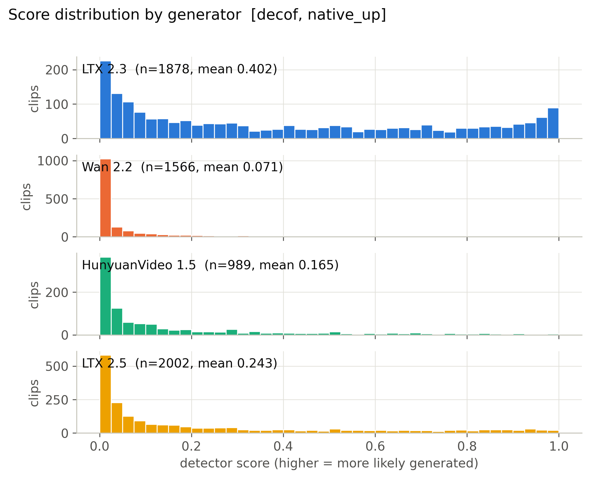

**Mean score, 56 cells x generator.** (`figures/heatmap_mean_score_cells.pdf`)

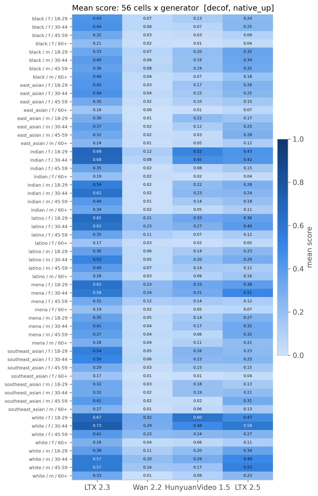

**Detection rate, 56 cells x generator (provisional threshold).** (`figures/heatmap_detection_rate_cells_provisional.pdf`)

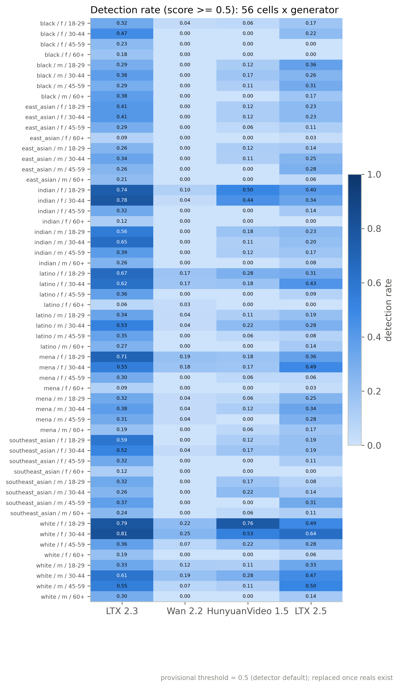

**Mean score by race, gender, age band with 95% CI.** (`figures/subgroup_mean_score.pdf`)

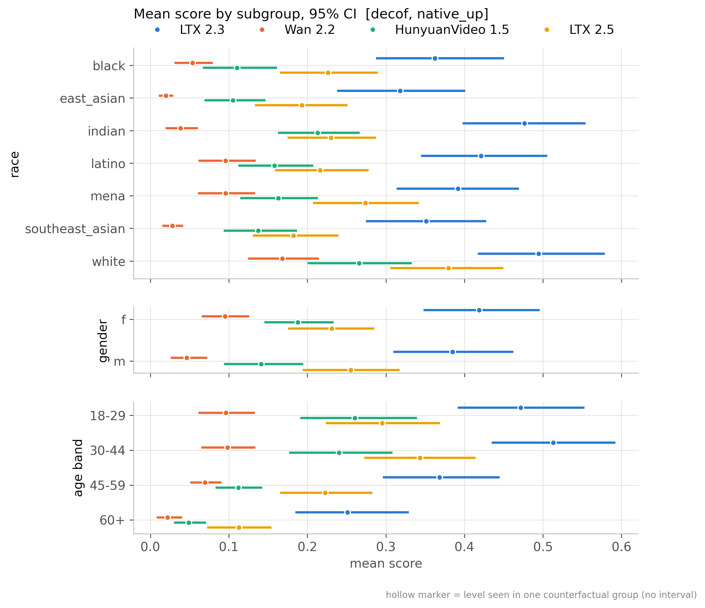

**Mean score by scene factor with 95% CI.** (`figures/scene_factor_mean_score.pdf`)

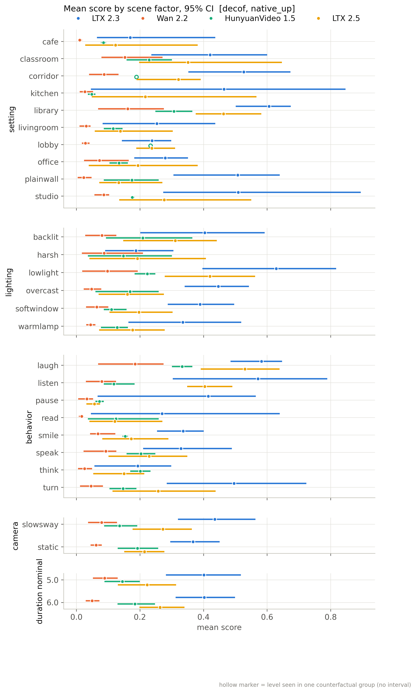

**Detection rate by subgroup (provisional threshold).** (`figures/subgroup_detection_rate_provisional.pdf`)

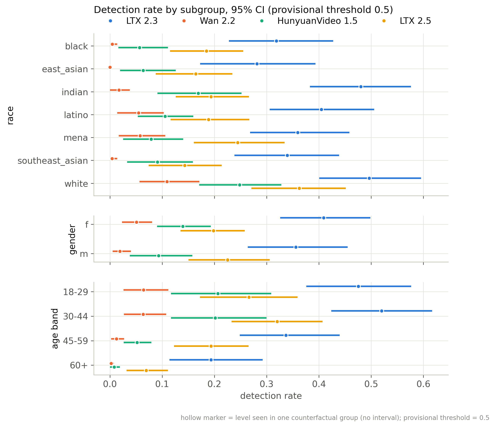

**Distribution of per-group CF spread.** (`figures/cf_spread_distribution.pdf`)

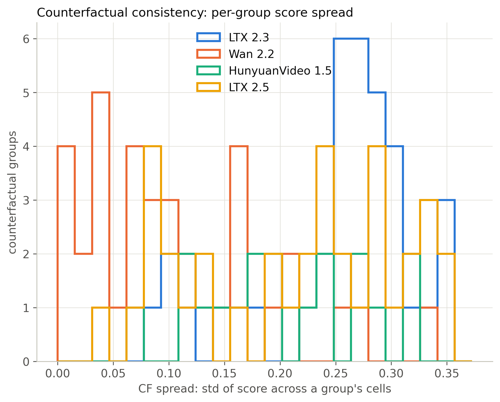

**Flip rate by generator (provisional threshold).** (`figures/flip_rate_by_generator_provisional.pdf`)

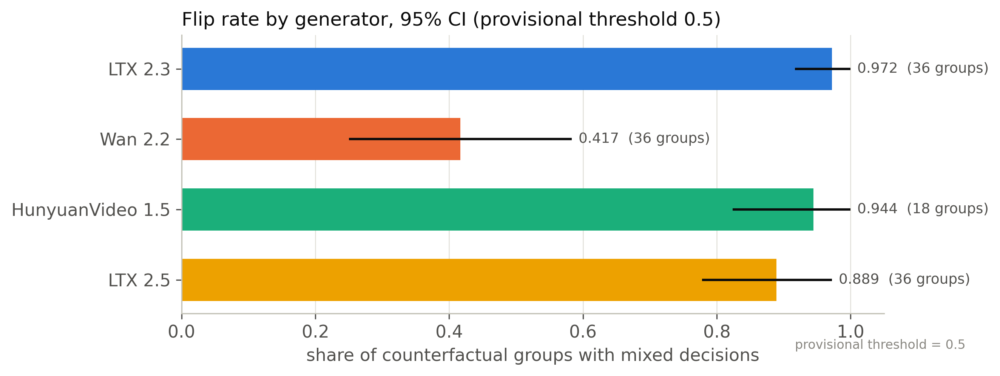

**Partial eta squared by factor.** (`figures/factor_attribution_variance_share.pdf`)

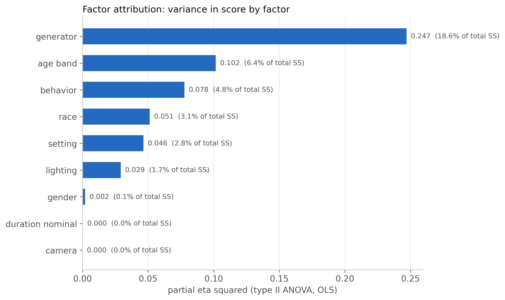

**Highest- and lowest-scoring included clips.** (`figures/example_strip.pdf`)

**ROC per generator against fps-matched reals.** (`figures/roc_per_generator.pdf`)

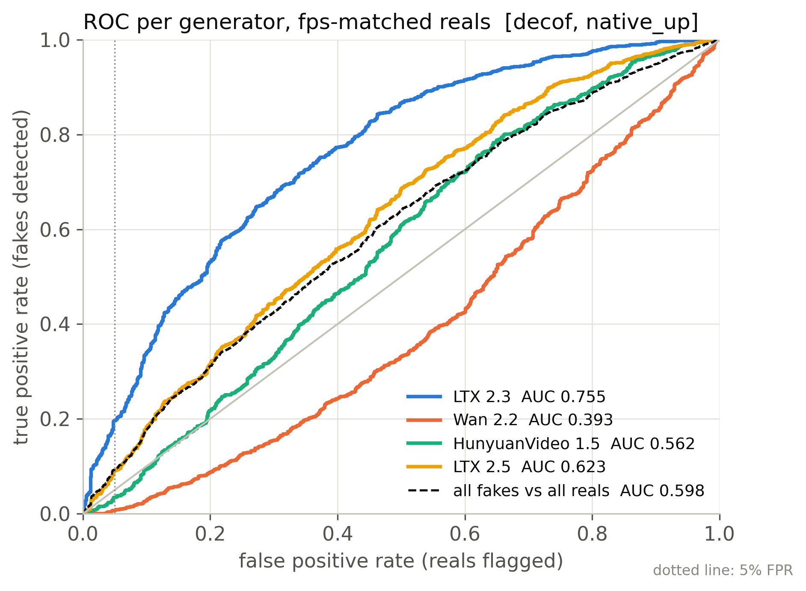

**Real FPR by perceived subgroup at the calibrated threshold.** (`figures/real_fpr_by_subgroup.pdf`)

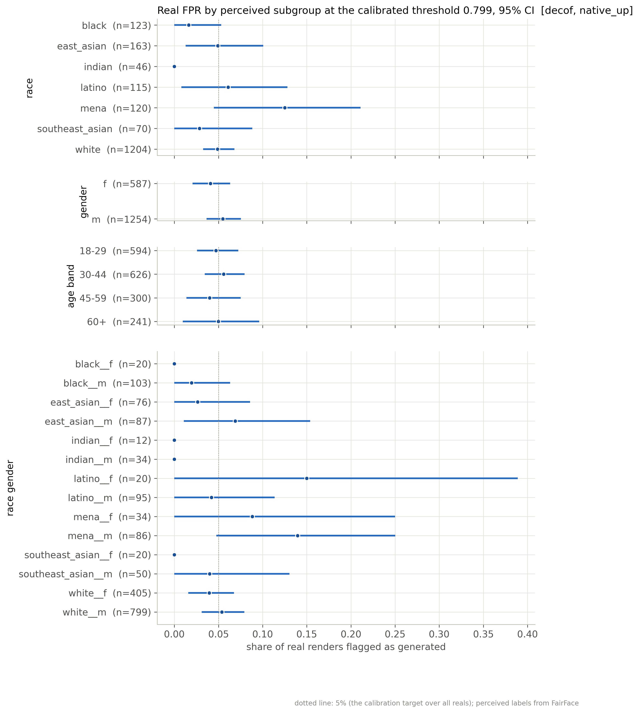

**AUC by subgroup: each subgroup's fakes vs same-subgroup reals.** (`figures/subgroup_auc.pdf`)

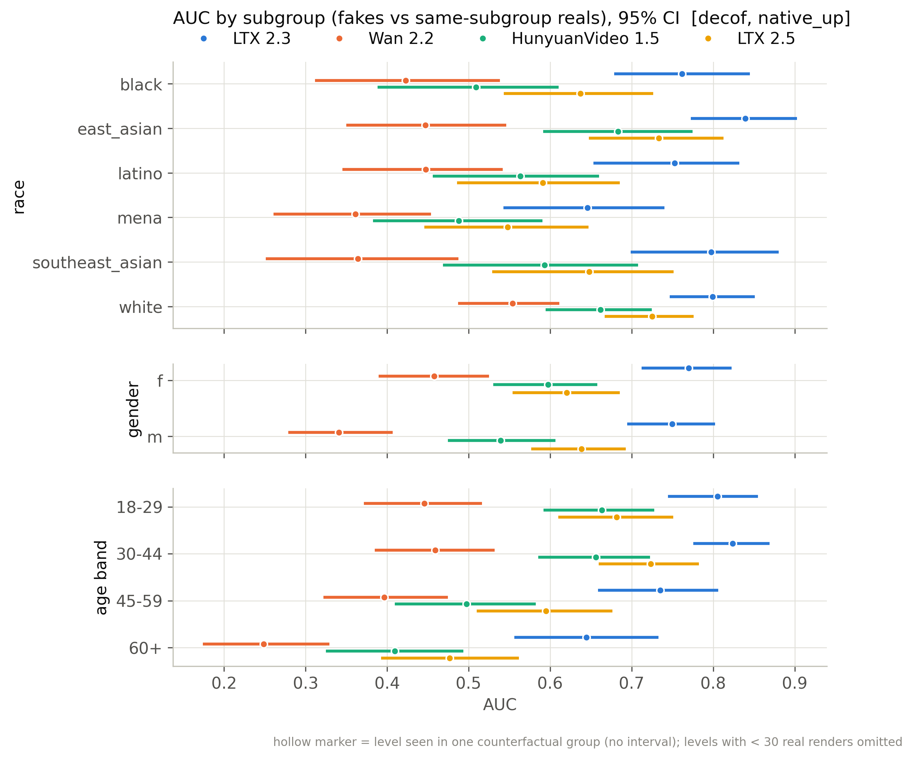

## Files

`manifest_used.csv` (every clip of the active batches with render/score/inclusion flags), `scores.csv` (score per scored clip), `tables/*.csv`, `figures/*`, `snapshot_meta.json`.

