# decof / native_up_2s: snapshot 20261023-0243

> **Detector training data.** The released DeCoF checkpoint is most likely trained on AIGVDBench's Open-Sora split (per the paper's default training set and the checkpoint name); our generators are therefore likely unseen. Not confirmed by the authors. Our curated GenBuster subset includes LTX-Video and HunyuanVideo, which are separate from DeCoF's training data but not from AIGVDBench as a whole.

> **Provisional threshold.** Every detection rate and flip rate below uses the detector's default threshold (0.5; official: argmax over 2 logits (DeCoF test.py) == softmax[:,1] >= 0.5). They will be replaced by the 5%-real-FPR threshold once reals exist (section 6.3).

## Settings

| setting           | value                                                                                  |
|:------------------|:---------------------------------------------------------------------------------------|
| detector          | decof 1+b75d2cbe                                                                       |
| checkpoint_sha256 | 4edb7b310cc729771e74b93f658c7fdc4f2e31fdfa617a88372a540d4f9e7b4a                       |
| view              | native_up_2s (view_hash f48f13e3eb9c049d)                                              |
| ffmpeg            | ffmpeg version 7.1.1 Copyright (c) 2000-2025 the FFmpeg developers                     |
| batches           | fake_b1, fake_b2, fake_b3, real_all                                                    |
| inclusion set     | primary (technical QC pass AND face QC pass)                                           |
| bootstrap         | 1000 resamples of whole counterfactual groups, seed 20261020, 95% percentile intervals |
| git commit        | 2949de581861-dirty                                                                     |
| created           | 2026-10-23T02:44:09Z                                                                   |

Detector preprocessing on top of the view:

| field               | value                                                                           |
|:--------------------|:--------------------------------------------------------------------------------|
| source              | AIGVDBench section 7 + DeCoF src/utils/data.py (test phase)                     |
| frames_window       | 128                                                                             |
| frames_sampled      | 32                                                                              |
| frames_used         | 8                                                                               |
| sampling            | np.linspace(0, n-1, 32).astype(int)[:8], n = min(128, frames)                   |
| crop                | centre square, side = shorter side                                              |
| resize_1            | [256, 256, 'PIL.BILINEAR']                                                      |
| intermediate_format | lossless (PNG-equivalent, kept in memory)                                       |
| resize_2            | [224, 224, 'torchvision Resize default (bilinear, antialias)']                  |
| centre_crop         | 224                                                                             |
| normalize           | {'mean': [0.485, 0.456, 0.406], 'std': [0.229, 0.224, 0.225]}                   |
| backbone            | OpenAI CLIP ViT-L/14 (frozen), fp32                                             |
| head                | DeCoF vit.ViT(num_patches=8, dim=768, depth=2, heads=4, mlp_dim=768, pool=mean) |
| score               | softmax(logits)[:, 1]                                                           |
| precision           | fp32, TF32 off                                                                  |
| code                | LongMa-2025/DeCoF@5f73e8dc4f8cd9faeed07d767c9517e3f2c66044                      |
| clip_sha256         | b8cca3fd41ae0c99ba7e8951adf17d267cdb84cd88be6f7c2e0eca1737a03836                |

## Coverage

| batch    | generator   |   clips |   primary |   rendered |   view_excluded |   render_failed |   scored |   score_failed |   included |
|:---------|:------------|--------:|----------:|-----------:|----------------:|----------------:|---------:|---------------:|-----------:|
| fake_b1  | hunyuan15   |     504 |       492 |        504 |               0 |               0 |      504 |              0 |        492 |
| fake_b1  | ltx23       |    2016 |      1878 |       2016 |               0 |               0 |     2016 |              0 |       1878 |
| fake_b1  | wan22       |    2016 |      1566 |       2016 |               0 |               0 |     2016 |              0 |       1566 |
| fake_b2  | hunyuan15   |     504 |       497 |        504 |               0 |               0 |      504 |              0 |        497 |
| fake_b3  | ltx25       |    2016 |      2002 |       2016 |               0 |               0 |     2016 |              0 |       2002 |
| real_all | real        |    2221 |      2221 |       2221 |               0 |               0 |     2221 |              0 |       2221 |

Reals scored: 4442. Fakes included: 6435 of 11498 scored (0 scoring failures).

## Observations

- LTX 2.3: mean score 0.438 [0.366, 0.513], median 0.380, n = 1878.
- Wan 2.2: mean score 0.082 [0.057, 0.108], median 0.012, n = 1566.
- HunyuanVideo 1.5: mean score 0.192 [0.145, 0.242], median 0.064, n = 989.
- LTX 2.5: mean score 0.263 [0.208, 0.317], median 0.113, n = 2002.
- Provisional detection rate (score >= 0.5), LTX 2.3: 41.9% [33.2, 50.9].
- Provisional detection rate (score >= 0.5), Wan 2.2: 5.2% [2.5, 8.1].
- Provisional detection rate (score >= 0.5), HunyuanVideo 1.5: 14.1% [8.7, 20.2].
- Provisional detection rate (score >= 0.5), LTX 2.5: 22.3% [16.2, 28.7].
- Provisional detection rate (score >= 0.5), all: 22.6% [17.8, 27.3].
- Largest race score gap: LTX 2.5 0.208 [0.167, 0.255] (white 0.401 vs southeast_asian 0.194).
- Largest gender score gap: Wan 2.2 0.056 [0.029, 0.083] (f 0.110 vs m 0.054).
- Largest age band score gap: LTX 2.3 0.264 [0.208, 0.318] (30-44 0.552 vs 60+ 0.289).
- Largest cell score gap: HunyuanVideo 1.5 0.639 [0.552, 0.762] (white__f__18-29 0.651 vs black__f__60+ 0.012).
- Largest scene-factor gap (all generators): setting 0.276 [0.217, 0.423] (library vs cafe).
- Largest partial eta squared: generator 0.250, age_band 0.102, behavior 0.068; residual holds 57.1% of total SS.
- CF spread, LTX 2.3: 0.265 [0.243, 0.284] over 36 groups (max 0.361).
- CF spread, Wan 2.2: 0.118 [0.091, 0.145] over 36 groups (max 0.341).
- CF spread, HunyuanVideo 1.5: 0.224 [0.189, 0.260] over 18 groups (max 0.340).
- CF spread, LTX 2.5: 0.237 [0.208, 0.267] over 36 groups (max 0.370).
- Provisional flip rate, LTX 2.3: 97.2% of 36 groups [91.7, 100.0].
- Provisional flip rate, Wan 2.2: 44.4% of 36 groups [27.8, 61.1].
- Provisional flip rate, HunyuanVideo 1.5: 94.4% of 18 groups [82.4, 100.0].
- Provisional flip rate, LTX 2.5: 94.4% of 36 groups [86.1, 100.0].

## 6.1 Fakes only, no threshold

### Mean score by generator

| generator   |    n |   n_groups |   estimate |   ci_lo |   ci_hi |    sd |   median |   q05 |   q95 |
|:------------|-----:|-----------:|-----------:|--------:|--------:|------:|---------:|------:|------:|
| ltx23       | 1878 |         36 |      0.438 |   0.366 |   0.513 | 0.35  |    0.38  | 0.008 | 0.984 |
| wan22       | 1566 |         36 |      0.082 |   0.057 |   0.108 | 0.164 |    0.012 | 0     | 0.505 |
| hunyuan15   |  989 |         18 |      0.192 |   0.145 |   0.242 | 0.257 |    0.064 | 0.002 | 0.807 |
| ltx25       | 2002 |         36 |      0.263 |   0.208 |   0.317 | 0.305 |    0.113 | 0.002 | 0.914 |
| all         | 6435 |         36 |      0.259 |   0.216 |   0.299 | 0.315 |    0.096 | 0.001 | 0.937 |

### Mean score by race

| generator   | level           |   n |   estimate |   ci_lo |   ci_hi |   median |
|:------------|:----------------|----:|-----------:|--------:|--------:|---------:|
| ltx23       | black           | 273 |      0.414 |   0.335 |   0.501 |    0.341 |
| ltx23       | east_asian      | 270 |      0.352 |   0.27  |   0.435 |    0.236 |
| ltx23       | indian          | 277 |      0.499 |   0.42  |   0.582 |    0.497 |
| ltx23       | latino          | 262 |      0.455 |   0.378 |   0.536 |    0.431 |
| ltx23       | mena            | 267 |      0.428 |   0.35  |   0.508 |    0.347 |
| ltx23       | southeast_asian | 271 |      0.388 |   0.308 |   0.468 |    0.275 |
| ltx23       | white           | 258 |      0.532 |   0.457 |   0.616 |    0.571 |
| wan22       | black           | 217 |      0.059 |   0.035 |   0.085 |    0.014 |
| wan22       | east_asian      | 226 |      0.025 |   0.015 |   0.036 |    0.006 |
| wan22       | indian          | 230 |      0.047 |   0.026 |   0.069 |    0.006 |
| wan22       | latino          | 219 |      0.103 |   0.067 |   0.144 |    0.021 |
| wan22       | mena            | 225 |      0.113 |   0.073 |   0.156 |    0.015 |
| wan22       | southeast_asian | 229 |      0.034 |   0.02  |   0.049 |    0.007 |
| wan22       | white           | 220 |      0.198 |   0.146 |   0.25  |    0.062 |
| hunyuan15   | black           | 141 |      0.129 |   0.076 |   0.193 |    0.043 |
| hunyuan15   | east_asian      | 141 |      0.13  |   0.087 |   0.181 |    0.036 |
| hunyuan15   | indian          | 142 |      0.247 |   0.188 |   0.308 |    0.101 |
| hunyuan15   | latino          | 142 |      0.187 |   0.13  |   0.246 |    0.054 |
| hunyuan15   | mena            | 139 |      0.188 |   0.134 |   0.248 |    0.073 |
| hunyuan15   | southeast_asian | 143 |      0.167 |   0.117 |   0.225 |    0.051 |
| hunyuan15   | white           | 141 |      0.293 |   0.231 |   0.358 |    0.173 |
| ltx25       | black           | 287 |      0.244 |   0.184 |   0.31  |    0.095 |
| ltx25       | east_asian      | 286 |      0.203 |   0.147 |   0.26  |    0.081 |
| ltx25       | indian          | 284 |      0.245 |   0.193 |   0.3   |    0.097 |
| ltx25       | latino          | 286 |      0.247 |   0.188 |   0.311 |    0.082 |
| ltx25       | mena            | 286 |      0.303 |   0.237 |   0.372 |    0.142 |
| ltx25       | southeast_asian | 286 |      0.194 |   0.142 |   0.245 |    0.068 |
| ltx25       | white           | 287 |      0.401 |   0.33  |   0.472 |    0.276 |
| all         | black           | 918 |      0.233 |   0.192 |   0.279 |    0.082 |
| all         | east_asian      | 923 |      0.192 |   0.151 |   0.233 |    0.048 |
| all         | indian          | 933 |      0.272 |   0.235 |   0.308 |    0.095 |
| all         | latino          | 909 |      0.263 |   0.215 |   0.311 |    0.088 |
| all         | mena            | 917 |      0.275 |   0.229 |   0.323 |    0.117 |
| all         | southeast_asian | 929 |      0.207 |   0.169 |   0.244 |    0.059 |
| all         | white           | 906 |      0.372 |   0.321 |   0.425 |    0.249 |

### Mean score by gender

| generator   | level   |    n |   estimate |   ci_lo |   ci_hi |   median |
|:------------|:--------|-----:|-----------:|--------:|--------:|---------:|
| ltx23       | f       |  931 |      0.458 |   0.386 |   0.536 |    0.418 |
| ltx23       | m       |  947 |      0.418 |   0.341 |   0.498 |    0.344 |
| wan22       | f       |  785 |      0.11  |   0.074 |   0.146 |    0.016 |
| wan22       | m       |  781 |      0.054 |   0.034 |   0.08  |    0.009 |
| hunyuan15   | f       |  495 |      0.217 |   0.168 |   0.269 |    0.088 |
| hunyuan15   | m       |  494 |      0.166 |   0.108 |   0.231 |    0.05  |
| ltx25       | f       |  999 |      0.257 |   0.204 |   0.312 |    0.099 |
| ltx25       | m       | 1003 |      0.269 |   0.212 |   0.33  |    0.123 |
| all         | f       | 3210 |      0.273 |   0.232 |   0.317 |    0.105 |
| all         | m       | 3225 |      0.245 |   0.204 |   0.288 |    0.086 |

### Mean score by age band

| generator   | level   |    n |   estimate |   ci_lo |   ci_hi |   median |
|:------------|:--------|-----:|-----------:|--------:|--------:|---------:|
| ltx23       | 18-29   |  469 |      0.503 |   0.426 |   0.583 |    0.497 |
| ltx23       | 30-44   |  471 |      0.552 |   0.475 |   0.631 |    0.608 |
| ltx23       | 45-59   |  478 |      0.404 |   0.328 |   0.483 |    0.347 |
| ltx23       | 60+     |  460 |      0.289 |   0.215 |   0.373 |    0.159 |
| wan22       | 18-29   |  388 |      0.11  |   0.073 |   0.15  |    0.017 |
| wan22       | 30-44   |  377 |      0.116 |   0.078 |   0.154 |    0.021 |
| wan22       | 45-59   |  398 |      0.08  |   0.058 |   0.102 |    0.018 |
| wan22       | 60+     |  403 |      0.026 |   0.01  |   0.047 |    0.004 |
| hunyuan15   | 18-29   |  242 |      0.303 |   0.223 |   0.392 |    0.163 |
| hunyuan15   | 30-44   |  248 |      0.271 |   0.203 |   0.342 |    0.149 |
| hunyuan15   | 45-59   |  250 |      0.134 |   0.098 |   0.171 |    0.049 |
| hunyuan15   | 60+     |  249 |      0.061 |   0.037 |   0.09  |    0.021 |
| ltx25       | 18-29   |  500 |      0.317 |   0.245 |   0.385 |    0.197 |
| ltx25       | 30-44   |  497 |      0.366 |   0.299 |   0.438 |    0.257 |
| ltx25       | 45-59   |  501 |      0.248 |   0.186 |   0.312 |    0.108 |
| ltx25       | 60+     |  504 |      0.121 |   0.084 |   0.16  |    0.031 |
| all         | 18-29   | 1599 |      0.319 |   0.267 |   0.371 |    0.161 |
| all         | 30-44   | 1593 |      0.347 |   0.298 |   0.398 |    0.203 |
| all         | 45-59   | 1627 |      0.235 |   0.196 |   0.277 |    0.088 |
| all         | 60+     | 1616 |      0.136 |   0.105 |   0.169 |    0.027 |

### Mean score by scene factor (all generators pooled)

| factor           | level      |    n |   estimate |   ci_lo |   ci_hi |
|:-----------------|:-----------|-----:|-----------:|--------:|--------:|
| setting          | cafe       |  593 |      0.131 |   0.051 |   0.26  |
| setting          | classroom  |  541 |      0.332 |   0.203 |   0.428 |
| setting          | corridor   |  716 |      0.349 |   0.307 |   0.425 |
| setting          | kitchen    |  605 |      0.209 |   0.046 |   0.471 |
| setting          | library    |  757 |      0.408 |   0.342 |   0.533 |
| setting          | livingroom |  754 |      0.147 |   0.068 |   0.208 |
| setting          | lobby      |  513 |      0.208 |   0.141 |   0.255 |
| setting          | office     |  580 |      0.246 |   0.191 |   0.361 |
| setting          | plainwall  |  777 |      0.245 |   0.209 |   0.324 |
| setting          | studio     |  599 |      0.29  |   0.185 |   0.462 |
| lighting         | backlit    | 1126 |      0.284 |   0.148 |   0.4   |
| lighting         | harsh      |  967 |      0.188 |   0.078 |   0.311 |
| lighting         | lowlight   | 1116 |      0.372 |   0.255 |   0.48  |
| lighting         | overcast   | 1022 |      0.268 |   0.187 |   0.35  |
| lighting         | softwindow | 1157 |      0.227 |   0.204 |   0.268 |
| lighting         | warmlamp   | 1047 |      0.203 |   0.125 |   0.29  |
| behavior         | laugh      |  723 |      0.426 |   0.362 |   0.506 |
| behavior         | listen     |  960 |      0.342 |   0.233 |   0.442 |
| behavior         | pause      |  744 |      0.182 |   0.051 |   0.248 |
| behavior         | read       |  796 |      0.159 |   0.046 |   0.324 |
| behavior         | smile      |  817 |      0.211 |   0.152 |   0.289 |
| behavior         | speak      |  806 |      0.248 |   0.159 |   0.313 |
| behavior         | think      |  733 |      0.155 |   0.048 |   0.249 |
| behavior         | turn       |  856 |      0.33  |   0.232 |   0.443 |
| camera           | slowsway   | 3224 |      0.279 |   0.21  |   0.345 |
| camera           | static     | 3211 |      0.238 |   0.2   |   0.282 |
| duration_nominal | 5.0        | 3226 |      0.244 |   0.178 |   0.312 |
| duration_nominal | 6.0        | 3209 |      0.273 |   0.229 |   0.319 |

Per-generator scene-factor and 56-cell rows: `tables/score_by_breakdown.csv`.

### Subgroup gap (max - min of level means)

A gap is max - min, so it is never negative and its interval cannot include 0; it is a size, not a test of a difference. Over many levels with few clips each (56 cells; HunyuanVideo has 9 groups per cell) the gap also grows with noise, so compare it with the per-level intervals in `tables/score_by_breakdown.csv`. Levels seen in a single counterfactual group have no interval.

| generator   | attribute        |   n_levels |   gap |   ci_lo |   ci_hi | max_level       | min_level          |
|:------------|:-----------------|-----------:|------:|--------:|--------:|:----------------|:-------------------|
| ltx23       | race             |          7 | 0.18  |   0.129 |   0.233 | white           | east_asian         |
| ltx23       | gender           |          2 | 0.04  |   0.004 |   0.079 | f               | m                  |
| ltx23       | age_band         |          4 | 0.264 |   0.208 |   0.318 | 30-44           | 60+                |
| ltx23       | cell             |         56 | 0.607 |   0.54  |   0.706 | white__f__30-44 | east_asian__f__60+ |
| ltx23       | setting          |         10 | 0.452 |   0.356 |   0.764 | library         | cafe               |
| ltx23       | lighting         |          6 | 0.412 |   0.219 |   0.651 | lowlight        | harsh              |
| ltx23       | behavior         |          8 | 0.424 |   0.297 |   0.697 | laugh           | think              |
| ltx23       | camera           |          2 | 0.068 |   0.003 |   0.218 | slowsway        | static             |
| ltx23       | duration_nominal |          2 | 0.009 |   0.003 |   0.178 | 6.0             | 5.0                |
| wan22       | race             |          7 | 0.173 |   0.129 |   0.218 | white           | east_asian         |
| wan22       | gender           |          2 | 0.056 |   0.029 |   0.083 | f               | m                  |
| wan22       | age_band         |          4 | 0.09  |   0.063 |   0.124 | 30-44           | 60+                |
| wan22       | cell             |         56 | 0.358 |   0.282 |   0.465 | white__f__18-29 | east_asian__f__60+ |
| wan22       | setting          |         10 | 0.167 |   0.114 |   0.269 | library         | cafe               |
| wan22       | lighting         |          6 | 0.063 |   0.043 |   0.198 | lowlight        | warmlamp           |
| wan22       | behavior         |          8 | 0.176 |   0.1   |   0.27  | laugh           | read               |
| wan22       | camera           |          2 | 0.016 |   0.001 |   0.07  | slowsway        | static             |
| wan22       | duration_nominal |          2 | 0.043 |   0.004 |   0.092 | 5.0             | 6.0                |
| hunyuan15   | race             |          7 | 0.165 |   0.119 |   0.232 | white           | black              |
| hunyuan15   | gender           |          2 | 0.052 |   0.005 |   0.107 | f               | m                  |
| hunyuan15   | age_band         |          4 | 0.241 |   0.176 |   0.315 | 18-29           | 60+                |
| hunyuan15   | cell             |         56 | 0.639 |   0.552 |   0.762 | white__f__18-29 | black__f__60+      |
| hunyuan15   | setting          |         10 | 0.3   |   0.188 |   0.359 | library         | kitchen            |
| hunyuan15   | lighting         |          6 | 0.127 |   0.097 |   0.312 | lowlight        | softwindow         |
| hunyuan15   | behavior         |          8 | 0.309 |   0.142 |   0.351 | laugh           | pause              |
| hunyuan15   | camera           |          2 | 0.053 |   0.002 |   0.146 | static          | slowsway           |
| hunyuan15   | duration_nominal |          2 | 0.045 |   0.002 |   0.144 | 6.0             | 5.0                |
| ltx25       | race             |          7 | 0.208 |   0.167 |   0.255 | white           | southeast_asian    |
| ltx25       | gender           |          2 | 0.012 |   0.001 |   0.047 | m               | f                  |
| ltx25       | age_band         |          4 | 0.246 |   0.187 |   0.305 | 30-44           | 60+                |
| ltx25       | cell             |         56 | 0.597 |   0.509 |   0.702 | white__f__30-44 | black__f__60+      |
| ltx25       | setting          |         10 | 0.283 |   0.267 |   0.532 | library         | cafe               |
| ltx25       | lighting         |          6 | 0.21  |   0.136 |   0.428 | lowlight        | warmlamp           |
| ltx25       | behavior         |          8 | 0.396 |   0.331 |   0.486 | laugh           | pause              |
| ltx25       | camera           |          2 | 0.076 |   0.004 |   0.183 | slowsway        | static             |
| ltx25       | duration_nominal |          2 | 0.049 |   0.003 |   0.162 | 6.0             | 5.0                |
| all         | race             |          7 | 0.181 |   0.152 |   0.21  | white           | east_asian         |
| all         | gender           |          2 | 0.028 |   0.006 |   0.05  | f               | m                  |
| all         | age_band         |          4 | 0.212 |   0.18  |   0.243 | 30-44           | 60+                |
| all         | cell             |         56 | 0.521 |   0.464 |   0.59  | white__f__30-44 | east_asian__f__60+ |
| all         | setting          |         10 | 0.276 |   0.217 |   0.423 | library         | cafe               |
| all         | lighting         |          6 | 0.185 |   0.098 |   0.347 | lowlight        | harsh              |
| all         | behavior         |          8 | 0.272 |   0.214 |   0.421 | laugh           | think              |
| all         | camera           |          2 | 0.041 |   0.002 |   0.12  | slowsway        | static             |
| all         | duration_nominal |          2 | 0.029 |   0.001 |   0.111 | 6.0             | 5.0                |

### CF spread (mean over groups of the std of score across the group's cells)

| generator   |   n_groups |   cf_spread |   ci_lo |   ci_hi |   median |   max |
|:------------|-----------:|------------:|--------:|--------:|---------:|------:|
| ltx23       |         36 |       0.265 |   0.243 |   0.284 |    0.282 | 0.361 |
| wan22       |         36 |       0.118 |   0.091 |   0.145 |    0.093 | 0.341 |
| hunyuan15   |         18 |       0.224 |   0.189 |   0.26  |    0.229 | 0.34  |
| ltx25       |         36 |       0.237 |   0.208 |   0.267 |    0.256 | 0.37  |

### Factor attribution

OLS with every factor as a fixed effect, type-II ANOVA. `ss_share` is the factor's type-II sum of squares over the total sum of squares (type-II shares need not add to 1). Scene factors are constant within a counterfactual group, so their effects are estimated from between-group differences only. The OLS F tests treat clips as independent although clips are clustered in counterfactual groups, so their p values are optimistic; use the group-bootstrap intervals above for inference.

| factor           |   df |   sum_sq | F     | p          | partial_eta2   |   ss_share |
|:-----------------|-----:|---------:|:------|:-----------|:---------------|-----------:|
| race             |    6 |  19.68   | 57.67 | 9.083e-70  | 0.05131        |  0.03089   |
| gender           |    1 |   1.273  | 22.37 | 2.292e-06  | 0.003485       |  0.001998  |
| age_band         |    3 |  41.27   | 241.8 | 1.204e-148 | 0.1018         |  0.06477   |
| setting          |    9 |  17.26   | 33.72 | 1.342e-58  | 0.04528        |  0.02709   |
| lighting         |    5 |   8.071  | 28.37 | 1.504e-28  | 0.02169        |  0.01267   |
| behavior         |    7 |  26.59   | 66.77 | 2.366e-93  | 0.06808        |  0.04173   |
| camera           |    1 |   0.1002 | 1.761 | 0.1845     | 0.0002752      |  0.0001572 |
| duration_nominal |    1 |   0.343  | 6.03  | 0.01409    | 0.0009415      |  0.0005383 |
| generator        |    3 | 121.2    | 710   | 0          | 0.2498         |  0.1902    |
| Residual         | 6398 | 364      |       |            |                |  0.5712    |

Lighting x race interaction (added to the same OLS):

| term            |   df |   sum_sq |     F |      p |   partial_eta2 |
|:----------------|-----:|---------:|------:|-------:|---------------:|
| lighting x race |   30 |    2.052 | 1.203 | 0.2054 |       0.005638 |

Mixed model `score ~ factors + (1 | counterfactual_group)` (REML) variance components (fixed effects: `tables/factor_mixed_fixed.csv`):

| component                               |   variance | converged   |
|:----------------------------------------|-----------:|:------------|
| counterfactual_group (random intercept) |    0       | True        |
| residual                                |    0.05554 | True        |
| ICC (group share of random variance)    |    0       | True        |

A group variance at or near 0 is a boundary estimate: setting, lighting, behavior, camera and duration are fixed per group and absorb most between-group variation, leaving little for the random intercept. It does not mean scenes do not matter.

## 6.2 Provisional (threshold 0.5, provisional)

### Detection rate by generator (provisional)

| generator   |    n |   estimate |   ci_lo |   ci_hi |
|:------------|-----:|-----------:|--------:|--------:|
| ltx23       | 1878 |      0.419 |   0.332 |   0.509 |
| wan22       | 1566 |      0.052 |   0.025 |   0.081 |
| hunyuan15   |  989 |      0.141 |   0.087 |   0.202 |
| ltx25       | 2002 |      0.223 |   0.162 |   0.287 |
| all         | 6435 |      0.226 |   0.178 |   0.273 |

### Detection rate by race (provisional)

| generator   | level           |   n |   estimate |   ci_lo |   ci_hi |
|:------------|:----------------|----:|-----------:|--------:|--------:|
| ltx23       | black           | 273 |      0.366 |   0.264 |   0.476 |
| ltx23       | east_asian      | 270 |      0.304 |   0.207 |   0.405 |
| ltx23       | indian          | 277 |      0.498 |   0.397 |   0.601 |
| ltx23       | latino          | 262 |      0.427 |   0.339 |   0.522 |
| ltx23       | mena            | 267 |      0.423 |   0.327 |   0.532 |
| ltx23       | southeast_asian | 271 |      0.373 |   0.273 |   0.478 |
| ltx23       | white           | 258 |      0.543 |   0.444 |   0.644 |
| wan22       | black           | 217 |      0.014 |   0     |   0.035 |
| wan22       | east_asian      | 226 |      0     |   0     |   0     |
| wan22       | indian          | 230 |      0.022 |   0     |   0.046 |
| wan22       | latino          | 219 |      0.073 |   0.026 |   0.128 |
| wan22       | mena            | 225 |      0.084 |   0.029 |   0.154 |
| wan22       | southeast_asian | 229 |      0.009 |   0     |   0.026 |
| wan22       | white           | 220 |      0.164 |   0.095 |   0.238 |
| hunyuan15   | black           | 141 |      0.078 |   0.019 |   0.154 |
| hunyuan15   | east_asian      | 141 |      0.085 |   0.031 |   0.152 |
| hunyuan15   | indian          | 142 |      0.211 |   0.119 |   0.303 |
| hunyuan15   | latino          | 142 |      0.155 |   0.078 |   0.234 |
| hunyuan15   | mena            | 139 |      0.115 |   0.046 |   0.189 |
| hunyuan15   | southeast_asian | 143 |      0.098 |   0.04  |   0.167 |
| hunyuan15   | white           | 141 |      0.241 |   0.169 |   0.315 |
| ltx25       | black           | 287 |      0.188 |   0.122 |   0.26  |
| ltx25       | east_asian      | 286 |      0.168 |   0.099 |   0.235 |
| ltx25       | indian          | 284 |      0.187 |   0.126 |   0.252 |
| ltx25       | latino          | 286 |      0.213 |   0.143 |   0.287 |
| ltx25       | mena            | 286 |      0.276 |   0.194 |   0.363 |
| ltx25       | southeast_asian | 286 |      0.133 |   0.074 |   0.192 |
| ltx25       | white           | 287 |      0.397 |   0.306 |   0.486 |
| all         | black           | 918 |      0.183 |   0.134 |   0.234 |
| all         | east_asian      | 923 |      0.154 |   0.106 |   0.199 |
| all         | indian          | 933 |      0.242 |   0.196 |   0.288 |
| all         | latino          | 909 |      0.232 |   0.176 |   0.289 |
| all         | mena            | 917 |      0.248 |   0.187 |   0.309 |
| all         | southeast_asian | 929 |      0.167 |   0.123 |   0.213 |
| all         | white           | 906 |      0.358 |   0.294 |   0.425 |

### Detection rate by gender (provisional)

| generator   | level   |    n |   estimate |   ci_lo |   ci_hi |
|:------------|:--------|-----:|-----------:|--------:|--------:|
| ltx23       | f       |  931 |      0.446 |   0.362 |   0.532 |
| ltx23       | m       |  947 |      0.392 |   0.299 |   0.494 |
| wan22       | f       |  785 |      0.076 |   0.035 |   0.121 |
| wan22       | m       |  781 |      0.027 |   0.008 |   0.052 |
| hunyuan15   | f       |  495 |      0.166 |   0.112 |   0.227 |
| hunyuan15   | m       |  494 |      0.115 |   0.047 |   0.196 |
| ltx25       | f       |  999 |      0.214 |   0.156 |   0.272 |
| ltx25       | m       | 1003 |      0.232 |   0.162 |   0.309 |
| all         | f       | 3210 |      0.24  |   0.193 |   0.288 |
| all         | m       | 3225 |      0.211 |   0.161 |   0.262 |

### Detection rate by age band (provisional)

| generator   | level   |    n |   estimate |   ci_lo |   ci_hi |
|:------------|:--------|-----:|-----------:|--------:|--------:|
| ltx23       | 18-29   |  469 |      0.499 |   0.405 |   0.594 |
| ltx23       | 30-44   |  471 |      0.558 |   0.462 |   0.657 |
| ltx23       | 45-59   |  478 |      0.372 |   0.276 |   0.479 |
| ltx23       | 60+     |  460 |      0.241 |   0.145 |   0.356 |
| wan22       | 18-29   |  388 |      0.085 |   0.037 |   0.137 |
| wan22       | 30-44   |  377 |      0.08  |   0.037 |   0.126 |
| wan22       | 45-59   |  398 |      0.033 |   0.013 |   0.053 |
| wan22       | 60+     |  403 |      0.012 |   0     |   0.031 |
| hunyuan15   | 18-29   |  242 |      0.273 |   0.162 |   0.401 |
| hunyuan15   | 30-44   |  248 |      0.21  |   0.131 |   0.302 |
| hunyuan15   | 45-59   |  250 |      0.068 |   0.031 |   0.105 |
| hunyuan15   | 60+     |  249 |      0.016 |   0     |   0.038 |
| ltx25       | 18-29   |  500 |      0.28  |   0.194 |   0.369 |
| ltx25       | 30-44   |  497 |      0.336 |   0.254 |   0.421 |
| ltx25       | 45-59   |  501 |      0.206 |   0.132 |   0.282 |
| ltx25       | 60+     |  504 |      0.073 |   0.038 |   0.113 |
| all         | 18-29   | 1599 |      0.296 |   0.233 |   0.357 |
| all         | 30-44   | 1593 |      0.321 |   0.262 |   0.38  |
| all         | 45-59   | 1627 |      0.191 |   0.148 |   0.24  |
| all         | 60+     | 1616 |      0.097 |   0.063 |   0.135 |

### Detection-rate gap (provisional)

| generator   | attribute        |   gap |   ci_lo |   ci_hi | max_level       | min_level          |
|:------------|:-----------------|------:|--------:|--------:|:----------------|:-------------------|
| ltx23       | race             | 0.239 |   0.167 |   0.319 | white           | east_asian         |
| ltx23       | gender           | 0.054 |   0.006 |   0.11  | f               | m                  |
| ltx23       | age_band         | 0.317 |   0.237 |   0.4   | 30-44           | 60+                |
| ltx23       | cell             | 0.726 |   0.666 |   0.9   | white__f__30-44 | east_asian__f__60+ |
| ltx23       | setting          | 0.514 |   0.417 |   0.891 | library         | cafe               |
| ltx23       | lighting         | 0.485 |   0.26  |   0.757 | lowlight        | harsh              |
| ltx23       | behavior         | 0.539 |   0.37  |   0.834 | laugh           | think              |
| ltx23       | camera           | 0.1   |   0.008 |   0.271 | slowsway        | static             |
| ltx23       | duration_nominal | 0.002 |   0.003 |   0.21  | 6.0             | 5.0                |
| wan22       | race             | 0.164 |   0.095 |   0.238 | white           | east_asian         |
| wan22       | gender           | 0.05  |   0.009 |   0.089 | f               | m                  |
| wan22       | age_band         | 0.073 |   0.04  |   0.116 | 18-29           | 60+                |
| wan22       | cell             | 0.37  |   0.231 |   0.556 | white__f__18-29 | black__f__30-44    |
| wan22       | setting          | 0.16  |   0.098 |   0.315 | library         | cafe               |
| wan22       | lighting         | 0.073 |   0.043 |   0.197 | lowlight        | warmlamp           |
| wan22       | behavior         | 0.16  |   0.08  |   0.289 | laugh           | read               |
| wan22       | camera           | 0.034 |   0.002 |   0.093 | slowsway        | static             |
| wan22       | duration_nominal | 0.038 |   0.002 |   0.092 | 5.0             | 6.0                |
| hunyuan15   | race             | 0.163 |   0.114 |   0.255 | white           | black              |
| hunyuan15   | gender           | 0.05  |   0.003 |   0.12  | f               | m                  |
| hunyuan15   | age_band         | 0.257 |   0.159 |   0.37  | 18-29           | 60+                |
| hunyuan15   | cell             | 0.824 |   0.65  |   1     | white__f__18-29 | black__f__30-44    |
| hunyuan15   | setting          | 0.321 |   0.192 |   0.429 | library         | kitchen            |
| hunyuan15   | lighting         | 0.137 |   0.122 |   0.401 | backlit         | warmlamp           |
| hunyuan15   | behavior         | 0.356 |   0.141 |   0.415 | laugh           | pause              |
| hunyuan15   | camera           | 0.045 |   0.003 |   0.158 | static          | slowsway           |
| hunyuan15   | duration_nominal | 0.051 |   0.003 |   0.168 | 6.0             | 5.0                |
| ltx25       | race             | 0.264 |   0.195 |   0.338 | white           | southeast_asian    |
| ltx25       | gender           | 0.018 |   0.001 |   0.066 | m               | f                  |
| ltx25       | age_band         | 0.263 |   0.194 |   0.335 | 30-44           | 60+                |
| ltx25       | cell             | 0.694 |   0.556 |   0.834 | white__f__30-44 | black__f__60+      |
| ltx25       | setting          | 0.323 |   0.306 |   0.595 | library         | plainwall          |
| ltx25       | lighting         | 0.214 |   0.147 |   0.463 | lowlight        | warmlamp           |
| ltx25       | behavior         | 0.462 |   0.381 |   0.569 | laugh           | pause              |
| ltx25       | camera           | 0.096 |   0.004 |   0.219 | slowsway        | static             |
| ltx25       | duration_nominal | 0.052 |   0.003 |   0.182 | 6.0             | 5.0                |
| all         | race             | 0.204 |   0.162 |   0.25  | white           | east_asian         |
| all         | gender           | 0.029 |   0.004 |   0.056 | f               | m                  |
| all         | age_band         | 0.224 |   0.185 |   0.265 | 30-44           | 60+                |
| all         | cell             | 0.562 |   0.496 |   0.693 | white__f__30-44 | east_asian__f__60+ |
| all         | setting          | 0.305 |   0.238 |   0.502 | library         | livingroom         |
| all         | lighting         | 0.205 |   0.113 |   0.397 | lowlight        | harsh              |
| all         | behavior         | 0.329 |   0.245 |   0.491 | laugh           | think              |
| all         | camera           | 0.062 |   0.004 |   0.151 | slowsway        | static             |
| all         | duration_nominal | 0.031 |   0.002 |   0.123 | 6.0             | 5.0                |

### Flip rate (provisional): share of groups whose clips get different decisions

| generator   |   n_groups |   flip_rate |   ci_lo |   ci_hi |   median |   max |
|:------------|-----------:|------------:|--------:|--------:|---------:|------:|
| ltx23       |         36 |       0.972 |   0.917 |   1     |        1 |     1 |
| wan22       |         36 |       0.444 |   0.278 |   0.611 |        0 |     1 |
| hunyuan15   |         18 |       0.944 |   0.824 |   1     |        1 |     1 |
| ltx25       |         36 |       0.944 |   0.861 |   1     |        1 |     1 |

### Sensitivity: inclusion set

| set     | generator   |    n |   mean_score |   provisional_detection_rate |
|:--------|:------------|-----:|-------------:|-----------------------------:|
| all     | hunyuan15   | 1008 |        0.194 |                        0.144 |
| all     | ltx23       | 2016 |        0.442 |                        0.424 |
| all     | ltx25       | 2016 |        0.263 |                        0.224 |
| all     | wan22       | 2016 |        0.091 |                        0.059 |
| primary | hunyuan15   |  989 |        0.192 |                        0.141 |
| primary | ltx23       | 1878 |        0.438 |                        0.419 |
| primary | ltx25       | 2002 |        0.263 |                        0.223 |
| primary | wan22       | 1566 |        0.082 |                        0.052 |

## 6.3 Real vs generated (calibrated threshold 0.8506)

The threshold is the score at which 5% of primary real renders (24 and 16 fps pooled) are flagged; one per detector and view, never per subgroup. Each generator is compared with reals rendered at its own fps. Intervals: fakes resample counterfactual groups, reals resample identity clusters (source video). Real labels are perceived (FairFace), not self-reported.

### Calibration

| scope            |   n_renders |   n_sources |   n_identities |   threshold |    fpr |
|:-----------------|------------:|------------:|---------------:|------------:|-------:|
| all real renders |        4442 |        2221 |           1822 |      0.8506 | 0.0502 |
| 16 fps renders   |        2221 |        2221 |           1822 |      0.8506 | 0.0477 |
| 24 fps renders   |        2221 |        2221 |           1822 |      0.8506 | 0.0527 |

### AUC, AP, EER, TPR at 5% FPR

| generator   | real_fps   |   n_fake |   n_real |   auc |   auc_ci_lo |   auc_ci_hi |    ap |   eer |   tpr_at_5fpr |   detection_rate_global_thr |   det_ci_lo |   det_ci_hi |
|:------------|:-----------|---------:|---------:|------:|------------:|------------:|------:|------:|--------------:|----------------------------:|------------:|------------:|
| ltx23       | 24         |     1878 |     2221 | 0.738 |       0.686 |       0.791 | 0.685 | 0.333 |         0.193 |                       0.2   |       0.139 |       0.272 |
| wan22       | 16         |     1566 |     2221 | 0.372 |       0.316 |       0.426 | 0.328 | 0.599 |         0.004 |                       0.004 |       0.001 |       0.007 |
| hunyuan15   | 24         |      989 |     2221 | 0.536 |       0.481 |       0.592 | 0.316 | 0.478 |         0.035 |                       0.037 |       0.02  |       0.056 |
| ltx25       | 24         |     2002 |     2221 | 0.596 |       0.541 |       0.649 | 0.545 | 0.438 |         0.079 |                       0.083 |       0.052 |       0.121 |
| all         | 24+16      |     6435 |     4442 | 0.576 |       0.535 |       0.619 | 0.659 | 0.448 |         0.091 |                       0.091 |       0.065 |       0.122 |

### Real FPR by perceived subgroup

| attribute   | level              |   n_renders |   n_identities |   fpr |   ci_lo |   ci_hi |
|:------------|:-------------------|------------:|---------------:|------:|--------:|--------:|
| race        | black              |         378 |            173 | 0.037 |   0.01  |   0.07  |
| race        | east_asian         |         382 |            170 | 0.045 |   0.017 |   0.077 |
| race        | indian             |         112 |             54 | 0.062 |   0.009 |   0.134 |
| race        | latino             |         254 |            119 | 0.055 |   0.019 |   0.094 |
| race        | mena               |         258 |            124 | 0.097 |   0.053 |   0.148 |
| race        | southeast_asian    |         184 |             85 | 0.022 |   0     |   0.058 |
| race        | white              |        2836 |           1179 | 0.049 |   0.038 |   0.06  |
| gender      | f                  |        1380 |            605 | 0.052 |   0.036 |   0.069 |
| gender      | m                  |        3024 |           1263 | 0.049 |   0.038 |   0.06  |
| age_band    | 18-29              |        1382 |            625 | 0.06  |   0.043 |   0.078 |
| age_band    | 30-44              |        1518 |            679 | 0.051 |   0.036 |   0.066 |
| age_band    | 45-59              |         644 |            274 | 0.042 |   0.022 |   0.064 |
| age_band    | 60+                |         624 |            268 | 0.024 |   0.009 |   0.043 |
| race_gender | black__f           |          64 |             30 | 0.031 |   0     |   0.107 |
| race_gender | black__m           |         314 |            144 | 0.038 |   0.007 |   0.076 |
| race_gender | east_asian__f      |         138 |             63 | 0.014 |   0     |   0.049 |
| race_gender | east_asian__m      |         244 |            110 | 0.061 |   0.022 |   0.107 |
| race_gender | indian__f          |          32 |             16 | 0.125 |   0     |   0.333 |
| race_gender | indian__m          |          80 |             38 | 0.037 |   0     |   0.104 |
| race_gender | latino__f          |          62 |             30 | 0.065 |   0     |   0.16  |
| race_gender | latino__m          |         192 |             89 | 0.052 |   0.013 |   0.098 |
| race_gender | mena__f            |          60 |             30 | 0.067 |   0     |   0.167 |
| race_gender | mena__m            |         198 |             94 | 0.106 |   0.053 |   0.168 |
| race_gender | southeast_asian__f |          64 |             30 | 0.031 |   0     |   0.111 |
| race_gender | southeast_asian__m |         120 |             56 | 0.017 |   0     |   0.052 |
| race_gender | white__f           |         960 |            425 | 0.056 |   0.036 |   0.078 |
| race_gender | white__m           |        1876 |            789 | 0.045 |   0.032 |   0.058 |

### Real FPR gap (max - min across levels; non-negative by construction)

| attribute   |   n_levels |   fpr_gap |   ci_lo |   ci_hi | max_level   |   max_fpr | min_level       |   min_fpr |
|:------------|-----------:|----------:|--------:|--------:|:------------|----------:|:----------------|----------:|
| race        |          7 |     0.075 |   0.042 |   0.14  | mena        |     0.097 | southeast_asian |     0.022 |
| gender      |          2 |     0.004 |   0     |   0.024 | f           |     0.052 | m               |     0.049 |
| age_band    |          4 |     0.036 |   0.018 |   0.06  | 18-29       |     0.06  | 60+             |     0.024 |
| race_gender |         14 |     0.111 |   0.081 |   0.333 | indian__f   |     0.125 | east_asian__f   |     0.014 |

### Worst-subgroup AUC and AUC gap

| generator   | attribute   |   n_levels | worst_level   |   worst_auc |   worst_ci_lo |   worst_ci_hi | best_level    |   best_auc |   auc_gap |   gap_ci_lo |   gap_ci_hi |
|:------------|:------------|-----------:|:--------------|------------:|--------------:|--------------:|:--------------|-----------:|----------:|------------:|------------:|
| ltx23       | race        |          7 | mena          |       0.693 |         0.615 |         0.749 | east_asian    |      0.792 |     0.098 |       0.066 |       0.177 |
| ltx23       | gender      |          2 | m             |       0.739 |         0.677 |         0.787 | f             |      0.739 |     0     |       0.001 |       0.039 |
| ltx23       | age_band    |          4 | 60+           |       0.691 |         0.616 |         0.767 | 30-44         |      0.805 |     0.114 |       0.064 |       0.164 |
| ltx23       | race_gender |         13 | mena__m       |       0.662 |         0.563 |         0.729 | east_asian__f |      0.797 |     0.135 |       0.113 |       0.262 |
| wan22       | race        |          7 | indian        |       0.252 |         0.169 |         0.333 | white         |      0.529 |     0.277 |       0.197 |       0.36  |
| wan22       | gender      |          2 | m             |       0.326 |         0.269 |         0.382 | f             |      0.423 |     0.097 |       0.052 |       0.14  |
| wan22       | age_band    |          4 | 60+           |       0.276 |         0.212 |         0.344 | 30-44         |      0.429 |     0.153 |       0.102 |       0.224 |
| wan22       | race_gender |         13 | indian__m     |       0.151 |         0.068 |         0.245 | white__f      |      0.593 |     0.441 |       0.333 |       0.558 |
| hunyuan15   | race        |          7 | black         |       0.446 |         0.353 |         0.53  | white         |      0.635 |     0.189 |       0.132 |       0.275 |
| hunyuan15   | gender      |          2 | m             |       0.516 |         0.449 |         0.579 | f             |      0.56  |     0.044 |       0.002 |       0.112 |
| hunyuan15   | age_band    |          4 | 60+           |       0.442 |         0.373 |         0.513 | 18-29         |      0.621 |     0.18  |       0.116 |       0.256 |
| hunyuan15   | race_gender |         13 | indian__m     |       0.416 |         0.257 |         0.486 | white__f      |      0.675 |     0.259 |       0.217 |       0.452 |
| ltx25       | race        |          7 | indian        |       0.512 |         0.414 |         0.59  | white         |      0.7   |     0.189 |       0.124 |       0.284 |
| ltx25       | gender      |          2 | f             |       0.583 |         0.524 |         0.637 | m             |      0.614 |     0.031 |       0.002 |       0.072 |
| ltx25       | age_band    |          4 | 60+           |       0.504 |         0.437 |         0.573 | 30-44         |      0.688 |     0.183 |       0.115 |       0.254 |
| ltx25       | race_gender |         13 | indian__m     |       0.444 |         0.319 |         0.547 | white__m      |      0.732 |     0.288 |       0.194 |       0.41  |
| all         | race        |          7 | indian        |       0.514 |         0.436 |         0.57  | white         |      0.674 |     0.16  |       0.112 |       0.236 |
| all         | gender      |          2 | m             |       0.568 |         0.524 |         0.611 | f             |      0.588 |     0.02  |       0.001 |       0.053 |
| all         | age_band    |          4 | 60+           |       0.493 |         0.439 |         0.55  | 30-44         |      0.652 |     0.159 |       0.113 |       0.207 |
| all         | race_gender |         14 | indian__m     |       0.452 |         0.357 |         0.524 | white__f      |      0.686 |     0.233 |       0.174 |       0.359 |

### Detection rate at the calibrated threshold

| generator   |    n |   estimate |   ci_lo |   ci_hi |
|:------------|-----:|-----------:|--------:|--------:|
| ltx23       | 1878 |      0.2   |   0.139 |   0.272 |
| wan22       | 1566 |      0.004 |   0.001 |   0.007 |
| hunyuan15   |  989 |      0.037 |   0.02  |   0.056 |
| ltx25       | 2002 |      0.083 |   0.052 |   0.121 |
| all         | 6435 |      0.091 |   0.065 |   0.122 |

#### by race

| generator   | level           |   n |   estimate |   ci_lo |   ci_hi |
|:------------|:----------------|----:|-----------:|--------:|--------:|
| ltx23       | black           | 273 |      0.172 |   0.096 |   0.264 |
| ltx23       | east_asian      | 270 |      0.137 |   0.069 |   0.212 |
| ltx23       | indian          | 277 |      0.249 |   0.173 |   0.331 |
| ltx23       | latino          | 262 |      0.24  |   0.16  |   0.335 |
| ltx23       | mena            | 267 |      0.187 |   0.122 |   0.262 |
| ltx23       | southeast_asian | 271 |      0.144 |   0.085 |   0.209 |
| ltx23       | white           | 258 |      0.275 |   0.193 |   0.367 |
| wan22       | black           | 217 |      0     |   0     |   0     |
| wan22       | east_asian      | 226 |      0     |   0     |   0     |
| wan22       | indian          | 230 |      0     |   0     |   0     |
| wan22       | latino          | 219 |      0.005 |   0     |   0.014 |
| wan22       | mena            | 225 |      0.004 |   0     |   0.014 |
| wan22       | southeast_asian | 229 |      0     |   0     |   0     |
| wan22       | white           | 220 |      0.018 |   0     |   0.042 |
| hunyuan15   | black           | 141 |      0.007 |   0     |   0.023 |
| hunyuan15   | east_asian      | 141 |      0.021 |   0     |   0.045 |
| hunyuan15   | indian          | 142 |      0.07  |   0.026 |   0.123 |
| hunyuan15   | latino          | 142 |      0     |   0     |   0     |
| hunyuan15   | mena            | 139 |      0.043 |   0.007 |   0.088 |
| hunyuan15   | southeast_asian | 143 |      0.042 |   0.012 |   0.079 |
| hunyuan15   | white           | 141 |      0.078 |   0.025 |   0.141 |
| ltx25       | black           | 287 |      0.063 |   0.024 |   0.111 |
| ltx25       | east_asian      | 286 |      0.028 |   0.004 |   0.059 |
| ltx25       | indian          | 284 |      0.085 |   0.049 |   0.128 |
| ltx25       | latino          | 286 |      0.08  |   0.045 |   0.126 |
| ltx25       | mena            | 286 |      0.115 |   0.066 |   0.17  |
| ltx25       | southeast_asian | 286 |      0.035 |   0.01  |   0.066 |
| ltx25       | white           | 287 |      0.178 |   0.115 |   0.247 |
| all         | black           | 918 |      0.072 |   0.041 |   0.112 |
| all         | east_asian      | 923 |      0.052 |   0.028 |   0.079 |
| all         | indian          | 933 |      0.11  |   0.079 |   0.142 |
| all         | latino          | 909 |      0.096 |   0.065 |   0.132 |
| all         | mena            | 917 |      0.098 |   0.065 |   0.134 |
| all         | southeast_asian | 929 |      0.059 |   0.036 |   0.085 |
| all         | white           | 906 |      0.151 |   0.111 |   0.199 |

#### by gender

| generator   | level   |    n |   estimate |   ci_lo |   ci_hi |
|:------------|:--------|-----:|-----------:|--------:|--------:|
| ltx23       | f       |  931 |      0.224 |   0.159 |   0.296 |
| ltx23       | m       |  947 |      0.176 |   0.114 |   0.25  |
| wan22       | f       |  785 |      0.004 |   0     |   0.008 |
| wan22       | m       |  781 |      0.004 |   0     |   0.009 |
| hunyuan15   | f       |  495 |      0.044 |   0.022 |   0.07  |
| hunyuan15   | m       |  494 |      0.03  |   0.008 |   0.059 |
| ltx25       | f       |  999 |      0.095 |   0.058 |   0.135 |
| ltx25       | m       | 1003 |      0.072 |   0.041 |   0.112 |
| all         | f       | 3210 |      0.102 |   0.074 |   0.134 |
| all         | m       | 3225 |      0.08  |   0.051 |   0.112 |

#### by age band

| generator   | level   |    n |   estimate |   ci_lo |   ci_hi |
|:------------|:--------|-----:|-----------:|--------:|--------:|
| ltx23       | 18-29   |  469 |      0.26  |   0.181 |   0.353 |
| ltx23       | 30-44   |  471 |      0.318 |   0.233 |   0.409 |
| ltx23       | 45-59   |  478 |      0.153 |   0.087 |   0.228 |
| ltx23       | 60+     |  460 |      0.067 |   0.032 |   0.113 |
| wan22       | 18-29   |  388 |      0.008 |   0     |   0.017 |
| wan22       | 30-44   |  377 |      0.005 |   0     |   0.012 |
| wan22       | 45-59   |  398 |      0.003 |   0     |   0.008 |
| wan22       | 60+     |  403 |      0     |   0     |   0     |
| hunyuan15   | 18-29   |  242 |      0.074 |   0.032 |   0.126 |
| hunyuan15   | 30-44   |  248 |      0.065 |   0.033 |   0.096 |
| hunyuan15   | 45-59   |  250 |      0.012 |   0     |   0.026 |
| hunyuan15   | 60+     |  249 |      0     |   0     |   0     |
| ltx25       | 18-29   |  500 |      0.112 |   0.068 |   0.164 |
| ltx25       | 30-44   |  497 |      0.151 |   0.098 |   0.213 |
| ltx25       | 45-59   |  501 |      0.058 |   0.028 |   0.097 |
| ltx25       | 60+     |  504 |      0.014 |   0     |   0.032 |
| all         | 18-29   | 1599 |      0.124 |   0.087 |   0.167 |
| all         | 30-44   | 1593 |      0.153 |   0.113 |   0.195 |
| all         | 45-59   | 1627 |      0.065 |   0.039 |   0.096 |
| all         | 60+     | 1616 |      0.024 |   0.011 |   0.038 |

### Detection-rate gap at the calibrated threshold

| generator   | attribute        |   gap |   ci_lo |   ci_hi | max_level       | min_level          |
|:------------|:-----------------|------:|--------:|--------:|:----------------|:-------------------|
| ltx23       | race             | 0.138 |   0.096 |   0.216 | white           | east_asian         |
| ltx23       | gender           | 0.048 |   0.015 |   0.084 | f               | m                  |
| ltx23       | age_band         | 0.251 |   0.185 |   0.319 | 30-44           | 60+                |
| ltx23       | cell             | 0.531 |   0.452 |   0.727 | white__f__30-44 | east_asian__f__60+ |
| ltx23       | setting          | 0.303 |   0.261 |   0.768 | library         | cafe               |
| ltx23       | lighting         | 0.359 |   0.182 |   0.579 | lowlight        | harsh              |
| ltx23       | behavior         | 0.311 |   0.227 |   0.618 | listen          | think              |
| ltx23       | camera           | 0.096 |   0.005 |   0.229 | slowsway        | static             |
| ltx23       | duration_nominal | 0.042 |   0.003 |   0.177 | 5.0             | 6.0                |
| wan22       | race             | 0.018 |   0.004 |   0.042 | white           | black              |
| wan22       | gender           | 0     |   0     |   0.006 | m               | f                  |
| wan22       | age_band         | 0.008 |   0.003 |   0.017 | 18-29           | 60+                |
| wan22       | cell             | 0.042 |   0.036 |   0.156 | white__f__30-44 | black__f__18-29    |
| wan22       | setting          | 0.033 |   0.006 |   0.154 | office          | cafe               |
| wan22       | lighting         | 0.01  |   0.003 |   0.027 | lowlight        | harsh              |
| wan22       | behavior         | 0.013 |   0.005 |   0.053 | listen          | pause              |
| wan22       | camera           | 0.003 |   0     |   0.009 | slowsway        | static             |
| wan22       | duration_nominal | 0.002 |   0     |   0.009 | 5.0             | 6.0                |
| hunyuan15   | race             | 0.078 |   0.05  |   0.144 | white           | latino             |
| hunyuan15   | gender           | 0.014 |   0.001 |   0.047 | f               | m                  |
| hunyuan15   | age_band         | 0.074 |   0.042 |   0.126 | 18-29           | 60+                |
| hunyuan15   | cell             | 0.294 |   0.231 |   0.545 | white__f__30-44 | black__f__18-29    |
| hunyuan15   | setting          | 0.125 |   0.054 |   0.143 | library         | kitchen            |
| hunyuan15   | lighting         | 0.065 |   0.036 |   0.143 | backlit         | softwindow         |
| hunyuan15   | behavior         | 0.107 |   0.048 |   0.143 | laugh           | pause              |
| hunyuan15   | camera           | 0.029 |   0.002 |   0.064 | static          | slowsway           |
| hunyuan15   | duration_nominal | 0.018 |   0.001 |   0.055 | 6.0             | 5.0                |
| ltx25       | race             | 0.15  |   0.094 |   0.214 | white           | east_asian         |
| ltx25       | gender           | 0.023 |   0.001 |   0.052 | f               | m                  |
| ltx25       | age_band         | 0.137 |   0.087 |   0.197 | 30-44           | 60+                |
| ltx25       | cell             | 0.389 |   0.278 |   0.556 | white__f__30-44 | black__f__45-59    |
| ltx25       | setting          | 0.175 |   0.161 |   0.396 | library         | plainwall          |
| ltx25       | lighting         | 0.178 |   0.086 |   0.321 | lowlight        | warmlamp           |
| ltx25       | behavior         | 0.166 |   0.152 |   0.344 | laugh           | pause              |
| ltx25       | camera           | 0.061 |   0.005 |   0.13  | slowsway        | static             |
| ltx25       | duration_nominal | 0.001 |   0.001 |   0.078 | 5.0             | 6.0                |
| all         | race             | 0.099 |   0.07  |   0.134 | white           | east_asian         |
| all         | gender           | 0.023 |   0.006 |   0.038 | f               | m                  |
| all         | age_band         | 0.129 |   0.096 |   0.164 | 30-44           | 60+                |
| all         | cell             | 0.339 |   0.255 |   0.422 | white__f__30-44 | east_asian__f__60+ |
| all         | setting          | 0.151 |   0.123 |   0.337 | library         | cafe               |
| all         | lighting         | 0.153 |   0.073 |   0.266 | lowlight        | harsh              |
| all         | behavior         | 0.13  |   0.103 |   0.285 | turn            | think              |
| all         | camera           | 0.044 |   0.003 |   0.102 | slowsway        | static             |
| all         | duration_nominal | 0.002 |   0.001 |   0.063 | 5.0             | 6.0                |

### Flip rate at the calibrated threshold

| generator   |   n_groups |   flip_rate |   ci_lo |   ci_hi |   median |   max |
|:------------|-----------:|------------:|--------:|--------:|---------:|------:|
| ltx23       |         36 |       0.861 |   0.75  |   0.972 |        1 |     1 |
| wan22       |         36 |       0.139 |   0.028 |   0.25  |        0 |     1 |
| hunyuan15   |         18 |       0.722 |   0.499 |   0.929 |        1 |     1 |
| ltx25       |         36 |       0.639 |   0.472 |   0.806 |        1 |     1 |

## Figures

**Score distribution by generator.** (`figures/score_distribution_by_generator.pdf`)

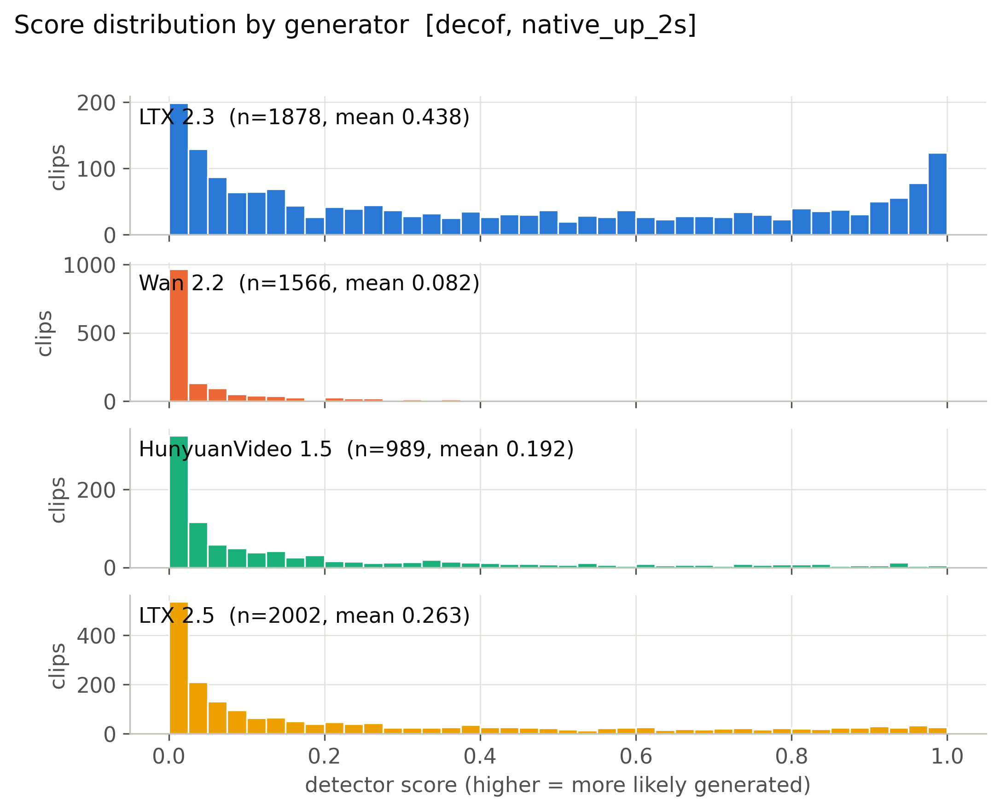

**Mean score, 56 cells x generator.** (`figures/heatmap_mean_score_cells.pdf`)

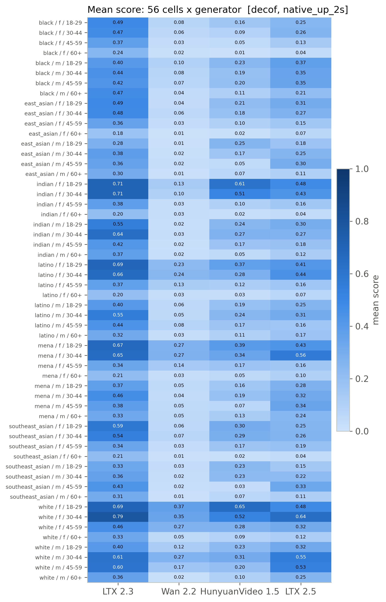

**Detection rate, 56 cells x generator (provisional threshold).** (`figures/heatmap_detection_rate_cells_provisional.pdf`)

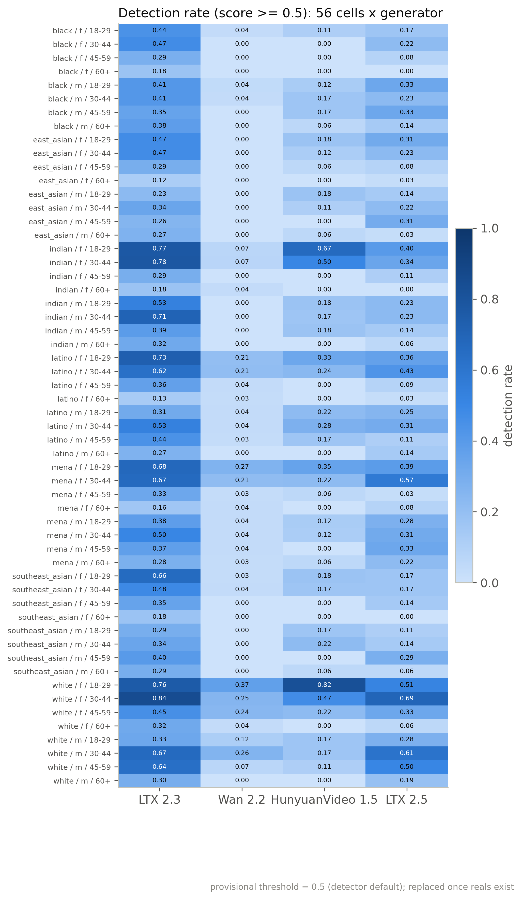

**Mean score by race, gender, age band with 95% CI.** (`figures/subgroup_mean_score.pdf`)

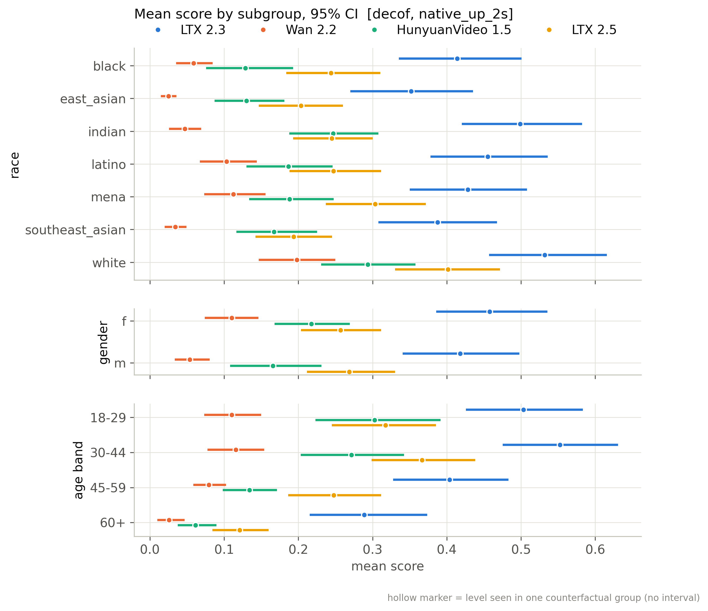

**Mean score by scene factor with 95% CI.** (`figures/scene_factor_mean_score.pdf`)

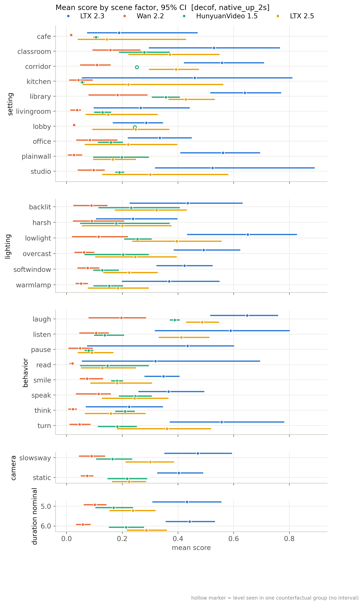

**Detection rate by subgroup (provisional threshold).** (`figures/subgroup_detection_rate_provisional.pdf`)

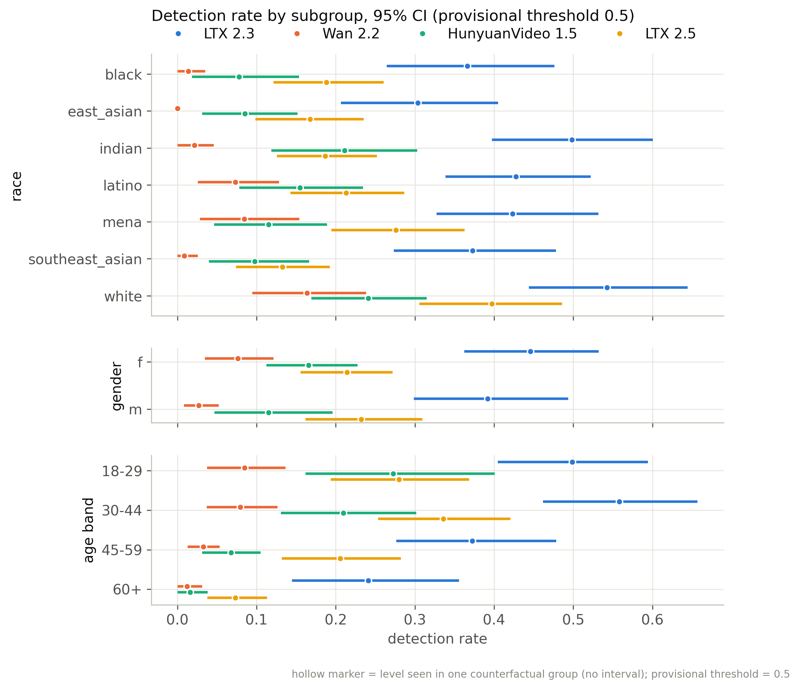

**Distribution of per-group CF spread.** (`figures/cf_spread_distribution.pdf`)

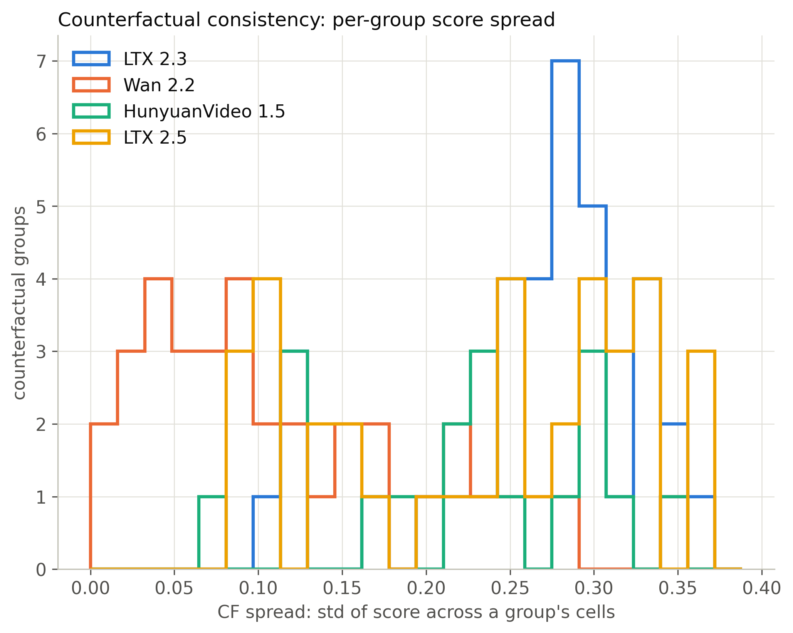

**Flip rate by generator (provisional threshold).** (`figures/flip_rate_by_generator_provisional.pdf`)

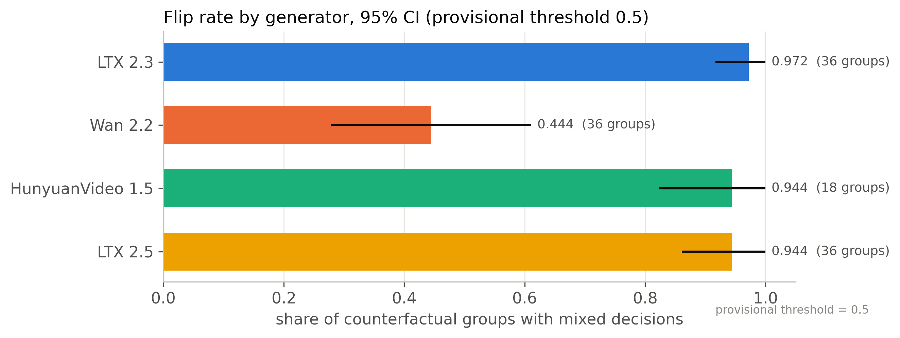

**Partial eta squared by factor.** (`figures/factor_attribution_variance_share.pdf`)

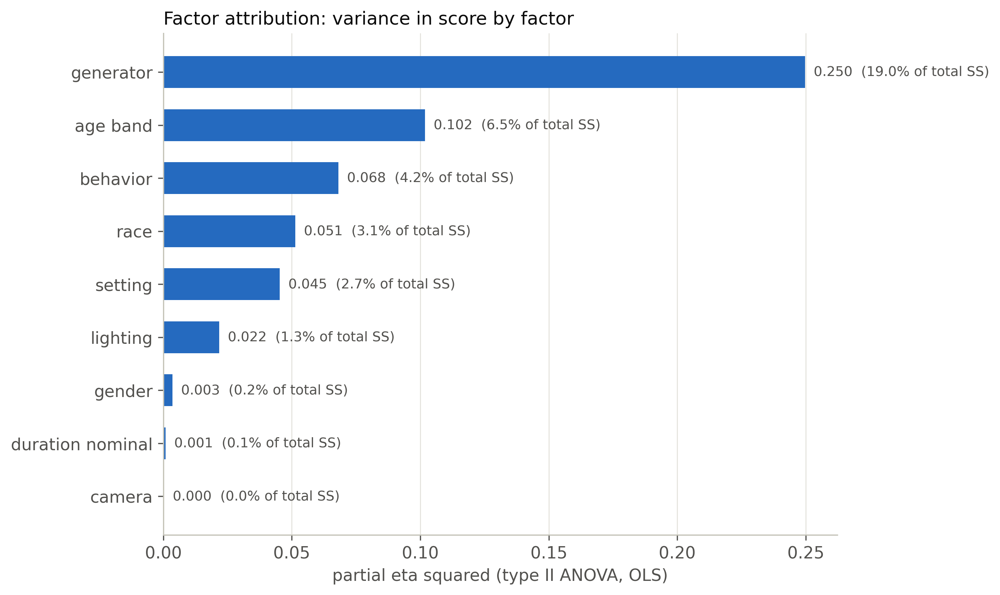

**Highest- and lowest-scoring included clips.** (`figures/example_strip.pdf`)

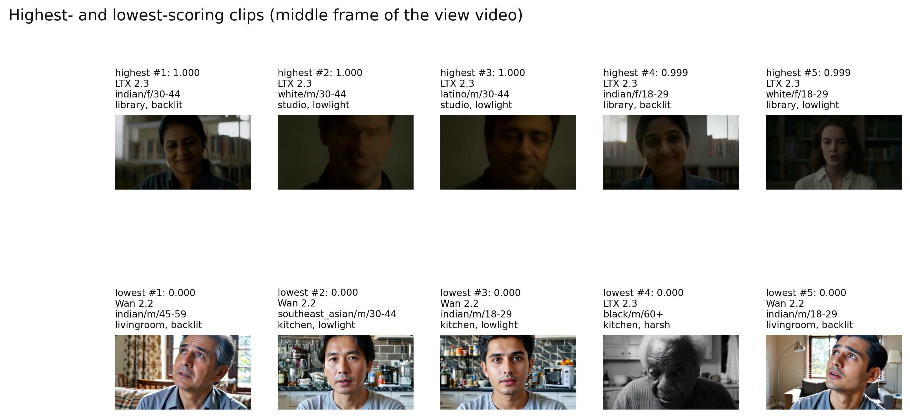

**ROC per generator against fps-matched reals.** (`figures/roc_per_generator.pdf`)

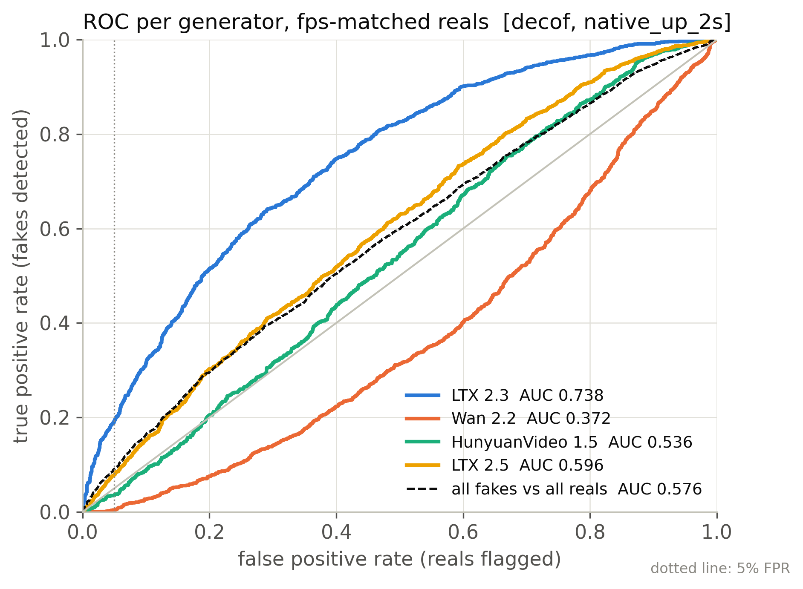

**Real FPR by perceived subgroup at the calibrated threshold.** (`figures/real_fpr_by_subgroup.pdf`)

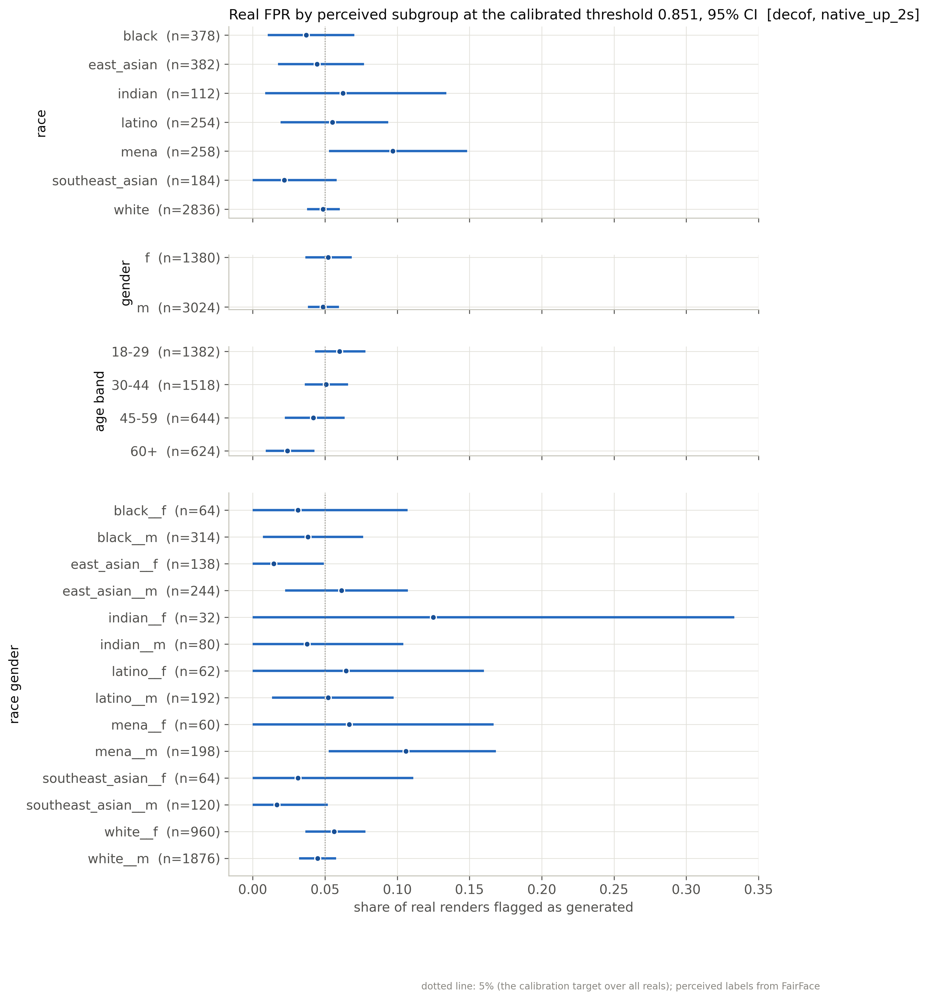

**AUC by subgroup: each subgroup's fakes vs same-subgroup reals.** (`figures/subgroup_auc.pdf`)

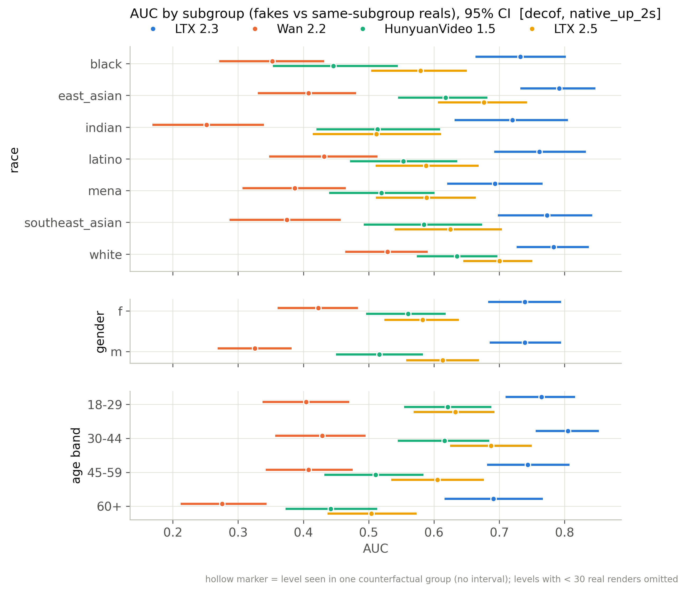

## Files

`manifest_used.csv` (every clip of the active batches with render/score/inclusion flags), `scores.csv` (score per scored clip), `tables/*.csv`, `figures/*`, `snapshot_meta.json`.

