# demamba / face512: snapshot 20261021-0617

> **Detector training data.** DeMamba weights are our own (GenVideo-100K, single-GPU adaptation of the authors' code), not an official release; the authors have published none. GenVideo-100K contains none of our generators. On GenVideo validation it flags 16.8% of real videos at 0.5.

> **Provisional threshold.** Every detection rate and flip rate below uses the detector's default threshold (0.5; sigmoid(logit) > 0.5 (training metrics and our standalone evaluator)). They will be replaced by the 5%-real-FPR threshold once reals exist (section 6.3).

## Settings

| setting           | value                                                                                  |
|:------------------|:---------------------------------------------------------------------------------------|
| detector          | demamba 1+504611ba                                                                     |
| checkpoint_sha256 | f89897c72b595aa85a524e59083919cebb0b92161d2a694a2cbffbdd8456ce17                       |
| view              | face512 (view_hash 330ecb1e37e36e82)                                                   |
| ffmpeg            | ffmpeg version 7.1.1 Copyright (c) 2000-2025 the FFmpeg developers                     |
| batches           | fake_b1, fake_b2, real_b1                                                              |
| inclusion set     | primary (technical QC pass AND face QC pass)                                           |
| bootstrap         | 1000 resamples of whole counterfactual groups, seed 20261020, 95% percentile intervals |
| git commit        | ac1140ab3053-dirty                                                                     |
| created           | 2026-10-21T06:17:45Z                                                                   |

Detector preprocessing on top of the view:

| field     | value                                                                                 |
|:----------|:--------------------------------------------------------------------------------------|
| source    | DeMamba Preprocess/video2frame.py + dataloader.py (val) + our standalone evaluator    |
| sampling  | every round(fps/target)-th frame, target 2 fps (>= 4 s) else ceil(8/dur); max 32 kept |
| window    | centre 8 consecutive sampled frames; zero-pad if fewer than 8                         |
| crop      | centre, trim 10% each side of the longer dimension                                    |
| resize    | [224, 224, 'cv2.INTER_LINEAR']                                                        |
| channels  | RGB                                                                                   |
| normalize | {'mean': [0.485, 0.456, 0.406], 'std': [0.229, 0.224, 0.225], 'max_pixel_value': 255} |
| model     | XCLIP_DeMamba (X-CLIP-B/16 vision, fine-tuned) + bidirectional Mamba, 1 logit         |
| score     | sigmoid(logit)                                                                        |
| precision | fp32, TF32 off                                                                        |
| weights   | Ahsanz/DeMamba-GenVideo100K@27468b8201fc55978bbce51450949345867de184                  |

## Coverage

| batch   | generator   |   clips |   primary |   rendered |   view_excluded |   render_failed |   scored |   score_failed |   included |
|:--------|:------------|--------:|----------:|-----------:|----------------:|----------------:|---------:|---------------:|-----------:|
| fake_b1 | hunyuan15   |     504 |       492 |        504 |               0 |               0 |      504 |              0 |        492 |
| fake_b1 | ltx23       |    2016 |      1878 |       2012 |               4 |               0 |     2012 |              0 |       1874 |
| fake_b1 | wan22       |    2016 |      1566 |       2016 |               0 |               0 |     2016 |              0 |       1566 |
| fake_b2 | hunyuan15   |     504 |       497 |        504 |               0 |               0 |      504 |              0 |        497 |
| real_b1 | real        |    1785 |      1684 |        653 |            1108 |              24 |      653 |              0 |        625 |

face512 window placement (fixed window at the median YuNet face centre, shifted inward at frame edges). The scaled frame is exactly 512 px on its short side, so every window spans it fully and is "shifted" on that axis by construction; the long-axis count is the informative one.

|   rendered |   shifted_long_axis |   shifted_short_axis |   max_shift_long_px |   excluded_no_face |
|-----------:|--------------------:|---------------------:|--------------------:|-------------------:|
|       6342 |                  63 |                 6297 |                 142 |                  4 |

Reals scored: 1306. Fakes included: 4429 of 6342 scored (0 scoring failures).

## Observations

- LTX 2.3: mean score 0.978 [0.960, 0.992], median 1.000, n = 1874.
- Wan 2.2: mean score 1.000 [1.000, 1.000], median 1.000, n = 1566.
- HunyuanVideo 1.5: mean score 0.999 [0.999, 1.000], median 1.000, n = 989.
- Provisional detection rate (score >= 0.5), LTX 2.3: 98.7% [97.5, 99.7].
- Provisional detection rate (score >= 0.5), Wan 2.2: 100.0% [100.0, 100.0].
- Provisional detection rate (score >= 0.5), HunyuanVideo 1.5: 100.0% [100.0, 100.0].
- Provisional detection rate (score >= 0.5), all: 99.4% [98.9, 99.9].
- Largest race score gap: LTX 2.3 0.058 [0.024, 0.098] (mena 0.993 vs east_asian 0.935).
- Largest gender score gap: LTX 2.3 0.008 [0.000, 0.026] (m 0.982 vs f 0.974).
- Largest age band score gap: LTX 2.3 0.026 [0.008, 0.049] (60+ 0.994 vs 18-29 0.968).
- Largest cell score gap: LTX 2.3 0.113 [0.050, 0.206] (white__m__60+ 1.000 vs east_asian__f__18-29 0.887).
- Largest scene-factor gap (all generators): behavior 0.035 [0.014, 0.078] (smile vs turn).
- Largest partial eta squared: lighting 0.030, behavior 0.027, generator 0.026; residual holds 87.1% of total SS.
- CF spread, LTX 2.3: 0.042 [0.018, 0.068] over 36 groups (max 0.272).
- CF spread, Wan 2.2: 0.000 [0.000, 0.000] over 36 groups (max 0.003).
- CF spread, HunyuanVideo 1.5: 0.003 [0.001, 0.005] over 18 groups (max 0.020).
- Provisional flip rate, LTX 2.3: 16.7% of 36 groups [5.6, 30.6].
- Provisional flip rate, Wan 2.2: 0.0% of 36 groups [0.0, 0.0].
- Provisional flip rate, HunyuanVideo 1.5: 0.0% of 18 groups [0.0, 0.0].

## 6.1 Fakes only, no threshold

### Mean score by generator

| generator   |    n |   n_groups |   estimate |   ci_lo |   ci_hi |    sd |   median |   q05 |   q95 |
|:------------|-----:|-----------:|-----------:|--------:|--------:|------:|---------:|------:|------:|
| ltx23       | 1874 |         36 |      0.978 |   0.96  |   0.992 | 0.1   |        1 | 0.909 |     1 |
| wan22       | 1566 |         36 |      1     |   1     |   1     | 0.001 |        1 | 1     |     1 |
| hunyuan15   |  989 |         18 |      0.999 |   0.999 |   1     | 0.006 |        1 | 0.999 |     1 |
| all         | 4429 |         36 |      0.99  |   0.983 |   0.996 | 0.066 |        1 | 0.988 |     1 |

### Mean score by race

| generator   | level           |   n |   estimate |   ci_lo |   ci_hi |   median |
|:------------|:----------------|----:|-----------:|--------:|--------:|---------:|
| ltx23       | black           | 272 |      0.988 |   0.973 |   0.999 |    1     |
| ltx23       | east_asian      | 270 |      0.935 |   0.889 |   0.973 |    0.999 |
| ltx23       | indian          | 277 |      0.99  |   0.978 |   0.999 |    1     |
| ltx23       | latino          | 262 |      0.992 |   0.984 |   0.999 |    1     |
| ltx23       | mena            | 266 |      0.993 |   0.985 |   0.999 |    1     |
| ltx23       | southeast_asian | 271 |      0.957 |   0.924 |   0.983 |    1     |
| ltx23       | white           | 256 |      0.991 |   0.979 |   0.999 |    1     |
| wan22       | black           | 217 |      1     |   1     |   1     |    1     |
| wan22       | east_asian      | 226 |      1     |   0.999 |   1     |    1     |
| wan22       | indian          | 230 |      1     |   1     |   1     |    1     |
| wan22       | latino          | 219 |      1     |   1     |   1     |    1     |
| wan22       | mena            | 225 |      1     |   1     |   1     |    1     |
| wan22       | southeast_asian | 229 |      1     |   1     |   1     |    1     |
| wan22       | white           | 220 |      1     |   1     |   1     |    1     |
| hunyuan15   | black           | 141 |      1     |   0.999 |   1     |    1     |
| hunyuan15   | east_asian      | 141 |      0.997 |   0.994 |   0.999 |    1     |
| hunyuan15   | indian          | 142 |      1     |   0.999 |   1     |    1     |
| hunyuan15   | latino          | 142 |      1     |   1     |   1     |    1     |
| hunyuan15   | mena            | 139 |      1     |   1     |   1     |    1     |
| hunyuan15   | southeast_asian | 143 |      0.999 |   0.998 |   1     |    1     |
| hunyuan15   | white           | 141 |      1     |   1     |   1     |    1     |
| all         | black           | 630 |      0.995 |   0.988 |   0.999 |    1     |
| all         | east_asian      | 637 |      0.972 |   0.951 |   0.988 |    1     |
| all         | indian          | 649 |      0.995 |   0.991 |   0.999 |    1     |
| all         | latino          | 623 |      0.997 |   0.993 |   0.999 |    1     |
| all         | mena            | 630 |      0.997 |   0.994 |   1     |    1     |
| all         | southeast_asian | 643 |      0.982 |   0.967 |   0.993 |    1     |
| all         | white           | 617 |      0.996 |   0.991 |   1     |    1     |

### Mean score by gender

| generator   | level   |    n |   estimate |   ci_lo |   ci_hi |   median |
|:------------|:--------|-----:|-----------:|--------:|--------:|---------:|
| ltx23       | f       |  931 |      0.974 |   0.95  |   0.993 |        1 |
| ltx23       | m       |  943 |      0.982 |   0.969 |   0.993 |        1 |
| wan22       | f       |  785 |      1     |   1     |   1     |        1 |
| wan22       | m       |  781 |      1     |   1     |   1     |        1 |
| hunyuan15   | f       |  495 |      0.999 |   0.998 |   1     |        1 |
| hunyuan15   | m       |  494 |      0.999 |   0.999 |   1     |        1 |
| all         | f       | 2211 |      0.989 |   0.979 |   0.997 |        1 |
| all         | m       | 2218 |      0.992 |   0.987 |   0.997 |        1 |

### Mean score by age band

| generator   | level   |    n |   estimate |   ci_lo |   ci_hi |   median |
|:------------|:--------|-----:|-----------:|--------:|--------:|---------:|
| ltx23       | 18-29   |  468 |      0.968 |   0.941 |   0.989 |        1 |
| ltx23       | 30-44   |  470 |      0.976 |   0.954 |   0.992 |        1 |
| ltx23       | 45-59   |  478 |      0.974 |   0.954 |   0.991 |        1 |
| ltx23       | 60+     |  458 |      0.994 |   0.99  |   0.997 |        1 |
| wan22       | 18-29   |  388 |      1     |   1     |   1     |        1 |
| wan22       | 30-44   |  377 |      1     |   1     |   1     |        1 |
| wan22       | 45-59   |  398 |      1     |   1     |   1     |        1 |
| wan22       | 60+     |  403 |      1     |   1     |   1     |        1 |
| hunyuan15   | 18-29   |  242 |      0.999 |   0.997 |   1     |        1 |
| hunyuan15   | 30-44   |  248 |      0.999 |   0.997 |   1     |        1 |
| hunyuan15   | 45-59   |  250 |      1     |   1     |   1     |        1 |
| hunyuan15   | 60+     |  249 |      1     |   1     |   1     |        1 |
| all         | 18-29   | 1098 |      0.986 |   0.974 |   0.995 |        1 |
| all         | 30-44   | 1095 |      0.989 |   0.98  |   0.996 |        1 |
| all         | 45-59   | 1126 |      0.989 |   0.98  |   0.996 |        1 |
| all         | 60+     | 1110 |      0.997 |   0.996 |   0.999 |        1 |

### Mean score by scene factor (all generators pooled)

| factor           | level      |    n |   estimate |   ci_lo |   ci_hi |
|:-----------------|:-----------|-----:|-----------:|--------:|--------:|
| setting          | cafe       |  375 |      0.998 |   0.996 |   0.999 |
| setting          | classroom  |  373 |      1     |   0.999 |   1     |
| setting          | corridor   |  493 |      0.995 |   0.985 |   1     |
| setting          | kitchen    |  441 |      0.976 |   0.914 |   1     |
| setting          | library    |  532 |      0.984 |   0.951 |   1     |
| setting          | livingroom |  530 |      0.999 |   0.997 |   1     |
| setting          | lobby      |  345 |      0.969 |   0.935 |   1     |
| setting          | office     |  357 |      0.977 |   0.929 |   1     |
| setting          | plainwall  |  553 |      0.999 |   0.997 |   1     |
| setting          | studio     |  430 |      1     |   0.999 |   1     |
| lighting         | backlit    |  786 |      0.998 |   0.995 |   1     |
| lighting         | harsh      |  632 |      0.985 |   0.956 |   1     |
| lighting         | lowlight   |  784 |      0.965 |   0.935 |   0.992 |
| lighting         | overcast   |  692 |      0.996 |   0.989 |   1     |
| lighting         | softwindow |  821 |      1     |   1     |   1     |
| lighting         | warmlamp   |  714 |      0.998 |   0.996 |   1     |
| behavior         | laugh      |  498 |      0.989 |   0.962 |   1     |
| behavior         | listen     |  679 |      0.998 |   0.996 |   1     |
| behavior         | pause      |  520 |      1     |   0.998 |   1     |
| behavior         | read       |  576 |      0.997 |   0.992 |   1     |
| behavior         | smile      |  538 |      1     |   1     |   1     |
| behavior         | speak      |  530 |      0.994 |   0.986 |   1     |
| behavior         | think      |  508 |      0.98  |   0.935 |   1     |
| behavior         | turn       |  580 |      0.965 |   0.922 |   0.994 |
| camera           | slowsway   | 2224 |      0.987 |   0.976 |   0.997 |
| camera           | static     | 2205 |      0.994 |   0.985 |   1     |
| duration_nominal | 5.0        | 2226 |      0.995 |   0.989 |   0.999 |
| duration_nominal | 6.0        | 2203 |      0.986 |   0.972 |   0.997 |

Per-generator scene-factor and 56-cell rows: `tables/score_by_breakdown.csv`.

### Subgroup gap (max - min of level means)

A gap is max - min, so it is never negative and its interval cannot include 0; it is a size, not a test of a difference. Over many levels with few clips each (56 cells; HunyuanVideo has 9 groups per cell) the gap also grows with noise, so compare it with the per-level intervals in `tables/score_by_breakdown.csv`. Levels seen in a single counterfactual group have no interval.

| generator   | attribute        |   n_levels |   gap |   ci_lo |   ci_hi | max_level       | min_level            |
|:------------|:-----------------|-----------:|------:|--------:|--------:|:----------------|:---------------------|
| ltx23       | race             |          7 | 0.058 |   0.024 |   0.098 | mena            | east_asian           |
| ltx23       | gender           |          2 | 0.008 |   0     |   0.026 | m               | f                    |
| ltx23       | age_band         |          4 | 0.026 |   0.008 |   0.049 | 60+             | 18-29                |
| ltx23       | cell             |         56 | 0.113 |   0.05  |   0.206 | white__m__60+   | east_asian__f__18-29 |
| ltx23       | setting          |         10 | 0.063 |   0.034 |   0.176 | classroom       | lobby                |
| ltx23       | lighting         |          6 | 0.085 |   0.033 |   0.146 | softwindow      | lowlight             |
| ltx23       | behavior         |          8 | 0.072 |   0.033 |   0.176 | smile           | turn                 |
| ltx23       | camera           |          2 | 0.015 |   0.001 |   0.045 | static          | slowsway             |
| ltx23       | duration_nominal |          2 | 0.019 |   0.001 |   0.049 | 5.0             | 6.0                  |
| wan22       | race             |          7 | 0     |   0     |   0.001 | white           | east_asian           |
| wan22       | gender           |          2 | 0     |   0     |   0     | m               | f                    |
| wan22       | age_band         |          4 | 0     |   0     |   0     | 60+             | 18-29                |
| wan22       | cell             |         56 | 0.001 |   0     |   0.002 | white__f__60+   | east_asian__f__30-44 |
| wan22       | setting          |         10 | 0     |   0     |   0.001 | studio          | classroom            |
| wan22       | lighting         |          6 | 0     |   0     |   0.001 | warmlamp        | overcast             |
| wan22       | behavior         |          8 | 0     |   0     |   0.001 | smile           | turn                 |
| wan22       | camera           |          2 | 0     |   0     |   0     | slowsway        | static               |
| wan22       | duration_nominal |          2 | 0     |   0     |   0     | 5.0             | 6.0                  |
| hunyuan15   | race             |          7 | 0.003 |   0.001 |   0.006 | white           | east_asian           |
| hunyuan15   | gender           |          2 | 0     |   0     |   0.001 | m               | f                    |
| hunyuan15   | age_band         |          4 | 0.001 |   0     |   0.003 | 45-59           | 18-29                |
| hunyuan15   | cell             |         56 | 0.011 |   0.002 |   0.025 | white__m__30-44 | east_asian__f__18-29 |
| hunyuan15   | setting          |         10 | 0.003 |   0.001 |   0.006 | lobby           | office               |
| hunyuan15   | lighting         |          6 | 0.002 |   0     |   0.006 | backlit         | harsh                |
| hunyuan15   | behavior         |          8 | 0.003 |   0.001 |   0.006 | smile           | turn                 |
| hunyuan15   | camera           |          2 | 0.001 |   0     |   0.002 | static          | slowsway             |
| hunyuan15   | duration_nominal |          2 | 0     |   0     |   0.001 | 5.0             | 6.0                  |
| all         | race             |          7 | 0.025 |   0.011 |   0.044 | mena            | east_asian           |
| all         | gender           |          2 | 0.003 |   0     |   0.011 | m               | f                    |
| all         | age_band         |          4 | 0.011 |   0.004 |   0.021 | 60+             | 18-29                |
| all         | cell             |         56 | 0.049 |   0.023 |   0.089 | white__m__60+   | east_asian__f__18-29 |
| all         | setting          |         10 | 0.031 |   0.015 |   0.086 | studio          | lobby                |
| all         | lighting         |          6 | 0.035 |   0.015 |   0.066 | softwindow      | lowlight             |
| all         | behavior         |          8 | 0.035 |   0.014 |   0.078 | smile           | turn                 |
| all         | camera           |          2 | 0.007 |   0     |   0.021 | static          | slowsway             |
| all         | duration_nominal |          2 | 0.009 |   0     |   0.023 | 5.0             | 6.0                  |

### CF spread (mean over groups of the std of score across the group's cells)

| generator   |   n_groups |   cf_spread |   ci_lo |   ci_hi |   median |   max |
|:------------|-----------:|------------:|--------:|--------:|---------:|------:|
| ltx23       |         36 |       0.042 |   0.018 |   0.068 |    0.002 | 0.272 |
| wan22       |         36 |       0     |   0     |   0     |    0     | 0.003 |
| hunyuan15   |         18 |       0.003 |   0.001 |   0.005 |    0     | 0.02  |

### Factor attribution

OLS with every factor as a fixed effect, type-II ANOVA. `ss_share` is the factor's type-II sum of squares over the total sum of squares (type-II shares need not add to 1). Scene factors are constant within a counterfactual group, so their effects are estimated from between-group differences only. The OLS F tests treat clips as independent although clips are clustered in counterfactual groups, so their p values are optimistic; use the group-bootstrap intervals above for inference.

| factor           |   df |    sum_sq | F      | p         | partial_eta2   |   ss_share |
|:-----------------|-----:|----------:|:-------|:----------|:---------------|-----------:|
| race             |    6 |  0.3875   | 16.78  | 3.08e-19  | 0.0224         |  0.01995   |
| gender           |    1 |  0.009925 | 2.578  | 0.1084    | 0.0005865      |  0.000511  |
| age_band         |    3 |  0.07813  | 6.765  | 0.0001506 | 0.004599       |  0.004023  |
| setting          |    9 |  0.3122   | 9.011  | 1.329e-13 | 0.01813        |  0.01608   |
| lighting         |    5 |  0.5187   | 26.95  | 6.215e-27 | 0.02976        |  0.0267    |
| behavior         |    7 |  0.4651   | 17.26  | 1.094e-22 | 0.02677        |  0.02395   |
| camera           |    1 |  0.00344  | 0.8936 | 0.3446    | 0.0002034      |  0.0001771 |
| duration_nominal |    1 |  0.001954 | 0.5075 | 0.4763    | 0.0001155      |  0.0001006 |
| generator        |    2 |  0.4456   | 57.87  | 1.553e-25 | 0.02567        |  0.02294   |
| Residual         | 4393 | 16.91     |        |           |                |  0.8707    |

Lighting x race interaction (added to the same OLS):

| term            |   df |   sum_sq |     F |         p |   partial_eta2 |
|:----------------|-----:|---------:|------:|----------:|---------------:|
| lighting x race |   30 |   0.7056 | 6.332 | 1.588e-24 |        0.04172 |

Mixed model `score ~ factors + (1 | counterfactual_group)` (REML) variance components (fixed effects: `tables/factor_mixed_fixed.csv`):

| component                               |   variance | converged   |
|:----------------------------------------|-----------:|:------------|
| counterfactual_group (random intercept) |   0        | True        |
| residual                                |   0.003755 | True        |
| ICC (group share of random variance)    |   0        | True        |

A group variance at or near 0 is a boundary estimate: setting, lighting, behavior, camera and duration are fixed per group and absorb most between-group variation, leaving little for the random intercept. It does not mean scenes do not matter.

## 6.2 Provisional (threshold 0.5, provisional)

### Detection rate by generator (provisional)

| generator   |    n |   estimate |   ci_lo |   ci_hi |
|:------------|-----:|-----------:|--------:|--------:|
| ltx23       | 1874 |      0.987 |   0.975 |   0.997 |
| wan22       | 1566 |      1     |   1     |   1     |
| hunyuan15   |  989 |      1     |   1     |   1     |
| all         | 4429 |      0.994 |   0.989 |   0.999 |

### Detection rate by race (provisional)

| generator   | level           |   n |   estimate |   ci_lo |   ci_hi |
|:------------|:----------------|----:|-----------:|--------:|--------:|
| ltx23       | black           | 272 |      0.993 |   0.982 |   1     |
| ltx23       | east_asian      | 270 |      0.952 |   0.906 |   0.989 |
| ltx23       | indian          | 277 |      1     |   1     |   1     |
| ltx23       | latino          | 262 |      1     |   1     |   1     |
| ltx23       | mena            | 266 |      1     |   1     |   1     |
| ltx23       | southeast_asian | 271 |      0.97  |   0.944 |   0.993 |
| ltx23       | white           | 256 |      0.992 |   0.981 |   1     |
| wan22       | black           | 217 |      1     |   1     |   1     |
| wan22       | east_asian      | 226 |      1     |   1     |   1     |
| wan22       | indian          | 230 |      1     |   1     |   1     |
| wan22       | latino          | 219 |      1     |   1     |   1     |
| wan22       | mena            | 225 |      1     |   1     |   1     |
| wan22       | southeast_asian | 229 |      1     |   1     |   1     |
| wan22       | white           | 220 |      1     |   1     |   1     |
| hunyuan15   | black           | 141 |      1     |   1     |   1     |
| hunyuan15   | east_asian      | 141 |      1     |   1     |   1     |
| hunyuan15   | indian          | 142 |      1     |   1     |   1     |
| hunyuan15   | latino          | 142 |      1     |   1     |   1     |
| hunyuan15   | mena            | 139 |      1     |   1     |   1     |
| hunyuan15   | southeast_asian | 143 |      1     |   1     |   1     |
| hunyuan15   | white           | 141 |      1     |   1     |   1     |
| all         | black           | 630 |      0.997 |   0.992 |   1     |
| all         | east_asian      | 637 |      0.98  |   0.96  |   0.995 |
| all         | indian          | 649 |      1     |   1     |   1     |
| all         | latino          | 623 |      1     |   1     |   1     |
| all         | mena            | 630 |      1     |   1     |   1     |
| all         | southeast_asian | 643 |      0.988 |   0.976 |   0.997 |
| all         | white           | 617 |      0.997 |   0.992 |   1     |

### Detection rate by gender (provisional)

| generator   | level   |    n |   estimate |   ci_lo |   ci_hi |
|:------------|:--------|-----:|-----------:|--------:|--------:|
| ltx23       | f       |  931 |      0.984 |   0.966 |   0.998 |
| ltx23       | m       |  943 |      0.989 |   0.979 |   0.998 |
| wan22       | f       |  785 |      1     |   1     |   1     |
| wan22       | m       |  781 |      1     |   1     |   1     |
| hunyuan15   | f       |  495 |      1     |   1     |   1     |
| hunyuan15   | m       |  494 |      1     |   1     |   1     |
| all         | f       | 2211 |      0.993 |   0.986 |   0.999 |
| all         | m       | 2218 |      0.995 |   0.991 |   0.999 |

### Detection rate by age band (provisional)

| generator   | level   |    n |   estimate |   ci_lo |   ci_hi |
|:------------|:--------|-----:|-----------:|--------:|--------:|
| ltx23       | 18-29   |  468 |      0.976 |   0.953 |   0.996 |
| ltx23       | 30-44   |  470 |      0.989 |   0.975 |   1     |
| ltx23       | 45-59   |  478 |      0.983 |   0.968 |   0.996 |
| ltx23       | 60+     |  458 |      0.998 |   0.993 |   1     |
| wan22       | 18-29   |  388 |      1     |   1     |   1     |
| wan22       | 30-44   |  377 |      1     |   1     |   1     |
| wan22       | 45-59   |  398 |      1     |   1     |   1     |
| wan22       | 60+     |  403 |      1     |   1     |   1     |
| hunyuan15   | 18-29   |  242 |      1     |   1     |   1     |
| hunyuan15   | 30-44   |  248 |      1     |   1     |   1     |
| hunyuan15   | 45-59   |  250 |      1     |   1     |   1     |
| hunyuan15   | 60+     |  249 |      1     |   1     |   1     |
| all         | 18-29   | 1098 |      0.99  |   0.98  |   0.998 |
| all         | 30-44   | 1095 |      0.995 |   0.989 |   1     |
| all         | 45-59   | 1126 |      0.993 |   0.986 |   0.998 |
| all         | 60+     | 1110 |      0.999 |   0.997 |   1     |

### Detection-rate gap (provisional)

| generator   | attribute        |   gap |   ci_lo |   ci_hi | max_level       | min_level            |
|:------------|:-----------------|------:|--------:|--------:|:----------------|:---------------------|
| ltx23       | race             | 0.048 |   0.012 |   0.094 | indian          | east_asian           |
| ltx23       | gender           | 0.006 |   0     |   0.021 | m               | f                    |
| ltx23       | age_band         | 0.021 |   0.006 |   0.045 | 60+             | 18-29                |
| ltx23       | cell             | 0.094 |   0.033 |   0.219 | black__f__30-44 | east_asian__f__18-29 |
| ltx23       | setting          | 0.042 |   0.022 |   0.109 | cafe            | kitchen              |
| ltx23       | lighting         | 0.059 |   0.022 |   0.1   | backlit         | lowlight             |
| ltx23       | behavior         | 0.04  |   0.018 |   0.109 | listen          | turn                 |
| ltx23       | camera           | 0.009 |   0     |   0.03  | static          | slowsway             |
| ltx23       | duration_nominal | 0.008 |   0     |   0.029 | 5.0             | 6.0                  |
| wan22       | race             | 0     |   0     |   0     | black           | black                |
| wan22       | gender           | 0     |   0     |   0     | f               | f                    |
| wan22       | age_band         | 0     |   0     |   0     | 18-29           | 18-29                |
| wan22       | cell             | 0     |   0     |   0     | black__f__18-29 | black__f__18-29      |
| wan22       | setting          | 0     |   0     |   0     | cafe            | cafe                 |
| wan22       | lighting         | 0     |   0     |   0     | backlit         | backlit              |
| wan22       | behavior         | 0     |   0     |   0     | laugh           | laugh                |
| wan22       | camera           | 0     |   0     |   0     | slowsway        | slowsway             |
| wan22       | duration_nominal | 0     |   0     |   0     | 5.0             | 5.0                  |
| hunyuan15   | race             | 0     |   0     |   0     | black           | black                |
| hunyuan15   | gender           | 0     |   0     |   0     | f               | f                    |
| hunyuan15   | age_band         | 0     |   0     |   0     | 18-29           | 18-29                |
| hunyuan15   | cell             | 0     |   0     |   0     | black__f__18-29 | black__f__18-29      |
| hunyuan15   | setting          | 0     |   0     |   0     | cafe            | cafe                 |
| hunyuan15   | lighting         | 0     |   0     |   0     | backlit         | backlit              |
| hunyuan15   | behavior         | 0     |   0     |   0     | laugh           | laugh                |
| hunyuan15   | camera           | 0     |   0     |   0     | slowsway        | slowsway             |
| hunyuan15   | duration_nominal | 0     |   0     |   0     | 5.0             | 5.0                  |
| all         | race             | 0.02  |   0.005 |   0.04  | indian          | east_asian           |
| all         | gender           | 0.002 |   0     |   0.008 | m               | f                    |
| all         | age_band         | 0.009 |   0.003 |   0.02  | 60+             | 18-29                |
| all         | cell             | 0.039 |   0.013 |   0.095 | black__f__30-44 | east_asian__m__45-59 |
| all         | setting          | 0.017 |   0.01  |   0.057 | cafe            | lobby                |
| all         | lighting         | 0.024 |   0.01  |   0.046 | backlit         | lowlight             |
| all         | behavior         | 0.019 |   0.008 |   0.051 | listen          | turn                 |
| all         | camera           | 0.004 |   0     |   0.013 | static          | slowsway             |
| all         | duration_nominal | 0.004 |   0     |   0.014 | 5.0             | 6.0                  |

### Flip rate (provisional): share of groups whose clips get different decisions

| generator   |   n_groups |   flip_rate |   ci_lo |   ci_hi |   median |   max |
|:------------|-----------:|------------:|--------:|--------:|---------:|------:|
| ltx23       |         36 |       0.167 |   0.056 |   0.306 |        0 |     1 |
| wan22       |         36 |       0     |   0     |   0     |        0 |     0 |
| hunyuan15   |         18 |       0     |   0     |   0     |        0 |     0 |

### Sensitivity: inclusion set

| set     | generator   |    n |   mean_score |   provisional_detection_rate |
|:--------|:------------|-----:|-------------:|-----------------------------:|
| all     | hunyuan15   | 1008 |        0.999 |                        1     |
| all     | ltx23       | 2012 |        0.979 |                        0.988 |
| all     | wan22       | 2016 |        1     |                        1     |
| primary | hunyuan15   |  989 |        0.999 |                        1     |
| primary | ltx23       | 1874 |        0.978 |                        0.987 |
| primary | wan22       | 1566 |        1     |                        1     |

## 6.3 Real vs generated (calibrated threshold 0.9998)

The threshold is the score at which 5% of primary real renders (24 and 16 fps pooled) are flagged; one per detector and view, never per subgroup. Each generator is compared with reals rendered at its own fps. Intervals: fakes resample counterfactual groups, reals resample identity clusters (source video). Real labels are perceived (FairFace), not self-reported.

### Calibration

| scope            |   n_renders |   n_sources |   n_identities |   threshold |    fpr |
|:-----------------|------------:|------------:|---------------:|------------:|-------:|
| all real renders |        1250 |         625 |            559 |      0.9998 | 0.0504 |
| 16 fps renders   |         625 |         625 |            559 |      0.9998 | 0.0544 |
| 24 fps renders   |         625 |         625 |            559 |      0.9998 | 0.0464 |

### AUC, AP, EER, TPR at 5% FPR

| generator   | real_fps   |   n_fake |   n_real |   auc |   auc_ci_lo |   auc_ci_hi |    ap |   eer |   tpr_at_5fpr |   detection_rate_global_thr |   det_ci_lo |   det_ci_hi |
|:------------|:-----------|---------:|---------:|------:|------------:|------------:|------:|------:|--------------:|----------------------------:|------------:|------------:|
| ltx23       | 24         |     1874 |      625 | 0.869 |       0.818 |       0.914 | 0.95  | 0.223 |         0.545 |                       0.526 |       0.419 |       0.635 |
| wan22       | 16         |     1566 |      625 | 0.982 |       0.973 |       0.988 | 0.992 | 0.07  |         0.907 |                       0.912 |       0.879 |       0.942 |
| hunyuan15   | 24         |      989 |      625 | 0.963 |       0.944 |       0.977 | 0.975 | 0.113 |         0.821 |                       0.811 |       0.732 |       0.879 |
| all         | 24+16      |     4429 |     1250 | 0.927 |       0.903 |       0.95  | 0.978 | 0.151 |         0.726 |                       0.726 |       0.667 |       0.788 |

### Real FPR by perceived subgroup

| attribute   | level              |   n_renders |   n_identities |   fpr |   ci_lo |   ci_hi |
|:------------|:-------------------|------------:|---------------:|------:|--------:|--------:|
| race        | black              |          78 |             37 | 0     |   0     |   0     |
| race        | east_asian         |          94 |             43 | 0.043 |   0     |   0.105 |
| race        | indian             |          34 |             17 | 0.059 |   0     |   0.2   |
| race        | latino             |          74 |             35 | 0.041 |   0     |   0.108 |
| race        | mena               |          88 |             43 | 0.023 |   0     |   0.077 |
| race        | southeast_asian    |          50 |             24 | 0.04  |   0     |   0.131 |
| race        | white              |         832 |            373 | 0.06  |   0.038 |   0.086 |
| gender      | f                  |         416 |            189 | 0.067 |   0.036 |   0.106 |
| gender      | m                  |         834 |            374 | 0.042 |   0.023 |   0.063 |
| age_band    | 18-29              |         418 |            196 | 0.065 |   0.034 |   0.103 |
| age_band    | 30-44              |         454 |            211 | 0.042 |   0.017 |   0.073 |
| age_band    | 45-59              |         202 |             93 | 0.054 |   0.019 |   0.102 |
| age_band    | 60+                |         176 |             82 | 0.034 |   0.006 |   0.078 |
| race_gender | black__f           |          14 |              7 | 0     |   0     |   0     |
| race_gender | black__m           |          64 |             31 | 0     |   0     |   0     |
| race_gender | east_asian__f      |          46 |             21 | 0.087 |   0     |   0.211 |
| race_gender | east_asian__m      |          48 |             22 | 0     |   0     |   0     |
| race_gender | indian__f          |          12 |              6 | 0     |   0     |   0     |
| race_gender | indian__m          |          22 |             11 | 0.091 |   0     |   0.333 |
| race_gender | latino__f          |          12 |              6 | 0     |   0     |   0     |
| race_gender | latino__m          |          62 |             29 | 0.048 |   0     |   0.13  |
| race_gender | mena__f            |          32 |             16 | 0     |   0     |   0     |
| race_gender | mena__m            |          56 |             27 | 0.036 |   0     |   0.12  |
| race_gender | southeast_asian__f |          16 |              7 | 0.125 |   0     |   0.429 |
| race_gender | southeast_asian__m |          34 |             17 | 0     |   0     |   0     |
| race_gender | white__f           |         284 |            128 | 0.077 |   0.038 |   0.124 |
| race_gender | white__m           |         548 |            247 | 0.051 |   0.026 |   0.079 |

### Real FPR gap (max - min across levels; non-negative by construction)

| attribute   |   n_levels |   fpr_gap |   ci_lo |   ci_hi | max_level          |   max_fpr | min_level   |   min_fpr |
|:------------|-----------:|----------:|--------:|--------:|:-------------------|----------:|:------------|----------:|
| race        |          7 |     0.06  |   0.051 |   0.207 | white              |     0.06  | black       |     0     |
| gender      |          2 |     0.025 |   0.002 |   0.066 | f                  |     0.067 | m           |     0.042 |
| age_band    |          4 |     0.031 |   0.013 |   0.086 | 18-29              |     0.065 | 60+         |     0.034 |
| race_gender |         14 |     0.125 |   0.074 |   0.429 | southeast_asian__f |     0.125 | black__f    |     0     |

### Worst-subgroup AUC and AUC gap

| generator   | attribute   |   n_levels | worst_level     |   worst_auc |   worst_ci_lo |   worst_ci_hi | best_level   |   best_auc |   auc_gap |   gap_ci_lo |   gap_ci_hi |
|:------------|:------------|-----------:|:----------------|------------:|--------------:|--------------:|:-------------|-----------:|----------:|------------:|------------:|
| ltx23       | race        |          5 | east_asian      |       0.85  |         0.763 |         0.924 | black        |      0.945 |     0.094 |       0.039 |       0.18  |
| ltx23       | gender      |          2 | f               |       0.844 |         0.778 |         0.902 | m            |      0.884 |     0.04  |       0.004 |       0.082 |
| ltx23       | age_band    |          4 | 18-29           |       0.83  |         0.768 |         0.886 | 60+          |      0.898 |     0.067 |       0.031 |       0.121 |
| ltx23       | race_gender |          4 | white__f        |       0.876 |         0.811 |         0.93  | black__m     |      0.956 |     0.081 |       0.042 |       0.139 |
| wan22       | race        |          5 | east_asian      |       0.972 |         0.94  |         0.992 | latino       |      0.998 |     0.026 |       0.007 |       0.06  |
| wan22       | gender      |          2 | f               |       0.977 |         0.963 |         0.987 | m            |      0.984 |     0.007 |       0     |       0.02  |
| wan22       | age_band    |          4 | 18-29           |       0.96  |         0.937 |         0.977 | 60+          |      0.998 |     0.038 |       0.02  |       0.06  |
| wan22       | race_gender |          4 | white__f        |       0.995 |         0.987 |         0.998 | black__m     |      1     |     0.005 |       0.002 |       0.013 |
| hunyuan15   | race        |          5 | east_asian      |       0.947 |         0.902 |         0.98  | black        |      0.99  |     0.043 |       0.015 |       0.091 |
| hunyuan15   | gender      |          2 | f               |       0.949 |         0.918 |         0.972 | m            |      0.971 |     0.022 |       0.003 |       0.047 |
| hunyuan15   | age_band    |          4 | 18-29           |       0.924 |         0.887 |         0.955 | 60+          |      0.984 |     0.06  |       0.035 |       0.098 |
| hunyuan15   | race_gender |          4 | white__f        |       0.973 |         0.949 |         0.99  | black__m     |      0.998 |     0.025 |       0.009 |       0.051 |
| all         | race        |          7 | southeast_asian |       0.904 |         0.83  |         0.936 | black        |      0.971 |     0.067 |       0.044 |       0.144 |
| all         | gender      |          2 | f               |       0.912 |         0.878 |         0.943 | m            |      0.937 |     0.025 |       0.004 |       0.051 |
| all         | age_band    |          4 | 18-29           |       0.894 |         0.857 |         0.927 | 60+          |      0.951 |     0.058 |       0.032 |       0.09  |
| all         | race_gender |          9 | east_asian__f   |       0.88  |         0.799 |         0.943 | black__m     |      0.979 |     0.099 |       0.046 |       0.186 |

### Detection rate at the calibrated threshold

| generator   |    n |   estimate |   ci_lo |   ci_hi |
|:------------|-----:|-----------:|--------:|--------:|
| ltx23       | 1874 |      0.526 |   0.419 |   0.635 |
| wan22       | 1566 |      0.912 |   0.879 |   0.942 |
| hunyuan15   |  989 |      0.811 |   0.732 |   0.879 |
| all         | 4429 |      0.726 |   0.667 |   0.788 |

#### by race

| generator   | level           |   n |   estimate |   ci_lo |   ci_hi |
|:------------|:----------------|----:|-----------:|--------:|--------:|
| ltx23       | black           | 272 |      0.599 |   0.476 |   0.715 |
| ltx23       | east_asian      | 270 |      0.304 |   0.195 |   0.425 |
| ltx23       | indian          | 277 |      0.534 |   0.408 |   0.671 |
| ltx23       | latino          | 262 |      0.634 |   0.504 |   0.755 |
| ltx23       | mena            | 266 |      0.602 |   0.483 |   0.72  |
| ltx23       | southeast_asian | 271 |      0.365 |   0.242 |   0.49  |
| ltx23       | white           | 256 |      0.656 |   0.537 |   0.772 |
| wan22       | black           | 217 |      0.899 |   0.842 |   0.95  |
| wan22       | east_asian      | 226 |      0.774 |   0.691 |   0.847 |
| wan22       | indian          | 230 |      0.952 |   0.916 |   0.985 |
| wan22       | latino          | 219 |      0.991 |   0.971 |   1     |
| wan22       | mena            | 225 |      0.987 |   0.965 |   1     |
| wan22       | southeast_asian | 229 |      0.803 |   0.727 |   0.88  |
| wan22       | white           | 220 |      0.982 |   0.95  |   1     |
| hunyuan15   | black           | 141 |      0.837 |   0.739 |   0.916 |
| hunyuan15   | east_asian      | 141 |      0.596 |   0.5   |   0.691 |
| hunyuan15   | indian          | 142 |      0.817 |   0.681 |   0.925 |
| hunyuan15   | latino          | 142 |      0.859 |   0.775 |   0.933 |
| hunyuan15   | mena            | 139 |      0.921 |   0.856 |   0.973 |
| hunyuan15   | southeast_asian | 143 |      0.727 |   0.601 |   0.836 |
| hunyuan15   | white           | 141 |      0.922 |   0.858 |   0.973 |
| all         | black           | 630 |      0.756 |   0.687 |   0.819 |
| all         | east_asian      | 637 |      0.535 |   0.456 |   0.614 |
| all         | indian          | 649 |      0.744 |   0.667 |   0.818 |
| all         | latino          | 623 |      0.811 |   0.746 |   0.872 |
| all         | mena            | 630 |      0.81  |   0.75  |   0.867 |
| all         | southeast_asian | 643 |      0.602 |   0.525 |   0.678 |
| all         | white           | 617 |      0.833 |   0.777 |   0.888 |

#### by gender

| generator   | level   |    n |   estimate |   ci_lo |   ci_hi |
|:------------|:--------|-----:|-----------:|--------:|--------:|
| ltx23       | f       |  931 |      0.52  |   0.407 |   0.64  |
| ltx23       | m       |  943 |      0.532 |   0.421 |   0.642 |
| wan22       | f       |  785 |      0.902 |   0.855 |   0.944 |
| wan22       | m       |  781 |      0.922 |   0.894 |   0.948 |
| hunyuan15   | f       |  495 |      0.772 |   0.673 |   0.857 |
| hunyuan15   | m       |  494 |      0.85  |   0.779 |   0.908 |
| all         | f       | 2211 |      0.712 |   0.646 |   0.778 |
| all         | m       | 2218 |      0.74  |   0.68  |   0.8   |

#### by age band

| generator   | level   |    n |   estimate |   ci_lo |   ci_hi |
|:------------|:--------|-----:|-----------:|--------:|--------:|
| ltx23       | 18-29   |  468 |      0.459 |   0.341 |   0.583 |
| ltx23       | 30-44   |  470 |      0.506 |   0.399 |   0.622 |
| ltx23       | 45-59   |  478 |      0.548 |   0.43  |   0.665 |
| ltx23       | 60+     |  458 |      0.592 |   0.477 |   0.71  |
| wan22       | 18-29   |  388 |      0.835 |   0.766 |   0.891 |
| wan22       | 30-44   |  377 |      0.865 |   0.811 |   0.91  |
| wan22       | 45-59   |  398 |      0.95  |   0.925 |   0.972 |
| wan22       | 60+     |  403 |      0.993 |   0.984 |   1     |
| hunyuan15   | 18-29   |  242 |      0.674 |   0.545 |   0.788 |
| hunyuan15   | 30-44   |  248 |      0.75  |   0.632 |   0.851 |
| hunyuan15   | 45-59   |  250 |      0.924 |   0.851 |   0.979 |
| hunyuan15   | 60+     |  249 |      0.892 |   0.814 |   0.957 |
| all         | 18-29   | 1098 |      0.639 |   0.562 |   0.716 |
| all         | 30-44   | 1095 |      0.685 |   0.617 |   0.756 |
| all         | 45-59   | 1126 |      0.774 |   0.71  |   0.834 |
| all         | 60+     | 1110 |      0.805 |   0.748 |   0.86  |

### Detection-rate gap at the calibrated threshold

| generator   | attribute        |   gap |   ci_lo |   ci_hi | max_level     | min_level            |
|:------------|:-----------------|------:|--------:|--------:|:--------------|:---------------------|
| ltx23       | race             | 0.353 |   0.275 |   0.449 | white         | east_asian           |
| ltx23       | gender           | 0.012 |   0.001 |   0.069 | m             | f                    |
| ltx23       | age_band         | 0.132 |   0.063 |   0.206 | 60+           | 18-29                |
| ltx23       | cell             | 0.571 |   0.528 |   0.782 | white__m__60+ | east_asian__m__45-59 |
| ltx23       | setting          | 0.525 |   0.481 |   1     | livingroom    | library              |
| ltx23       | lighting         | 0.736 |   0.59  |   0.934 | softwindow    | lowlight             |
| ltx23       | behavior         | 0.769 |   0.587 |   0.959 | smile         | turn                 |
| ltx23       | camera           | 0.213 |   0.031 |   0.411 | static        | slowsway             |
| ltx23       | duration_nominal | 0.075 |   0.004 |   0.294 | 5.0           | 6.0                  |
| wan22       | race             | 0.217 |   0.15  |   0.292 | latino        | east_asian           |
| wan22       | gender           | 0.02  |   0.001 |   0.058 | m             | f                    |
| wan22       | age_band         | 0.158 |   0.103 |   0.223 | 60+           | 18-29                |
| wan22       | cell             | 0.517 |   0.375 |   0.704 | black__f__60+ | east_asian__m__18-29 |
| wan22       | setting          | 0.165 |   0.121 |   0.465 | studio        | classroom            |
| wan22       | lighting         | 0.163 |   0.066 |   0.313 | warmlamp      | overcast             |
| wan22       | behavior         | 0.222 |   0.133 |   0.381 | laugh         | turn                 |
| wan22       | camera           | 0.017 |   0.002 |   0.081 | static        | slowsway             |
| wan22       | duration_nominal | 0.047 |   0.004 |   0.103 | 5.0           | 6.0                  |
| hunyuan15   | race             | 0.326 |   0.265 |   0.407 | white         | east_asian           |
| hunyuan15   | gender           | 0.078 |   0.026 |   0.134 | m             | f                    |
| hunyuan15   | age_band         | 0.25  |   0.174 |   0.353 | 45-59         | 18-29                |
| hunyuan15   | cell             | 0.765 |   0.619 |   0.945 | black__m__60+ | east_asian__m__18-29 |
| hunyuan15   | setting          | 0.259 |   0.196 |   0.571 | lobby         | library              |
| hunyuan15   | lighting         | 0.239 |   0.132 |   0.56  | backlit       | harsh                |
| hunyuan15   | behavior         | 0.33  |   0.195 |   0.596 | smile         | turn                 |
| hunyuan15   | camera           | 0.054 |   0.004 |   0.204 | static        | slowsway             |
| hunyuan15   | duration_nominal | 0.07  |   0.004 |   0.233 | 6.0           | 5.0                  |
| all         | race             | 0.298 |   0.246 |   0.352 | white         | east_asian           |
| all         | gender           | 0.028 |   0.002 |   0.062 | m             | f                    |
| all         | age_band         | 0.165 |   0.114 |   0.226 | 60+           | 18-29                |
| all         | cell             | 0.579 |   0.484 |   0.724 | black__m__60+ | east_asian__m__18-29 |
| all         | setting          | 0.291 |   0.278 |   0.659 | livingroom    | office               |
| all         | lighting         | 0.324 |   0.241 |   0.513 | softwindow    | lowlight             |
| all         | behavior         | 0.501 |   0.386 |   0.635 | smile         | turn                 |
| all         | camera           | 0.111 |   0.014 |   0.229 | static        | slowsway             |
| all         | duration_nominal | 0.056 |   0.004 |   0.177 | 5.0           | 6.0                  |

### Flip rate at the calibrated threshold

| generator   |   n_groups |   flip_rate |   ci_lo |   ci_hi |   median |   max |
|:------------|-----------:|------------:|--------:|--------:|---------:|------:|
| ltx23       |         36 |       0.861 |   0.75  |   0.972 |        1 |     1 |
| wan22       |         36 |       0.694 |   0.528 |   0.834 |        1 |     1 |
| hunyuan15   |         18 |       0.944 |   0.824 |   1     |        1 |     1 |

## Figures

**Score distribution by generator.** (`figures/score_distribution_by_generator.pdf`)

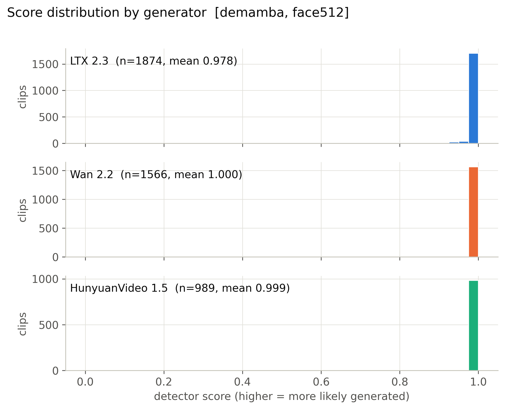

**Mean score, 56 cells x generator.** (`figures/heatmap_mean_score_cells.pdf`)

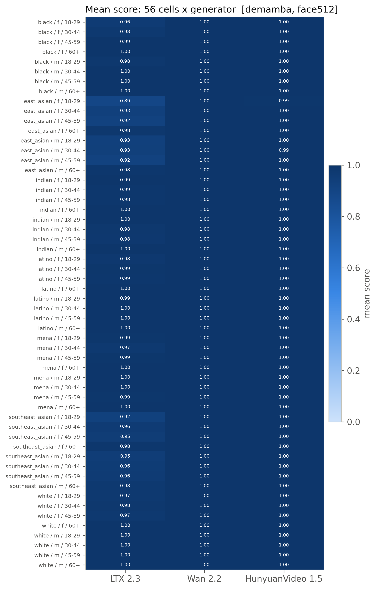

**Detection rate, 56 cells x generator (provisional threshold).** (`figures/heatmap_detection_rate_cells_provisional.pdf`)

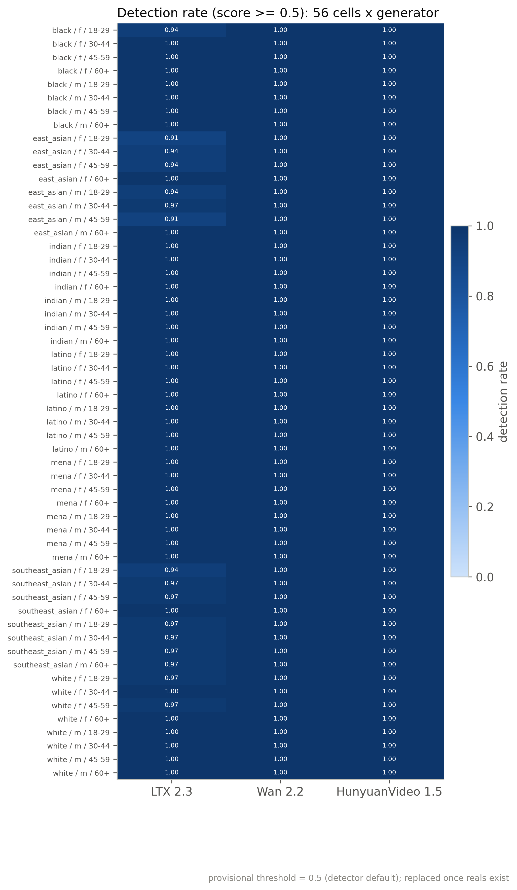

**Mean score by race, gender, age band with 95% CI.** (`figures/subgroup_mean_score.pdf`)

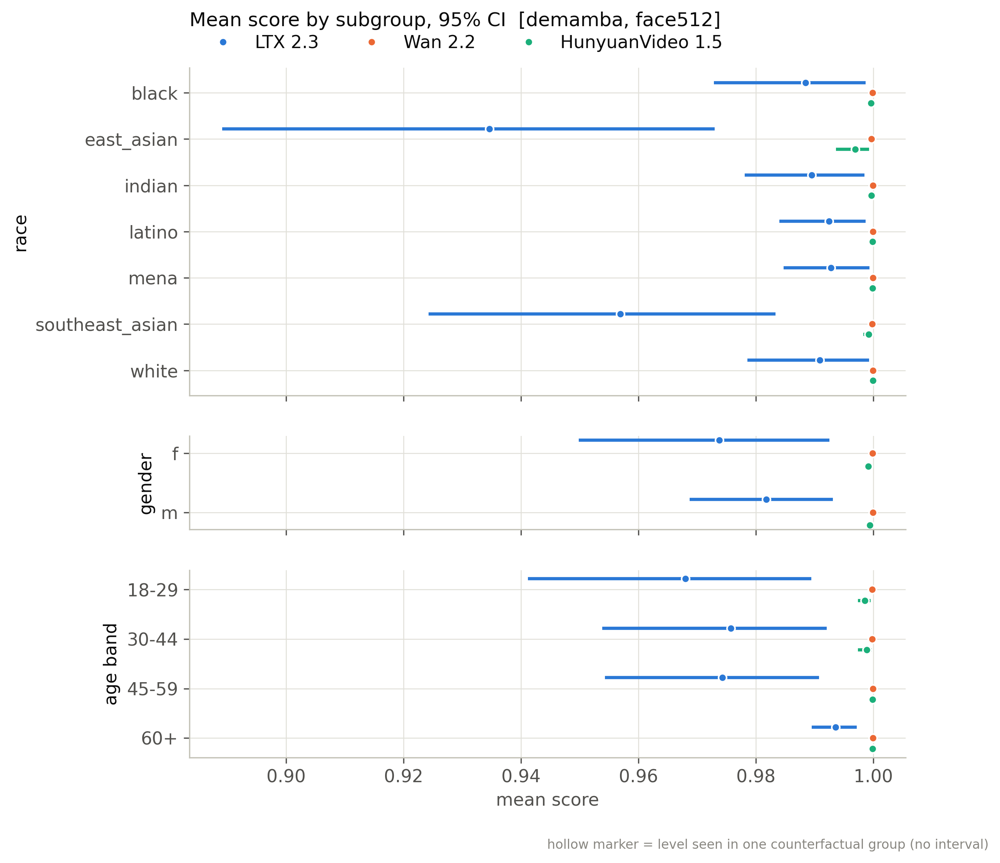

**Mean score by scene factor with 95% CI.** (`figures/scene_factor_mean_score.pdf`)

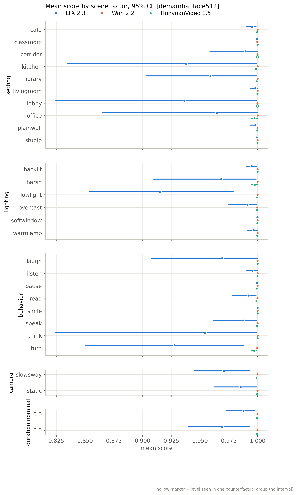

**Detection rate by subgroup (provisional threshold).** (`figures/subgroup_detection_rate_provisional.pdf`)

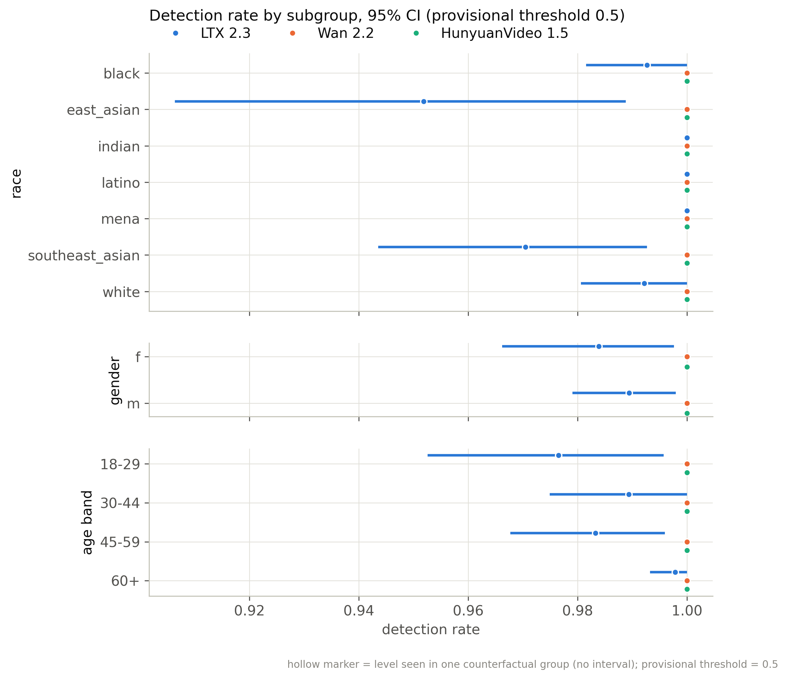

**Distribution of per-group CF spread.** (`figures/cf_spread_distribution.pdf`)

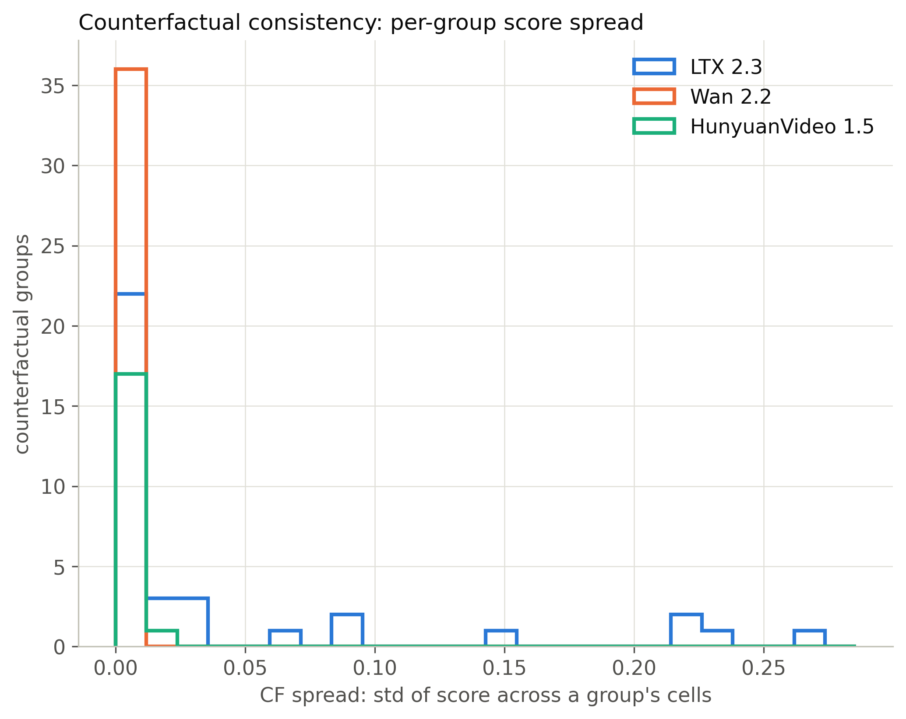

**Flip rate by generator (provisional threshold).** (`figures/flip_rate_by_generator_provisional.pdf`)

**Partial eta squared by factor.** (`figures/factor_attribution_variance_share.pdf`)

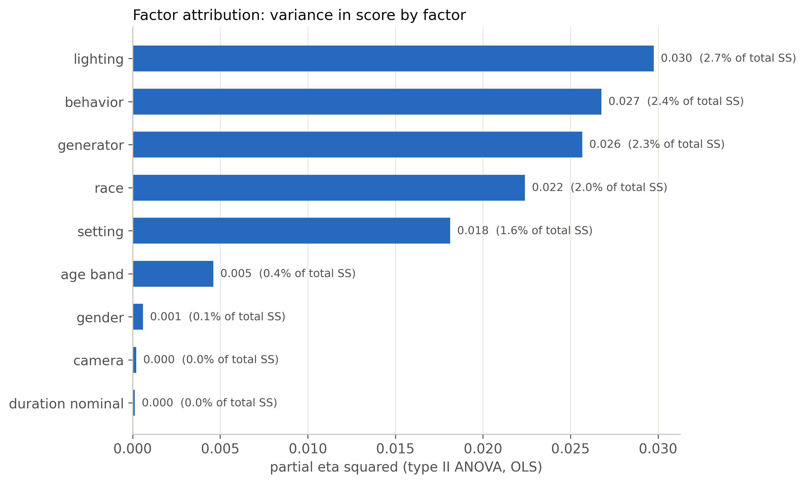

**Highest- and lowest-scoring included clips.** (`figures/example_strip.pdf`)

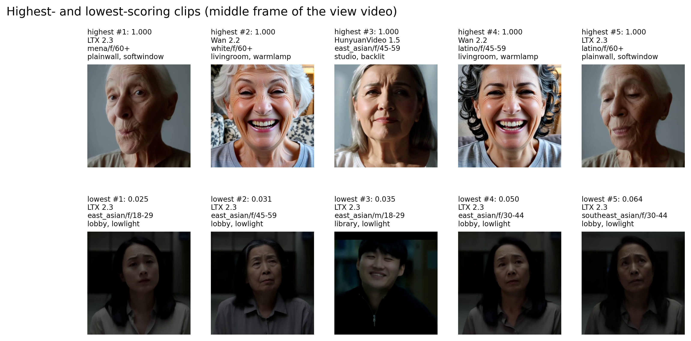

**ROC per generator against fps-matched reals.** (`figures/roc_per_generator.pdf`)

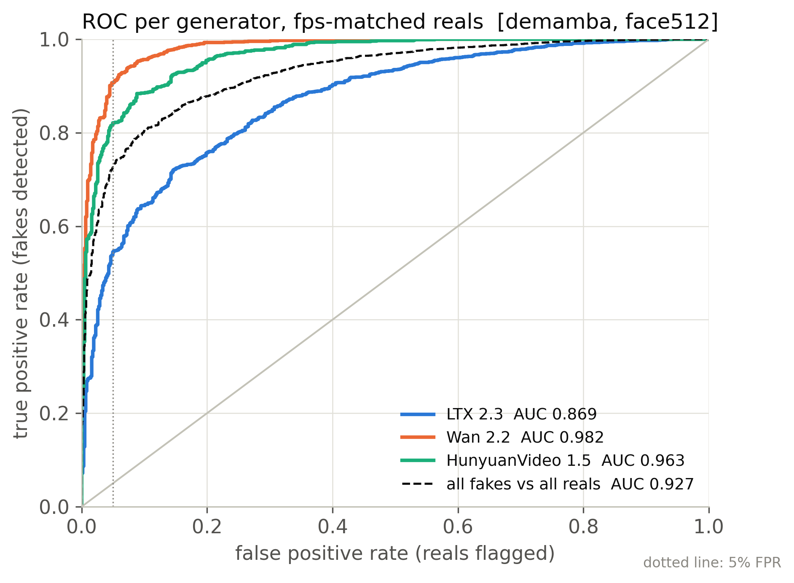

**Real FPR by perceived subgroup at the calibrated threshold.** (`figures/real_fpr_by_subgroup.pdf`)

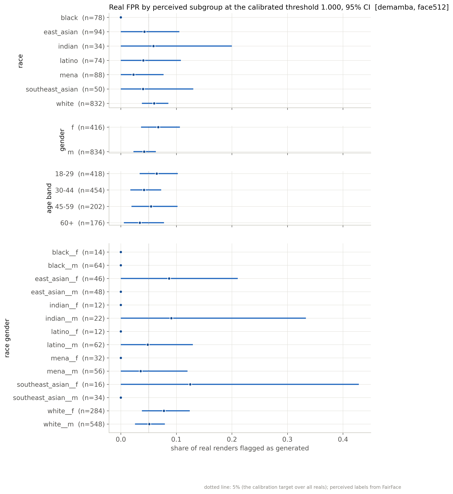

**AUC by subgroup: each subgroup's fakes vs same-subgroup reals.** (`figures/subgroup_auc.pdf`)

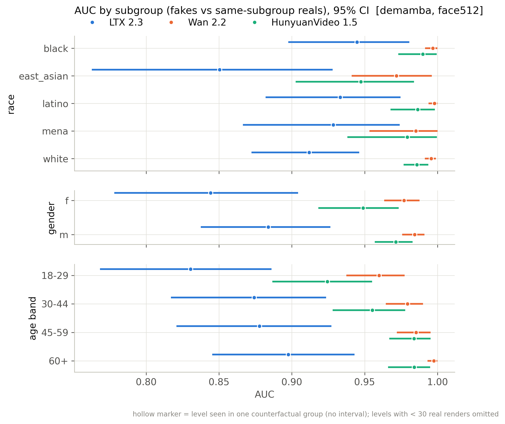

## Files

`manifest_used.csv` (every clip of the active batches with render/score/inclusion flags), `scores.csv` (score per scored clip), `tables/*.csv`, `figures/*`, `snapshot_meta.json`.

