# demamba / face512_2s: snapshot 20261021-2054

> **Detector training data.** DeMamba weights are our own (GenVideo-100K, single-GPU adaptation of the authors' code), not an official release; the authors have published none. GenVideo-100K contains none of our generators. On GenVideo validation it flags 16.8% of real videos at 0.5.

> **Provisional threshold.** Every detection rate and flip rate below uses the detector's default threshold (0.5; sigmoid(logit) > 0.5 (training metrics and our standalone evaluator)). They will be replaced by the 5%-real-FPR threshold once reals exist (section 6.3).

## Settings

| setting           | value                                                                                  |
|:------------------|:---------------------------------------------------------------------------------------|
| detector          | demamba 1+504611ba                                                                     |
| checkpoint_sha256 | f89897c72b595aa85a524e59083919cebb0b92161d2a694a2cbffbdd8456ce17                       |
| view              | face512_2s (view_hash 92b6f25d9ce9e5f4)                                                |
| ffmpeg            | ffmpeg version 7.1.1 Copyright (c) 2000-2025 the FFmpeg developers                     |
| batches           | fake_b1, fake_b2, real_all                                                             |
| inclusion set     | primary (technical QC pass AND face QC pass)                                           |
| bootstrap         | 1000 resamples of whole counterfactual groups, seed 20261020, 95% percentile intervals |
| git commit        | 4e41a35865f4-dirty                                                                     |
| created           | 2026-10-21T20:54:32Z                                                                   |

Detector preprocessing on top of the view:

| field     | value                                                                                 |
|:----------|:--------------------------------------------------------------------------------------|
| source    | DeMamba Preprocess/video2frame.py + dataloader.py (val) + our standalone evaluator    |
| sampling  | every round(fps/target)-th frame, target 2 fps (>= 4 s) else ceil(8/dur); max 32 kept |
| window    | centre 8 consecutive sampled frames; zero-pad if fewer than 8                         |
| crop      | centre, trim 10% each side of the longer dimension                                    |
| resize    | [224, 224, 'cv2.INTER_LINEAR']                                                        |
| channels  | RGB                                                                                   |
| normalize | {'mean': [0.485, 0.456, 0.406], 'std': [0.229, 0.224, 0.225], 'max_pixel_value': 255} |
| model     | XCLIP_DeMamba (X-CLIP-B/16 vision, fine-tuned) + bidirectional Mamba, 1 logit         |
| score     | sigmoid(logit)                                                                        |
| precision | fp32, TF32 off                                                                        |
| weights   | Ahsanz/DeMamba-GenVideo100K@27468b8201fc55978bbce51450949345867de184                  |

## Coverage

| batch    | generator   |   clips |   primary |   rendered |   view_excluded |   render_failed |   scored |   score_failed |   included |
|:---------|:------------|--------:|----------:|-----------:|----------------:|----------------:|---------:|---------------:|-----------:|
| fake_b1  | hunyuan15   |     504 |       492 |        504 |               0 |               0 |      504 |              0 |        492 |
| fake_b1  | ltx23       |    2016 |      1878 |       2005 |              11 |               0 |     2005 |              0 |       1867 |
| fake_b1  | wan22       |    2016 |      1566 |       2016 |               0 |               0 |     2016 |              0 |       1566 |
| fake_b2  | hunyuan15   |     504 |       497 |        504 |               0 |               0 |      504 |              0 |        497 |
| real_all | real        |    2221 |      2221 |       2206 |              15 |               0 |     2206 |              0 |       2206 |

face512 window placement (fixed window at the median YuNet face centre, shifted inward at frame edges). The scaled frame is exactly 512 px on its short side, so every window spans it fully and is "shifted" on that axis by construction; the long-axis count is the informative one.

|   rendered |   shifted_long_axis |   shifted_short_axis |   max_shift_long_px |   excluded_no_face |
|-----------:|--------------------:|---------------------:|--------------------:|-------------------:|
|       9441 |                 439 |                 9405 |                 203 |                 41 |

Reals scored: 4412. Fakes included: 4422 of 9441 scored (0 scoring failures).

## Observations

- LTX 2.3: mean score 0.979 [0.962, 0.993], median 1.000, n = 1867.
- Wan 2.2: mean score 1.000 [1.000, 1.000], median 1.000, n = 1566.
- HunyuanVideo 1.5: mean score 0.999 [0.997, 1.000], median 1.000, n = 989.
- Provisional detection rate (score >= 0.5), LTX 2.3: 98.9% [97.6, 99.8].
- Provisional detection rate (score >= 0.5), Wan 2.2: 100.0% [100.0, 100.0].
- Provisional detection rate (score >= 0.5), HunyuanVideo 1.5: 100.0% [100.0, 100.0].
- Provisional detection rate (score >= 0.5), all: 99.5% [99.0, 99.9].
- Largest race score gap: LTX 2.3 0.052 [0.021, 0.090] (white 0.994 vs east_asian 0.942).
- Largest gender score gap: LTX 2.3 0.009 [0.000, 0.032] (m 0.984 vs f 0.975).
- Largest age band score gap: LTX 2.3 0.021 [0.006, 0.043] (60+ 0.992 vs 18-29 0.971).
- Largest cell score gap: LTX 2.3 0.088 [0.048, 0.181] (white__m__60+ 1.000 vs east_asian__f__45-59 0.912).
- Largest scene-factor gap (all generators): setting 0.038 [0.011, 0.101] (studio vs lobby).
- Largest partial eta squared: lighting 0.027, behavior 0.021, generator 0.020; residual holds 88.0% of total SS.
- CF spread, LTX 2.3: 0.038 [0.017, 0.063] over 36 groups (max 0.298).
- CF spread, Wan 2.2: 0.001 [0.000, 0.001] over 36 groups (max 0.013).
- CF spread, HunyuanVideo 1.5: 0.005 [0.002, 0.010] over 18 groups (max 0.043).
- Provisional flip rate, LTX 2.3: 16.7% of 36 groups [5.6, 30.6].
- Provisional flip rate, Wan 2.2: 0.0% of 36 groups [0.0, 0.0].
- Provisional flip rate, HunyuanVideo 1.5: 0.0% of 18 groups [0.0, 0.0].

## 6.1 Fakes only, no threshold

### Mean score by generator

| generator   |    n |   n_groups |   estimate |   ci_lo |   ci_hi |    sd |   median |   q05 |   q95 |
|:------------|-----:|-----------:|-----------:|--------:|--------:|------:|---------:|------:|------:|
| ltx23       | 1867 |         36 |      0.979 |   0.962 |   0.993 | 0.096 |        1 | 0.925 |     1 |
| wan22       | 1566 |         36 |      1     |   1     |   1     | 0.002 |        1 | 1     |     1 |
| hunyuan15   |  989 |         18 |      0.999 |   0.997 |   1     | 0.012 |        1 | 0.997 |     1 |
| all         | 4422 |         36 |      0.991 |   0.983 |   0.997 | 0.064 |        1 | 0.985 |     1 |

### Mean score by race

| generator   | level           |   n |   estimate |   ci_lo |   ci_hi |   median |
|:------------|:----------------|----:|-----------:|--------:|--------:|---------:|
| ltx23       | black           | 270 |      0.989 |   0.971 |   0.999 |    1     |
| ltx23       | east_asian      | 270 |      0.942 |   0.901 |   0.977 |    0.999 |
| ltx23       | indian          | 276 |      0.988 |   0.974 |   0.998 |    1     |
| ltx23       | latino          | 261 |      0.992 |   0.982 |   0.999 |    1     |
| ltx23       | mena            | 266 |      0.991 |   0.982 |   0.999 |    1     |
| ltx23       | southeast_asian | 271 |      0.959 |   0.922 |   0.988 |    0.999 |
| ltx23       | white           | 253 |      0.994 |   0.988 |   0.999 |    1     |
| wan22       | black           | 217 |      1     |   1     |   1     |    1     |
| wan22       | east_asian      | 226 |      1     |   0.999 |   1     |    1     |
| wan22       | indian          | 230 |      1     |   1     |   1     |    1     |
| wan22       | latino          | 219 |      1     |   1     |   1     |    1     |
| wan22       | mena            | 225 |      1     |   1     |   1     |    1     |
| wan22       | southeast_asian | 229 |      0.999 |   0.999 |   1     |    1     |
| wan22       | white           | 220 |      1     |   1     |   1     |    1     |
| hunyuan15   | black           | 141 |      0.999 |   0.999 |   1     |    1     |
| hunyuan15   | east_asian      | 141 |      0.994 |   0.986 |   0.998 |    1     |
| hunyuan15   | indian          | 142 |      1     |   0.999 |   1     |    1     |
| hunyuan15   | latino          | 142 |      1     |   1     |   1     |    1     |
| hunyuan15   | mena            | 139 |      1     |   1     |   1     |    1     |
| hunyuan15   | southeast_asian | 143 |      0.998 |   0.995 |   1     |    1     |
| hunyuan15   | white           | 141 |      1     |   1     |   1     |    1     |
| all         | black           | 628 |      0.995 |   0.987 |   0.999 |    1     |
| all         | east_asian      | 637 |      0.974 |   0.955 |   0.989 |    1     |
| all         | indian          | 648 |      0.995 |   0.989 |   0.999 |    1     |
| all         | latino          | 622 |      0.996 |   0.993 |   1     |    1     |
| all         | mena            | 630 |      0.996 |   0.992 |   1     |    1     |
| all         | southeast_asian | 643 |      0.982 |   0.966 |   0.994 |    1     |
| all         | white           | 614 |      0.998 |   0.995 |   1     |    1     |

### Mean score by gender

| generator   | level   |    n |   estimate |   ci_lo |   ci_hi |   median |
|:------------|:--------|-----:|-----------:|--------:|--------:|---------:|
| ltx23       | f       |  931 |      0.975 |   0.947 |   0.995 |        1 |
| ltx23       | m       |  936 |      0.984 |   0.972 |   0.994 |        1 |
| wan22       | f       |  785 |      1     |   0.999 |   1     |        1 |
| wan22       | m       |  781 |      1     |   1     |   1     |        1 |
| hunyuan15   | f       |  495 |      0.999 |   0.998 |   1     |        1 |
| hunyuan15   | m       |  494 |      0.998 |   0.996 |   1     |        1 |
| all         | f       | 2211 |      0.989 |   0.978 |   0.998 |        1 |
| all         | m       | 2211 |      0.993 |   0.987 |   0.997 |        1 |

### Mean score by age band

| generator   | level   |    n |   estimate |   ci_lo |   ci_hi |   median |
|:------------|:--------|-----:|-----------:|--------:|--------:|---------:|
| ltx23       | 18-29   |  464 |      0.971 |   0.945 |   0.991 |        1 |
| ltx23       | 30-44   |  469 |      0.978 |   0.956 |   0.995 |        1 |
| ltx23       | 45-59   |  477 |      0.976 |   0.954 |   0.993 |        1 |
| ltx23       | 60+     |  457 |      0.992 |   0.987 |   0.997 |        1 |
| wan22       | 18-29   |  388 |      1     |   0.999 |   1     |        1 |
| wan22       | 30-44   |  377 |      1     |   1     |   1     |        1 |
| wan22       | 45-59   |  398 |      1     |   1     |   1     |        1 |
| wan22       | 60+     |  403 |      1     |   1     |   1     |        1 |
| hunyuan15   | 18-29   |  242 |      0.997 |   0.995 |   0.999 |        1 |
| hunyuan15   | 30-44   |  248 |      0.997 |   0.994 |   1     |        1 |
| hunyuan15   | 45-59   |  250 |      1     |   1     |   1     |        1 |
| hunyuan15   | 60+     |  249 |      1     |   1     |   1     |        1 |
| all         | 18-29   | 1094 |      0.987 |   0.976 |   0.996 |        1 |
| all         | 30-44   | 1094 |      0.99  |   0.98  |   0.997 |        1 |
| all         | 45-59   | 1125 |      0.99  |   0.98  |   0.997 |        1 |
| all         | 60+     | 1109 |      0.997 |   0.995 |   0.999 |        1 |

### Mean score by scene factor (all generators pooled)

| factor           | level      |    n |   estimate |   ci_lo |   ci_hi |
|:-----------------|:-----------|-----:|-----------:|--------:|--------:|
| setting          | cafe       |  373 |      0.995 |   0.982 |   0.999 |
| setting          | classroom  |  373 |      0.999 |   0.997 |   1     |
| setting          | corridor   |  493 |      0.998 |   0.995 |   1     |
| setting          | kitchen    |  439 |      0.986 |   0.955 |   0.999 |
| setting          | library    |  532 |      0.99  |   0.979 |   1     |
| setting          | livingroom |  529 |      0.999 |   0.997 |   1     |
| setting          | lobby      |  345 |      0.962 |   0.918 |   1     |
| setting          | office     |  357 |      0.968 |   0.899 |   1     |
| setting          | plainwall  |  553 |      0.999 |   0.997 |   1     |
| setting          | studio     |  428 |      1     |   0.999 |   1     |
| lighting         | backlit    |  782 |      0.998 |   0.995 |   1     |
| lighting         | harsh      |  632 |      0.977 |   0.938 |   0.999 |
| lighting         | lowlight   |  781 |      0.972 |   0.945 |   0.995 |
| lighting         | overcast   |  692 |      0.998 |   0.996 |   0.999 |
| lighting         | softwindow |  821 |      1     |   1     |   1     |
| lighting         | warmlamp   |  714 |      0.998 |   0.995 |   1     |
| behavior         | laugh      |  498 |      0.997 |   0.99  |   1     |
| behavior         | listen     |  676 |      0.998 |   0.995 |   1     |
| behavior         | pause      |  520 |      0.997 |   0.982 |   1     |
| behavior         | read       |  576 |      0.996 |   0.992 |   0.999 |
| behavior         | smile      |  538 |      1     |   1     |   1     |
| behavior         | speak      |  530 |      0.994 |   0.984 |   1     |
| behavior         | think      |  506 |      0.975 |   0.918 |   1     |
| behavior         | turn       |  578 |      0.969 |   0.926 |   0.996 |
| camera           | slowsway   | 2218 |      0.99  |   0.978 |   0.998 |
| camera           | static     | 2204 |      0.992 |   0.98  |   0.999 |
| duration_nominal | 5.0        | 2223 |      0.996 |   0.993 |   0.999 |
| duration_nominal | 6.0        | 2199 |      0.985 |   0.97  |   0.997 |

Per-generator scene-factor and 56-cell rows: `tables/score_by_breakdown.csv`.

### Subgroup gap (max - min of level means)

A gap is max - min, so it is never negative and its interval cannot include 0; it is a size, not a test of a difference. Over many levels with few clips each (56 cells; HunyuanVideo has 9 groups per cell) the gap also grows with noise, so compare it with the per-level intervals in `tables/score_by_breakdown.csv`. Levels seen in a single counterfactual group have no interval.

| generator   | attribute        |   n_levels |   gap |   ci_lo |   ci_hi | max_level       | min_level                 |
|:------------|:-----------------|-----------:|------:|--------:|--------:|:----------------|:--------------------------|
| ltx23       | race             |          7 | 0.052 |   0.021 |   0.09  | white           | east_asian                |
| ltx23       | gender           |          2 | 0.009 |   0     |   0.032 | m               | f                         |
| ltx23       | age_band         |          4 | 0.021 |   0.006 |   0.043 | 60+             | 18-29                     |
| ltx23       | cell             |         56 | 0.088 |   0.048 |   0.181 | white__m__60+   | east_asian__f__45-59      |
| ltx23       | setting          |         10 | 0.078 |   0.025 |   0.22  | studio          | lobby                     |
| ltx23       | lighting         |          6 | 0.068 |   0.022 |   0.153 | softwindow      | lowlight                  |
| ltx23       | behavior         |          8 | 0.062 |   0.022 |   0.22  | smile           | turn                      |
| ltx23       | camera           |          2 | 0.003 |   0.001 |   0.038 | static          | slowsway                  |
| ltx23       | duration_nominal |          2 | 0.023 |   0.001 |   0.056 | 5.0             | 6.0                       |
| wan22       | race             |          7 | 0.001 |   0     |   0.001 | white           | southeast_asian           |
| wan22       | gender           |          2 | 0     |   0     |   0.001 | m               | f                         |
| wan22       | age_band         |          4 | 0     |   0     |   0.001 | 60+             | 18-29                     |
| wan22       | cell             |         56 | 0.003 |   0     |   0.009 | white__f__60+   | southeast_asian__f__18-29 |
| wan22       | setting          |         10 | 0.001 |   0     |   0.003 | studio          | classroom                 |
| wan22       | lighting         |          6 | 0.001 |   0     |   0.002 | backlit         | overcast                  |
| wan22       | behavior         |          8 | 0.001 |   0     |   0.002 | smile           | turn                      |
| wan22       | camera           |          2 | 0     |   0     |   0.001 | slowsway        | static                    |
| wan22       | duration_nominal |          2 | 0     |   0     |   0     | 6.0             | 5.0                       |
| hunyuan15   | race             |          7 | 0.006 |   0.002 |   0.014 | white           | east_asian                |
| hunyuan15   | gender           |          2 | 0     |   0     |   0.001 | f               | m                         |
| hunyuan15   | age_band         |          4 | 0.003 |   0.001 |   0.006 | 45-59           | 18-29                     |
| hunyuan15   | cell             |         56 | 0.021 |   0.006 |   0.051 | white__m__30-44 | east_asian__m__30-44      |
| hunyuan15   | setting          |         10 | 0.006 |   0.001 |   0.013 | classroom       | office                    |
| hunyuan15   | lighting         |          6 | 0.005 |   0.001 |   0.013 | backlit         | harsh                     |
| hunyuan15   | behavior         |          8 | 0.007 |   0.001 |   0.013 | smile           | turn                      |
| hunyuan15   | camera           |          2 | 0.001 |   0     |   0.004 | static          | slowsway                  |
| hunyuan15   | duration_nominal |          2 | 0.001 |   0     |   0.004 | 5.0             | 6.0                       |
| all         | race             |          7 | 0.024 |   0.01  |   0.041 | white           | east_asian                |
| all         | gender           |          2 | 0.004 |   0     |   0.013 | m               | f                         |
| all         | age_band         |          4 | 0.01  |   0.003 |   0.02  | 60+             | 18-29                     |
| all         | cell             |         56 | 0.039 |   0.022 |   0.078 | white__m__60+   | east_asian__f__18-29      |
| all         | setting          |         10 | 0.038 |   0.011 |   0.101 | studio          | lobby                     |
| all         | lighting         |          6 | 0.028 |   0.009 |   0.067 | softwindow      | lowlight                  |
| all         | behavior         |          8 | 0.031 |   0.009 |   0.081 | smile           | turn                      |
| all         | camera           |          2 | 0.002 |   0     |   0.017 | static          | slowsway                  |
| all         | duration_nominal |          2 | 0.011 |   0.001 |   0.026 | 5.0             | 6.0                       |

### CF spread (mean over groups of the std of score across the group's cells)

| generator   |   n_groups |   cf_spread |   ci_lo |   ci_hi |   median |   max |
|:------------|-----------:|------------:|--------:|--------:|---------:|------:|
| ltx23       |         36 |       0.038 |   0.017 |   0.063 |    0.003 | 0.298 |
| wan22       |         36 |       0.001 |   0     |   0.001 |    0     | 0.013 |
| hunyuan15   |         18 |       0.005 |   0.002 |   0.01  |    0.001 | 0.043 |

### Factor attribution

OLS with every factor as a fixed effect, type-II ANOVA. `ss_share` is the factor's type-II sum of squares over the total sum of squares (type-II shares need not add to 1). Scene factors are constant within a counterfactual group, so their effects are estimated from between-group differences only. The OLS F tests treat clips as independent although clips are clustered in counterfactual groups, so their p values are optimistic; use the group-bootstrap intervals above for inference.

| factor           |   df |   sum_sq | F      | p         | partial_eta2   |   ss_share |
|:-----------------|-----:|---------:|:-------|:----------|:---------------|-----------:|
| race             |    6 |  0.3195  | 14.83  | 7.346e-17 | 0.01989        |  0.01786   |
| gender           |    1 |  0.01154 | 3.215  | 0.07305   | 0.0007324      |  0.000645  |
| age_band         |    3 |  0.06155 | 5.715  | 0.0006699 | 0.003894       |  0.00344   |
| setting          |    9 |  0.2158  | 6.678  | 1.506e-09 | 0.01352        |  0.01206   |
| lighting         |    5 |  0.4443  | 24.75  | 1.139e-24 | 0.02744        |  0.02483   |
| behavior         |    7 |  0.3321  | 13.21  | 5.852e-17 | 0.02065        |  0.01856   |
| camera           |    1 |  0.07056 | 19.65  | 9.518e-06 | 0.004461       |  0.003943  |
| duration_nominal |    1 |  0.00153 | 0.4261 | 0.514     | 9.713e-05      |  8.548e-05 |
| generator        |    2 |  0.3202  | 44.59  | 6.747e-20 | 0.01993        |  0.01789   |
| Residual         | 4386 | 15.75    |        |           |                |  0.88      |

Lighting x race interaction (added to the same OLS):

| term            |   df |   sum_sq |     F |         p |   partial_eta2 |
|:----------------|-----:|---------:|------:|----------:|---------------:|
| lighting x race |   30 |   0.4986 | 4.748 | 3.024e-16 |        0.03166 |

Mixed model `score ~ factors + (1 | counterfactual_group)` (REML) variance components (fixed effects: `tables/factor_mixed_fixed.csv`):

| component                               |   variance | converged   |
|:----------------------------------------|-----------:|:------------|
| counterfactual_group (random intercept) |   0        | True        |
| residual                                |   0.003403 | True        |
| ICC (group share of random variance)    |   0        | True        |

A group variance at or near 0 is a boundary estimate: setting, lighting, behavior, camera and duration are fixed per group and absorb most between-group variation, leaving little for the random intercept. It does not mean scenes do not matter.

## 6.2 Provisional (threshold 0.5, provisional)

### Detection rate by generator (provisional)

| generator   |    n |   estimate |   ci_lo |   ci_hi |
|:------------|-----:|-----------:|--------:|--------:|
| ltx23       | 1867 |      0.989 |   0.976 |   0.998 |
| wan22       | 1566 |      1     |   1     |   1     |
| hunyuan15   |  989 |      1     |   1     |   1     |
| all         | 4422 |      0.995 |   0.99  |   0.999 |

### Detection rate by race (provisional)

| generator   | level           |   n |   estimate |   ci_lo |   ci_hi |
|:------------|:----------------|----:|-----------:|--------:|--------:|
| ltx23       | black           | 270 |      0.993 |   0.977 |   1     |
| ltx23       | east_asian      | 270 |      0.959 |   0.92  |   0.989 |
| ltx23       | indian          | 276 |      0.996 |   0.989 |   1     |
| ltx23       | latino          | 261 |      1     |   1     |   1     |
| ltx23       | mena            | 266 |      1     |   1     |   1     |
| ltx23       | southeast_asian | 271 |      0.978 |   0.945 |   1     |
| ltx23       | white           | 253 |      0.996 |   0.988 |   1     |
| wan22       | black           | 217 |      1     |   1     |   1     |
| wan22       | east_asian      | 226 |      1     |   1     |   1     |
| wan22       | indian          | 230 |      1     |   1     |   1     |
| wan22       | latino          | 219 |      1     |   1     |   1     |
| wan22       | mena            | 225 |      1     |   1     |   1     |
| wan22       | southeast_asian | 229 |      1     |   1     |   1     |
| wan22       | white           | 220 |      1     |   1     |   1     |
| hunyuan15   | black           | 141 |      1     |   1     |   1     |
| hunyuan15   | east_asian      | 141 |      1     |   1     |   1     |
| hunyuan15   | indian          | 142 |      1     |   1     |   1     |
| hunyuan15   | latino          | 142 |      1     |   1     |   1     |
| hunyuan15   | mena            | 139 |      1     |   1     |   1     |
| hunyuan15   | southeast_asian | 143 |      1     |   1     |   1     |
| hunyuan15   | white           | 141 |      1     |   1     |   1     |
| all         | black           | 628 |      0.997 |   0.99  |   1     |
| all         | east_asian      | 637 |      0.983 |   0.966 |   0.995 |
| all         | indian          | 648 |      0.998 |   0.995 |   1     |
| all         | latino          | 622 |      1     |   1     |   1     |
| all         | mena            | 630 |      1     |   1     |   1     |
| all         | southeast_asian | 643 |      0.991 |   0.977 |   1     |
| all         | white           | 614 |      0.998 |   0.995 |   1     |

### Detection rate by gender (provisional)

| generator   | level   |    n |   estimate |   ci_lo |   ci_hi |
|:------------|:--------|-----:|-----------:|--------:|--------:|
| ltx23       | f       |  931 |      0.985 |   0.963 |   1     |
| ltx23       | m       |  936 |      0.993 |   0.984 |   0.999 |
| wan22       | f       |  785 |      1     |   1     |   1     |
| wan22       | m       |  781 |      1     |   1     |   1     |
| hunyuan15   | f       |  495 |      1     |   1     |   1     |
| hunyuan15   | m       |  494 |      1     |   1     |   1     |
| all         | f       | 2211 |      0.994 |   0.985 |   1     |
| all         | m       | 2211 |      0.997 |   0.993 |   1     |

### Detection rate by age band (provisional)

| generator   | level   |    n |   estimate |   ci_lo |   ci_hi |
|:------------|:--------|-----:|-----------:|--------:|--------:|
| ltx23       | 18-29   |  464 |      0.983 |   0.961 |   0.998 |
| ltx23       | 30-44   |  469 |      0.987 |   0.967 |   1     |
| ltx23       | 45-59   |  477 |      0.985 |   0.971 |   0.996 |
| ltx23       | 60+     |  457 |      1     |   1     |   1     |
| wan22       | 18-29   |  388 |      1     |   1     |   1     |
| wan22       | 30-44   |  377 |      1     |   1     |   1     |
| wan22       | 45-59   |  398 |      1     |   1     |   1     |
| wan22       | 60+     |  403 |      1     |   1     |   1     |
| hunyuan15   | 18-29   |  242 |      1     |   1     |   1     |
| hunyuan15   | 30-44   |  248 |      1     |   1     |   1     |
| hunyuan15   | 45-59   |  250 |      1     |   1     |   1     |
| hunyuan15   | 60+     |  249 |      1     |   1     |   1     |
| all         | 18-29   | 1094 |      0.993 |   0.984 |   0.999 |
| all         | 30-44   | 1094 |      0.995 |   0.986 |   1     |
| all         | 45-59   | 1125 |      0.994 |   0.988 |   0.998 |
| all         | 60+     | 1109 |      1     |   1     |   1     |

### Detection-rate gap (provisional)

| generator   | attribute        |   gap |   ci_lo |   ci_hi | max_level       | min_level            |
|:------------|:-----------------|------:|--------:|--------:|:----------------|:---------------------|
| ltx23       | race             | 0.041 |   0.011 |   0.08  | latino          | east_asian           |
| ltx23       | gender           | 0.008 |   0     |   0.028 | m               | f                    |
| ltx23       | age_band         | 0.017 |   0.004 |   0.039 | 60+             | 18-29                |
| ltx23       | cell             | 0.088 |   0.03  |   0.2   | black__f__45-59 | east_asian__f__45-59 |
| ltx23       | setting          | 0.048 |   0.014 |   0.145 | cafe            | lobby                |
| ltx23       | lighting         | 0.038 |   0.01  |   0.103 | backlit         | lowlight             |
| ltx23       | behavior         | 0.036 |   0.008 |   0.145 | listen          | think                |
| ltx23       | camera           | 0.003 |   0     |   0.027 | static          | slowsway             |
| ltx23       | duration_nominal | 0.015 |   0.001 |   0.037 | 5.0             | 6.0                  |
| wan22       | race             | 0     |   0     |   0     | black           | black                |
| wan22       | gender           | 0     |   0     |   0     | f               | f                    |
| wan22       | age_band         | 0     |   0     |   0     | 18-29           | 18-29                |
| wan22       | cell             | 0     |   0     |   0     | black__f__18-29 | black__f__18-29      |
| wan22       | setting          | 0     |   0     |   0     | cafe            | cafe                 |
| wan22       | lighting         | 0     |   0     |   0     | backlit         | backlit              |
| wan22       | behavior         | 0     |   0     |   0     | laugh           | laugh                |
| wan22       | camera           | 0     |   0     |   0     | slowsway        | slowsway             |
| wan22       | duration_nominal | 0     |   0     |   0     | 5.0             | 5.0                  |
| hunyuan15   | race             | 0     |   0     |   0     | black           | black                |
| hunyuan15   | gender           | 0     |   0     |   0     | f               | f                    |
| hunyuan15   | age_band         | 0     |   0     |   0     | 18-29           | 18-29                |
| hunyuan15   | cell             | 0     |   0     |   0     | black__f__18-29 | black__f__18-29      |
| hunyuan15   | setting          | 0     |   0     |   0     | cafe            | cafe                 |
| hunyuan15   | lighting         | 0     |   0     |   0     | backlit         | backlit              |
| hunyuan15   | behavior         | 0     |   0     |   0     | laugh           | laugh                |
| hunyuan15   | camera           | 0     |   0     |   0     | slowsway        | slowsway             |
| hunyuan15   | duration_nominal | 0     |   0     |   0     | 5.0             | 5.0                  |
| all         | race             | 0.017 |   0.005 |   0.034 | latino          | east_asian           |
| all         | gender           | 0.003 |   0     |   0.012 | m               | f                    |
| all         | age_band         | 0.007 |   0.002 |   0.017 | 60+             | 18-29                |
| all         | cell             | 0.036 |   0.013 |   0.084 | black__f__45-59 | east_asian__f__45-59 |
| all         | setting          | 0.023 |   0.005 |   0.072 | cafe            | lobby                |
| all         | lighting         | 0.015 |   0.004 |   0.044 | backlit         | lowlight             |
| all         | behavior         | 0.017 |   0.003 |   0.054 | listen          | turn                 |
| all         | camera           | 0.001 |   0     |   0.012 | static          | slowsway             |
| all         | duration_nominal | 0.007 |   0     |   0.017 | 5.0             | 6.0                  |

### Flip rate (provisional): share of groups whose clips get different decisions

| generator   |   n_groups |   flip_rate |   ci_lo |   ci_hi |   median |   max |
|:------------|-----------:|------------:|--------:|--------:|---------:|------:|
| ltx23       |         36 |       0.167 |   0.056 |   0.306 |        0 |     1 |
| wan22       |         36 |       0     |   0     |   0     |        0 |     0 |
| hunyuan15   |         18 |       0     |   0     |   0     |        0 |     0 |

### Sensitivity: inclusion set

| set     | generator   |    n |   mean_score |   provisional_detection_rate |
|:--------|:------------|-----:|-------------:|-----------------------------:|
| all     | hunyuan15   | 1008 |        0.999 |                        1     |
| all     | ltx23       | 2005 |        0.98  |                        0.99  |
| all     | wan22       | 2016 |        1     |                        1     |
| primary | hunyuan15   |  989 |        0.999 |                        1     |
| primary | ltx23       | 1867 |        0.979 |                        0.989 |
| primary | wan22       | 1566 |        1     |                        1     |

## 6.3 Real vs generated (calibrated threshold 0.9998)

The threshold is the score at which 5% of primary real renders (24 and 16 fps pooled) are flagged; one per detector and view, never per subgroup. Each generator is compared with reals rendered at its own fps. Intervals: fakes resample counterfactual groups, reals resample identity clusters (source video). Real labels are perceived (FairFace), not self-reported.

### Calibration

| scope            |   n_renders |   n_sources |   n_identities |   threshold |    fpr |
|:-----------------|------------:|------------:|---------------:|------------:|-------:|
| all real renders |        4412 |        2206 |           1809 |      0.9998 | 0.0501 |
| 16 fps renders   |        2206 |        2206 |           1809 |      0.9998 | 0.0526 |
| 24 fps renders   |        2206 |        2206 |           1809 |      0.9998 | 0.0476 |

### AUC, AP, EER, TPR at 5% FPR

| generator   | real_fps   |   n_fake |   n_real |   auc |   auc_ci_lo |   auc_ci_hi |    ap |   eer |   tpr_at_5fpr |   detection_rate_global_thr |   det_ci_lo |   det_ci_hi |
|:------------|:-----------|---------:|---------:|------:|------------:|------------:|------:|------:|--------------:|----------------------------:|------------:|------------:|
| ltx23       | 24         |     1867 |     2206 | 0.89  |       0.85  |       0.927 | 0.874 | 0.197 |         0.55  |                       0.53  |       0.423 |       0.638 |
| wan22       | 16         |     1566 |     2206 | 0.983 |       0.976 |       0.988 | 0.974 | 0.065 |         0.906 |                       0.915 |       0.88  |       0.945 |
| hunyuan15   | 24         |      989 |     2206 | 0.964 |       0.947 |       0.978 | 0.928 | 0.108 |         0.812 |                       0.805 |       0.724 |       0.873 |
| all         | 24+16      |     4422 |     4412 | 0.937 |       0.916 |       0.955 | 0.94  | 0.141 |         0.728 |                       0.728 |       0.669 |       0.787 |

### Real FPR by perceived subgroup

| attribute   | level              |   n_renders |   n_identities |   fpr |   ci_lo |   ci_hi |
|:------------|:-------------------|------------:|---------------:|------:|--------:|--------:|
| race        | black              |         378 |            173 | 0.082 |   0.045 |   0.123 |
| race        | east_asian         |         380 |            169 | 0.016 |   0.003 |   0.034 |
| race        | indian             |         112 |             54 | 0.062 |   0.009 |   0.127 |
| race        | latino             |         254 |            119 | 0.055 |   0.008 |   0.112 |
| race        | mena               |         258 |            124 | 0.008 |   0     |   0.024 |
| race        | southeast_asian    |         184 |             85 | 0.011 |   0     |   0.038 |
| race        | white              |        2836 |           1179 | 0.056 |   0.043 |   0.07  |
| gender      | f                  |        1378 |            604 | 0.059 |   0.04  |   0.078 |
| gender      | m                  |        3024 |           1263 | 0.046 |   0.035 |   0.058 |
| age_band    | 18-29              |        1380 |            624 | 0.059 |   0.042 |   0.076 |
| age_band    | 30-44              |        1518 |            679 | 0.049 |   0.032 |   0.068 |
| age_band    | 45-59              |         644 |            274 | 0.051 |   0.027 |   0.079 |
| age_band    | 60+                |         624 |            268 | 0.05  |   0.028 |   0.076 |
| race_gender | black__f           |          64 |             30 | 0.094 |   0     |   0.2   |
| race_gender | black__m           |         314 |            144 | 0.08  |   0.039 |   0.124 |
| race_gender | east_asian__f      |         136 |             62 | 0.037 |   0     |   0.086 |
| race_gender | east_asian__m      |         244 |            110 | 0.004 |   0     |   0.013 |
| race_gender | indian__f          |          32 |             16 | 0.062 |   0     |   0.214 |
| race_gender | indian__m          |          80 |             38 | 0.062 |   0     |   0.143 |
| race_gender | latino__f          |          62 |             30 | 0.032 |   0     |   0.1   |
| race_gender | latino__m          |         192 |             89 | 0.062 |   0.009 |   0.133 |
| race_gender | mena__f            |          60 |             30 | 0     |   0     |   0     |
| race_gender | mena__m            |         198 |             94 | 0.01  |   0     |   0.032 |
| race_gender | southeast_asian__f |          64 |             30 | 0     |   0     |   0     |
| race_gender | southeast_asian__m |         120 |             56 | 0.017 |   0     |   0.059 |
| race_gender | white__f           |         960 |            425 | 0.069 |   0.044 |   0.095 |
| race_gender | white__m           |        1876 |            789 | 0.05  |   0.035 |   0.065 |

### Real FPR gap (max - min across levels; non-negative by construction)

| attribute   |   n_levels |   fpr_gap |   ci_lo |   ci_hi | max_level   |   max_fpr | min_level   |   min_fpr |
|:------------|-----------:|----------:|--------:|--------:|:------------|----------:|:------------|----------:|
| race        |          7 |     0.074 |   0.052 |   0.133 | black       |     0.082 | mena        |     0.008 |
| gender      |          2 |     0.012 |   0.001 |   0.036 | f           |     0.059 | m           |     0.046 |
| age_band    |          4 |     0.01  |   0.008 |   0.046 | 18-29       |     0.059 | 30-44       |     0.049 |
| race_gender |         14 |     0.094 |   0.073 |   0.231 | black__f    |     0.094 | mena__f     |     0     |

### Worst-subgroup AUC and AUC gap

| generator   | attribute   |   n_levels | worst_level   |   worst_auc |   worst_ci_lo |   worst_ci_hi | best_level   |   best_auc |   auc_gap |   gap_ci_lo |   gap_ci_hi |
|:------------|:------------|-----------:|:--------------|------------:|--------------:|--------------:|:-------------|-----------:|----------:|------------:|------------:|
| ltx23       | race        |          7 | east_asian    |       0.877 |         0.815 |         0.912 | mena         |      0.96  |     0.083 |       0.056 |       0.142 |
| ltx23       | gender      |          2 | f             |       0.871 |         0.819 |         0.918 | m            |      0.901 |     0.03  |       0.003 |       0.062 |
| ltx23       | age_band    |          4 | 18-29         |       0.861 |         0.813 |         0.906 | 60+          |      0.903 |     0.042 |       0.018 |       0.077 |
| ltx23       | race_gender |         13 | black__f      |       0.844 |         0.746 |         0.889 | mena__m      |      0.966 |     0.122 |       0.089 |       0.22  |
| wan22       | race        |          7 | black         |       0.976 |         0.957 |         0.984 | white        |      0.996 |     0.021 |       0.014 |       0.04  |
| wan22       | gender      |          2 | f             |       0.978 |         0.968 |         0.986 | m            |      0.986 |     0.008 |       0.001 |       0.017 |
| wan22       | age_band    |          4 | 18-29         |       0.965 |         0.95  |         0.977 | 60+          |      0.993 |     0.027 |       0.016 |       0.042 |
| wan22       | race_gender |         13 | black__f      |       0.961 |         0.921 |         0.979 | mena__f      |      0.999 |     0.038 |       0.021 |       0.078 |
| hunyuan15   | race        |          7 | east_asian    |       0.95  |         0.918 |         0.969 | mena         |      0.992 |     0.042 |       0.026 |       0.073 |
| hunyuan15   | gender      |          2 | f             |       0.954 |         0.932 |         0.974 | m            |      0.97  |     0.016 |       0.002 |       0.031 |
| hunyuan15   | age_band    |          4 | 18-29         |       0.934 |         0.904 |         0.959 | 45-59        |      0.98  |     0.046 |       0.027 |       0.072 |
| hunyuan15   | race_gender |         13 | black__f      |       0.934 |         0.866 |         0.959 | white__m     |      0.995 |     0.062 |       0.04  |       0.129 |
| all         | race        |          7 | east_asian    |       0.927 |         0.894 |         0.947 | mena         |      0.978 |     0.052 |       0.035 |       0.084 |
| all         | gender      |          2 | f             |       0.925 |         0.898 |         0.949 | m            |      0.944 |     0.019 |       0.003 |       0.035 |
| all         | age_band    |          4 | 18-29         |       0.911 |         0.884 |         0.937 | 60+          |      0.95  |     0.038 |       0.021 |       0.059 |
| all         | race_gender |         14 | black__f      |       0.902 |         0.84  |         0.933 | mena__m      |      0.981 |     0.079 |       0.056 |       0.144 |

### Detection rate at the calibrated threshold

| generator   |    n |   estimate |   ci_lo |   ci_hi |
|:------------|-----:|-----------:|--------:|--------:|
| ltx23       | 1867 |      0.53  |   0.423 |   0.638 |
| wan22       | 1566 |      0.915 |   0.88  |   0.945 |
| hunyuan15   |  989 |      0.805 |   0.724 |   0.873 |
| all         | 4422 |      0.728 |   0.669 |   0.787 |

#### by race

| generator   | level           |   n |   estimate |   ci_lo |   ci_hi |
|:------------|:----------------|----:|-----------:|--------:|--------:|
| ltx23       | black           | 270 |      0.574 |   0.459 |   0.684 |
| ltx23       | east_asian      | 270 |      0.326 |   0.216 |   0.456 |
| ltx23       | indian          | 276 |      0.543 |   0.421 |   0.67  |
| ltx23       | latino          | 261 |      0.64  |   0.515 |   0.755 |
| ltx23       | mena            | 266 |      0.609 |   0.5   |   0.72  |
| ltx23       | southeast_asian | 271 |      0.351 |   0.232 |   0.478 |
| ltx23       | white           | 253 |      0.684 |   0.573 |   0.788 |
| wan22       | black           | 217 |      0.903 |   0.848 |   0.953 |
| wan22       | east_asian      | 226 |      0.792 |   0.697 |   0.876 |
| wan22       | indian          | 230 |      0.935 |   0.885 |   0.977 |
| wan22       | latino          | 219 |      0.986 |   0.964 |   1     |
| wan22       | mena            | 225 |      0.982 |   0.96  |   1     |
| wan22       | southeast_asian | 229 |      0.812 |   0.739 |   0.882 |
| wan22       | white           | 220 |      1     |   1     |   1     |
| hunyuan15   | black           | 141 |      0.837 |   0.727 |   0.926 |
| hunyuan15   | east_asian      | 141 |      0.589 |   0.5   |   0.684 |
| hunyuan15   | indian          | 142 |      0.824 |   0.705 |   0.932 |
| hunyuan15   | latino          | 142 |      0.852 |   0.737 |   0.951 |
| hunyuan15   | mena            | 139 |      0.928 |   0.875 |   0.974 |
| hunyuan15   | southeast_asian | 143 |      0.692 |   0.575 |   0.806 |
| hunyuan15   | white           | 141 |      0.915 |   0.846 |   0.973 |
| all         | black           | 628 |      0.747 |   0.682 |   0.806 |
| all         | east_asian      | 637 |      0.549 |   0.47  |   0.629 |
| all         | indian          | 648 |      0.744 |   0.665 |   0.817 |
| all         | latino          | 622 |      0.81  |   0.738 |   0.874 |
| all         | mena            | 630 |      0.813 |   0.755 |   0.866 |
| all         | southeast_asian | 643 |      0.591 |   0.518 |   0.664 |
| all         | white           | 614 |      0.85  |   0.8   |   0.901 |

#### by gender

| generator   | level   |    n |   estimate |   ci_lo |   ci_hi |
|:------------|:--------|-----:|-----------:|--------:|--------:|
| ltx23       | f       |  931 |      0.531 |   0.415 |   0.647 |
| ltx23       | m       |  936 |      0.53  |   0.428 |   0.639 |
| wan22       | f       |  785 |      0.899 |   0.853 |   0.938 |
| wan22       | m       |  781 |      0.931 |   0.902 |   0.956 |
| hunyuan15   | f       |  495 |      0.782 |   0.69  |   0.861 |
| hunyuan15   | m       |  494 |      0.828 |   0.748 |   0.892 |
| all         | f       | 2211 |      0.718 |   0.651 |   0.782 |
| all         | m       | 2211 |      0.738 |   0.678 |   0.795 |

#### by age band

| generator   | level   |    n |   estimate |   ci_lo |   ci_hi |
|:------------|:--------|-----:|-----------:|--------:|--------:|
| ltx23       | 18-29   |  464 |      0.466 |   0.351 |   0.583 |
| ltx23       | 30-44   |  469 |      0.514 |   0.408 |   0.622 |
| ltx23       | 45-59   |  477 |      0.564 |   0.448 |   0.677 |
| ltx23       | 60+     |  457 |      0.578 |   0.469 |   0.693 |
| wan22       | 18-29   |  388 |      0.838 |   0.779 |   0.889 |
| wan22       | 30-44   |  377 |      0.867 |   0.812 |   0.916 |
| wan22       | 45-59   |  398 |      0.962 |   0.939 |   0.983 |
| wan22       | 60+     |  403 |      0.988 |   0.974 |   0.998 |
| hunyuan15   | 18-29   |  242 |      0.669 |   0.553 |   0.771 |
| hunyuan15   | 30-44   |  248 |      0.738 |   0.633 |   0.833 |
| hunyuan15   | 45-59   |  250 |      0.924 |   0.868 |   0.968 |
| hunyuan15   | 60+     |  249 |      0.884 |   0.778 |   0.964 |
| all         | 18-29   | 1094 |      0.643 |   0.57  |   0.716 |
| all         | 30-44   | 1094 |      0.686 |   0.622 |   0.75  |
| all         | 45-59   | 1125 |      0.785 |   0.724 |   0.842 |
| all         | 60+     | 1109 |      0.795 |   0.736 |   0.855 |

### Detection-rate gap at the calibrated threshold

| generator   | attribute        |   gap |   ci_lo |   ci_hi | max_level     | min_level            |
|:------------|:-----------------|------:|--------:|--------:|:--------------|:---------------------|
| ltx23       | race             | 0.358 |   0.289 |   0.446 | white         | east_asian           |
| ltx23       | gender           | 0.001 |   0.001 |   0.076 | f             | m                    |
| ltx23       | age_band         | 0.112 |   0.04  |   0.193 | 60+           | 18-29                |
| ltx23       | cell             | 0.578 |   0.519 |   0.77  | white__f__60+ | east_asian__m__45-59 |
| ltx23       | setting          | 0.557 |   0.502 |   1     | livingroom    | library              |
| ltx23       | lighting         | 0.698 |   0.538 |   0.911 | softwindow    | lowlight             |
| ltx23       | behavior         | 0.716 |   0.558 |   0.927 | smile         | turn                 |
| ltx23       | camera           | 0.173 |   0.014 |   0.366 | static        | slowsway             |
| ltx23       | duration_nominal | 0.067 |   0.003 |   0.28  | 5.0           | 6.0                  |
| wan22       | race             | 0.208 |   0.141 |   0.303 | white         | east_asian           |
| wan22       | gender           | 0.031 |   0.003 |   0.065 | m             | f                    |
| wan22       | age_band         | 0.15  |   0.104 |   0.202 | 60+           | 18-29                |
| wan22       | cell             | 0.483 |   0.345 |   0.677 | black__f__60+ | east_asian__m__18-29 |
| wan22       | setting          | 0.164 |   0.121 |   0.442 | studio        | classroom            |
| wan22       | lighting         | 0.186 |   0.074 |   0.323 | backlit       | overcast             |
| wan22       | behavior         | 0.222 |   0.13  |   0.374 | laugh         | turn                 |
| wan22       | camera           | 0.006 |   0.002 |   0.076 | static        | slowsway             |
| wan22       | duration_nominal | 0.058 |   0.006 |   0.115 | 5.0           | 6.0                  |
| hunyuan15   | race             | 0.339 |   0.275 |   0.42  | mena          | east_asian           |
| hunyuan15   | gender           | 0.046 |   0.004 |   0.107 | m             | f                    |
| hunyuan15   | age_band         | 0.255 |   0.18  |   0.342 | 45-59         | 18-29                |
| hunyuan15   | cell             | 0.765 |   0.611 |   0.947 | black__f__60+ | east_asian__m__18-29 |
| hunyuan15   | setting          | 0.281 |   0.196 |   0.674 | classroom     | office               |
| hunyuan15   | lighting         | 0.276 |   0.153 |   0.657 | backlit       | harsh                |
| hunyuan15   | behavior         | 0.389 |   0.186 |   0.674 | laugh         | turn                 |
| hunyuan15   | camera           | 0.054 |   0.004 |   0.214 | static        | slowsway             |
| hunyuan15   | duration_nominal | 0.033 |   0.003 |   0.201 | 6.0           | 5.0                  |
| all         | race             | 0.301 |   0.245 |   0.362 | white         | east_asian           |
| all         | gender           | 0.02  |   0.001 |   0.058 | m             | f                    |
| all         | age_band         | 0.153 |   0.11  |   0.203 | 60+           | 18-29                |
| all         | cell             | 0.551 |   0.458 |   0.683 | white__f__60+ | east_asian__m__18-29 |
| all         | setting          | 0.296 |   0.283 |   0.669 | livingroom    | office               |
| all         | lighting         | 0.304 |   0.231 |   0.506 | softwindow    | lowlight             |
| all         | behavior         | 0.481 |   0.373 |   0.622 | smile         | turn                 |
| all         | camera           | 0.089 |   0.006 |   0.203 | static        | slowsway             |
| all         | duration_nominal | 0.064 |   0.004 |   0.188 | 5.0           | 6.0                  |

### Flip rate at the calibrated threshold

| generator   |   n_groups |   flip_rate |   ci_lo |   ci_hi |   median |   max |
|:------------|-----------:|------------:|--------:|--------:|---------:|------:|
| ltx23       |         36 |       0.861 |    0.75 |   0.972 |        1 |     1 |
| wan22       |         36 |       0.667 |    0.5  |   0.833 |        1 |     1 |
| hunyuan15   |         18 |       1     |    1    |   1     |        1 |     1 |

## Figures

**Score distribution by generator.** (`figures/score_distribution_by_generator.pdf`)

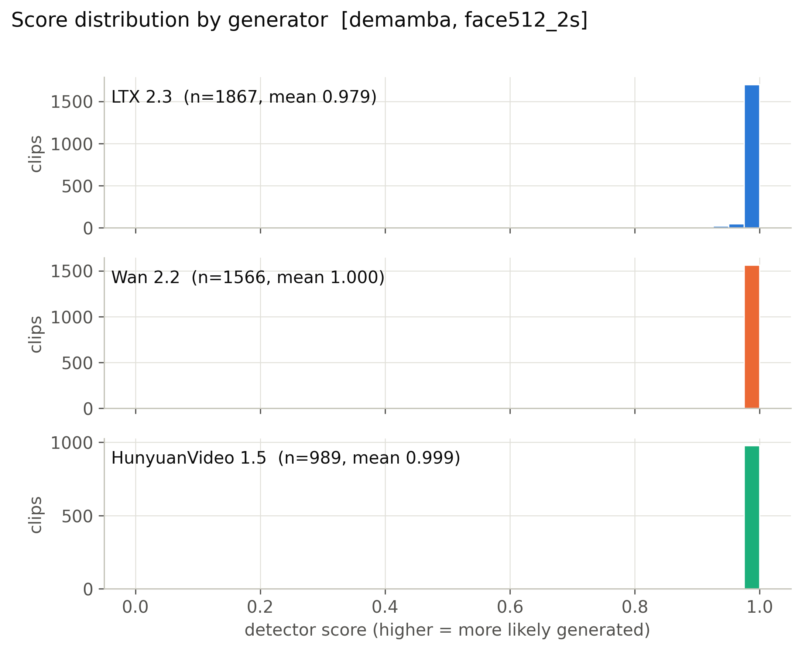

**Mean score, 56 cells x generator.** (`figures/heatmap_mean_score_cells.pdf`)

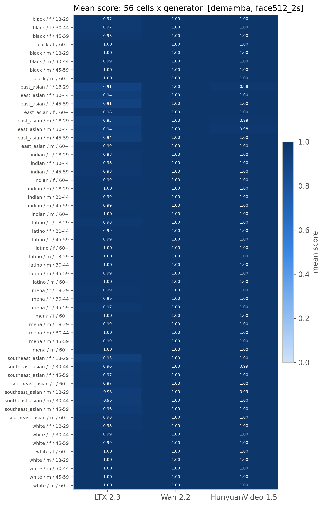

**Detection rate, 56 cells x generator (provisional threshold).** (`figures/heatmap_detection_rate_cells_provisional.pdf`)

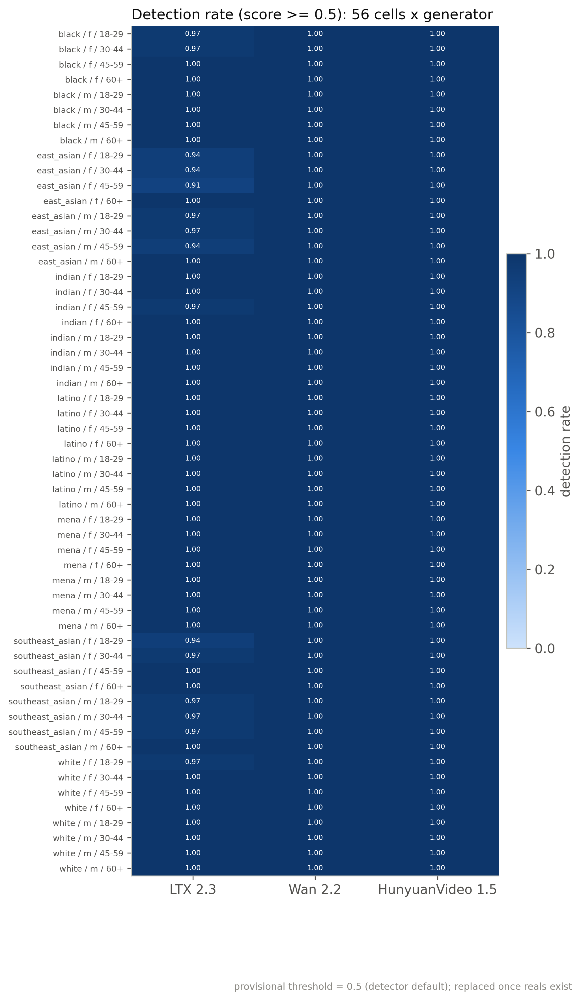

**Mean score by race, gender, age band with 95% CI.** (`figures/subgroup_mean_score.pdf`)

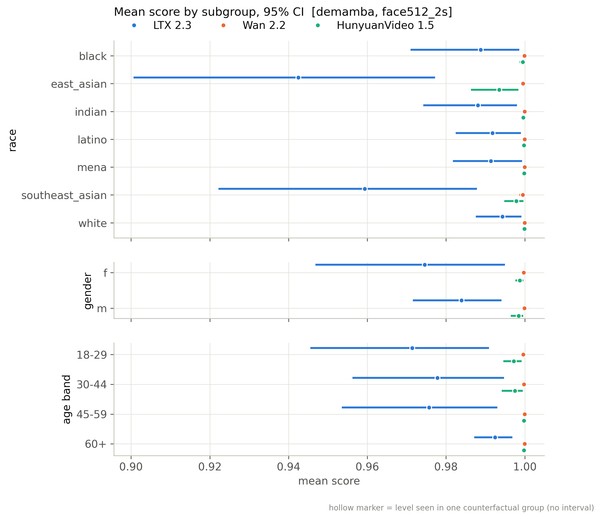

**Mean score by scene factor with 95% CI.** (`figures/scene_factor_mean_score.pdf`)

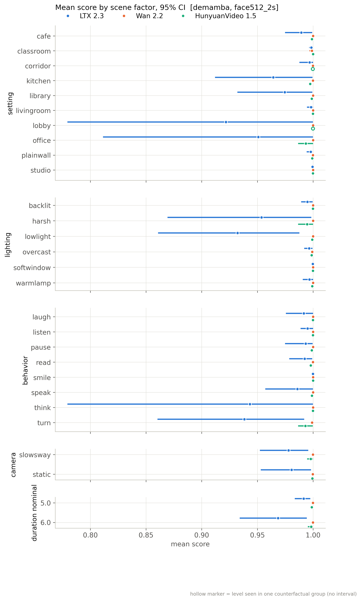

**Detection rate by subgroup (provisional threshold).** (`figures/subgroup_detection_rate_provisional.pdf`)

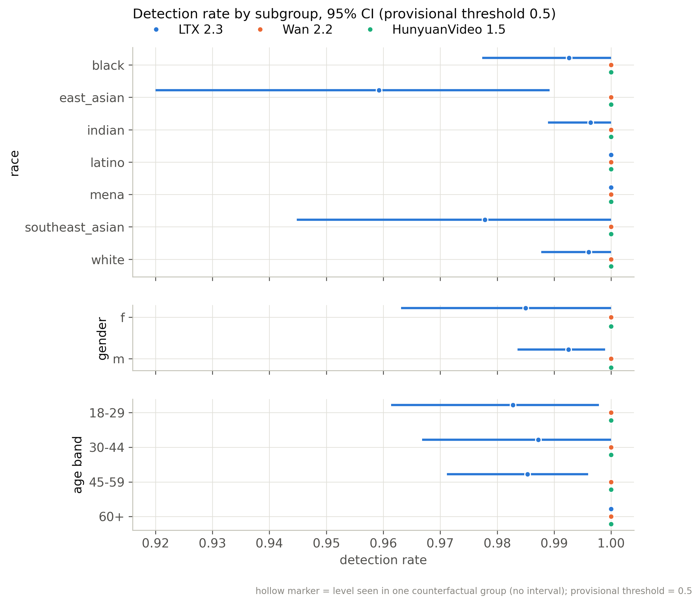

**Distribution of per-group CF spread.** (`figures/cf_spread_distribution.pdf`)

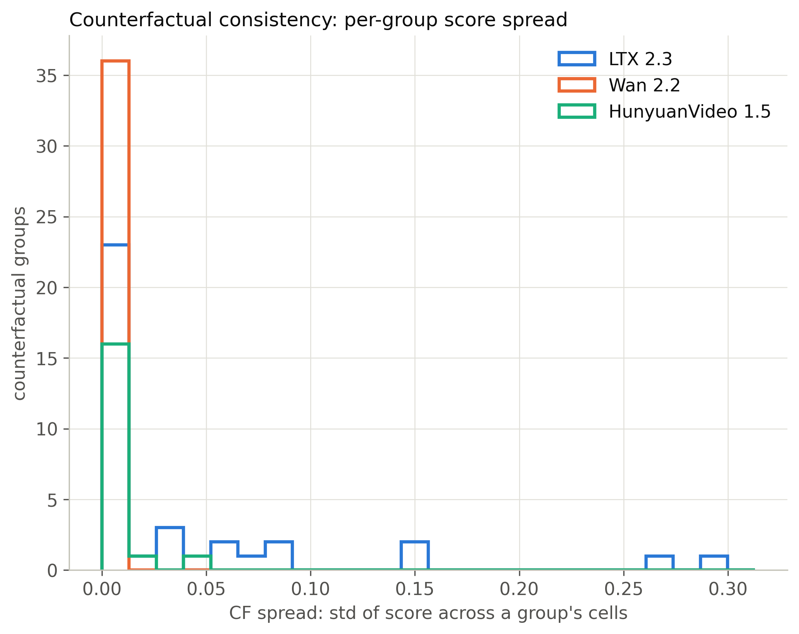

**Flip rate by generator (provisional threshold).** (`figures/flip_rate_by_generator_provisional.pdf`)

**Partial eta squared by factor.** (`figures/factor_attribution_variance_share.pdf`)

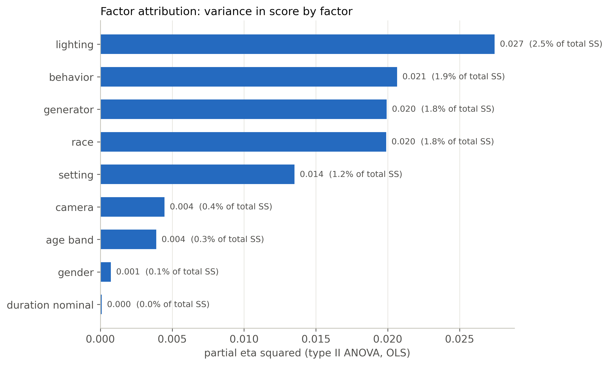

**Highest- and lowest-scoring included clips.** (`figures/example_strip.pdf`)

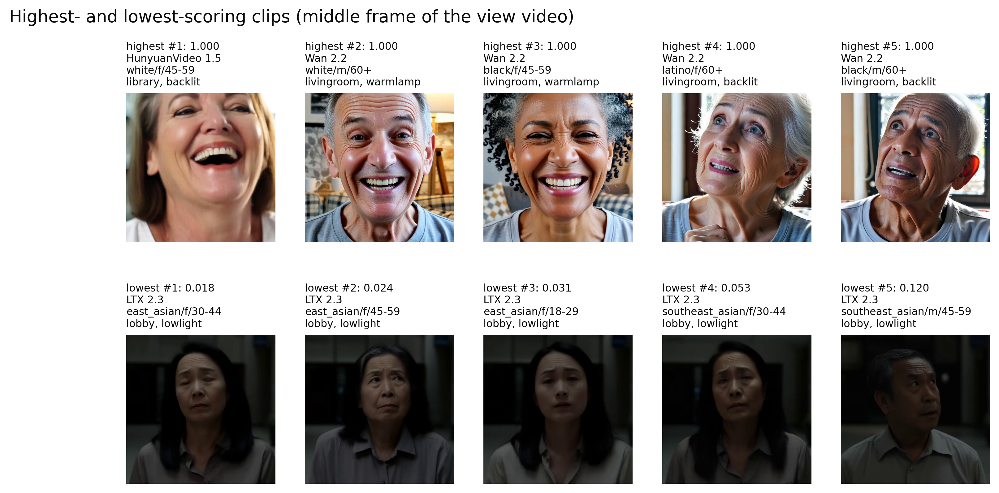

**ROC per generator against fps-matched reals.** (`figures/roc_per_generator.pdf`)

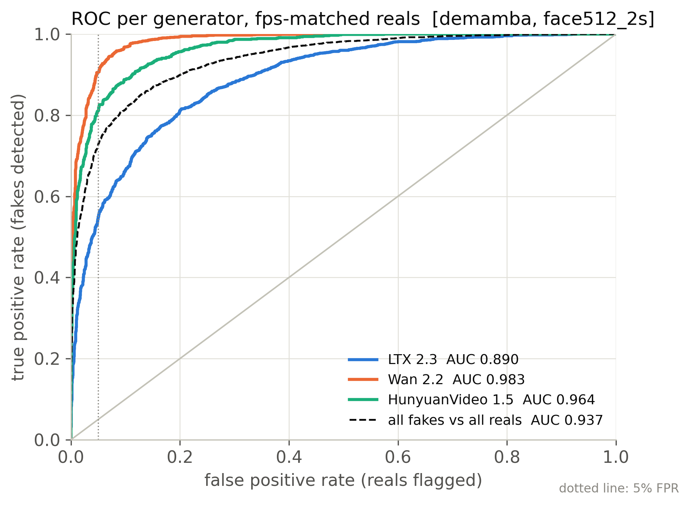

**Real FPR by perceived subgroup at the calibrated threshold.** (`figures/real_fpr_by_subgroup.pdf`)

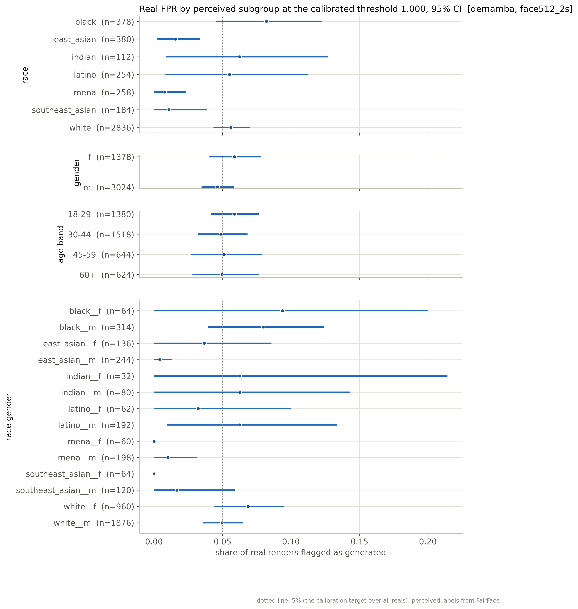

**AUC by subgroup: each subgroup's fakes vs same-subgroup reals.** (`figures/subgroup_auc.pdf`)

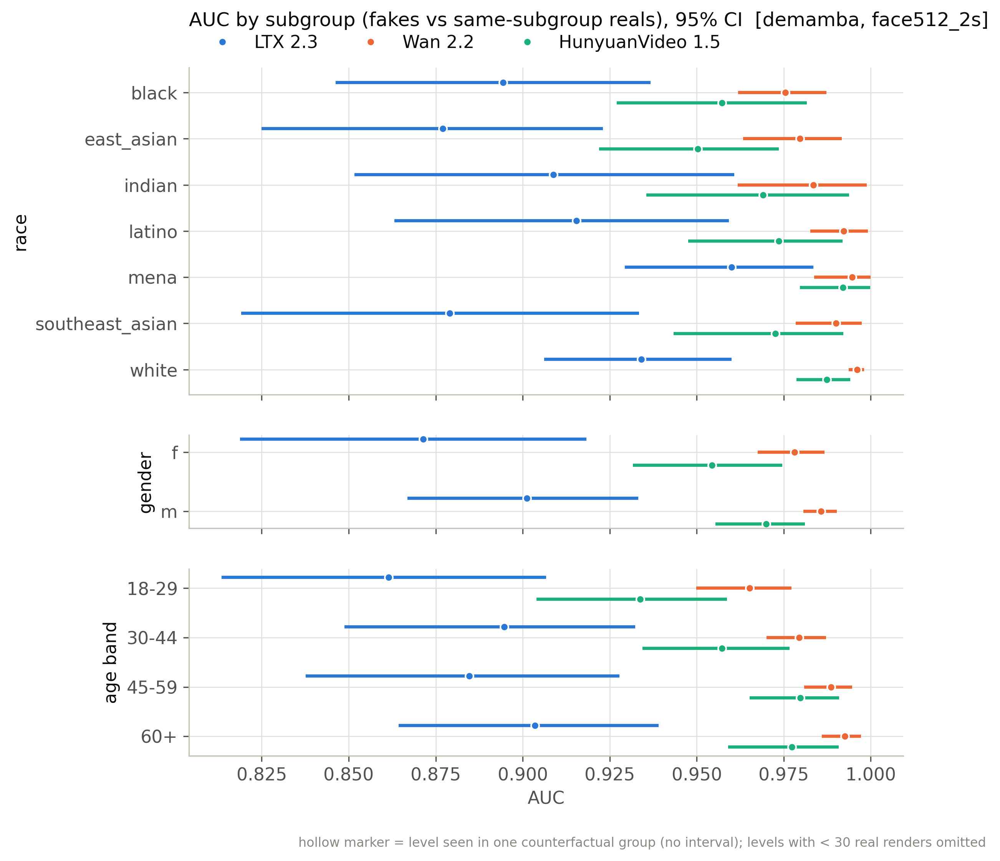

## Files

`manifest_used.csv` (every clip of the active batches with render/score/inclusion flags), `scores.csv` (score per scored clip), `tables/*.csv`, `figures/*`, `snapshot_meta.json`.

