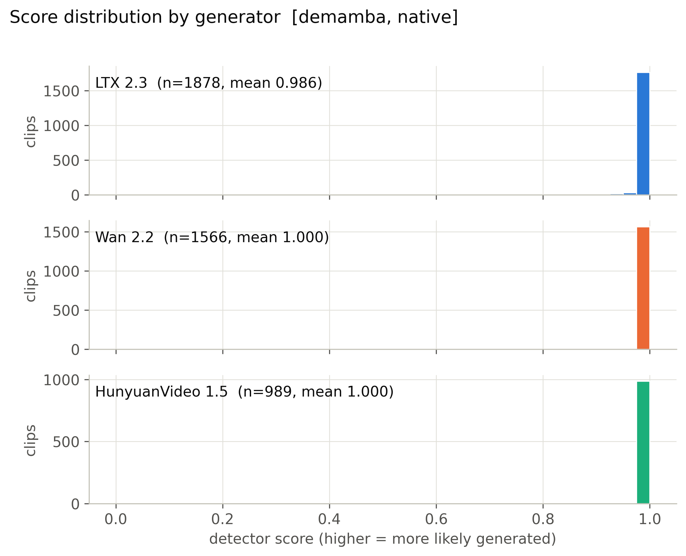
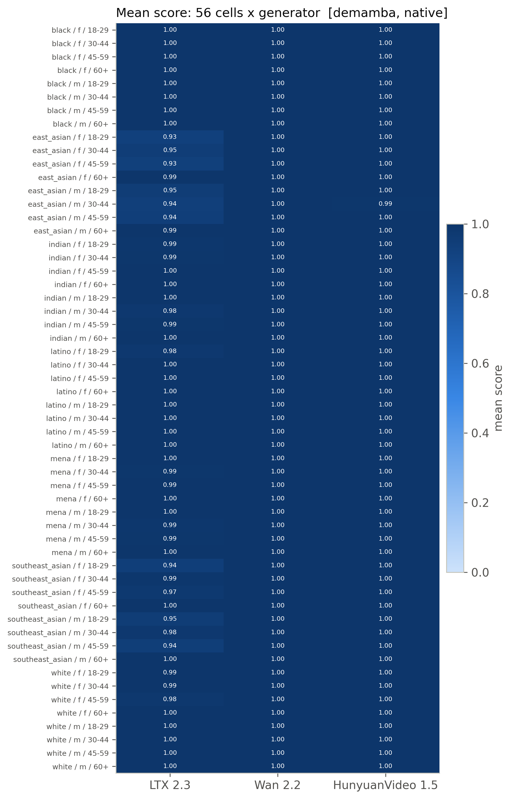
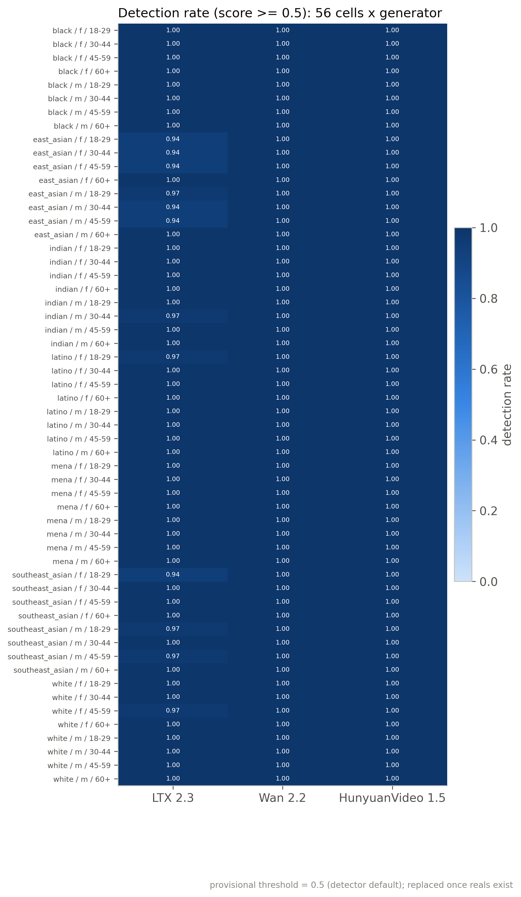
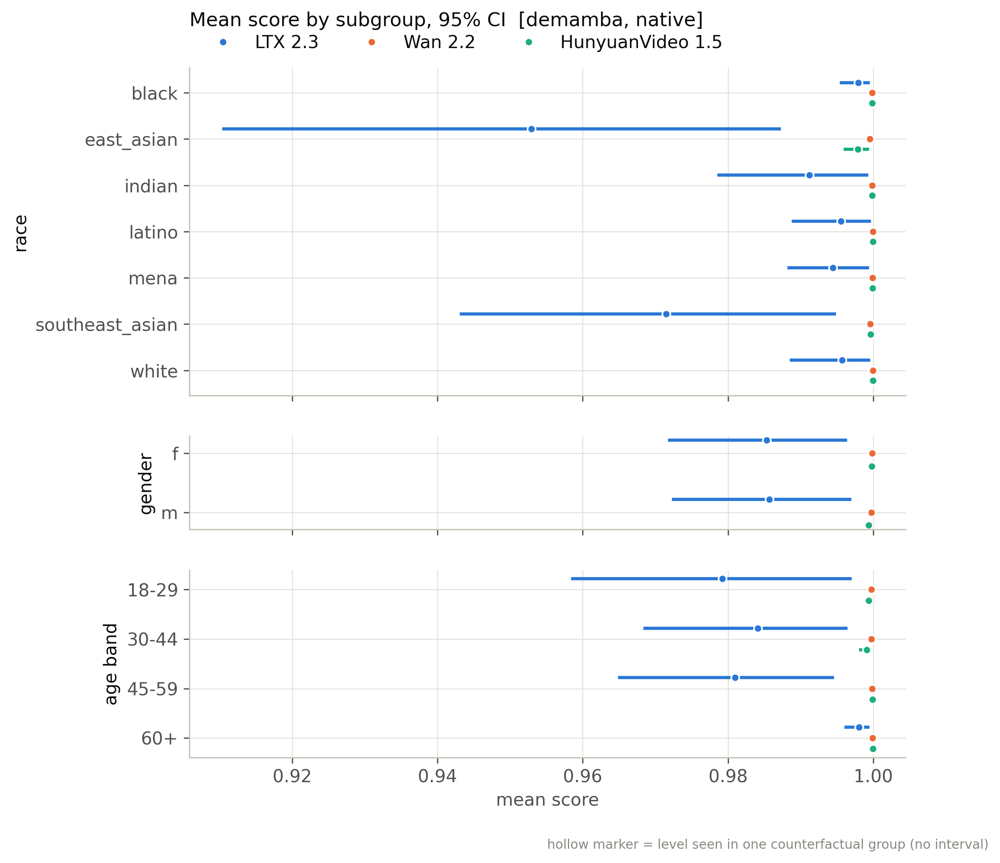
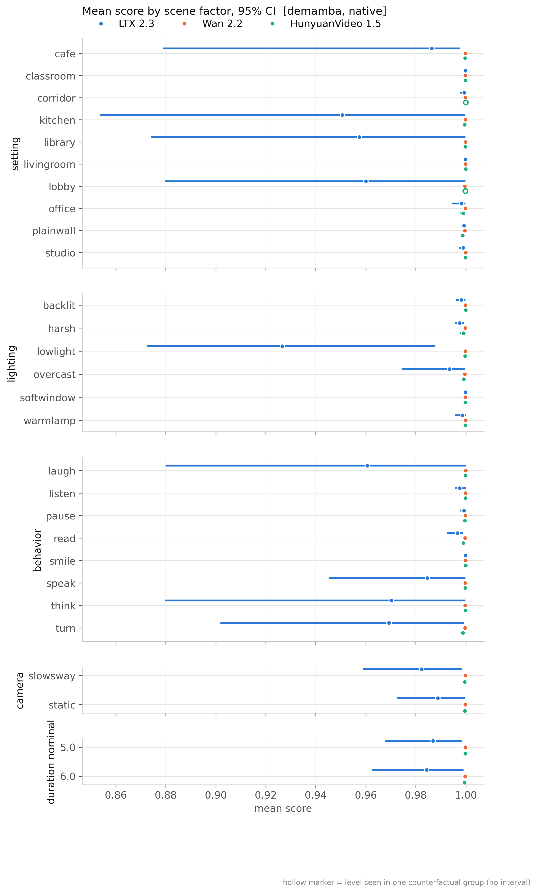
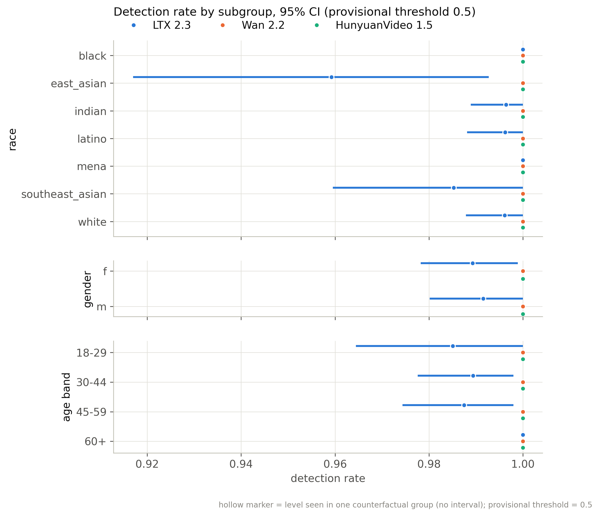
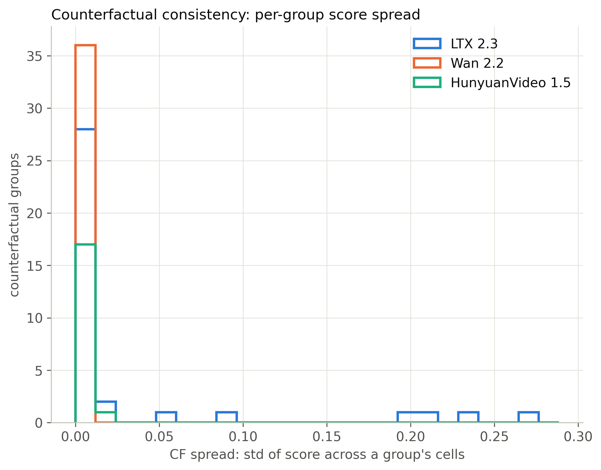
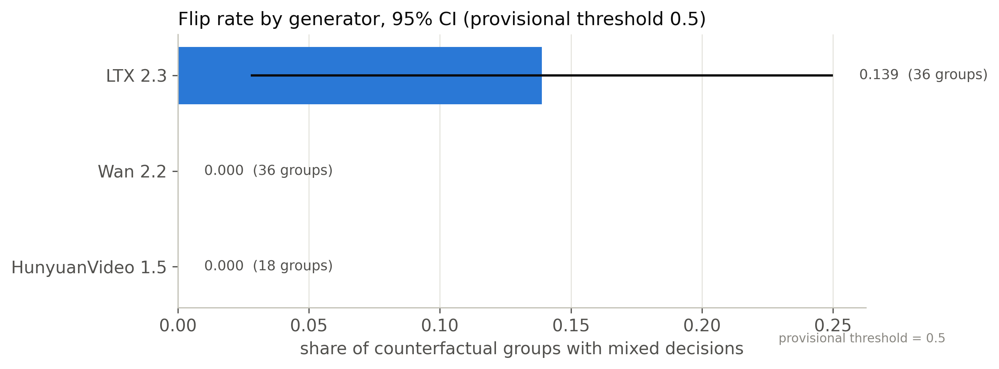
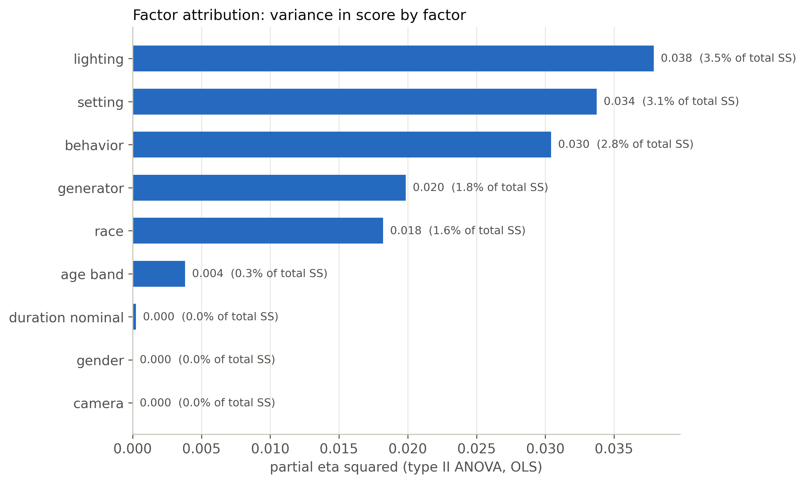
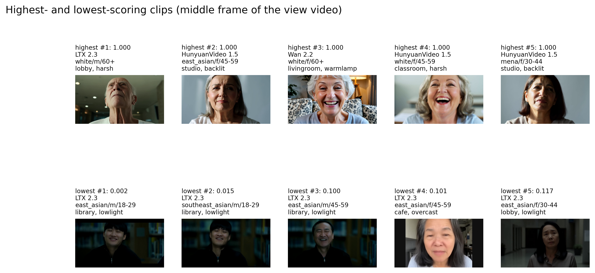

# demamba / native: snapshot 20261021-0618

> **Detector training data.** DeMamba weights are our own (GenVideo-100K, single-GPU adaptation of the authors' code), not an official release; the authors have published none. GenVideo-100K contains none of our generators. On GenVideo validation it flags 16.8% of real videos at 0.5.

> **Provisional threshold.** Every detection rate and flip rate below uses the detector's default threshold (0.5; sigmoid(logit) > 0.5 (training metrics and our standalone evaluator)). They will be replaced by the 5%-real-FPR threshold once reals exist (section 6.3).

## Settings

| setting           | value                                                                                  |
|:------------------|:---------------------------------------------------------------------------------------|
| detector          | demamba 1+504611ba                                                                     |
| checkpoint_sha256 | f89897c72b595aa85a524e59083919cebb0b92161d2a694a2cbffbdd8456ce17                       |
| view              | native (view_hash 1e7dfa0b3c412dce)                                                    |
| ffmpeg            | ffmpeg version 7.1.1 Copyright (c) 2000-2025 the FFmpeg developers                     |
| batches           | fake_b1, fake_b2, real_b1                                                              |
| inclusion set     | primary (technical QC pass AND face QC pass)                                           |
| bootstrap         | 1000 resamples of whole counterfactual groups, seed 20261020, 95% percentile intervals |
| git commit        | ac1140ab3053-dirty                                                                     |
| created           | 2026-10-21T06:18:37Z                                                                   |

Detector preprocessing on top of the view:

| field     | value                                                                                 |
|:----------|:--------------------------------------------------------------------------------------|
| source    | DeMamba Preprocess/video2frame.py + dataloader.py (val) + our standalone evaluator    |
| sampling  | every round(fps/target)-th frame, target 2 fps (>= 4 s) else ceil(8/dur); max 32 kept |
| window    | centre 8 consecutive sampled frames; zero-pad if fewer than 8                         |
| crop      | centre, trim 10% each side of the longer dimension                                    |
| resize    | [224, 224, 'cv2.INTER_LINEAR']                                                        |
| channels  | RGB                                                                                   |
| normalize | {'mean': [0.485, 0.456, 0.406], 'std': [0.229, 0.224, 0.225], 'max_pixel_value': 255} |
| model     | XCLIP_DeMamba (X-CLIP-B/16 vision, fine-tuned) + bidirectional Mamba, 1 logit         |
| score     | sigmoid(logit)                                                                        |
| precision | fp32, TF32 off                                                                        |
| weights   | Ahsanz/DeMamba-GenVideo100K@27468b8201fc55978bbce51450949345867de184                  |

## Coverage

| batch   | generator   |   clips |   primary |   rendered |   view_excluded |   render_failed |   scored |   score_failed |   included |
|:--------|:------------|--------:|----------:|-----------:|----------------:|----------------:|---------:|---------------:|-----------:|
| fake_b1 | hunyuan15   |     504 |       492 |        504 |               0 |               0 |      504 |              0 |        492 |
| fake_b1 | ltx23       |    2016 |      1878 |       2016 |               0 |               0 |     2016 |              0 |       1878 |
| fake_b1 | wan22       |    2016 |      1566 |       2016 |               0 |               0 |     2016 |              0 |       1566 |
| fake_b2 | hunyuan15   |     504 |       497 |        504 |               0 |               0 |      504 |              0 |        497 |
| real_b1 | real        |    1785 |      1684 |          0 |            1785 |               0 |        0 |              0 |          0 |

Reals scored: 0. Fakes included: 4433 of 5040 scored (0 scoring failures).

## Observations

- LTX 2.3: mean score 0.986 [0.972, 0.997], median 1.000, n = 1878.
- Wan 2.2: mean score 1.000 [1.000, 1.000], median 1.000, n = 1566.
- HunyuanVideo 1.5: mean score 1.000 [0.999, 1.000], median 1.000, n = 989.
- Provisional detection rate (score >= 0.5), LTX 2.3: 99.0% [98.0, 99.9].
- Provisional detection rate (score >= 0.5), Wan 2.2: 100.0% [100.0, 100.0].
- Provisional detection rate (score >= 0.5), HunyuanVideo 1.5: 100.0% [100.0, 100.0].
- Provisional detection rate (score >= 0.5), all: 99.6% [99.2, 100.0].
- Largest race score gap: LTX 2.3 0.045 [0.012, 0.086] (black 0.998 vs east_asian 0.953).
- Largest gender score gap: LTX 2.3 0.000 [0.000, 0.006] (m 0.986 vs f 0.985).
- Largest age band score gap: LTX 2.3 0.019 [0.005, 0.039] (60+ 0.998 vs 18-29 0.979).
- Largest cell score gap: LTX 2.3 0.073 [0.032, 0.162] (mena__m__60+ 1.000 vs east_asian__f__18-29 0.927).
- Largest scene-factor gap (all generators): lighting 0.030 [0.006, 0.059] (softwindow vs lowlight).
- Largest partial eta squared: lighting 0.038, setting 0.034, behavior 0.030; residual holds 87.9% of total SS.
- CF spread, LTX 2.3: 0.032 [0.011, 0.057] over 36 groups (max 0.275).
- CF spread, Wan 2.2: 0.000 [0.000, 0.000] over 36 groups (max 0.001).
- CF spread, HunyuanVideo 1.5: 0.002 [0.000, 0.004] over 18 groups (max 0.014).
- Provisional flip rate, LTX 2.3: 13.9% of 36 groups [2.8, 25.0].
- Provisional flip rate, Wan 2.2: 0.0% of 36 groups [0.0, 0.0].
- Provisional flip rate, HunyuanVideo 1.5: 0.0% of 18 groups [0.0, 0.0].

## 6.1 Fakes only, no threshold

### Mean score by generator

| generator   |    n |   n_groups |   estimate |   ci_lo |   ci_hi |    sd |   median |   q05 |   q95 |
|:------------|-----:|-----------:|-----------:|--------:|--------:|------:|---------:|------:|------:|
| ltx23       | 1878 |         36 |      0.986 |   0.972 |   0.997 | 0.082 |        1 | 0.959 |     1 |
| wan22       | 1566 |         36 |      1     |   1     |   1     | 0     |        1 | 0.999 |     1 |
| hunyuan15   |  989 |         18 |      1     |   0.999 |   1     | 0.004 |        1 | 0.999 |     1 |
| all         | 4433 |         36 |      0.994 |   0.988 |   0.998 | 0.054 |        1 | 0.996 |     1 |

### Mean score by race

| generator   | level           |   n |   estimate |   ci_lo |   ci_hi |   median |
|:------------|:----------------|----:|-----------:|--------:|--------:|---------:|
| ltx23       | black           | 273 |      0.998 |   0.995 |   1     |        1 |
| ltx23       | east_asian      | 270 |      0.953 |   0.91  |   0.987 |        1 |
| ltx23       | indian          | 277 |      0.991 |   0.979 |   0.999 |        1 |
| ltx23       | latino          | 262 |      0.996 |   0.989 |   1     |        1 |
| ltx23       | mena            | 267 |      0.994 |   0.988 |   0.999 |        1 |
| ltx23       | southeast_asian | 271 |      0.971 |   0.943 |   0.995 |        1 |
| ltx23       | white           | 258 |      0.996 |   0.989 |   1     |        1 |
| wan22       | black           | 217 |      1     |   1     |   1     |        1 |
| wan22       | east_asian      | 226 |      1     |   0.999 |   1     |        1 |
| wan22       | indian          | 230 |      1     |   1     |   1     |        1 |
| wan22       | latino          | 219 |      1     |   1     |   1     |        1 |
| wan22       | mena            | 225 |      1     |   1     |   1     |        1 |
| wan22       | southeast_asian | 229 |      1     |   0.999 |   1     |        1 |
| wan22       | white           | 220 |      1     |   1     |   1     |        1 |
| hunyuan15   | black           | 141 |      1     |   1     |   1     |        1 |
| hunyuan15   | east_asian      | 141 |      0.998 |   0.996 |   0.999 |        1 |
| hunyuan15   | indian          | 142 |      1     |   1     |   1     |        1 |
| hunyuan15   | latino          | 142 |      1     |   1     |   1     |        1 |
| hunyuan15   | mena            | 139 |      1     |   1     |   1     |        1 |
| hunyuan15   | southeast_asian | 143 |      1     |   0.999 |   1     |        1 |
| hunyuan15   | white           | 141 |      1     |   1     |   1     |        1 |
| all         | black           | 631 |      0.999 |   0.998 |   1     |        1 |
| all         | east_asian      | 637 |      0.979 |   0.961 |   0.994 |        1 |
| all         | indian          | 649 |      0.996 |   0.991 |   1     |        1 |
| all         | latino          | 623 |      0.998 |   0.995 |   1     |        1 |
| all         | mena            | 631 |      0.998 |   0.995 |   1     |        1 |
| all         | southeast_asian | 643 |      0.988 |   0.976 |   0.998 |        1 |
| all         | white           | 619 |      0.998 |   0.995 |   1     |        1 |

### Mean score by gender

| generator   | level   |    n |   estimate |   ci_lo |   ci_hi |   median |
|:------------|:--------|-----:|-----------:|--------:|--------:|---------:|
| ltx23       | f       |  931 |      0.985 |   0.972 |   0.996 |        1 |
| ltx23       | m       |  947 |      0.986 |   0.972 |   0.997 |        1 |
| wan22       | f       |  785 |      1     |   1     |   1     |        1 |
| wan22       | m       |  781 |      1     |   1     |   1     |        1 |
| hunyuan15   | f       |  495 |      1     |   1     |   1     |        1 |
| hunyuan15   | m       |  494 |      0.999 |   0.999 |   1     |        1 |
| all         | f       | 2211 |      0.994 |   0.988 |   0.998 |        1 |
| all         | m       | 2222 |      0.994 |   0.988 |   0.998 |        1 |

### Mean score by age band

| generator   | level   |    n |   estimate |   ci_lo |   ci_hi |   median |
|:------------|:--------|-----:|-----------:|--------:|--------:|---------:|
| ltx23       | 18-29   |  469 |      0.979 |   0.958 |   0.997 |        1 |
| ltx23       | 30-44   |  471 |      0.984 |   0.968 |   0.996 |        1 |
| ltx23       | 45-59   |  478 |      0.981 |   0.965 |   0.995 |        1 |
| ltx23       | 60+     |  460 |      0.998 |   0.996 |   0.999 |        1 |
| wan22       | 18-29   |  388 |      1     |   1     |   1     |        1 |
| wan22       | 30-44   |  377 |      1     |   1     |   1     |        1 |
| wan22       | 45-59   |  398 |      1     |   1     |   1     |        1 |
| wan22       | 60+     |  403 |      1     |   1     |   1     |        1 |
| hunyuan15   | 18-29   |  242 |      0.999 |   0.999 |   1     |        1 |
| hunyuan15   | 30-44   |  248 |      0.999 |   0.998 |   1     |        1 |
| hunyuan15   | 45-59   |  250 |      1     |   1     |   1     |        1 |
| hunyuan15   | 60+     |  249 |      1     |   1     |   1     |        1 |
| all         | 18-29   | 1099 |      0.991 |   0.982 |   0.998 |        1 |
| all         | 30-44   | 1096 |      0.993 |   0.986 |   0.998 |        1 |
| all         | 45-59   | 1126 |      0.992 |   0.985 |   0.998 |        1 |
| all         | 60+     | 1112 |      0.999 |   0.998 |   1     |        1 |

### Mean score by scene factor (all generators pooled)

| factor           | level      |    n |   estimate |   ci_lo |   ci_hi |
|:-----------------|:-----------|-----:|-----------:|--------:|--------:|
| setting          | cafe       |  376 |      0.993 |   0.955 |   0.998 |
| setting          | classroom  |  373 |      1     |   1     |   1     |
| setting          | corridor   |  493 |      1     |   0.999 |   1     |
| setting          | kitchen    |  441 |      0.981 |   0.924 |   1     |
| setting          | library    |  534 |      0.983 |   0.936 |   1     |
| setting          | livingroom |  530 |      1     |   1     |   1     |
| setting          | lobby      |  345 |      0.98  |   0.955 |   1     |
| setting          | office     |  357 |      0.999 |   0.996 |   1     |
| setting          | plainwall  |  553 |      0.999 |   0.999 |   1     |
| setting          | studio     |  431 |      1     |   0.999 |   1     |
| lighting         | backlit    |  790 |      0.999 |   0.998 |   1     |
| lighting         | harsh      |  632 |      0.999 |   0.997 |   1     |
| lighting         | lowlight   |  784 |      0.97  |   0.941 |   0.995 |
| lighting         | overcast   |  692 |      0.997 |   0.987 |   1     |
| lighting         | softwindow |  821 |      1     |   1     |   1     |
| lighting         | warmlamp   |  714 |      0.999 |   0.998 |   1     |
| behavior         | laugh      |  500 |      0.986 |   0.951 |   1     |
| behavior         | listen     |  680 |      0.999 |   0.998 |   1     |
| behavior         | pause      |  520 |      1     |   0.998 |   1     |
| behavior         | read       |  576 |      0.998 |   0.997 |   0.999 |
| behavior         | smile      |  538 |      1     |   1     |   1     |
| behavior         | speak      |  530 |      0.993 |   0.979 |   1     |
| behavior         | think      |  509 |      0.987 |   0.955 |   1     |
| behavior         | turn       |  580 |      0.985 |   0.949 |   1     |
| camera           | slowsway   | 2225 |      0.992 |   0.982 |   0.999 |
| camera           | static     | 2208 |      0.995 |   0.989 |   1     |
| duration_nominal | 5.0        | 2227 |      0.995 |   0.987 |   0.999 |
| duration_nominal | 6.0        | 2206 |      0.993 |   0.983 |   0.999 |

Per-generator scene-factor and 56-cell rows: `tables/score_by_breakdown.csv`.

### Subgroup gap (max - min of level means)

A gap is max - min, so it is never negative and its interval cannot include 0; it is a size, not a test of a difference. Over many levels with few clips each (56 cells; HunyuanVideo has 9 groups per cell) the gap also grows with noise, so compare it with the per-level intervals in `tables/score_by_breakdown.csv`. Levels seen in a single counterfactual group have no interval.

| generator   | attribute        |   n_levels |   gap |   ci_lo |   ci_hi | max_level     | min_level            |
|:------------|:-----------------|-----------:|------:|--------:|--------:|:--------------|:---------------------|
| ltx23       | race             |          7 | 0.045 |   0.012 |   0.086 | black         | east_asian           |
| ltx23       | gender           |          2 | 0     |   0     |   0.006 | m             | f                    |
| ltx23       | age_band         |          4 | 0.019 |   0.005 |   0.039 | 60+           | 18-29                |
| ltx23       | cell             |         56 | 0.073 |   0.032 |   0.162 | mena__m__60+  | east_asian__f__18-29 |
| ltx23       | setting          |         10 | 0.049 |   0.019 |   0.146 | livingroom    | kitchen              |
| ltx23       | lighting         |          6 | 0.073 |   0.014 |   0.127 | softwindow    | lowlight             |
| ltx23       | behavior         |          8 | 0.039 |   0.015 |   0.126 | smile         | laugh                |
| ltx23       | camera           |          2 | 0.007 |   0     |   0.033 | static        | slowsway             |
| ltx23       | duration_nominal |          2 | 0.003 |   0     |   0.03  | 5.0           | 6.0                  |
| wan22       | race             |          7 | 0     |   0     |   0.001 | white         | east_asian           |
| wan22       | gender           |          2 | 0     |   0     |   0     | f             | m                    |
| wan22       | age_band         |          4 | 0     |   0     |   0     | 60+           | 18-29                |
| wan22       | cell             |         56 | 0.001 |   0.001 |   0.002 | white__f__60+ | east_asian__m__18-29 |
| wan22       | setting          |         10 | 0     |   0     |   0.001 | studio        | plainwall            |
| wan22       | lighting         |          6 | 0     |   0     |   0     | warmlamp      | overcast             |
| wan22       | behavior         |          8 | 0     |   0     |   0.001 | smile         | read                 |
| wan22       | camera           |          2 | 0     |   0     |   0     | static        | slowsway             |
| wan22       | duration_nominal |          2 | 0     |   0     |   0     | 5.0           | 6.0                  |
| hunyuan15   | race             |          7 | 0.002 |   0.001 |   0.004 | white         | east_asian           |
| hunyuan15   | gender           |          2 | 0     |   0     |   0.001 | f             | m                    |
| hunyuan15   | age_band         |          4 | 0.001 |   0     |   0.002 | 60+           | 30-44                |
| hunyuan15   | cell             |         56 | 0.01  |   0.002 |   0.023 | white__f__60+ | east_asian__m__30-44 |
| hunyuan15   | setting          |         10 | 0.001 |   0     |   0.002 | corridor      | plainwall            |
| hunyuan15   | lighting         |          6 | 0.001 |   0     |   0.002 | backlit       | harsh                |
| hunyuan15   | behavior         |          8 | 0.001 |   0     |   0.002 | smile         | turn                 |
| hunyuan15   | camera           |          2 | 0     |   0     |   0.001 | static        | slowsway             |
| hunyuan15   | duration_nominal |          2 | 0     |   0     |   0.001 | 5.0           | 6.0                  |
| all         | race             |          7 | 0.02  |   0.006 |   0.037 | black         | east_asian           |
| all         | gender           |          2 | 0     |   0     |   0.002 | f             | m                    |
| all         | age_band         |          4 | 0.008 |   0.002 |   0.017 | 60+           | 18-29                |
| all         | cell             |         56 | 0.031 |   0.015 |   0.069 | mena__m__60+  | east_asian__f__18-29 |
| all         | setting          |         10 | 0.019 |   0.008 |   0.076 | livingroom    | lobby                |
| all         | lighting         |          6 | 0.03  |   0.006 |   0.059 | softwindow    | lowlight             |
| all         | behavior         |          8 | 0.015 |   0.006 |   0.064 | smile         | turn                 |
| all         | camera           |          2 | 0.003 |   0     |   0.014 | static        | slowsway             |
| all         | duration_nominal |          2 | 0.002 |   0     |   0.014 | 5.0           | 6.0                  |

### CF spread (mean over groups of the std of score across the group's cells)

| generator   |   n_groups |   cf_spread |   ci_lo |   ci_hi |   median |   max |
|:------------|-----------:|------------:|--------:|--------:|---------:|------:|
| ltx23       |         36 |       0.032 |   0.011 |   0.057 |    0.001 | 0.275 |
| wan22       |         36 |       0     |   0     |   0     |    0     | 0.001 |
| hunyuan15   |         18 |       0.002 |   0     |   0.004 |    0     | 0.014 |

### Factor attribution

OLS with every factor as a fixed effect, type-II ANOVA. `ss_share` is the factor's type-II sum of squares over the total sum of squares (type-II shares need not add to 1). Scene factors are constant within a counterfactual group, so their effects are estimated from between-group differences only. The OLS F tests treat clips as independent although clips are clustered in counterfactual groups, so their p values are optimistic; use the group-bootstrap intervals above for inference.

| factor           |   df |     sum_sq | F         | p         | partial_eta2   |   ss_share |
|:-----------------|-----:|-----------:|:----------|:----------|:---------------|-----------:|
| race             |    6 |  0.212     | 13.59     | 2.374e-15 | 0.01821        |  0.01631   |
| gender           |    1 |  3.466e-05 | 0.01333   | 0.9081    | 3.032e-06      |  2.666e-06 |
| age_band         |    3 |  0.04381   | 5.617     | 0.0007689 | 0.003818       |  0.00337   |
| setting          |    9 |  0.399     | 17.06     | 5.463e-28 | 0.03373        |  0.0307    |
| lighting         |    5 |  0.4501    | 34.63     | 7.672e-35 | 0.03789        |  0.03463   |
| behavior         |    7 |  0.3586    | 19.71     | 3.667e-26 | 0.03042        |  0.02759   |
| camera           |    1 |  1.973e-06 | 0.0007588 | 0.978     | 1.726e-07      |  1.518e-07 |
| duration_nominal |    1 |  0.002805  | 1.079     | 0.2989    | 0.0002454      |  0.0002158 |
| generator        |    2 |  0.2316    | 44.55     | 7.008e-20 | 0.01986        |  0.01782   |
| Residual         | 4397 | 11.43      |           |           |                |  0.8794    |

Lighting x race interaction (added to the same OLS):

| term            |   df |   sum_sq |    F |         p |   partial_eta2 |
|:----------------|-----:|---------:|-----:|----------:|---------------:|
| lighting x race |   30 |   0.6628 | 8.96 | 8.289e-39 |        0.05798 |

Mixed model `score ~ factors + (1 | counterfactual_group)` (REML) variance components (fixed effects: `tables/factor_mixed_fixed.csv`):

| component                               |   variance | converged   |
|:----------------------------------------|-----------:|:------------|
| counterfactual_group (random intercept) |   0        | True        |
| residual                                |   0.002559 | True        |
| ICC (group share of random variance)    |   0        | True        |

A group variance at or near 0 is a boundary estimate: setting, lighting, behavior, camera and duration are fixed per group and absorb most between-group variation, leaving little for the random intercept. It does not mean scenes do not matter.

## 6.2 Provisional (threshold 0.5, provisional)

### Detection rate by generator (provisional)

| generator   |    n |   estimate |   ci_lo |   ci_hi |
|:------------|-----:|-----------:|--------:|--------:|
| ltx23       | 1878 |      0.99  |   0.98  |   0.999 |
| wan22       | 1566 |      1     |   1     |   1     |
| hunyuan15   |  989 |      1     |   1     |   1     |
| all         | 4433 |      0.996 |   0.992 |   1     |

### Detection rate by race (provisional)

| generator   | level           |   n |   estimate |   ci_lo |   ci_hi |
|:------------|:----------------|----:|-----------:|--------:|--------:|
| ltx23       | black           | 273 |      1     |   1     |   1     |
| ltx23       | east_asian      | 270 |      0.959 |   0.917 |   0.993 |
| ltx23       | indian          | 277 |      0.996 |   0.989 |   1     |
| ltx23       | latino          | 262 |      0.996 |   0.988 |   1     |
| ltx23       | mena            | 267 |      1     |   1     |   1     |
| ltx23       | southeast_asian | 271 |      0.985 |   0.96  |   1     |
| ltx23       | white           | 258 |      0.996 |   0.988 |   1     |
| wan22       | black           | 217 |      1     |   1     |   1     |
| wan22       | east_asian      | 226 |      1     |   1     |   1     |
| wan22       | indian          | 230 |      1     |   1     |   1     |
| wan22       | latino          | 219 |      1     |   1     |   1     |
| wan22       | mena            | 225 |      1     |   1     |   1     |
| wan22       | southeast_asian | 229 |      1     |   1     |   1     |
| wan22       | white           | 220 |      1     |   1     |   1     |
| hunyuan15   | black           | 141 |      1     |   1     |   1     |
| hunyuan15   | east_asian      | 141 |      1     |   1     |   1     |
| hunyuan15   | indian          | 142 |      1     |   1     |   1     |
| hunyuan15   | latino          | 142 |      1     |   1     |   1     |
| hunyuan15   | mena            | 139 |      1     |   1     |   1     |
| hunyuan15   | southeast_asian | 143 |      1     |   1     |   1     |
| hunyuan15   | white           | 141 |      1     |   1     |   1     |
| all         | black           | 631 |      1     |   1     |   1     |
| all         | east_asian      | 637 |      0.983 |   0.965 |   0.997 |
| all         | indian          | 649 |      0.998 |   0.995 |   1     |
| all         | latino          | 623 |      0.998 |   0.995 |   1     |
| all         | mena            | 631 |      1     |   1     |   1     |
| all         | southeast_asian | 643 |      0.994 |   0.983 |   1     |
| all         | white           | 619 |      0.998 |   0.995 |   1     |

### Detection rate by gender (provisional)

| generator   | level   |    n |   estimate |   ci_lo |   ci_hi |
|:------------|:--------|-----:|-----------:|--------:|--------:|
| ltx23       | f       |  931 |      0.989 |   0.978 |   0.999 |
| ltx23       | m       |  947 |      0.992 |   0.98  |   1     |
| wan22       | f       |  785 |      1     |   1     |   1     |
| wan22       | m       |  781 |      1     |   1     |   1     |
| hunyuan15   | f       |  495 |      1     |   1     |   1     |
| hunyuan15   | m       |  494 |      1     |   1     |   1     |
| all         | f       | 2211 |      0.995 |   0.991 |   1     |
| all         | m       | 2222 |      0.996 |   0.992 |   1     |

### Detection rate by age band (provisional)

| generator   | level   |    n |   estimate |   ci_lo |   ci_hi |
|:------------|:--------|-----:|-----------:|--------:|--------:|
| ltx23       | 18-29   |  469 |      0.985 |   0.964 |   1     |
| ltx23       | 30-44   |  471 |      0.989 |   0.978 |   0.998 |
| ltx23       | 45-59   |  478 |      0.987 |   0.974 |   0.998 |
| ltx23       | 60+     |  460 |      1     |   1     |   1     |
| wan22       | 18-29   |  388 |      1     |   1     |   1     |
| wan22       | 30-44   |  377 |      1     |   1     |   1     |
| wan22       | 45-59   |  398 |      1     |   1     |   1     |
| wan22       | 60+     |  403 |      1     |   1     |   1     |
| hunyuan15   | 18-29   |  242 |      1     |   1     |   1     |
| hunyuan15   | 30-44   |  248 |      1     |   1     |   1     |
| hunyuan15   | 45-59   |  250 |      1     |   1     |   1     |
| hunyuan15   | 60+     |  249 |      1     |   1     |   1     |
| all         | 18-29   | 1099 |      0.994 |   0.985 |   1     |
| all         | 30-44   | 1096 |      0.995 |   0.99  |   0.999 |
| all         | 45-59   | 1126 |      0.995 |   0.989 |   0.999 |
| all         | 60+     | 1112 |      1     |   1     |   1     |

### Detection-rate gap (provisional)

| generator   | attribute        |   gap |   ci_lo |   ci_hi | max_level       | min_level            |
|:------------|:-----------------|------:|--------:|--------:|:----------------|:---------------------|
| ltx23       | race             | 0.041 |   0.007 |   0.083 | black           | east_asian           |
| ltx23       | gender           | 0.002 |   0     |   0.01  | m               | f                    |
| ltx23       | age_band         | 0.015 |   0.002 |   0.036 | 60+             | 18-29                |
| ltx23       | cell             | 0.062 |   0.029 |   0.179 | black__f__18-29 | east_asian__f__18-29 |
| ltx23       | setting          | 0.038 |   0.01  |   0.127 | classroom       | library              |
| ltx23       | lighting         | 0.053 |   0.008 |   0.098 | backlit         | lowlight             |
| ltx23       | behavior         | 0.04  |   0.008 |   0.121 | listen          | laugh                |
| ltx23       | camera           | 0.008 |   0     |   0.029 | static          | slowsway             |
| ltx23       | duration_nominal | 0.001 |   0     |   0.025 | 6.0             | 5.0                  |
| wan22       | race             | 0     |   0     |   0     | black           | black                |
| wan22       | gender           | 0     |   0     |   0     | f               | f                    |
| wan22       | age_band         | 0     |   0     |   0     | 18-29           | 18-29                |
| wan22       | cell             | 0     |   0     |   0     | black__f__18-29 | black__f__18-29      |
| wan22       | setting          | 0     |   0     |   0     | cafe            | cafe                 |
| wan22       | lighting         | 0     |   0     |   0     | backlit         | backlit              |
| wan22       | behavior         | 0     |   0     |   0     | laugh           | laugh                |
| wan22       | camera           | 0     |   0     |   0     | slowsway        | slowsway             |
| wan22       | duration_nominal | 0     |   0     |   0     | 5.0             | 5.0                  |
| hunyuan15   | race             | 0     |   0     |   0     | black           | black                |
| hunyuan15   | gender           | 0     |   0     |   0     | f               | f                    |
| hunyuan15   | age_band         | 0     |   0     |   0     | 18-29           | 18-29                |
| hunyuan15   | cell             | 0     |   0     |   0     | black__f__18-29 | black__f__18-29      |
| hunyuan15   | setting          | 0     |   0     |   0     | cafe            | cafe                 |
| hunyuan15   | lighting         | 0     |   0     |   0     | backlit         | backlit              |
| hunyuan15   | behavior         | 0     |   0     |   0     | laugh           | laugh                |
| hunyuan15   | camera           | 0     |   0     |   0     | slowsway        | slowsway             |
| hunyuan15   | duration_nominal | 0     |   0     |   0     | 5.0             | 5.0                  |
| all         | race             | 0.017 |   0.003 |   0.035 | black           | east_asian           |
| all         | gender           | 0.001 |   0     |   0.004 | m               | f                    |
| all         | age_band         | 0.006 |   0.001 |   0.015 | 60+             | 18-29                |
| all         | cell             | 0.026 |   0.012 |   0.078 | black__f__18-29 | east_asian__m__45-59 |
| all         | setting          | 0.015 |   0.004 |   0.064 | classroom       | library              |
| all         | lighting         | 0.022 |   0.003 |   0.046 | backlit         | lowlight             |
| all         | behavior         | 0.014 |   0.004 |   0.057 | listen          | laugh                |
| all         | camera           | 0.004 |   0     |   0.013 | static          | slowsway             |
| all         | duration_nominal | 0     |   0     |   0.011 | 5.0             | 6.0                  |

### Flip rate (provisional): share of groups whose clips get different decisions

| generator   |   n_groups |   flip_rate |   ci_lo |   ci_hi |   median |   max |
|:------------|-----------:|------------:|--------:|--------:|---------:|------:|
| ltx23       |         36 |       0.139 |   0.028 |    0.25 |        0 |     1 |
| wan22       |         36 |       0     |   0     |    0    |        0 |     0 |
| hunyuan15   |         18 |       0     |   0     |    0    |        0 |     0 |

### Sensitivity: inclusion set

| set     | generator   |    n |   mean_score |   provisional_detection_rate |
|:--------|:------------|-----:|-------------:|-----------------------------:|
| all     | hunyuan15   | 1008 |        1     |                        1     |
| all     | ltx23       | 2016 |        0.977 |                        0.984 |
| all     | wan22       | 2016 |        1     |                        1     |
| primary | hunyuan15   |  989 |        1     |                        1     |
| primary | ltx23       | 1878 |        0.986 |                        0.99  |
| primary | wan22       | 1566 |        1     |                        1     |

## 6.3 Pending until reals exist

| metric                                                      | status   | reason                |
|:------------------------------------------------------------|:---------|:----------------------|
| AUC, AP, EER, TPR@5%FPR (overall, per generator)            | pending  | needs reals (real_b1) |
| Calibrated threshold (5% FPR on fps-matched reals)          | pending  | needs reals (real_b1) |
| Real FPR by perceived race, gender, age band, race x gender | pending  | needs reals (real_b1) |
| Detection rate and flip rate at the calibrated threshold    | pending  | needs reals (real_b1) |
| Worst-subgroup AUC, subgroup AUC gap                        | pending  | needs reals (real_b1) |
| ROC curves per generator; real FPR by subgroup (figures)    | pending  | needs reals (real_b1) |

## Figures

**Score distribution by generator.** (`figures/score_distribution_by_generator.pdf`)

**Mean score, 56 cells x generator.** (`figures/heatmap_mean_score_cells.pdf`)

**Detection rate, 56 cells x generator (provisional threshold).** (`figures/heatmap_detection_rate_cells_provisional.pdf`)

**Mean score by race, gender, age band with 95% CI.** (`figures/subgroup_mean_score.pdf`)

**Mean score by scene factor with 95% CI.** (`figures/scene_factor_mean_score.pdf`)

**Detection rate by subgroup (provisional threshold).** (`figures/subgroup_detection_rate_provisional.pdf`)

**Distribution of per-group CF spread.** (`figures/cf_spread_distribution.pdf`)

**Flip rate by generator (provisional threshold).** (`figures/flip_rate_by_generator_provisional.pdf`)

**Partial eta squared by factor.** (`figures/factor_attribution_variance_share.pdf`)

**Highest- and lowest-scoring included clips.** (`figures/example_strip.pdf`)

## Files

`manifest_used.csv` (every clip of the active batches with render/score/inclusion flags), `scores.csv` (score per scored clip), `tables/*.csv`, `figures/*`, `snapshot_meta.json`.

