# demamba / native_up: snapshot 20261023-0245

> **Detector training data.** DeMamba weights are our own (GenVideo-100K, single-GPU adaptation of the authors' code), not an official release; the authors have published none. GenVideo-100K contains none of our generators. On GenVideo validation it flags 16.8% of real videos at 0.5.

> **Provisional threshold.** Every detection rate and flip rate below uses the detector's default threshold (0.5; sigmoid(logit) > 0.5 (training metrics and our standalone evaluator)). They will be replaced by the 5%-real-FPR threshold once reals exist (section 6.3).

## Settings

| setting           | value                                                                                  |
|:------------------|:---------------------------------------------------------------------------------------|
| detector          | demamba 1+504611ba                                                                     |
| checkpoint_sha256 | f89897c72b595aa85a524e59083919cebb0b92161d2a694a2cbffbdd8456ce17                       |
| view              | native_up (view_hash 4db0c07a46c4b8d9)                                                 |
| ffmpeg            | ffmpeg version 7.1.1 Copyright (c) 2000-2025 the FFmpeg developers                     |
| batches           | fake_b1, fake_b2, fake_b3, real_all                                                    |
| inclusion set     | primary (technical QC pass AND face QC pass)                                           |
| bootstrap         | 1000 resamples of whole counterfactual groups, seed 20261020, 95% percentile intervals |
| git commit        | 2949de581861-dirty                                                                     |
| created           | 2026-10-23T02:45:17Z                                                                   |

Detector preprocessing on top of the view:

| field     | value                                                                                 |
|:----------|:--------------------------------------------------------------------------------------|
| source    | DeMamba Preprocess/video2frame.py + dataloader.py (val) + our standalone evaluator    |
| sampling  | every round(fps/target)-th frame, target 2 fps (>= 4 s) else ceil(8/dur); max 32 kept |
| window    | centre 8 consecutive sampled frames; zero-pad if fewer than 8                         |
| crop      | centre, trim 10% each side of the longer dimension                                    |
| resize    | [224, 224, 'cv2.INTER_LINEAR']                                                        |
| channels  | RGB                                                                                   |
| normalize | {'mean': [0.485, 0.456, 0.406], 'std': [0.229, 0.224, 0.225], 'max_pixel_value': 255} |
| model     | XCLIP_DeMamba (X-CLIP-B/16 vision, fine-tuned) + bidirectional Mamba, 1 logit         |
| score     | sigmoid(logit)                                                                        |
| precision | fp32, TF32 off                                                                        |
| weights   | Ahsanz/DeMamba-GenVideo100K@27468b8201fc55978bbce51450949345867de184                  |

## Coverage

| batch    | generator   |   clips |   primary |   rendered |   view_excluded |   render_failed |   scored |   score_failed |   included |
|:---------|:------------|--------:|----------:|-----------:|----------------:|----------------:|---------:|---------------:|-----------:|
| fake_b1  | hunyuan15   |     504 |       492 |        504 |               0 |               0 |      504 |              0 |        492 |
| fake_b1  | ltx23       |    2016 |      1878 |       2016 |               0 |               0 |     2016 |              0 |       1878 |
| fake_b1  | wan22       |    2016 |      1566 |       2016 |               0 |               0 |     2016 |              0 |       1566 |
| fake_b2  | hunyuan15   |     504 |       497 |        504 |               0 |               0 |      504 |              0 |        497 |
| fake_b3  | ltx25       |    2016 |      2002 |       2016 |               0 |               0 |     2016 |              0 |       2002 |
| real_all | real        |    2221 |      2221 |        923 |            1275 |              23 |      932 |              0 |        932 |

Reals scored: 1855. Fakes included: 6435 of 8911 scored (0 scoring failures).

## Observations

- LTX 2.3: mean score 0.986 [0.972, 0.997], median 1.000, n = 1878.
- Wan 2.2: mean score 1.000 [1.000, 1.000], median 1.000, n = 1566.
- HunyuanVideo 1.5: mean score 1.000 [0.999, 1.000], median 1.000, n = 989.
- LTX 2.5: mean score 0.990 [0.980, 0.997], median 1.000, n = 2002.
- Provisional detection rate (score >= 0.5), LTX 2.3: 99.0% [98.0, 99.9].
- Provisional detection rate (score >= 0.5), Wan 2.2: 100.0% [100.0, 100.0].
- Provisional detection rate (score >= 0.5), HunyuanVideo 1.5: 100.0% [100.0, 100.0].
- Provisional detection rate (score >= 0.5), LTX 2.5: 99.7% [99.2, 100.0].
- Provisional detection rate (score >= 0.5), all: 99.6% [99.2, 99.9].
- Largest race score gap: LTX 2.3 0.045 [0.012, 0.086] (black 0.998 vs east_asian 0.953).
- Largest gender score gap: LTX 2.5 0.005 [0.000, 0.014] (f 0.992 vs m 0.987).
- Largest age band score gap: LTX 2.3 0.019 [0.005, 0.039] (60+ 0.998 vs 18-29 0.979).
- Largest cell score gap: LTX 2.3 0.073 [0.032, 0.162] (mena__m__60+ 1.000 vs east_asian__f__18-29 0.927).
- Largest scene-factor gap (all generators): lighting 0.036 [0.013, 0.055] (softwindow vs lowlight).
- Largest partial eta squared: lighting 0.035, setting 0.022, race 0.021; residual holds 88.3% of total SS.
- CF spread, LTX 2.3: 0.032 [0.011, 0.057] over 36 groups (max 0.275).
- CF spread, Wan 2.2: 0.000 [0.000, 0.000] over 36 groups (max 0.001).
- CF spread, HunyuanVideo 1.5: 0.002 [0.000, 0.004] over 18 groups (max 0.014).
- CF spread, LTX 2.5: 0.022 [0.007, 0.038] over 36 groups (max 0.230).
- Provisional flip rate, LTX 2.3: 13.9% of 36 groups [2.8, 25.0].
- Provisional flip rate, Wan 2.2: 0.0% of 36 groups [0.0, 0.0].
- Provisional flip rate, HunyuanVideo 1.5: 0.0% of 18 groups [0.0, 0.0].
- Provisional flip rate, LTX 2.5: 11.1% of 36 groups [2.8, 22.2].

## 6.1 Fakes only, no threshold

### Mean score by generator

| generator   |    n |   n_groups |   estimate |   ci_lo |   ci_hi |    sd |   median |   q05 |   q95 |
|:------------|-----:|-----------:|-----------:|--------:|--------:|------:|---------:|------:|------:|
| ltx23       | 1878 |         36 |      0.986 |   0.972 |   0.997 | 0.082 |        1 | 0.959 |     1 |
| wan22       | 1566 |         36 |      1     |   1     |   1     | 0     |        1 | 0.999 |     1 |
| hunyuan15   |  989 |         18 |      1     |   0.999 |   1     | 0.004 |        1 | 0.999 |     1 |
| ltx25       | 2002 |         36 |      0.99  |   0.98  |   0.997 | 0.059 |        1 | 0.972 |     1 |
| all         | 6435 |         36 |      0.992 |   0.986 |   0.997 | 0.056 |        1 | 0.989 |     1 |

### Mean score by race

| generator   | level           |   n |   estimate |   ci_lo |   ci_hi |   median |
|:------------|:----------------|----:|-----------:|--------:|--------:|---------:|
| ltx23       | black           | 273 |      0.998 |   0.995 |   1     |    1     |
| ltx23       | east_asian      | 270 |      0.953 |   0.91  |   0.987 |    1     |
| ltx23       | indian          | 277 |      0.991 |   0.979 |   0.999 |    1     |
| ltx23       | latino          | 262 |      0.996 |   0.989 |   1     |    1     |
| ltx23       | mena            | 267 |      0.994 |   0.988 |   0.999 |    1     |
| ltx23       | southeast_asian | 271 |      0.971 |   0.943 |   0.995 |    1     |
| ltx23       | white           | 258 |      0.996 |   0.989 |   1     |    1     |
| wan22       | black           | 217 |      1     |   1     |   1     |    1     |
| wan22       | east_asian      | 226 |      1     |   0.999 |   1     |    1     |
| wan22       | indian          | 230 |      1     |   1     |   1     |    1     |
| wan22       | latino          | 219 |      1     |   1     |   1     |    1     |
| wan22       | mena            | 225 |      1     |   1     |   1     |    1     |
| wan22       | southeast_asian | 229 |      1     |   0.999 |   1     |    1     |
| wan22       | white           | 220 |      1     |   1     |   1     |    1     |
| hunyuan15   | black           | 141 |      1     |   1     |   1     |    1     |
| hunyuan15   | east_asian      | 141 |      0.998 |   0.996 |   0.999 |    1     |
| hunyuan15   | indian          | 142 |      1     |   1     |   1     |    1     |
| hunyuan15   | latino          | 142 |      1     |   1     |   1     |    1     |
| hunyuan15   | mena            | 139 |      1     |   1     |   1     |    1     |
| hunyuan15   | southeast_asian | 143 |      1     |   0.999 |   1     |    1     |
| hunyuan15   | white           | 141 |      1     |   1     |   1     |    1     |
| ltx25       | black           | 287 |      0.999 |   0.998 |   1     |    1     |
| ltx25       | east_asian      | 286 |      0.974 |   0.951 |   0.992 |    0.999 |
| ltx25       | indian          | 284 |      0.99  |   0.979 |   0.998 |    1     |
| ltx25       | latino          | 286 |      0.994 |   0.985 |   0.999 |    1     |
| ltx25       | mena            | 286 |      0.996 |   0.991 |   0.999 |    1     |
| ltx25       | southeast_asian | 286 |      0.976 |   0.954 |   0.994 |    1     |
| ltx25       | white           | 287 |      0.998 |   0.995 |   1     |    1     |
| all         | black           | 918 |      0.999 |   0.998 |   1     |    1     |
| all         | east_asian      | 923 |      0.978 |   0.961 |   0.992 |    1     |
| all         | indian          | 933 |      0.994 |   0.989 |   0.999 |    1     |
| all         | latino          | 909 |      0.997 |   0.993 |   1     |    1     |
| all         | mena            | 917 |      0.997 |   0.994 |   0.999 |    1     |
| all         | southeast_asian | 929 |      0.984 |   0.971 |   0.995 |    1     |
| all         | white           | 906 |      0.998 |   0.996 |   1     |    1     |

### Mean score by gender

| generator   | level   |    n |   estimate |   ci_lo |   ci_hi |   median |
|:------------|:--------|-----:|-----------:|--------:|--------:|---------:|
| ltx23       | f       |  931 |      0.985 |   0.972 |   0.996 |        1 |
| ltx23       | m       |  947 |      0.986 |   0.972 |   0.997 |        1 |
| wan22       | f       |  785 |      1     |   1     |   1     |        1 |
| wan22       | m       |  781 |      1     |   1     |   1     |        1 |
| hunyuan15   | f       |  495 |      1     |   1     |   1     |        1 |
| hunyuan15   | m       |  494 |      0.999 |   0.999 |   1     |        1 |
| ltx25       | f       |  999 |      0.992 |   0.983 |   0.998 |        1 |
| ltx25       | m       | 1003 |      0.987 |   0.975 |   0.997 |        1 |
| all         | f       | 3210 |      0.993 |   0.988 |   0.998 |        1 |
| all         | m       | 3225 |      0.992 |   0.985 |   0.997 |        1 |

### Mean score by age band

| generator   | level   |    n |   estimate |   ci_lo |   ci_hi |   median |
|:------------|:--------|-----:|-----------:|--------:|--------:|---------:|
| ltx23       | 18-29   |  469 |      0.979 |   0.958 |   0.997 |        1 |
| ltx23       | 30-44   |  471 |      0.984 |   0.968 |   0.996 |        1 |
| ltx23       | 45-59   |  478 |      0.981 |   0.965 |   0.995 |        1 |
| ltx23       | 60+     |  460 |      0.998 |   0.996 |   0.999 |        1 |
| wan22       | 18-29   |  388 |      1     |   1     |   1     |        1 |
| wan22       | 30-44   |  377 |      1     |   1     |   1     |        1 |
| wan22       | 45-59   |  398 |      1     |   1     |   1     |        1 |
| wan22       | 60+     |  403 |      1     |   1     |   1     |        1 |
| hunyuan15   | 18-29   |  242 |      0.999 |   0.999 |   1     |        1 |
| hunyuan15   | 30-44   |  248 |      0.999 |   0.998 |   1     |        1 |
| hunyuan15   | 45-59   |  250 |      1     |   1     |   1     |        1 |
| hunyuan15   | 60+     |  249 |      1     |   1     |   1     |        1 |
| ltx25       | 18-29   |  500 |      0.984 |   0.968 |   0.997 |        1 |
| ltx25       | 30-44   |  497 |      0.985 |   0.968 |   0.998 |        1 |
| ltx25       | 45-59   |  501 |      0.991 |   0.985 |   0.997 |        1 |
| ltx25       | 60+     |  504 |      0.997 |   0.993 |   0.999 |        1 |
| all         | 18-29   | 1599 |      0.989 |   0.98  |   0.996 |        1 |
| all         | 30-44   | 1593 |      0.99  |   0.982 |   0.997 |        1 |
| all         | 45-59   | 1627 |      0.992 |   0.986 |   0.997 |        1 |
| all         | 60+     | 1616 |      0.998 |   0.997 |   0.999 |        1 |

### Mean score by scene factor (all generators pooled)

| factor           | level      |    n |   estimate |   ci_lo |   ci_hi |
|:-----------------|:-----------|-----:|-----------:|--------:|--------:|
| setting          | cafe       |  593 |      0.994 |   0.981 |   0.999 |
| setting          | classroom  |  541 |      1     |   0.999 |   1     |
| setting          | corridor   |  716 |      0.999 |   0.998 |   1     |
| setting          | kitchen    |  605 |      0.982 |   0.935 |   0.999 |
| setting          | library    |  757 |      0.974 |   0.954 |   1     |
| setting          | livingroom |  754 |      1     |   1     |   1     |
| setting          | lobby      |  513 |      0.977 |   0.944 |   1     |
| setting          | office     |  580 |      0.998 |   0.996 |   1     |
| setting          | plainwall  |  777 |      0.998 |   0.992 |   0.999 |
| setting          | studio     |  599 |      1     |   0.999 |   1     |
| lighting         | backlit    | 1126 |      0.997 |   0.992 |   1     |
| lighting         | harsh      |  967 |      0.998 |   0.997 |   1     |
| lighting         | lowlight   | 1116 |      0.964 |   0.945 |   0.986 |
| lighting         | overcast   | 1022 |      0.998 |   0.992 |   0.999 |
| lighting         | softwindow | 1157 |      1     |   1     |   1     |
| lighting         | warmlamp   | 1047 |      0.999 |   0.999 |   1     |
| behavior         | laugh      |  723 |      0.989 |   0.965 |   1     |
| behavior         | listen     |  960 |      0.996 |   0.991 |   1     |
| behavior         | pause      |  744 |      0.999 |   0.999 |   0.999 |
| behavior         | read       |  796 |      0.997 |   0.992 |   0.999 |
| behavior         | smile      |  817 |      1     |   1     |   1     |
| behavior         | speak      |  806 |      0.986 |   0.966 |   1     |
| behavior         | think      |  733 |      0.984 |   0.944 |   1     |
| behavior         | turn       |  856 |      0.987 |   0.957 |   0.999 |
| camera           | slowsway   | 3224 |      0.992 |   0.984 |   0.998 |
| camera           | static     | 3211 |      0.993 |   0.984 |   1     |
| duration_nominal | 5.0        | 3226 |      0.993 |   0.985 |   0.999 |
| duration_nominal | 6.0        | 3209 |      0.992 |   0.982 |   0.999 |

Per-generator scene-factor and 56-cell rows: `tables/score_by_breakdown.csv`.

### Subgroup gap (max - min of level means)

A gap is max - min, so it is never negative and its interval cannot include 0; it is a size, not a test of a difference. Over many levels with few clips each (56 cells; HunyuanVideo has 9 groups per cell) the gap also grows with noise, so compare it with the per-level intervals in `tables/score_by_breakdown.csv`. Levels seen in a single counterfactual group have no interval.

| generator   | attribute        |   n_levels |   gap |   ci_lo |   ci_hi | max_level     | min_level            |
|:------------|:-----------------|-----------:|------:|--------:|--------:|:--------------|:---------------------|
| ltx23       | race             |          7 | 0.045 |   0.012 |   0.086 | black         | east_asian           |
| ltx23       | gender           |          2 | 0     |   0     |   0.006 | m             | f                    |
| ltx23       | age_band         |          4 | 0.019 |   0.005 |   0.039 | 60+           | 18-29                |
| ltx23       | cell             |         56 | 0.073 |   0.032 |   0.162 | mena__m__60+  | east_asian__f__18-29 |
| ltx23       | setting          |         10 | 0.049 |   0.019 |   0.146 | livingroom    | kitchen              |
| ltx23       | lighting         |          6 | 0.073 |   0.014 |   0.127 | softwindow    | lowlight             |
| ltx23       | behavior         |          8 | 0.039 |   0.015 |   0.126 | smile         | laugh                |
| ltx23       | camera           |          2 | 0.007 |   0     |   0.033 | static        | slowsway             |
| ltx23       | duration_nominal |          2 | 0.003 |   0     |   0.03  | 5.0           | 6.0                  |
| wan22       | race             |          7 | 0     |   0     |   0.001 | white         | east_asian           |
| wan22       | gender           |          2 | 0     |   0     |   0     | f             | m                    |
| wan22       | age_band         |          4 | 0     |   0     |   0     | 60+           | 18-29                |
| wan22       | cell             |         56 | 0.001 |   0.001 |   0.002 | white__f__60+ | east_asian__m__18-29 |
| wan22       | setting          |         10 | 0     |   0     |   0.001 | studio        | plainwall            |
| wan22       | lighting         |          6 | 0     |   0     |   0     | warmlamp      | overcast             |
| wan22       | behavior         |          8 | 0     |   0     |   0.001 | smile         | read                 |
| wan22       | camera           |          2 | 0     |   0     |   0     | static        | slowsway             |
| wan22       | duration_nominal |          2 | 0     |   0     |   0     | 5.0           | 6.0                  |
| hunyuan15   | race             |          7 | 0.002 |   0.001 |   0.004 | white         | east_asian           |
| hunyuan15   | gender           |          2 | 0     |   0     |   0.001 | f             | m                    |
| hunyuan15   | age_band         |          4 | 0.001 |   0     |   0.002 | 60+           | 30-44                |
| hunyuan15   | cell             |         56 | 0.01  |   0.002 |   0.023 | white__f__60+ | east_asian__m__30-44 |
| hunyuan15   | setting          |         10 | 0.001 |   0     |   0.002 | corridor      | plainwall            |
| hunyuan15   | lighting         |          6 | 0.001 |   0     |   0.002 | backlit       | harsh                |
| hunyuan15   | behavior         |          8 | 0.001 |   0     |   0.002 | smile         | turn                 |
| hunyuan15   | camera           |          2 | 0     |   0     |   0.001 | static        | slowsway             |
| hunyuan15   | duration_nominal |          2 | 0     |   0     |   0.001 | 5.0           | 6.0                  |
| ltx25       | race             |          7 | 0.025 |   0.008 |   0.047 | black         | east_asian           |
| ltx25       | gender           |          2 | 0.005 |   0     |   0.014 | f             | m                    |
| ltx25       | age_band         |          4 | 0.013 |   0.002 |   0.029 | 60+           | 18-29                |
| ltx25       | cell             |         56 | 0.062 |   0.021 |   0.13  | black__m__60+ | east_asian__m__18-29 |
| ltx25       | setting          |         10 | 0.046 |   0.012 |   0.137 | livingroom    | library              |
| ltx25       | lighting         |          6 | 0.05  |   0.012 |   0.095 | warmlamp      | lowlight             |
| ltx25       | behavior         |          8 | 0.029 |   0.009 |   0.092 | smile         | speak                |
| ltx25       | camera           |          2 | 0.005 |   0     |   0.024 | slowsway      | static               |
| ltx25       | duration_nominal |          2 | 0.001 |   0     |   0.02  | 6.0           | 5.0                  |
| all         | race             |          7 | 0.021 |   0.008 |   0.038 | black         | east_asian           |
| all         | gender           |          2 | 0.002 |   0     |   0.004 | f             | m                    |
| all         | age_band         |          4 | 0.01  |   0.003 |   0.018 | 60+           | 18-29                |
| all         | cell             |         56 | 0.038 |   0.017 |   0.071 | black__m__60+ | east_asian__m__30-44 |
| all         | setting          |         10 | 0.025 |   0.014 |   0.065 | livingroom    | library              |
| all         | lighting         |          6 | 0.036 |   0.013 |   0.055 | softwindow    | lowlight             |
| all         | behavior         |          8 | 0.016 |   0.008 |   0.056 | smile         | think                |
| all         | camera           |          2 | 0     |   0     |   0.012 | static        | slowsway             |
| all         | duration_nominal |          2 | 0.001 |   0     |   0.013 | 5.0           | 6.0                  |

### CF spread (mean over groups of the std of score across the group's cells)

| generator   |   n_groups |   cf_spread |   ci_lo |   ci_hi |   median |   max |
|:------------|-----------:|------------:|--------:|--------:|---------:|------:|
| ltx23       |         36 |       0.032 |   0.011 |   0.057 |    0.001 | 0.275 |
| wan22       |         36 |       0     |   0     |   0     |    0     | 0.001 |
| hunyuan15   |         18 |       0.002 |   0     |   0.004 |    0     | 0.014 |
| ltx25       |         36 |       0.022 |   0.007 |   0.038 |    0.002 | 0.23  |

### Factor attribution

OLS with every factor as a fixed effect, type-II ANOVA. `ss_share` is the factor's type-II sum of squares over the total sum of squares (type-II shares need not add to 1). Scene factors are constant within a counterfactual group, so their effects are estimated from between-group differences only. The OLS F tests treat clips as independent although clips are clustered in counterfactual groups, so their p values are optimistic; use the group-bootstrap intervals above for inference.

| factor           |   df |   sum_sq | F     | p         | partial_eta2   |   ss_share |
|:-----------------|-----:|---------:|:------|:----------|:---------------|-----------:|
| race             |    6 |  0.38    | 22.85 | 8.205e-27 | 0.02098        |  0.01893   |
| gender           |    1 |  0.00366 | 1.32  | 0.2506    | 0.0002063      |  0.0001823 |
| age_band         |    3 |  0.08319 | 10    | 1.417e-06 | 0.004669       |  0.004144  |
| setting          |    9 |  0.4021  | 16.12 | 1.931e-26 | 0.02217        |  0.02003   |
| lighting         |    5 |  0.6466  | 46.66 | 1.596e-47 | 0.03518        |  0.03221   |
| behavior         |    7 |  0.2119  | 10.92 | 8.839e-14 | 0.01181        |  0.01056   |
| camera           |    1 |  0.02213 | 7.984 | 0.004734  | 0.001246       |  0.001102  |
| duration_nominal |    1 |  0.02173 | 7.839 | 0.005128  | 0.001224       |  0.001082  |
| generator        |    3 |  0.2388  | 28.71 | 1.951e-18 | 0.01329        |  0.01189   |
| Residual         | 6398 | 17.73    |       |           |                |  0.8834    |

Lighting x race interaction (added to the same OLS):

| term            |   df |   sum_sq |     F |        p |   partial_eta2 |
|:----------------|-----:|---------:|------:|---------:|---------------:|
| lighting x race |   30 |    1.082 | 13.79 | 1.29e-66 |          0.061 |

Mixed model `score ~ factors + (1 | counterfactual_group)` (REML) variance components (fixed effects: `tables/factor_mixed_fixed.csv`):

| component                               |   variance | converged   |
|:----------------------------------------|-----------:|:------------|
| counterfactual_group (random intercept) |   0        | True        |
| residual                                |   0.002742 | True        |
| ICC (group share of random variance)    |   0        | True        |

A group variance at or near 0 is a boundary estimate: setting, lighting, behavior, camera and duration are fixed per group and absorb most between-group variation, leaving little for the random intercept. It does not mean scenes do not matter.

## 6.2 Provisional (threshold 0.5, provisional)

### Detection rate by generator (provisional)

| generator   |    n |   estimate |   ci_lo |   ci_hi |
|:------------|-----:|-----------:|--------:|--------:|
| ltx23       | 1878 |      0.99  |   0.98  |   0.999 |
| wan22       | 1566 |      1     |   1     |   1     |
| hunyuan15   |  989 |      1     |   1     |   1     |
| ltx25       | 2002 |      0.997 |   0.992 |   1     |
| all         | 6435 |      0.996 |   0.992 |   0.999 |

### Detection rate by race (provisional)

| generator   | level           |   n |   estimate |   ci_lo |   ci_hi |
|:------------|:----------------|----:|-----------:|--------:|--------:|
| ltx23       | black           | 273 |      1     |   1     |   1     |
| ltx23       | east_asian      | 270 |      0.959 |   0.917 |   0.993 |
| ltx23       | indian          | 277 |      0.996 |   0.989 |   1     |
| ltx23       | latino          | 262 |      0.996 |   0.988 |   1     |
| ltx23       | mena            | 267 |      1     |   1     |   1     |
| ltx23       | southeast_asian | 271 |      0.985 |   0.96  |   1     |
| ltx23       | white           | 258 |      0.996 |   0.988 |   1     |
| wan22       | black           | 217 |      1     |   1     |   1     |
| wan22       | east_asian      | 226 |      1     |   1     |   1     |
| wan22       | indian          | 230 |      1     |   1     |   1     |
| wan22       | latino          | 219 |      1     |   1     |   1     |
| wan22       | mena            | 225 |      1     |   1     |   1     |
| wan22       | southeast_asian | 229 |      1     |   1     |   1     |
| wan22       | white           | 220 |      1     |   1     |   1     |
| hunyuan15   | black           | 141 |      1     |   1     |   1     |
| hunyuan15   | east_asian      | 141 |      1     |   1     |   1     |
| hunyuan15   | indian          | 142 |      1     |   1     |   1     |
| hunyuan15   | latino          | 142 |      1     |   1     |   1     |
| hunyuan15   | mena            | 139 |      1     |   1     |   1     |
| hunyuan15   | southeast_asian | 143 |      1     |   1     |   1     |
| hunyuan15   | white           | 141 |      1     |   1     |   1     |
| ltx25       | black           | 287 |      1     |   1     |   1     |
| ltx25       | east_asian      | 286 |      0.986 |   0.969 |   1     |
| ltx25       | indian          | 284 |      1     |   1     |   1     |
| ltx25       | latino          | 286 |      1     |   1     |   1     |
| ltx25       | mena            | 286 |      1     |   1     |   1     |
| ltx25       | southeast_asian | 286 |      0.99  |   0.972 |   1     |
| ltx25       | white           | 287 |      1     |   1     |   1     |
| all         | black           | 918 |      1     |   1     |   1     |
| all         | east_asian      | 923 |      0.984 |   0.968 |   0.996 |
| all         | indian          | 933 |      0.999 |   0.997 |   1     |
| all         | latino          | 909 |      0.999 |   0.997 |   1     |
| all         | mena            | 917 |      1     |   1     |   1     |
| all         | southeast_asian | 929 |      0.992 |   0.984 |   1     |
| all         | white           | 906 |      0.999 |   0.997 |   1     |

### Detection rate by gender (provisional)

| generator   | level   |    n |   estimate |   ci_lo |   ci_hi |
|:------------|:--------|-----:|-----------:|--------:|--------:|
| ltx23       | f       |  931 |      0.989 |   0.978 |   0.999 |
| ltx23       | m       |  947 |      0.992 |   0.98  |   1     |
| wan22       | f       |  785 |      1     |   1     |   1     |
| wan22       | m       |  781 |      1     |   1     |   1     |
| hunyuan15   | f       |  495 |      1     |   1     |   1     |
| hunyuan15   | m       |  494 |      1     |   1     |   1     |
| ltx25       | f       |  999 |      0.999 |   0.997 |   1     |
| ltx25       | m       | 1003 |      0.994 |   0.985 |   1     |
| all         | f       | 3210 |      0.997 |   0.993 |   1     |
| all         | m       | 3225 |      0.996 |   0.992 |   0.999 |

### Detection rate by age band (provisional)

| generator   | level   |    n |   estimate |   ci_lo |   ci_hi |
|:------------|:--------|-----:|-----------:|--------:|--------:|
| ltx23       | 18-29   |  469 |      0.985 |   0.964 |   1     |
| ltx23       | 30-44   |  471 |      0.989 |   0.978 |   0.998 |
| ltx23       | 45-59   |  478 |      0.987 |   0.974 |   0.998 |
| ltx23       | 60+     |  460 |      1     |   1     |   1     |
| wan22       | 18-29   |  388 |      1     |   1     |   1     |
| wan22       | 30-44   |  377 |      1     |   1     |   1     |
| wan22       | 45-59   |  398 |      1     |   1     |   1     |
| wan22       | 60+     |  403 |      1     |   1     |   1     |
| hunyuan15   | 18-29   |  242 |      1     |   1     |   1     |
| hunyuan15   | 30-44   |  248 |      1     |   1     |   1     |
| hunyuan15   | 45-59   |  250 |      1     |   1     |   1     |
| hunyuan15   | 60+     |  249 |      1     |   1     |   1     |
| ltx25       | 18-29   |  500 |      0.992 |   0.982 |   1     |
| ltx25       | 30-44   |  497 |      0.996 |   0.988 |   1     |
| ltx25       | 45-59   |  501 |      0.998 |   0.994 |   1     |
| ltx25       | 60+     |  504 |      1     |   1     |   1     |
| all         | 18-29   | 1599 |      0.993 |   0.986 |   0.999 |
| all         | 30-44   | 1593 |      0.996 |   0.991 |   0.999 |
| all         | 45-59   | 1627 |      0.996 |   0.991 |   0.999 |
| all         | 60+     | 1616 |      1     |   1     |   1     |

### Detection-rate gap (provisional)

| generator   | attribute        |   gap |   ci_lo |   ci_hi | max_level       | min_level            |
|:------------|:-----------------|------:|--------:|--------:|:----------------|:---------------------|
| ltx23       | race             | 0.041 |   0.007 |   0.083 | black           | east_asian           |
| ltx23       | gender           | 0.002 |   0     |   0.01  | m               | f                    |
| ltx23       | age_band         | 0.015 |   0.002 |   0.036 | 60+             | 18-29                |
| ltx23       | cell             | 0.062 |   0.029 |   0.179 | black__f__18-29 | east_asian__f__18-29 |
| ltx23       | setting          | 0.038 |   0.01  |   0.127 | classroom       | library              |
| ltx23       | lighting         | 0.053 |   0.008 |   0.098 | backlit         | lowlight             |
| ltx23       | behavior         | 0.04  |   0.008 |   0.121 | listen          | laugh                |
| ltx23       | camera           | 0.008 |   0     |   0.029 | static          | slowsway             |
| ltx23       | duration_nominal | 0.001 |   0     |   0.025 | 6.0             | 5.0                  |
| wan22       | race             | 0     |   0     |   0     | black           | black                |
| wan22       | gender           | 0     |   0     |   0     | f               | f                    |
| wan22       | age_band         | 0     |   0     |   0     | 18-29           | 18-29                |
| wan22       | cell             | 0     |   0     |   0     | black__f__18-29 | black__f__18-29      |
| wan22       | setting          | 0     |   0     |   0     | cafe            | cafe                 |
| wan22       | lighting         | 0     |   0     |   0     | backlit         | backlit              |
| wan22       | behavior         | 0     |   0     |   0     | laugh           | laugh                |
| wan22       | camera           | 0     |   0     |   0     | slowsway        | slowsway             |
| wan22       | duration_nominal | 0     |   0     |   0     | 5.0             | 5.0                  |
| hunyuan15   | race             | 0     |   0     |   0     | black           | black                |
| hunyuan15   | gender           | 0     |   0     |   0     | f               | f                    |
| hunyuan15   | age_band         | 0     |   0     |   0     | 18-29           | 18-29                |
| hunyuan15   | cell             | 0     |   0     |   0     | black__f__18-29 | black__f__18-29      |
| hunyuan15   | setting          | 0     |   0     |   0     | cafe            | cafe                 |
| hunyuan15   | lighting         | 0     |   0     |   0     | backlit         | backlit              |
| hunyuan15   | behavior         | 0     |   0     |   0     | laugh           | laugh                |
| hunyuan15   | camera           | 0     |   0     |   0     | slowsway        | slowsway             |
| hunyuan15   | duration_nominal | 0     |   0     |   0     | 5.0             | 5.0                  |
| ltx25       | race             | 0.014 |   0.003 |   0.031 | black           | east_asian           |
| ltx25       | gender           | 0.005 |   0     |   0.014 | f               | m                    |
| ltx25       | age_band         | 0.008 |   0.002 |   0.018 | 60+             | 18-29                |
| ltx25       | cell             | 0.056 |   0.028 |   0.139 | black__f__18-29 | east_asian__m__18-29 |
| ltx25       | setting          | 0.024 |   0.004 |   0.071 | cafe            | lobby                |
| ltx25       | lighting         | 0.018 |   0.002 |   0.042 | harsh           | lowlight             |
| ltx25       | behavior         | 0.018 |   0.003 |   0.071 | laugh           | think                |
| ltx25       | camera           | 0.003 |   0     |   0.012 | slowsway        | static               |
| ltx25       | duration_nominal | 0.003 |   0     |   0.012 | 5.0             | 6.0                  |
| all         | race             | 0.016 |   0.004 |   0.032 | black           | east_asian           |
| all         | gender           | 0.001 |   0     |   0.003 | f               | m                    |
| all         | age_band         | 0.007 |   0.002 |   0.014 | 60+             | 18-29                |
| all         | cell             | 0.027 |   0.009 |   0.072 | black__f__18-29 | east_asian__m__45-59 |
| all         | setting          | 0.014 |   0.006 |   0.044 | classroom       | lobby                |
| all         | lighting         | 0.021 |   0.004 |   0.04  | harsh           | lowlight             |
| all         | behavior         | 0.01  |   0.004 |   0.043 | pause           | laugh                |
| all         | camera           | 0.002 |   0     |   0.009 | static          | slowsway             |
| all         | duration_nominal | 0.001 |   0     |   0.009 | 5.0             | 6.0                  |

### Flip rate (provisional): share of groups whose clips get different decisions

| generator   |   n_groups |   flip_rate |   ci_lo |   ci_hi |   median |   max |
|:------------|-----------:|------------:|--------:|--------:|---------:|------:|
| ltx23       |         36 |       0.139 |   0.028 |   0.25  |        0 |     1 |
| wan22       |         36 |       0     |   0     |   0     |        0 |     0 |
| hunyuan15   |         18 |       0     |   0     |   0     |        0 |     0 |
| ltx25       |         36 |       0.111 |   0.028 |   0.222 |        0 |     1 |

### Sensitivity: inclusion set

| set     | generator   |    n |   mean_score |   provisional_detection_rate |
|:--------|:------------|-----:|-------------:|-----------------------------:|
| all     | hunyuan15   | 1008 |        1     |                        1     |
| all     | ltx23       | 2016 |        0.977 |                        0.984 |
| all     | ltx25       | 2016 |        0.99  |                        0.997 |
| all     | wan22       | 2016 |        1     |                        1     |
| primary | hunyuan15   |  989 |        1     |                        1     |
| primary | ltx23       | 1878 |        0.986 |                        0.99  |
| primary | ltx25       | 2002 |        0.99  |                        0.997 |
| primary | wan22       | 1566 |        1     |                        1     |

## 6.3 Real vs generated (calibrated threshold 0.9998)

The threshold is the score at which 5% of primary real renders (24 and 16 fps pooled) are flagged; one per detector and view, never per subgroup. Each generator is compared with reals rendered at its own fps. Intervals: fakes resample counterfactual groups, reals resample identity clusters (source video). Real labels are perceived (FairFace), not self-reported.

### Calibration

| scope            |   n_renders |   n_sources |   n_identities |   threshold |    fpr |
|:-----------------|------------:|------------:|---------------:|------------:|-------:|
| all real renders |        1855 |         932 |            811 |      0.9998 | 0.0501 |
| 16 fps renders   |         932 |         932 |            811 |      0.9998 | 0.0536 |
| 24 fps renders   |         923 |         923 |            802 |      0.9998 | 0.0466 |

### AUC, AP, EER, TPR at 5% FPR

| generator   | real_fps   |   n_fake |   n_real |   auc |   auc_ci_lo |   auc_ci_hi |    ap |   eer |   tpr_at_5fpr |   detection_rate_global_thr |   det_ci_lo |   det_ci_hi |
|:------------|:-----------|---------:|---------:|------:|------------:|------------:|------:|------:|--------------:|----------------------------:|------------:|------------:|
| ltx23       | 24         |     1878 |      923 | 0.904 |       0.867 |       0.937 | 0.942 | 0.17  |         0.586 |                       0.576 |       0.48  |       0.675 |
| wan22       | 16         |     1566 |      932 | 0.961 |       0.949 |       0.971 | 0.966 | 0.103 |         0.738 |                       0.751 |       0.693 |       0.809 |
| hunyuan15   | 24         |      989 |      923 | 0.967 |       0.956 |       0.977 | 0.962 | 0.096 |         0.824 |                       0.81  |       0.748 |       0.868 |
| ltx25       | 24         |     2002 |      923 | 0.893 |       0.86  |       0.924 | 0.932 | 0.182 |         0.5   |                       0.484 |       0.397 |       0.576 |
| all         | 24+16      |     6435 |     1855 | 0.924 |       0.901 |       0.944 | 0.971 | 0.148 |         0.626 |                       0.626 |       0.561 |       0.69  |

### Real FPR by perceived subgroup

| attribute   | level              |   n_renders |   n_identities |   fpr |   ci_lo |   ci_hi |
|:------------|:-------------------|------------:|---------------:|------:|--------:|--------:|
| race        | black              |         123 |             59 | 0.049 |   0     |   0.108 |
| race        | east_asian         |         163 |             75 | 0.043 |   0.006 |   0.089 |
| race        | indian             |          46 |             23 | 0.043 |   0     |   0.136 |
| race        | latino             |         115 |             55 | 0.009 |   0     |   0.032 |
| race        | mena               |         120 |             59 | 0.017 |   0     |   0.055 |
| race        | southeast_asian    |          70 |             34 | 0     |   0     |   0     |
| race        | white              |        1204 |            523 | 0.061 |   0.041 |   0.08  |
| gender      | f                  |         587 |            266 | 0.092 |   0.062 |   0.127 |
| gender      | m                  |        1254 |            553 | 0.03  |   0.018 |   0.043 |
| age_band    | 18-29              |         594 |            275 | 0.084 |   0.056 |   0.117 |
| age_band    | 30-44              |         626 |            290 | 0.043 |   0.021 |   0.068 |
| age_band    | 45-59              |         300 |            134 | 0.03  |   0.007 |   0.06  |
| age_band    | 60+                |         241 |            112 | 0.017 |   0     |   0.043 |
| race_gender | black__f           |          20 |             10 | 0.1   |   0     |   0.333 |
| race_gender | black__m           |         103 |             50 | 0.039 |   0     |   0.108 |
| race_gender | east_asian__f      |          76 |             35 | 0.066 |   0     |   0.153 |
| race_gender | east_asian__m      |          87 |             41 | 0.023 |   0     |   0.078 |
| race_gender | indian__f          |          12 |              6 | 0     |   0     |   0     |
| race_gender | indian__m          |          34 |             17 | 0.059 |   0     |   0.185 |
| race_gender | latino__f          |          20 |             10 | 0     |   0     |   0     |
| race_gender | latino__m          |          95 |             45 | 0.011 |   0     |   0.038 |
| race_gender | mena__f            |          34 |             17 | 0     |   0     |   0     |
| race_gender | mena__m            |          86 |             42 | 0.023 |   0     |   0.079 |
| race_gender | southeast_asian__f |          20 |              9 | 0     |   0     |   0     |
| race_gender | southeast_asian__m |          50 |             25 | 0     |   0     |   0     |
| race_gender | white__f           |         405 |            183 | 0.116 |   0.075 |   0.162 |
| race_gender | white__m           |         799 |            350 | 0.033 |   0.017 |   0.05  |

### Real FPR gap (max - min across levels; non-negative by construction)

| attribute   |   n_levels |   fpr_gap |   ci_lo |   ci_hi | max_level   |   max_fpr | min_level       |   min_fpr |
|:------------|-----------:|----------:|--------:|--------:|:------------|----------:|:----------------|----------:|
| race        |          7 |     0.061 |   0.05  |   0.143 | white       |     0.061 | southeast_asian |     0     |
| gender      |          2 |     0.062 |   0.03  |   0.099 | f           |     0.092 | m               |     0.03  |
| age_band    |          4 |     0.068 |   0.033 |   0.107 | 18-29       |     0.084 | 60+             |     0.017 |
| race_gender |         14 |     0.116 |   0.09  |   0.333 | white__f    |     0.116 | indian__f       |     0     |

### Worst-subgroup AUC and AUC gap

| generator   | attribute   |   n_levels | worst_level     |   worst_auc |   worst_ci_lo |   worst_ci_hi | best_level   |   best_auc |   auc_gap |   gap_ci_lo |   gap_ci_hi |
|:------------|:------------|-----------:|:----------------|------------:|--------------:|--------------:|:-------------|-----------:|----------:|------------:|------------:|
| ltx23       | race        |          6 | east_asian      |       0.882 |         0.806 |         0.926 | latino       |      0.963 |     0.08  |       0.051 |       0.159 |
| ltx23       | gender      |          2 | f               |       0.865 |         0.813 |         0.911 | m            |      0.924 |     0.06  |       0.027 |       0.091 |
| ltx23       | age_band    |          4 | 18-29           |       0.862 |         0.815 |         0.905 | 60+          |      0.939 |     0.077 |       0.045 |       0.117 |
| ltx23       | race_gender |          7 | east_asian__f   |       0.85  |         0.748 |         0.91  | white__m     |      0.968 |     0.118 |       0.069 |       0.226 |
| wan22       | race        |          6 | east_asian      |       0.946 |         0.899 |         0.969 | latino       |      0.996 |     0.051 |       0.029 |       0.098 |
| wan22       | gender      |          2 | f               |       0.937 |         0.913 |         0.958 | m            |      0.972 |     0.035 |       0.015 |       0.059 |
| wan22       | age_band    |          4 | 18-29           |       0.928 |         0.902 |         0.951 | 60+          |      0.984 |     0.055 |       0.033 |       0.083 |
| wan22       | race_gender |          7 | east_asian__f   |       0.928 |         0.866 |         0.967 | latino__m    |      0.996 |     0.068 |       0.032 |       0.131 |
| hunyuan15   | race        |          6 | east_asian      |       0.951 |         0.915 |         0.975 | latino       |      0.995 |     0.044 |       0.021 |       0.08  |
| hunyuan15   | gender      |          2 | f               |       0.95  |         0.927 |         0.97  | m            |      0.975 |     0.025 |       0.006 |       0.045 |
| hunyuan15   | age_band    |          4 | 18-29           |       0.926 |         0.898 |         0.951 | 60+          |      0.992 |     0.066 |       0.043 |       0.097 |
| hunyuan15   | race_gender |          7 | east_asian__f   |       0.946 |         0.895 |         0.972 | latino__m    |      0.999 |     0.053 |       0.028 |       0.104 |
| ltx25       | race        |          6 | southeast_asian |       0.88  |         0.792 |         0.919 | mena         |      0.956 |     0.077 |       0.044 |       0.164 |
| ltx25       | gender      |          2 | f               |       0.856 |         0.811 |         0.901 | m            |      0.908 |     0.052 |       0.021 |       0.086 |
| ltx25       | age_band    |          4 | 18-29           |       0.837 |         0.788 |         0.881 | 60+          |      0.941 |     0.103 |       0.065 |       0.15  |
| ltx25       | race_gender |          7 | east_asian__f   |       0.845 |         0.734 |         0.91  | black__m     |      0.96  |     0.115 |       0.062 |       0.238 |
| all         | race        |          7 | east_asian      |       0.908 |         0.845 |         0.935 | mena         |      0.97  |     0.062 |       0.043 |       0.132 |
| all         | gender      |          2 | f               |       0.892 |         0.858 |         0.925 | m            |      0.938 |     0.046 |       0.022 |       0.073 |
| all         | age_band    |          4 | 18-29           |       0.879 |         0.843 |         0.912 | 60+          |      0.958 |     0.079 |       0.051 |       0.114 |
| all         | race_gender |         10 | east_asian__f   |       0.882 |         0.794 |         0.925 | white__m     |      0.974 |     0.092 |       0.062 |       0.194 |

### Detection rate at the calibrated threshold

| generator   |    n |   estimate |   ci_lo |   ci_hi |
|:------------|-----:|-----------:|--------:|--------:|
| ltx23       | 1878 |      0.576 |   0.48  |   0.675 |
| wan22       | 1566 |      0.751 |   0.693 |   0.809 |
| hunyuan15   |  989 |      0.81  |   0.748 |   0.868 |
| ltx25       | 2002 |      0.484 |   0.397 |   0.576 |
| all         | 6435 |      0.626 |   0.561 |   0.69  |

#### by race

| generator   | level           |   n |   estimate |   ci_lo |   ci_hi |
|:------------|:----------------|----:|-----------:|--------:|--------:|
| ltx23       | black           | 273 |      0.707 |   0.599 |   0.804 |
| ltx23       | east_asian      | 270 |      0.285 |   0.183 |   0.4   |
| ltx23       | indian          | 277 |      0.542 |   0.426 |   0.664 |
| ltx23       | latino          | 262 |      0.706 |   0.591 |   0.818 |
| ltx23       | mena            | 267 |      0.659 |   0.551 |   0.763 |
| ltx23       | southeast_asian | 271 |      0.38  |   0.271 |   0.496 |
| ltx23       | white           | 258 |      0.767 |   0.668 |   0.858 |
| wan22       | black           | 217 |      0.756 |   0.675 |   0.835 |
| wan22       | east_asian      | 226 |      0.425 |   0.303 |   0.552 |
| wan22       | indian          | 230 |      0.77  |   0.683 |   0.852 |
| wan22       | latino          | 219 |      0.927 |   0.871 |   0.97  |
| wan22       | mena            | 225 |      0.916 |   0.871 |   0.96  |
| wan22       | southeast_asian | 229 |      0.498 |   0.388 |   0.62  |
| wan22       | white           | 220 |      0.982 |   0.954 |   1     |
| hunyuan15   | black           | 141 |      0.823 |   0.714 |   0.918 |
| hunyuan15   | east_asian      | 141 |      0.596 |   0.51  |   0.692 |
| hunyuan15   | indian          | 142 |      0.824 |   0.718 |   0.911 |
| hunyuan15   | latino          | 142 |      0.908 |   0.848 |   0.964 |
| hunyuan15   | mena            | 139 |      0.892 |   0.83  |   0.949 |
| hunyuan15   | southeast_asian | 143 |      0.671 |   0.545 |   0.788 |
| hunyuan15   | white           | 141 |      0.957 |   0.907 |   0.993 |
| ltx25       | black           | 287 |      0.603 |   0.502 |   0.712 |
| ltx25       | east_asian      | 286 |      0.196 |   0.133 |   0.267 |
| ltx25       | indian          | 284 |      0.504 |   0.394 |   0.621 |
| ltx25       | latino          | 286 |      0.528 |   0.418 |   0.641 |
| ltx25       | mena            | 286 |      0.538 |   0.434 |   0.649 |
| ltx25       | southeast_asian | 286 |      0.269 |   0.192 |   0.362 |
| ltx25       | white           | 287 |      0.746 |   0.643 |   0.84  |
| all         | black           | 918 |      0.704 |   0.636 |   0.771 |
| all         | east_asian      | 923 |      0.339 |   0.274 |   0.419 |
| all         | indian          | 933 |      0.629 |   0.553 |   0.709 |
| all         | latino          | 909 |      0.735 |   0.665 |   0.801 |
| all         | mena            | 917 |      0.72  |   0.655 |   0.783 |
| all         | southeast_asian | 929 |      0.42  |   0.343 |   0.505 |
| all         | white           | 906 |      0.842 |   0.789 |   0.893 |

#### by gender

| generator   | level   |    n |   estimate |   ci_lo |   ci_hi |
|:------------|:--------|-----:|-----------:|--------:|--------:|
| ltx23       | f       |  931 |      0.58  |   0.48  |   0.689 |
| ltx23       | m       |  947 |      0.572 |   0.473 |   0.666 |
| wan22       | f       |  785 |      0.764 |   0.694 |   0.831 |
| wan22       | m       |  781 |      0.738 |   0.682 |   0.797 |
| hunyuan15   | f       |  495 |      0.822 |   0.743 |   0.896 |
| hunyuan15   | m       |  494 |      0.798 |   0.744 |   0.852 |
| ltx25       | f       |  999 |      0.504 |   0.407 |   0.599 |
| ltx25       | m       | 1003 |      0.464 |   0.374 |   0.555 |
| all         | f       | 3210 |      0.639 |   0.571 |   0.711 |
| all         | m       | 3225 |      0.613 |   0.553 |   0.672 |

#### by age band

| generator   | level   |    n |   estimate |   ci_lo |   ci_hi |
|:------------|:--------|-----:|-----------:|--------:|--------:|
| ltx23       | 18-29   |  469 |      0.471 |   0.368 |   0.588 |
| ltx23       | 30-44   |  471 |      0.544 |   0.44  |   0.652 |
| ltx23       | 45-59   |  478 |      0.621 |   0.516 |   0.721 |
| ltx23       | 60+     |  460 |      0.67  |   0.567 |   0.768 |
| wan22       | 18-29   |  388 |      0.66  |   0.571 |   0.746 |
| wan22       | 30-44   |  377 |      0.679 |   0.59  |   0.764 |
| wan22       | 45-59   |  398 |      0.807 |   0.758 |   0.856 |
| wan22       | 60+     |  403 |      0.851 |   0.805 |   0.897 |
| hunyuan15   | 18-29   |  242 |      0.657 |   0.554 |   0.756 |
| hunyuan15   | 30-44   |  248 |      0.718 |   0.622 |   0.816 |
| hunyuan15   | 45-59   |  250 |      0.896 |   0.848 |   0.943 |
| hunyuan15   | 60+     |  249 |      0.964 |   0.908 |   0.996 |
| ltx25       | 18-29   |  500 |      0.364 |   0.271 |   0.463 |
| ltx25       | 30-44   |  497 |      0.423 |   0.337 |   0.516 |
| ltx25       | 45-59   |  501 |      0.503 |   0.406 |   0.603 |
| ltx25       | 60+     |  504 |      0.643 |   0.538 |   0.744 |
| all         | 18-29   | 1599 |      0.512 |   0.441 |   0.588 |
| all         | 30-44   | 1593 |      0.565 |   0.497 |   0.636 |
| all         | 45-59   | 1627 |      0.672 |   0.609 |   0.736 |
| all         | 60+     | 1616 |      0.752 |   0.69  |   0.813 |

### Detection-rate gap at the calibrated threshold

| generator   | attribute        |   gap |   ci_lo |   ci_hi | max_level        | min_level            |
|:------------|:-----------------|------:|--------:|--------:|:-----------------|:---------------------|
| ltx23       | race             | 0.482 |   0.386 |   0.574 | white            | east_asian           |
| ltx23       | gender           | 0.008 |   0.001 |   0.058 | f                | m                    |
| ltx23       | age_band         | 0.198 |   0.133 |   0.27  | 60+              | 18-29                |
| ltx23       | cell             | 0.712 |   0.635 |   0.886 | black__m__60+    | east_asian__m__18-29 |
| ltx23       | setting          | 0.563 |   0.47  |   0.982 | livingroom       | library              |
| ltx23       | lighting         | 0.687 |   0.573 |   0.905 | warmlamp         | lowlight             |
| ltx23       | behavior         | 0.504 |   0.385 |   0.904 | smile            | turn                 |
| ltx23       | camera           | 0.177 |   0.017 |   0.359 | static           | slowsway             |
| ltx23       | duration_nominal | 0.083 |   0.004 |   0.272 | 5.0              | 6.0                  |
| wan22       | race             | 0.557 |   0.433 |   0.675 | white            | east_asian           |
| wan22       | gender           | 0.027 |   0.001 |   0.074 | f                | m                    |
| wan22       | age_band         | 0.191 |   0.13  |   0.271 | 60+              | 18-29                |
| wan22       | cell             | 0.75  |   0.652 |   0.926 | latino__f__45-59 | east_asian__m__45-59 |
| wan22       | setting          | 0.334 |   0.289 |   0.512 | studio           | plainwall            |
| wan22       | lighting         | 0.242 |   0.145 |   0.439 | warmlamp         | overcast             |
| wan22       | behavior         | 0.379 |   0.307 |   0.513 | smile            | read                 |
| wan22       | camera           | 0.066 |   0.005 |   0.192 | static           | slowsway             |
| wan22       | duration_nominal | 0.123 |   0.017 |   0.233 | 5.0              | 6.0                  |
| hunyuan15   | race             | 0.362 |   0.282 |   0.451 | white            | east_asian           |
| hunyuan15   | gender           | 0.025 |   0.001 |   0.079 | f                | m                    |
| hunyuan15   | age_band         | 0.307 |   0.213 |   0.404 | 60+              | 18-29                |
| hunyuan15   | cell             | 0.833 |   0.714 |   1     | black__f__60+    | east_asian__m__30-44 |
| hunyuan15   | setting          | 0.246 |   0.196 |   0.429 | corridor         | kitchen              |
| hunyuan15   | lighting         | 0.172 |   0.124 |   0.402 | backlit          | lowlight             |
| hunyuan15   | behavior         | 0.277 |   0.212 |   0.429 | smile            | speak                |
| hunyuan15   | camera           | 0.019 |   0.003 |   0.149 | static           | slowsway             |
| hunyuan15   | duration_nominal | 0.023 |   0.003 |   0.157 | 6.0              | 5.0                  |
| ltx25       | race             | 0.55  |   0.466 |   0.626 | white            | east_asian           |
| ltx25       | gender           | 0.04  |   0.003 |   0.089 | f                | m                    |
| ltx25       | age_band         | 0.279 |   0.191 |   0.364 | 60+              | 18-29                |
| ltx25       | cell             | 0.778 |   0.722 |   0.944 | black__m__60+    | east_asian__m__18-29 |
| ltx25       | setting          | 0.603 |   0.457 |   0.901 | studio           | library              |
| ltx25       | lighting         | 0.498 |   0.264 |   0.724 | warmlamp         | lowlight             |
| ltx25       | behavior         | 0.423 |   0.328 |   0.766 | smile            | turn                 |
| ltx25       | camera           | 0.182 |   0.031 |   0.343 | static           | slowsway             |
| ltx25       | duration_nominal | 0.048 |   0.003 |   0.224 | 5.0              | 6.0                  |
| all         | race             | 0.503 |   0.438 |   0.563 | white            | east_asian           |
| all         | gender           | 0.026 |   0.003 |   0.059 | f                | m                    |
| all         | age_band         | 0.24  |   0.189 |   0.302 | 60+              | 18-29                |
| all         | cell             | 0.742 |   0.687 |   0.843 | black__m__60+    | east_asian__m__30-44 |
| all         | setting          | 0.353 |   0.295 |   0.613 | livingroom       | library              |
| all         | lighting         | 0.396 |   0.24  |   0.564 | warmlamp         | lowlight             |
| all         | behavior         | 0.394 |   0.313 |   0.613 | smile            | turn                 |
| all         | camera           | 0.128 |   0.02  |   0.251 | static           | slowsway             |
| all         | duration_nominal | 0.073 |   0.006 |   0.195 | 5.0              | 6.0                  |

### Flip rate at the calibrated threshold

| generator   |   n_groups |   flip_rate |   ci_lo |   ci_hi |   median |   max |
|:------------|-----------:|------------:|--------:|--------:|---------:|------:|
| ltx23       |         36 |       0.861 |   0.75  |   0.972 |        1 |     1 |
| wan22       |         36 |       0.889 |   0.778 |   0.972 |        1 |     1 |
| hunyuan15   |         18 |       1     |   1     |   1     |        1 |     1 |
| ltx25       |         36 |       0.972 |   0.917 |   1     |        1 |     1 |

## Figures

**Score distribution by generator.** (`figures/score_distribution_by_generator.pdf`)

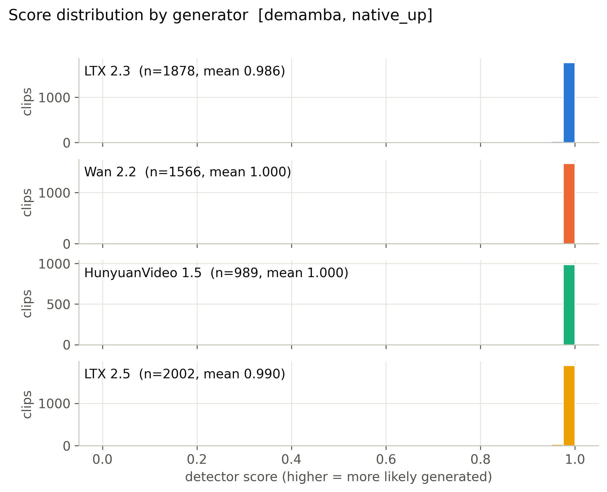

**Mean score, 56 cells x generator.** (`figures/heatmap_mean_score_cells.pdf`)

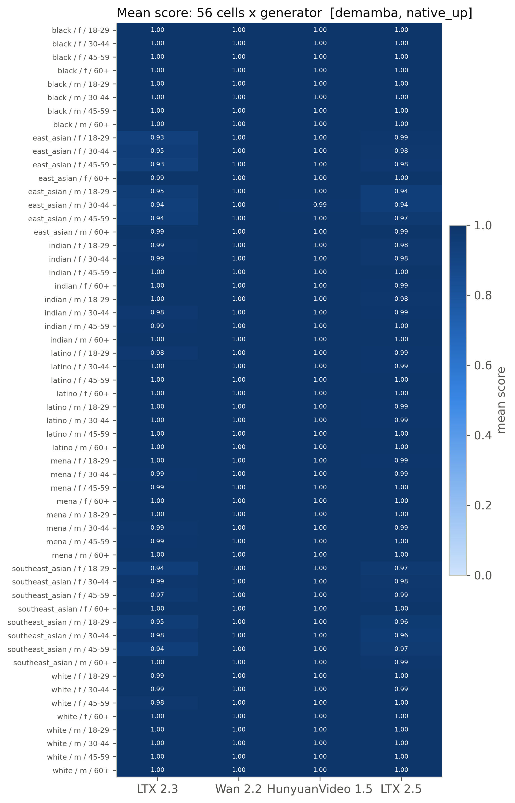

**Detection rate, 56 cells x generator (provisional threshold).** (`figures/heatmap_detection_rate_cells_provisional.pdf`)

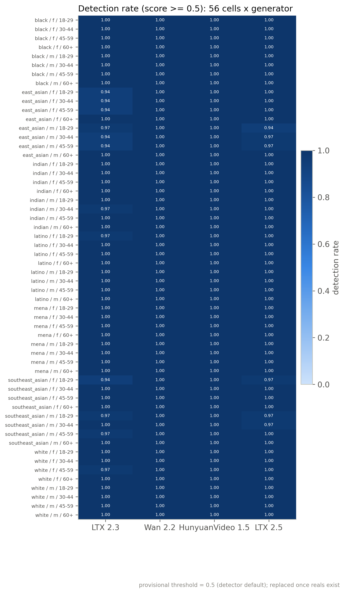

**Mean score by race, gender, age band with 95% CI.** (`figures/subgroup_mean_score.pdf`)

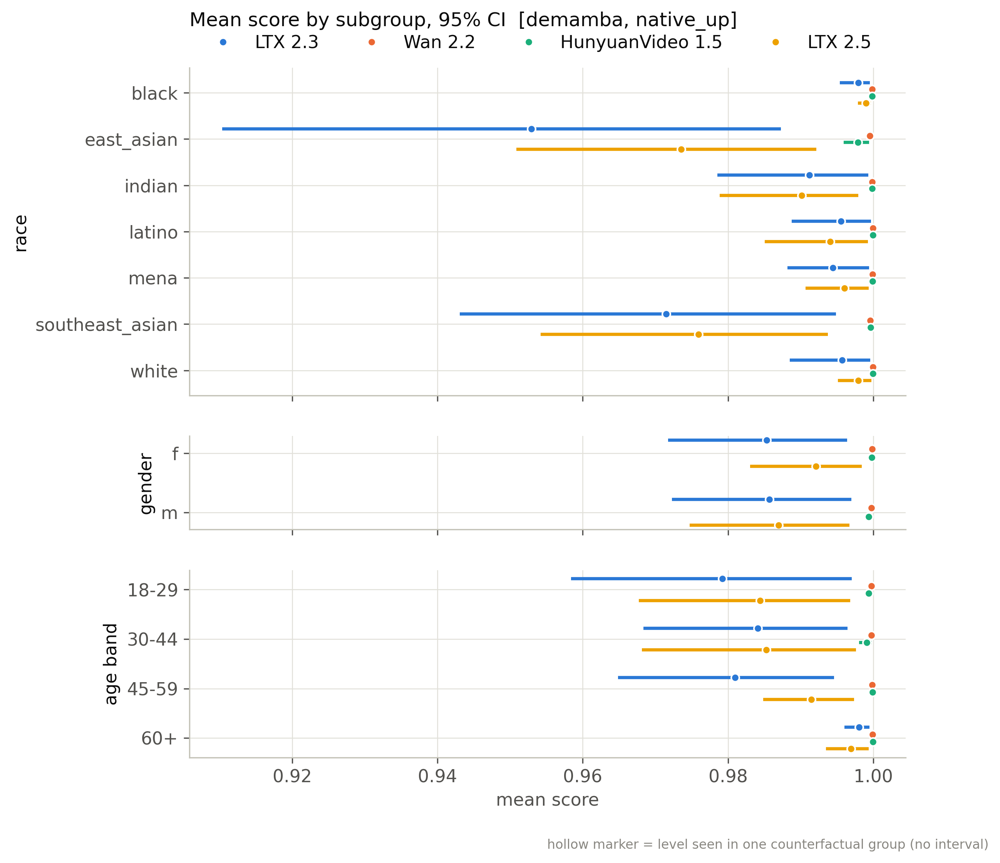

**Mean score by scene factor with 95% CI.** (`figures/scene_factor_mean_score.pdf`)

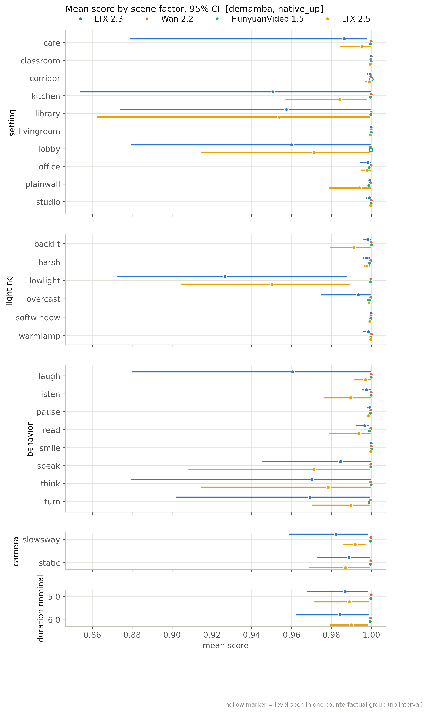

**Detection rate by subgroup (provisional threshold).** (`figures/subgroup_detection_rate_provisional.pdf`)

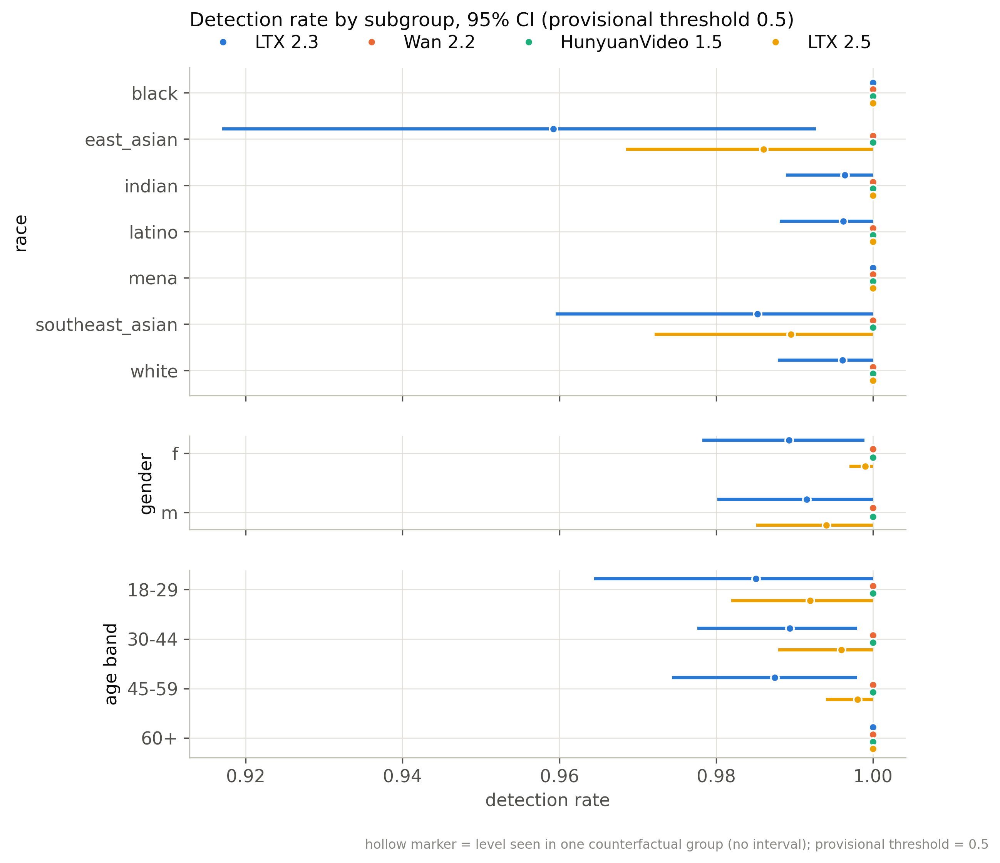

**Distribution of per-group CF spread.** (`figures/cf_spread_distribution.pdf`)

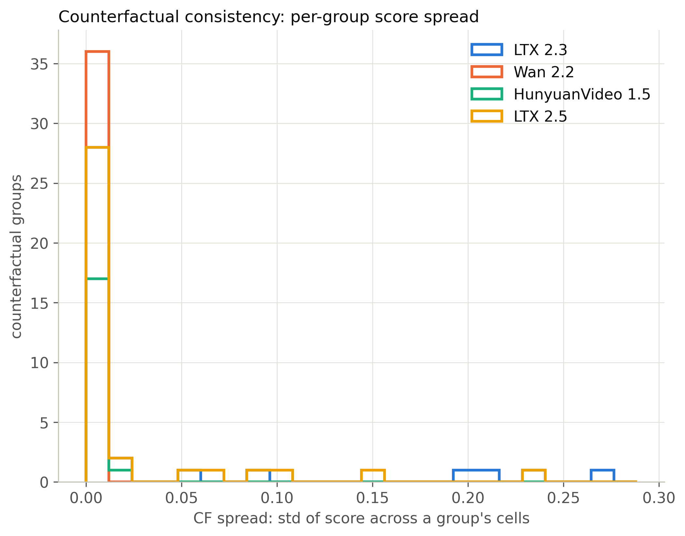

**Flip rate by generator (provisional threshold).** (`figures/flip_rate_by_generator_provisional.pdf`)

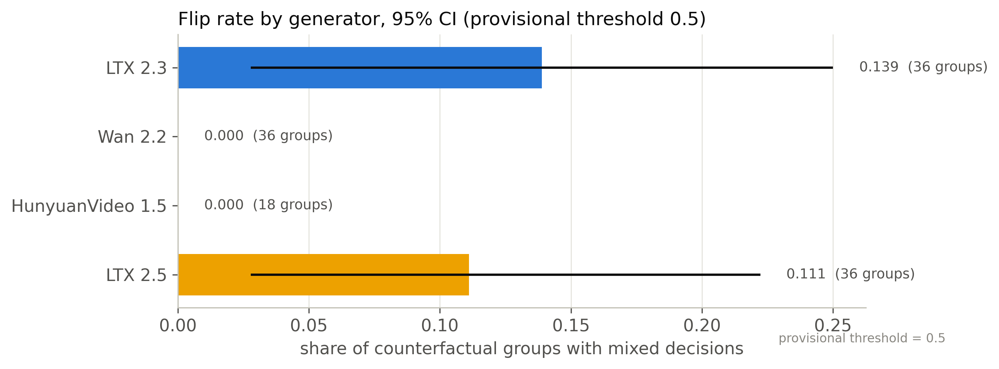

**Partial eta squared by factor.** (`figures/factor_attribution_variance_share.pdf`)

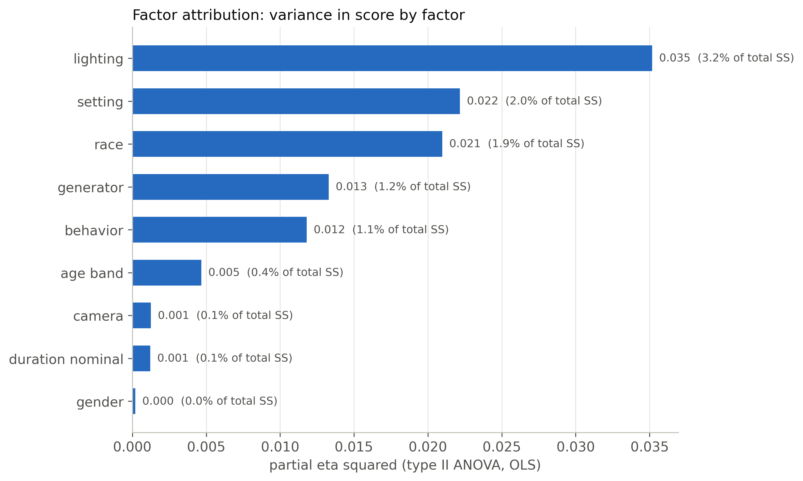

**Highest- and lowest-scoring included clips.** (`figures/example_strip.pdf`)

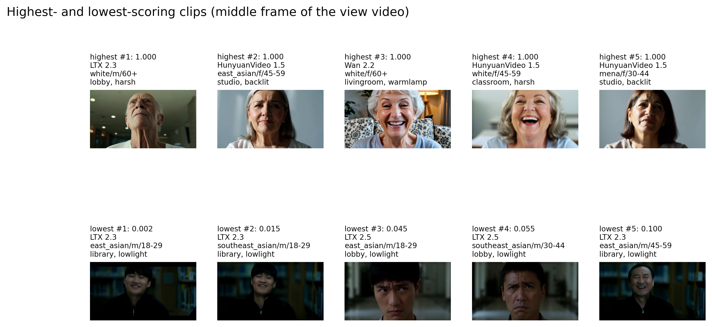

**ROC per generator against fps-matched reals.** (`figures/roc_per_generator.pdf`)

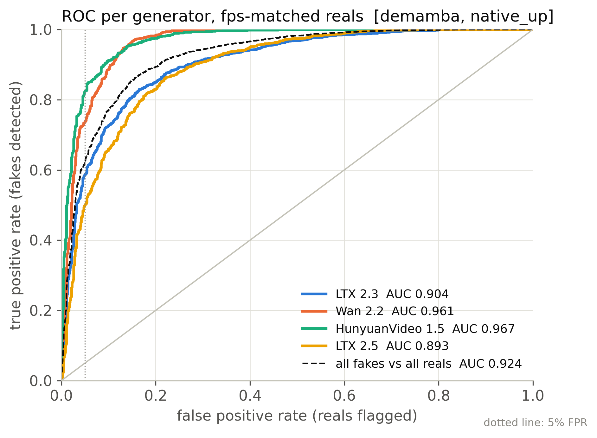

**Real FPR by perceived subgroup at the calibrated threshold.** (`figures/real_fpr_by_subgroup.pdf`)

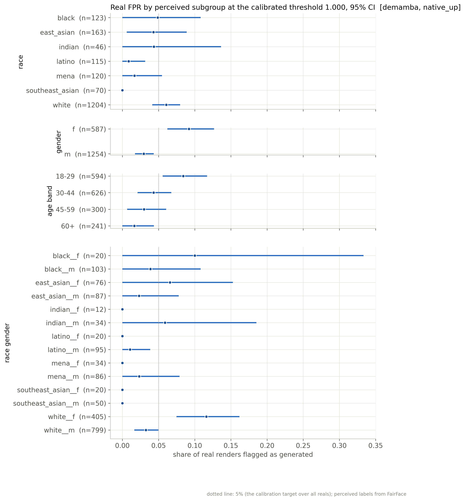

**AUC by subgroup: each subgroup's fakes vs same-subgroup reals.** (`figures/subgroup_auc.pdf`)

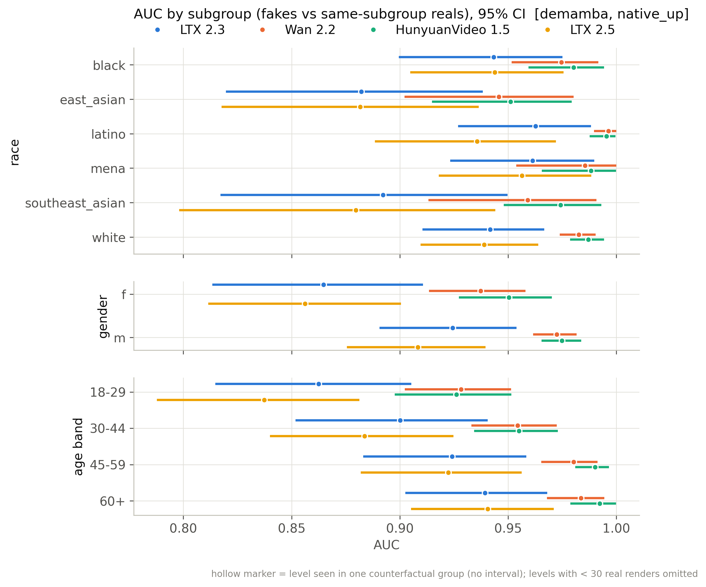

## Files

`manifest_used.csv` (every clip of the active batches with render/score/inclusion flags), `scores.csv` (score per scored clip), `tables/*.csv`, `figures/*`, `snapshot_meta.json`.

