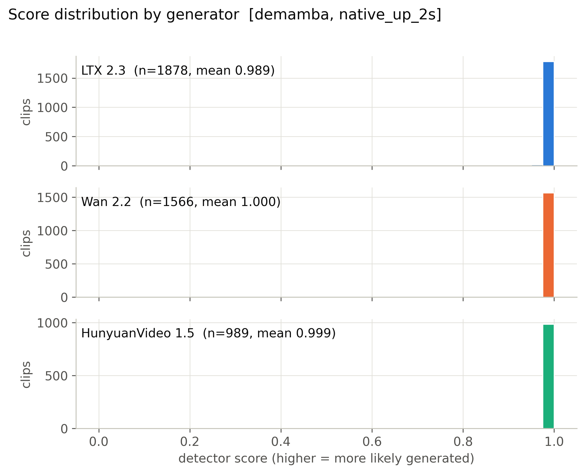
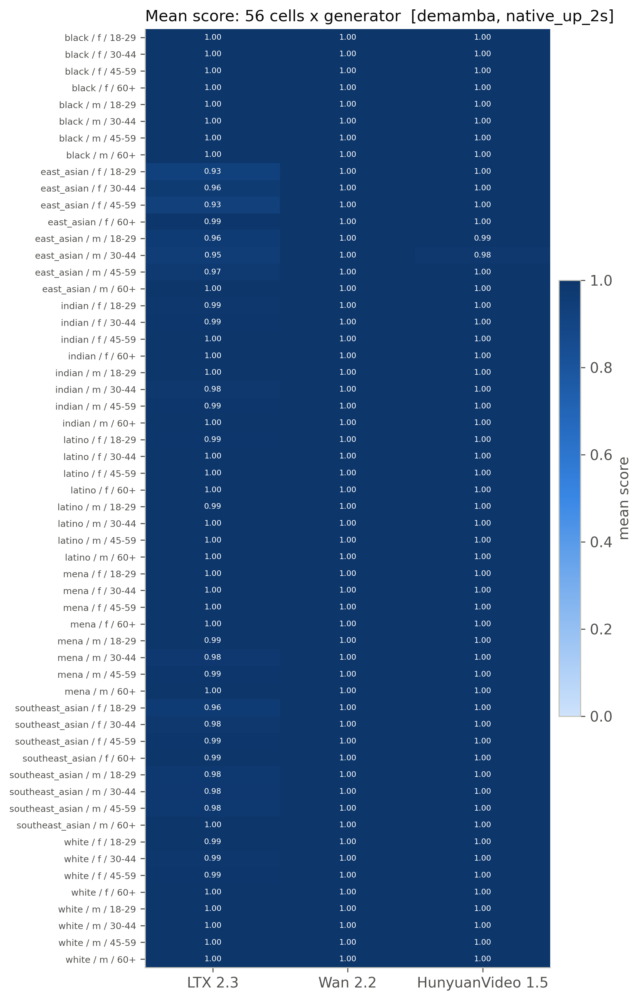
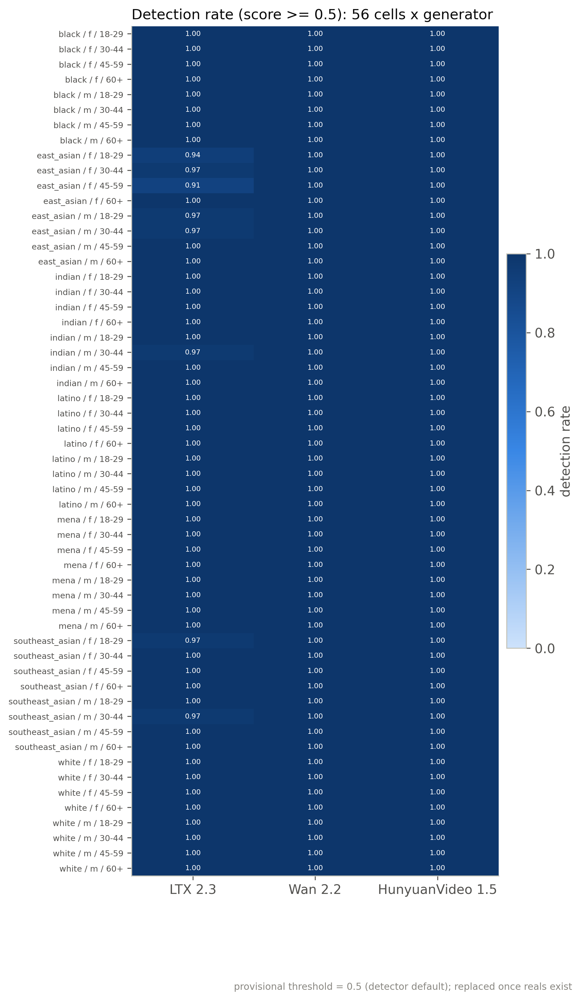
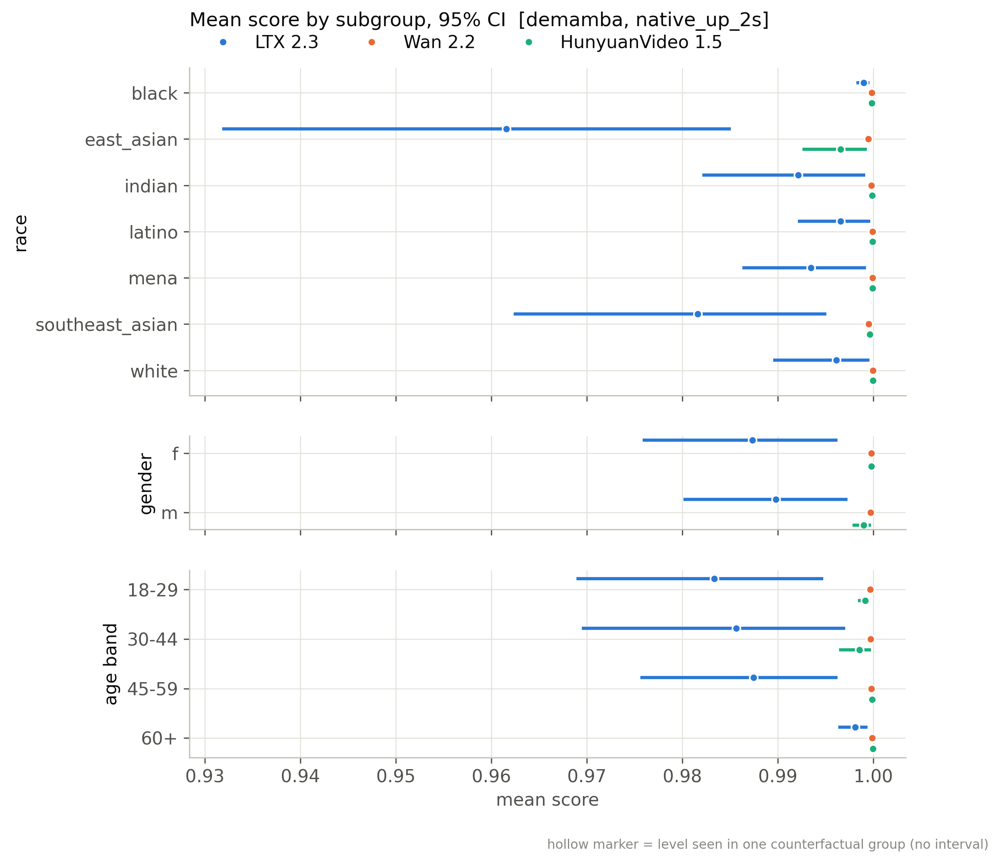
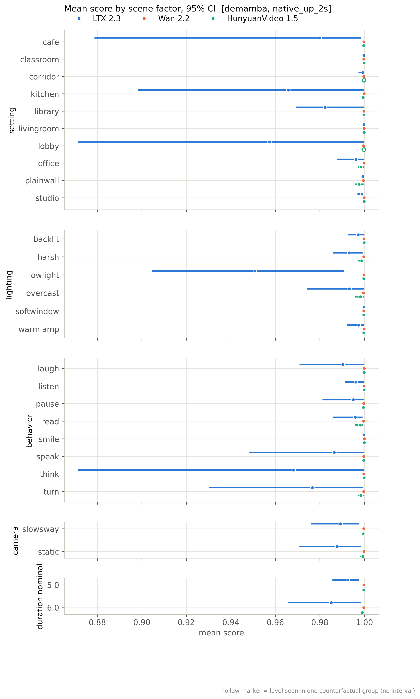
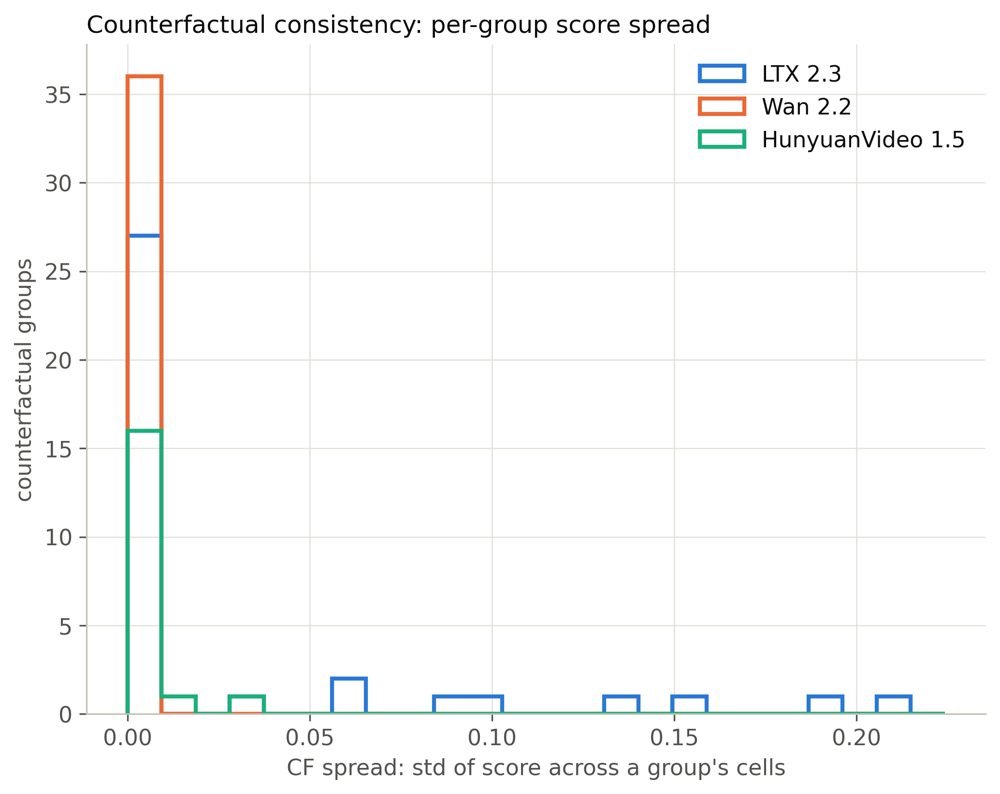
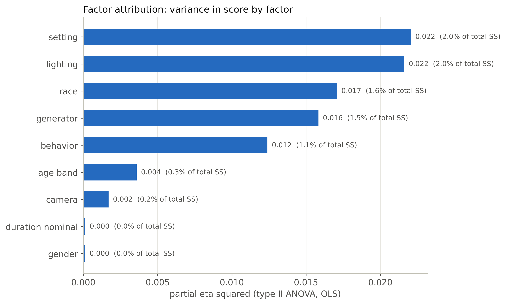
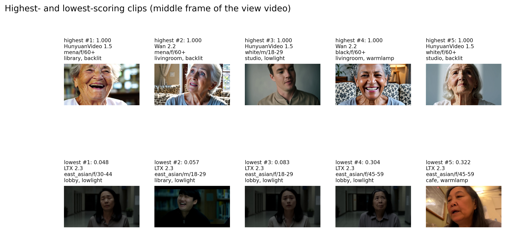
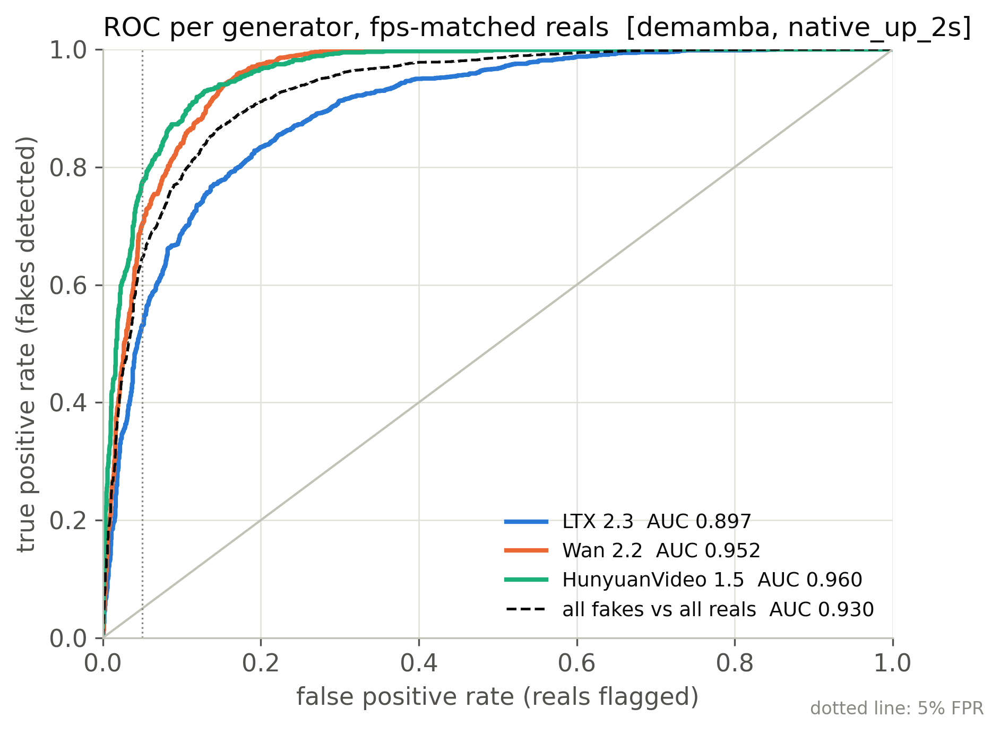
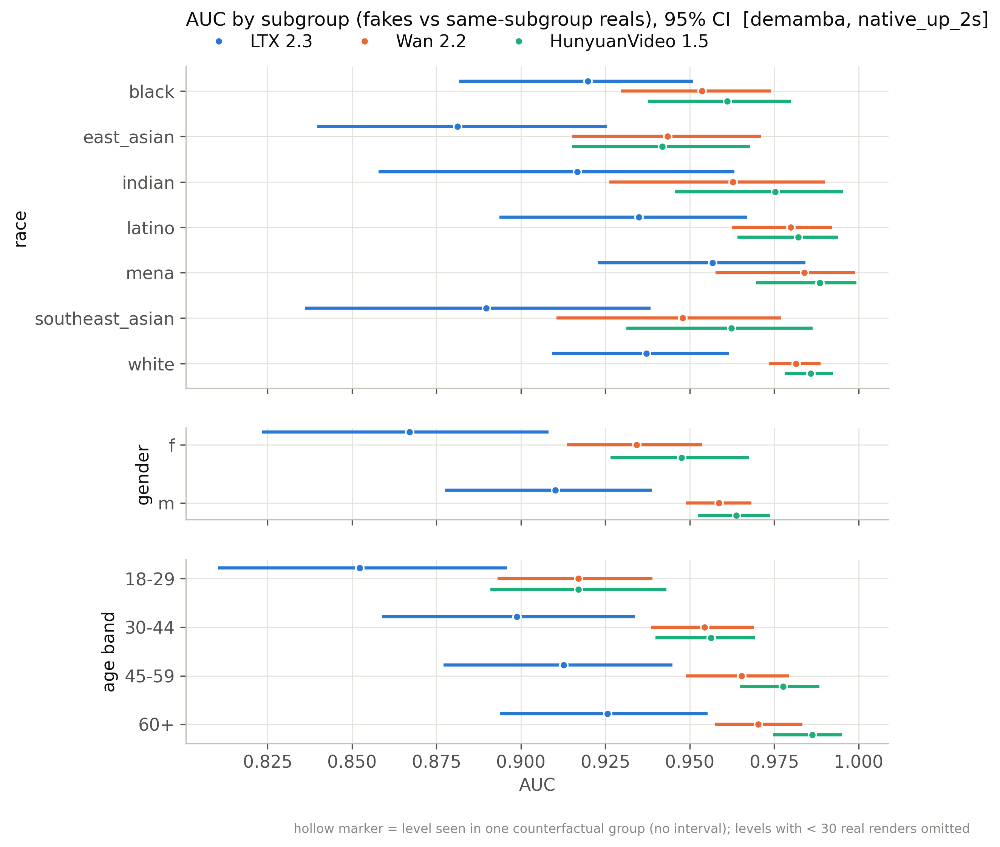

# demamba / native_up_2s: snapshot 20261021-2055

> **Detector training data.** DeMamba weights are our own (GenVideo-100K, single-GPU adaptation of the authors' code), not an official release; the authors have published none. GenVideo-100K contains none of our generators. On GenVideo validation it flags 16.8% of real videos at 0.5.

> **Provisional threshold.** Every detection rate and flip rate below uses the detector's default threshold (0.5; sigmoid(logit) > 0.5 (training metrics and our standalone evaluator)). They will be replaced by the 5%-real-FPR threshold once reals exist (section 6.3).

## Settings

| setting           | value                                                                                  |
|:------------------|:---------------------------------------------------------------------------------------|
| detector          | demamba 1+504611ba                                                                     |
| checkpoint_sha256 | f89897c72b595aa85a524e59083919cebb0b92161d2a694a2cbffbdd8456ce17                       |
| view              | native_up_2s (view_hash f48f13e3eb9c049d)                                              |
| ffmpeg            | ffmpeg version 7.1.1 Copyright (c) 2000-2025 the FFmpeg developers                     |
| batches           | fake_b1, fake_b2, real_all                                                             |
| inclusion set     | primary (technical QC pass AND face QC pass)                                           |
| bootstrap         | 1000 resamples of whole counterfactual groups, seed 20261020, 95% percentile intervals |
| git commit        | 4e41a35865f4-dirty                                                                     |
| created           | 2026-10-21T20:55:31Z                                                                   |

Detector preprocessing on top of the view:

| field     | value                                                                                 |
|:----------|:--------------------------------------------------------------------------------------|
| source    | DeMamba Preprocess/video2frame.py + dataloader.py (val) + our standalone evaluator    |
| sampling  | every round(fps/target)-th frame, target 2 fps (>= 4 s) else ceil(8/dur); max 32 kept |
| window    | centre 8 consecutive sampled frames; zero-pad if fewer than 8                         |
| crop      | centre, trim 10% each side of the longer dimension                                    |
| resize    | [224, 224, 'cv2.INTER_LINEAR']                                                        |
| channels  | RGB                                                                                   |
| normalize | {'mean': [0.485, 0.456, 0.406], 'std': [0.229, 0.224, 0.225], 'max_pixel_value': 255} |
| model     | XCLIP_DeMamba (X-CLIP-B/16 vision, fine-tuned) + bidirectional Mamba, 1 logit         |
| score     | sigmoid(logit)                                                                        |
| precision | fp32, TF32 off                                                                        |
| weights   | Ahsanz/DeMamba-GenVideo100K@27468b8201fc55978bbce51450949345867de184                  |

## Coverage

| batch    | generator   |   clips |   primary |   rendered |   view_excluded |   render_failed |   scored |   score_failed |   included |
|:---------|:------------|--------:|----------:|-----------:|----------------:|----------------:|---------:|---------------:|-----------:|
| fake_b1  | hunyuan15   |     504 |       492 |        504 |               0 |               0 |      504 |              0 |        492 |
| fake_b1  | ltx23       |    2016 |      1878 |       2016 |               0 |               0 |     2016 |              0 |       1878 |
| fake_b1  | wan22       |    2016 |      1566 |       2016 |               0 |               0 |     2016 |              0 |       1566 |
| fake_b2  | hunyuan15   |     504 |       497 |        504 |               0 |               0 |      504 |              0 |        497 |
| real_all | real        |    2221 |      2221 |       2221 |               0 |               0 |     2221 |              0 |       2221 |

Reals scored: 4442. Fakes included: 4433 of 9482 scored (0 scoring failures).

## Observations

- LTX 2.3: mean score 0.989 [0.978, 0.996], median 1.000, n = 1878.
- Wan 2.2: mean score 1.000 [1.000, 1.000], median 1.000, n = 1566.
- HunyuanVideo 1.5: mean score 0.999 [0.999, 1.000], median 1.000, n = 989.
- Provisional detection rate (score >= 0.5), LTX 2.3: 99.4% [98.8, 99.8].
- Provisional detection rate (score >= 0.5), Wan 2.2: 100.0% [100.0, 100.0].
- Provisional detection rate (score >= 0.5), HunyuanVideo 1.5: 100.0% [100.0, 100.0].
- Provisional detection rate (score >= 0.5), all: 99.8% [99.5, 99.9].
- Largest race score gap: LTX 2.3 0.037 [0.014, 0.066] (black 0.999 vs east_asian 0.962).
- Largest gender score gap: LTX 2.3 0.002 [0.000, 0.007] (m 0.990 vs f 0.987).
- Largest age band score gap: LTX 2.3 0.015 [0.005, 0.029] (60+ 0.998 vs 18-29 0.983).
- Largest cell score gap: LTX 2.3 0.075 [0.042, 0.153] (white__m__60+ 1.000 vs east_asian__f__18-29 0.925).
- Largest scene-factor gap (all generators): setting 0.021 [0.007, 0.053] (livingroom vs lobby).
- Largest partial eta squared: setting 0.022, lighting 0.022, race 0.017; residual holds 90.8% of total SS.
- CF spread, LTX 2.3: 0.030 [0.013, 0.049] over 36 groups (max 0.214).
- CF spread, Wan 2.2: 0.000 [0.000, 0.000] over 36 groups (max 0.001).
- CF spread, HunyuanVideo 1.5: 0.003 [0.000, 0.007] over 18 groups (max 0.031).
- Provisional flip rate, LTX 2.3: 16.7% of 36 groups [5.6, 30.6].
- Provisional flip rate, Wan 2.2: 0.0% of 36 groups [0.0, 0.0].
- Provisional flip rate, HunyuanVideo 1.5: 0.0% of 18 groups [0.0, 0.0].

## 6.1 Fakes only, no threshold

### Mean score by generator

| generator   |    n |   n_groups |   estimate |   ci_lo |   ci_hi |    sd |   median |   q05 |   q95 |
|:------------|-----:|-----------:|-----------:|--------:|--------:|------:|---------:|------:|------:|
| ltx23       | 1878 |         36 |      0.989 |   0.978 |   0.996 | 0.066 |        1 | 0.978 |     1 |
| wan22       | 1566 |         36 |      1     |   1     |   1     | 0.001 |        1 | 0.999 |     1 |
| hunyuan15   |  989 |         18 |      0.999 |   0.999 |   1     | 0.008 |        1 | 0.999 |     1 |
| all         | 4433 |         36 |      0.995 |   0.991 |   0.998 | 0.044 |        1 | 0.996 |     1 |

### Mean score by race

| generator   | level           |   n |   estimate |   ci_lo |   ci_hi |   median |
|:------------|:----------------|----:|-----------:|--------:|--------:|---------:|
| ltx23       | black           | 273 |      0.999 |   0.998 |   1     |    1     |
| ltx23       | east_asian      | 270 |      0.962 |   0.932 |   0.985 |    0.999 |
| ltx23       | indian          | 277 |      0.992 |   0.982 |   0.999 |    1     |
| ltx23       | latino          | 262 |      0.997 |   0.992 |   1     |    1     |
| ltx23       | mena            | 267 |      0.993 |   0.986 |   0.999 |    1     |
| ltx23       | southeast_asian | 271 |      0.982 |   0.962 |   0.995 |    1     |
| ltx23       | white           | 258 |      0.996 |   0.99  |   1     |    1     |
| wan22       | black           | 217 |      1     |   1     |   1     |    1     |
| wan22       | east_asian      | 226 |      0.999 |   0.999 |   1     |    1     |
| wan22       | indian          | 230 |      1     |   1     |   1     |    1     |
| wan22       | latino          | 219 |      1     |   1     |   1     |    1     |
| wan22       | mena            | 225 |      1     |   1     |   1     |    1     |
| wan22       | southeast_asian | 229 |      1     |   0.999 |   1     |    1     |
| wan22       | white           | 220 |      1     |   1     |   1     |    1     |
| hunyuan15   | black           | 141 |      1     |   1     |   1     |    1     |
| hunyuan15   | east_asian      | 141 |      0.997 |   0.993 |   0.999 |    1     |
| hunyuan15   | indian          | 142 |      1     |   1     |   1     |    1     |
| hunyuan15   | latino          | 142 |      1     |   1     |   1     |    1     |
| hunyuan15   | mena            | 139 |      1     |   1     |   1     |    1     |
| hunyuan15   | southeast_asian | 143 |      1     |   0.999 |   1     |    1     |
| hunyuan15   | white           | 141 |      1     |   1     |   1     |    1     |
| all         | black           | 631 |      0.999 |   0.999 |   1     |    1     |
| all         | east_asian      | 637 |      0.983 |   0.97  |   0.993 |    1     |
| all         | indian          | 649 |      0.997 |   0.992 |   1     |    1     |
| all         | latino          | 623 |      0.999 |   0.997 |   1     |    1     |
| all         | mena            | 631 |      0.997 |   0.994 |   1     |    1     |
| all         | southeast_asian | 643 |      0.992 |   0.984 |   0.998 |    1     |
| all         | white           | 619 |      0.998 |   0.996 |   1     |    1     |

### Mean score by gender

| generator   | level   |    n |   estimate |   ci_lo |   ci_hi |   median |
|:------------|:--------|-----:|-----------:|--------:|--------:|---------:|
| ltx23       | f       |  931 |      0.987 |   0.976 |   0.996 |        1 |
| ltx23       | m       |  947 |      0.99  |   0.98  |   0.997 |        1 |
| wan22       | f       |  785 |      1     |   1     |   1     |        1 |
| wan22       | m       |  781 |      1     |   1     |   1     |        1 |
| hunyuan15   | f       |  495 |      1     |   1     |   1     |        1 |
| hunyuan15   | m       |  494 |      0.999 |   0.998 |   1     |        1 |
| all         | f       | 2211 |      0.995 |   0.99  |   0.998 |        1 |
| all         | m       | 2222 |      0.995 |   0.991 |   0.998 |        1 |

### Mean score by age band

| generator   | level   |    n |   estimate |   ci_lo |   ci_hi |   median |
|:------------|:--------|-----:|-----------:|--------:|--------:|---------:|
| ltx23       | 18-29   |  469 |      0.983 |   0.969 |   0.995 |        1 |
| ltx23       | 30-44   |  471 |      0.986 |   0.969 |   0.997 |        1 |
| ltx23       | 45-59   |  478 |      0.987 |   0.976 |   0.996 |        1 |
| ltx23       | 60+     |  460 |      0.998 |   0.996 |   0.999 |        1 |
| wan22       | 18-29   |  388 |      1     |   1     |   1     |        1 |
| wan22       | 30-44   |  377 |      1     |   1     |   1     |        1 |
| wan22       | 45-59   |  398 |      1     |   1     |   1     |        1 |
| wan22       | 60+     |  403 |      1     |   1     |   1     |        1 |
| hunyuan15   | 18-29   |  242 |      0.999 |   0.998 |   1     |        1 |
| hunyuan15   | 30-44   |  248 |      0.999 |   0.996 |   1     |        1 |
| hunyuan15   | 45-59   |  250 |      1     |   1     |   1     |        1 |
| hunyuan15   | 60+     |  249 |      1     |   1     |   1     |        1 |
| all         | 18-29   | 1099 |      0.993 |   0.986 |   0.997 |        1 |
| all         | 30-44   | 1096 |      0.993 |   0.987 |   0.998 |        1 |
| all         | 45-59   | 1126 |      0.995 |   0.99  |   0.998 |        1 |
| all         | 60+     | 1112 |      0.999 |   0.998 |   1     |        1 |

### Mean score by scene factor (all generators pooled)

| factor           | level      |    n |   estimate |   ci_lo |   ci_hi |
|:-----------------|:-----------|-----:|-----------:|--------:|--------:|
| setting          | cafe       |  376 |      0.99  |   0.955 |   0.999 |
| setting          | classroom  |  373 |      1     |   1     |   1     |
| setting          | corridor   |  493 |      1     |   0.999 |   1     |
| setting          | kitchen    |  441 |      0.987 |   0.947 |   1     |
| setting          | library    |  534 |      0.993 |   0.985 |   1     |
| setting          | livingroom |  530 |      1     |   1     |   1     |
| setting          | lobby      |  345 |      0.979 |   0.952 |   1     |
| setting          | office     |  357 |      0.997 |   0.992 |   1     |
| setting          | plainwall  |  553 |      0.999 |   0.998 |   1     |
| setting          | studio     |  431 |      0.999 |   0.999 |   1     |
| lighting         | backlit    |  790 |      0.999 |   0.996 |   1     |
| lighting         | harsh      |  632 |      0.997 |   0.992 |   1     |
| lighting         | lowlight   |  784 |      0.98  |   0.96  |   0.996 |
| lighting         | overcast   |  692 |      0.997 |   0.987 |   1     |
| lighting         | softwindow |  821 |      1     |   1     |   1     |
| lighting         | warmlamp   |  714 |      0.999 |   0.997 |   1     |
| behavior         | laugh      |  500 |      0.997 |   0.988 |   1     |
| behavior         | listen     |  680 |      0.998 |   0.996 |   1     |
| behavior         | pause      |  520 |      0.998 |   0.987 |   1     |
| behavior         | read       |  576 |      0.998 |   0.994 |   0.999 |
| behavior         | smile      |  538 |      1     |   1     |   1     |
| behavior         | speak      |  530 |      0.994 |   0.979 |   1     |
| behavior         | think      |  509 |      0.986 |   0.952 |   1     |
| behavior         | turn       |  580 |      0.988 |   0.965 |   1     |
| camera           | slowsway   | 2225 |      0.995 |   0.989 |   0.999 |
| camera           | static     | 2208 |      0.995 |   0.988 |   0.999 |
| duration_nominal | 5.0        | 2227 |      0.997 |   0.994 |   0.999 |
| duration_nominal | 6.0        | 2206 |      0.993 |   0.984 |   0.999 |

Per-generator scene-factor and 56-cell rows: `tables/score_by_breakdown.csv`.

### Subgroup gap (max - min of level means)

A gap is max - min, so it is never negative and its interval cannot include 0; it is a size, not a test of a difference. Over many levels with few clips each (56 cells; HunyuanVideo has 9 groups per cell) the gap also grows with noise, so compare it with the per-level intervals in `tables/score_by_breakdown.csv`. Levels seen in a single counterfactual group have no interval.

| generator   | attribute        |   n_levels |   gap |   ci_lo |   ci_hi | max_level     | min_level            |
|:------------|:-----------------|-----------:|------:|--------:|--------:|:--------------|:---------------------|
| ltx23       | race             |          7 | 0.037 |   0.014 |   0.066 | black         | east_asian           |
| ltx23       | gender           |          2 | 0.002 |   0     |   0.007 | m             | f                    |
| ltx23       | age_band         |          4 | 0.015 |   0.005 |   0.029 | 60+           | 18-29                |
| ltx23       | cell             |         56 | 0.075 |   0.042 |   0.153 | white__m__60+ | east_asian__f__18-29 |
| ltx23       | setting          |         10 | 0.042 |   0.017 |   0.128 | livingroom    | lobby                |
| ltx23       | lighting         |          6 | 0.049 |   0.011 |   0.096 | softwindow    | lowlight             |
| ltx23       | behavior         |          8 | 0.032 |   0.01  |   0.128 | smile         | think                |
| ltx23       | camera           |          2 | 0.001 |   0     |   0.023 | slowsway      | static               |
| ltx23       | duration_nominal |          2 | 0.007 |   0     |   0.026 | 5.0           | 6.0                  |
| wan22       | race             |          7 | 0     |   0     |   0.001 | white         | east_asian           |
| wan22       | gender           |          2 | 0     |   0     |   0     | f             | m                    |
| wan22       | age_band         |          4 | 0     |   0     |   0     | 60+           | 18-29                |
| wan22       | cell             |         56 | 0.001 |   0.001 |   0.002 | white__f__60+ | east_asian__m__18-29 |
| wan22       | setting          |         10 | 0     |   0     |   0.001 | studio        | plainwall            |
| wan22       | lighting         |          6 | 0     |   0     |   0.001 | warmlamp      | overcast             |
| wan22       | behavior         |          8 | 0     |   0     |   0.001 | smile         | read                 |
| wan22       | camera           |          2 | 0     |   0     |   0     | static        | slowsway             |
| wan22       | duration_nominal |          2 | 0     |   0     |   0     | 5.0           | 6.0                  |
| hunyuan15   | race             |          7 | 0.003 |   0.001 |   0.007 | white         | east_asian           |
| hunyuan15   | gender           |          2 | 0.001 |   0     |   0.002 | f             | m                    |
| hunyuan15   | age_band         |          4 | 0.001 |   0     |   0.004 | 60+           | 30-44                |
| hunyuan15   | cell             |         56 | 0.017 |   0.002 |   0.047 | white__f__60+ | east_asian__m__30-44 |
| hunyuan15   | setting          |         10 | 0.002 |   0     |   0.004 | corridor      | plainwall            |
| hunyuan15   | lighting         |          6 | 0.002 |   0     |   0.004 | backlit       | overcast             |
| hunyuan15   | behavior         |          8 | 0.002 |   0     |   0.004 | smile         | read                 |
| hunyuan15   | camera           |          2 | 0     |   0     |   0.001 | slowsway      | static               |
| hunyuan15   | duration_nominal |          2 | 0.001 |   0     |   0.002 | 5.0           | 6.0                  |
| all         | race             |          7 | 0.017 |   0.007 |   0.03  | black         | east_asian           |
| all         | gender           |          2 | 0.001 |   0     |   0.003 | m             | f                    |
| all         | age_band         |          4 | 0.007 |   0.002 |   0.013 | 60+           | 18-29                |
| all         | cell             |         56 | 0.031 |   0.018 |   0.064 | white__m__60+ | east_asian__f__18-29 |
| all         | setting          |         10 | 0.021 |   0.007 |   0.053 | livingroom    | lobby                |
| all         | lighting         |          6 | 0.02  |   0.005 |   0.04  | softwindow    | lowlight             |
| all         | behavior         |          8 | 0.014 |   0.005 |   0.047 | smile         | think                |
| all         | camera           |          2 | 0.001 |   0     |   0.009 | slowsway      | static               |
| all         | duration_nominal |          2 | 0.004 |   0     |   0.013 | 5.0           | 6.0                  |

### CF spread (mean over groups of the std of score across the group's cells)

| generator   |   n_groups |   cf_spread |   ci_lo |   ci_hi |   median |   max |
|:------------|-----------:|------------:|--------:|--------:|---------:|------:|
| ltx23       |         36 |       0.03  |   0.013 |   0.049 |    0.001 | 0.214 |
| wan22       |         36 |       0     |   0     |   0     |    0     | 0.001 |
| hunyuan15   |         18 |       0.003 |   0     |   0.007 |    0     | 0.031 |

### Factor attribution

OLS with every factor as a fixed effect, type-II ANOVA. `ss_share` is the factor's type-II sum of squares over the total sum of squares (type-II shares need not add to 1). Scene factors are constant within a counterfactual group, so their effects are estimated from between-group differences only. The OLS F tests treat clips as independent although clips are clustered in counterfactual groups, so their p values are optimistic; use the group-bootstrap intervals above for inference.

| factor           |   df |    sum_sq | F      | p         | partial_eta2   |   ss_share |
|:-----------------|-----:|----------:|:-------|:----------|:---------------|-----------:|
| race             |    6 | 0.1334    | 12.74  | 2.637e-14 | 0.01708        |  0.01579   |
| gender           |    1 | 0.0008712 | 0.4991 | 0.4799    | 0.0001135      |  0.0001031 |
| age_band         |    3 | 0.02762   | 5.274  | 0.001249  | 0.003585       |  0.003268  |
| setting          |    9 | 0.1732    | 11.02  | 3.656e-17 | 0.02207        |  0.0205    |
| lighting         |    5 | 0.1696    | 19.43  | 3.475e-19 | 0.02162        |  0.02007   |
| behavior         |    7 | 0.09629   | 7.881  | 1.593e-09 | 0.01239        |  0.0114    |
| camera           |    1 | 0.013     | 7.45   | 0.006369  | 0.001691       |  0.001539  |
| duration_nominal |    1 | 0.0009678 | 0.5544 | 0.4565    | 0.0001261      |  0.0001145 |
| generator        |    2 | 0.1235    | 35.37  | 5.777e-16 | 0.01583        |  0.01461   |
| Residual         | 4397 | 7.675     |        |           |                |  0.9083    |

Lighting x race interaction (added to the same OLS):

| term            |   df |   sum_sq |     F |         p |   partial_eta2 |
|:----------------|-----:|---------:|------:|----------:|---------------:|
| lighting x race |   30 |   0.2271 | 4.439 | 1.102e-14 |        0.02959 |

Mixed model `score ~ factors + (1 | counterfactual_group)` (REML) variance components (fixed effects: `tables/factor_mixed_fixed.csv`):

| component                               |   variance | converged   |
|:----------------------------------------|-----------:|:------------|
| counterfactual_group (random intercept) |   0        | True        |
| residual                                |   0.001704 | True        |
| ICC (group share of random variance)    |   0        | True        |

A group variance at or near 0 is a boundary estimate: setting, lighting, behavior, camera and duration are fixed per group and absorb most between-group variation, leaving little for the random intercept. It does not mean scenes do not matter.

## 6.2 Provisional (threshold 0.5, provisional)

### Detection rate by generator (provisional)

| generator   |    n |   estimate |   ci_lo |   ci_hi |
|:------------|-----:|-----------:|--------:|--------:|
| ltx23       | 1878 |      0.994 |   0.988 |   0.998 |
| wan22       | 1566 |      1     |   1     |   1     |
| hunyuan15   |  989 |      1     |   1     |   1     |
| all         | 4433 |      0.998 |   0.995 |   0.999 |

### Detection rate by race (provisional)

| generator   | level           |   n |   estimate |   ci_lo |   ci_hi |
|:------------|:----------------|----:|-----------:|--------:|--------:|
| ltx23       | black           | 273 |      1     |   1     |   1     |
| ltx23       | east_asian      | 270 |      0.97  |   0.945 |   0.992 |
| ltx23       | indian          | 277 |      0.996 |   0.989 |   1     |
| ltx23       | latino          | 262 |      1     |   1     |   1     |
| ltx23       | mena            | 267 |      1     |   1     |   1     |
| ltx23       | southeast_asian | 271 |      0.993 |   0.981 |   1     |
| ltx23       | white           | 258 |      1     |   1     |   1     |
| wan22       | black           | 217 |      1     |   1     |   1     |
| wan22       | east_asian      | 226 |      1     |   1     |   1     |
| wan22       | indian          | 230 |      1     |   1     |   1     |
| wan22       | latino          | 219 |      1     |   1     |   1     |
| wan22       | mena            | 225 |      1     |   1     |   1     |
| wan22       | southeast_asian | 229 |      1     |   1     |   1     |
| wan22       | white           | 220 |      1     |   1     |   1     |
| hunyuan15   | black           | 141 |      1     |   1     |   1     |
| hunyuan15   | east_asian      | 141 |      1     |   1     |   1     |
| hunyuan15   | indian          | 142 |      1     |   1     |   1     |
| hunyuan15   | latino          | 142 |      1     |   1     |   1     |
| hunyuan15   | mena            | 139 |      1     |   1     |   1     |
| hunyuan15   | southeast_asian | 143 |      1     |   1     |   1     |
| hunyuan15   | white           | 141 |      1     |   1     |   1     |
| all         | black           | 631 |      1     |   1     |   1     |
| all         | east_asian      | 637 |      0.987 |   0.976 |   0.997 |
| all         | indian          | 649 |      0.998 |   0.995 |   1     |
| all         | latino          | 623 |      1     |   1     |   1     |
| all         | mena            | 631 |      1     |   1     |   1     |
| all         | southeast_asian | 643 |      0.997 |   0.992 |   1     |
| all         | white           | 619 |      1     |   1     |   1     |

### Detection rate by gender (provisional)

| generator   | level   |    n |   estimate |   ci_lo |   ci_hi |
|:------------|:--------|-----:|-----------:|--------:|--------:|
| ltx23       | f       |  931 |      0.992 |   0.985 |   0.999 |
| ltx23       | m       |  947 |      0.996 |   0.99  |   1     |
| wan22       | f       |  785 |      1     |   1     |   1     |
| wan22       | m       |  781 |      1     |   1     |   1     |
| hunyuan15   | f       |  495 |      1     |   1     |   1     |
| hunyuan15   | m       |  494 |      1     |   1     |   1     |
| all         | f       | 2211 |      0.997 |   0.994 |   1     |
| all         | m       | 2222 |      0.998 |   0.996 |   1     |

### Detection rate by age band (provisional)

| generator   | level   |    n |   estimate |   ci_lo |   ci_hi |
|:------------|:--------|-----:|-----------:|--------:|--------:|
| ltx23       | 18-29   |  469 |      0.991 |   0.983 |   0.998 |
| ltx23       | 30-44   |  471 |      0.992 |   0.979 |   1     |
| ltx23       | 45-59   |  478 |      0.994 |   0.986 |   1     |
| ltx23       | 60+     |  460 |      1     |   1     |   1     |
| wan22       | 18-29   |  388 |      1     |   1     |   1     |
| wan22       | 30-44   |  377 |      1     |   1     |   1     |
| wan22       | 45-59   |  398 |      1     |   1     |   1     |
| wan22       | 60+     |  403 |      1     |   1     |   1     |
| hunyuan15   | 18-29   |  242 |      1     |   1     |   1     |
| hunyuan15   | 30-44   |  248 |      1     |   1     |   1     |
| hunyuan15   | 45-59   |  250 |      1     |   1     |   1     |
| hunyuan15   | 60+     |  249 |      1     |   1     |   1     |
| all         | 18-29   | 1099 |      0.996 |   0.993 |   0.999 |
| all         | 30-44   | 1096 |      0.996 |   0.991 |   1     |
| all         | 45-59   | 1126 |      0.997 |   0.994 |   1     |
| all         | 60+     | 1112 |      1     |   1     |   1     |

### Detection-rate gap (provisional)

| generator   | attribute        |   gap |   ci_lo |   ci_hi | max_level       | min_level            |
|:------------|:-----------------|------:|--------:|--------:|:----------------|:---------------------|
| ltx23       | race             | 0.03  |   0.008 |   0.055 | black           | east_asian           |
| ltx23       | gender           | 0.003 |   0     |   0.01  | m               | f                    |
| ltx23       | age_band         | 0.009 |   0.004 |   0.021 | 60+             | 18-29                |
| ltx23       | cell             | 0.088 |   0.029 |   0.2   | black__f__18-29 | east_asian__f__45-59 |
| ltx23       | setting          | 0.024 |   0.009 |   0.073 | classroom       | lobby                |
| ltx23       | lighting         | 0.025 |   0.006 |   0.052 | harsh           | lowlight             |
| ltx23       | behavior         | 0.018 |   0.006 |   0.073 | pause           | think                |
| ltx23       | camera           | 0.001 |   0     |   0.012 | static          | slowsway             |
| ltx23       | duration_nominal | 0.002 |   0     |   0.014 | 5.0             | 6.0                  |
| wan22       | race             | 0     |   0     |   0     | black           | black                |
| wan22       | gender           | 0     |   0     |   0     | f               | f                    |
| wan22       | age_band         | 0     |   0     |   0     | 18-29           | 18-29                |
| wan22       | cell             | 0     |   0     |   0     | black__f__18-29 | black__f__18-29      |
| wan22       | setting          | 0     |   0     |   0     | cafe            | cafe                 |
| wan22       | lighting         | 0     |   0     |   0     | backlit         | backlit              |
| wan22       | behavior         | 0     |   0     |   0     | laugh           | laugh                |
| wan22       | camera           | 0     |   0     |   0     | slowsway        | slowsway             |
| wan22       | duration_nominal | 0     |   0     |   0     | 5.0             | 5.0                  |
| hunyuan15   | race             | 0     |   0     |   0     | black           | black                |
| hunyuan15   | gender           | 0     |   0     |   0     | f               | f                    |
| hunyuan15   | age_band         | 0     |   0     |   0     | 18-29           | 18-29                |
| hunyuan15   | cell             | 0     |   0     |   0     | black__f__18-29 | black__f__18-29      |
| hunyuan15   | setting          | 0     |   0     |   0     | cafe            | cafe                 |
| hunyuan15   | lighting         | 0     |   0     |   0     | backlit         | backlit              |
| hunyuan15   | behavior         | 0     |   0     |   0     | laugh           | laugh                |
| hunyuan15   | camera           | 0     |   0     |   0     | slowsway        | slowsway             |
| hunyuan15   | duration_nominal | 0     |   0     |   0     | 5.0             | 5.0                  |
| all         | race             | 0.013 |   0.003 |   0.024 | black           | east_asian           |
| all         | gender           | 0.001 |   0     |   0.004 | m               | f                    |
| all         | age_band         | 0.004 |   0.002 |   0.009 | 60+             | 30-44                |
| all         | cell             | 0.036 |   0.012 |   0.081 | black__f__18-29 | east_asian__f__45-59 |
| all         | setting          | 0.012 |   0.004 |   0.028 | classroom       | lobby                |
| all         | lighting         | 0.01  |   0.002 |   0.022 | harsh           | lowlight             |
| all         | behavior         | 0.008 |   0.003 |   0.027 | pause           | think                |
| all         | camera           | 0     |   0     |   0.005 | static          | slowsway             |
| all         | duration_nominal | 0.001 |   0     |   0.006 | 5.0             | 6.0                  |

### Flip rate (provisional): share of groups whose clips get different decisions

| generator   |   n_groups |   flip_rate |   ci_lo |   ci_hi |   median |   max |
|:------------|-----------:|------------:|--------:|--------:|---------:|------:|
| ltx23       |         36 |       0.167 |   0.056 |   0.306 |        0 |     1 |
| wan22       |         36 |       0     |   0     |   0     |        0 |     0 |
| hunyuan15   |         18 |       0     |   0     |   0     |        0 |     0 |

### Sensitivity: inclusion set

| set     | generator   |    n |   mean_score |   provisional_detection_rate |
|:--------|:------------|-----:|-------------:|-----------------------------:|
| all     | hunyuan15   | 1008 |        0.999 |                        1     |
| all     | ltx23       | 2016 |        0.98  |                        0.988 |
| all     | wan22       | 2016 |        1     |                        1     |
| primary | hunyuan15   |  989 |        0.999 |                        1     |
| primary | ltx23       | 1878 |        0.989 |                        0.994 |
| primary | wan22       | 1566 |        1     |                        1     |

## 6.3 Real vs generated (calibrated threshold 0.9998)

The threshold is the score at which 5% of primary real renders (24 and 16 fps pooled) are flagged; one per detector and view, never per subgroup. Each generator is compared with reals rendered at its own fps. Intervals: fakes resample counterfactual groups, reals resample identity clusters (source video). Real labels are perceived (FairFace), not self-reported.

### Calibration

| scope            |   n_renders |   n_sources |   n_identities |   threshold |    fpr |
|:-----------------|------------:|------------:|---------------:|------------:|-------:|
| all real renders |        4442 |        2221 |           1822 |      0.9998 | 0.0502 |
| 16 fps renders   |        2221 |        2221 |           1822 |      0.9998 | 0.05   |
| 24 fps renders   |        2221 |        2221 |           1822 |      0.9998 | 0.0504 |

### AUC, AP, EER, TPR at 5% FPR

| generator   | real_fps   |   n_fake |   n_real |   auc |   auc_ci_lo |   auc_ci_hi |    ap |   eer |   tpr_at_5fpr |   detection_rate_global_thr |   det_ci_lo |   det_ci_hi |
|:------------|:-----------|---------:|---------:|------:|------------:|------------:|------:|------:|--------------:|----------------------------:|------------:|------------:|
| ltx23       | 24         |     1878 |     2221 | 0.897 |       0.864 |       0.928 | 0.862 | 0.185 |         0.531 |                       0.531 |       0.439 |       0.623 |
| wan22       | 16         |     1566 |     2221 | 0.952 |       0.94  |       0.962 | 0.908 | 0.121 |         0.704 |                       0.704 |       0.639 |       0.772 |
| hunyuan15   | 24         |      989 |     2221 | 0.96  |       0.947 |       0.971 | 0.9   | 0.105 |         0.776 |                       0.776 |       0.71  |       0.835 |
| all         | 24+16      |     4433 |     4442 | 0.93  |       0.913 |       0.946 | 0.916 | 0.141 |         0.647 |                       0.647 |       0.592 |       0.702 |

### Real FPR by perceived subgroup

| attribute   | level              |   n_renders |   n_identities |   fpr |   ci_lo |   ci_hi |
|:------------|:-------------------|------------:|---------------:|------:|--------:|--------:|
| race        | black              |         378 |            173 | 0.053 |   0.027 |   0.089 |
| race        | east_asian         |         382 |            170 | 0.034 |   0.011 |   0.061 |
| race        | indian             |         112 |             54 | 0.036 |   0     |   0.083 |
| race        | latino             |         254 |            119 | 0.047 |   0.015 |   0.088 |
| race        | mena               |         258 |            124 | 0.023 |   0     |   0.059 |
| race        | southeast_asian    |         184 |             85 | 0.022 |   0     |   0.059 |
| race        | white              |        2836 |           1179 | 0.057 |   0.045 |   0.071 |
| gender      | f                  |        1380 |            605 | 0.083 |   0.062 |   0.106 |
| gender      | m                  |        3024 |           1263 | 0.035 |   0.026 |   0.045 |
| age_band    | 18-29              |        1382 |            625 | 0.075 |   0.053 |   0.098 |
| age_band    | 30-44              |        1518 |            679 | 0.034 |   0.021 |   0.048 |
| age_band    | 45-59              |         644 |            274 | 0.045 |   0.022 |   0.072 |
| age_band    | 60+                |         624 |            268 | 0.042 |   0.021 |   0.063 |
| race_gender | black__f           |          64 |             30 | 0.094 |   0     |   0.216 |
| race_gender | black__m           |         314 |            144 | 0.045 |   0.016 |   0.081 |
| race_gender | east_asian__f      |         138 |             63 | 0.08  |   0.019 |   0.152 |
| race_gender | east_asian__m      |         244 |            110 | 0.008 |   0     |   0.028 |
| race_gender | indian__f          |          32 |             16 | 0.031 |   0     |   0.107 |
| race_gender | indian__m          |          80 |             38 | 0.037 |   0     |   0.098 |
| race_gender | latino__f          |          62 |             30 | 0.065 |   0     |   0.156 |
| race_gender | latino__m          |         192 |             89 | 0.042 |   0.01  |   0.089 |
| race_gender | mena__f            |          60 |             30 | 0.033 |   0     |   0.111 |
| race_gender | mena__m            |         198 |             94 | 0.02  |   0     |   0.063 |
| race_gender | southeast_asian__f |          64 |             30 | 0     |   0     |   0     |
| race_gender | southeast_asian__m |         120 |             56 | 0.033 |   0     |   0.089 |
| race_gender | white__f           |         960 |            425 | 0.094 |   0.068 |   0.123 |
| race_gender | white__m           |        1876 |            789 | 0.038 |   0.026 |   0.051 |

### Real FPR gap (max - min across levels; non-negative by construction)

| attribute   |   n_levels |   fpr_gap |   ci_lo |   ci_hi | max_level   |   max_fpr | min_level          |   min_fpr |
|:------------|-----------:|----------:|--------:|--------:|:------------|----------:|:-------------------|----------:|
| race        |          7 |     0.035 |   0.034 |   0.091 | white       |     0.057 | southeast_asian    |     0.022 |
| gender      |          2 |     0.047 |   0.025 |   0.072 | f           |     0.083 | m                  |     0.035 |
| age_band    |          4 |     0.04  |   0.022 |   0.069 | 18-29       |     0.075 | 30-44              |     0.034 |
| race_gender |         14 |     0.094 |   0.085 |   0.226 | black__f    |     0.094 | southeast_asian__f |     0     |

### Worst-subgroup AUC and AUC gap

| generator   | attribute   |   n_levels | worst_level   |   worst_auc |   worst_ci_lo |   worst_ci_hi | best_level   |   best_auc |   auc_gap |   gap_ci_lo |   gap_ci_hi |
|:------------|:------------|-----------:|:--------------|------------:|--------------:|--------------:|:-------------|-----------:|----------:|------------:|------------:|
| ltx23       | race        |          7 | east_asian    |       0.881 |         0.827 |         0.917 | mena         |      0.957 |     0.076 |       0.045 |       0.125 |
| ltx23       | gender      |          2 | f             |       0.867 |         0.823 |         0.908 | m            |      0.91  |     0.043 |       0.016 |       0.072 |
| ltx23       | age_band    |          4 | 18-29         |       0.852 |         0.81  |         0.896 | 60+          |      0.926 |     0.073 |       0.045 |       0.108 |
| ltx23       | race_gender |         13 | east_asian__f |       0.848 |         0.77  |         0.901 | white__m     |      0.96  |     0.113 |       0.08  |       0.197 |
| wan22       | race        |          7 | east_asian    |       0.943 |         0.905 |         0.958 | mena         |      0.984 |     0.04  |       0.03  |       0.086 |
| wan22       | gender      |          2 | f             |       0.934 |         0.914 |         0.954 | m            |      0.959 |     0.024 |       0.006 |       0.044 |
| wan22       | age_band    |          4 | 18-29         |       0.917 |         0.893 |         0.939 | 60+          |      0.97  |     0.053 |       0.033 |       0.081 |
| wan22       | race_gender |         13 | east_asian__f |       0.921 |         0.855 |         0.946 | mena__f      |      0.992 |     0.071 |       0.049 |       0.143 |
| hunyuan15   | race        |          7 | east_asian    |       0.942 |         0.914 |         0.961 | mena         |      0.989 |     0.047 |       0.029 |       0.08  |
| hunyuan15   | gender      |          2 | f             |       0.948 |         0.926 |         0.966 | m            |      0.964 |     0.016 |       0.001 |       0.035 |
| hunyuan15   | age_band    |          4 | 18-29         |       0.917 |         0.891 |         0.943 | 60+          |      0.986 |     0.069 |       0.046 |       0.096 |
| hunyuan15   | race_gender |         13 | east_asian__f |       0.932 |         0.874 |         0.954 | white__m     |      0.994 |     0.061 |       0.043 |       0.122 |
| all         | race        |          7 | east_asian    |       0.916 |         0.88  |         0.939 | mena         |      0.973 |     0.057 |       0.036 |       0.097 |
| all         | gender      |          2 | f             |       0.908 |         0.884 |         0.934 | m            |      0.939 |     0.03  |       0.011 |       0.051 |
| all         | age_band    |          4 | 18-29         |       0.889 |         0.863 |         0.915 | 60+          |      0.955 |     0.067 |       0.044 |       0.093 |
| all         | race_gender |         14 | east_asian__f |       0.893 |         0.828 |         0.925 | mena__f      |      0.978 |     0.085 |       0.061 |       0.157 |

### Detection rate at the calibrated threshold

| generator   |    n |   estimate |   ci_lo |   ci_hi |
|:------------|-----:|-----------:|--------:|--------:|
| ltx23       | 1878 |      0.531 |   0.439 |   0.623 |
| wan22       | 1566 |      0.704 |   0.639 |   0.772 |
| hunyuan15   |  989 |      0.776 |   0.71  |   0.835 |
| all         | 4433 |      0.647 |   0.592 |   0.702 |

#### by race

| generator   | level           |   n |   estimate |   ci_lo |   ci_hi |
|:------------|:----------------|----:|-----------:|--------:|--------:|
| ltx23       | black           | 273 |      0.612 |   0.511 |   0.712 |
| ltx23       | east_asian      | 270 |      0.248 |   0.165 |   0.348 |
| ltx23       | indian          | 277 |      0.52  |   0.406 |   0.635 |
| ltx23       | latino          | 262 |      0.656 |   0.543 |   0.772 |
| ltx23       | mena            | 267 |      0.618 |   0.51  |   0.721 |
| ltx23       | southeast_asian | 271 |      0.336 |   0.238 |   0.442 |
| ltx23       | white           | 258 |      0.744 |   0.64  |   0.835 |
| wan22       | black           | 217 |      0.714 |   0.624 |   0.817 |
| wan22       | east_asian      | 226 |      0.425 |   0.312 |   0.545 |
| wan22       | indian          | 230 |      0.713 |   0.608 |   0.819 |
| wan22       | latino          | 219 |      0.881 |   0.816 |   0.939 |
| wan22       | mena            | 225 |      0.853 |   0.785 |   0.917 |
| wan22       | southeast_asian | 229 |      0.406 |   0.299 |   0.516 |
| wan22       | white           | 220 |      0.95  |   0.911 |   0.984 |
| hunyuan15   | black           | 141 |      0.787 |   0.682 |   0.889 |
| hunyuan15   | east_asian      | 141 |      0.546 |   0.462 |   0.641 |
| hunyuan15   | indian          | 142 |      0.782 |   0.669 |   0.886 |
| hunyuan15   | latino          | 142 |      0.887 |   0.822 |   0.947 |
| hunyuan15   | mena            | 139 |      0.863 |   0.799 |   0.925 |
| hunyuan15   | southeast_asian | 143 |      0.622 |   0.5   |   0.747 |
| hunyuan15   | white           | 141 |      0.943 |   0.9   |   0.98  |
| all         | black           | 631 |      0.686 |   0.617 |   0.755 |
| all         | east_asian      | 637 |      0.377 |   0.308 |   0.449 |
| all         | indian          | 649 |      0.646 |   0.575 |   0.717 |
| all         | latino          | 623 |      0.788 |   0.728 |   0.846 |
| all         | mena            | 631 |      0.756 |   0.7   |   0.812 |
| all         | southeast_asian | 643 |      0.425 |   0.355 |   0.501 |
| all         | white           | 619 |      0.863 |   0.819 |   0.906 |

#### by gender

| generator   | level   |    n |   estimate |   ci_lo |   ci_hi |
|:------------|:--------|-----:|-----------:|--------:|--------:|
| ltx23       | f       |  931 |      0.553 |   0.45  |   0.659 |
| ltx23       | m       |  947 |      0.51  |   0.419 |   0.602 |
| wan22       | f       |  785 |      0.734 |   0.661 |   0.804 |
| wan22       | m       |  781 |      0.673 |   0.606 |   0.746 |
| hunyuan15   | f       |  495 |      0.792 |   0.705 |   0.87  |
| hunyuan15   | m       |  494 |      0.759 |   0.702 |   0.813 |
| all         | f       | 2211 |      0.671 |   0.609 |   0.737 |
| all         | m       | 2222 |      0.623 |   0.57  |   0.676 |

#### by age band

| generator   | level   |    n |   estimate |   ci_lo |   ci_hi |
|:------------|:--------|-----:|-----------:|--------:|--------:|
| ltx23       | 18-29   |  469 |      0.416 |   0.315 |   0.524 |
| ltx23       | 30-44   |  471 |      0.493 |   0.397 |   0.589 |
| ltx23       | 45-59   |  478 |      0.586 |   0.483 |   0.685 |
| ltx23       | 60+     |  460 |      0.633 |   0.531 |   0.738 |
| wan22       | 18-29   |  388 |      0.595 |   0.5   |   0.687 |
| wan22       | 30-44   |  377 |      0.631 |   0.534 |   0.729 |
| wan22       | 45-59   |  398 |      0.764 |   0.71  |   0.82  |
| wan22       | 60+     |  403 |      0.816 |   0.762 |   0.87  |
| hunyuan15   | 18-29   |  242 |      0.628 |   0.522 |   0.728 |
| hunyuan15   | 30-44   |  248 |      0.657 |   0.564 |   0.749 |
| hunyuan15   | 45-59   |  250 |      0.872 |   0.817 |   0.925 |
| hunyuan15   | 60+     |  249 |      0.94  |   0.874 |   0.991 |
| all         | 18-29   | 1099 |      0.526 |   0.451 |   0.603 |
| all         | 30-44   | 1096 |      0.578 |   0.513 |   0.641 |
| all         | 45-59   | 1126 |      0.712 |   0.656 |   0.766 |
| all         | 60+     | 1112 |      0.768 |   0.716 |   0.821 |

### Detection-rate gap at the calibrated threshold

| generator   | attribute        |   gap |   ci_lo |   ci_hi | max_level     | min_level            |
|:------------|:-----------------|------:|--------:|--------:|:--------------|:---------------------|
| ltx23       | race             | 0.496 |   0.406 |   0.588 | white         | east_asian           |
| ltx23       | gender           | 0.043 |   0.003 |   0.101 | f             | m                    |
| ltx23       | age_band         | 0.217 |   0.143 |   0.303 | 60+           | 18-29                |
| ltx23       | cell             | 0.728 |   0.672 |   0.907 | white__f__60+ | east_asian__m__18-29 |
| ltx23       | setting          | 0.542 |   0.449 |   0.964 | livingroom    | library              |
| ltx23       | lighting         | 0.634 |   0.503 |   0.841 | softwindow    | lowlight             |
| ltx23       | behavior         | 0.481 |   0.342 |   0.848 | smile         | turn                 |
| ltx23       | camera           | 0.12  |   0.006 |   0.297 | static        | slowsway             |
| ltx23       | duration_nominal | 0.081 |   0.005 |   0.274 | 5.0           | 6.0                  |
| wan22       | race             | 0.544 |   0.449 |   0.646 | white         | southeast_asian      |
| wan22       | gender           | 0.06  |   0.01  |   0.108 | f             | m                    |
| wan22       | age_band         | 0.221 |   0.138 |   0.313 | 60+           | 18-29                |
| wan22       | cell             | 0.862 |   0.759 |   0.969 | black__f__60+ | east_asian__m__18-29 |
| wan22       | setting          | 0.382 |   0.32  |   0.606 | studio        | plainwall            |
| wan22       | lighting         | 0.272 |   0.206 |   0.473 | warmlamp      | overcast             |
| wan22       | behavior         | 0.406 |   0.342 |   0.567 | smile         | read                 |
| wan22       | camera           | 0.086 |   0.005 |   0.227 | static        | slowsway             |
| wan22       | duration_nominal | 0.101 |   0.008 |   0.228 | 5.0           | 6.0                  |
| hunyuan15   | race             | 0.397 |   0.316 |   0.479 | white         | east_asian           |
| hunyuan15   | gender           | 0.033 |   0.002 |   0.098 | f             | m                    |
| hunyuan15   | age_band         | 0.312 |   0.232 |   0.409 | 60+           | 18-29                |
| hunyuan15   | cell             | 0.944 |   0.846 |   1     | black__f__60+ | east_asian__m__30-44 |
| hunyuan15   | setting          | 0.252 |   0.164 |   0.445 | studio        | kitchen              |
| hunyuan15   | lighting         | 0.185 |   0.131 |   0.393 | backlit       | lowlight             |
| hunyuan15   | behavior         | 0.26  |   0.2   |   0.445 | laugh         | pause                |
| hunyuan15   | camera           | 0.016 |   0.002 |   0.146 | slowsway      | static               |
| hunyuan15   | duration_nominal | 0.031 |   0.002 |   0.162 | 6.0           | 5.0                  |
| all         | race             | 0.486 |   0.42  |   0.55  | white         | east_asian           |
| all         | gender           | 0.048 |   0.008 |   0.088 | f             | m                    |
| all         | age_band         | 0.242 |   0.179 |   0.309 | 60+           | 18-29                |
| all         | cell             | 0.799 |   0.735 |   0.893 | white__f__60+ | east_asian__m__18-29 |
| all         | setting          | 0.298 |   0.288 |   0.562 | livingroom    | library              |
| all         | lighting         | 0.304 |   0.219 |   0.461 | warmlamp      | lowlight             |
| all         | behavior         | 0.354 |   0.289 |   0.516 | smile         | turn                 |
| all         | camera           | 0.08  |   0.006 |   0.189 | static        | slowsway             |
| all         | duration_nominal | 0.073 |   0.005 |   0.186 | 5.0           | 6.0                  |

### Flip rate at the calibrated threshold

| generator   |   n_groups |   flip_rate |   ci_lo |   ci_hi |   median |   max |
|:------------|-----------:|------------:|--------:|--------:|---------:|------:|
| ltx23       |         36 |       0.861 |   0.75  |   0.972 |        1 |     1 |
| wan22       |         36 |       0.889 |   0.778 |   0.972 |        1 |     1 |
| hunyuan15   |         18 |       1     |   1     |   1     |        1 |     1 |

## Figures

**Score distribution by generator.** (`figures/score_distribution_by_generator.pdf`)

**Mean score, 56 cells x generator.** (`figures/heatmap_mean_score_cells.pdf`)

**Detection rate, 56 cells x generator (provisional threshold).** (`figures/heatmap_detection_rate_cells_provisional.pdf`)

**Mean score by race, gender, age band with 95% CI.** (`figures/subgroup_mean_score.pdf`)

**Mean score by scene factor with 95% CI.** (`figures/scene_factor_mean_score.pdf`)

**Detection rate by subgroup (provisional threshold).** (`figures/subgroup_detection_rate_provisional.pdf`)

**Distribution of per-group CF spread.** (`figures/cf_spread_distribution.pdf`)

**Flip rate by generator (provisional threshold).** (`figures/flip_rate_by_generator_provisional.pdf`)

**Partial eta squared by factor.** (`figures/factor_attribution_variance_share.pdf`)

**Highest- and lowest-scoring included clips.** (`figures/example_strip.pdf`)

**ROC per generator against fps-matched reals.** (`figures/roc_per_generator.pdf`)

**Real FPR by perceived subgroup at the calibrated threshold.** (`figures/real_fpr_by_subgroup.pdf`)

**AUC by subgroup: each subgroup's fakes vs same-subgroup reals.** (`figures/subgroup_auc.pdf`)

## Files

`manifest_used.csv` (every clip of the active batches with render/score/inclusion flags), `scores.csv` (score per scored clip), `tables/*.csv`, `figures/*`, `snapshot_meta.json`.

