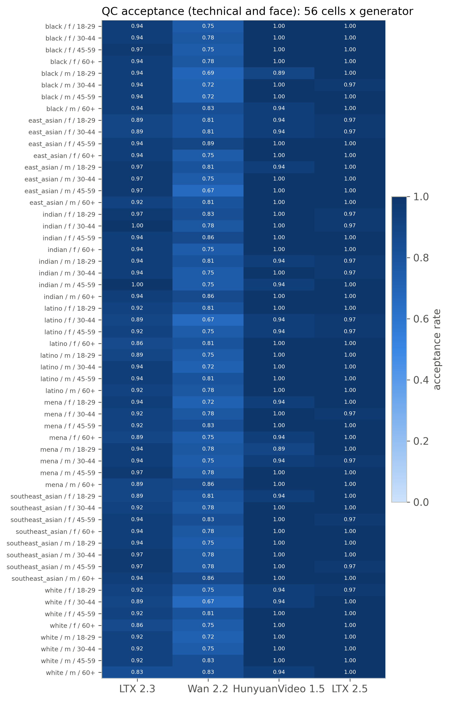
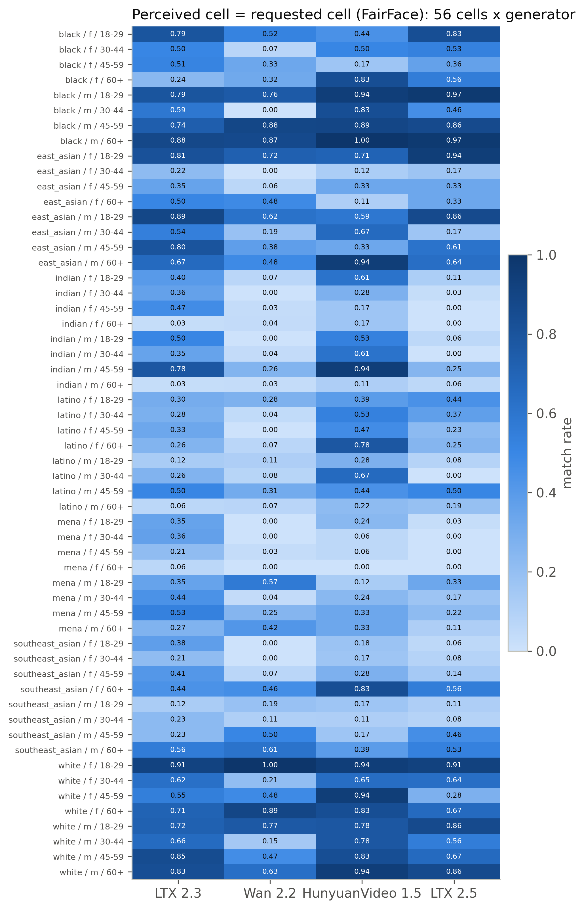
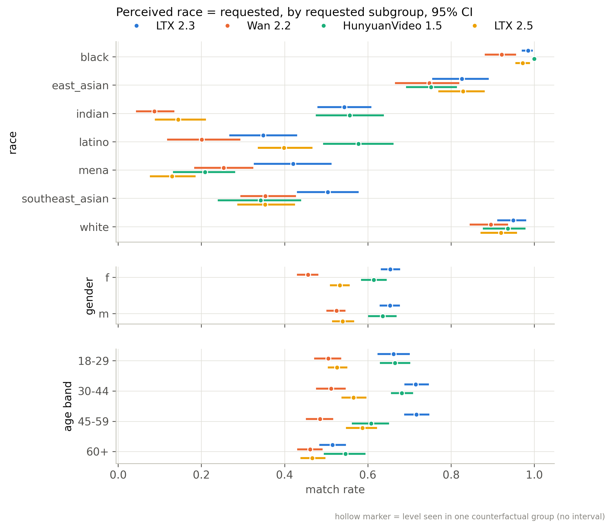
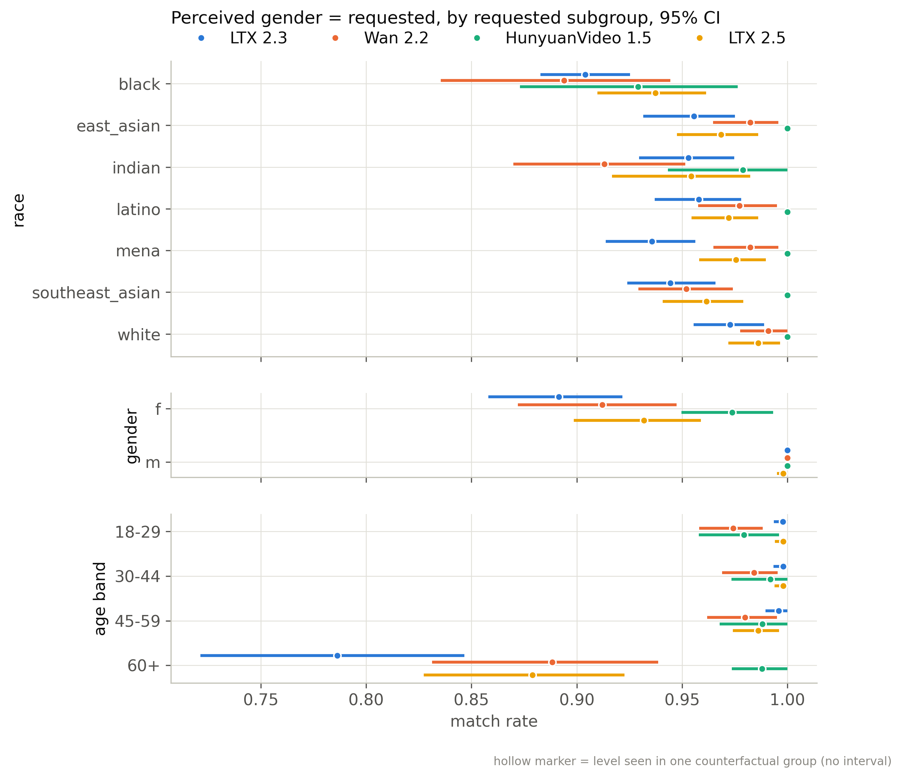
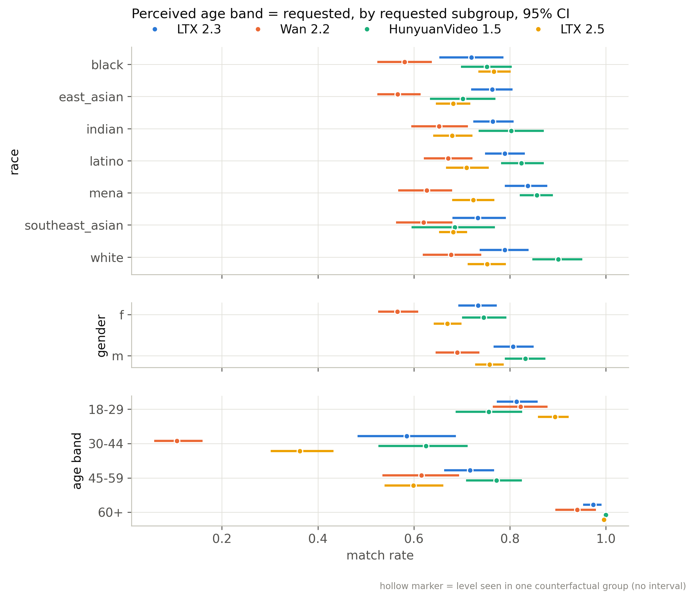
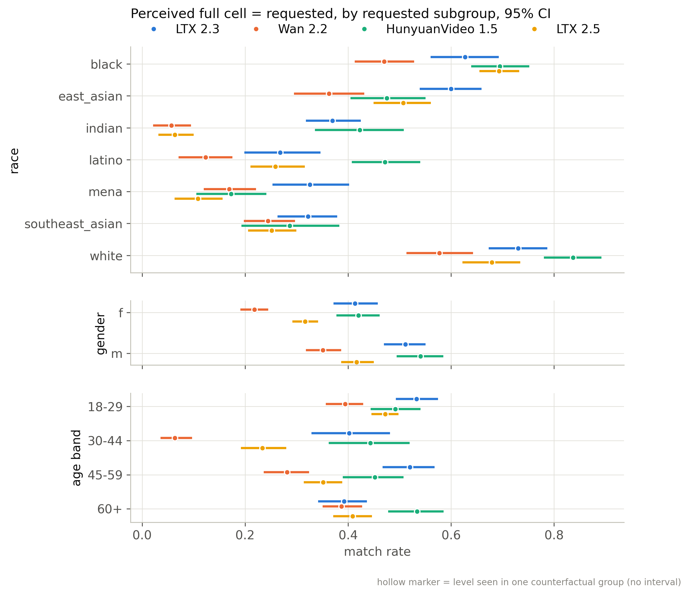
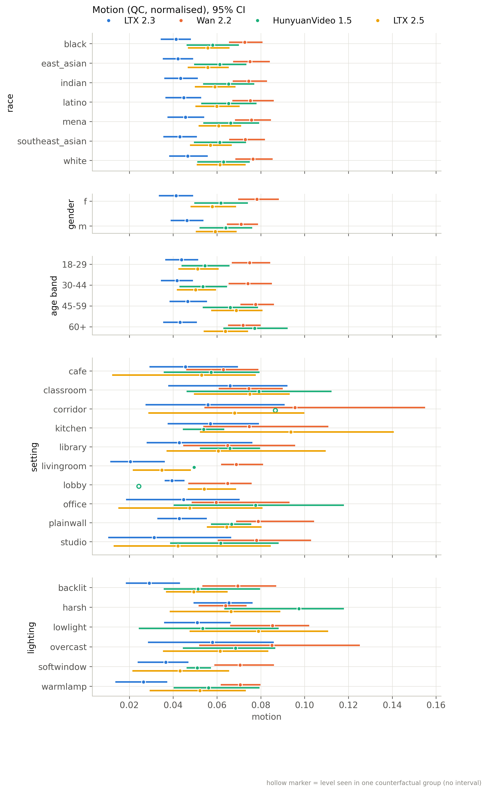
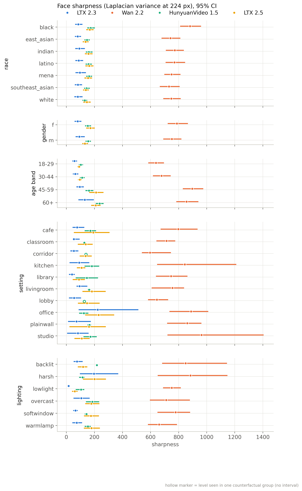
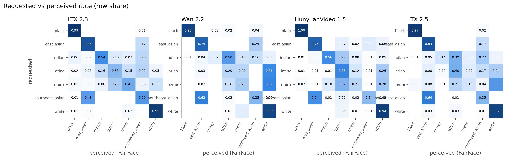
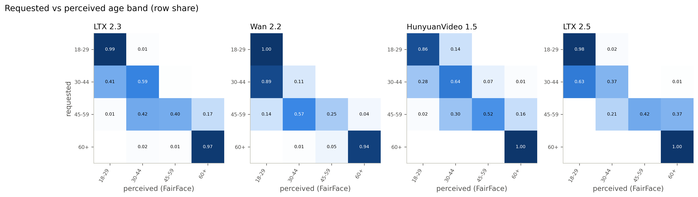

# Generator benchmark (Track A, section 6.4)

Snapshot `20261023-0251`, batches fake_b1, fake_b2, fake_b3; 7056 generated clips, 6435 primary and measured, 6425 with a face found by YuNet. Intervals: 95%, 1000 resamples of whole counterfactual groups.

Perceived labels come from FairFace (res34, 7-race) on 8 face crops per clip, the same procedure as the real half. They are perceived-presentation labels from a classifier with its own error profile (weaker on darker skin and older faces), so a low match rate mixes generator drift and classifier error; the reals carry the same classifier's labels.

## Inclusion

| batch   | generator   |   clips |   qc_technical |   qc_face |   primary |   measured |   face_found |
|:--------|:------------|--------:|---------------:|----------:|----------:|-----------:|-------------:|
| fake_b1 | hunyuan15   |     504 |            504 |       492 |       492 |        504 |          504 |
| fake_b1 | ltx23       |    2016 |           1885 |      2009 |      1878 |       2016 |         2006 |
| fake_b1 | wan22       |    2016 |           2016 |      1566 |      1566 |       2016 |         2016 |
| fake_b2 | hunyuan15   |     504 |            504 |       497 |       497 |        504 |          504 |
| fake_b3 | ltx25       |    2016 |           2014 |      2004 |      2002 |       2016 |         2016 |

## QC acceptance: technical QC

| generator   | factor   | level           |    n |   estimate |   ci_lo |   ci_hi |
|:------------|:---------|:----------------|-----:|-----------:|--------:|--------:|
| ltx23       | overall  | all             | 2016 |      0.935 |   0.868 |   0.987 |
| ltx23       | race     | black           |  288 |      0.948 |   0.892 |   0.99  |
| ltx23       | race     | east_asian      |  288 |      0.944 |   0.885 |   0.993 |
| ltx23       | race     | indian          |  288 |      0.962 |   0.903 |   1     |
| ltx23       | race     | latino          |  288 |      0.917 |   0.83  |   0.983 |
| ltx23       | race     | mena            |  288 |      0.931 |   0.854 |   0.99  |
| ltx23       | race     | southeast_asian |  288 |      0.944 |   0.868 |   1     |
| ltx23       | race     | white           |  288 |      0.899 |   0.806 |   0.979 |
| ltx23       | gender   | f               | 1008 |      0.928 |   0.856 |   0.984 |
| ltx23       | gender   | m               | 1008 |      0.942 |   0.878 |   0.99  |
| ltx23       | age_band | 18-29           |  504 |      0.937 |   0.867 |   0.988 |
| ltx23       | age_band | 30-44           |  504 |      0.94  |   0.879 |   0.99  |
| ltx23       | age_band | 45-59           |  504 |      0.948 |   0.887 |   0.994 |
| ltx23       | age_band | 60+             |  504 |      0.915 |   0.829 |   0.98  |
| wan22       | overall  | all             | 2016 |      1     |   1     |   1     |
| wan22       | race     | black           |  288 |      1     |   1     |   1     |
| wan22       | race     | east_asian      |  288 |      1     |   1     |   1     |
| wan22       | race     | indian          |  288 |      1     |   1     |   1     |
| wan22       | race     | latino          |  288 |      1     |   1     |   1     |
| wan22       | race     | mena            |  288 |      1     |   1     |   1     |
| wan22       | race     | southeast_asian |  288 |      1     |   1     |   1     |
| wan22       | race     | white           |  288 |      1     |   1     |   1     |
| wan22       | gender   | f               | 1008 |      1     |   1     |   1     |
| wan22       | gender   | m               | 1008 |      1     |   1     |   1     |
| wan22       | age_band | 18-29           |  504 |      1     |   1     |   1     |
| wan22       | age_band | 30-44           |  504 |      1     |   1     |   1     |
| wan22       | age_band | 45-59           |  504 |      1     |   1     |   1     |
| wan22       | age_band | 60+             |  504 |      1     |   1     |   1     |
| hunyuan15   | overall  | all             | 1008 |      1     |   1     |   1     |
| hunyuan15   | race     | black           |  144 |      1     |   1     |   1     |
| hunyuan15   | race     | east_asian      |  144 |      1     |   1     |   1     |
| hunyuan15   | race     | indian          |  144 |      1     |   1     |   1     |
| hunyuan15   | race     | latino          |  144 |      1     |   1     |   1     |
| hunyuan15   | race     | mena            |  144 |      1     |   1     |   1     |
| hunyuan15   | race     | southeast_asian |  144 |      1     |   1     |   1     |
| hunyuan15   | race     | white           |  144 |      1     |   1     |   1     |
| hunyuan15   | gender   | f               |  504 |      1     |   1     |   1     |
| hunyuan15   | gender   | m               |  504 |      1     |   1     |   1     |
| hunyuan15   | age_band | 18-29           |  252 |      1     |   1     |   1     |
| hunyuan15   | age_band | 30-44           |  252 |      1     |   1     |   1     |
| hunyuan15   | age_band | 45-59           |  252 |      1     |   1     |   1     |
| hunyuan15   | age_band | 60+             |  252 |      1     |   1     |   1     |
| ltx25       | overall  | all             | 2016 |      0.999 |   0.998 |   1     |
| ltx25       | race     | black           |  288 |      1     |   1     |   1     |
| ltx25       | race     | east_asian      |  288 |      0.997 |   0.99  |   1     |
| ltx25       | race     | indian          |  288 |      1     |   1     |   1     |
| ltx25       | race     | latino          |  288 |      1     |   1     |   1     |
| ltx25       | race     | mena            |  288 |      1     |   1     |   1     |
| ltx25       | race     | southeast_asian |  288 |      1     |   1     |   1     |
| ltx25       | race     | white           |  288 |      0.997 |   0.99  |   1     |
| ltx25       | gender   | f               | 1008 |      0.998 |   0.995 |   1     |
| ltx25       | gender   | m               | 1008 |      1     |   1     |   1     |
| ltx25       | age_band | 18-29           |  504 |      0.998 |   0.994 |   1     |
| ltx25       | age_band | 30-44           |  504 |      0.998 |   0.994 |   1     |
| ltx25       | age_band | 45-59           |  504 |      1     |   1     |   1     |
| ltx25       | age_band | 60+             |  504 |      1     |   1     |   1     |
| all         | overall  | all             | 7056 |      0.981 |   0.962 |   0.996 |
| all         | race     | black           | 1008 |      0.985 |   0.969 |   0.997 |
| all         | race     | east_asian      | 1008 |      0.983 |   0.965 |   0.997 |
| all         | race     | indian          | 1008 |      0.989 |   0.972 |   1     |
| all         | race     | latino          | 1008 |      0.976 |   0.951 |   0.995 |
| all         | race     | mena            | 1008 |      0.98  |   0.959 |   0.997 |
| all         | race     | southeast_asian | 1008 |      0.984 |   0.963 |   1     |
| all         | race     | white           | 1008 |      0.97  |   0.943 |   0.992 |
| all         | gender   | f               | 3528 |      0.979 |   0.959 |   0.995 |
| all         | gender   | m               | 3528 |      0.984 |   0.965 |   0.997 |
| all         | age_band | 18-29           | 1764 |      0.981 |   0.962 |   0.996 |
| all         | age_band | 30-44           | 1764 |      0.982 |   0.965 |   0.997 |
| all         | age_band | 45-59           | 1764 |      0.985 |   0.968 |   0.998 |
| all         | age_band | 60+             | 1764 |      0.976 |   0.952 |   0.994 |

## QC acceptance: face QC

| generator   | factor   | level           |    n |   estimate |   ci_lo |   ci_hi |
|:------------|:---------|:----------------|-----:|-----------:|--------:|--------:|
| ltx23       | overall  | all             | 2016 |      0.997 |   0.99  |   1     |
| ltx23       | race     | black           |  288 |      1     |   1     |   1     |
| ltx23       | race     | east_asian      |  288 |      0.993 |   0.979 |   1     |
| ltx23       | race     | indian          |  288 |      1     |   1     |   1     |
| ltx23       | race     | latino          |  288 |      0.993 |   0.979 |   1     |
| ltx23       | race     | mena            |  288 |      0.997 |   0.99  |   1     |
| ltx23       | race     | southeast_asian |  288 |      0.997 |   0.99  |   1     |
| ltx23       | race     | white           |  288 |      0.997 |   0.99  |   1     |
| ltx23       | gender   | f               | 1008 |      0.996 |   0.988 |   1     |
| ltx23       | gender   | m               | 1008 |      0.997 |   0.992 |   1     |
| ltx23       | age_band | 18-29           |  504 |      0.994 |   0.982 |   1     |
| ltx23       | age_band | 30-44           |  504 |      0.994 |   0.982 |   1     |
| ltx23       | age_band | 45-59           |  504 |      1     |   1     |   1     |
| ltx23       | age_band | 60+             |  504 |      0.998 |   0.994 |   1     |
| wan22       | overall  | all             | 2016 |      0.777 |   0.686 |   0.864 |
| wan22       | race     | black           |  288 |      0.753 |   0.646 |   0.847 |
| wan22       | race     | east_asian      |  288 |      0.785 |   0.691 |   0.868 |
| wan22       | race     | indian          |  288 |      0.799 |   0.705 |   0.889 |
| wan22       | race     | latino          |  288 |      0.76  |   0.656 |   0.858 |
| wan22       | race     | mena            |  288 |      0.781 |   0.677 |   0.882 |
| wan22       | race     | southeast_asian |  288 |      0.795 |   0.712 |   0.878 |
| wan22       | race     | white           |  288 |      0.764 |   0.663 |   0.861 |
| wan22       | gender   | f               | 1008 |      0.779 |   0.677 |   0.871 |
| wan22       | gender   | m               | 1008 |      0.775 |   0.68  |   0.866 |
| wan22       | age_band | 18-29           |  504 |      0.77  |   0.677 |   0.863 |
| wan22       | age_band | 30-44           |  504 |      0.748 |   0.637 |   0.855 |
| wan22       | age_band | 45-59           |  504 |      0.79  |   0.694 |   0.881 |
| wan22       | age_band | 60+             |  504 |      0.8   |   0.7   |   0.889 |
| hunyuan15   | overall  | all             | 1008 |      0.981 |   0.964 |   0.996 |
| hunyuan15   | race     | black           |  144 |      0.979 |   0.956 |   1     |
| hunyuan15   | race     | east_asian      |  144 |      0.979 |   0.944 |   1     |
| hunyuan15   | race     | indian          |  144 |      0.986 |   0.967 |   1     |
| hunyuan15   | race     | latino          |  144 |      0.986 |   0.964 |   1     |
| hunyuan15   | race     | mena            |  144 |      0.965 |   0.929 |   0.994 |
| hunyuan15   | race     | southeast_asian |  144 |      0.993 |   0.977 |   1     |
| hunyuan15   | race     | white           |  144 |      0.979 |   0.941 |   1     |
| hunyuan15   | gender   | f               |  504 |      0.982 |   0.957 |   1     |
| hunyuan15   | gender   | m               |  504 |      0.98  |   0.957 |   1     |
| hunyuan15   | age_band | 18-29           |  252 |      0.96  |   0.918 |   0.995 |
| hunyuan15   | age_band | 30-44           |  252 |      0.984 |   0.964 |   1     |
| hunyuan15   | age_band | 45-59           |  252 |      0.992 |   0.981 |   1     |
| hunyuan15   | age_band | 60+             |  252 |      0.988 |   0.974 |   1     |
| ltx25       | overall  | all             | 2016 |      0.994 |   0.988 |   0.999 |
| ltx25       | race     | black           |  288 |      0.997 |   0.99  |   1     |
| ltx25       | race     | east_asian      |  288 |      0.997 |   0.99  |   1     |
| ltx25       | race     | indian          |  288 |      0.986 |   0.965 |   1     |
| ltx25       | race     | latino          |  288 |      0.993 |   0.983 |   1     |
| ltx25       | race     | mena            |  288 |      0.993 |   0.983 |   1     |
| ltx25       | race     | southeast_asian |  288 |      0.993 |   0.983 |   1     |
| ltx25       | race     | white           |  288 |      1     |   1     |   1     |
| ltx25       | gender   | f               | 1008 |      0.993 |   0.982 |   1     |
| ltx25       | gender   | m               | 1008 |      0.995 |   0.987 |   1     |
| ltx25       | age_band | 18-29           |  504 |      0.994 |   0.988 |   1     |
| ltx25       | age_band | 30-44           |  504 |      0.988 |   0.976 |   0.998 |
| ltx25       | age_band | 45-59           |  504 |      0.994 |   0.984 |   1     |
| ltx25       | age_band | 60+             |  504 |      1     |   1     |   1     |
| all         | overall  | all             | 7056 |      0.931 |   0.903 |   0.958 |
| all         | race     | black           | 1008 |      0.926 |   0.894 |   0.954 |
| all         | race     | east_asian      | 1008 |      0.933 |   0.905 |   0.959 |
| all         | race     | indian          | 1008 |      0.937 |   0.908 |   0.964 |
| all         | race     | latino          | 1008 |      0.926 |   0.896 |   0.955 |
| all         | race     | mena            | 1008 |      0.93  |   0.897 |   0.962 |
| all         | race     | southeast_asian | 1008 |      0.938 |   0.912 |   0.963 |
| all         | race     | white           | 1008 |      0.929 |   0.9   |   0.955 |
| all         | gender   | f               | 3528 |      0.931 |   0.901 |   0.959 |
| all         | gender   | m               | 3528 |      0.931 |   0.903 |   0.959 |
| all         | age_band | 18-29           | 1764 |      0.925 |   0.897 |   0.954 |
| all         | age_band | 30-44           | 1764 |      0.921 |   0.888 |   0.953 |
| all         | age_band | 45-59           | 1764 |      0.937 |   0.908 |   0.964 |
| all         | age_band | 60+             | 1764 |      0.94  |   0.912 |   0.966 |

## QC acceptance: technical and face QC (primary)

| generator   | factor   | level           |    n |   estimate |   ci_lo |   ci_hi |
|:------------|:---------|:----------------|-----:|-----------:|--------:|--------:|
| ltx23       | overall  | all             | 2016 |      0.932 |   0.866 |   0.983 |
| ltx23       | race     | black           |  288 |      0.948 |   0.892 |   0.99  |
| ltx23       | race     | east_asian      |  288 |      0.938 |   0.878 |   0.986 |
| ltx23       | race     | indian          |  288 |      0.962 |   0.903 |   1     |
| ltx23       | race     | latino          |  288 |      0.91  |   0.823 |   0.976 |
| ltx23       | race     | mena            |  288 |      0.927 |   0.851 |   0.986 |
| ltx23       | race     | southeast_asian |  288 |      0.941 |   0.868 |   0.997 |
| ltx23       | race     | white           |  288 |      0.896 |   0.805 |   0.976 |
| ltx23       | gender   | f               | 1008 |      0.924 |   0.852 |   0.979 |
| ltx23       | gender   | m               | 1008 |      0.939 |   0.876 |   0.988 |
| ltx23       | age_band | 18-29           |  504 |      0.931 |   0.861 |   0.982 |
| ltx23       | age_band | 30-44           |  504 |      0.935 |   0.873 |   0.982 |
| ltx23       | age_band | 45-59           |  504 |      0.948 |   0.887 |   0.994 |
| ltx23       | age_band | 60+             |  504 |      0.913 |   0.829 |   0.978 |
| wan22       | overall  | all             | 2016 |      0.777 |   0.686 |   0.864 |
| wan22       | race     | black           |  288 |      0.753 |   0.646 |   0.847 |
| wan22       | race     | east_asian      |  288 |      0.785 |   0.691 |   0.868 |
| wan22       | race     | indian          |  288 |      0.799 |   0.705 |   0.889 |
| wan22       | race     | latino          |  288 |      0.76  |   0.656 |   0.858 |
| wan22       | race     | mena            |  288 |      0.781 |   0.677 |   0.882 |
| wan22       | race     | southeast_asian |  288 |      0.795 |   0.712 |   0.878 |
| wan22       | race     | white           |  288 |      0.764 |   0.663 |   0.861 |
| wan22       | gender   | f               | 1008 |      0.779 |   0.677 |   0.871 |
| wan22       | gender   | m               | 1008 |      0.775 |   0.68  |   0.866 |
| wan22       | age_band | 18-29           |  504 |      0.77  |   0.677 |   0.863 |
| wan22       | age_band | 30-44           |  504 |      0.748 |   0.637 |   0.855 |
| wan22       | age_band | 45-59           |  504 |      0.79  |   0.694 |   0.881 |
| wan22       | age_band | 60+             |  504 |      0.8   |   0.7   |   0.889 |
| hunyuan15   | overall  | all             | 1008 |      0.981 |   0.964 |   0.996 |
| hunyuan15   | race     | black           |  144 |      0.979 |   0.956 |   1     |
| hunyuan15   | race     | east_asian      |  144 |      0.979 |   0.944 |   1     |
| hunyuan15   | race     | indian          |  144 |      0.986 |   0.967 |   1     |
| hunyuan15   | race     | latino          |  144 |      0.986 |   0.964 |   1     |
| hunyuan15   | race     | mena            |  144 |      0.965 |   0.929 |   0.994 |
| hunyuan15   | race     | southeast_asian |  144 |      0.993 |   0.977 |   1     |
| hunyuan15   | race     | white           |  144 |      0.979 |   0.941 |   1     |
| hunyuan15   | gender   | f               |  504 |      0.982 |   0.957 |   1     |
| hunyuan15   | gender   | m               |  504 |      0.98  |   0.957 |   1     |
| hunyuan15   | age_band | 18-29           |  252 |      0.96  |   0.918 |   0.995 |
| hunyuan15   | age_band | 30-44           |  252 |      0.984 |   0.964 |   1     |
| hunyuan15   | age_band | 45-59           |  252 |      0.992 |   0.981 |   1     |
| hunyuan15   | age_band | 60+             |  252 |      0.988 |   0.974 |   1     |
| ltx25       | overall  | all             | 2016 |      0.993 |   0.987 |   0.998 |
| ltx25       | race     | black           |  288 |      0.997 |   0.99  |   1     |
| ltx25       | race     | east_asian      |  288 |      0.993 |   0.983 |   1     |
| ltx25       | race     | indian          |  288 |      0.986 |   0.965 |   1     |
| ltx25       | race     | latino          |  288 |      0.993 |   0.983 |   1     |
| ltx25       | race     | mena            |  288 |      0.993 |   0.983 |   1     |
| ltx25       | race     | southeast_asian |  288 |      0.993 |   0.983 |   1     |
| ltx25       | race     | white           |  288 |      0.997 |   0.99  |   1     |
| ltx25       | gender   | f               | 1008 |      0.991 |   0.98  |   0.999 |
| ltx25       | gender   | m               | 1008 |      0.995 |   0.987 |   1     |
| ltx25       | age_band | 18-29           |  504 |      0.992 |   0.984 |   0.998 |
| ltx25       | age_band | 30-44           |  504 |      0.986 |   0.972 |   0.996 |
| ltx25       | age_band | 45-59           |  504 |      0.994 |   0.984 |   1     |
| ltx25       | age_band | 60+             |  504 |      1     |   1     |   1     |
| all         | overall  | all             | 7056 |      0.912 |   0.879 |   0.943 |
| all         | race     | black           | 1008 |      0.911 |   0.877 |   0.942 |
| all         | race     | east_asian      | 1008 |      0.916 |   0.887 |   0.945 |
| all         | race     | indian          | 1008 |      0.926 |   0.889 |   0.959 |
| all         | race     | latino          | 1008 |      0.902 |   0.86  |   0.939 |
| all         | race     | mena            | 1008 |      0.91  |   0.871 |   0.946 |
| all         | race     | southeast_asian | 1008 |      0.922 |   0.886 |   0.955 |
| all         | race     | white           | 1008 |      0.899 |   0.86  |   0.935 |
| all         | gender   | f               | 3528 |      0.91  |   0.87  |   0.945 |
| all         | gender   | m               | 3528 |      0.914 |   0.882 |   0.946 |
| all         | age_band | 18-29           | 1764 |      0.906 |   0.873 |   0.94  |
| all         | age_band | 30-44           | 1764 |      0.903 |   0.866 |   0.938 |
| all         | age_band | 45-59           | 1764 |      0.922 |   0.888 |   0.955 |
| all         | age_band | 60+             | 1764 |      0.916 |   0.879 |   0.95  |

### Acceptance gap (primary)

| generator   | attribute        |   gap |   ci_lo |   ci_hi | max_level            | min_level            |
|:------------|:-----------------|------:|--------:|--------:|:---------------------|:---------------------|
| ltx23       | race             | 0.066 |   0.031 |   0.129 | indian               | white                |
| ltx23       | gender           | 0.016 |   0.001 |   0.046 | m                    | f                    |
| ltx23       | age_band         | 0.036 |   0.016 |   0.068 | 45-59                | 60+                  |
| ltx23       | cell             | 0.167 |   0.083 |   0.306 | indian__f__30-44     | white__m__60+        |
| ltx23       | setting          | 0.286 |   0.076 |   0.839 | corridor             | classroom            |
| ltx23       | lighting         | 0.14  |   0.065 |   0.5   | backlit              | harsh                |
| ltx23       | behavior         | 0.214 |   0.058 |   0.752 | listen               | laugh                |
| ltx23       | camera           | 0.028 |   0.002 |   0.154 | slowsway             | static               |
| ltx23       | duration_nominal | 0.123 |   0.021 |   0.254 | 6                    | 5                    |
| wan22       | race             | 0.045 |   0.031 |   0.104 | indian               | black                |
| wan22       | gender           | 0.004 |   0.001 |   0.063 | f                    | m                    |
| wan22       | age_band         | 0.052 |   0.02  |   0.111 | 60+                  | 30-44                |
| wan22       | cell             | 0.222 |   0.222 |   0.417 | east_asian__f__45-59 | east_asian__m__45-59 |
| wan22       | setting          | 0.848 |   0.714 |   0.935 | plainwall            | office               |
| wan22       | lighting         | 0.423 |   0.26  |   0.763 | softwindow           | harsh                |
| wan22       | behavior         | 0.332 |   0.25  |   0.864 | laugh                | smile                |
| wan22       | camera           | 0.008 |   0.003 |   0.231 | slowsway             | static               |
| wan22       | duration_nominal | 0.141 |   0.007 |   0.327 | 5                    | 6                    |
| hunyuan15   | race             | 0.028 |   0.013 |   0.066 | southeast_asian      | mena                 |
| hunyuan15   | gender           | 0.002 |   0     |   0.033 | f                    | m                    |
| hunyuan15   | age_band         | 0.032 |   0.004 |   0.075 | 45-59                | 18-29                |
| hunyuan15   | cell             | 0.111 |   0.053 |   0.294 | black__f__18-29      | black__m__18-29      |
| hunyuan15   | setting          | 0.071 |   0.024 |   0.125 | classroom            | corridor             |
| hunyuan15   | lighting         | 0.042 |   0.014 |   0.125 | backlit              | lowlight             |
| hunyuan15   | behavior         | 0.071 |   0.027 |   0.125 | laugh                | turn                 |
| hunyuan15   | camera           | 0.038 |   0.011 |   0.071 | static               | slowsway             |
| hunyuan15   | duration_nominal | 0.006 |   0     |   0.04  | 5                    | 6                    |
| ltx25       | race             | 0.01  |   0.007 |   0.035 | black                | indian               |
| ltx25       | gender           | 0.004 |   0     |   0.017 | m                    | f                    |
| ltx25       | age_band         | 0.014 |   0.004 |   0.028 | 60+                  | 30-44                |
| ltx25       | cell             | 0.028 |   0.028 |   0.111 | black__f__18-29      | black__m__30-44      |
| ltx25       | setting          | 0.031 |   0.011 |   0.071 | classroom            | cafe                 |
| ltx25       | lighting         | 0.018 |   0.007 |   0.045 | backlit              | overcast             |
| ltx25       | behavior         | 0.018 |   0.009 |   0.054 | listen               | read                 |
| ltx25       | camera           | 0.004 |   0     |   0.016 | static               | slowsway             |
| ltx25       | duration_nominal | 0.004 |   0     |   0.016 | 6                    | 5                    |
| all         | race             | 0.027 |   0.018 |   0.05  | indian               | white                |
| all         | gender           | 0.004 |   0.001 |   0.027 | m                    | f                    |
| all         | age_band         | 0.019 |   0.007 |   0.04  | 45-59                | 30-44                |
| all         | cell             | 0.095 |   0.085 |   0.168 | east_asian__f__45-59 | latino__f__30-44     |
| all         | setting          | 0.251 |   0.237 |   0.458 | plainwall            | office               |
| all         | lighting         | 0.162 |   0.107 |   0.283 | softwindow           | harsh                |
| all         | behavior         | 0.106 |   0.09  |   0.342 | listen               | speak                |
| all         | camera           | 0.004 |   0.001 |   0.085 | slowsway             | static               |
| all         | duration_nominal | 0.005 |   0.001 |   0.077 | 5                    | 6                    |

## Demographic fidelity: perceived race = requested

| generator   | factor   | level           |    n |   estimate |   ci_lo |   ci_hi |
|:------------|:---------|:----------------|-----:|-----------:|--------:|--------:|
| ltx23       | overall  | all             | 1868 |      0.654 |   0.633 |   0.673 |
| ltx23       | race     | black           |  271 |      0.985 |   0.97  |   0.996 |
| ltx23       | race     | east_asian      |  270 |      0.826 |   0.755 |   0.89  |
| ltx23       | race     | indian          |  276 |      0.543 |   0.479 |   0.609 |
| ltx23       | race     | latino          |  261 |      0.349 |   0.267 |   0.43  |
| ltx23       | race     | mena            |  264 |      0.42  |   0.326 |   0.513 |
| ltx23       | race     | southeast_asian |  270 |      0.504 |   0.43  |   0.578 |
| ltx23       | race     | white           |  256 |      0.949 |   0.911 |   0.981 |
| ltx23       | gender   | f               |  931 |      0.654 |   0.631 |   0.677 |
| ltx23       | gender   | m               |  937 |      0.653 |   0.628 |   0.677 |
| ltx23       | age_band | 18-29           |  467 |      0.662 |   0.623 |   0.701 |
| ltx23       | age_band | 30-44           |  470 |      0.715 |   0.688 |   0.747 |
| ltx23       | age_band | 45-59           |  477 |      0.717 |   0.687 |   0.748 |
| ltx23       | age_band | 60+             |  454 |      0.515 |   0.483 |   0.547 |
| wan22       | overall  | all             | 1566 |      0.49  |   0.47  |   0.509 |
| wan22       | race     | black           |  217 |      0.922 |   0.881 |   0.956 |
| wan22       | race     | east_asian      |  226 |      0.748 |   0.665 |   0.82  |
| wan22       | race     | indian          |  230 |      0.087 |   0.043 |   0.135 |
| wan22       | race     | latino          |  219 |      0.201 |   0.118 |   0.294 |
| wan22       | race     | mena            |  225 |      0.253 |   0.183 |   0.325 |
| wan22       | race     | southeast_asian |  229 |      0.354 |   0.294 |   0.427 |
| wan22       | race     | white           |  220 |      0.895 |   0.845 |   0.937 |
| wan22       | gender   | f               |  785 |      0.456 |   0.429 |   0.481 |
| wan22       | gender   | m               |  781 |      0.525 |   0.501 |   0.546 |
| wan22       | age_band | 18-29           |  388 |      0.505 |   0.471 |   0.536 |
| wan22       | age_band | 30-44           |  377 |      0.512 |   0.476 |   0.547 |
| wan22       | age_band | 45-59           |  398 |      0.485 |   0.451 |   0.517 |
| wan22       | age_band | 60+             |  403 |      0.462 |   0.43  |   0.491 |
| hunyuan15   | overall  | all             |  989 |      0.625 |   0.602 |   0.649 |
| hunyuan15   | race     | black           |  141 |      1     |   1     |   1     |
| hunyuan15   | race     | east_asian      |  141 |      0.752 |   0.692 |   0.814 |
| hunyuan15   | race     | indian          |  142 |      0.556 |   0.475 |   0.639 |
| hunyuan15   | race     | latino          |  142 |      0.577 |   0.492 |   0.662 |
| hunyuan15   | race     | mena            |  139 |      0.209 |   0.132 |   0.281 |
| hunyuan15   | race     | southeast_asian |  143 |      0.343 |   0.239 |   0.44  |
| hunyuan15   | race     | white           |  141 |      0.936 |   0.877 |   0.979 |
| hunyuan15   | gender   | f               |  495 |      0.614 |   0.584 |   0.645 |
| hunyuan15   | gender   | m               |  494 |      0.636 |   0.601 |   0.669 |
| hunyuan15   | age_band | 18-29           |  242 |      0.665 |   0.629 |   0.702 |
| hunyuan15   | age_band | 30-44           |  248 |      0.681 |   0.655 |   0.709 |
| hunyuan15   | age_band | 45-59           |  250 |      0.608 |   0.562 |   0.651 |
| hunyuan15   | age_band | 60+             |  249 |      0.546 |   0.494 |   0.594 |
| ltx25       | overall  | all             | 2002 |      0.536 |   0.519 |   0.555 |
| ltx25       | race     | black           |  287 |      0.972 |   0.955 |   0.989 |
| ltx25       | race     | east_asian      |  286 |      0.829 |   0.769 |   0.881 |
| ltx25       | race     | indian          |  284 |      0.144 |   0.088 |   0.211 |
| ltx25       | race     | latino          |  286 |      0.399 |   0.336 |   0.467 |
| ltx25       | race     | mena            |  286 |      0.129 |   0.076 |   0.186 |
| ltx25       | race     | southeast_asian |  286 |      0.353 |   0.286 |   0.425 |
| ltx25       | race     | white           |  287 |      0.92  |   0.871 |   0.958 |
| ltx25       | gender   | f               |  999 |      0.533 |   0.509 |   0.556 |
| ltx25       | gender   | m               | 1003 |      0.539 |   0.514 |   0.567 |
| ltx25       | age_band | 18-29           |  500 |      0.526 |   0.504 |   0.551 |
| ltx25       | age_band | 30-44           |  497 |      0.565 |   0.536 |   0.597 |
| ltx25       | age_band | 45-59           |  501 |      0.587 |   0.548 |   0.622 |
| ltx25       | age_band | 60+             |  504 |      0.466 |   0.438 |   0.498 |
| all         | overall  | all             | 6425 |      0.573 |   0.562 |   0.583 |
| all         | race     | black           |  916 |      0.968 |   0.957 |   0.978 |
| all         | race     | east_asian      |  923 |      0.796 |   0.76  |   0.833 |
| all         | race     | indian          |  932 |      0.311 |   0.278 |   0.349 |
| all         | race     | latino          |  908 |      0.365 |   0.323 |   0.406 |
| all         | race     | mena            |  914 |      0.256 |   0.211 |   0.304 |
| all         | race     | southeast_asian |  928 |      0.395 |   0.356 |   0.433 |
| all         | race     | white           |  904 |      0.925 |   0.888 |   0.953 |
| all         | gender   | f               | 3210 |      0.562 |   0.551 |   0.573 |
| all         | gender   | m               | 3215 |      0.584 |   0.569 |   0.6   |
| all         | age_band | 18-29           | 1597 |      0.582 |   0.563 |   0.599 |
| all         | age_band | 30-44           | 1592 |      0.615 |   0.599 |   0.631 |
| all         | age_band | 45-59           | 1626 |      0.603 |   0.584 |   0.623 |
| all         | age_band | 60+             | 1610 |      0.491 |   0.478 |   0.505 |

## Demographic fidelity: perceived gender = requested

| generator   | factor   | level           |    n |   estimate |   ci_lo |   ci_hi |
|:------------|:---------|:----------------|-----:|-----------:|--------:|--------:|
| ltx23       | overall  | all             | 1868 |      0.946 |   0.929 |   0.961 |
| ltx23       | race     | black           |  271 |      0.904 |   0.883 |   0.925 |
| ltx23       | race     | east_asian      |  270 |      0.956 |   0.932 |   0.975 |
| ltx23       | race     | indian          |  276 |      0.953 |   0.93  |   0.975 |
| ltx23       | race     | latino          |  261 |      0.958 |   0.937 |   0.978 |
| ltx23       | race     | mena            |  264 |      0.936 |   0.914 |   0.956 |
| ltx23       | race     | southeast_asian |  270 |      0.944 |   0.924 |   0.966 |
| ltx23       | race     | white           |  256 |      0.973 |   0.955 |   0.989 |
| ltx23       | gender   | f               |  931 |      0.892 |   0.858 |   0.922 |
| ltx23       | gender   | m               |  937 |      1     |   1     |   1     |
| ltx23       | age_band | 18-29           |  467 |      0.998 |   0.994 |   1     |
| ltx23       | age_band | 30-44           |  470 |      0.998 |   0.993 |   1     |
| ltx23       | age_band | 45-59           |  477 |      0.996 |   0.989 |   1     |
| ltx23       | age_band | 60+             |  454 |      0.786 |   0.721 |   0.847 |
| wan22       | overall  | all             | 1566 |      0.956 |   0.936 |   0.974 |
| wan22       | race     | black           |  217 |      0.894 |   0.835 |   0.944 |
| wan22       | race     | east_asian      |  226 |      0.982 |   0.965 |   0.996 |
| wan22       | race     | indian          |  230 |      0.913 |   0.87  |   0.952 |
| wan22       | race     | latino          |  219 |      0.977 |   0.958 |   0.995 |
| wan22       | race     | mena            |  225 |      0.982 |   0.965 |   0.996 |
| wan22       | race     | southeast_asian |  229 |      0.952 |   0.929 |   0.974 |
| wan22       | race     | white           |  220 |      0.991 |   0.977 |   1     |
| wan22       | gender   | f               |  785 |      0.912 |   0.872 |   0.947 |
| wan22       | gender   | m               |  781 |      1     |   1     |   1     |
| wan22       | age_band | 18-29           |  388 |      0.974 |   0.958 |   0.988 |
| wan22       | age_band | 30-44           |  377 |      0.984 |   0.969 |   0.995 |
| wan22       | age_band | 45-59           |  398 |      0.98  |   0.962 |   0.995 |
| wan22       | age_band | 60+             |  403 |      0.888 |   0.831 |   0.939 |
| hunyuan15   | overall  | all             |  989 |      0.987 |   0.975 |   0.997 |
| hunyuan15   | race     | black           |  141 |      0.929 |   0.873 |   0.976 |
| hunyuan15   | race     | east_asian      |  141 |      1     |   1     |   1     |
| hunyuan15   | race     | indian          |  142 |      0.979 |   0.943 |   1     |
| hunyuan15   | race     | latino          |  142 |      1     |   1     |   1     |
| hunyuan15   | race     | mena            |  139 |      1     |   1     |   1     |
| hunyuan15   | race     | southeast_asian |  143 |      1     |   1     |   1     |
| hunyuan15   | race     | white           |  141 |      1     |   1     |   1     |
| hunyuan15   | gender   | f               |  495 |      0.974 |   0.95  |   0.993 |
| hunyuan15   | gender   | m               |  494 |      1     |   1     |   1     |
| hunyuan15   | age_band | 18-29           |  242 |      0.979 |   0.958 |   0.996 |
| hunyuan15   | age_band | 30-44           |  248 |      0.992 |   0.973 |   1     |
| hunyuan15   | age_band | 45-59           |  250 |      0.988 |   0.968 |   1     |
| hunyuan15   | age_band | 60+             |  249 |      0.988 |   0.974 |   1     |
| ltx25       | overall  | all             | 2002 |      0.965 |   0.949 |   0.978 |
| ltx25       | race     | black           |  287 |      0.937 |   0.91  |   0.961 |
| ltx25       | race     | east_asian      |  286 |      0.969 |   0.948 |   0.986 |
| ltx25       | race     | indian          |  284 |      0.954 |   0.917 |   0.982 |
| ltx25       | race     | latino          |  286 |      0.972 |   0.954 |   0.986 |
| ltx25       | race     | mena            |  286 |      0.976 |   0.958 |   0.99  |
| ltx25       | race     | southeast_asian |  286 |      0.962 |   0.941 |   0.979 |
| ltx25       | race     | white           |  287 |      0.986 |   0.972 |   0.997 |
| ltx25       | gender   | f               |  999 |      0.932 |   0.899 |   0.959 |
| ltx25       | gender   | m               | 1003 |      0.998 |   0.995 |   1     |
| ltx25       | age_band | 18-29           |  500 |      0.998 |   0.994 |   1     |
| ltx25       | age_band | 30-44           |  497 |      0.998 |   0.994 |   1     |
| ltx25       | age_band | 45-59           |  501 |      0.986 |   0.974 |   0.996 |
| ltx25       | age_band | 60+             |  504 |      0.879 |   0.827 |   0.923 |
| all         | overall  | all             | 6425 |      0.961 |   0.95  |   0.97  |
| all         | race     | black           |  916 |      0.916 |   0.891 |   0.938 |
| all         | race     | east_asian      |  923 |      0.973 |   0.962 |   0.983 |
| all         | race     | indian          |  932 |      0.947 |   0.927 |   0.965 |
| all         | race     | latino          |  908 |      0.974 |   0.962 |   0.984 |
| all         | race     | mena            |  914 |      0.969 |   0.961 |   0.978 |
| all         | race     | southeast_asian |  928 |      0.96  |   0.948 |   0.971 |
| all         | race     | white           |  904 |      0.986 |   0.978 |   0.993 |
| all         | gender   | f               | 3210 |      0.922 |   0.899 |   0.941 |
| all         | gender   | m               | 3215 |      0.999 |   0.998 |   1     |
| all         | age_band | 18-29           | 1597 |      0.989 |   0.983 |   0.995 |
| all         | age_band | 30-44           | 1592 |      0.994 |   0.988 |   0.998 |
| all         | age_band | 45-59           | 1626 |      0.988 |   0.981 |   0.994 |
| all         | age_band | 60+             | 1610 |      0.872 |   0.835 |   0.903 |

## Demographic fidelity: perceived age band = requested

| generator   | factor   | level           |    n |   estimate |   ci_lo |   ci_hi |
|:------------|:---------|:----------------|-----:|-----------:|--------:|--------:|
| ltx23       | overall  | all             | 1868 |      0.77  |   0.737 |   0.805 |
| ltx23       | race     | black           |  271 |      0.72  |   0.653 |   0.787 |
| ltx23       | race     | east_asian      |  270 |      0.763 |   0.719 |   0.806 |
| ltx23       | race     | indian          |  276 |      0.764 |   0.724 |   0.808 |
| ltx23       | race     | latino          |  261 |      0.789 |   0.748 |   0.831 |
| ltx23       | race     | mena            |  264 |      0.837 |   0.789 |   0.878 |
| ltx23       | race     | southeast_asian |  270 |      0.733 |   0.68  |   0.791 |
| ltx23       | race     | white           |  256 |      0.789 |   0.737 |   0.839 |
| ltx23       | gender   | f               |  931 |      0.734 |   0.693 |   0.773 |
| ltx23       | gender   | m               |  937 |      0.807 |   0.766 |   0.85  |
| ltx23       | age_band | 18-29           |  467 |      0.814 |   0.773 |   0.858 |
| ltx23       | age_band | 30-44           |  470 |      0.585 |   0.483 |   0.688 |
| ltx23       | age_band | 45-59           |  477 |      0.717 |   0.663 |   0.767 |
| ltx23       | age_band | 60+             |  454 |      0.974 |   0.952 |   0.991 |
| wan22       | overall  | all             | 1566 |      0.628 |   0.59  |   0.666 |
| wan22       | race     | black           |  217 |      0.581 |   0.524 |   0.637 |
| wan22       | race     | east_asian      |  226 |      0.566 |   0.524 |   0.614 |
| wan22       | race     | indian          |  230 |      0.652 |   0.594 |   0.712 |
| wan22       | race     | latino          |  219 |      0.671 |   0.62  |   0.722 |
| wan22       | race     | mena            |  225 |      0.627 |   0.567 |   0.679 |
| wan22       | race     | southeast_asian |  229 |      0.62  |   0.563 |   0.68  |
| wan22       | race     | white           |  220 |      0.677 |   0.619 |   0.74  |
| wan22       | gender   | f               |  785 |      0.566 |   0.525 |   0.609 |
| wan22       | gender   | m               |  781 |      0.69  |   0.645 |   0.737 |
| wan22       | age_band | 18-29           |  388 |      0.822 |   0.764 |   0.878 |
| wan22       | age_band | 30-44           |  377 |      0.106 |   0.059 |   0.16  |
| wan22       | age_band | 45-59           |  398 |      0.616 |   0.535 |   0.694 |
| wan22       | age_band | 60+             |  403 |      0.94  |   0.895 |   0.979 |
| hunyuan15   | overall  | all             |  989 |      0.789 |   0.754 |   0.819 |
| hunyuan15   | race     | black           |  141 |      0.752 |   0.698 |   0.804 |
| hunyuan15   | race     | east_asian      |  141 |      0.702 |   0.634 |   0.77  |
| hunyuan15   | race     | indian          |  142 |      0.803 |   0.735 |   0.871 |
| hunyuan15   | race     | latino          |  142 |      0.824 |   0.781 |   0.87  |
| hunyuan15   | race     | mena            |  139 |      0.856 |   0.82  |   0.89  |
| hunyuan15   | race     | southeast_asian |  143 |      0.685 |   0.595 |   0.769 |
| hunyuan15   | race     | white           |  141 |      0.901 |   0.847 |   0.951 |
| hunyuan15   | gender   | f               |  495 |      0.745 |   0.7   |   0.793 |
| hunyuan15   | gender   | m               |  494 |      0.832 |   0.789 |   0.874 |
| hunyuan15   | age_band | 18-29           |  242 |      0.756 |   0.687 |   0.825 |
| hunyuan15   | age_band | 30-44           |  248 |      0.625 |   0.526 |   0.712 |
| hunyuan15   | age_band | 45-59           |  250 |      0.772 |   0.709 |   0.825 |
| hunyuan15   | age_band | 60+             |  249 |      1     |   1     |   1     |
| ltx25       | overall  | all             | 2002 |      0.714 |   0.69  |   0.739 |
| ltx25       | race     | black           |  287 |      0.767 |   0.734 |   0.801 |
| ltx25       | race     | east_asian      |  286 |      0.682 |   0.646 |   0.718 |
| ltx25       | race     | indian          |  284 |      0.68  |   0.64  |   0.722 |
| ltx25       | race     | latino          |  286 |      0.71  |   0.667 |   0.756 |
| ltx25       | race     | mena            |  286 |      0.724 |   0.679 |   0.768 |
| ltx25       | race     | southeast_asian |  286 |      0.682 |   0.653 |   0.711 |
| ltx25       | race     | white           |  287 |      0.753 |   0.712 |   0.792 |
| ltx25       | gender   | f               |  999 |      0.67  |   0.641 |   0.699 |
| ltx25       | gender   | m               | 1003 |      0.758 |   0.728 |   0.787 |
| ltx25       | age_band | 18-29           |  500 |      0.894 |   0.859 |   0.922 |
| ltx25       | age_band | 30-44           |  497 |      0.362 |   0.302 |   0.433 |
| ltx25       | age_band | 45-59           |  501 |      0.599 |   0.539 |   0.661 |
| ltx25       | age_band | 60+             |  504 |      0.996 |   0.99  |   1     |
| all         | overall  | all             | 6425 |      0.721 |   0.697 |   0.744 |
| all         | race     | black           |  916 |      0.706 |   0.674 |   0.739 |
| all         | race     | east_asian      |  923 |      0.68  |   0.657 |   0.706 |
| all         | race     | indian          |  932 |      0.717 |   0.682 |   0.751 |
| all         | race     | latino          |  908 |      0.741 |   0.712 |   0.768 |
| all         | race     | mena            |  914 |      0.753 |   0.722 |   0.784 |
| all         | race     | southeast_asian |  928 |      0.682 |   0.651 |   0.718 |
| all         | race     | white           |  904 |      0.768 |   0.74  |   0.796 |
| all         | gender   | f               | 3210 |      0.674 |   0.648 |   0.7   |
| all         | gender   | m               | 3215 |      0.767 |   0.741 |   0.793 |
| all         | age_band | 18-29           | 1597 |      0.832 |   0.804 |   0.86  |
| all         | age_band | 30-44           | 1592 |      0.408 |   0.349 |   0.467 |
| all         | age_band | 45-59           | 1626 |      0.664 |   0.63  |   0.699 |
| all         | age_band | 60+             | 1610 |      0.976 |   0.959 |   0.99  |

## Demographic fidelity: perceived full cell = requested

| generator   | factor   | level           |    n |   estimate |   ci_lo |   ci_hi |
|:------------|:---------|:----------------|-----:|-----------:|--------:|--------:|
| ltx23       | overall  | all             | 1868 |      0.463 |   0.43  |   0.494 |
| ltx23       | race     | black           |  271 |      0.627 |   0.56  |   0.693 |
| ltx23       | race     | east_asian      |  270 |      0.6   |   0.539 |   0.659 |
| ltx23       | race     | indian          |  276 |      0.37  |   0.318 |   0.425 |
| ltx23       | race     | latino          |  261 |      0.268 |   0.198 |   0.346 |
| ltx23       | race     | mena            |  264 |      0.326 |   0.253 |   0.402 |
| ltx23       | race     | southeast_asian |  270 |      0.322 |   0.263 |   0.379 |
| ltx23       | race     | white           |  256 |      0.73  |   0.673 |   0.787 |
| ltx23       | gender   | f               |  931 |      0.414 |   0.372 |   0.458 |
| ltx23       | gender   | m               |  937 |      0.511 |   0.47  |   0.55  |
| ltx23       | age_band | 18-29           |  467 |      0.533 |   0.493 |   0.575 |
| ltx23       | age_band | 30-44           |  470 |      0.402 |   0.329 |   0.482 |
| ltx23       | age_band | 45-59           |  477 |      0.52  |   0.467 |   0.568 |
| ltx23       | age_band | 60+             |  454 |      0.392 |   0.342 |   0.437 |
| wan22       | overall  | all             | 1566 |      0.284 |   0.26  |   0.31  |
| wan22       | race     | black           |  217 |      0.47  |   0.413 |   0.529 |
| wan22       | race     | east_asian      |  226 |      0.363 |   0.295 |   0.431 |
| wan22       | race     | indian          |  230 |      0.057 |   0.021 |   0.095 |
| wan22       | race     | latino          |  219 |      0.123 |   0.071 |   0.175 |
| wan22       | race     | mena            |  225 |      0.169 |   0.119 |   0.221 |
| wan22       | race     | southeast_asian |  229 |      0.245 |   0.197 |   0.297 |
| wan22       | race     | white           |  220 |      0.577 |   0.513 |   0.643 |
| wan22       | gender   | f               |  785 |      0.218 |   0.191 |   0.245 |
| wan22       | gender   | m               |  781 |      0.351 |   0.318 |   0.387 |
| wan22       | age_band | 18-29           |  388 |      0.394 |   0.357 |   0.429 |
| wan22       | age_band | 30-44           |  377 |      0.064 |   0.035 |   0.097 |
| wan22       | age_band | 45-59           |  398 |      0.281 |   0.236 |   0.324 |
| wan22       | age_band | 60+             |  403 |      0.387 |   0.351 |   0.427 |
| hunyuan15   | overall  | all             |  989 |      0.48  |   0.445 |   0.513 |
| hunyuan15   | race     | black           |  141 |      0.695 |   0.639 |   0.752 |
| hunyuan15   | race     | east_asian      |  141 |      0.475 |   0.405 |   0.55  |
| hunyuan15   | race     | indian          |  142 |      0.423 |   0.335 |   0.508 |
| hunyuan15   | race     | latino          |  142 |      0.472 |   0.407 |   0.54  |
| hunyuan15   | race     | mena            |  139 |      0.173 |   0.105 |   0.241 |
| hunyuan15   | race     | southeast_asian |  143 |      0.287 |   0.193 |   0.383 |
| hunyuan15   | race     | white           |  141 |      0.837 |   0.78  |   0.892 |
| hunyuan15   | gender   | f               |  495 |      0.42  |   0.377 |   0.461 |
| hunyuan15   | gender   | m               |  494 |      0.54  |   0.494 |   0.585 |
| hunyuan15   | age_band | 18-29           |  242 |      0.492 |   0.444 |   0.541 |
| hunyuan15   | age_band | 30-44           |  248 |      0.444 |   0.363 |   0.519 |
| hunyuan15   | age_band | 45-59           |  250 |      0.452 |   0.39  |   0.508 |
| hunyuan15   | age_band | 60+             |  249 |      0.534 |   0.478 |   0.586 |
| ltx25       | overall  | all             | 2002 |      0.367 |   0.345 |   0.387 |
| ltx25       | race     | black           |  287 |      0.693 |   0.655 |   0.733 |
| ltx25       | race     | east_asian      |  286 |      0.507 |   0.449 |   0.561 |
| ltx25       | race     | indian          |  284 |      0.063 |   0.031 |   0.1   |
| ltx25       | race     | latino          |  286 |      0.259 |   0.211 |   0.316 |
| ltx25       | race     | mena            |  286 |      0.108 |   0.063 |   0.156 |
| ltx25       | race     | southeast_asian |  286 |      0.252 |   0.206 |   0.3   |
| ltx25       | race     | white           |  287 |      0.679 |   0.622 |   0.734 |
| ltx25       | gender   | f               |  999 |      0.316 |   0.292 |   0.342 |
| ltx25       | gender   | m               | 1003 |      0.417 |   0.387 |   0.45  |
| ltx25       | age_band | 18-29           |  500 |      0.472 |   0.445 |   0.498 |
| ltx25       | age_band | 30-44           |  497 |      0.233 |   0.192 |   0.28  |
| ltx25       | age_band | 45-59           |  501 |      0.351 |   0.314 |   0.388 |
| ltx25       | age_band | 60+             |  504 |      0.409 |   0.371 |   0.446 |
| all         | overall  | all             | 6425 |      0.392 |   0.374 |   0.41  |
| all         | race     | black           |  916 |      0.621 |   0.587 |   0.656 |
| all         | race     | east_asian      |  923 |      0.494 |   0.462 |   0.525 |
| all         | race     | indian          |  932 |      0.207 |   0.179 |   0.236 |
| all         | race     | latino          |  908 |      0.262 |   0.226 |   0.299 |
| all         | race     | mena            |  914 |      0.196 |   0.159 |   0.235 |
| all         | race     | southeast_asian |  928 |      0.276 |   0.245 |   0.307 |
| all         | race     | white           |  904 |      0.694 |   0.66  |   0.728 |
| all         | gender   | f               | 3210 |      0.336 |   0.315 |   0.357 |
| all         | gender   | m               | 3215 |      0.447 |   0.425 |   0.469 |
| all         | age_band | 18-29           | 1597 |      0.474 |   0.457 |   0.493 |
| all         | age_band | 30-44           | 1592 |      0.276 |   0.235 |   0.316 |
| all         | age_band | 45-59           | 1626 |      0.399 |   0.376 |   0.423 |
| all         | age_band | 60+             | 1610 |      0.418 |   0.391 |   0.442 |

### Cell-fidelity gap

| generator   | attribute        |   gap |   ci_lo |   ci_hi | max_level       | min_level        |
|:------------|:-----------------|------:|--------:|--------:|:----------------|:-----------------|
| ltx23       | race             | 0.462 |   0.402 |   0.538 | white           | latino           |
| ltx23       | gender           | 0.098 |   0.046 |   0.147 | m               | f                |
| ltx23       | age_band         | 0.141 |   0.11  |   0.218 | 18-29           | 60+              |
| ltx23       | cell             | 0.88  |   0.873 |   1     | white__f__18-29 | indian__f__60+   |
| ltx23       | setting          | 0.13  |   0.117 |   0.341 | kitchen         | library          |
| ltx23       | lighting         | 0.085 |   0.062 |   0.237 | harsh           | backlit          |
| ltx23       | behavior         | 0.194 |   0.131 |   0.336 | read            | laugh            |
| ltx23       | camera           | 0.088 |   0.026 |   0.153 | slowsway        | static           |
| ltx23       | duration_nominal | 0.011 |   0.001 |   0.083 | 5               | 6                |
| wan22       | race             | 0.521 |   0.459 |   0.587 | white           | indian           |
| wan22       | gender           | 0.133 |   0.097 |   0.168 | m               | f                |
| wan22       | age_band         | 0.331 |   0.292 |   0.377 | 18-29           | 30-44            |
| wan22       | cell             | 1     |   1     |   1     | white__f__18-29 | black__m__30-44  |
| wan22       | setting          | 0.135 |   0.119 |   0.386 | classroom       | office           |
| wan22       | lighting         | 0.03  |   0.037 |   0.18  | harsh           | warmlamp         |
| wan22       | behavior         | 0.136 |   0.109 |   0.241 | speak           | listen           |
| wan22       | camera           | 0.025 |   0.002 |   0.069 | static          | slowsway         |
| wan22       | duration_nominal | 0.006 |   0.001 |   0.063 | 5               | 6                |
| hunyuan15   | race             | 0.664 |   0.569 |   0.762 | white           | mena             |
| hunyuan15   | gender           | 0.12  |   0.068 |   0.176 | m               | f                |
| hunyuan15   | age_band         | 0.091 |   0.036 |   0.198 | 60+             | 30-44            |
| hunyuan15   | cell             | 1     |   1     |   1     | black__m__60+   | mena__f__60+     |
| hunyuan15   | setting          | 0.214 |   0.143 |   0.268 | lobby           | classroom        |
| hunyuan15   | lighting         | 0.104 |   0.07  |   0.236 | lowlight        | softwindow       |
| hunyuan15   | behavior         | 0.174 |   0.111 |   0.25  | turn            | laugh            |
| hunyuan15   | camera           | 0.036 |   0.002 |   0.105 | static          | slowsway         |
| hunyuan15   | duration_nominal | 0.013 |   0.001 |   0.092 | 6               | 5                |
| ltx25       | race             | 0.63  |   0.594 |   0.688 | black           | indian           |
| ltx25       | gender           | 0.1   |   0.067 |   0.139 | m               | f                |
| ltx25       | age_band         | 0.239 |   0.189 |   0.285 | 18-29           | 30-44            |
| ltx25       | cell             | 0.972 |   0.944 |   1     | black__m__18-29 | indian__f__45-59 |
| ltx25       | setting          | 0.141 |   0.085 |   0.25  | lobby           | library          |
| ltx25       | lighting         | 0.052 |   0.038 |   0.167 | harsh           | backlit          |
| ltx25       | behavior         | 0.165 |   0.107 |   0.232 | think           | pause            |
| ltx25       | camera           | 0.013 |   0.001 |   0.059 | slowsway        | static           |
| ltx25       | duration_nominal | 0.001 |   0.001 |   0.052 | 5               | 6                |
| all         | race             | 0.498 |   0.458 |   0.55  | white           | mena             |
| all         | gender           | 0.111 |   0.087 |   0.134 | m               | f                |
| all         | age_band         | 0.198 |   0.159 |   0.237 | 18-29           | 30-44            |
| all         | cell             | 0.92  |   0.888 |   0.973 | white__f__18-29 | mena__f__60+     |
| all         | setting          | 0.095 |   0.074 |   0.178 | kitchen         | library          |
| all         | lighting         | 0.06  |   0.036 |   0.139 | harsh           | backlit          |
| all         | behavior         | 0.129 |   0.101 |   0.168 | think           | laugh            |
| all         | camera           | 0.018 |   0.001 |   0.055 | slowsway        | static           |
| all         | duration_nominal | 0.004 |   0.001 |   0.042 | 6               | 5                |

### No face found (primary clips)

| generator   |    n |   estimate |   ci_lo |   ci_hi |
|:------------|-----:|-----------:|--------:|--------:|
| ltx23       | 1878 |      0.005 |   0.002 |   0.01  |
| wan22       | 1566 |      0     |   0     |   0     |
| hunyuan15   |  989 |      0     |   0     |   0     |
| ltx25       | 2002 |      0     |   0     |   0     |
| all         | 6435 |      0.002 |   0     |   0.003 |

## Motion (QC, normalised)

| generator   | factor   | level           |    n |   estimate |   ci_lo |   ci_hi |
|:------------|:---------|:----------------|-----:|-----------:|--------:|--------:|
| ltx23       | overall  | all             | 1878 |      0.044 |   0.036 |   0.051 |
| ltx23       | race     | black           |  273 |      0.041 |   0.034 |   0.048 |
| ltx23       | race     | east_asian      |  270 |      0.042 |   0.035 |   0.049 |
| ltx23       | race     | indian          |  277 |      0.043 |   0.036 |   0.051 |
| ltx23       | race     | latino          |  262 |      0.045 |   0.036 |   0.053 |
| ltx23       | race     | mena            |  267 |      0.046 |   0.037 |   0.054 |
| ltx23       | race     | southeast_asian |  271 |      0.043 |   0.036 |   0.051 |
| ltx23       | race     | white           |  258 |      0.047 |   0.038 |   0.056 |
| ltx23       | gender   | f               |  931 |      0.041 |   0.033 |   0.049 |
| ltx23       | gender   | m               |  947 |      0.046 |   0.039 |   0.054 |
| ltx23       | age_band | 18-29           |  469 |      0.044 |   0.036 |   0.051 |
| ltx23       | age_band | 30-44           |  471 |      0.042 |   0.034 |   0.049 |
| ltx23       | age_band | 45-59           |  478 |      0.047 |   0.038 |   0.055 |
| ltx23       | age_band | 60+             |  460 |      0.043 |   0.035 |   0.051 |
| wan22       | overall  | all             | 1566 |      0.075 |   0.067 |   0.083 |
| wan22       | race     | black           |  217 |      0.073 |   0.065 |   0.081 |
| wan22       | race     | east_asian      |  226 |      0.075 |   0.067 |   0.084 |
| wan22       | race     | indian          |  230 |      0.075 |   0.067 |   0.083 |
| wan22       | race     | latino          |  219 |      0.075 |   0.067 |   0.086 |
| wan22       | race     | mena            |  225 |      0.076 |   0.068 |   0.085 |
| wan22       | race     | southeast_asian |  229 |      0.073 |   0.066 |   0.082 |
| wan22       | race     | white           |  220 |      0.076 |   0.068 |   0.085 |
| wan22       | gender   | f               |  785 |      0.078 |   0.07  |   0.088 |
| wan22       | gender   | m               |  781 |      0.071 |   0.065 |   0.079 |
| wan22       | age_band | 18-29           |  388 |      0.075 |   0.067 |   0.084 |
| wan22       | age_band | 30-44           |  377 |      0.074 |   0.065 |   0.085 |
| wan22       | age_band | 45-59           |  398 |      0.078 |   0.071 |   0.086 |
| wan22       | age_band | 60+             |  403 |      0.072 |   0.065 |   0.08  |
| hunyuan15   | overall  | all             |  989 |      0.063 |   0.051 |   0.075 |
| hunyuan15   | race     | black           |  141 |      0.058 |   0.046 |   0.07  |
| hunyuan15   | race     | east_asian      |  141 |      0.061 |   0.05  |   0.073 |
| hunyuan15   | race     | indian          |  142 |      0.065 |   0.054 |   0.077 |
| hunyuan15   | race     | latino          |  142 |      0.065 |   0.053 |   0.078 |
| hunyuan15   | race     | mena            |  139 |      0.066 |   0.054 |   0.079 |
| hunyuan15   | race     | southeast_asian |  143 |      0.061 |   0.049 |   0.073 |
| hunyuan15   | race     | white           |  141 |      0.063 |   0.051 |   0.075 |
| hunyuan15   | gender   | f               |  495 |      0.062 |   0.05  |   0.074 |
| hunyuan15   | gender   | m               |  494 |      0.064 |   0.052 |   0.076 |
| hunyuan15   | age_band | 18-29           |  242 |      0.054 |   0.044 |   0.066 |
| hunyuan15   | age_band | 30-44           |  248 |      0.054 |   0.043 |   0.065 |
| hunyuan15   | age_band | 45-59           |  250 |      0.066 |   0.054 |   0.079 |
| hunyuan15   | age_band | 60+             |  249 |      0.077 |   0.063 |   0.092 |
| ltx25       | overall  | all             | 2002 |      0.059 |   0.049 |   0.068 |
| ltx25       | race     | black           |  287 |      0.056 |   0.047 |   0.066 |
| ltx25       | race     | east_asian      |  286 |      0.056 |   0.047 |   0.065 |
| ltx25       | race     | indian          |  284 |      0.059 |   0.05  |   0.068 |
| ltx25       | race     | latino          |  286 |      0.06  |   0.05  |   0.07  |
| ltx25       | race     | mena            |  286 |      0.061 |   0.052 |   0.071 |
| ltx25       | race     | southeast_asian |  286 |      0.057 |   0.048 |   0.067 |
| ltx25       | race     | white           |  287 |      0.061 |   0.051 |   0.073 |
| ltx25       | gender   | f               |  999 |      0.058 |   0.048 |   0.069 |
| ltx25       | gender   | m               | 1003 |      0.059 |   0.05  |   0.069 |
| ltx25       | age_band | 18-29           |  500 |      0.051 |   0.042 |   0.061 |
| ltx25       | age_band | 30-44           |  497 |      0.05  |   0.042 |   0.06  |
| ltx25       | age_band | 45-59           |  501 |      0.069 |   0.057 |   0.081 |
| ltx25       | age_band | 60+             |  504 |      0.064 |   0.054 |   0.074 |
| all         | overall  | all             | 6435 |      0.059 |   0.052 |   0.066 |
| all         | race     | black           |  918 |      0.056 |   0.049 |   0.062 |
| all         | race     | east_asian      |  923 |      0.057 |   0.051 |   0.065 |
| all         | race     | indian          |  933 |      0.059 |   0.053 |   0.066 |
| all         | race     | latino          |  909 |      0.06  |   0.053 |   0.068 |
| all         | race     | mena            |  917 |      0.061 |   0.054 |   0.068 |
| all         | race     | southeast_asian |  929 |      0.058 |   0.051 |   0.065 |
| all         | race     | white           |  906 |      0.061 |   0.053 |   0.069 |
| all         | gender   | f               | 3210 |      0.059 |   0.051 |   0.067 |
| all         | gender   | m               | 3225 |      0.059 |   0.052 |   0.066 |
| all         | age_band | 18-29           | 1599 |      0.055 |   0.048 |   0.062 |
| all         | age_band | 30-44           | 1593 |      0.054 |   0.047 |   0.061 |
| all         | age_band | 45-59           | 1627 |      0.064 |   0.056 |   0.072 |
| all         | age_band | 60+             | 1616 |      0.062 |   0.055 |   0.07  |

| generator   | attribute        |   gap |   ci_lo |   ci_hi | max_level        | min_level            |
|:------------|:-----------------|------:|--------:|--------:|:-----------------|:---------------------|
| ltx23       | race             | 0.005 |   0.003 |   0.01  | white            | black                |
| ltx23       | gender           | 0.005 |   0.001 |   0.008 | m                | f                    |
| ltx23       | age_band         | 0.005 |   0.003 |   0.008 | 45-59            | 30-44                |
| ltx23       | cell             | 0.021 |   0.017 |   0.029 | mena__m__45-59   | mena__f__30-44       |
| ltx23       | setting          | 0.046 |   0.033 |   0.08  | classroom        | livingroom           |
| ltx23       | lighting         | 0.039 |   0.028 |   0.063 | harsh            | warmlamp             |
| ltx23       | behavior         | 0.056 |   0.042 |   0.076 | turn             | smile                |
| ltx23       | camera           | 0.015 |   0.002 |   0.03  | slowsway         | static               |
| ltx23       | duration_nominal | 0.003 |   0     |   0.018 | 6                | 5                    |
| wan22       | race             | 0.004 |   0.002 |   0.009 | white            | black                |
| wan22       | gender           | 0.007 |   0.003 |   0.012 | f                | m                    |
| wan22       | age_band         | 0.006 |   0.003 |   0.009 | 45-59            | 60+                  |
| wan22       | cell             | 0.02  |   0.017 |   0.036 | white__f__45-59  | black__m__18-29      |
| wan22       | setting          | 0.036 |   0.022 |   0.093 | corridor         | office               |
| wan22       | lighting         | 0.021 |   0.014 |   0.068 | lowlight         | harsh                |
| wan22       | behavior         | 0.052 |   0.028 |   0.094 | turn             | speak                |
| wan22       | camera           | 0.017 |   0.003 |   0.033 | slowsway         | static               |
| wan22       | duration_nominal | 0.013 |   0.001 |   0.031 | 6                | 5                    |
| hunyuan15   | race             | 0.008 |   0.004 |   0.015 | mena             | black                |
| hunyuan15   | gender           | 0.002 |   0     |   0.008 | m                | f                    |
| hunyuan15   | age_band         | 0.024 |   0.016 |   0.033 | 60+              | 30-44                |
| hunyuan15   | cell             | 0.039 |   0.034 |   0.058 | indian__m__60+   | black__f__30-44      |
| hunyuan15   | setting          | 0.062 |   0.034 |   0.094 | corridor         | lobby                |
| hunyuan15   | lighting         | 0.046 |   0.022 |   0.084 | harsh            | softwindow           |
| hunyuan15   | behavior         | 0.071 |   0.043 |   0.094 | turn             | think                |
| hunyuan15   | camera           | 0.025 |   0.005 |   0.047 | slowsway         | static               |
| hunyuan15   | duration_nominal | 0.002 |   0     |   0.028 | 5                | 6                    |
| ltx25       | race             | 0.006 |   0.004 |   0.011 | white            | east_asian           |
| ltx25       | gender           | 0.001 |   0     |   0.006 | m                | f                    |
| ltx25       | age_band         | 0.019 |   0.014 |   0.024 | 45-59            | 30-44                |
| ltx25       | cell             | 0.031 |   0.027 |   0.045 | black__f__45-59  | east_asian__f__18-29 |
| ltx25       | setting          | 0.059 |   0.04  |   0.119 | kitchen          | livingroom           |
| ltx25       | lighting         | 0.036 |   0.022 |   0.075 | lowlight         | softwindow           |
| ltx25       | behavior         | 0.07  |   0.048 |   0.101 | turn             | smile                |
| ltx25       | camera           | 0.031 |   0.015 |   0.048 | slowsway         | static               |
| ltx25       | duration_nominal | 0     |   0     |   0.023 | 6                | 5                    |
| all         | race             | 0.005 |   0.003 |   0.008 | white            | black                |
| all         | gender           | 0     |   0     |   0.003 | m                | f                    |
| all         | age_band         | 0.01  |   0.008 |   0.013 | 45-59            | 30-44                |
| all         | cell             | 0.018 |   0.016 |   0.026 | indian__f__45-59 | black__m__30-44      |
| all         | setting          | 0.031 |   0.027 |   0.072 | corridor         | livingroom           |
| all         | lighting         | 0.022 |   0.018 |   0.054 | harsh            | backlit              |
| all         | behavior         | 0.058 |   0.042 |   0.075 | turn             | smile                |
| all         | camera           | 0.022 |   0.01  |   0.034 | slowsway         | static               |
| all         | duration_nominal | 0.002 |   0     |   0.017 | 6                | 5                    |

## Face sharpness

| generator   | factor   | level           |    n |   estimate |   ci_lo |   ci_hi |
|:------------|:---------|:----------------|-----:|-----------:|--------:|--------:|
| ltx23       | overall  | all             | 1868 |     86.931 |  62.347 | 119.409 |
| ltx23       | race     | black           |  271 |     85.066 |  62.718 | 114.789 |
| ltx23       | race     | east_asian      |  270 |     80.515 |  61.224 | 104.595 |
| ltx23       | race     | indian          |  276 |     92.601 |  63.148 | 132.384 |
| ltx23       | race     | latino          |  261 |     88.732 |  64.546 | 119.564 |
| ltx23       | race     | mena            |  264 |     96.581 |  65.443 | 139.353 |
| ltx23       | race     | southeast_asian |  270 |     82.772 |  60.006 | 112.14  |
| ltx23       | race     | white           |  256 |     82.156 |  56.621 | 115.973 |
| ltx23       | gender   | f               |  931 |     81.156 |  58.529 | 107.788 |
| ltx23       | gender   | m               |  937 |     92.67  |  65.717 | 131.323 |
| ltx23       | age_band | 18-29           |  467 |     57.54  |  42.106 |  76.822 |
| ltx23       | age_band | 30-44           |  470 |     63.639 |  46.438 |  86.025 |
| ltx23       | age_band | 45-59           |  477 |     95.938 |  71.855 | 124.569 |
| ltx23       | age_band | 60+             |  454 |    131.813 |  85.899 | 196.481 |
| wan22       | overall  | all             | 1566 |    770.14  | 709.769 | 839.475 |
| wan22       | race     | black           |  217 |    881.705 | 810.921 | 960.443 |
| wan22       | race     | east_asian      |  226 |    741.865 | 678.8   | 812.762 |
| wan22       | race     | indian          |  230 |    772.464 | 709.439 | 837.662 |
| wan22       | race     | latino          |  219 |    770.395 | 707.226 | 846.945 |
| wan22       | race     | mena            |  225 |    749.345 | 698.099 | 813.092 |
| wan22       | race     | southeast_asian |  229 |    731.465 | 665.644 | 807.491 |
| wan22       | race     | white           |  220 |    747.983 | 690.605 | 814.763 |
| wan22       | gender   | f               |  785 |    787.711 | 722.501 | 866.555 |
| wan22       | gender   | m               |  781 |    752.479 | 690.992 | 820.31  |
| wan22       | age_band | 18-29           |  388 |    638.289 | 583.898 | 695.834 |
| wan22       | age_band | 30-44           |  377 |    678.766 | 616.702 | 744.165 |
| wan22       | age_band | 45-59           |  398 |    897.533 | 829.737 | 976.21  |
| wan22       | age_band | 60+             |  403 |    856.75  | 783.482 | 941.203 |
| hunyuan15   | overall  | all             |  989 |    154.049 | 135.49  | 175.28  |
| hunyuan15   | race     | black           |  141 |    174.028 | 149.148 | 203.831 |
| hunyuan15   | race     | east_asian      |  141 |    147.469 | 129.335 | 167.031 |
| hunyuan15   | race     | indian          |  142 |    160.609 | 138.759 | 186.805 |
| hunyuan15   | race     | latino          |  142 |    158.018 | 137.531 | 181.68  |
| hunyuan15   | race     | mena            |  139 |    162.379 | 141.457 | 183.374 |
| hunyuan15   | race     | southeast_asian |  143 |    144.867 | 126.438 | 167.063 |
| hunyuan15   | race     | white           |  141 |    131.144 | 114.841 | 148.866 |
| hunyuan15   | gender   | f               |  495 |    152.86  | 133.095 | 176.045 |
| hunyuan15   | gender   | m               |  494 |    155.24  | 136.629 | 175.103 |
| hunyuan15   | age_band | 18-29           |  242 |    103.469 |  89.133 | 119.324 |
| hunyuan15   | age_band | 30-44           |  248 |    112.598 |  96.257 | 130.892 |
| hunyuan15   | age_band | 45-59           |  250 |    161.338 | 136.64  | 192.474 |
| hunyuan15   | age_band | 60+             |  249 |    237.172 | 209.572 | 265.897 |
| ltx25       | overall  | all             | 2002 |    152.203 | 128.425 | 177.168 |
| ltx25       | race     | black           |  287 |    167.285 | 141.3   | 194.843 |
| ltx25       | race     | east_asian      |  286 |    137.048 | 116.394 | 159.023 |
| ltx25       | race     | indian          |  284 |    158.072 | 132.034 | 186.81  |
| ltx25       | race     | latino          |  286 |    162.902 | 135.379 | 193.405 |
| ltx25       | race     | mena            |  286 |    155.012 | 129.152 | 183.552 |
| ltx25       | race     | southeast_asian |  286 |    138.938 | 119.28  | 159.662 |
| ltx25       | race     | white           |  287 |    146.174 | 120.305 | 173.69  |
| ltx25       | gender   | f               |  999 |    171.826 | 141.817 | 202.638 |
| ltx25       | gender   | m               | 1003 |    132.658 | 113.268 | 154.362 |
| ltx25       | age_band | 18-29           |  500 |     90.481 |  78.415 | 102.444 |
| ltx25       | age_band | 30-44           |  497 |     96.231 |  82.964 | 109.825 |
| ltx25       | age_band | 45-59           |  501 |    211.517 | 163.373 | 264.867 |
| ltx25       | age_band | 60+             |  504 |    209.669 | 177.109 | 244.478 |
| all         | overall  | all             | 6425 |    284.123 | 259.805 | 310.683 |
| all         | race     | black           |  916 |    313.244 | 286.244 | 342.703 |
| all         | race     | east_asian      |  923 |    270.194 | 245.021 | 296.352 |
| all         | race     | indian          |  932 |    290.69  | 265.039 | 317.239 |
| all         | race     | latino          |  908 |    287.339 | 261.006 | 315.174 |
| all         | race     | mena            |  914 |    285.563 | 262.925 | 309.837 |
| all         | race     | southeast_asian |  928 |    269.727 | 244.907 | 297.467 |
| all         | race     | white           |  904 |    272.159 | 246.664 | 299.981 |
| all         | gender   | f               | 3210 |    293.218 | 267.502 | 321.95  |
| all         | gender   | m               | 3215 |    275.043 | 251.205 | 300.723 |
| all         | age_band | 18-29           | 1597 |    215.909 | 193.169 | 238.21  |
| all         | age_band | 30-44           | 1592 |    227.108 | 203.746 | 250.912 |
| all         | age_band | 45-59           | 1626 |    337.814 | 309.999 | 367.783 |
| all         | age_band | 60+             | 1610 |    353.939 | 321.777 | 388.608 |

| generator   | attribute        |     gap |   ci_lo |   ci_hi | max_level       | min_level                 |
|:------------|:-----------------|--------:|--------:|--------:|:----------------|:--------------------------|
| ltx23       | race             |  16.066 |   7.002 |  36.168 | mena            | east_asian                |
| ltx23       | gender           |  11.514 |   0.942 |  25.049 | m               | f                         |
| ltx23       | age_band         |  74.273 |  40.092 | 121.334 | 60+             | 18-29                     |
| ltx23       | cell             | 135.936 |  71.55  | 241.809 | mena__m__60+    | southeast_asian__f__18-29 |
| ltx23       | setting          | 183.371 |  68.184 | 472.288 | office          | library                   |
| ltx23       | lighting         | 179.981 |  85.39  | 352.747 | harsh           | lowlight                  |
| ltx23       | behavior         | 127.449 |  64.784 | 366.74  | speak           | listen                    |
| ltx23       | camera           |   7.952 |   1.172 |  65.552 | static          | slowsway                  |
| ltx23       | duration_nominal |  33.655 |   1.157 | 103.533 | 5               | 6                         |
| wan22       | race             | 150.239 | 121.416 | 186.674 | black           | southeast_asian           |
| wan22       | gender           |  35.232 |   2.495 |  81.097 | f               | m                         |
| wan22       | age_band         | 259.244 | 225.967 | 294.516 | 45-59           | 18-29                     |
| wan22       | cell             | 590.826 | 500.337 | 749.341 | black__f__45-59 | southeast_asian__f__18-29 |
| wan22       | setting          | 366.969 | 238.878 | 858.773 | studio          | corridor                  |
| wan22       | lighting         | 224.364 | 110.17  | 546.898 | harsh           | warmlamp                  |
| wan22       | behavior         | 302.414 | 193.227 | 681.968 | read            | turn                      |
| wan22       | camera           |  22.792 |   2.002 | 152.065 | slowsway        | static                    |
| wan22       | duration_nominal | 133.81  |  19.363 | 259.251 | 5               | 6                         |
| hunyuan15   | race             |  42.883 |  28.44  |  60.69  | black           | white                     |
| hunyuan15   | gender           |   2.38  |   0.197 |   9.884 | m               | f                         |
| hunyuan15   | age_band         | 133.703 | 113.214 | 153.668 | 60+             | 18-29                     |
| hunyuan15   | cell             | 237.275 | 193.032 | 290.267 | black__m__60+   | white__m__18-29           |
| hunyuan15   | setting          |  57.174 |  45.798 | 167.526 | kitchen         | office                    |
| hunyuan15   | lighting         | 112.947 |  85.057 | 155.596 | backlit         | lowlight                  |
| hunyuan15   | behavior         |  94.755 |  49.351 | 167.526 | pause           | speak                     |
| hunyuan15   | camera           |  32.822 |   2.923 |  69.584 | static          | slowsway                  |
| hunyuan15   | duration_nominal |   6.98  |   0.785 |  51.169 | 6               | 5                         |
| ltx25       | race             |  30.238 |  22.993 |  45.214 | black           | east_asian                |
| ltx25       | gender           |  39.167 |  23.569 |  56.461 | f               | m                         |
| ltx25       | age_band         | 121.037 |  97.371 | 165.394 | 45-59           | 18-29                     |
| ltx25       | cell             | 218.222 | 167.463 | 311.392 | black__f__45-59 | east_asian__m__18-29      |
| ltx25       | setting          | 139.837 |  99.578 | 258.229 | office          | library                   |
| ltx25       | lighting         | 140.187 | 108.553 | 229.353 | harsh           | lowlight                  |
| ltx25       | behavior         | 126.577 |  99.688 | 232.109 | pause           | listen                    |
| ltx25       | camera           |  18.933 |   1.072 |  70.565 | static          | slowsway                  |
| ltx25       | duration_nominal |   7.953 |   0.885 |  61.582 | 6               | 5                         |
| all         | race             |  43.517 |  33.866 |  57.286 | black           | southeast_asian           |
| all         | gender           |  18.175 |   5.627 |  30.943 | f               | m                         |
| all         | age_band         | 138.03  | 120.97  | 158.193 | 60+             | 18-29                     |
| all         | cell             | 214.622 | 200.482 | 266.402 | black__f__45-59 | mena__f__18-29            |
| all         | setting          | 107.162 |  99.858 | 278.054 | studio          | lobby                     |
| all         | lighting         |  69.911 |  50.418 | 186.54  | harsh           | lowlight                  |
| all         | behavior         |  85.289 |  81.737 | 236.864 | pause           | turn                      |
| all         | camera           |   7.159 |   1.095 |  57.582 | static          | slowsway                  |
| all         | duration_nominal |  67.794 |  24.066 | 114.606 | 5               | 6                         |

## Mean luma

| generator   | factor   | level           |    n |   estimate |   ci_lo |   ci_hi |
|:------------|:---------|:----------------|-----:|-----------:|--------:|--------:|
| ltx23       | overall  | all             | 1878 |     69.119 |  61.458 |  76.88  |
| ltx23       | race     | black           |  273 |     65.816 |  58.344 |  73.059 |
| ltx23       | race     | east_asian      |  270 |     72.678 |  64.674 |  80.667 |
| ltx23       | race     | indian          |  277 |     68.612 |  61.064 |  76.536 |
| ltx23       | race     | latino          |  262 |     67.396 |  59.903 |  75.179 |
| ltx23       | race     | mena            |  267 |     67.439 |  59.864 |  75.445 |
| ltx23       | race     | southeast_asian |  271 |     69.227 |  61.619 |  76.977 |
| ltx23       | race     | white           |  258 |     72.808 |  64.726 |  80.997 |
| ltx23       | gender   | f               |  931 |     67.516 |  59.793 |  75.445 |
| ltx23       | gender   | m               |  947 |     70.695 |  63.016 |  78.396 |
| ltx23       | age_band | 18-29           |  469 |     66.258 |  58.613 |  73.781 |
| ltx23       | age_band | 30-44           |  471 |     65.371 |  57.903 |  72.861 |
| ltx23       | age_band | 45-59           |  478 |     68.612 |  61.023 |  76.364 |
| ltx23       | age_band | 60+             |  460 |     76.401 |  67.868 |  85.041 |
| wan22       | overall  | all             | 1566 |    121.041 | 118.763 | 123.403 |
| wan22       | race     | black           |  217 |    119.946 | 117.611 | 122.262 |
| wan22       | race     | east_asian      |  226 |    121.551 | 119.267 | 123.918 |
| wan22       | race     | indian          |  230 |    121.248 | 119.025 | 123.506 |
| wan22       | race     | latino          |  219 |    120.667 | 118.173 | 123.145 |
| wan22       | race     | mena            |  225 |    120.935 | 118.482 | 123.288 |
| wan22       | race     | southeast_asian |  229 |    121.199 | 119.055 | 123.48  |
| wan22       | race     | white           |  220 |    121.7   | 119.258 | 124.114 |
| wan22       | gender   | f               |  785 |    120.634 | 118.192 | 122.938 |
| wan22       | gender   | m               |  781 |    121.451 | 119.271 | 123.761 |
| wan22       | age_band | 18-29           |  388 |    120.753 | 118.255 | 123.183 |
| wan22       | age_band | 30-44           |  377 |    120.273 | 117.803 | 122.761 |
| wan22       | age_band | 45-59           |  398 |    120.623 | 118.338 | 122.905 |
| wan22       | age_band | 60+             |  403 |    122.452 | 120.344 | 124.591 |
| hunyuan15   | overall  | all             |  989 |    118.99  | 106.637 | 129.516 |
| hunyuan15   | race     | black           |  141 |    115.955 | 104.79  | 125.362 |
| hunyuan15   | race     | east_asian      |  141 |    121.784 | 109.423 | 132.384 |
| hunyuan15   | race     | indian          |  142 |    116.518 | 104.248 | 126.749 |
| hunyuan15   | race     | latino          |  142 |    116.063 | 103.499 | 127.133 |
| hunyuan15   | race     | mena            |  139 |    118.884 | 106.159 | 130.111 |
| hunyuan15   | race     | southeast_asian |  143 |    120.166 | 108.057 | 130.629 |
| hunyuan15   | race     | white           |  141 |    123.582 | 111.264 | 134.538 |
| hunyuan15   | gender   | f               |  495 |    116.852 | 105.047 | 127.031 |
| hunyuan15   | gender   | m               |  494 |    121.133 | 108.578 | 131.723 |
| hunyuan15   | age_band | 18-29           |  242 |    116.108 | 102.69  | 127.115 |
| hunyuan15   | age_band | 30-44           |  248 |    115.014 | 102.014 | 125.993 |
| hunyuan15   | age_band | 45-59           |  250 |    118.624 | 106.833 | 129.249 |
| hunyuan15   | age_band | 60+             |  249 |    126.12  | 114.631 | 135.95  |
| ltx25       | overall  | all             | 2002 |     84.366 |  76.397 |  91.467 |
| ltx25       | race     | black           |  287 |     82.446 |  74.595 |  89.643 |
| ltx25       | race     | east_asian      |  286 |     85.461 |  77.342 |  92.634 |
| ltx25       | race     | indian          |  284 |     85.201 |  77.286 |  92.344 |
| ltx25       | race     | latino          |  286 |     82.923 |  74.785 |  89.953 |
| ltx25       | race     | mena            |  286 |     83.423 |  75.33  |  90.576 |
| ltx25       | race     | southeast_asian |  286 |     83.276 |  75.422 |  90.261 |
| ltx25       | race     | white           |  287 |     87.83  |  79.875 |  95.182 |
| ltx25       | gender   | f               |  999 |     82.437 |  74.44  |  89.39  |
| ltx25       | gender   | m               | 1003 |     86.286 |  78.078 |  93.531 |
| ltx25       | age_band | 18-29           |  500 |     81.673 |  73.886 |  88.63  |
| ltx25       | age_band | 30-44           |  497 |     80.851 |  73.084 |  87.792 |
| ltx25       | age_band | 45-59           |  501 |     83.537 |  75.122 |  90.9   |
| ltx25       | age_band | 60+             |  504 |     91.326 |  82.981 |  98.59  |
| all         | overall  | all             | 6435 |     94.163 |  87.948 |  99.949 |
| all         | race     | black           |  918 |     91.512 |  85.496 |  96.996 |
| all         | race     | east_asian      |  923 |     96.107 |  89.644 | 102.086 |
| all         | race     | indian          |  933 |     93.928 |  87.838 |  99.566 |
| all         | race     | latino          |  909 |     92.718 |  86.268 |  98.555 |
| all         | race     | mena            |  917 |     93.348 |  86.966 |  99.182 |
| all         | race     | southeast_asian |  929 |     94.204 |  87.898 | 100.14  |
| all         | race     | white           |  906 |     97.341 |  91.046 | 103.134 |
| all         | gender   | f               | 3210 |     92.757 |  86.52  |  98.526 |
| all         | gender   | m               | 3225 |     95.562 |  89.366 | 101.313 |
| all         | age_band | 18-29           | 1599 |     91.846 |  85.562 |  97.559 |
| all         | age_band | 30-44           | 1593 |     90.922 |  84.849 |  96.569 |
| all         | age_band | 45-59           | 1627 |     93.615 |  87.353 |  99.441 |
| all         | age_band | 60+             | 1616 |    100.201 |  93.851 | 106.112 |

| generator   | attribute        |    gap |   ci_lo |   ci_hi | max_level     | min_level        |
|:------------|:-----------------|-------:|--------:|--------:|:--------------|:-----------------|
| ltx23       | race             |  6.992 |   5.27  |  10.281 | white         | black            |
| ltx23       | gender           |  3.18  |   2.057 |   4.175 | m             | f                |
| ltx23       | age_band         | 11.029 |   8.335 |  13.305 | 60+           | 30-44            |
| ltx23       | cell             | 21.226 |  16.913 |  26.892 | white__f__60+ | black__f__30-44  |
| ltx23       | setting          | 34.042 |  27.218 |  88.095 | classroom     | library          |
| ltx23       | lighting         | 65.937 |  53.147 |  82.463 | overcast      | lowlight         |
| ltx23       | behavior         | 24.039 |  19.694 |  77.045 | read          | laugh            |
| ltx23       | camera           | 12.744 |   1.217 |  29.085 | static        | slowsway         |
| ltx23       | duration_nominal |  1.737 |   0.315 |  19.201 | 5             | 6                |
| wan22       | race             |  1.755 |   1.231 |   2.363 | white         | black            |
| wan22       | gender           |  0.817 |   0.16  |   1.492 | m             | f                |
| wan22       | age_band         |  2.179 |   1.49  |   2.968 | 60+           | 30-44            |
| wan22       | cell             |  5.174 |   4.361 |   7.146 | white__f__60+ | latino__f__18-29 |
| wan22       | setting          |  9.686 |   7.247 |  26.656 | plainwall     | corridor         |
| wan22       | lighting         | 14.074 |   6.721 |  23.263 | overcast      | warmlamp         |
| wan22       | behavior         | 10.497 |   7.173 |  23.169 | pause         | laugh            |
| wan22       | camera           |  0.409 |   0.089 |   5.324 | slowsway      | static           |
| wan22       | duration_nominal |  4.695 |   0.63  |   9.517 | 5             | 6                |
| hunyuan15   | race             |  7.626 |   6.447 |  10.818 | white         | black            |
| hunyuan15   | gender           |  4.282 |   2.336 |   6.173 | m             | f                |
| hunyuan15   | age_band         | 11.106 |   7.533 |  14.597 | 60+           | 30-44            |
| hunyuan15   | cell             | 24.341 |  21.338 |  30.046 | white__f__60+ | latino__f__18-29 |
| hunyuan15   | setting          | 50.176 |  32.344 | 101.645 | livingroom    | lobby            |
| hunyuan15   | lighting         | 62.935 |  30.526 |  92.288 | softwindow    | lowlight         |
| hunyuan15   | behavior         | 48.981 |  23.27  |  89.119 | laugh         | speak            |
| hunyuan15   | camera           |  0.909 |   0.382 |  27.124 | slowsway      | static           |
| hunyuan15   | duration_nominal |  6.942 |   0.28  |  30.084 | 6             | 5                |
| ltx25       | race             |  5.384 |   4.342 |   6.873 | white         | black            |
| ltx25       | gender           |  3.849 |   2.753 |   4.91  | m             | f                |
| ltx25       | age_band         | 10.474 |   8.598 |  12.277 | 60+           | 30-44            |
| ltx25       | cell             | 22.542 |  20.041 |  25.666 | black__f__60+ | black__f__18-29  |
| ltx25       | setting          | 48.131 |  31.327 |  84.858 | office        | library          |
| ltx25       | lighting         | 66.71  |  56.633 |  79.85  | overcast      | lowlight         |
| ltx25       | behavior         | 29.351 |  20.886 |  70.965 | smile         | laugh            |
| ltx25       | camera           | 10.733 |   0.728 |  26.147 | static        | slowsway         |
| ltx25       | duration_nominal |  3.954 |   0.238 |  18.469 | 5             | 6                |
| all         | race             |  5.829 |   4.365 |   7.398 | white         | black            |
| all         | gender           |  2.804 |   2.165 |   3.579 | m             | f                |
| all         | age_band         |  9.278 |   7.522 |  10.948 | 60+           | 30-44            |
| all         | cell             | 17.252 |  14.975 |  20.905 | white__f__60+ | black__f__18-29  |
| all         | setting          | 31.032 |  22.753 |  59.728 | classroom     | lobby            |
| all         | lighting         | 49.401 |  41.609 |  59.004 | overcast      | lowlight         |
| all         | behavior         | 12.687 |  14.708 |  51.932 | pause         | listen           |
| all         | camera           |  7.104 |   0.42  |  19.48  | static        | slowsway         |
| all         | duration_nominal |  3.988 |   0.191 |  15.565 | 5             | 6                |

## Contrast

| generator   | factor   | level           |    n |   estimate |   ci_lo |   ci_hi |
|:------------|:---------|:----------------|-----:|-----------:|--------:|--------:|
| ltx23       | overall  | all             | 1878 |     47.349 |  41.879 |  52.751 |
| ltx23       | race     | black           |  273 |     47.749 |  42.093 |  53.39  |
| ltx23       | race     | east_asian      |  270 |     48.531 |  42.972 |  53.795 |
| ltx23       | race     | indian          |  277 |     46.97  |  41.653 |  52.362 |
| ltx23       | race     | latino          |  262 |     47.506 |  41.787 |  53.229 |
| ltx23       | race     | mena            |  267 |     46.771 |  41.367 |  52.275 |
| ltx23       | race     | southeast_asian |  271 |     47.012 |  41.396 |  52.378 |
| ltx23       | race     | white           |  258 |     46.888 |  41.163 |  52.449 |
| ltx23       | gender   | f               |  931 |     47.851 |  42.309 |  53.419 |
| ltx23       | gender   | m               |  947 |     46.855 |  41.387 |  52.037 |
| ltx23       | age_band | 18-29           |  469 |     47.763 |  42.069 |  53.43  |
| ltx23       | age_band | 30-44           |  471 |     47.66  |  42.075 |  53.237 |
| ltx23       | age_band | 45-59           |  478 |     46.49  |  41.182 |  51.781 |
| ltx23       | age_band | 60+             |  460 |     47.5   |  41.865 |  53.173 |
| wan22       | overall  | all             | 1566 |     61.6   |  59.964 |  63.122 |
| wan22       | race     | black           |  217 |     61.682 |  59.741 |  63.273 |
| wan22       | race     | east_asian      |  226 |     62.395 |  60.688 |  64.018 |
| wan22       | race     | indian          |  230 |     61.679 |  59.992 |  63.224 |
| wan22       | race     | latino          |  219 |     61.148 |  59.502 |  62.704 |
| wan22       | race     | mena            |  225 |     61.394 |  59.804 |  62.836 |
| wan22       | race     | southeast_asian |  229 |     62.259 |  60.633 |  63.861 |
| wan22       | race     | white           |  220 |     60.598 |  58.862 |  62.138 |
| wan22       | gender   | f               |  785 |     62.03  |  60.439 |  63.565 |
| wan22       | gender   | m               |  781 |     61.169 |  59.409 |  62.681 |
| wan22       | age_band | 18-29           |  388 |     62.527 |  60.794 |  64.101 |
| wan22       | age_band | 30-44           |  377 |     62.457 |  60.69  |  64.138 |
| wan22       | age_band | 45-59           |  398 |     61.339 |  59.722 |  62.96  |
| wan22       | age_band | 60+             |  403 |     60.166 |  58.528 |  61.598 |
| hunyuan15   | overall  | all             |  989 |     54.786 |  51.024 |  58.684 |
| hunyuan15   | race     | black           |  141 |     55.486 |  51.913 |  59.291 |
| hunyuan15   | race     | east_asian      |  141 |     54.632 |  50.826 |  58.499 |
| hunyuan15   | race     | indian          |  142 |     55.185 |  51.34  |  59.316 |
| hunyuan15   | race     | latino          |  142 |     55.77  |  52.412 |  59.303 |
| hunyuan15   | race     | mena            |  139 |     55.415 |  51.67  |  59.401 |
| hunyuan15   | race     | southeast_asian |  143 |     55.124 |  51.363 |  58.806 |
| hunyuan15   | race     | white           |  141 |     51.884 |  48.012 |  55.786 |
| hunyuan15   | gender   | f               |  495 |     56.473 |  52.716 |  60.122 |
| hunyuan15   | gender   | m               |  494 |     53.095 |  49.419 |  57.024 |
| hunyuan15   | age_band | 18-29           |  242 |     55.941 |  52.043 |  59.914 |
| hunyuan15   | age_band | 30-44           |  248 |     55.587 |  51.698 |  59.443 |
| hunyuan15   | age_band | 45-59           |  250 |     53.357 |  49.569 |  57.494 |
| hunyuan15   | age_band | 60+             |  249 |     54.299 |  50.567 |  58.171 |
| ltx25       | overall  | all             | 2002 |     50.385 |  46.239 |  54.652 |
| ltx25       | race     | black           |  287 |     52.113 |  47.614 |  56.622 |
| ltx25       | race     | east_asian      |  286 |     50.697 |  46.486 |  54.965 |
| ltx25       | race     | indian          |  284 |     50.549 |  46.344 |  54.694 |
| ltx25       | race     | latino          |  286 |     50.807 |  46.437 |  55.255 |
| ltx25       | race     | mena            |  286 |     50.112 |  45.902 |  54.402 |
| ltx25       | race     | southeast_asian |  286 |     50.059 |  45.926 |  54.292 |
| ltx25       | race     | white           |  287 |     48.356 |  44.304 |  52.618 |
| ltx25       | gender   | f               |  999 |     51.373 |  47.023 |  55.561 |
| ltx25       | gender   | m               | 1003 |     49.4   |  45.338 |  53.695 |
| ltx25       | age_band | 18-29           |  500 |     51.986 |  47.691 |  56.434 |
| ltx25       | age_band | 30-44           |  497 |     51.955 |  47.396 |  56.445 |
| ltx25       | age_band | 45-59           |  501 |     49.323 |  44.825 |  53.861 |
| ltx25       | age_band | 60+             |  504 |     48.303 |  44.513 |  52.192 |
| all         | overall  | all             | 6435 |     52.905 |  49.643 |  56.21  |
| all         | race     | black           |  918 |     53.595 |  50.228 |  56.962 |
| all         | race     | east_asian      |  923 |     53.529 |  50.292 |  56.877 |
| all         | race     | indian          |  933 |     52.936 |  49.768 |  56.311 |
| all         | race     | latino          |  909 |     53.122 |  49.788 |  56.421 |
| all         | race     | mena            |  917 |     52.711 |  49.689 |  56.054 |
| all         | race     | southeast_asian |  929 |     52.957 |  49.842 |  56.184 |
| all         | race     | white           |  906 |     51.46  |  48.06  |  54.728 |
| all         | gender   | f               | 3210 |     53.744 |  50.405 |  57.053 |
| all         | gender   | m               | 3225 |     52.069 |  48.928 |  55.467 |
| all         | age_band | 18-29           | 1599 |     53.904 |  50.515 |  57.249 |
| all         | age_band | 30-44           | 1593 |     53.736 |  50.383 |  57.141 |
| all         | age_band | 45-59           | 1627 |     52.05  |  48.836 |  55.481 |
| all         | age_band | 60+             | 1616 |     51.957 |  48.902 |  55.067 |

| generator   | attribute        |    gap |   ci_lo |   ci_hi | max_level                 | min_level       |
|:------------|:-----------------|-------:|--------:|--------:|:--------------------------|:----------------|
| ltx23       | race             |  1.759 |   1.321 |   3.432 | east_asian                | mena            |
| ltx23       | gender           |  0.996 |   0.125 |   2.16  | f                         | m               |
| ltx23       | age_band         |  1.273 |   0.7   |   2.953 | 18-29                     | 45-59           |
| ltx23       | cell             |  7.689 |   6.032 |  11.461 | east_asian__f__30-44      | black__f__45-59 |
| ltx23       | setting          | 30.08  |  23.001 |  54.189 | cafe                      | lobby           |
| ltx23       | lighting         | 51.231 |  44.625 |  56.935 | backlit                   | lowlight        |
| ltx23       | behavior         | 12.109 |  12.959 |  51.864 | think                     | turn            |
| ltx23       | camera           |  0.777 |   0.168 |  12.839 | slowsway                  | static          |
| ltx23       | duration_nominal |  3.148 |   0.157 |  13.956 | 5                         | 6               |
| wan22       | race             |  1.797 |   1.143 |   2.618 | east_asian                | white           |
| wan22       | gender           |  0.86  |   0.292 |   1.436 | f                         | m               |
| wan22       | age_band         |  2.361 |   1.611 |   3.222 | 18-29                     | 60+             |
| wan22       | cell             |  5.48  |   4.72  |   7.491 | southeast_asian__f__18-29 | latino__m__60+  |
| wan22       | setting          | 11.99  |   8.762 |  19.632 | library                   | studio          |
| wan22       | lighting         |  4.021 |   2.818 |  11.108 | backlit                   | softwindow      |
| wan22       | behavior         |  4.773 |   3.955 |  14.288 | laugh                     | read            |
| wan22       | camera           |  1.25  |   0.065 |   4.492 | slowsway                  | static          |
| wan22       | duration_nominal |  1.613 |   0.101 |   4.484 | 5                         | 6               |
| hunyuan15   | race             |  3.886 |   2.492 |   5.93  | latino                    | white           |
| hunyuan15   | gender           |  3.378 |   1.168 |   5.433 | f                         | m               |
| hunyuan15   | age_band         |  2.584 |   1.244 |   4.718 | 18-29                     | 45-59           |
| hunyuan15   | cell             | 13.556 |   9.009 |  18.902 | latino__f__30-44          | white__m__30-44 |
| hunyuan15   | setting          | 11.397 |   8.437 |  31.897 | cafe                      | corridor        |
| hunyuan15   | lighting         | 18.703 |   9.027 |  30.656 | backlit                   | lowlight        |
| hunyuan15   | behavior         | 15.308 |   9.009 |  30.264 | laugh                     | speak           |
| hunyuan15   | camera           |  1.383 |   0.132 |   9.536 | slowsway                  | static          |
| hunyuan15   | duration_nominal |  4.608 |   0.256 |  12.431 | 6                         | 5               |
| ltx25       | race             |  3.757 |   1.803 |   5.56  | black                     | white           |
| ltx25       | gender           |  1.973 |   0.813 |   3.085 | f                         | m               |
| ltx25       | age_band         |  3.683 |   2.166 |   5.5   | 18-29                     | 60+             |
| ltx25       | cell             |  8.926 |   6.537 |  12.014 | east_asian__f__18-29      | white__m__18-29 |
| ltx25       | setting          | 22.463 |  17.082 |  42.308 | cafe                      | plainwall       |
| ltx25       | lighting         | 36.551 |  28.726 |  44.491 | backlit                   | lowlight        |
| ltx25       | behavior         | 13.146 |  10.615 |  40.107 | smile                     | read            |
| ltx25       | camera           |  5.034 |   0.435 |  13.632 | static                    | slowsway        |
| ltx25       | duration_nominal |  2.69  |   0.188 |  11.116 | 5                         | 6               |
| all         | race             |  2.136 |   1.257 |   3.392 | black                     | white           |
| all         | gender           |  1.675 |   1.023 |   2.355 | f                         | m               |
| all         | age_band         |  1.947 |   1.15  |   3.099 | 18-29                     | 60+             |
| all         | cell             |  7.446 |   5.975 |   9.403 | east_asian__f__18-29      | white__m__18-29 |
| all         | setting          | 17.352 |  13.304 |  33.298 | cafe                      | plainwall       |
| all         | lighting         | 29.159 |  23.348 |  34.655 | backlit                   | lowlight        |
| all         | behavior         |  7.461 |   7.05  |  29.161 | laugh                     | read            |
| all         | camera           |  0.858 |   0.072 |   8.242 | static                    | slowsway        |
| all         | duration_nominal |  2.036 |   0.109 |   8.26  | 5                         | 6               |

## Figures

`figures/heatmap_qc_acceptance_cells.pdf`

`figures/heatmap_cell_fidelity.pdf`

`figures/fidelity_race_match.pdf`

`figures/fidelity_gender_match.pdf`

`figures/fidelity_age_match.pdf`

`figures/fidelity_cell_match.pdf`

`figures/quality_motion.pdf`

`figures/quality_face_sharpness.pdf`

`figures/confusion_race.pdf`

`figures/confusion_age_band.pdf`

Full tables, including 56-cell and scene-factor breakdowns: `tables/*.csv`.

