# vpvp / face512: snapshot 20261021-2230

> **Detector training data.** V-PVP head trained by the authors on AIGVDBench Real + Open-Sora + CogVideoX1.5 + EasyAnimate with a frozen Kinetics-400 VideoMAE-B/16; none of our generators is in its training set.

> **Provisional threshold.** Every detection rate and flip rate below uses the detector's default threshold (0.5; official: sigmoid(logit) > 0.5 (eval_opensource.py --threshold default)). They will be replaced by the 5%-real-FPR threshold once reals exist (section 6.3).

## Settings

| setting           | value                                                                                  |
|:------------------|:---------------------------------------------------------------------------------------|
| detector          | vpvp 1+c6ec2331                                                                        |
| checkpoint_sha256 | 33581d50452bcf19373a3e5db1204e44b456cb216ac21a3b889ee6970ba6f93b                       |
| view              | face512 (view_hash 330ecb1e37e36e82)                                                   |
| ffmpeg            | ffmpeg version 7.1.1 Copyright (c) 2000-2025 the FFmpeg developers                     |
| batches           | fake_b1, fake_b2, real_all                                                             |
| inclusion set     | primary (technical QC pass AND face QC pass)                                           |
| bootstrap         | 1000 resamples of whole counterfactual groups, seed 20261020, 95% percentile intervals |
| git commit        | 0528ba2cad5a-dirty                                                                     |
| created           | 2026-10-21T22:30:23Z                                                                   |

Detector preprocessing on top of the view:

| field       | value                                                                                                                                                |
|:------------|:-----------------------------------------------------------------------------------------------------------------------------------------------------|
| source      | manic-cui/Rethinking-the-readout@6ca3b1195c4b842c593638055bbcc9c8eaa6781d src/dataset.py + eval_opensource.py; AIGVDBench section 7 frame extraction |
| extraction  | 32 of the first 128 frames, np.linspace(0, n-1, 32); centre square; 256x256 PIL bilinear                                                             |
| frames_used | np.linspace(0, 31, 16, dtype=int) of the 32                                                                                                          |
| resize      | [224, 224, 'PIL BICUBIC']                                                                                                                            |
| normalize   | {'mean': [0.485, 0.456, 0.406], 'std': [0.229, 0.224, 0.225]}                                                                                        |
| backbone    | MCG-NJU/videomae-base-finetuned-kinetics@488eb9a0565f257b32866000305c8178965eb9f6, frozen, last block, fp16 autocast                                 |
| head        | PVPHead('velocity_gated', D=768), videomae_k400_vpvp.pt (sha 33581d50452b), fp32                                                                     |
| score       | sigmoid(logit) in float64                                                                                                                            |

## Coverage

| batch    | generator   |   clips |   primary |   rendered |   view_excluded |   render_failed |   scored |   score_failed |   included |
|:---------|:------------|--------:|----------:|-----------:|----------------:|----------------:|---------:|---------------:|-----------:|
| fake_b1  | hunyuan15   |     504 |       492 |        504 |               0 |               0 |      504 |              0 |        492 |
| fake_b1  | ltx23       |    2016 |      1878 |       2012 |               4 |               0 |     2012 |              0 |       1874 |
| fake_b1  | wan22       |    2016 |      1566 |       2016 |               0 |               0 |     2016 |              0 |       1566 |
| fake_b2  | hunyuan15   |     504 |       497 |        504 |               0 |               0 |      504 |              0 |        497 |
| real_all | real        |    2221 |      2221 |        919 |            1279 |              23 |      928 |              0 |        928 |

face512 window placement (fixed window at the median YuNet face centre, shifted inward at frame edges). The scaled frame is exactly 512 px on its short side, so every window spans it fully and is "shifted" on that axis by construction; the long-axis count is the informative one.

|   rendered |   shifted_long_axis |   shifted_short_axis |   max_shift_long_px |   excluded_no_face |
|-----------:|--------------------:|---------------------:|--------------------:|-------------------:|
|       6883 |                 159 |                 6840 |                 186 |                 12 |

Reals scored: 1847. Fakes included: 4429 of 6883 scored (0 scoring failures).

## Observations

- LTX 2.3: mean score 0.491 [0.398, 0.588], median 0.458, n = 1874.
- Wan 2.2: mean score 0.840 [0.787, 0.885], median 0.993, n = 1566.
- HunyuanVideo 1.5: mean score 0.210 [0.137, 0.289], median 0.014, n = 989.
- Provisional detection rate (score >= 0.5), LTX 2.3: 49.0% [39.0, 59.4].
- Provisional detection rate (score >= 0.5), Wan 2.2: 85.1% [79.7, 89.7].
- Provisional detection rate (score >= 0.5), HunyuanVideo 1.5: 19.6% [12.2, 28.0].
- Provisional detection rate (score >= 0.5), all: 55.2% [48.3, 62.2].
- Largest race score gap: LTX 2.3 0.110 [0.078, 0.202] (black 0.544 vs east_asian 0.434).
- Largest gender score gap: Wan 2.2 0.109 [0.065, 0.158] (m 0.895 vs f 0.786).
- Largest age band score gap: HunyuanVideo 1.5 0.111 [0.062, 0.190] (18-29 0.265 vs 60+ 0.154).
- Largest cell score gap: HunyuanVideo 1.5 0.400 [0.359, 0.626] (mena__m__45-59 0.427 vs latino__f__45-59 0.027).
- Largest scene-factor gap (all generators): setting 0.468 [0.364, 0.704] (studio vs office).
- Largest partial eta squared: generator 0.310, behavior 0.034, setting 0.019; residual holds 56.5% of total SS.
- CF spread, LTX 2.3: 0.302 [0.273, 0.330] over 36 groups (max 0.416).
- CF spread, Wan 2.2: 0.221 [0.180, 0.262] over 36 groups (max 0.443).
- CF spread, HunyuanVideo 1.5: 0.272 [0.214, 0.326] over 18 groups (max 0.410).
- Provisional flip rate, LTX 2.3: 94.4% of 36 groups [86.1, 100.0].
- Provisional flip rate, Wan 2.2: 77.8% of 36 groups [63.9, 89.0].
- Provisional flip rate, HunyuanVideo 1.5: 88.9% of 18 groups [72.2, 100.0].

## 6.1 Fakes only, no threshold

### Mean score by generator

| generator   |    n |   n_groups |   estimate |   ci_lo |   ci_hi |    sd |   median |   q05 |   q95 |
|:------------|-----:|-----------:|-----------:|--------:|--------:|------:|---------:|------:|------:|
| ltx23       | 1874 |         36 |      0.491 |   0.398 |   0.588 | 0.435 |    0.458 | 0     |  1    |
| wan22       | 1566 |         36 |      0.84  |   0.787 |   0.885 | 0.296 |    0.993 | 0.055 |  1    |
| hunyuan15   |  989 |         18 |      0.21  |   0.137 |   0.289 | 0.337 |    0.014 | 0     |  0.98 |
| all         | 4429 |         36 |      0.552 |   0.484 |   0.62  | 0.44  |    0.733 | 0     |  1    |

### Mean score by race

| generator   | level           |   n |   estimate |   ci_lo |   ci_hi |   median |
|:------------|:----------------|----:|-----------:|--------:|--------:|---------:|
| ltx23       | black           | 272 |      0.544 |   0.452 |   0.645 |    0.674 |
| ltx23       | east_asian      | 270 |      0.434 |   0.327 |   0.541 |    0.212 |
| ltx23       | indian          | 277 |      0.513 |   0.405 |   0.624 |    0.494 |
| ltx23       | latino          | 262 |      0.453 |   0.343 |   0.569 |    0.305 |
| ltx23       | mena            | 266 |      0.529 |   0.427 |   0.628 |    0.608 |
| ltx23       | southeast_asian | 271 |      0.495 |   0.382 |   0.606 |    0.456 |
| ltx23       | white           | 256 |      0.464 |   0.364 |   0.566 |    0.353 |
| wan22       | black           | 217 |      0.877 |   0.829 |   0.924 |    0.994 |
| wan22       | east_asian      | 226 |      0.798 |   0.717 |   0.863 |    0.988 |
| wan22       | indian          | 230 |      0.835 |   0.769 |   0.897 |    0.993 |
| wan22       | latino          | 219 |      0.862 |   0.821 |   0.899 |    0.995 |
| wan22       | mena            | 225 |      0.88  |   0.837 |   0.92  |    0.996 |
| wan22       | southeast_asian | 229 |      0.795 |   0.718 |   0.861 |    0.988 |
| wan22       | white           | 220 |      0.836 |   0.765 |   0.901 |    0.996 |
| hunyuan15   | black           | 141 |      0.249 |   0.15  |   0.364 |    0.033 |
| hunyuan15   | east_asian      | 141 |      0.186 |   0.109 |   0.269 |    0.017 |
| hunyuan15   | indian          | 142 |      0.203 |   0.145 |   0.262 |    0.019 |
| hunyuan15   | latino          | 142 |      0.161 |   0.079 |   0.257 |    0.004 |
| hunyuan15   | mena            | 139 |      0.212 |   0.139 |   0.293 |    0.012 |
| hunyuan15   | southeast_asian | 143 |      0.219 |   0.125 |   0.325 |    0.008 |
| hunyuan15   | white           | 141 |      0.237 |   0.14  |   0.346 |    0.013 |
| all         | black           | 630 |      0.593 |   0.526 |   0.66  |    0.863 |
| all         | east_asian      | 637 |      0.508 |   0.436 |   0.576 |    0.537 |
| all         | indian          | 649 |      0.559 |   0.489 |   0.632 |    0.777 |
| all         | latino          | 623 |      0.53  |   0.458 |   0.603 |    0.63  |
| all         | mena            | 630 |      0.584 |   0.517 |   0.654 |    0.828 |
| all         | southeast_asian | 643 |      0.541 |   0.463 |   0.618 |    0.685 |
| all         | white           | 617 |      0.545 |   0.474 |   0.619 |    0.698 |

### Mean score by gender

| generator   | level   |    n |   estimate |   ci_lo |   ci_hi |   median |
|:------------|:--------|-----:|-----------:|--------:|--------:|---------:|
| ltx23       | f       |  931 |      0.508 |   0.405 |   0.615 |    0.545 |
| ltx23       | m       |  943 |      0.474 |   0.383 |   0.57  |    0.4   |
| wan22       | f       |  785 |      0.786 |   0.718 |   0.846 |    0.979 |
| wan22       | m       |  781 |      0.895 |   0.85  |   0.937 |    0.998 |
| hunyuan15   | f       |  495 |      0.175 |   0.115 |   0.251 |    0.011 |
| hunyuan15   | m       |  494 |      0.245 |   0.154 |   0.346 |    0.02  |
| all         | f       | 2211 |      0.532 |   0.463 |   0.604 |    0.657 |
| all         | m       | 2218 |      0.571 |   0.503 |   0.641 |    0.79  |

### Mean score by age band

| generator   | level   |    n |   estimate |   ci_lo |   ci_hi |   median |
|:------------|:--------|-----:|-----------:|--------:|--------:|---------:|
| ltx23       | 18-29   |  468 |      0.485 |   0.383 |   0.588 |    0.444 |
| ltx23       | 30-44   |  470 |      0.506 |   0.403 |   0.609 |    0.516 |
| ltx23       | 45-59   |  478 |      0.457 |   0.357 |   0.561 |    0.329 |
| ltx23       | 60+     |  458 |      0.516 |   0.416 |   0.621 |    0.543 |
| wan22       | 18-29   |  388 |      0.861 |   0.809 |   0.903 |    0.995 |
| wan22       | 30-44   |  377 |      0.867 |   0.81  |   0.914 |    0.997 |
| wan22       | 45-59   |  398 |      0.803 |   0.733 |   0.863 |    0.985 |
| wan22       | 60+     |  403 |      0.831 |   0.766 |   0.892 |    0.991 |
| hunyuan15   | 18-29   |  242 |      0.265 |   0.182 |   0.364 |    0.045 |
| hunyuan15   | 30-44   |  248 |      0.246 |   0.167 |   0.33  |    0.019 |
| hunyuan15   | 45-59   |  250 |      0.176 |   0.102 |   0.261 |    0.009 |
| hunyuan15   | 60+     |  249 |      0.154 |   0.08  |   0.239 |    0.005 |
| all         | 18-29   | 1098 |      0.569 |   0.501 |   0.637 |    0.783 |
| all         | 30-44   | 1095 |      0.571 |   0.496 |   0.648 |    0.806 |
| all         | 45-59   | 1126 |      0.517 |   0.448 |   0.588 |    0.598 |
| all         | 60+     | 1110 |      0.549 |   0.479 |   0.621 |    0.73  |

### Mean score by scene factor (all generators pooled)

| factor           | level      |    n |   estimate |   ci_lo |   ci_hi |
|:-----------------|:-----------|-----:|-----------:|--------:|--------:|
| setting          | cafe       |  375 |      0.439 |   0.154 |   0.791 |
| setting          | classroom  |  373 |      0.374 |   0.293 |   0.544 |
| setting          | corridor   |  493 |      0.538 |   0.262 |   0.816 |
| setting          | kitchen    |  441 |      0.403 |   0.211 |   0.665 |
| setting          | library    |  532 |      0.675 |   0.605 |   0.762 |
| setting          | livingroom |  530 |      0.709 |   0.542 |   0.951 |
| setting          | lobby      |  345 |      0.583 |   0.46  |   0.635 |
| setting          | office     |  357 |      0.317 |   0.215 |   0.601 |
| setting          | plainwall  |  553 |      0.56  |   0.412 |   0.652 |
| setting          | studio     |  430 |      0.784 |   0.688 |   0.935 |
| lighting         | backlit    |  786 |      0.728 |   0.646 |   0.798 |
| lighting         | harsh      |  632 |      0.31  |   0.234 |   0.422 |
| lighting         | lowlight   |  784 |      0.658 |   0.635 |   0.68  |
| lighting         | overcast   |  692 |      0.439 |   0.342 |   0.606 |
| lighting         | softwindow |  821 |      0.588 |   0.411 |   0.763 |
| lighting         | warmlamp   |  714 |      0.523 |   0.288 |   0.783 |
| behavior         | laugh      |  498 |      0.61  |   0.381 |   0.816 |
| behavior         | listen     |  679 |      0.692 |   0.649 |   0.747 |
| behavior         | pause      |  520 |      0.531 |   0.413 |   0.641 |
| behavior         | read       |  576 |      0.335 |   0.154 |   0.616 |
| behavior         | smile      |  538 |      0.647 |   0.381 |   0.943 |
| behavior         | speak      |  530 |      0.474 |   0.306 |   0.669 |
| behavior         | think      |  508 |      0.681 |   0.46  |   0.779 |
| behavior         | turn       |  580 |      0.439 |   0.261 |   0.638 |
| camera           | slowsway   | 2224 |      0.502 |   0.395 |   0.611 |
| camera           | static     | 2205 |      0.602 |   0.523 |   0.68  |
| duration_nominal | 5.0        | 2226 |      0.59  |   0.483 |   0.698 |
| duration_nominal | 6.0        | 2203 |      0.513 |   0.43  |   0.591 |

Per-generator scene-factor and 56-cell rows: `tables/score_by_breakdown.csv`.

### Subgroup gap (max - min of level means)

A gap is max - min, so it is never negative and its interval cannot include 0; it is a size, not a test of a difference. Over many levels with few clips each (56 cells; HunyuanVideo has 9 groups per cell) the gap also grows with noise, so compare it with the per-level intervals in `tables/score_by_breakdown.csv`. Levels seen in a single counterfactual group have no interval.

| generator   | attribute        |   n_levels |   gap |   ci_lo |   ci_hi | max_level        | min_level            |
|:------------|:-----------------|-----------:|------:|--------:|--------:|:-----------------|:---------------------|
| ltx23       | race             |          7 | 0.11  |   0.078 |   0.202 | black            | east_asian           |
| ltx23       | gender           |          2 | 0.034 |   0.001 |   0.091 | f                | m                    |
| ltx23       | age_band         |          4 | 0.059 |   0.027 |   0.125 | 60+              | 45-59                |
| ltx23       | cell             |         56 | 0.289 |   0.301 |   0.513 | mena__f__18-29   | white__m__45-59      |
| ltx23       | setting          |         10 | 0.631 |   0.543 |   0.864 | studio           | classroom            |
| ltx23       | lighting         |          6 | 0.576 |   0.495 |   0.758 | backlit          | harsh                |
| ltx23       | behavior         |          8 | 0.528 |   0.461 |   0.796 | laugh            | read                 |
| ltx23       | camera           |          2 | 0.09  |   0.005 |   0.286 | static           | slowsway             |
| ltx23       | duration_nominal |          2 | 0.104 |   0.004 |   0.303 | 5.0              | 6.0                  |
| wan22       | race             |          7 | 0.085 |   0.057 |   0.155 | mena             | southeast_asian      |
| wan22       | gender           |          2 | 0.109 |   0.065 |   0.158 | m                | f                    |
| wan22       | age_band         |          4 | 0.064 |   0.033 |   0.116 | 30-44            | 45-59                |
| wan22       | cell             |         56 | 0.348 |   0.279 |   0.513 | latino__m__18-29 | east_asian__f__45-59 |
| wan22       | setting          |         10 | 0.329 |   0.183 |   0.573 | studio           | kitchen              |
| wan22       | lighting         |          6 | 0.19  |   0.134 |   0.367 | softwindow       | harsh                |
| wan22       | behavior         |          8 | 0.254 |   0.172 |   0.499 | pause            | turn                 |
| wan22       | camera           |          2 | 0.091 |   0.009 |   0.186 | static           | slowsway             |
| wan22       | duration_nominal |          2 | 0.005 |   0.002 |   0.112 | 5.0              | 6.0                  |
| hunyuan15   | race             |          7 | 0.088 |   0.06  |   0.182 | black            | latino               |
| hunyuan15   | gender           |          2 | 0.07  |   0.008 |   0.145 | m                | f                    |
| hunyuan15   | age_band         |          4 | 0.111 |   0.062 |   0.19  | 18-29            | 60+                  |
| hunyuan15   | cell             |         56 | 0.4   |   0.359 |   0.626 | mena__m__45-59   | latino__f__45-59     |
| hunyuan15   | setting          |         10 | 0.383 |   0.253 |   0.544 | lobby            | classroom            |
| hunyuan15   | lighting         |          6 | 0.268 |   0.148 |   0.517 | backlit          | harsh                |
| hunyuan15   | behavior         |          8 | 0.434 |   0.269 |   0.539 | think            | turn                 |
| hunyuan15   | camera           |          2 | 0.149 |   0.017 |   0.282 | static           | slowsway             |
| hunyuan15   | duration_nominal |          2 | 0.046 |   0.004 |   0.207 | 5.0              | 6.0                  |
| all         | race             |          7 | 0.085 |   0.057 |   0.131 | black            | east_asian           |
| all         | gender           |          2 | 0.039 |   0.008 |   0.068 | m                | f                    |
| all         | age_band         |          4 | 0.055 |   0.034 |   0.091 | 30-44            | 45-59                |
| all         | cell             |         56 | 0.26  |   0.223 |   0.394 | black__m__18-29  | east_asian__f__45-59 |
| all         | setting          |         10 | 0.468 |   0.364 |   0.704 | studio           | office               |
| all         | lighting         |          6 | 0.418 |   0.306 |   0.547 | backlit          | harsh                |
| all         | behavior         |          8 | 0.358 |   0.26  |   0.651 | listen           | read                 |
| all         | camera           |          2 | 0.1   |   0.007 |   0.237 | static           | slowsway             |
| all         | duration_nominal |          2 | 0.077 |   0.004 |   0.207 | 5.0              | 6.0                  |

### CF spread (mean over groups of the std of score across the group's cells)

| generator   |   n_groups |   cf_spread |   ci_lo |   ci_hi |   median |   max |
|:------------|-----------:|------------:|--------:|--------:|---------:|------:|
| ltx23       |         36 |       0.302 |   0.273 |   0.33  |    0.318 | 0.416 |
| wan22       |         36 |       0.221 |   0.18  |   0.262 |    0.24  | 0.443 |
| hunyuan15   |         18 |       0.272 |   0.214 |   0.326 |    0.31  | 0.41  |

### Factor attribution

OLS with every factor as a fixed effect, type-II ANOVA. `ss_share` is the factor's type-II sum of squares over the total sum of squares (type-II shares need not add to 1). Scene factors are constant within a counterfactual group, so their effects are estimated from between-group differences only. The OLS F tests treat clips as independent although clips are clustered in counterfactual groups, so their p values are optimistic; use the group-bootstrap intervals above for inference.

| factor           |   df |   sum_sq | F     | p         | partial_eta2   |   ss_share |
|:-----------------|-----:|---------:|:------|:----------|:---------------|-----------:|
| race             |    6 |   3.6    | 5.449 | 1.259e-05 | 0.007387       |  0.004207  |
| gender           |    1 |   1.329  | 12.07 | 0.0005174 | 0.00274        |  0.001553  |
| age_band         |    3 |   2.111  | 6.389 | 0.0002572 | 0.004344       |  0.002466  |
| setting          |    9 |   9.25   | 9.334 | 3.603e-14 | 0.01876        |  0.01081   |
| lighting         |    5 |   7.966  | 14.47 | 4.368e-14 | 0.0162         |  0.009309  |
| behavior         |    7 |  16.98   | 22.03 | 1.852e-29 | 0.03391        |  0.01984   |
| camera           |    1 |   4.555  | 41.37 | 1.397e-10 | 0.009329       |  0.005323  |
| duration_nominal |    1 |   0.7339 | 6.665 | 0.009866  | 0.001515       |  0.0008576 |
| generator        |    2 | 217.3    | 986.9 | 0         | 0.31           |  0.254     |
| Residual         | 4393 | 483.7    |       |           |                |  0.5653    |

Lighting x race interaction (added to the same OLS):

| term            |   df |   sum_sq |      F |      p |   partial_eta2 |
|:----------------|-----:|---------:|-------:|-------:|---------------:|
| lighting x race |   30 |    2.957 | 0.8944 | 0.6319 |       0.006112 |

Mixed model `score ~ factors + (1 | counterfactual_group)` (REML) variance components (fixed effects: `tables/factor_mixed_fixed.csv`):

| component                               |   variance | converged   |
|:----------------------------------------|-----------:|:------------|
| counterfactual_group (random intercept) |     0      | True        |
| residual                                |     0.1062 | True        |
| ICC (group share of random variance)    |     0      | True        |

A group variance at or near 0 is a boundary estimate: setting, lighting, behavior, camera and duration are fixed per group and absorb most between-group variation, leaving little for the random intercept. It does not mean scenes do not matter.

## 6.2 Provisional (threshold 0.5, provisional)

### Detection rate by generator (provisional)

| generator   |    n |   estimate |   ci_lo |   ci_hi |
|:------------|-----:|-----------:|--------:|--------:|
| ltx23       | 1874 |      0.49  |   0.39  |   0.594 |
| wan22       | 1566 |      0.851 |   0.797 |   0.897 |
| hunyuan15   |  989 |      0.196 |   0.122 |   0.28  |
| all         | 4429 |      0.552 |   0.483 |   0.622 |

### Detection rate by race (provisional)

| generator   | level           |   n |   estimate |   ci_lo |   ci_hi |
|:------------|:----------------|----:|-----------:|--------:|--------:|
| ltx23       | black           | 272 |      0.548 |   0.446 |   0.663 |
| ltx23       | east_asian      | 270 |      0.437 |   0.324 |   0.551 |
| ltx23       | indian          | 277 |      0.498 |   0.379 |   0.622 |
| ltx23       | latino          | 262 |      0.454 |   0.333 |   0.579 |
| ltx23       | mena            | 266 |      0.534 |   0.426 |   0.642 |
| ltx23       | southeast_asian | 271 |      0.491 |   0.365 |   0.613 |
| ltx23       | white           | 256 |      0.469 |   0.356 |   0.587 |
| wan22       | black           | 217 |      0.889 |   0.84  |   0.938 |
| wan22       | east_asian      | 226 |      0.81  |   0.719 |   0.883 |
| wan22       | indian          | 230 |      0.835 |   0.763 |   0.902 |
| wan22       | latino          | 219 |      0.872 |   0.825 |   0.916 |
| wan22       | mena            | 225 |      0.902 |   0.851 |   0.945 |
| wan22       | southeast_asian | 229 |      0.803 |   0.722 |   0.874 |
| wan22       | white           | 220 |      0.845 |   0.768 |   0.915 |
| hunyuan15   | black           | 141 |      0.241 |   0.129 |   0.368 |
| hunyuan15   | east_asian      | 141 |      0.17  |   0.074 |   0.271 |
| hunyuan15   | indian          | 142 |      0.176 |   0.116 |   0.237 |
| hunyuan15   | latino          | 142 |      0.141 |   0.059 |   0.243 |
| hunyuan15   | mena            | 139 |      0.209 |   0.125 |   0.298 |
| hunyuan15   | southeast_asian | 143 |      0.21  |   0.111 |   0.322 |
| hunyuan15   | white           | 141 |      0.227 |   0.125 |   0.349 |
| all         | black           | 630 |      0.597 |   0.529 |   0.666 |
| all         | east_asian      | 637 |      0.51  |   0.433 |   0.586 |
| all         | indian          | 649 |      0.547 |   0.472 |   0.625 |
| all         | latino          | 623 |      0.53  |   0.452 |   0.605 |
| all         | mena            | 630 |      0.594 |   0.523 |   0.663 |
| all         | southeast_asian | 643 |      0.54  |   0.46  |   0.621 |
| all         | white           | 617 |      0.548 |   0.468 |   0.631 |

### Detection rate by gender (provisional)

| generator   | level   |    n |   estimate |   ci_lo |   ci_hi |
|:------------|:--------|-----:|-----------:|--------:|--------:|
| ltx23       | f       |  931 |      0.512 |   0.401 |   0.629 |
| ltx23       | m       |  943 |      0.469 |   0.37  |   0.573 |
| wan22       | f       |  785 |      0.796 |   0.726 |   0.857 |
| wan22       | m       |  781 |      0.905 |   0.862 |   0.947 |
| hunyuan15   | f       |  495 |      0.162 |   0.096 |   0.243 |
| hunyuan15   | m       |  494 |      0.231 |   0.135 |   0.34  |
| all         | f       | 2211 |      0.535 |   0.461 |   0.609 |
| all         | m       | 2218 |      0.569 |   0.497 |   0.643 |

### Detection rate by age band (provisional)

| generator   | level   |    n |   estimate |   ci_lo |   ci_hi |
|:------------|:--------|-----:|-----------:|--------:|--------:|
| ltx23       | 18-29   |  468 |      0.481 |   0.373 |   0.591 |
| ltx23       | 30-44   |  470 |      0.511 |   0.402 |   0.621 |
| ltx23       | 45-59   |  478 |      0.458 |   0.35  |   0.574 |
| ltx23       | 60+     |  458 |      0.513 |   0.409 |   0.624 |
| wan22       | 18-29   |  388 |      0.874 |   0.817 |   0.918 |
| wan22       | 30-44   |  377 |      0.875 |   0.819 |   0.923 |
| wan22       | 45-59   |  398 |      0.812 |   0.736 |   0.877 |
| wan22       | 60+     |  403 |      0.844 |   0.771 |   0.907 |
| hunyuan15   | 18-29   |  242 |      0.244 |   0.15  |   0.354 |
| hunyuan15   | 30-44   |  248 |      0.238 |   0.158 |   0.326 |
| hunyuan15   | 45-59   |  250 |      0.164 |   0.082 |   0.256 |
| hunyuan15   | 60+     |  249 |      0.141 |   0.067 |   0.224 |
| all         | 18-29   | 1098 |      0.567 |   0.495 |   0.638 |
| all         | 30-44   | 1095 |      0.574 |   0.497 |   0.653 |
| all         | 45-59   | 1126 |      0.518 |   0.443 |   0.598 |
| all         | 60+     | 1110 |      0.55  |   0.476 |   0.625 |

### Detection-rate gap (provisional)

| generator   | attribute        |   gap |   ci_lo |   ci_hi | max_level        | min_level                 |
|:------------|:-----------------|------:|--------:|--------:|:-----------------|:--------------------------|
| ltx23       | race             | 0.111 |   0.068 |   0.223 | black            | east_asian                |
| ltx23       | gender           | 0.044 |   0.003 |   0.106 | f                | m                         |
| ltx23       | age_band         | 0.055 |   0.027 |   0.132 | 60+              | 45-59                     |
| ltx23       | cell             | 0.343 |   0.356 |   0.614 | mena__f__18-29   | east_asian__m__60+        |
| ltx23       | setting          | 0.686 |   0.581 |   0.917 | studio           | classroom                 |
| ltx23       | lighting         | 0.612 |   0.526 |   0.805 | backlit          | harsh                     |
| ltx23       | behavior         | 0.566 |   0.494 |   0.845 | laugh            | read                      |
| ltx23       | camera           | 0.096 |   0.006 |   0.311 | static           | slowsway                  |
| ltx23       | duration_nominal | 0.11  |   0.005 |   0.32  | 5.0              | 6.0                       |
| wan22       | race             | 0.099 |   0.062 |   0.187 | mena             | southeast_asian           |
| wan22       | gender           | 0.109 |   0.06  |   0.162 | m                | f                         |
| wan22       | age_band         | 0.064 |   0.027 |   0.132 | 30-44            | 45-59                     |
| wan22       | cell             | 0.345 |   0.292 |   0.571 | latino__m__18-29 | southeast_asian__f__18-29 |
| wan22       | setting          | 0.314 |   0.176 |   0.588 | studio           | kitchen                   |
| wan22       | lighting         | 0.189 |   0.13  |   0.378 | softwindow       | harsh                     |
| wan22       | behavior         | 0.27  |   0.181 |   0.51  | pause            | turn                      |
| wan22       | camera           | 0.098 |   0.011 |   0.199 | static           | slowsway                  |
| wan22       | duration_nominal | 0.001 |   0.002 |   0.116 | 6.0              | 5.0                       |
| hunyuan15   | race             | 0.1   |   0.075 |   0.213 | black            | latino                    |
| hunyuan15   | gender           | 0.069 |   0.004 |   0.155 | m                | f                         |
| hunyuan15   | age_band         | 0.103 |   0.062 |   0.184 | 18-29            | 60+                       |
| hunyuan15   | cell             | 0.444 |   0.389 |   0.714 | mena__m__45-59   | indian__f__45-59          |
| hunyuan15   | setting          | 0.426 |   0.268 |   0.571 | lobby            | corridor                  |
| hunyuan15   | lighting         | 0.285 |   0.161 |   0.55  | backlit          | harsh                     |
| hunyuan15   | behavior         | 0.479 |   0.29  |   0.571 | think            | turn                      |
| hunyuan15   | camera           | 0.158 |   0.02  |   0.297 | static           | slowsway                  |
| hunyuan15   | duration_nominal | 0.059 |   0.003 |   0.221 | 5.0              | 6.0                       |
| all         | race             | 0.087 |   0.061 |   0.141 | black            | east_asian                |
| all         | gender           | 0.035 |   0.005 |   0.068 | m                | f                         |
| all         | age_band         | 0.057 |   0.032 |   0.096 | 30-44            | 45-59                     |
| all         | cell             | 0.264 |   0.248 |   0.435 | black__m__18-29  | latino__f__45-59          |
| all         | setting          | 0.5   |   0.383 |   0.742 | studio           | office                    |
| all         | lighting         | 0.438 |   0.333 |   0.579 | backlit          | harsh                     |
| all         | behavior         | 0.368 |   0.278 |   0.671 | listen           | read                      |
| all         | camera           | 0.107 |   0.008 |   0.252 | static           | slowsway                  |
| all         | duration_nominal | 0.081 |   0.005 |   0.218 | 5.0              | 6.0                       |

### Flip rate (provisional): share of groups whose clips get different decisions

| generator   |   n_groups |   flip_rate |   ci_lo |   ci_hi |   median |   max |
|:------------|-----------:|------------:|--------:|--------:|---------:|------:|
| ltx23       |         36 |       0.944 |   0.861 |    1    |        1 |     1 |
| wan22       |         36 |       0.778 |   0.639 |    0.89 |        1 |     1 |
| hunyuan15   |         18 |       0.889 |   0.722 |    1    |        1 |     1 |

### Sensitivity: inclusion set

| set     | generator   |    n |   mean_score |   provisional_detection_rate |
|:--------|:------------|-----:|-------------:|-----------------------------:|
| all     | hunyuan15   | 1008 |        0.209 |                        0.194 |
| all     | ltx23       | 2012 |        0.499 |                        0.499 |
| all     | wan22       | 2016 |        0.849 |                        0.86  |
| primary | hunyuan15   |  989 |        0.21  |                        0.196 |
| primary | ltx23       | 1874 |        0.491 |                        0.49  |
| primary | wan22       | 1566 |        0.84  |                        0.851 |

## 6.3 Real vs generated (calibrated threshold 1.0000)

The threshold is the score at which 5% of primary real renders (24 and 16 fps pooled) are flagged; one per detector and view, never per subgroup. Each generator is compared with reals rendered at its own fps. Intervals: fakes resample counterfactual groups, reals resample identity clusters (source video). Real labels are perceived (FairFace), not self-reported.

### Calibration

| scope            |   n_renders |   n_sources |   n_identities |   threshold |    fpr |
|:-----------------|------------:|------------:|---------------:|------------:|-------:|
| all real renders |        1847 |         928 |            807 |           1 | 0.0504 |
| 16 fps renders   |         928 |         928 |            807 |           1 | 0.0496 |
| 24 fps renders   |         919 |         919 |            798 |           1 | 0.0511 |

### AUC, AP, EER, TPR at 5% FPR

| generator   | real_fps   |   n_fake |   n_real |   auc |   auc_ci_lo |   auc_ci_hi |    ap |   eer |   tpr_at_5fpr |   detection_rate_global_thr |   det_ci_lo |   det_ci_hi |
|:------------|:-----------|---------:|---------:|------:|------------:|------------:|------:|------:|--------------:|----------------------------:|------------:|------------:|
| ltx23       | 24         |     1874 |      919 | 0.399 |       0.331 |       0.468 | 0.594 | 0.561 |         0.007 |                       0.007 |       0.002 |       0.013 |
| wan22       | 16         |     1566 |      928 | 0.63  |       0.58  |       0.675 | 0.669 | 0.399 |         0.022 |                       0.021 |       0.008 |       0.038 |
| hunyuan15   | 24         |      989 |      919 | 0.214 |       0.164 |       0.266 | 0.362 | 0.723 |         0     |                       0     |       0     |       0     |
| all         | 24+16      |     4429 |     1847 | 0.44  |       0.388 |       0.492 | 0.654 | 0.525 |         0.01  |                       0.01  |       0.004 |       0.019 |

### Real FPR by perceived subgroup

| attribute   | level              |   n_renders |   n_identities |   fpr |   ci_lo |   ci_hi |
|:------------|:-------------------|------------:|---------------:|------:|--------:|--------:|
| race        | black              |         123 |             59 | 0.073 |   0.018 |   0.141 |
| race        | east_asian         |         163 |             75 | 0.025 |   0     |   0.06  |
| race        | indian             |          46 |             23 | 0.13  |   0     |   0.28  |
| race        | latino             |         115 |             55 | 0.035 |   0     |   0.093 |
| race        | mena               |         120 |             59 | 0.133 |   0.059 |   0.218 |
| race        | southeast_asian    |          70 |             34 | 0     |   0     |   0     |
| race        | white              |        1204 |            523 | 0.044 |   0.028 |   0.062 |
| gender      | f                  |         587 |            266 | 0.031 |   0.013 |   0.052 |
| gender      | m                  |        1254 |            553 | 0.059 |   0.042 |   0.077 |
| age_band    | 18-29              |         594 |            275 | 0.037 |   0.018 |   0.06  |
| age_band    | 30-44              |         626 |            290 | 0.072 |   0.046 |   0.099 |
| age_band    | 45-59              |         300 |            134 | 0.043 |   0.012 |   0.078 |
| age_band    | 60+                |         241 |            112 | 0.033 |   0.008 |   0.068 |
| race_gender | black__f           |          20 |             10 | 0     |   0     |   0     |
| race_gender | black__m           |         103 |             50 | 0.087 |   0.021 |   0.167 |
| race_gender | east_asian__f      |          76 |             35 | 0.013 |   0     |   0.048 |
| race_gender | east_asian__m      |          87 |             41 | 0.034 |   0     |   0.097 |
| race_gender | indian__f          |          12 |              6 | 0.167 |   0     |   0.5   |
| race_gender | indian__m          |          34 |             17 | 0.118 |   0     |   0.3   |
| race_gender | latino__f          |          20 |             10 | 0     |   0     |   0     |
| race_gender | latino__m          |          95 |             45 | 0.042 |   0     |   0.111 |
| race_gender | mena__f            |          34 |             17 | 0.118 |   0     |   0.3   |
| race_gender | mena__m            |          86 |             42 | 0.14  |   0.05  |   0.244 |
| race_gender | southeast_asian__f |          20 |              9 | 0     |   0     |   0     |
| race_gender | southeast_asian__m |          50 |             25 | 0     |   0     |   0     |
| race_gender | white__f           |         405 |            183 | 0.027 |   0.008 |   0.053 |
| race_gender | white__m           |         799 |            350 | 0.053 |   0.032 |   0.076 |

### Real FPR gap (max - min across levels; non-negative by construction)

| attribute   |   n_levels |   fpr_gap |   ci_lo |   ci_hi | max_level   |   max_fpr | min_level       |   min_fpr |
|:------------|-----------:|----------:|--------:|--------:|:------------|----------:|:----------------|----------:|
| race        |          7 |     0.133 |   0.086 |   0.283 | mena        |     0.133 | southeast_asian |     0     |
| gender      |          2 |     0.028 |   0.002 |   0.053 | m           |     0.059 | f               |     0.031 |
| age_band    |          4 |     0.039 |   0.018 |   0.08  | 30-44       |     0.072 | 60+             |     0.033 |
| race_gender |         14 |     0.167 |   0.111 |   0.5   | indian__f   |     0.167 | black__f        |     0     |

### Worst-subgroup AUC and AUC gap

| generator   | attribute   |   n_levels | worst_level   |   worst_auc |   worst_ci_lo |   worst_ci_hi | best_level    |   best_auc |   auc_gap |   gap_ci_lo |   gap_ci_hi |
|:------------|:------------|-----------:|:--------------|------------:|--------------:|--------------:|:--------------|-----------:|----------:|------------:|------------:|
| ltx23       | race        |          6 | mena          |       0.276 |         0.187 |         0.343 | east_asian    |      0.423 |     0.147 |       0.096 |       0.254 |
| ltx23       | gender      |          2 | m             |       0.378 |         0.315 |         0.452 | f             |      0.434 |     0.056 |       0.006 |       0.11  |
| ltx23       | age_band    |          4 | 30-44         |       0.386 |         0.303 |         0.453 | 60+           |      0.448 |     0.062 |       0.027 |       0.153 |
| ltx23       | race_gender |          7 | mena__m       |       0.254 |         0.162 |         0.333 | white__f      |      0.459 |     0.204 |       0.14  |       0.313 |
| wan22       | race        |          6 | mena          |       0.489 |         0.382 |         0.553 | east_asian    |      0.681 |     0.193 |       0.135 |       0.317 |
| wan22       | gender      |          2 | f             |       0.605 |         0.543 |         0.662 | m             |      0.676 |     0.071 |       0.01  |       0.142 |
| wan22       | age_band    |          4 | 45-59         |       0.62  |         0.531 |         0.663 | 18-29         |      0.656 |     0.036 |       0.02  |       0.136 |
| wan22       | race_gender |          7 | mena__m       |       0.549 |         0.415 |         0.607 | east_asian__m |      0.79  |     0.241 |       0.156 |       0.402 |
| hunyuan15   | race        |          6 | mena          |       0.102 |         0.052 |         0.147 | east_asian    |      0.25  |     0.148 |       0.105 |       0.245 |
| hunyuan15   | gender      |          2 | m             |       0.22  |         0.157 |         0.263 | f             |      0.223 |     0.003 |       0.001 |       0.067 |
| hunyuan15   | age_band    |          4 | 45-59         |       0.198 |         0.124 |         0.246 | 18-29         |      0.26  |     0.061 |       0.026 |       0.137 |
| hunyuan15   | race_gender |          7 | mena__m       |       0.104 |         0.043 |         0.151 | east_asian__m |      0.279 |     0.174 |       0.13  |       0.314 |
| all         | race        |          7 | mena          |       0.313 |         0.236 |         0.371 | indian        |      0.508 |     0.195 |       0.128 |       0.358 |
| all         | gender      |          2 | m             |       0.448 |         0.385 |         0.492 | f             |      0.448 |     0     |       0.001 |       0.058 |
| all         | age_band    |          4 | 45-59         |       0.429 |         0.352 |         0.481 | 18-29         |      0.464 |     0.035 |       0.02  |       0.123 |
| all         | race_gender |         10 | mena__f       |       0.323 |         0.182 |         0.362 | east_asian__m |      0.525 |     0.203 |       0.163 |       0.422 |

### Detection rate at the calibrated threshold

| generator   |    n |   estimate |   ci_lo |   ci_hi |
|:------------|-----:|-----------:|--------:|--------:|
| ltx23       | 1874 |      0.007 |   0.002 |   0.013 |
| wan22       | 1566 |      0.021 |   0.008 |   0.038 |
| hunyuan15   |  989 |      0     |   0     |   0     |
| all         | 4429 |      0.01  |   0.004 |   0.019 |

#### by race

| generator   | level           |   n |   estimate |   ci_lo |   ci_hi |
|:------------|:----------------|----:|-----------:|--------:|--------:|
| ltx23       | black           | 272 |      0.007 |   0     |   0.018 |
| ltx23       | east_asian      | 270 |      0.004 |   0     |   0.011 |
| ltx23       | indian          | 277 |      0.007 |   0     |   0.018 |
| ltx23       | latino          | 262 |      0.011 |   0     |   0.03  |
| ltx23       | mena            | 266 |      0.008 |   0     |   0.019 |
| ltx23       | southeast_asian | 271 |      0.004 |   0     |   0.011 |
| ltx23       | white           | 256 |      0.008 |   0     |   0.02  |
| wan22       | black           | 217 |      0.018 |   0     |   0.045 |
| wan22       | east_asian      | 226 |      0.004 |   0     |   0.014 |
| wan22       | indian          | 230 |      0.03  |   0.009 |   0.057 |
| wan22       | latino          | 219 |      0.018 |   0.004 |   0.038 |
| wan22       | mena            | 225 |      0.031 |   0.004 |   0.068 |
| wan22       | southeast_asian | 229 |      0.026 |   0     |   0.061 |
| wan22       | white           | 220 |      0.018 |   0     |   0.042 |
| hunyuan15   | black           | 141 |      0     |   0     |   0     |
| hunyuan15   | east_asian      | 141 |      0     |   0     |   0     |
| hunyuan15   | indian          | 142 |      0     |   0     |   0     |
| hunyuan15   | latino          | 142 |      0     |   0     |   0     |
| hunyuan15   | mena            | 139 |      0     |   0     |   0     |
| hunyuan15   | southeast_asian | 143 |      0     |   0     |   0     |
| hunyuan15   | white           | 141 |      0     |   0     |   0     |
| all         | black           | 630 |      0.01  |   0.002 |   0.02  |
| all         | east_asian      | 637 |      0.003 |   0     |   0.008 |
| all         | indian          | 649 |      0.014 |   0.004 |   0.027 |
| all         | latino          | 623 |      0.011 |   0.003 |   0.023 |
| all         | mena            | 630 |      0.014 |   0.002 |   0.03  |
| all         | southeast_asian | 643 |      0.011 |   0.002 |   0.023 |
| all         | white           | 617 |      0.01  |   0.002 |   0.022 |

#### by gender

| generator   | level   |    n |   estimate |   ci_lo |   ci_hi |
|:------------|:--------|-----:|-----------:|--------:|--------:|
| ltx23       | f       |  931 |      0.005 |   0     |   0.011 |
| ltx23       | m       |  943 |      0.008 |   0.002 |   0.019 |
| wan22       | f       |  785 |      0.004 |   0     |   0.01  |
| wan22       | m       |  781 |      0.038 |   0.012 |   0.072 |
| hunyuan15   | f       |  495 |      0     |   0     |   0     |
| hunyuan15   | m       |  494 |      0     |   0     |   0     |
| all         | f       | 2211 |      0.004 |   0.001 |   0.007 |
| all         | m       | 2218 |      0.017 |   0.006 |   0.032 |

#### by age band

| generator   | level   |    n |   estimate |   ci_lo |   ci_hi |
|:------------|:--------|-----:|-----------:|--------:|--------:|
| ltx23       | 18-29   |  468 |      0.004 |   0     |   0.011 |
| ltx23       | 30-44   |  470 |      0.009 |   0     |   0.02  |
| ltx23       | 45-59   |  478 |      0.008 |   0     |   0.019 |
| ltx23       | 60+     |  458 |      0.007 |   0     |   0.017 |
| wan22       | 18-29   |  388 |      0.026 |   0.007 |   0.048 |
| wan22       | 30-44   |  377 |      0.034 |   0.011 |   0.062 |
| wan22       | 45-59   |  398 |      0.005 |   0     |   0.012 |
| wan22       | 60+     |  403 |      0.02  |   0     |   0.052 |
| hunyuan15   | 18-29   |  242 |      0     |   0     |   0     |
| hunyuan15   | 30-44   |  248 |      0     |   0     |   0     |
| hunyuan15   | 45-59   |  250 |      0     |   0     |   0     |
| hunyuan15   | 60+     |  249 |      0     |   0     |   0     |
| all         | 18-29   | 1098 |      0.011 |   0.003 |   0.021 |
| all         | 30-44   | 1095 |      0.016 |   0.006 |   0.027 |
| all         | 45-59   | 1126 |      0.005 |   0.001 |   0.011 |
| all         | 60+     | 1110 |      0.01  |   0.001 |   0.023 |

### Detection-rate gap at the calibrated threshold

| generator   | attribute        |   gap |   ci_lo |   ci_hi | max_level        | min_level       |
|:------------|:-----------------|------:|--------:|--------:|:-----------------|:----------------|
| ltx23       | race             | 0.008 |   0.004 |   0.03  | latino           | southeast_asian |
| ltx23       | gender           | 0.003 |   0     |   0.014 | m                | f               |
| ltx23       | age_band         | 0.004 |   0.002 |   0.018 | 30-44            | 18-29           |
| ltx23       | cell             | 0.032 |   0.03  |   0.133 | latino__f__60+   | black__f__18-29 |
| ltx23       | setting          | 0.024 |   0.01  |   0.075 | studio           | classroom       |
| ltx23       | lighting         | 0.021 |   0.008 |   0.047 | backlit          | harsh           |
| ltx23       | behavior         | 0.016 |   0.008 |   0.055 | smile            | pause           |
| ltx23       | camera           | 0.003 |   0     |   0.017 | static           | slowsway        |
| ltx23       | duration_nominal | 0.004 |   0     |   0.018 | 5.0              | 6.0             |
| wan22       | race             | 0.027 |   0.014 |   0.068 | mena             | east_asian      |
| wan22       | gender           | 0.035 |   0.008 |   0.068 | m                | f               |
| wan22       | age_band         | 0.029 |   0.011 |   0.056 | 30-44            | 45-59           |
| wan22       | cell             | 0.148 |   0.074 |   0.3   | indian__m__30-44 | black__f__18-29 |
| wan22       | setting          | 0.119 |   0.036 |   0.2   | studio           | cafe            |
| wan22       | lighting         | 0.049 |   0.021 |   0.126 | backlit          | overcast        |
| wan22       | behavior         | 0.063 |   0.028 |   0.169 | think            | read            |
| wan22       | camera           | 0.009 |   0     |   0.043 | static           | slowsway        |
| wan22       | duration_nominal | 0.021 |   0.001 |   0.052 | 5.0              | 6.0             |
| hunyuan15   | race             | 0     |   0     |   0     | black            | black           |
| hunyuan15   | gender           | 0     |   0     |   0     | f                | f               |
| hunyuan15   | age_band         | 0     |   0     |   0     | 18-29            | 18-29           |
| hunyuan15   | cell             | 0     |   0     |   0     | black__f__18-29  | black__f__18-29 |
| hunyuan15   | setting          | 0     |   0     |   0     | cafe             | cafe            |
| hunyuan15   | lighting         | 0     |   0     |   0     | backlit          | backlit         |
| hunyuan15   | behavior         | 0     |   0     |   0     | laugh            | laugh           |
| hunyuan15   | camera           | 0     |   0     |   0     | slowsway         | slowsway        |
| hunyuan15   | duration_nominal | 0     |   0     |   0     | 5.0              | 5.0             |
| all         | race             | 0.011 |   0.006 |   0.028 | mena             | east_asian      |
| all         | gender           | 0.014 |   0.003 |   0.027 | m                | f               |
| all         | age_band         | 0.01  |   0.005 |   0.02  | 30-44            | 45-59           |
| all         | cell             | 0.051 |   0.026 |   0.104 | indian__m__30-44 | black__f__18-29 |
| all         | setting          | 0.053 |   0.021 |   0.081 | studio           | classroom       |
| all         | lighting         | 0.027 |   0.011 |   0.057 | backlit          | overcast        |
| all         | behavior         | 0.028 |   0.012 |   0.075 | think            | read            |
| all         | camera           | 0.005 |   0     |   0.021 | static           | slowsway        |
| all         | duration_nominal | 0.01  |   0.001 |   0.026 | 5.0              | 6.0             |

### Flip rate at the calibrated threshold

| generator   |   n_groups |   flip_rate |   ci_lo |   ci_hi |   median |   max |
|:------------|-----------:|------------:|--------:|--------:|---------:|------:|
| ltx23       |         36 |       0.167 |   0.056 |   0.306 |        0 |     1 |
| wan22       |         36 |       0.25  |   0.111 |   0.389 |        0 |     1 |
| hunyuan15   |         18 |       0     |   0     |   0     |        0 |     0 |

## Figures

**Score distribution by generator.** (`figures/score_distribution_by_generator.pdf`)

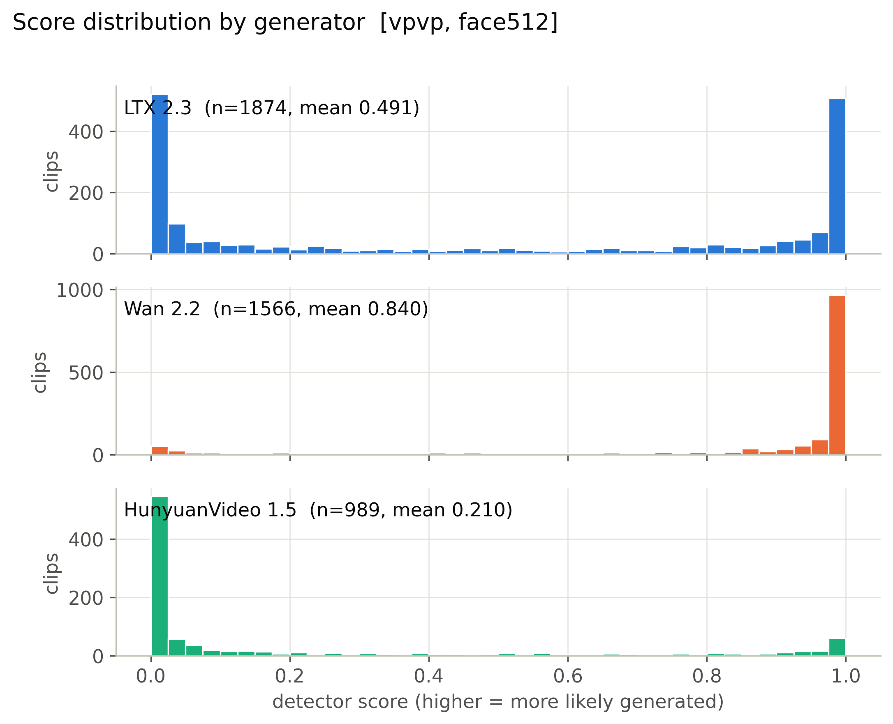

**Mean score, 56 cells x generator.** (`figures/heatmap_mean_score_cells.pdf`)

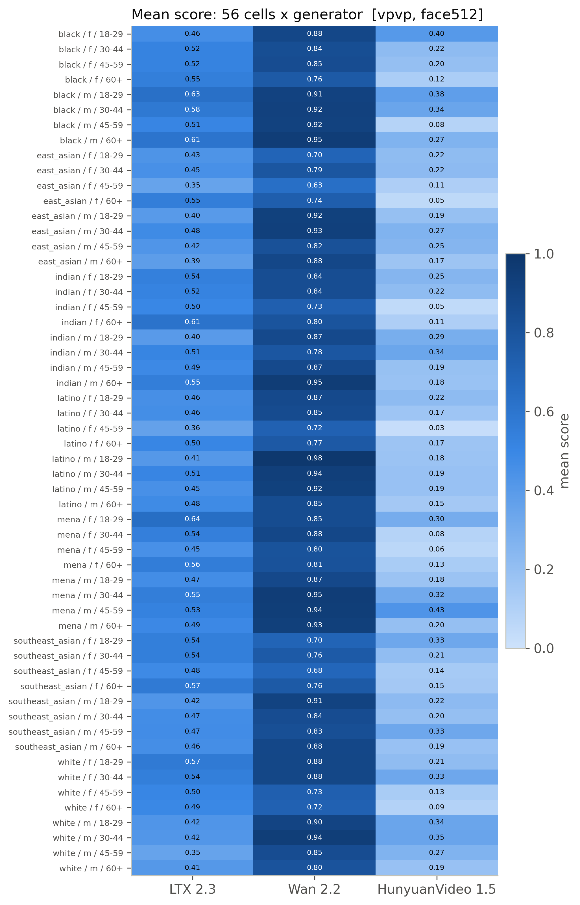

**Detection rate, 56 cells x generator (provisional threshold).** (`figures/heatmap_detection_rate_cells_provisional.pdf`)

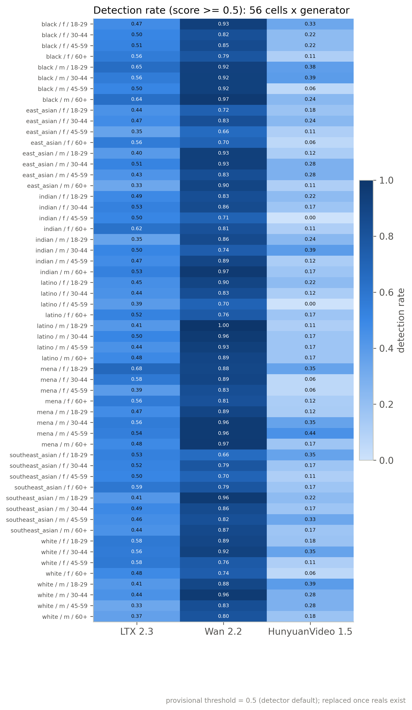

**Mean score by race, gender, age band with 95% CI.** (`figures/subgroup_mean_score.pdf`)

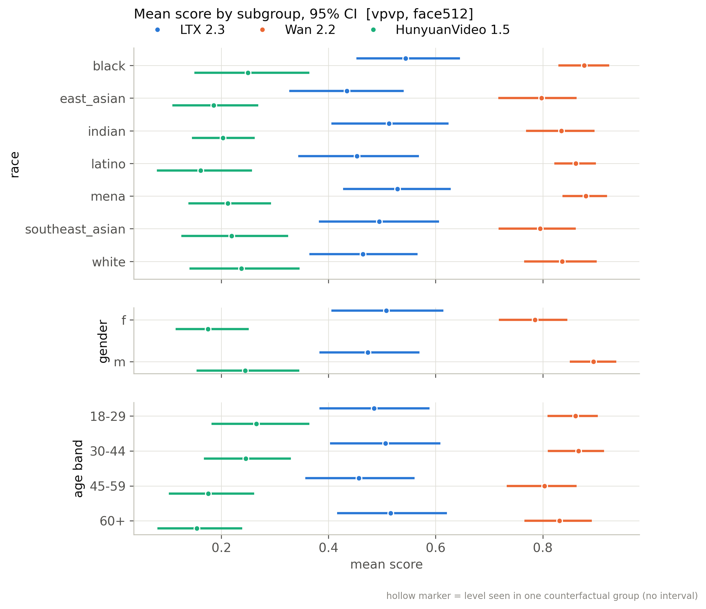

**Mean score by scene factor with 95% CI.** (`figures/scene_factor_mean_score.pdf`)

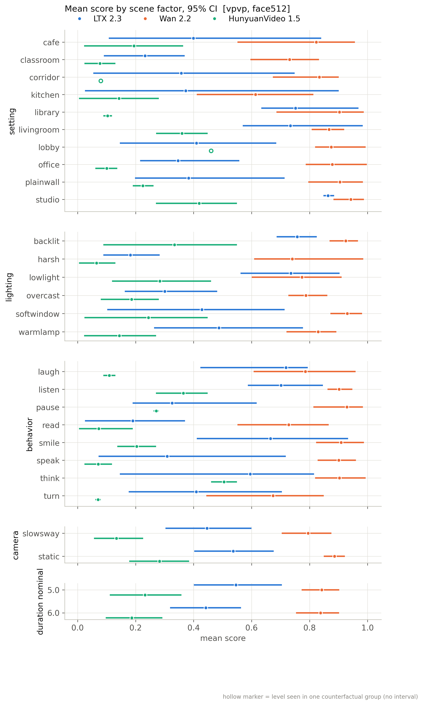

**Detection rate by subgroup (provisional threshold).** (`figures/subgroup_detection_rate_provisional.pdf`)

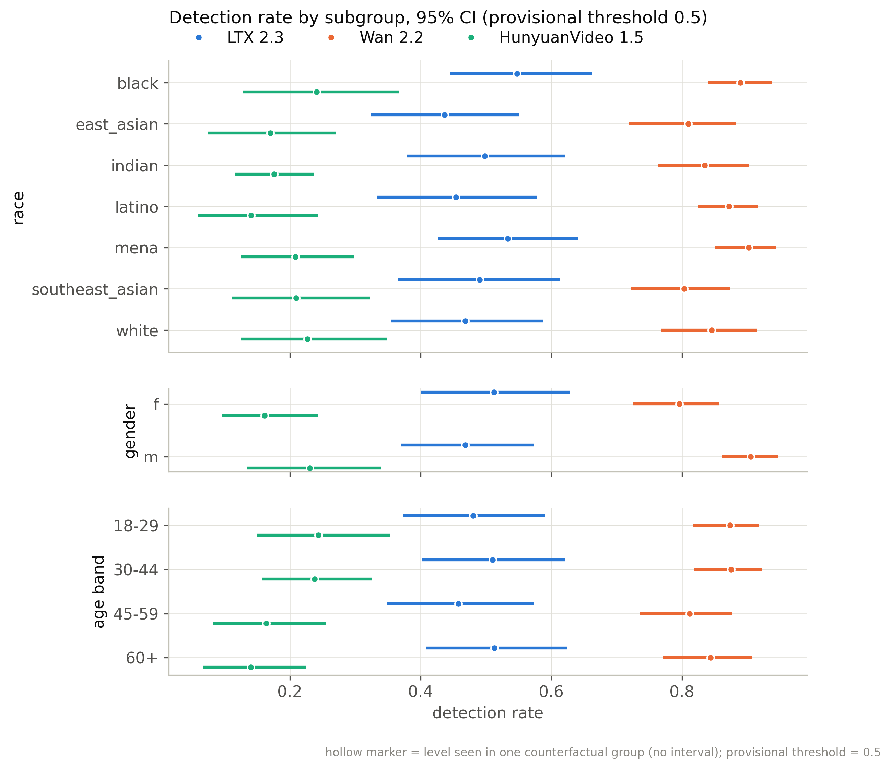

**Distribution of per-group CF spread.** (`figures/cf_spread_distribution.pdf`)

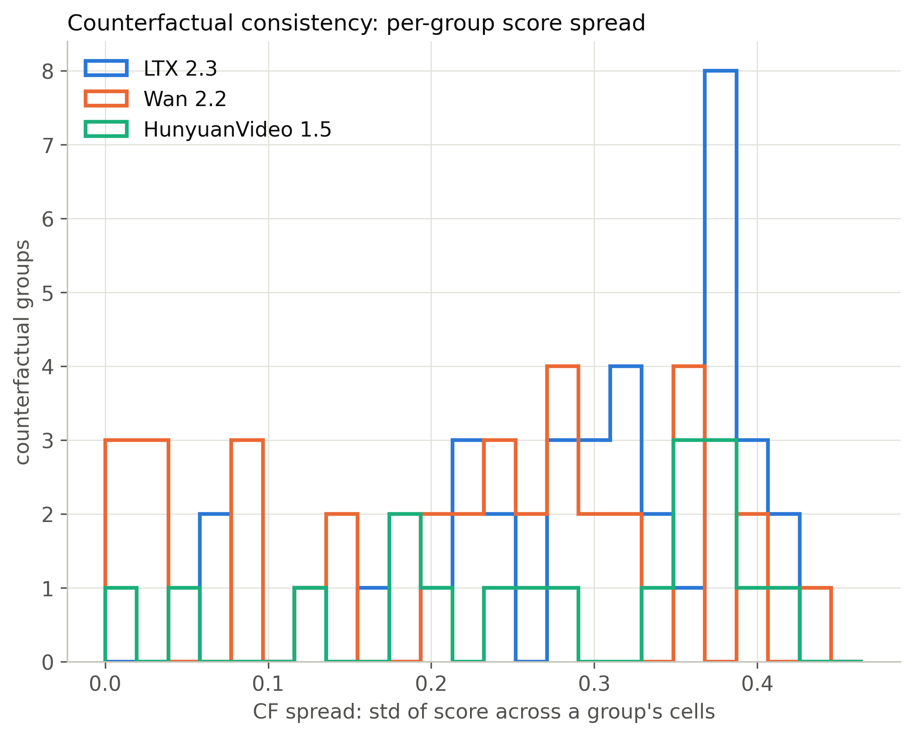

**Flip rate by generator (provisional threshold).** (`figures/flip_rate_by_generator_provisional.pdf`)

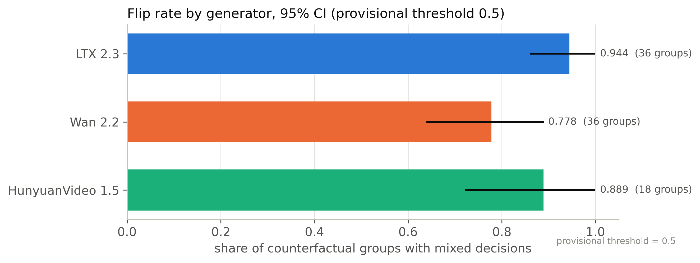

**Partial eta squared by factor.** (`figures/factor_attribution_variance_share.pdf`)

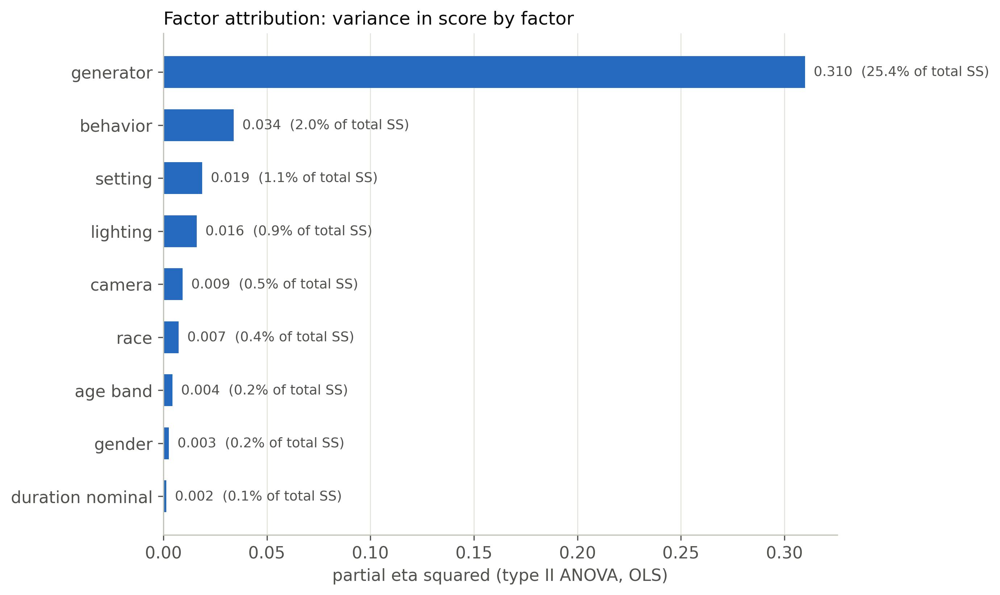

**Highest- and lowest-scoring included clips.** (`figures/example_strip.pdf`)

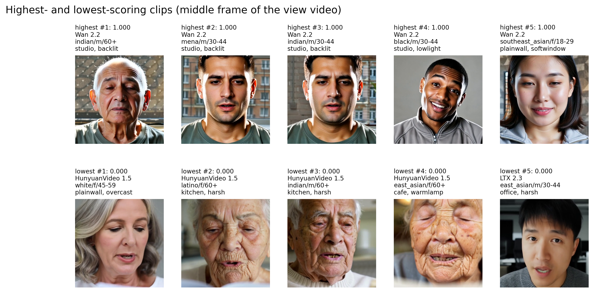

**ROC per generator against fps-matched reals.** (`figures/roc_per_generator.pdf`)

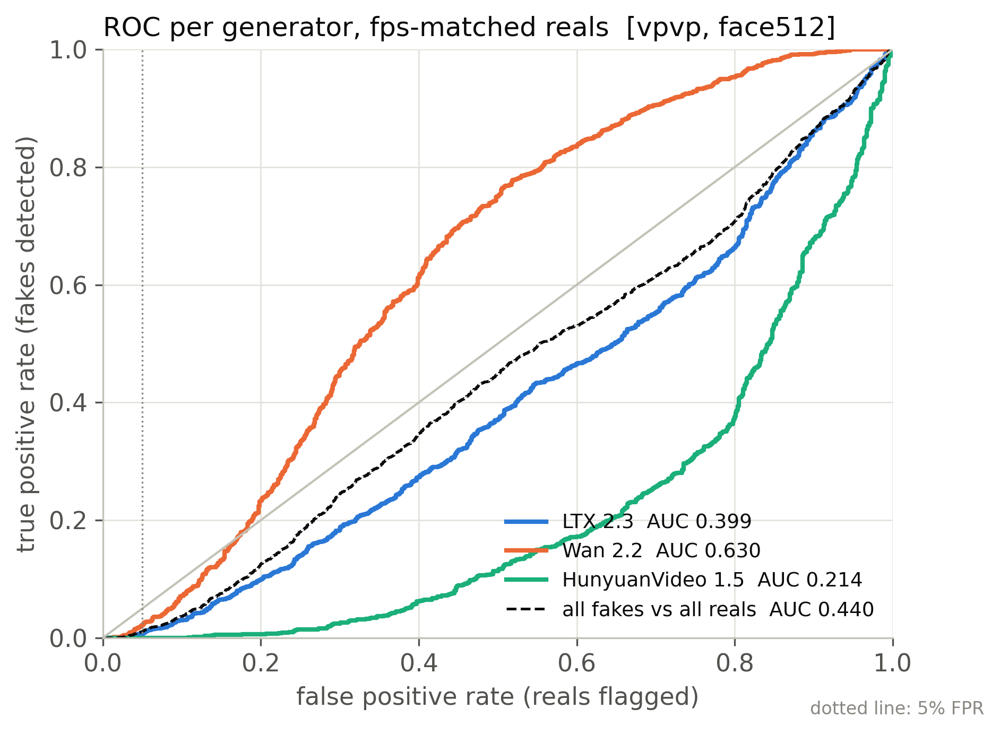

**Real FPR by perceived subgroup at the calibrated threshold.** (`figures/real_fpr_by_subgroup.pdf`)

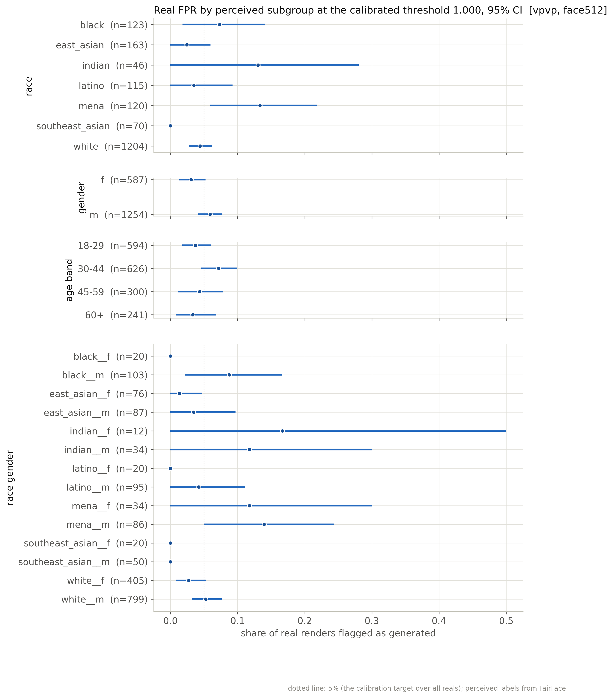

**AUC by subgroup: each subgroup's fakes vs same-subgroup reals.** (`figures/subgroup_auc.pdf`)

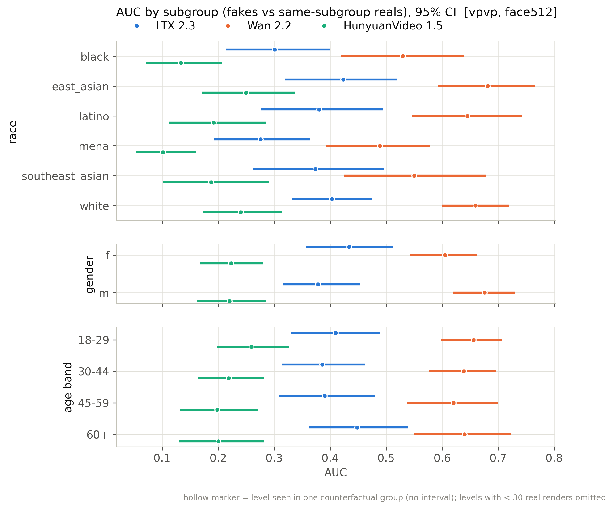

## Files

`manifest_used.csv` (every clip of the active batches with render/score/inclusion flags), `scores.csv` (score per scored clip), `tables/*.csv`, `figures/*`, `snapshot_meta.json`.

