# vpvp / face512_2s: snapshot 20261023-0247

> **Detector training data.** V-PVP head trained by the authors on AIGVDBench Real + Open-Sora + CogVideoX1.5 + EasyAnimate with a frozen Kinetics-400 VideoMAE-B/16; none of our generators is in its training set.

> **Provisional threshold.** Every detection rate and flip rate below uses the detector's default threshold (0.5; official: sigmoid(logit) > 0.5 (eval_opensource.py --threshold default)). They will be replaced by the 5%-real-FPR threshold once reals exist (section 6.3).

## Settings

| setting           | value                                                                                  |
|:------------------|:---------------------------------------------------------------------------------------|
| detector          | vpvp 1+c6ec2331                                                                        |
| checkpoint_sha256 | 33581d50452bcf19373a3e5db1204e44b456cb216ac21a3b889ee6970ba6f93b                       |
| view              | face512_2s (view_hash 92b6f25d9ce9e5f4)                                                |
| ffmpeg            | ffmpeg version 7.1.1 Copyright (c) 2000-2025 the FFmpeg developers                     |
| batches           | fake_b1, fake_b2, fake_b3, real_all                                                    |
| inclusion set     | primary (technical QC pass AND face QC pass)                                           |
| bootstrap         | 1000 resamples of whole counterfactual groups, seed 20261020, 95% percentile intervals |
| git commit        | 2949de581861-dirty                                                                     |
| created           | 2026-10-23T02:47:55Z                                                                   |

Detector preprocessing on top of the view:

| field       | value                                                                                                                                                |
|:------------|:-----------------------------------------------------------------------------------------------------------------------------------------------------|
| source      | manic-cui/Rethinking-the-readout@6ca3b1195c4b842c593638055bbcc9c8eaa6781d src/dataset.py + eval_opensource.py; AIGVDBench section 7 frame extraction |
| extraction  | 32 of the first 128 frames, np.linspace(0, n-1, 32); centre square; 256x256 PIL bilinear                                                             |
| frames_used | np.linspace(0, 31, 16, dtype=int) of the 32                                                                                                          |
| resize      | [224, 224, 'PIL BICUBIC']                                                                                                                            |
| normalize   | {'mean': [0.485, 0.456, 0.406], 'std': [0.229, 0.224, 0.225]}                                                                                        |
| backbone    | MCG-NJU/videomae-base-finetuned-kinetics@488eb9a0565f257b32866000305c8178965eb9f6, frozen, last block, fp16 autocast                                 |
| head        | PVPHead('velocity_gated', D=768), videomae_k400_vpvp.pt (sha 33581d50452b), fp32                                                                     |
| score       | sigmoid(logit) in float64                                                                                                                            |

## Coverage

| batch    | generator   |   clips |   primary |   rendered |   view_excluded |   render_failed |   scored |   score_failed |   included |
|:---------|:------------|--------:|----------:|-----------:|----------------:|----------------:|---------:|---------------:|-----------:|
| fake_b1  | hunyuan15   |     504 |       492 |        504 |               0 |               0 |      504 |              0 |        492 |
| fake_b1  | ltx23       |    2016 |      1878 |       2005 |              11 |               0 |     2005 |              0 |       1867 |
| fake_b1  | wan22       |    2016 |      1566 |       2016 |               0 |               0 |     2016 |              0 |       1566 |
| fake_b2  | hunyuan15   |     504 |       497 |        504 |               0 |               0 |      504 |              0 |        497 |
| fake_b3  | ltx25       |    2016 |      2002 |       2016 |               0 |               0 |     2016 |              0 |       2002 |
| real_all | real        |    2221 |      2221 |       2206 |              15 |               0 |     2206 |              0 |       2206 |

face512 window placement (fixed window at the median YuNet face centre, shifted inward at frame edges). The scaled frame is exactly 512 px on its short side, so every window spans it fully and is "shifted" on that axis by construction; the long-axis count is the informative one.

|   rendered |   shifted_long_axis |   shifted_short_axis |   max_shift_long_px |   excluded_no_face |
|-----------:|--------------------:|---------------------:|--------------------:|-------------------:|
|      11457 |                 439 |                11403 |                 203 |                 41 |

Reals scored: 4412. Fakes included: 6424 of 11457 scored (0 scoring failures).

## Observations

- LTX 2.3: mean score 0.887 [0.829, 0.935], median 0.999, n = 1867.
- Wan 2.2: mean score 0.985 [0.976, 0.992], median 1.000, n = 1566.
- HunyuanVideo 1.5: mean score 0.707 [0.595, 0.814], median 0.958, n = 989.
- LTX 2.5: mean score 0.697 [0.619, 0.780], median 0.949, n = 2002.
- Provisional detection rate (score >= 0.5), LTX 2.3: 89.7% [84.0, 94.6].
- Provisional detection rate (score >= 0.5), Wan 2.2: 99.2% [98.4, 99.8].
- Provisional detection rate (score >= 0.5), HunyuanVideo 1.5: 71.4% [58.9, 82.6].
- Provisional detection rate (score >= 0.5), LTX 2.5: 70.4% [62.0, 79.4].
- Provisional detection rate (score >= 0.5), all: 83.2% [77.4, 88.7].
- Largest race score gap: HunyuanVideo 1.5 0.147 [0.095, 0.230] (east_asian 0.767 vs white 0.620).
- Largest gender score gap: LTX 2.5 0.055 [0.010, 0.098] (m 0.724 vs f 0.669).
- Largest age band score gap: HunyuanVideo 1.5 0.245 [0.153, 0.348] (18-29 0.817 vs 60+ 0.571).
- Largest cell score gap: HunyuanVideo 1.5 0.542 [0.433, 0.781] (east_asian__m__18-29 0.925 vs white__f__60+ 0.383).
- Largest scene-factor gap (all generators): lighting 0.296 [0.159, 0.447] (lowlight vs harsh).
- Largest partial eta squared: generator 0.164, behavior 0.087, lighting 0.048; residual holds 64.8% of total SS.
- CF spread, LTX 2.3: 0.167 [0.121, 0.208] over 36 groups (max 0.409).
- CF spread, Wan 2.2: 0.043 [0.023, 0.067] over 36 groups (max 0.207).
- CF spread, HunyuanVideo 1.5: 0.282 [0.238, 0.322] over 18 groups (max 0.425).
- CF spread, LTX 2.5: 0.277 [0.241, 0.310] over 36 groups (max 0.423).
- Provisional flip rate, LTX 2.3: 66.7% of 36 groups [52.7, 80.6].
- Provisional flip rate, Wan 2.2: 13.9% of 36 groups [2.8, 25.1].
- Provisional flip rate, HunyuanVideo 1.5: 94.4% of 18 groups [81.8, 100.0].
- Provisional flip rate, LTX 2.5: 91.7% of 36 groups [80.6, 100.0].

## 6.1 Fakes only, no threshold

### Mean score by generator

| generator   |    n |   n_groups |   estimate |   ci_lo |   ci_hi |    sd |   median |   q05 |   q95 |
|:------------|-----:|-----------:|-----------:|--------:|--------:|------:|---------:|------:|------:|
| ltx23       | 1867 |         36 |      0.887 |   0.829 |   0.935 | 0.261 |    0.999 | 0.11  |     1 |
| wan22       | 1566 |         36 |      0.985 |   0.976 |   0.992 | 0.078 |    1     | 0.942 |     1 |
| hunyuan15   |  989 |         18 |      0.707 |   0.595 |   0.814 | 0.383 |    0.958 | 0.006 |     1 |
| ltx25       | 2002 |         36 |      0.697 |   0.619 |   0.78  | 0.386 |    0.949 | 0.005 |     1 |
| all         | 6424 |         36 |      0.824 |   0.769 |   0.875 | 0.324 |    0.998 | 0.022 |     1 |

### Mean score by race

| generator   | level           |   n |   estimate |   ci_lo |   ci_hi |   median |
|:------------|:----------------|----:|-----------:|--------:|--------:|---------:|
| ltx23       | black           | 270 |      0.893 |   0.825 |   0.947 |    1     |
| ltx23       | east_asian      | 270 |      0.874 |   0.815 |   0.927 |    0.999 |
| ltx23       | indian          | 276 |      0.908 |   0.855 |   0.954 |    0.999 |
| ltx23       | latino          | 261 |      0.873 |   0.808 |   0.933 |    0.999 |
| ltx23       | mena            | 266 |      0.91  |   0.861 |   0.956 |    1     |
| ltx23       | southeast_asian | 271 |      0.87  |   0.803 |   0.928 |    1     |
| ltx23       | white           | 253 |      0.878 |   0.817 |   0.933 |    0.999 |
| wan22       | black           | 217 |      0.988 |   0.981 |   0.995 |    1     |
| wan22       | east_asian      | 226 |      0.974 |   0.953 |   0.992 |    1     |
| wan22       | indian          | 230 |      0.981 |   0.964 |   0.995 |    1     |
| wan22       | latino          | 219 |      0.992 |   0.984 |   0.997 |    1     |
| wan22       | mena            | 225 |      0.993 |   0.983 |   0.998 |    1     |
| wan22       | southeast_asian | 229 |      0.985 |   0.971 |   0.995 |    1     |
| wan22       | white           | 220 |      0.984 |   0.972 |   0.994 |    1     |
| hunyuan15   | black           | 141 |      0.75  |   0.633 |   0.857 |    0.971 |
| hunyuan15   | east_asian      | 141 |      0.767 |   0.667 |   0.867 |    0.968 |
| hunyuan15   | indian          | 142 |      0.717 |   0.592 |   0.84  |    0.971 |
| hunyuan15   | latino          | 142 |      0.681 |   0.557 |   0.796 |    0.922 |
| hunyuan15   | mena            | 139 |      0.735 |   0.616 |   0.841 |    0.965 |
| hunyuan15   | southeast_asian | 143 |      0.679 |   0.54  |   0.811 |    0.958 |
| hunyuan15   | white           | 141 |      0.62  |   0.5   |   0.742 |    0.885 |
| ltx25       | black           | 287 |      0.76  |   0.68  |   0.835 |    0.981 |
| ltx25       | east_asian      | 286 |      0.67  |   0.579 |   0.759 |    0.92  |
| ltx25       | indian          | 284 |      0.696 |   0.608 |   0.782 |    0.938 |
| ltx25       | latino          | 286 |      0.697 |   0.609 |   0.784 |    0.958 |
| ltx25       | mena            | 286 |      0.734 |   0.649 |   0.817 |    0.971 |
| ltx25       | southeast_asian | 286 |      0.662 |   0.574 |   0.754 |    0.877 |
| ltx25       | white           | 287 |      0.659 |   0.564 |   0.759 |    0.925 |
| all         | black           | 915 |      0.852 |   0.8   |   0.901 |    0.999 |
| all         | east_asian      | 923 |      0.819 |   0.768 |   0.869 |    0.996 |
| all         | indian          | 932 |      0.832 |   0.777 |   0.884 |    0.998 |
| all         | latino          | 908 |      0.816 |   0.757 |   0.871 |    0.998 |
| all         | mena            | 916 |      0.849 |   0.799 |   0.896 |    0.999 |
| all         | southeast_asian | 929 |      0.805 |   0.747 |   0.862 |    0.997 |
| all         | white           | 901 |      0.794 |   0.734 |   0.851 |    0.997 |

### Mean score by gender

| generator   | level   |    n |   estimate |   ci_lo |   ci_hi |   median |
|:------------|:--------|-----:|-----------:|--------:|--------:|---------:|
| ltx23       | f       |  931 |      0.886 |   0.827 |   0.937 |    0.999 |
| ltx23       | m       |  936 |      0.887 |   0.829 |   0.936 |    1     |
| wan22       | f       |  785 |      0.981 |   0.967 |   0.991 |    1     |
| wan22       | m       |  781 |      0.99  |   0.98  |   0.997 |    1     |
| hunyuan15   | f       |  495 |      0.691 |   0.574 |   0.797 |    0.935 |
| hunyuan15   | m       |  494 |      0.723 |   0.603 |   0.838 |    0.965 |
| ltx25       | f       |  999 |      0.669 |   0.582 |   0.757 |    0.922 |
| ltx25       | m       | 1003 |      0.724 |   0.65  |   0.81  |    0.961 |
| all         | f       | 3210 |      0.812 |   0.758 |   0.863 |    0.997 |
| all         | m       | 3214 |      0.836 |   0.781 |   0.888 |    0.999 |

### Mean score by age band

| generator   | level   |    n |   estimate |   ci_lo |   ci_hi |   median |
|:------------|:--------|-----:|-----------:|--------:|--------:|---------:|
| ltx23       | 18-29   |  464 |      0.907 |   0.865 |   0.946 |    0.999 |
| ltx23       | 30-44   |  469 |      0.89  |   0.828 |   0.943 |    1     |
| ltx23       | 45-59   |  477 |      0.868 |   0.798 |   0.93  |    0.999 |
| ltx23       | 60+     |  457 |      0.882 |   0.812 |   0.941 |    0.999 |
| wan22       | 18-29   |  388 |      0.986 |   0.971 |   0.997 |    1     |
| wan22       | 30-44   |  377 |      0.99  |   0.982 |   0.996 |    1     |
| wan22       | 45-59   |  398 |      0.984 |   0.973 |   0.994 |    1     |
| wan22       | 60+     |  403 |      0.982 |   0.97  |   0.991 |    1     |
| hunyuan15   | 18-29   |  242 |      0.817 |   0.725 |   0.902 |    0.993 |
| hunyuan15   | 30-44   |  248 |      0.787 |   0.663 |   0.896 |    0.989 |
| hunyuan15   | 45-59   |  250 |      0.656 |   0.526 |   0.785 |    0.855 |
| hunyuan15   | 60+     |  249 |      0.571 |   0.423 |   0.715 |    0.727 |
| ltx25       | 18-29   |  500 |      0.726 |   0.649 |   0.804 |    0.969 |
| ltx25       | 30-44   |  497 |      0.728 |   0.643 |   0.811 |    0.972 |
| ltx25       | 45-59   |  501 |      0.645 |   0.558 |   0.737 |    0.886 |
| ltx25       | 60+     |  504 |      0.689 |   0.599 |   0.782 |    0.919 |
| all         | 18-29   | 1594 |      0.856 |   0.813 |   0.896 |    0.999 |
| all         | 30-44   | 1591 |      0.847 |   0.793 |   0.898 |    0.999 |
| all         | 45-59   | 1626 |      0.795 |   0.733 |   0.852 |    0.996 |
| all         | 60+     | 1613 |      0.799 |   0.734 |   0.859 |    0.994 |

### Mean score by scene factor (all generators pooled)

| factor           | level      |    n |   estimate |   ci_lo |   ci_hi |
|:-----------------|:-----------|-----:|-----------:|--------:|--------:|
| setting          | cafe       |  590 |      0.737 |   0.448 |   0.939 |
| setting          | classroom  |  541 |      0.676 |   0.599 |   0.803 |
| setting          | corridor   |  716 |      0.81  |   0.705 |   0.94  |
| setting          | kitchen    |  603 |      0.694 |   0.439 |   0.881 |
| setting          | library    |  755 |      0.907 |   0.88  |   0.918 |
| setting          | livingroom |  753 |      0.891 |   0.802 |   0.953 |
| setting          | lobby      |  513 |      0.853 |   0.728 |   0.978 |
| setting          | office     |  580 |      0.726 |   0.489 |   0.993 |
| setting          | plainwall  |  777 |      0.911 |   0.792 |   0.981 |
| setting          | studio     |  596 |      0.959 |   0.944 |   0.993 |
| lighting         | backlit    | 1118 |      0.901 |   0.839 |   0.94  |
| lighting         | harsh      |  967 |      0.63  |   0.496 |   0.807 |
| lighting         | lowlight   | 1113 |      0.926 |   0.867 |   0.966 |
| lighting         | overcast   | 1022 |      0.84  |   0.746 |   0.92  |
| lighting         | softwindow | 1157 |      0.825 |   0.687 |   0.942 |
| lighting         | warmlamp   | 1047 |      0.795 |   0.627 |   0.922 |
| behavior         | laugh      |  721 |      0.851 |   0.688 |   0.94  |
| behavior         | listen     |  956 |      0.924 |   0.903 |   0.942 |
| behavior         | pause      |  744 |      0.882 |   0.792 |   0.94  |
| behavior         | read       |  796 |      0.687 |   0.439 |   0.981 |
| behavior         | smile      |  817 |      0.934 |   0.882 |   0.993 |
| behavior         | speak      |  806 |      0.717 |   0.61  |   0.849 |
| behavior         | think      |  730 |      0.89  |   0.773 |   0.978 |
| behavior         | turn       |  854 |      0.706 |   0.581 |   0.79  |
| camera           | slowsway   | 3217 |      0.761 |   0.673 |   0.85  |
| camera           | static     | 3207 |      0.886 |   0.85  |   0.919 |
| duration_nominal | 5.0        | 3222 |      0.814 |   0.725 |   0.888 |
| duration_nominal | 6.0        | 3202 |      0.834 |   0.763 |   0.892 |

Per-generator scene-factor and 56-cell rows: `tables/score_by_breakdown.csv`.

### Subgroup gap (max - min of level means)

A gap is max - min, so it is never negative and its interval cannot include 0; it is a size, not a test of a difference. Over many levels with few clips each (56 cells; HunyuanVideo has 9 groups per cell) the gap also grows with noise, so compare it with the per-level intervals in `tables/score_by_breakdown.csv`. Levels seen in a single counterfactual group have no interval.

| generator   | attribute        |   n_levels |   gap |   ci_lo |   ci_hi | max_level            | min_level            |
|:------------|:-----------------|-----------:|------:|--------:|--------:|:---------------------|:---------------------|
| ltx23       | race             |          7 | 0.039 |   0.027 |   0.088 | mena                 | southeast_asian      |
| ltx23       | gender           |          2 | 0.001 |   0.001 |   0.039 | m                    | f                    |
| ltx23       | age_band         |          4 | 0.04  |   0.014 |   0.09  | 18-29                | 45-59                |
| ltx23       | cell             |         56 | 0.175 |   0.157 |   0.337 | east_asian__f__18-29 | east_asian__m__30-44 |
| ltx23       | setting          |         10 | 0.271 |   0.196 |   0.653 | studio               | kitchen              |
| ltx23       | lighting         |          6 | 0.255 |   0.138 |   0.474 | lowlight             | harsh                |
| ltx23       | behavior         |          8 | 0.285 |   0.161 |   0.648 | smile                | read                 |
| ltx23       | camera           |          2 | 0.068 |   0.004 |   0.179 | static               | slowsway             |
| ltx23       | duration_nominal |          2 | 0.012 |   0.002 |   0.124 | 5.0                  | 6.0                  |
| wan22       | race             |          7 | 0.019 |   0.009 |   0.041 | mena                 | east_asian           |
| wan22       | gender           |          2 | 0.009 |   0     |   0.023 | m                    | f                    |
| wan22       | age_band         |          4 | 0.008 |   0.004 |   0.02  | 30-44                | 60+                  |
| wan22       | cell             |         56 | 0.067 |   0.041 |   0.162 | latino__m__18-29     | east_asian__f__60+   |
| wan22       | setting          |         10 | 0.046 |   0.028 |   0.081 | studio               | kitchen              |
| wan22       | lighting         |          6 | 0.031 |   0.016 |   0.065 | backlit              | harsh                |
| wan22       | behavior         |          8 | 0.053 |   0.028 |   0.079 | smile                | read                 |
| wan22       | camera           |          2 | 0.014 |   0.002 |   0.029 | static               | slowsway             |
| wan22       | duration_nominal |          2 | 0.007 |   0     |   0.024 | 5.0                  | 6.0                  |
| hunyuan15   | race             |          7 | 0.147 |   0.095 |   0.23  | east_asian           | white                |
| hunyuan15   | gender           |          2 | 0.032 |   0.001 |   0.085 | m                    | f                    |
| hunyuan15   | age_band         |          4 | 0.245 |   0.153 |   0.348 | 18-29                | 60+                  |
| hunyuan15   | cell             |         56 | 0.542 |   0.433 |   0.781 | east_asian__m__18-29 | white__f__60+        |
| hunyuan15   | setting          |         10 | 0.459 |   0.352 |   0.806 | lobby                | office               |
| hunyuan15   | lighting         |          6 | 0.527 |   0.268 |   0.788 | lowlight             | harsh                |
| hunyuan15   | behavior         |          8 | 0.557 |   0.356 |   0.791 | think                | turn                 |
| hunyuan15   | camera           |          2 | 0.264 |   0.058 |   0.454 | static               | slowsway             |
| hunyuan15   | duration_nominal |          2 | 0.016 |   0.004 |   0.271 | 6.0                  | 5.0                  |
| ltx25       | race             |          7 | 0.1   |   0.067 |   0.173 | black                | white                |
| ltx25       | gender           |          2 | 0.055 |   0.01  |   0.098 | m                    | f                    |
| ltx25       | age_band         |          4 | 0.083 |   0.045 |   0.144 | 30-44                | 45-59                |
| ltx25       | cell             |         56 | 0.354 |   0.317 |   0.544 | black__m__18-29      | latino__f__45-59     |
| ltx25       | setting          |         10 | 0.48  |   0.359 |   0.838 | studio               | classroom            |
| ltx25       | lighting         |          6 | 0.34  |   0.19  |   0.626 | lowlight             | harsh                |
| ltx25       | behavior         |          8 | 0.392 |   0.317 |   0.774 | smile                | speak                |
| ltx25       | camera           |          2 | 0.203 |   0.056 |   0.347 | static               | slowsway             |
| ltx25       | duration_nominal |          2 | 0.091 |   0.005 |   0.235 | 6.0                  | 5.0                  |
| all         | race             |          7 | 0.058 |   0.043 |   0.091 | black                | white                |
| all         | gender           |          2 | 0.024 |   0.004 |   0.044 | m                    | f                    |
| all         | age_band         |          4 | 0.061 |   0.038 |   0.1   | 18-29                | 45-59                |
| all         | cell             |         56 | 0.198 |   0.173 |   0.29  | mena__m__45-59       | latino__f__45-59     |
| all         | setting          |         10 | 0.283 |   0.221 |   0.539 | studio               | classroom            |
| all         | lighting         |          6 | 0.296 |   0.159 |   0.447 | lowlight             | harsh                |
| all         | behavior         |          8 | 0.247 |   0.193 |   0.519 | smile                | read                 |
| all         | camera           |          2 | 0.125 |   0.027 |   0.219 | static               | slowsway             |
| all         | duration_nominal |          2 | 0.021 |   0.002 |   0.125 | 6.0                  | 5.0                  |

### CF spread (mean over groups of the std of score across the group's cells)

| generator   |   n_groups |   cf_spread |   ci_lo |   ci_hi |   median |   max |
|:------------|-----------:|------------:|--------:|--------:|---------:|------:|
| ltx23       |         36 |       0.167 |   0.121 |   0.208 |    0.139 | 0.409 |
| wan22       |         36 |       0.043 |   0.023 |   0.067 |    0.014 | 0.207 |
| hunyuan15   |         18 |       0.282 |   0.238 |   0.322 |    0.301 | 0.425 |
| ltx25       |         36 |       0.277 |   0.241 |   0.31  |    0.3   | 0.423 |

### Factor attribution

OLS with every factor as a fixed effect, type-II ANOVA. `ss_share` is the factor's type-II sum of squares over the total sum of squares (type-II shares need not add to 1). Scene factors are constant within a counterfactual group, so their effects are estimated from between-group differences only. The OLS F tests treat clips as independent although clips are clustered in counterfactual groups, so their p values are optimistic; use the group-bootstrap intervals above for inference.

| factor           |   df |   sum_sq | F     | p          | partial_eta2   |   ss_share |
|:-----------------|-----:|---------:|:------|:-----------|:---------------|-----------:|
| race             |    6 |   2.472  | 6.033 | 2.626e-06  | 0.005636       |   0.003675 |
| gender           |    1 |   0.8683 | 12.72 | 0.0003651  | 0.001987       |   0.001291 |
| age_band         |    3 |   4.893  | 23.89 | 2.281e-15  | 0.0111         |   0.007276 |
| setting          |    9 |  11.87   | 19.32 | 2.787e-32  | 0.0265         |   0.01765  |
| lighting         |    5 |  22.13   | 64.82 | 3.264e-66  | 0.04829        |   0.0329   |
| behavior         |    7 |  41.79   | 87.43 | 4.953e-122 | 0.08744        |   0.06213  |
| camera           |    1 |   7.27   | 106.5 | 9.078e-25  | 0.0164         |   0.01081  |
| duration_nominal |    1 |   1.161  | 17.01 | 3.764e-05  | 0.002656       |   0.001727 |
| generator        |    3 |  85.84   | 419.1 | 1.641e-248 | 0.1645         |   0.1276   |
| Residual         | 6387 | 436.1    |       |            |                |   0.6484   |

Lighting x race interaction (added to the same OLS):

| term            |   df |   sum_sq |     F |       p |   partial_eta2 |
|:----------------|-----:|---------:|------:|--------:|---------------:|
| lighting x race |   30 |    2.846 | 1.392 | 0.07572 |       0.006526 |

Mixed model `score ~ factors + (1 | counterfactual_group)` (REML) variance components (fixed effects: `tables/factor_mixed_fixed.csv`):

| component                               |   variance | converged   |
|:----------------------------------------|-----------:|:------------|
| counterfactual_group (random intercept) |    0       | True        |
| residual                                |    0.06677 | True        |
| ICC (group share of random variance)    |    0       | True        |

A group variance at or near 0 is a boundary estimate: setting, lighting, behavior, camera and duration are fixed per group and absorb most between-group variation, leaving little for the random intercept. It does not mean scenes do not matter.

## 6.2 Provisional (threshold 0.5, provisional)

### Detection rate by generator (provisional)

| generator   |    n |   estimate |   ci_lo |   ci_hi |
|:------------|-----:|-----------:|--------:|--------:|
| ltx23       | 1867 |      0.897 |   0.84  |   0.946 |
| wan22       | 1566 |      0.992 |   0.984 |   0.998 |
| hunyuan15   |  989 |      0.714 |   0.589 |   0.826 |
| ltx25       | 2002 |      0.704 |   0.62  |   0.794 |
| all         | 6424 |      0.832 |   0.774 |   0.887 |

### Detection rate by race (provisional)

| generator   | level           |   n |   estimate |   ci_lo |   ci_hi |
|:------------|:----------------|----:|-----------:|--------:|--------:|
| ltx23       | black           | 270 |      0.893 |   0.824 |   0.953 |
| ltx23       | east_asian      | 270 |      0.889 |   0.83  |   0.943 |
| ltx23       | indian          | 276 |      0.913 |   0.854 |   0.961 |
| ltx23       | latino          | 261 |      0.866 |   0.794 |   0.934 |
| ltx23       | mena            | 266 |      0.932 |   0.888 |   0.975 |
| ltx23       | southeast_asian | 271 |      0.889 |   0.821 |   0.952 |
| ltx23       | white           | 253 |      0.897 |   0.842 |   0.951 |
| wan22       | black           | 217 |      1     |   1     |   1     |
| wan22       | east_asian      | 226 |      0.978 |   0.951 |   1     |
| wan22       | indian          | 230 |      0.987 |   0.964 |   1     |
| wan22       | latino          | 219 |      1     |   1     |   1     |
| wan22       | mena            | 225 |      0.996 |   0.985 |   1     |
| wan22       | southeast_asian | 229 |      0.991 |   0.978 |   1     |
| wan22       | white           | 220 |      0.995 |   0.986 |   1     |
| hunyuan15   | black           | 141 |      0.745 |   0.614 |   0.869 |
| hunyuan15   | east_asian      | 141 |      0.809 |   0.698 |   0.908 |
| hunyuan15   | indian          | 142 |      0.732 |   0.586 |   0.867 |
| hunyuan15   | latino          | 142 |      0.704 |   0.57  |   0.829 |
| hunyuan15   | mena            | 139 |      0.748 |   0.615 |   0.863 |
| hunyuan15   | southeast_asian | 143 |      0.664 |   0.514 |   0.807 |
| hunyuan15   | white           | 141 |      0.596 |   0.467 |   0.725 |
| ltx25       | black           | 287 |      0.76  |   0.672 |   0.84  |
| ltx25       | east_asian      | 286 |      0.675 |   0.58  |   0.765 |
| ltx25       | indian          | 284 |      0.715 |   0.619 |   0.806 |
| ltx25       | latino          | 286 |      0.696 |   0.601 |   0.794 |
| ltx25       | mena            | 286 |      0.745 |   0.65  |   0.836 |
| ltx25       | southeast_asian | 286 |      0.675 |   0.572 |   0.778 |
| ltx25       | white           | 287 |      0.666 |   0.562 |   0.767 |
| all         | black           | 915 |      0.854 |   0.795 |   0.907 |
| all         | east_asian      | 923 |      0.832 |   0.774 |   0.884 |
| all         | indian          | 932 |      0.843 |   0.782 |   0.901 |
| all         | latino          | 908 |      0.819 |   0.754 |   0.88  |
| all         | mena            | 916 |      0.861 |   0.808 |   0.911 |
| all         | southeast_asian | 929 |      0.814 |   0.752 |   0.873 |
| all         | white           | 901 |      0.8   |   0.74  |   0.859 |

### Detection rate by gender (provisional)

| generator   | level   |    n |   estimate |   ci_lo |   ci_hi |
|:------------|:--------|-----:|-----------:|--------:|--------:|
| ltx23       | f       |  931 |      0.898 |   0.839 |   0.948 |
| ltx23       | m       |  936 |      0.896 |   0.836 |   0.946 |
| wan22       | f       |  785 |      0.989 |   0.975 |   0.999 |
| wan22       | m       |  781 |      0.996 |   0.99  |   1     |
| hunyuan15   | f       |  495 |      0.695 |   0.57  |   0.809 |
| hunyuan15   | m       |  494 |      0.733 |   0.606 |   0.852 |
| ltx25       | f       |  999 |      0.676 |   0.582 |   0.77  |
| ltx25       | m       | 1003 |      0.733 |   0.653 |   0.827 |
| all         | f       | 3210 |      0.82  |   0.762 |   0.874 |
| all         | m       | 3214 |      0.844 |   0.787 |   0.899 |

### Detection rate by age band (provisional)

| generator   | level   |    n |   estimate |   ci_lo |   ci_hi |
|:------------|:--------|-----:|-----------:|--------:|--------:|
| ltx23       | 18-29   |  464 |      0.916 |   0.874 |   0.956 |
| ltx23       | 30-44   |  469 |      0.906 |   0.84  |   0.959 |
| ltx23       | 45-59   |  477 |      0.874 |   0.805 |   0.936 |
| ltx23       | 60+     |  457 |      0.893 |   0.827 |   0.95  |
| wan22       | 18-29   |  388 |      0.99  |   0.974 |   1     |
| wan22       | 30-44   |  377 |      0.995 |   0.985 |   1     |
| wan22       | 45-59   |  398 |      0.992 |   0.983 |   1     |
| wan22       | 60+     |  403 |      0.993 |   0.982 |   1     |
| hunyuan15   | 18-29   |  242 |      0.822 |   0.732 |   0.91  |
| hunyuan15   | 30-44   |  248 |      0.798 |   0.655 |   0.922 |
| hunyuan15   | 45-59   |  250 |      0.664 |   0.522 |   0.801 |
| hunyuan15   | 60+     |  249 |      0.574 |   0.413 |   0.732 |
| ltx25       | 18-29   |  500 |      0.73  |   0.639 |   0.815 |
| ltx25       | 30-44   |  497 |      0.732 |   0.641 |   0.822 |
| ltx25       | 45-59   |  501 |      0.649 |   0.555 |   0.752 |
| ltx25       | 60+     |  504 |      0.706 |   0.607 |   0.806 |
| all         | 18-29   | 1594 |      0.861 |   0.818 |   0.904 |
| all         | 30-44   | 1591 |      0.856 |   0.797 |   0.909 |
| all         | 45-59   | 1626 |      0.801 |   0.738 |   0.863 |
| all         | 60+     | 1613 |      0.81  |   0.742 |   0.873 |

### Detection-rate gap (provisional)

| generator   | attribute        |   gap |   ci_lo |   ci_hi | max_level            | min_level            |
|:------------|:-----------------|------:|--------:|--------:|:---------------------|:---------------------|
| ltx23       | race             | 0.066 |   0.037 |   0.112 | mena                 | latino               |
| ltx23       | gender           | 0.002 |   0.001 |   0.044 | f                    | m                    |
| ltx23       | age_band         | 0.042 |   0.015 |   0.093 | 18-29                | 45-59                |
| ltx23       | cell             | 0.206 |   0.182 |   0.394 | east_asian__f__18-29 | black__f__60+        |
| ltx23       | setting          | 0.261 |   0.187 |   0.661 | studio               | kitchen              |
| ltx23       | lighting         | 0.253 |   0.13  |   0.489 | lowlight             | harsh                |
| ltx23       | behavior         | 0.289 |   0.154 |   0.661 | smile                | read                 |
| ltx23       | camera           | 0.068 |   0.004 |   0.181 | static               | slowsway             |
| ltx23       | duration_nominal | 0.002 |   0.001 |   0.124 | 5.0                  | 6.0                  |
| wan22       | race             | 0.022 |   0.008 |   0.05  | black                | east_asian           |
| wan22       | gender           | 0.008 |   0     |   0.022 | m                    | f                    |
| wan22       | age_band         | 0.005 |   0.002 |   0.022 | 30-44                | 18-29                |
| wan22       | cell             | 0.074 |   0.034 |   0.191 | black__f__18-29      | east_asian__f__60+   |
| wan22       | setting          | 0.043 |   0.018 |   0.083 | classroom            | kitchen              |
| wan22       | lighting         | 0.028 |   0.007 |   0.068 | backlit              | harsh                |
| wan22       | behavior         | 0.042 |   0.013 |   0.083 | laugh                | read                 |
| wan22       | camera           | 0.01  |   0.001 |   0.025 | static               | slowsway             |
| wan22       | duration_nominal | 0.001 |   0     |   0.016 | 6.0                  | 5.0                  |
| hunyuan15   | race             | 0.213 |   0.139 |   0.306 | east_asian           | white                |
| hunyuan15   | gender           | 0.038 |   0.003 |   0.088 | m                    | f                    |
| hunyuan15   | age_band         | 0.248 |   0.158 |   0.368 | 18-29                | 60+                  |
| hunyuan15   | cell             | 0.608 |   0.526 |   0.889 | east_asian__m__18-29 | white__f__60+        |
| hunyuan15   | setting          | 0.468 |   0.368 |   0.891 | lobby                | cafe                 |
| hunyuan15   | lighting         | 0.553 |   0.289 |   0.85  | lowlight             | harsh                |
| hunyuan15   | behavior         | 0.57  |   0.373 |   0.867 | think                | turn                 |
| hunyuan15   | camera           | 0.288 |   0.071 |   0.496 | static               | slowsway             |
| hunyuan15   | duration_nominal | 0.037 |   0.006 |   0.294 | 6.0                  | 5.0                  |
| ltx25       | race             | 0.094 |   0.07  |   0.178 | black                | white                |
| ltx25       | gender           | 0.057 |   0.008 |   0.105 | m                    | f                    |
| ltx25       | age_band         | 0.084 |   0.042 |   0.163 | 30-44                | 45-59                |
| ltx25       | cell             | 0.389 |   0.359 |   0.616 | black__m__18-29      | east_asian__f__45-59 |
| ltx25       | setting          | 0.518 |   0.396 |   0.869 | studio               | classroom            |
| ltx25       | lighting         | 0.366 |   0.2   |   0.668 | lowlight             | harsh                |
| ltx25       | behavior         | 0.407 |   0.34  |   0.807 | smile                | speak                |
| ltx25       | camera           | 0.221 |   0.064 |   0.377 | static               | slowsway             |
| ltx25       | duration_nominal | 0.091 |   0.003 |   0.244 | 6.0                  | 5.0                  |
| all         | race             | 0.061 |   0.047 |   0.091 | mena                 | white                |
| all         | gender           | 0.025 |   0.003 |   0.047 | m                    | f                    |
| all         | age_band         | 0.06  |   0.038 |   0.097 | 18-29                | 45-59                |
| all         | cell             | 0.217 |   0.194 |   0.326 | mena__m__45-59       | latino__f__45-59     |
| all         | setting          | 0.29  |   0.225 |   0.566 | studio               | classroom            |
| all         | lighting         | 0.308 |   0.16  |   0.471 | lowlight             | harsh                |
| all         | behavior         | 0.259 |   0.196 |   0.541 | smile                | read                 |
| all         | camera           | 0.134 |   0.031 |   0.23  | static               | slowsway             |
| all         | duration_nominal | 0.029 |   0.002 |   0.137 | 6.0                  | 5.0                  |

### Flip rate (provisional): share of groups whose clips get different decisions

| generator   |   n_groups |   flip_rate |   ci_lo |   ci_hi |   median |   max |
|:------------|-----------:|------------:|--------:|--------:|---------:|------:|
| ltx23       |         36 |       0.667 |   0.527 |   0.806 |        1 |     1 |
| wan22       |         36 |       0.139 |   0.028 |   0.251 |        0 |     1 |
| hunyuan15   |         18 |       0.944 |   0.818 |   1     |        1 |     1 |
| ltx25       |         36 |       0.917 |   0.806 |   1     |        1 |     1 |

### Sensitivity: inclusion set

| set     | generator   |    n |   mean_score |   provisional_detection_rate |
|:--------|:------------|-----:|-------------:|-----------------------------:|
| all     | hunyuan15   | 1008 |        0.707 |                        0.713 |
| all     | ltx23       | 2005 |        0.883 |                        0.893 |
| all     | ltx25       | 2016 |        0.696 |                        0.702 |
| all     | wan22       | 2016 |        0.987 |                        0.994 |
| primary | hunyuan15   |  989 |        0.707 |                        0.714 |
| primary | ltx23       | 1867 |        0.887 |                        0.897 |
| primary | ltx25       | 2002 |        0.697 |                        0.704 |
| primary | wan22       | 1566 |        0.985 |                        0.992 |

## 6.3 Real vs generated (calibrated threshold 1.0000)

The threshold is the score at which 5% of primary real renders (24 and 16 fps pooled) are flagged; one per detector and view, never per subgroup. Each generator is compared with reals rendered at its own fps. Intervals: fakes resample counterfactual groups, reals resample identity clusters (source video). Real labels are perceived (FairFace), not self-reported.

### Calibration

| scope            |   n_renders |   n_sources |   n_identities |   threshold |    fpr |
|:-----------------|------------:|------------:|---------------:|------------:|-------:|
| all real renders |        4412 |        2206 |           1809 |           1 | 0.0501 |
| 16 fps renders   |        2206 |        2206 |           1809 |           1 | 0.0512 |
| 24 fps renders   |        2206 |        2206 |           1809 |           1 | 0.049  |

### AUC, AP, EER, TPR at 5% FPR

| generator   | real_fps   |   n_fake |   n_real |   auc |   auc_ci_lo |   auc_ci_hi |    ap |   eer |   tpr_at_5fpr |   detection_rate_global_thr |   det_ci_lo |   det_ci_hi |
|:------------|:-----------|---------:|---------:|------:|------------:|------------:|------:|------:|--------------:|----------------------------:|------------:|------------:|
| ltx23       | 24         |     1867 |     2206 | 0.518 |       0.449 |       0.585 | 0.456 | 0.48  |         0.023 |                       0.022 |       0.009 |       0.041 |
| wan22       | 16         |     1566 |     2206 | 0.655 |       0.603 |       0.703 | 0.495 | 0.391 |         0.029 |                       0.031 |       0.012 |       0.054 |
| hunyuan15   | 24         |      989 |     2206 | 0.305 |       0.241 |       0.373 | 0.218 | 0.636 |         0.001 |                       0.001 |       0     |       0.003 |
| ltx25       | 24         |     2002 |     2206 | 0.303 |       0.25  |       0.36  | 0.355 | 0.64  |         0.001 |                       0.001 |       0     |       0.004 |
| all         | 24+16      |     6424 |     4412 | 0.452 |       0.402 |       0.502 | 0.549 | 0.527 |         0.015 |                       0.015 |       0.007 |       0.025 |

### Real FPR by perceived subgroup

| attribute   | level              |   n_renders |   n_identities |   fpr |   ci_lo |   ci_hi |
|:------------|:-------------------|------------:|---------------:|------:|--------:|--------:|
| race        | black              |         378 |            173 | 0.066 |   0.037 |   0.103 |
| race        | east_asian         |         380 |            169 | 0.021 |   0.005 |   0.042 |
| race        | indian             |         112 |             54 | 0.036 |   0     |   0.085 |
| race        | latino             |         254 |            119 | 0.028 |   0.004 |   0.057 |
| race        | mena               |         258 |            124 | 0.12  |   0.07  |   0.176 |
| race        | southeast_asian    |         184 |             85 | 0.049 |   0.011 |   0.094 |
| race        | white              |        2836 |           1179 | 0.048 |   0.037 |   0.06  |
| gender      | f                  |        1378 |            604 | 0.027 |   0.016 |   0.038 |
| gender      | m                  |        3024 |           1263 | 0.061 |   0.048 |   0.074 |
| age_band    | 18-29              |        1380 |            624 | 0.04  |   0.027 |   0.054 |
| age_band    | 30-44              |        1518 |            679 | 0.059 |   0.044 |   0.074 |
| age_band    | 45-59              |         644 |            274 | 0.07  |   0.037 |   0.105 |
| age_band    | 60+                |         624 |            268 | 0.045 |   0.022 |   0.072 |
| race_gender | black__f           |          64 |             30 | 0.016 |   0     |   0.054 |
| race_gender | black__m           |         314 |            144 | 0.076 |   0.041 |   0.119 |
| race_gender | east_asian__f      |         136 |             62 | 0     |   0     |   0     |
| race_gender | east_asian__m      |         244 |            110 | 0.033 |   0.008 |   0.067 |
| race_gender | indian__f          |          32 |             16 | 0     |   0     |   0     |
| race_gender | indian__m          |          80 |             38 | 0.05  |   0     |   0.118 |
| race_gender | latino__f          |          62 |             30 | 0.032 |   0     |   0.105 |
| race_gender | latino__m          |         192 |             89 | 0.026 |   0     |   0.062 |
| race_gender | mena__f            |          60 |             30 | 0.05  |   0     |   0.133 |
| race_gender | mena__m            |         198 |             94 | 0.141 |   0.081 |   0.21  |
| race_gender | southeast_asian__f |          64 |             30 | 0.047 |   0     |   0.128 |
| race_gender | southeast_asian__m |         120 |             56 | 0.05  |   0     |   0.113 |
| race_gender | white__f           |         960 |            425 | 0.029 |   0.015 |   0.045 |
| race_gender | white__m           |        1876 |            789 | 0.058 |   0.043 |   0.073 |

### Real FPR gap (max - min across levels; non-negative by construction)

| attribute   |   n_levels |   fpr_gap |   ci_lo |   ci_hi | max_level   |   max_fpr | min_level     |   min_fpr |
|:------------|-----------:|----------:|--------:|--------:|:------------|----------:|:--------------|----------:|
| race        |          7 |     0.099 |   0.058 |   0.165 | mena        |     0.12  | east_asian    |     0.021 |
| gender      |          2 |     0.034 |   0.017 |   0.051 | m           |     0.061 | f             |     0.027 |
| age_band    |          4 |     0.03  |   0.014 |   0.069 | 45-59       |     0.07  | 18-29         |     0.04  |
| race_gender |         14 |     0.141 |   0.09  |   0.21  | mena__m     |     0.141 | east_asian__f |     0     |

### Worst-subgroup AUC and AUC gap

| generator   | attribute   |   n_levels | worst_level   |   worst_auc |   worst_ci_lo |   worst_ci_hi | best_level    |   best_auc |   auc_gap |   gap_ci_lo |   gap_ci_hi |
|:------------|:------------|-----------:|:--------------|------------:|--------------:|--------------:|:--------------|-----------:|----------:|------------:|------------:|
| ltx23       | race        |          7 | mena          |       0.453 |         0.366 |         0.523 | east_asian    |      0.562 |     0.109 |       0.07  |       0.211 |
| ltx23       | gender      |          2 | m             |       0.504 |         0.438 |         0.574 | f             |      0.551 |     0.047 |       0.006 |       0.089 |
| ltx23       | age_band    |          4 | 45-59         |       0.494 |         0.416 |         0.564 | 60+           |      0.549 |     0.056 |       0.029 |       0.127 |
| ltx23       | race_gender |         13 | mena__m       |       0.465 |         0.333 |         0.508 | black__f      |      0.603 |     0.137 |       0.132 |       0.311 |
| wan22       | race        |          7 | mena          |       0.589 |         0.507 |         0.639 | east_asian    |      0.701 |     0.111 |       0.081 |       0.219 |
| wan22       | gender      |          2 | f             |       0.651 |         0.596 |         0.7   | m             |      0.687 |     0.036 |       0.003 |       0.084 |
| wan22       | age_band    |          4 | 45-59         |       0.622 |         0.546 |         0.683 | 18-29         |      0.704 |     0.082 |       0.039 |       0.146 |
| wan22       | race_gender |         13 | mena__f       |       0.599 |         0.469 |         0.639 | east_asian__m |      0.752 |     0.153 |       0.134 |       0.322 |
| hunyuan15   | race        |          7 | mena          |       0.229 |         0.151 |         0.289 | east_asian    |      0.379 |     0.15  |       0.103 |       0.241 |
| hunyuan15   | gender      |          2 | m             |       0.304 |         0.226 |         0.37  | f             |      0.32  |     0.016 |       0.001 |       0.067 |
| hunyuan15   | age_band    |          4 | 60+           |       0.237 |         0.168 |         0.301 | 18-29         |      0.404 |     0.167 |       0.115 |       0.236 |
| hunyuan15   | race_gender |         13 | mena__f       |       0.218 |         0.112 |         0.272 | east_asian__f |      0.388 |     0.17  |       0.154 |       0.339 |
| ltx25       | race        |          7 | mena          |       0.237 |         0.173 |         0.302 | east_asian    |      0.342 |     0.105 |       0.061 |       0.185 |
| ltx25       | gender      |          2 | f             |       0.306 |         0.248 |         0.361 | m             |      0.313 |     0.007 |       0.001 |       0.047 |
| ltx25       | age_band    |          4 | 45-59         |       0.272 |         0.211 |         0.334 | 18-29         |      0.341 |     0.069 |       0.027 |       0.132 |
| ltx25       | race_gender |         13 | mena__f       |       0.239 |         0.137 |         0.294 | black__f      |      0.365 |     0.126 |       0.109 |       0.28  |
| all         | race        |          7 | mena          |       0.387 |         0.324 |         0.442 | east_asian    |      0.501 |     0.114 |       0.071 |       0.2   |
| all         | gender      |          2 | m             |       0.458 |         0.403 |         0.505 | f             |      0.465 |     0.007 |       0.001 |       0.042 |
| all         | age_band    |          4 | 45-59         |       0.422 |         0.364 |         0.479 | 18-29         |      0.498 |     0.076 |       0.037 |       0.125 |
| all         | race_gender |         14 | mena__f       |       0.392 |         0.295 |         0.438 | indian__f     |      0.602 |     0.21  |       0.133 |       0.369 |

### Detection rate at the calibrated threshold

| generator   |    n |   estimate |   ci_lo |   ci_hi |
|:------------|-----:|-----------:|--------:|--------:|
| ltx23       | 1867 |      0.022 |   0.009 |   0.041 |
| wan22       | 1566 |      0.031 |   0.012 |   0.054 |
| hunyuan15   |  989 |      0.001 |   0     |   0.003 |
| ltx25       | 2002 |      0.001 |   0     |   0.004 |
| all         | 6424 |      0.015 |   0.007 |   0.025 |

#### by race

| generator   | level           |   n |   estimate |   ci_lo |   ci_hi |
|:------------|:----------------|----:|-----------:|--------:|--------:|
| ltx23       | black           | 270 |      0.022 |   0     |   0.052 |
| ltx23       | east_asian      | 270 |      0.015 |   0     |   0.033 |
| ltx23       | indian          | 276 |      0.025 |   0.007 |   0.053 |
| ltx23       | latino          | 261 |      0.011 |   0     |   0.025 |
| ltx23       | mena            | 266 |      0.053 |   0.018 |   0.097 |
| ltx23       | southeast_asian | 271 |      0.007 |   0     |   0.019 |
| ltx23       | white           | 253 |      0.024 |   0.007 |   0.047 |
| wan22       | black           | 217 |      0.023 |   0     |   0.067 |
| wan22       | east_asian      | 226 |      0.027 |   0     |   0.061 |
| wan22       | indian          | 230 |      0.035 |   0.009 |   0.065 |
| wan22       | latino          | 219 |      0.023 |   0.005 |   0.042 |
| wan22       | mena            | 225 |      0.049 |   0.018 |   0.087 |
| wan22       | southeast_asian | 229 |      0.022 |   0     |   0.048 |
| wan22       | white           | 220 |      0.036 |   0.005 |   0.078 |
| hunyuan15   | black           | 141 |      0     |   0     |   0     |
| hunyuan15   | east_asian      | 141 |      0.007 |   0     |   0.023 |
| hunyuan15   | indian          | 142 |      0     |   0     |   0     |
| hunyuan15   | latino          | 142 |      0     |   0     |   0     |
| hunyuan15   | mena            | 139 |      0     |   0     |   0     |
| hunyuan15   | southeast_asian | 143 |      0     |   0     |   0     |
| hunyuan15   | white           | 141 |      0     |   0     |   0     |
| ltx25       | black           | 287 |      0     |   0     |   0     |
| ltx25       | east_asian      | 286 |      0     |   0     |   0     |
| ltx25       | indian          | 284 |      0     |   0     |   0     |
| ltx25       | latino          | 286 |      0.003 |   0     |   0.011 |
| ltx25       | mena            | 286 |      0.007 |   0     |   0.018 |
| ltx25       | southeast_asian | 286 |      0     |   0     |   0     |
| ltx25       | white           | 287 |      0     |   0     |   0     |
| all         | black           | 915 |      0.012 |   0.001 |   0.025 |
| all         | east_asian      | 923 |      0.012 |   0.002 |   0.026 |
| all         | indian          | 932 |      0.016 |   0.005 |   0.029 |
| all         | latino          | 908 |      0.01  |   0.003 |   0.017 |
| all         | mena            | 916 |      0.029 |   0.014 |   0.049 |
| all         | southeast_asian | 929 |      0.008 |   0.002 |   0.015 |
| all         | white           | 901 |      0.016 |   0.005 |   0.029 |

#### by gender

| generator   | level   |    n |   estimate |   ci_lo |   ci_hi |
|:------------|:--------|-----:|-----------:|--------:|--------:|
| ltx23       | f       |  931 |      0.012 |   0.003 |   0.022 |
| ltx23       | m       |  936 |      0.033 |   0.011 |   0.064 |
| wan22       | f       |  785 |      0.005 |   0     |   0.012 |
| wan22       | m       |  781 |      0.056 |   0.023 |   0.097 |
| hunyuan15   | f       |  495 |      0     |   0     |   0     |
| hunyuan15   | m       |  494 |      0.002 |   0     |   0.007 |
| ltx25       | f       |  999 |      0     |   0     |   0     |
| ltx25       | m       | 1003 |      0.003 |   0     |   0.008 |
| all         | f       | 3210 |      0.005 |   0.001 |   0.009 |
| all         | m       | 3214 |      0.025 |   0.011 |   0.042 |

#### by age band

| generator   | level   |    n |   estimate |   ci_lo |   ci_hi |
|:------------|:--------|-----:|-----------:|--------:|--------:|
| ltx23       | 18-29   |  464 |      0.019 |   0.006 |   0.037 |
| ltx23       | 30-44   |  469 |      0.028 |   0.008 |   0.053 |
| ltx23       | 45-59   |  477 |      0.025 |   0.01  |   0.044 |
| ltx23       | 60+     |  457 |      0.018 |   0.002 |   0.043 |
| wan22       | 18-29   |  388 |      0.036 |   0.01  |   0.07  |
| wan22       | 30-44   |  377 |      0.045 |   0.017 |   0.079 |
| wan22       | 45-59   |  398 |      0.018 |   0.003 |   0.036 |
| wan22       | 60+     |  403 |      0.025 |   0.003 |   0.056 |
| hunyuan15   | 18-29   |  242 |      0     |   0     |   0     |
| hunyuan15   | 30-44   |  248 |      0.004 |   0     |   0.013 |
| hunyuan15   | 45-59   |  250 |      0     |   0     |   0     |
| hunyuan15   | 60+     |  249 |      0     |   0     |   0     |
| ltx25       | 18-29   |  500 |      0     |   0     |   0     |
| ltx25       | 30-44   |  497 |      0.006 |   0     |   0.016 |
| ltx25       | 45-59   |  501 |      0     |   0     |   0     |
| ltx25       | 60+     |  504 |      0     |   0     |   0     |
| all         | 18-29   | 1594 |      0.014 |   0.005 |   0.027 |
| all         | 30-44   | 1591 |      0.021 |   0.01  |   0.037 |
| all         | 45-59   | 1626 |      0.012 |   0.004 |   0.021 |
| all         | 60+     | 1613 |      0.011 |   0.003 |   0.022 |

### Detection-rate gap at the calibrated threshold

| generator   | attribute        |   gap |   ci_lo |   ci_hi | max_level            | min_level       |
|:------------|:-----------------|------:|--------:|--------:|:---------------------|:----------------|
| ltx23       | race             | 0.045 |   0.018 |   0.089 | mena                 | southeast_asian |
| ltx23       | gender           | 0.021 |   0.002 |   0.048 | m                    | f               |
| ltx23       | age_band         | 0.01  |   0.004 |   0.033 | 30-44                | 60+             |
| ltx23       | cell             | 0.171 |   0.086 |   0.306 | mena__m__45-59       | black__f__18-29 |
| ltx23       | setting          | 0.116 |   0.036 |   0.255 | studio               | classroom       |
| ltx23       | lighting         | 0.042 |   0.022 |   0.151 | softwindow           | harsh           |
| ltx23       | behavior         | 0.106 |   0.028 |   0.204 | smile                | laugh           |
| ltx23       | camera           | 0.024 |   0.001 |   0.061 | static               | slowsway        |
| ltx23       | duration_nominal | 0.022 |   0.001 |   0.061 | 5.0                  | 6.0             |
| wan22       | race             | 0.027 |   0.019 |   0.078 | mena                 | southeast_asian |
| wan22       | gender           | 0.051 |   0.022 |   0.087 | m                    | f               |
| wan22       | age_band         | 0.028 |   0.01  |   0.063 | 30-44                | 45-59           |
| wan22       | cell             | 0.143 |   0.091 |   0.3   | mena__m__18-29       | black__f__18-29 |
| wan22       | setting          | 0.189 |   0.06  |   0.232 | studio               | cafe            |
| wan22       | lighting         | 0.056 |   0.031 |   0.146 | softwindow           | overcast        |
| wan22       | behavior         | 0.105 |   0.049 |   0.195 | smile                | laugh           |
| wan22       | camera           | 0.013 |   0.001 |   0.053 | static               | slowsway        |
| wan22       | duration_nominal | 0.046 |   0.015 |   0.086 | 5.0                  | 6.0             |
| hunyuan15   | race             | 0.007 |   0     |   0.023 | east_asian           | black           |
| hunyuan15   | gender           | 0.002 |   0     |   0.007 | m                    | f               |
| hunyuan15   | age_band         | 0.004 |   0     |   0.013 | 30-44                | 18-29           |
| hunyuan15   | cell             | 0.056 |   0     |   0.188 | east_asian__m__30-44 | black__f__18-29 |
| hunyuan15   | setting          | 0.01  |   0     |   0.018 | studio               | cafe            |
| hunyuan15   | lighting         | 0.006 |   0     |   0.018 | backlit              | harsh           |
| hunyuan15   | behavior         | 0.009 |   0     |   0.018 | think                | laugh           |
| hunyuan15   | camera           | 0.002 |   0     |   0.006 | static               | slowsway        |
| hunyuan15   | duration_nominal | 0.002 |   0     |   0.007 | 5.0                  | 6.0             |
| ltx25       | race             | 0.007 |   0     |   0.018 | mena                 | black           |
| ltx25       | gender           | 0.003 |   0     |   0.008 | m                    | f               |
| ltx25       | age_band         | 0.006 |   0     |   0.016 | 30-44                | 18-29           |
| ltx25       | cell             | 0.057 |   0     |   0.143 | mena__m__30-44       | black__f__18-29 |
| ltx25       | setting          | 0.009 |   0     |   0.036 | plainwall            | cafe            |
| ltx25       | lighting         | 0.006 |   0     |   0.022 | overcast             | backlit         |
| ltx25       | behavior         | 0.009 |   0     |   0.036 | read                 | laugh           |
| ltx25       | camera           | 0.003 |   0     |   0.008 | static               | slowsway        |
| ltx25       | duration_nominal | 0.001 |   0     |   0.006 | 6.0                  | 5.0             |
| all         | race             | 0.022 |   0.011 |   0.04  | mena                 | southeast_asian |
| all         | gender           | 0.02  |   0.009 |   0.035 | m                    | f               |
| all         | age_band         | 0.01  |   0.003 |   0.024 | 30-44                | 60+             |
| all         | cell             | 0.071 |   0.043 |   0.144 | mena__m__30-44       | black__f__18-29 |
| all         | setting          | 0.084 |   0.031 |   0.152 | studio               | classroom       |
| all         | lighting         | 0.027 |   0.013 |   0.084 | softwindow           | harsh           |
| all         | behavior         | 0.056 |   0.019 |   0.119 | smile                | laugh           |
| all         | camera           | 0.011 |   0.001 |   0.031 | static               | slowsway        |
| all         | duration_nominal | 0.018 |   0.003 |   0.038 | 5.0                  | 6.0             |

### Flip rate at the calibrated threshold

| generator   |   n_groups |   flip_rate |   ci_lo |   ci_hi |   median |   max |
|:------------|-----------:|------------:|--------:|--------:|---------:|------:|
| ltx23       |         36 |       0.361 |   0.222 |   0.528 |        0 |     1 |
| wan22       |         36 |       0.333 |   0.194 |   0.5   |        0 |     1 |
| hunyuan15   |         18 |       0.056 |   0     |   0.188 |        0 |     1 |
| ltx25       |         36 |       0.056 |   0     |   0.139 |        0 |     1 |

## Figures

**Score distribution by generator.** (`figures/score_distribution_by_generator.pdf`)

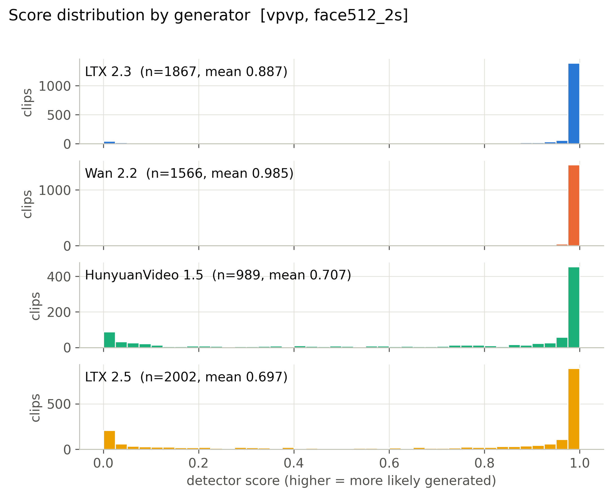

**Mean score, 56 cells x generator.** (`figures/heatmap_mean_score_cells.pdf`)

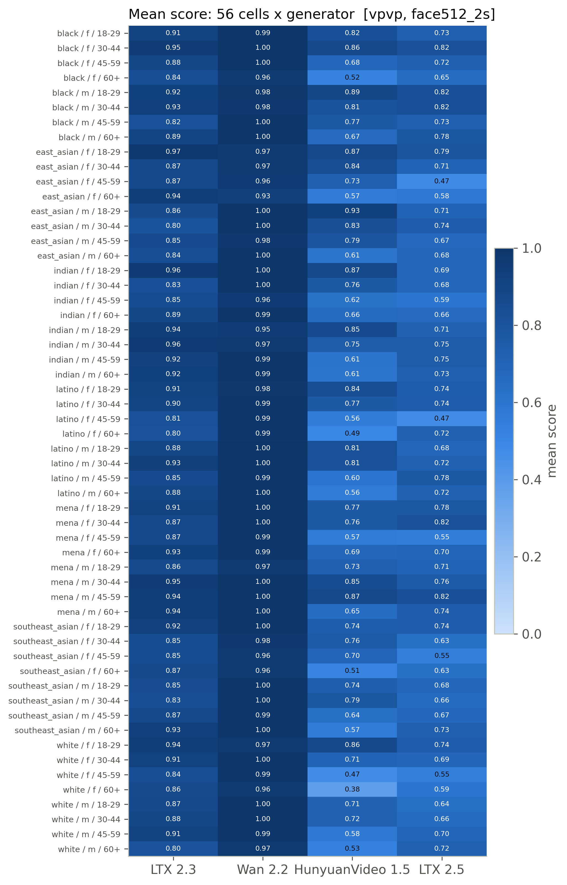

**Detection rate, 56 cells x generator (provisional threshold).** (`figures/heatmap_detection_rate_cells_provisional.pdf`)

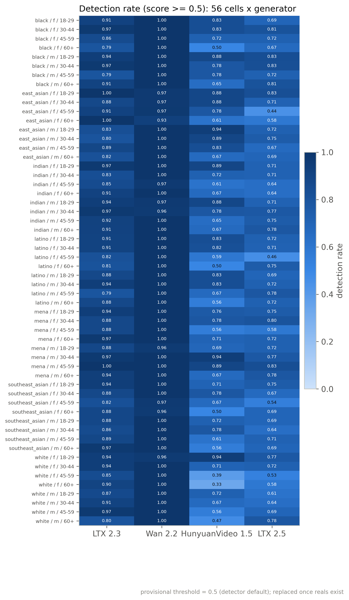

**Mean score by race, gender, age band with 95% CI.** (`figures/subgroup_mean_score.pdf`)

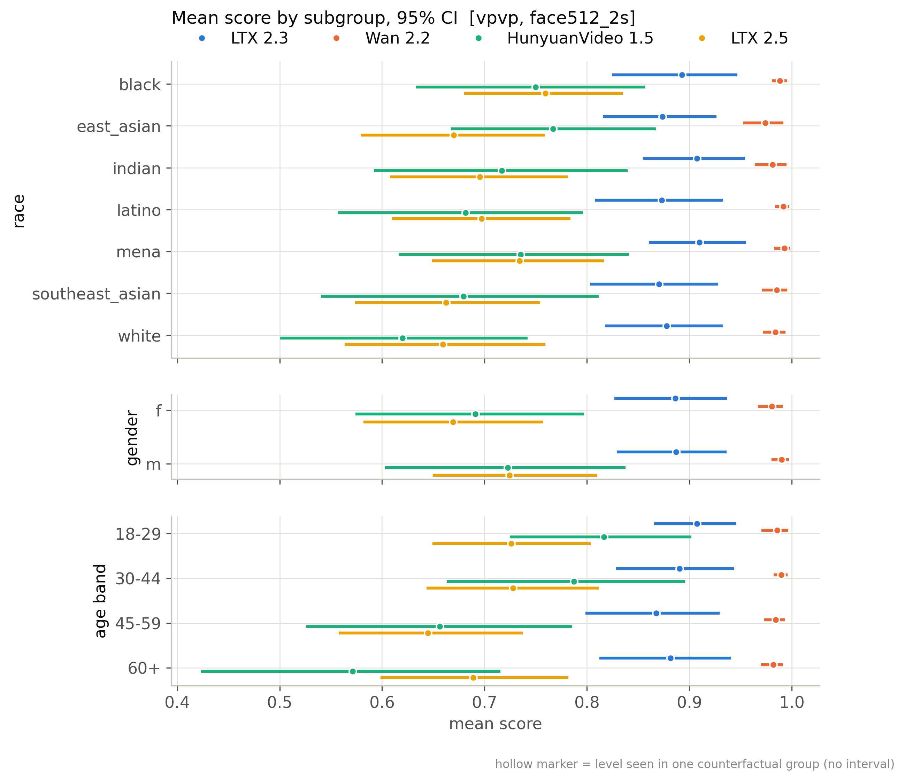

**Mean score by scene factor with 95% CI.** (`figures/scene_factor_mean_score.pdf`)

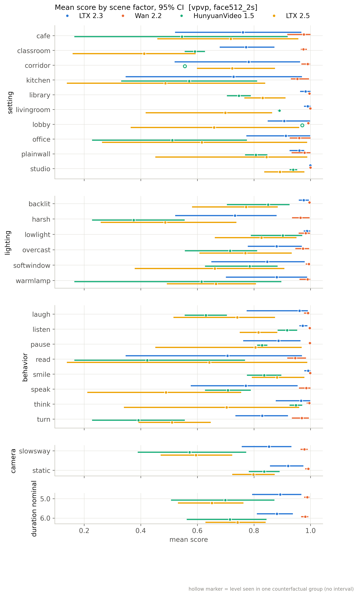

**Detection rate by subgroup (provisional threshold).** (`figures/subgroup_detection_rate_provisional.pdf`)

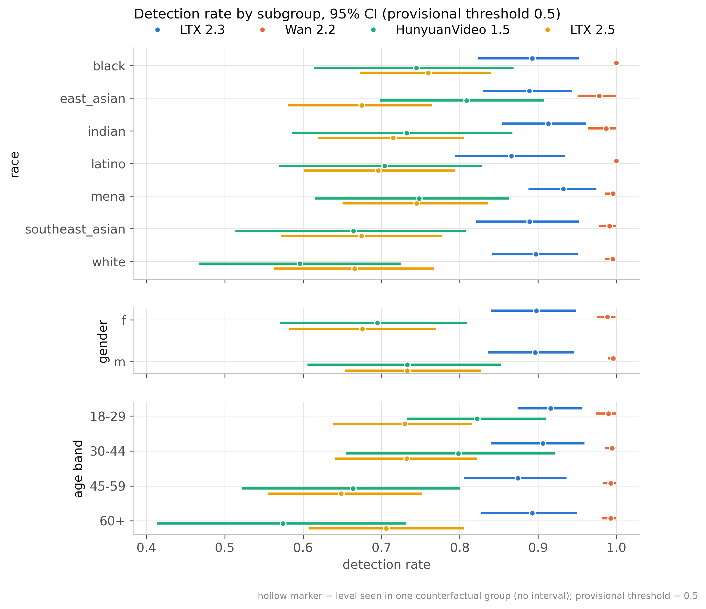

**Distribution of per-group CF spread.** (`figures/cf_spread_distribution.pdf`)

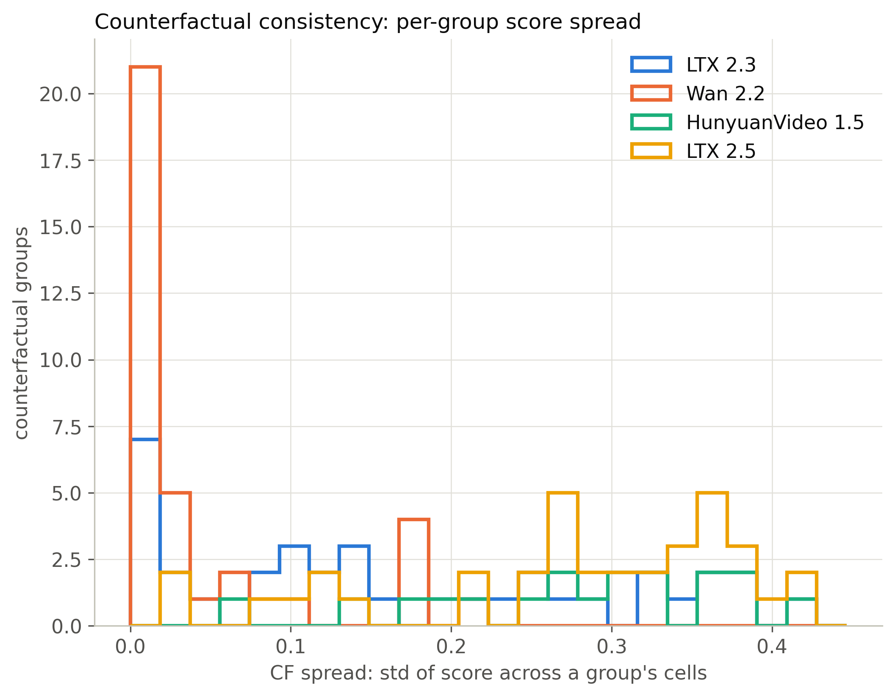

**Flip rate by generator (provisional threshold).** (`figures/flip_rate_by_generator_provisional.pdf`)

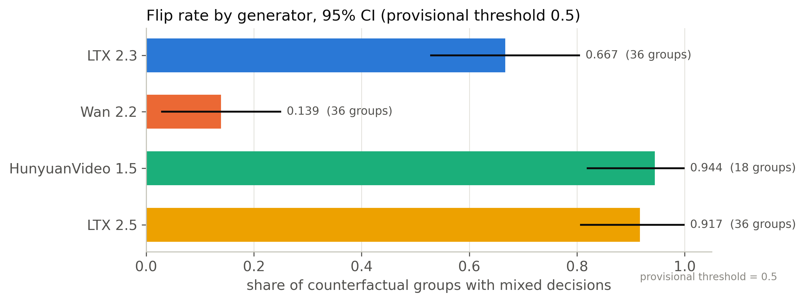

**Partial eta squared by factor.** (`figures/factor_attribution_variance_share.pdf`)

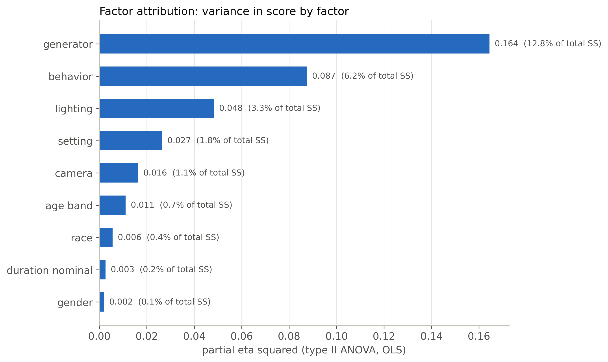

**Highest- and lowest-scoring included clips.** (`figures/example_strip.pdf`)

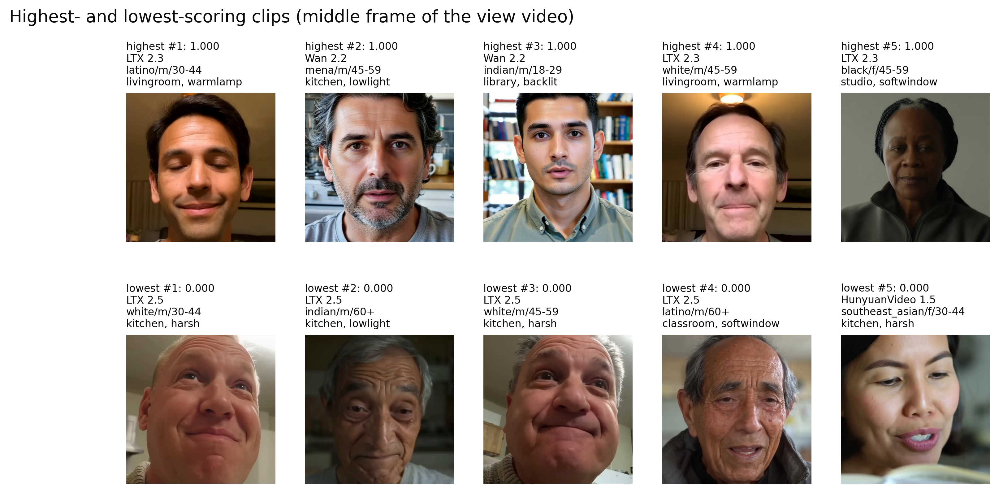

**ROC per generator against fps-matched reals.** (`figures/roc_per_generator.pdf`)

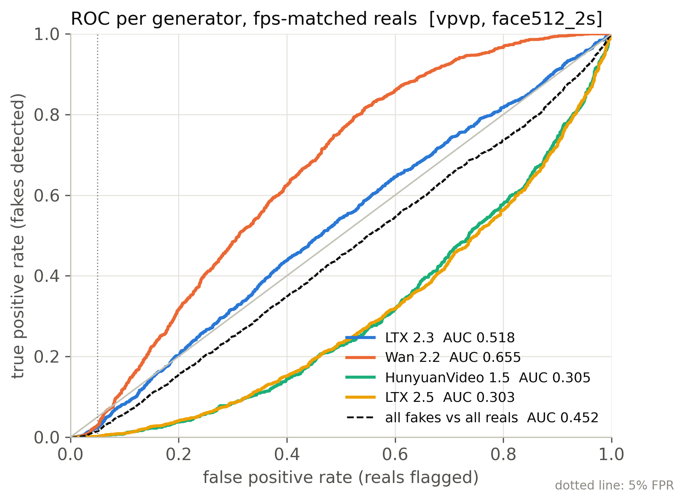

**Real FPR by perceived subgroup at the calibrated threshold.** (`figures/real_fpr_by_subgroup.pdf`)

**AUC by subgroup: each subgroup's fakes vs same-subgroup reals.** (`figures/subgroup_auc.pdf`)

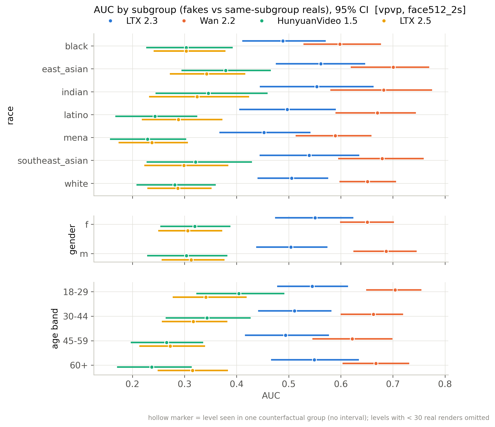

## Files

`manifest_used.csv` (every clip of the active batches with render/score/inclusion flags), `scores.csv` (score per scored clip), `tables/*.csv`, `figures/*`, `snapshot_meta.json`.

