# vpvp / native_up: snapshot 20261021-2230

> **Detector training data.** V-PVP head trained by the authors on AIGVDBench Real + Open-Sora + CogVideoX1.5 + EasyAnimate with a frozen Kinetics-400 VideoMAE-B/16; none of our generators is in its training set.

> **Provisional threshold.** Every detection rate and flip rate below uses the detector's default threshold (0.5; official: sigmoid(logit) > 0.5 (eval_opensource.py --threshold default)). They will be replaced by the 5%-real-FPR threshold once reals exist (section 6.3).

## Settings

| setting           | value                                                                                  |
|:------------------|:---------------------------------------------------------------------------------------|
| detector          | vpvp 1+c6ec2331                                                                        |
| checkpoint_sha256 | 33581d50452bcf19373a3e5db1204e44b456cb216ac21a3b889ee6970ba6f93b                       |
| view              | native_up (view_hash 4db0c07a46c4b8d9)                                                 |
| ffmpeg            | ffmpeg version 7.1.1 Copyright (c) 2000-2025 the FFmpeg developers                     |
| batches           | fake_b1, fake_b2, real_all                                                             |
| inclusion set     | primary (technical QC pass AND face QC pass)                                           |
| bootstrap         | 1000 resamples of whole counterfactual groups, seed 20261020, 95% percentile intervals |
| git commit        | 0528ba2cad5a-dirty                                                                     |
| created           | 2026-10-21T22:31:04Z                                                                   |

Detector preprocessing on top of the view:

| field       | value                                                                                                                                                |
|:------------|:-----------------------------------------------------------------------------------------------------------------------------------------------------|
| source      | manic-cui/Rethinking-the-readout@6ca3b1195c4b842c593638055bbcc9c8eaa6781d src/dataset.py + eval_opensource.py; AIGVDBench section 7 frame extraction |
| extraction  | 32 of the first 128 frames, np.linspace(0, n-1, 32); centre square; 256x256 PIL bilinear                                                             |
| frames_used | np.linspace(0, 31, 16, dtype=int) of the 32                                                                                                          |
| resize      | [224, 224, 'PIL BICUBIC']                                                                                                                            |
| normalize   | {'mean': [0.485, 0.456, 0.406], 'std': [0.229, 0.224, 0.225]}                                                                                        |
| backbone    | MCG-NJU/videomae-base-finetuned-kinetics@488eb9a0565f257b32866000305c8178965eb9f6, frozen, last block, fp16 autocast                                 |
| head        | PVPHead('velocity_gated', D=768), videomae_k400_vpvp.pt (sha 33581d50452b), fp32                                                                     |
| score       | sigmoid(logit) in float64                                                                                                                            |

## Coverage

| batch    | generator   |   clips |   primary |   rendered |   view_excluded |   render_failed |   scored |   score_failed |   included |
|:---------|:------------|--------:|----------:|-----------:|----------------:|----------------:|---------:|---------------:|-----------:|
| fake_b1  | hunyuan15   |     504 |       492 |        504 |               0 |               0 |      504 |              0 |        492 |
| fake_b1  | ltx23       |    2016 |      1878 |       2016 |               0 |               0 |     2016 |              0 |       1878 |
| fake_b1  | wan22       |    2016 |      1566 |       2016 |               0 |               0 |     2016 |              0 |       1566 |
| fake_b2  | hunyuan15   |     504 |       497 |        504 |               0 |               0 |      504 |              0 |        497 |
| real_all | real        |    2221 |      2221 |        923 |            1275 |              23 |      932 |              0 |        932 |

Reals scored: 1855. Fakes included: 4433 of 6895 scored (0 scoring failures).

## Observations

- LTX 2.3: mean score 0.434 [0.343, 0.530], median 0.266, n = 1878.
- Wan 2.2: mean score 0.796 [0.736, 0.846], median 0.979, n = 1566.
- HunyuanVideo 1.5: mean score 0.160 [0.101, 0.229], median 0.006, n = 989.
- Provisional detection rate (score >= 0.5), LTX 2.3: 43.1% [33.7, 53.1].
- Provisional detection rate (score >= 0.5), Wan 2.2: 81.4% [75.1, 86.8].
- Provisional detection rate (score >= 0.5), HunyuanVideo 1.5: 14.6% [8.7, 21.9].
- Provisional detection rate (score >= 0.5), all: 50.3% [43.5, 57.3].
- Largest race score gap: LTX 2.3 0.119 [0.094, 0.184] (mena 0.485 vs latino 0.366).
- Largest gender score gap: Wan 2.2 0.153 [0.108, 0.199] (m 0.872 vs f 0.719).
- Largest age band score gap: LTX 2.3 0.075 [0.035, 0.137] (30-44 0.459 vs 45-59 0.385).
- Largest cell score gap: Wan 2.2 0.386 [0.341, 0.557] (latino__m__18-29 0.963 vs white__f__60+ 0.577).
- Largest scene-factor gap (all generators): setting 0.505 [0.365, 0.719] (studio vs office).
- Largest partial eta squared: generator 0.316, behavior 0.026, setting 0.021; residual holds 56.6% of total SS.
- CF spread, LTX 2.3: 0.307 [0.278, 0.335] over 36 groups (max 0.431).
- CF spread, Wan 2.2: 0.256 [0.215, 0.292] over 36 groups (max 0.415).
- CF spread, HunyuanVideo 1.5: 0.225 [0.162, 0.286] over 18 groups (max 0.410).
- Provisional flip rate, LTX 2.3: 97.2% of 36 groups [91.7, 100.0].
- Provisional flip rate, Wan 2.2: 80.6% of 36 groups [66.7, 91.7].
- Provisional flip rate, HunyuanVideo 1.5: 77.8% of 18 groups [58.3, 95.0].

## 6.1 Fakes only, no threshold

### Mean score by generator

| generator   |    n |   n_groups |   estimate |   ci_lo |   ci_hi |    sd |   median |   q05 |   q95 |
|:------------|-----:|-----------:|-----------:|--------:|--------:|------:|---------:|------:|------:|
| ltx23       | 1878 |         36 |      0.434 |   0.343 |   0.53  | 0.43  |    0.266 | 0     | 1     |
| wan22       | 1566 |         36 |      0.796 |   0.736 |   0.846 | 0.322 |    0.979 | 0.041 | 1     |
| hunyuan15   |  989 |         18 |      0.16  |   0.101 |   0.229 | 0.295 |    0.006 | 0     | 0.934 |
| all         | 4433 |         36 |      0.501 |   0.436 |   0.568 | 0.439 |    0.515 | 0     | 1     |

### Mean score by race

| generator   | level           |   n |   estimate |   ci_lo |   ci_hi |   median |
|:------------|:----------------|----:|-----------:|--------:|--------:|---------:|
| ltx23       | black           | 273 |      0.466 |   0.371 |   0.568 |    0.367 |
| ltx23       | east_asian      | 270 |      0.404 |   0.307 |   0.51  |    0.126 |
| ltx23       | indian          | 277 |      0.478 |   0.374 |   0.588 |    0.407 |
| ltx23       | latino          | 262 |      0.366 |   0.263 |   0.474 |    0.106 |
| ltx23       | mena            | 267 |      0.485 |   0.385 |   0.592 |    0.428 |
| ltx23       | southeast_asian | 271 |      0.417 |   0.307 |   0.537 |    0.123 |
| ltx23       | white           | 258 |      0.418 |   0.326 |   0.514 |    0.22  |
| wan22       | black           | 217 |      0.822 |   0.758 |   0.883 |    0.987 |
| wan22       | east_asian      | 226 |      0.759 |   0.688 |   0.823 |    0.963 |
| wan22       | indian          | 230 |      0.79  |   0.715 |   0.862 |    0.982 |
| wan22       | latino          | 219 |      0.814 |   0.768 |   0.857 |    0.977 |
| wan22       | mena            | 225 |      0.827 |   0.771 |   0.872 |    0.983 |
| wan22       | southeast_asian | 229 |      0.766 |   0.683 |   0.834 |    0.974 |
| wan22       | white           | 220 |      0.793 |   0.714 |   0.867 |    0.983 |
| hunyuan15   | black           | 141 |      0.201 |   0.117 |   0.307 |    0.015 |
| hunyuan15   | east_asian      | 141 |      0.136 |   0.082 |   0.197 |    0.006 |
| hunyuan15   | indian          | 142 |      0.165 |   0.103 |   0.236 |    0.009 |
| hunyuan15   | latino          | 142 |      0.129 |   0.065 |   0.209 |    0.002 |
| hunyuan15   | mena            | 139 |      0.147 |   0.083 |   0.217 |    0.006 |
| hunyuan15   | southeast_asian | 143 |      0.168 |   0.086 |   0.264 |    0.007 |
| hunyuan15   | white           | 141 |      0.176 |   0.094 |   0.273 |    0.007 |
| all         | black           | 631 |      0.529 |   0.461 |   0.602 |    0.63  |
| all         | east_asian      | 637 |      0.471 |   0.402 |   0.538 |    0.355 |
| all         | indian          | 649 |      0.52  |   0.452 |   0.592 |    0.62  |
| all         | latino          | 623 |      0.469 |   0.399 |   0.539 |    0.392 |
| all         | mena            | 631 |      0.532 |   0.466 |   0.599 |    0.652 |
| all         | southeast_asian | 643 |      0.486 |   0.413 |   0.562 |    0.403 |
| all         | white           | 619 |      0.496 |   0.427 |   0.568 |    0.521 |

### Mean score by gender

| generator   | level   |    n |   estimate |   ci_lo |   ci_hi |   median |
|:------------|:--------|-----:|-----------:|--------:|--------:|---------:|
| ltx23       | f       |  931 |      0.447 |   0.347 |   0.555 |    0.316 |
| ltx23       | m       |  947 |      0.421 |   0.331 |   0.515 |    0.2   |
| wan22       | f       |  785 |      0.719 |   0.646 |   0.787 |    0.942 |
| wan22       | m       |  781 |      0.872 |   0.822 |   0.916 |    0.994 |
| hunyuan15   | f       |  495 |      0.13  |   0.074 |   0.2   |    0.004 |
| hunyuan15   | m       |  494 |      0.191 |   0.117 |   0.272 |    0.011 |
| all         | f       | 2211 |      0.472 |   0.407 |   0.544 |    0.397 |
| all         | m       | 2222 |      0.529 |   0.463 |   0.597 |    0.641 |

### Mean score by age band

| generator   | level   |    n |   estimate |   ci_lo |   ci_hi |   median |
|:------------|:--------|-----:|-----------:|--------:|--------:|---------:|
| ltx23       | 18-29   |  469 |      0.445 |   0.342 |   0.549 |    0.266 |
| ltx23       | 30-44   |  471 |      0.459 |   0.361 |   0.561 |    0.365 |
| ltx23       | 45-59   |  478 |      0.385 |   0.289 |   0.488 |    0.118 |
| ltx23       | 60+     |  460 |      0.448 |   0.351 |   0.553 |    0.318 |
| wan22       | 18-29   |  388 |      0.813 |   0.752 |   0.865 |    0.987 |
| wan22       | 30-44   |  377 |      0.82  |   0.755 |   0.88  |    0.99  |
| wan22       | 45-59   |  398 |      0.755 |   0.683 |   0.819 |    0.959 |
| wan22       | 60+     |  403 |      0.796 |   0.721 |   0.862 |    0.974 |
| hunyuan15   | 18-29   |  242 |      0.193 |   0.123 |   0.268 |    0.011 |
| hunyuan15   | 30-44   |  248 |      0.184 |   0.116 |   0.268 |    0.009 |
| hunyuan15   | 45-59   |  250 |      0.126 |   0.061 |   0.211 |    0.003 |
| hunyuan15   | 60+     |  249 |      0.14  |   0.08  |   0.205 |    0.006 |
| all         | 18-29   | 1099 |      0.519 |   0.45  |   0.586 |    0.607 |
| all         | 30-44   | 1096 |      0.521 |   0.449 |   0.594 |    0.637 |
| all         | 45-59   | 1126 |      0.458 |   0.389 |   0.528 |    0.344 |
| all         | 60+     | 1112 |      0.505 |   0.438 |   0.572 |    0.547 |

### Mean score by scene factor (all generators pooled)

| factor           | level      |    n |   estimate |   ci_lo |   ci_hi |
|:-----------------|:-----------|-----:|-----------:|--------:|--------:|
| setting          | cafe       |  376 |      0.385 |   0.141 |   0.696 |
| setting          | classroom  |  373 |      0.364 |   0.266 |   0.554 |
| setting          | corridor   |  493 |      0.483 |   0.225 |   0.743 |
| setting          | kitchen    |  441 |      0.353 |   0.2   |   0.58  |
| setting          | library    |  534 |      0.597 |   0.53  |   0.651 |
| setting          | livingroom |  530 |      0.666 |   0.478 |   0.944 |
| setting          | lobby      |  345 |      0.492 |   0.436 |   0.529 |
| setting          | office     |  357 |      0.246 |   0.149 |   0.492 |
| setting          | plainwall  |  553 |      0.528 |   0.366 |   0.615 |
| setting          | studio     |  431 |      0.751 |   0.661 |   0.905 |
| lighting         | backlit    |  790 |      0.66  |   0.59  |   0.728 |
| lighting         | harsh      |  632 |      0.275 |   0.193 |   0.39  |
| lighting         | lowlight   |  784 |      0.586 |   0.544 |   0.63  |
| lighting         | overcast   |  692 |      0.389 |   0.298 |   0.554 |
| lighting         | softwindow |  821 |      0.564 |   0.383 |   0.734 |
| lighting         | warmlamp   |  714 |      0.466 |   0.251 |   0.719 |
| behavior         | laugh      |  500 |      0.55  |   0.359 |   0.743 |
| behavior         | listen     |  680 |      0.63  |   0.576 |   0.667 |
| behavior         | pause      |  520 |      0.488 |   0.363 |   0.608 |
| behavior         | read       |  576 |      0.312 |   0.141 |   0.598 |
| behavior         | smile      |  538 |      0.601 |   0.336 |   0.925 |
| behavior         | speak      |  530 |      0.429 |   0.263 |   0.61  |
| behavior         | think      |  509 |      0.613 |   0.436 |   0.73  |
| behavior         | turn       |  580 |      0.379 |   0.222 |   0.563 |
| camera           | slowsway   | 2225 |      0.451 |   0.355 |   0.554 |
| camera           | static     | 2208 |      0.551 |   0.472 |   0.633 |
| duration_nominal | 5.0        | 2227 |      0.545 |   0.445 |   0.653 |
| duration_nominal | 6.0        | 2206 |      0.456 |   0.375 |   0.53  |

Per-generator scene-factor and 56-cell rows: `tables/score_by_breakdown.csv`.

### Subgroup gap (max - min of level means)

A gap is max - min, so it is never negative and its interval cannot include 0; it is a size, not a test of a difference. Over many levels with few clips each (56 cells; HunyuanVideo has 9 groups per cell) the gap also grows with noise, so compare it with the per-level intervals in `tables/score_by_breakdown.csv`. Levels seen in a single counterfactual group have no interval.

| generator   | attribute        |   n_levels |   gap |   ci_lo |   ci_hi | max_level        | min_level        |
|:------------|:-----------------|-----------:|------:|--------:|--------:|:-----------------|:-----------------|
| ltx23       | race             |          7 | 0.119 |   0.094 |   0.184 | mena             | latino           |
| ltx23       | gender           |          2 | 0.025 |   0.001 |   0.088 | f                | m                |
| ltx23       | age_band         |          4 | 0.075 |   0.035 |   0.137 | 30-44            | 45-59            |
| ltx23       | cell             |         56 | 0.316 |   0.321 |   0.51  | indian__m__60+   | latino__f__45-59 |
| ltx23       | setting          |         10 | 0.614 |   0.558 |   0.84  | studio           | classroom        |
| ltx23       | lighting         |          6 | 0.539 |   0.445 |   0.728 | lowlight         | harsh            |
| ltx23       | behavior         |          8 | 0.441 |   0.407 |   0.803 | smile            | read             |
| ltx23       | camera           |          2 | 0.091 |   0.005 |   0.285 | static           | slowsway         |
| ltx23       | duration_nominal |          2 | 0.121 |   0.005 |   0.316 | 5.0              | 6.0              |
| wan22       | race             |          7 | 0.068 |   0.043 |   0.137 | mena             | east_asian       |
| wan22       | gender           |          2 | 0.153 |   0.108 |   0.199 | m                | f                |
| wan22       | age_band         |          4 | 0.065 |   0.032 |   0.12  | 30-44            | 45-59            |
| wan22       | cell             |         56 | 0.386 |   0.341 |   0.557 | latino__m__18-29 | white__f__60+    |
| wan22       | setting          |         10 | 0.381 |   0.217 |   0.63  | studio           | kitchen          |
| wan22       | lighting         |          6 | 0.185 |   0.156 |   0.4   | softwindow       | overcast         |
| wan22       | behavior         |          8 | 0.275 |   0.201 |   0.548 | think            | turn             |
| wan22       | camera           |          2 | 0.095 |   0.008 |   0.206 | static           | slowsway         |
| wan22       | duration_nominal |          2 | 0.013 |   0.002 |   0.131 | 5.0              | 6.0              |
| hunyuan15   | race             |          7 | 0.073 |   0.049 |   0.165 | black            | latino           |
| hunyuan15   | gender           |          2 | 0.062 |   0.011 |   0.117 | m                | f                |
| hunyuan15   | age_band         |          4 | 0.067 |   0.036 |   0.129 | 18-29            | 45-59            |
| hunyuan15   | cell             |         56 | 0.306 |   0.276 |   0.552 | white__m__18-29  | mena__f__45-59   |
| hunyuan15   | setting          |         10 | 0.295 |   0.201 |   0.475 | studio           | classroom        |
| hunyuan15   | lighting         |          6 | 0.249 |   0.137 |   0.469 | backlit          | harsh            |
| hunyuan15   | behavior         |          8 | 0.324 |   0.219 |   0.473 | think            | speak            |
| hunyuan15   | camera           |          2 | 0.138 |   0.024 |   0.254 | static           | slowsway         |
| hunyuan15   | duration_nominal |          2 | 0.051 |   0.004 |   0.192 | 5.0              | 6.0              |
| all         | race             |          7 | 0.063 |   0.053 |   0.109 | mena             | latino           |
| all         | gender           |          2 | 0.056 |   0.029 |   0.082 | m                | f                |
| all         | age_band         |          4 | 0.063 |   0.039 |   0.103 | 30-44            | 45-59            |
| all         | cell             |         56 | 0.285 |   0.244 |   0.389 | black__m__30-44  | latino__f__45-59 |
| all         | setting          |         10 | 0.505 |   0.365 |   0.719 | studio           | office           |
| all         | lighting         |          6 | 0.385 |   0.278 |   0.529 | backlit          | harsh            |
| all         | behavior         |          8 | 0.318 |   0.241 |   0.656 | listen           | read             |
| all         | camera           |          2 | 0.1   |   0.006 |   0.227 | static           | slowsway         |
| all         | duration_nominal |          2 | 0.089 |   0.005 |   0.211 | 5.0              | 6.0              |

### CF spread (mean over groups of the std of score across the group's cells)

| generator   |   n_groups |   cf_spread |   ci_lo |   ci_hi |   median |   max |
|:------------|-----------:|------------:|--------:|--------:|---------:|------:|
| ltx23       |         36 |       0.307 |   0.278 |   0.335 |    0.329 | 0.431 |
| wan22       |         36 |       0.256 |   0.215 |   0.292 |    0.281 | 0.415 |
| hunyuan15   |         18 |       0.225 |   0.162 |   0.286 |    0.27  | 0.41  |

### Factor attribution

OLS with every factor as a fixed effect, type-II ANOVA. `ss_share` is the factor's type-II sum of squares over the total sum of squares (type-II shares need not add to 1). Scene factors are constant within a counterfactual group, so their effects are estimated from between-group differences only. The OLS F tests treat clips as independent although clips are clustered in counterfactual groups, so their p values are optimistic; use the group-bootstrap intervals above for inference.

| factor           |   df |   sum_sq | F     | p         | partial_eta2   |   ss_share |
|:-----------------|-----:|---------:|:------|:----------|:---------------|-----------:|
| race             |    6 |   2.787  | 4.229 | 0.0002991 | 0.005737       |  0.003265  |
| gender           |    1 |   3.071  | 27.96 | 1.301e-07 | 0.006318       |  0.003597  |
| age_band         |    3 |   2.829  | 8.584 | 1.113e-05 | 0.005823       |  0.003314  |
| setting          |    9 |  10.4    | 10.52 | 2.838e-16 | 0.02108        |  0.01219   |
| lighting         |    5 |   7.181  | 13.07 | 1.175e-12 | 0.01465        |  0.00841   |
| behavior         |    7 |  12.74   | 16.57 | 1.039e-21 | 0.0257         |  0.01493   |
| camera           |    1 |   5.915  | 53.84 | 2.582e-13 | 0.0121         |  0.006927  |
| duration_nominal |    1 |   0.5735 | 5.22  | 0.02237   | 0.001186       |  0.0006717 |
| generator        |    2 | 223.4    | 1017  | 0         | 0.3163         |  0.2617    |
| Residual         | 4397 | 483.1    |       |           |                |  0.5658    |

Lighting x race interaction (added to the same OLS):

| term            |   df |   sum_sq |     F |      p |   partial_eta2 |
|:----------------|-----:|---------:|------:|-------:|---------------:|
| lighting x race |   30 |    2.618 | 0.793 | 0.7809 |       0.005418 |

Mixed model `score ~ factors + (1 | counterfactual_group)` (REML) variance components (fixed effects: `tables/factor_mixed_fixed.csv`):

| component                               |   variance | converged   |
|:----------------------------------------|-----------:|:------------|
| counterfactual_group (random intercept) |     0      | True        |
| residual                                |     0.1058 | True        |
| ICC (group share of random variance)    |     0      | True        |

A group variance at or near 0 is a boundary estimate: setting, lighting, behavior, camera and duration are fixed per group and absorb most between-group variation, leaving little for the random intercept. It does not mean scenes do not matter.

## 6.2 Provisional (threshold 0.5, provisional)

### Detection rate by generator (provisional)

| generator   |    n |   estimate |   ci_lo |   ci_hi |
|:------------|-----:|-----------:|--------:|--------:|
| ltx23       | 1878 |      0.431 |   0.337 |   0.531 |
| wan22       | 1566 |      0.814 |   0.751 |   0.868 |
| hunyuan15   |  989 |      0.146 |   0.087 |   0.219 |
| all         | 4433 |      0.503 |   0.435 |   0.573 |

### Detection rate by race (provisional)

| generator   | level           |   n |   estimate |   ci_lo |   ci_hi |
|:------------|:----------------|----:|-----------:|--------:|--------:|
| ltx23       | black           | 273 |      0.473 |   0.363 |   0.588 |
| ltx23       | east_asian      | 270 |      0.4   |   0.297 |   0.506 |
| ltx23       | indian          | 277 |      0.48  |   0.371 |   0.599 |
| ltx23       | latino          | 262 |      0.359 |   0.245 |   0.479 |
| ltx23       | mena            | 267 |      0.491 |   0.381 |   0.602 |
| ltx23       | southeast_asian | 271 |      0.399 |   0.287 |   0.522 |
| ltx23       | white           | 258 |      0.415 |   0.316 |   0.52  |
| wan22       | black           | 217 |      0.848 |   0.774 |   0.912 |
| wan22       | east_asian      | 226 |      0.77  |   0.691 |   0.841 |
| wan22       | indian          | 230 |      0.817 |   0.739 |   0.892 |
| wan22       | latino          | 219 |      0.831 |   0.777 |   0.881 |
| wan22       | mena            | 225 |      0.844 |   0.776 |   0.901 |
| wan22       | southeast_asian | 229 |      0.769 |   0.675 |   0.856 |
| wan22       | white           | 220 |      0.818 |   0.731 |   0.897 |
| hunyuan15   | black           | 141 |      0.191 |   0.092 |   0.317 |
| hunyuan15   | east_asian      | 141 |      0.113 |   0.061 |   0.173 |
| hunyuan15   | indian          | 142 |      0.148 |   0.077 |   0.232 |
| hunyuan15   | latino          | 142 |      0.12  |   0.053 |   0.207 |
| hunyuan15   | mena            | 139 |      0.122 |   0.066 |   0.188 |
| hunyuan15   | southeast_asian | 143 |      0.147 |   0.062 |   0.244 |
| hunyuan15   | white           | 141 |      0.177 |   0.083 |   0.298 |
| all         | black           | 631 |      0.539 |   0.467 |   0.616 |
| all         | east_asian      | 637 |      0.468 |   0.396 |   0.537 |
| all         | indian          | 649 |      0.527 |   0.455 |   0.601 |
| all         | latino          | 623 |      0.47  |   0.396 |   0.548 |
| all         | mena            | 631 |      0.536 |   0.465 |   0.606 |
| all         | southeast_asian | 643 |      0.474 |   0.396 |   0.556 |
| all         | white           | 619 |      0.504 |   0.432 |   0.58  |

### Detection rate by gender (provisional)

| generator   | level   |    n |   estimate |   ci_lo |   ci_hi |
|:------------|:--------|-----:|-----------:|--------:|--------:|
| ltx23       | f       |  931 |      0.446 |   0.338 |   0.559 |
| ltx23       | m       |  947 |      0.417 |   0.324 |   0.517 |
| wan22       | f       |  785 |      0.732 |   0.649 |   0.807 |
| wan22       | m       |  781 |      0.895 |   0.847 |   0.937 |
| hunyuan15   | f       |  495 |      0.107 |   0.056 |   0.176 |
| hunyuan15   | m       |  494 |      0.184 |   0.109 |   0.269 |
| all         | f       | 2211 |      0.472 |   0.402 |   0.547 |
| all         | m       | 2222 |      0.533 |   0.466 |   0.603 |

### Detection rate by age band (provisional)

| generator   | level   |    n |   estimate |   ci_lo |   ci_hi |
|:------------|:--------|-----:|-----------:|--------:|--------:|
| ltx23       | 18-29   |  469 |      0.448 |   0.341 |   0.555 |
| ltx23       | 30-44   |  471 |      0.461 |   0.36  |   0.568 |
| ltx23       | 45-59   |  478 |      0.383 |   0.28  |   0.491 |
| ltx23       | 60+     |  460 |      0.435 |   0.335 |   0.548 |
| wan22       | 18-29   |  388 |      0.827 |   0.761 |   0.888 |
| wan22       | 30-44   |  377 |      0.828 |   0.757 |   0.891 |
| wan22       | 45-59   |  398 |      0.779 |   0.701 |   0.852 |
| wan22       | 60+     |  403 |      0.821 |   0.742 |   0.892 |
| hunyuan15   | 18-29   |  242 |      0.169 |   0.099 |   0.244 |
| hunyuan15   | 30-44   |  248 |      0.173 |   0.097 |   0.274 |
| hunyuan15   | 45-59   |  250 |      0.112 |   0.044 |   0.207 |
| hunyuan15   | 60+     |  249 |      0.129 |   0.067 |   0.195 |
| all         | 18-29   | 1099 |      0.52  |   0.446 |   0.591 |
| all         | 30-44   | 1096 |      0.522 |   0.448 |   0.599 |
| all         | 45-59   | 1126 |      0.463 |   0.391 |   0.538 |
| all         | 60+     | 1112 |      0.506 |   0.436 |   0.577 |

### Detection-rate gap (provisional)

| generator   | attribute        |   gap |   ci_lo |   ci_hi | max_level        | min_level            |
|:------------|:-----------------|------:|--------:|--------:|:-----------------|:---------------------|
| ltx23       | race             | 0.132 |   0.1   |   0.214 | mena             | latino               |
| ltx23       | gender           | 0.029 |   0.002 |   0.1   | f                | m                    |
| ltx23       | age_band         | 0.078 |   0.035 |   0.154 | 30-44            | 45-59                |
| ltx23       | cell             | 0.405 |   0.386 |   0.626 | indian__m__60+   | east_asian__m__60+   |
| ltx23       | setting          | 0.635 |   0.576 |   0.895 | studio           | classroom            |
| ltx23       | lighting         | 0.55  |   0.452 |   0.762 | lowlight         | harsh                |
| ltx23       | behavior         | 0.464 |   0.424 |   0.845 | smile            | read                 |
| ltx23       | camera           | 0.1   |   0.006 |   0.296 | static           | slowsway             |
| ltx23       | duration_nominal | 0.138 |   0.009 |   0.34  | 5.0              | 6.0                  |
| wan22       | race             | 0.079 |   0.056 |   0.177 | black            | southeast_asian      |
| wan22       | gender           | 0.163 |   0.108 |   0.22  | m                | f                    |
| wan22       | age_band         | 0.049 |   0.025 |   0.121 | 30-44            | 45-59                |
| wan22       | cell             | 0.448 |   0.367 |   0.655 | latino__m__18-29 | east_asian__f__18-29 |
| wan22       | setting          | 0.406 |   0.228 |   0.662 | studio           | kitchen              |
| wan22       | lighting         | 0.194 |   0.171 |   0.424 | backlit          | lowlight             |
| wan22       | behavior         | 0.293 |   0.205 |   0.57  | think            | turn                 |
| wan22       | camera           | 0.11  |   0.011 |   0.225 | static           | slowsway             |
| wan22       | duration_nominal | 0.007 |   0.003 |   0.137 | 6.0              | 5.0                  |
| hunyuan15   | race             | 0.078 |   0.048 |   0.211 | black            | east_asian           |
| hunyuan15   | gender           | 0.077 |   0.023 |   0.131 | m                | f                    |
| hunyuan15   | age_band         | 0.061 |   0.035 |   0.136 | 30-44            | 45-59                |
| hunyuan15   | cell             | 0.389 |   0.304 |   0.647 | indian__m__30-44 | mena__f__30-44       |
| hunyuan15   | setting          | 0.326 |   0.196 |   0.482 | studio           | classroom            |
| hunyuan15   | lighting         | 0.256 |   0.14  |   0.482 | backlit          | harsh                |
| hunyuan15   | behavior         | 0.33  |   0.219 |   0.482 | think            | speak                |
| hunyuan15   | camera           | 0.132 |   0.014 |   0.259 | static           | slowsway             |
| hunyuan15   | duration_nominal | 0.052 |   0.002 |   0.203 | 5.0              | 6.0                  |
| all         | race             | 0.071 |   0.059 |   0.13  | black            | east_asian           |
| all         | gender           | 0.062 |   0.029 |   0.092 | m                | f                    |
| all         | age_band         | 0.059 |   0.033 |   0.105 | 30-44            | 45-59                |
| all         | cell             | 0.312 |   0.276 |   0.441 | indian__m__60+   | latino__f__45-59     |
| all         | setting          | 0.533 |   0.383 |   0.757 | studio           | office               |
| all         | lighting         | 0.401 |   0.296 |   0.549 | backlit          | harsh                |
| all         | behavior         | 0.33  |   0.252 |   0.672 | listen           | read                 |
| all         | camera           | 0.108 |   0.008 |   0.24  | static           | slowsway             |
| all         | duration_nominal | 0.091 |   0.007 |   0.22  | 5.0              | 6.0                  |

### Flip rate (provisional): share of groups whose clips get different decisions

| generator   |   n_groups |   flip_rate |   ci_lo |   ci_hi |   median |   max |
|:------------|-----------:|------------:|--------:|--------:|---------:|------:|
| ltx23       |         36 |       0.972 |   0.917 |   1     |        1 |     1 |
| wan22       |         36 |       0.806 |   0.667 |   0.917 |        1 |     1 |
| hunyuan15   |         18 |       0.778 |   0.583 |   0.95  |        1 |     1 |

### Sensitivity: inclusion set

| set     | generator   |    n |   mean_score |   provisional_detection_rate |
|:--------|:------------|-----:|-------------:|-----------------------------:|
| all     | hunyuan15   | 1008 |        0.16  |                        0.145 |
| all     | ltx23       | 2016 |        0.445 |                        0.443 |
| all     | wan22       | 2016 |        0.803 |                        0.82  |
| primary | hunyuan15   |  989 |        0.16  |                        0.146 |
| primary | ltx23       | 1878 |        0.434 |                        0.431 |
| primary | wan22       | 1566 |        0.796 |                        0.814 |

## 6.3 Real vs generated (calibrated threshold 1.0000)

The threshold is the score at which 5% of primary real renders (24 and 16 fps pooled) are flagged; one per detector and view, never per subgroup. Each generator is compared with reals rendered at its own fps. Intervals: fakes resample counterfactual groups, reals resample identity clusters (source video). Real labels are perceived (FairFace), not self-reported.

### Calibration

| scope            |   n_renders |   n_sources |   n_identities |   threshold |    fpr |
|:-----------------|------------:|------------:|---------------:|------------:|-------:|
| all real renders |        1855 |         932 |            811 |           1 | 0.0501 |
| 16 fps renders   |         932 |         932 |            811 |           1 | 0.0526 |
| 24 fps renders   |         923 |         923 |            802 |           1 | 0.0477 |

### AUC, AP, EER, TPR at 5% FPR

| generator   | real_fps   |   n_fake |   n_real |   auc |   auc_ci_lo |   auc_ci_hi |    ap |   eer |   tpr_at_5fpr |   detection_rate_global_thr |   det_ci_lo |   det_ci_hi |
|:------------|:-----------|---------:|---------:|------:|------------:|------------:|------:|------:|--------------:|----------------------------:|------------:|------------:|
| ltx23       | 24         |     1878 |      923 | 0.412 |       0.349 |       0.478 | 0.598 | 0.562 |         0.011 |                       0.01  |       0.002 |       0.019 |
| wan22       | 16         |     1566 |      932 | 0.634 |       0.588 |       0.679 | 0.671 | 0.402 |         0.02  |                       0.022 |       0.008 |       0.039 |
| hunyuan15   | 24         |      989 |      923 | 0.228 |       0.172 |       0.283 | 0.365 | 0.692 |         0     |                       0     |       0     |       0     |
| all         | 24+16      |     4433 |     1855 | 0.45  |       0.4   |       0.5   | 0.657 | 0.528 |         0.012 |                       0.012 |       0.005 |       0.02  |

### Real FPR by perceived subgroup

| attribute   | level              |   n_renders |   n_identities |   fpr |   ci_lo |   ci_hi |
|:------------|:-------------------|------------:|---------------:|------:|--------:|--------:|
| race        | black              |         123 |             59 | 0.057 |   0.008 |   0.116 |
| race        | east_asian         |         163 |             75 | 0.025 |   0     |   0.058 |
| race        | indian             |          46 |             23 | 0.022 |   0     |   0.071 |
| race        | latino             |         115 |             55 | 0.052 |   0.008 |   0.109 |
| race        | mena               |         120 |             59 | 0.15  |   0.069 |   0.241 |
| race        | southeast_asian    |          70 |             34 | 0     |   0     |   0     |
| race        | white              |        1204 |            523 | 0.047 |   0.03  |   0.064 |
| gender      | f                  |         587 |            266 | 0.027 |   0.011 |   0.047 |
| gender      | m                  |        1254 |            553 | 0.061 |   0.043 |   0.079 |
| age_band    | 18-29              |         594 |            275 | 0.034 |   0.015 |   0.056 |
| age_band    | 30-44              |         626 |            290 | 0.062 |   0.038 |   0.089 |
| age_band    | 45-59              |         300 |            134 | 0.077 |   0.039 |   0.118 |
| age_band    | 60+                |         241 |            112 | 0.025 |   0     |   0.056 |
| race_gender | black__f           |          20 |             10 | 0     |   0     |   0     |
| race_gender | black__m           |         103 |             50 | 0.068 |   0.01  |   0.142 |
| race_gender | east_asian__f      |          76 |             35 | 0.013 |   0     |   0.044 |
| race_gender | east_asian__m      |          87 |             41 | 0.034 |   0     |   0.093 |
| race_gender | indian__f          |          12 |              6 | 0     |   0     |   0     |
| race_gender | indian__m          |          34 |             17 | 0.029 |   0     |   0.1   |
| race_gender | latino__f          |          20 |             10 | 0     |   0     |   0     |
| race_gender | latino__m          |          95 |             45 | 0.063 |   0.01  |   0.132 |
| race_gender | mena__f            |          34 |             17 | 0.147 |   0     |   0.334 |
| race_gender | mena__m            |          86 |             42 | 0.151 |   0.057 |   0.268 |
| race_gender | southeast_asian__f |          20 |              9 | 0     |   0     |   0     |
| race_gender | southeast_asian__m |          50 |             25 | 0     |   0     |   0     |
| race_gender | white__f           |         405 |            183 | 0.025 |   0.007 |   0.047 |
| race_gender | white__m           |         799 |            350 | 0.058 |   0.034 |   0.082 |

### Real FPR gap (max - min across levels; non-negative by construction)

| attribute   |   n_levels |   fpr_gap |   ci_lo |   ci_hi | max_level   |   max_fpr | min_level       |   min_fpr |
|:------------|-----------:|----------:|--------:|--------:|:------------|----------:|:----------------|----------:|
| race        |          7 |     0.15  |   0.075 |   0.241 | mena        |     0.15  | southeast_asian |     0     |
| gender      |          2 |     0.033 |   0.009 |   0.058 | m           |     0.061 | f               |     0.027 |
| age_band    |          4 |     0.052 |   0.024 |   0.104 | 45-59       |     0.077 | 60+             |     0.025 |
| race_gender |         14 |     0.151 |   0.094 |   0.342 | mena__m     |     0.151 | black__f        |     0     |

### Worst-subgroup AUC and AUC gap

| generator   | attribute   |   n_levels | worst_level   |   worst_auc |   worst_ci_lo |   worst_ci_hi | best_level    |   best_auc |   auc_gap |   gap_ci_lo |   gap_ci_hi |
|:------------|:------------|-----------:|:--------------|------------:|--------------:|--------------:|:--------------|-----------:|----------:|------------:|------------:|
| ltx23       | race        |          6 | black         |       0.323 |         0.224 |         0.381 | white         |      0.422 |     0.099 |       0.074 |       0.251 |
| ltx23       | gender      |          2 | m             |       0.395 |         0.33  |         0.46  | f             |      0.446 |     0.05  |       0.005 |       0.109 |
| ltx23       | age_band    |          4 | 45-59         |       0.394 |         0.31  |         0.457 | 60+           |      0.446 |     0.051 |       0.022 |       0.14  |
| ltx23       | race_gender |          7 | mena__m       |       0.332 |         0.212 |         0.384 | white__f      |      0.474 |     0.142 |       0.104 |       0.274 |
| wan22       | race        |          6 | black         |       0.526 |         0.41  |         0.581 | white         |      0.663 |     0.137 |       0.114 |       0.308 |
| wan22       | gender      |          2 | f             |       0.612 |         0.553 |         0.666 | m             |      0.682 |     0.07  |       0.013 |       0.13  |
| wan22       | age_band    |          4 | 45-59         |       0.607 |         0.519 |         0.668 | 18-29         |      0.666 |     0.059 |       0.022 |       0.158 |
| wan22       | race_gender |          7 | east_asian__f |       0.565 |         0.436 |         0.621 | east_asian__m |      0.741 |     0.176 |       0.116 |       0.358 |
| hunyuan15   | race        |          6 | mena          |       0.136 |         0.074 |         0.183 | east_asian    |      0.245 |     0.109 |       0.078 |       0.247 |
| hunyuan15   | gender      |          2 | f             |       0.232 |         0.166 |         0.278 | m             |      0.236 |     0.004 |       0.001 |       0.067 |
| hunyuan15   | age_band    |          4 | 45-59         |       0.213 |         0.138 |         0.264 | 18-29         |      0.257 |     0.044 |       0.021 |       0.119 |
| hunyuan15   | race_gender |          7 | black__m      |       0.154 |         0.068 |         0.189 | east_asian__m |      0.273 |     0.118 |       0.097 |       0.268 |
| all         | race        |          7 | black         |       0.356 |         0.258 |         0.404 | indian        |      0.513 |     0.157 |       0.104 |       0.332 |
| all         | gender      |          2 | f             |       0.458 |         0.399 |         0.502 | m             |      0.461 |     0.004 |       0.001 |       0.056 |
| all         | age_band    |          4 | 45-59         |       0.43  |         0.356 |         0.484 | 60+           |      0.478 |     0.047 |       0.021 |       0.131 |
| all         | race_gender |         10 | mena__f       |       0.333 |         0.184 |         0.403 | indian__m     |      0.511 |     0.178 |       0.133 |       0.422 |

### Detection rate at the calibrated threshold

| generator   |    n |   estimate |   ci_lo |   ci_hi |
|:------------|-----:|-----------:|--------:|--------:|
| ltx23       | 1878 |      0.01  |   0.002 |   0.019 |
| wan22       | 1566 |      0.022 |   0.008 |   0.039 |
| hunyuan15   |  989 |      0     |   0     |   0     |
| all         | 4433 |      0.012 |   0.005 |   0.02  |

#### by race

| generator   | level           |   n |   estimate |   ci_lo |   ci_hi |
|:------------|:----------------|----:|-----------:|--------:|--------:|
| ltx23       | black           | 273 |      0.004 |   0     |   0.011 |
| ltx23       | east_asian      | 270 |      0.015 |   0     |   0.034 |
| ltx23       | indian          | 277 |      0.004 |   0     |   0.011 |
| ltx23       | latino          | 262 |      0.015 |   0     |   0.034 |
| ltx23       | mena            | 267 |      0.007 |   0     |   0.019 |
| ltx23       | southeast_asian | 271 |      0.007 |   0     |   0.019 |
| ltx23       | white           | 258 |      0.016 |   0     |   0.036 |
| wan22       | black           | 217 |      0.018 |   0     |   0.045 |
| wan22       | east_asian      | 226 |      0.009 |   0     |   0.022 |
| wan22       | indian          | 230 |      0.039 |   0.009 |   0.076 |
| wan22       | latino          | 219 |      0.023 |   0.004 |   0.05  |
| wan22       | mena            | 225 |      0.027 |   0.004 |   0.061 |
| wan22       | southeast_asian | 229 |      0.017 |   0     |   0.04  |
| wan22       | white           | 220 |      0.018 |   0     |   0.042 |
| hunyuan15   | black           | 141 |      0     |   0     |   0     |
| hunyuan15   | east_asian      | 141 |      0     |   0     |   0     |
| hunyuan15   | indian          | 142 |      0     |   0     |   0     |
| hunyuan15   | latino          | 142 |      0     |   0     |   0     |
| hunyuan15   | mena            | 139 |      0     |   0     |   0     |
| hunyuan15   | southeast_asian | 143 |      0     |   0     |   0     |
| hunyuan15   | white           | 141 |      0     |   0     |   0     |
| all         | black           | 631 |      0.008 |   0     |   0.018 |
| all         | east_asian      | 637 |      0.009 |   0.002 |   0.019 |
| all         | indian          | 649 |      0.015 |   0.005 |   0.029 |
| all         | latino          | 623 |      0.014 |   0.005 |   0.027 |
| all         | mena            | 631 |      0.013 |   0.003 |   0.026 |
| all         | southeast_asian | 643 |      0.009 |   0.002 |   0.018 |
| all         | white           | 619 |      0.013 |   0.003 |   0.026 |

#### by gender

| generator   | level   |    n |   estimate |   ci_lo |   ci_hi |
|:------------|:--------|-----:|-----------:|--------:|--------:|
| ltx23       | f       |  931 |      0.008 |   0     |   0.018 |
| ltx23       | m       |  947 |      0.012 |   0.001 |   0.026 |
| wan22       | f       |  785 |      0.005 |   0     |   0.012 |
| wan22       | m       |  781 |      0.038 |   0.013 |   0.072 |
| hunyuan15   | f       |  495 |      0     |   0     |   0     |
| hunyuan15   | m       |  494 |      0     |   0     |   0     |
| all         | f       | 2211 |      0.005 |   0.001 |   0.01  |
| all         | m       | 2222 |      0.018 |   0.008 |   0.031 |

#### by age band

| generator   | level   |    n |   estimate |   ci_lo |   ci_hi |
|:------------|:--------|-----:|-----------:|--------:|--------:|
| ltx23       | 18-29   |  469 |      0.006 |   0     |   0.014 |
| ltx23       | 30-44   |  471 |      0.015 |   0.002 |   0.032 |
| ltx23       | 45-59   |  478 |      0.008 |   0     |   0.021 |
| ltx23       | 60+     |  460 |      0.009 |   0     |   0.02  |
| wan22       | 18-29   |  388 |      0.026 |   0.005 |   0.049 |
| wan22       | 30-44   |  377 |      0.034 |   0.011 |   0.063 |
| wan22       | 45-59   |  398 |      0.008 |   0     |   0.016 |
| wan22       | 60+     |  403 |      0.02  |   0     |   0.052 |
| hunyuan15   | 18-29   |  242 |      0     |   0     |   0     |
| hunyuan15   | 30-44   |  248 |      0     |   0     |   0     |
| hunyuan15   | 45-59   |  250 |      0     |   0     |   0     |
| hunyuan15   | 60+     |  249 |      0     |   0     |   0     |
| all         | 18-29   | 1099 |      0.012 |   0.004 |   0.022 |
| all         | 30-44   | 1096 |      0.018 |   0.008 |   0.031 |
| all         | 45-59   | 1126 |      0.006 |   0.002 |   0.012 |
| all         | 60+     | 1112 |      0.011 |   0.002 |   0.024 |

### Detection-rate gap at the calibrated threshold

| generator   | attribute        |   gap |   ci_lo |   ci_hi | max_level        | min_level       |
|:------------|:-----------------|------:|--------:|--------:|:-----------------|:----------------|
| ltx23       | race             | 0.012 |   0.005 |   0.036 | white            | indian          |
| ltx23       | gender           | 0.004 |   0     |   0.021 | m                | f               |
| ltx23       | age_band         | 0.008 |   0.002 |   0.024 | 30-44            | 18-29           |
| ltx23       | cell             | 0.059 |   0.031 |   0.152 | latino__m__30-44 | black__f__18-29 |
| ltx23       | setting          | 0.034 |   0.011 |   0.107 | cafe             | classroom       |
| ltx23       | lighting         | 0.021 |   0.007 |   0.069 | backlit          | harsh           |
| ltx23       | behavior         | 0.036 |   0.009 |   0.094 | listen           | laugh           |
| ltx23       | camera           | 0.004 |   0     |   0.023 | slowsway         | static          |
| ltx23       | duration_nominal | 0.003 |   0     |   0.023 | 5.0              | 6.0             |
| wan22       | race             | 0.03  |   0.017 |   0.067 | indian           | east_asian      |
| wan22       | gender           | 0.033 |   0.007 |   0.066 | m                | f               |
| wan22       | age_band         | 0.027 |   0.011 |   0.058 | 30-44            | 45-59           |
| wan22       | cell             | 0.148 |   0.083 |   0.308 | indian__m__30-44 | black__f__18-29 |
| wan22       | setting          | 0.126 |   0.032 |   0.18  | studio           | cafe            |
| wan22       | lighting         | 0.045 |   0.018 |   0.117 | backlit          | overcast        |
| wan22       | behavior         | 0.063 |   0.025 |   0.153 | think            | read            |
| wan22       | camera           | 0.01  |   0.001 |   0.042 | static           | slowsway        |
| wan22       | duration_nominal | 0.022 |   0.001 |   0.052 | 5.0              | 6.0             |
| hunyuan15   | race             | 0     |   0     |   0     | black            | black           |
| hunyuan15   | gender           | 0     |   0     |   0     | f                | f               |
| hunyuan15   | age_band         | 0     |   0     |   0     | 18-29            | 18-29           |
| hunyuan15   | cell             | 0     |   0     |   0     | black__f__18-29  | black__f__18-29 |
| hunyuan15   | setting          | 0     |   0     |   0     | cafe             | cafe            |
| hunyuan15   | lighting         | 0     |   0     |   0     | backlit          | backlit         |
| hunyuan15   | behavior         | 0     |   0     |   0     | laugh            | laugh           |
| hunyuan15   | camera           | 0     |   0     |   0     | slowsway         | slowsway        |
| hunyuan15   | duration_nominal | 0     |   0     |   0     | 5.0              | 5.0             |
| all         | race             | 0.007 |   0.006 |   0.023 | indian           | black           |
| all         | gender           | 0.013 |   0.004 |   0.025 | m                | f               |
| all         | age_band         | 0.012 |   0.005 |   0.025 | 30-44            | 45-59           |
| all         | cell             | 0.063 |   0.038 |   0.122 | indian__m__30-44 | black__f__18-29 |
| all         | setting          | 0.058 |   0.031 |   0.075 | studio           | corridor        |
| all         | lighting         | 0.025 |   0.013 |   0.05  | backlit          | harsh           |
| all         | behavior         | 0.025 |   0.014 |   0.062 | listen           | read            |
| all         | camera           | 0.002 |   0     |   0.018 | static           | slowsway        |
| all         | duration_nominal | 0.01  |   0.001 |   0.025 | 5.0              | 6.0             |

### Flip rate at the calibrated threshold

| generator   |   n_groups |   flip_rate |   ci_lo |   ci_hi |   median |   max |
|:------------|-----------:|------------:|--------:|--------:|---------:|------:|
| ltx23       |         36 |       0.167 |   0.056 |   0.306 |        0 |     1 |
| wan22       |         36 |       0.306 |   0.167 |   0.444 |        0 |     1 |
| hunyuan15   |         18 |       0     |   0     |   0     |        0 |     0 |

## Figures

**Score distribution by generator.** (`figures/score_distribution_by_generator.pdf`)

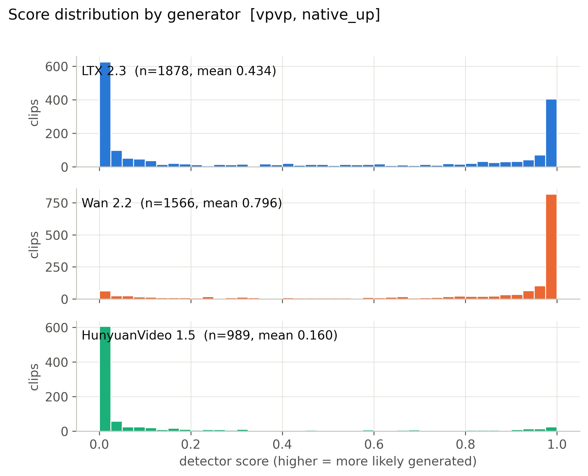

**Mean score, 56 cells x generator.** (`figures/heatmap_mean_score_cells.pdf`)

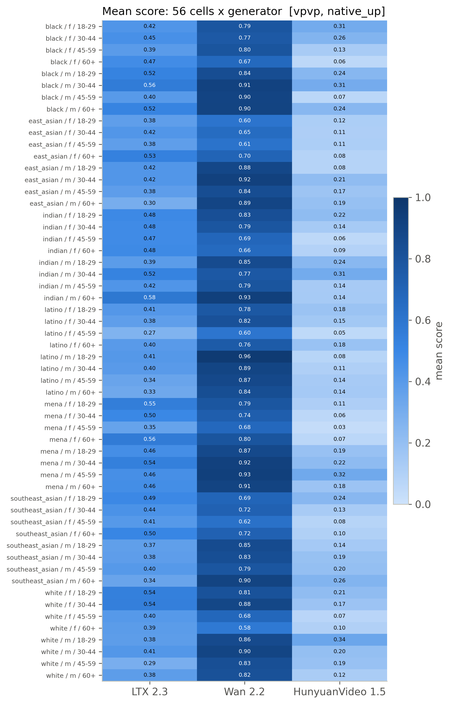

**Detection rate, 56 cells x generator (provisional threshold).** (`figures/heatmap_detection_rate_cells_provisional.pdf`)

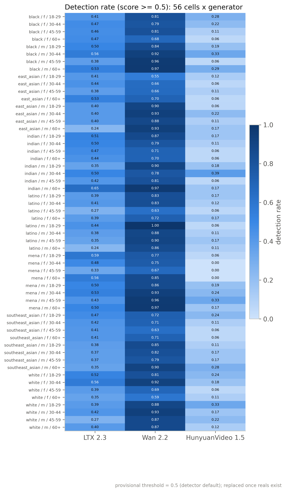

**Mean score by race, gender, age band with 95% CI.** (`figures/subgroup_mean_score.pdf`)

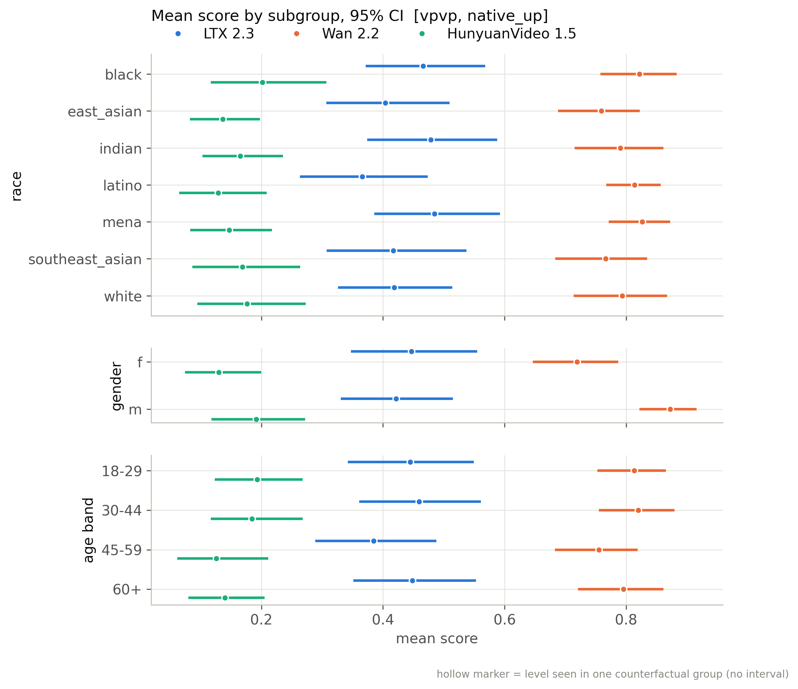

**Mean score by scene factor with 95% CI.** (`figures/scene_factor_mean_score.pdf`)

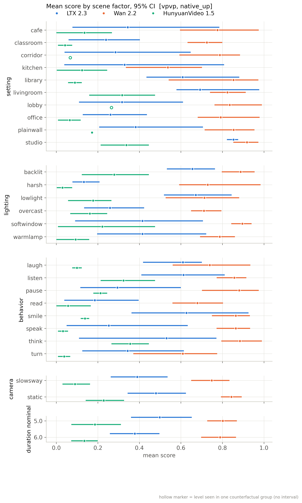

**Detection rate by subgroup (provisional threshold).** (`figures/subgroup_detection_rate_provisional.pdf`)

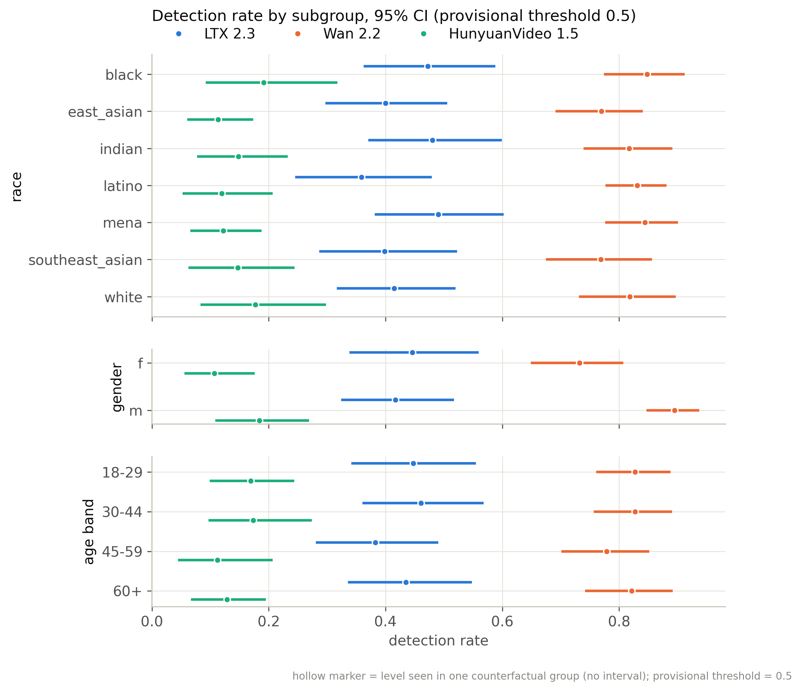

**Distribution of per-group CF spread.** (`figures/cf_spread_distribution.pdf`)

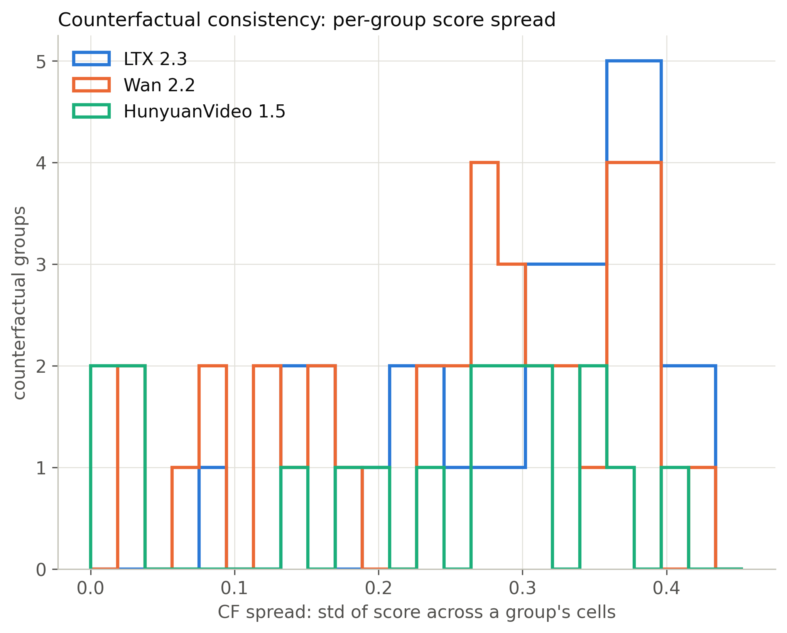

**Flip rate by generator (provisional threshold).** (`figures/flip_rate_by_generator_provisional.pdf`)

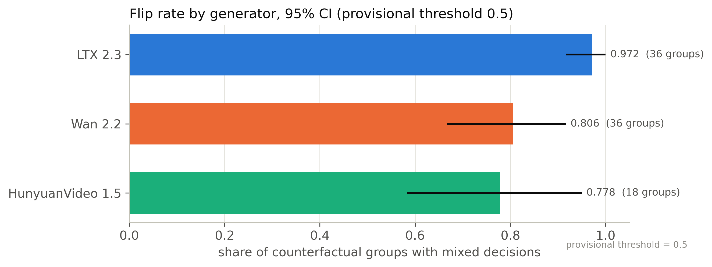

**Partial eta squared by factor.** (`figures/factor_attribution_variance_share.pdf`)

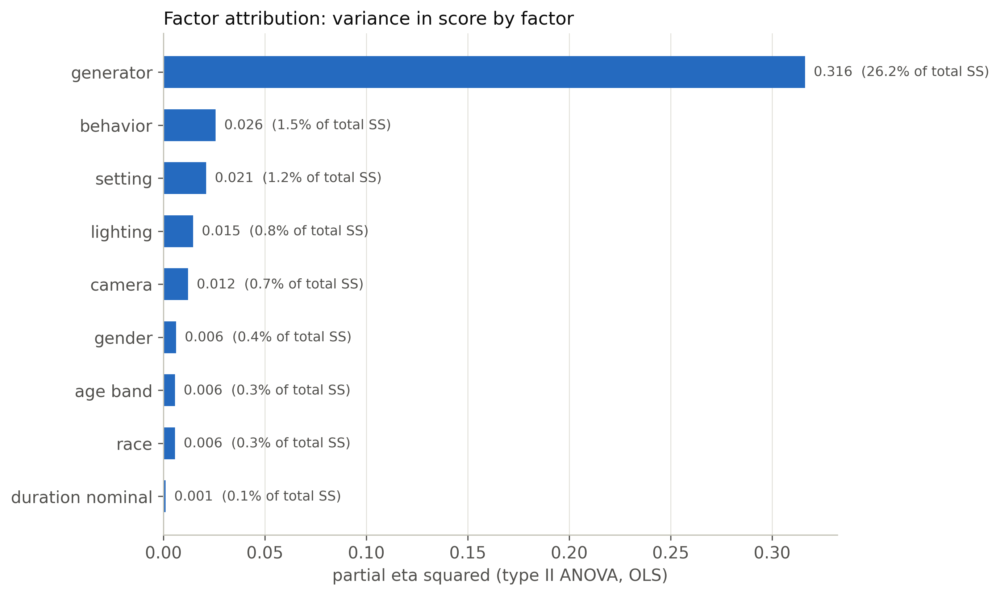

**Highest- and lowest-scoring included clips.** (`figures/example_strip.pdf`)

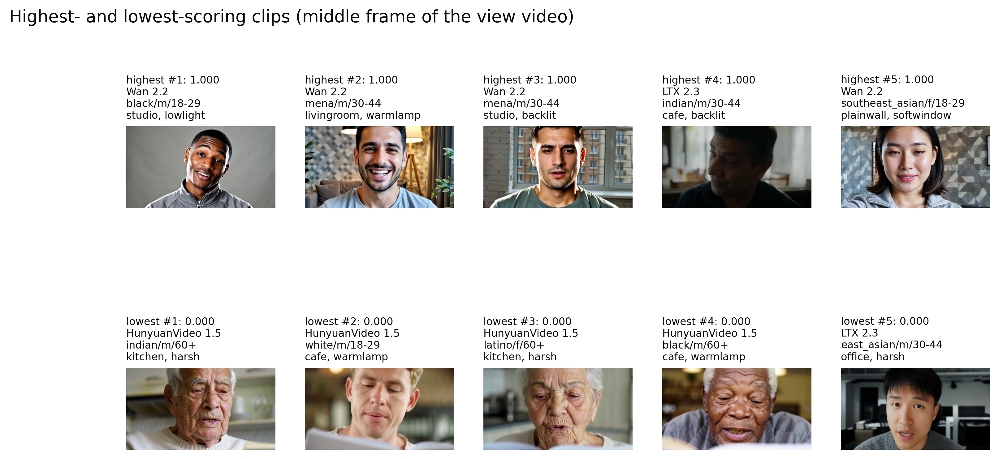

**ROC per generator against fps-matched reals.** (`figures/roc_per_generator.pdf`)

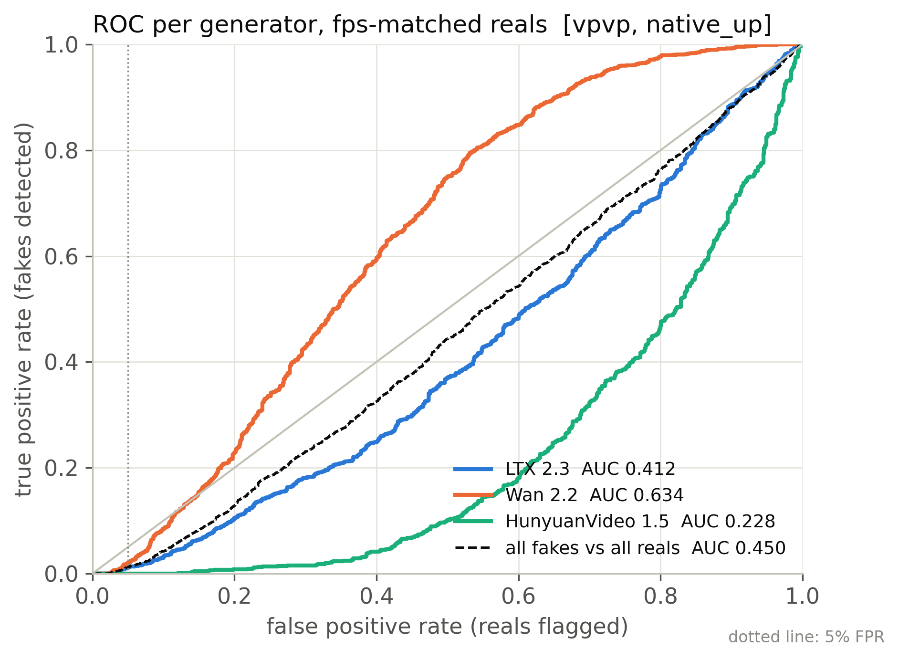

**Real FPR by perceived subgroup at the calibrated threshold.** (`figures/real_fpr_by_subgroup.pdf`)

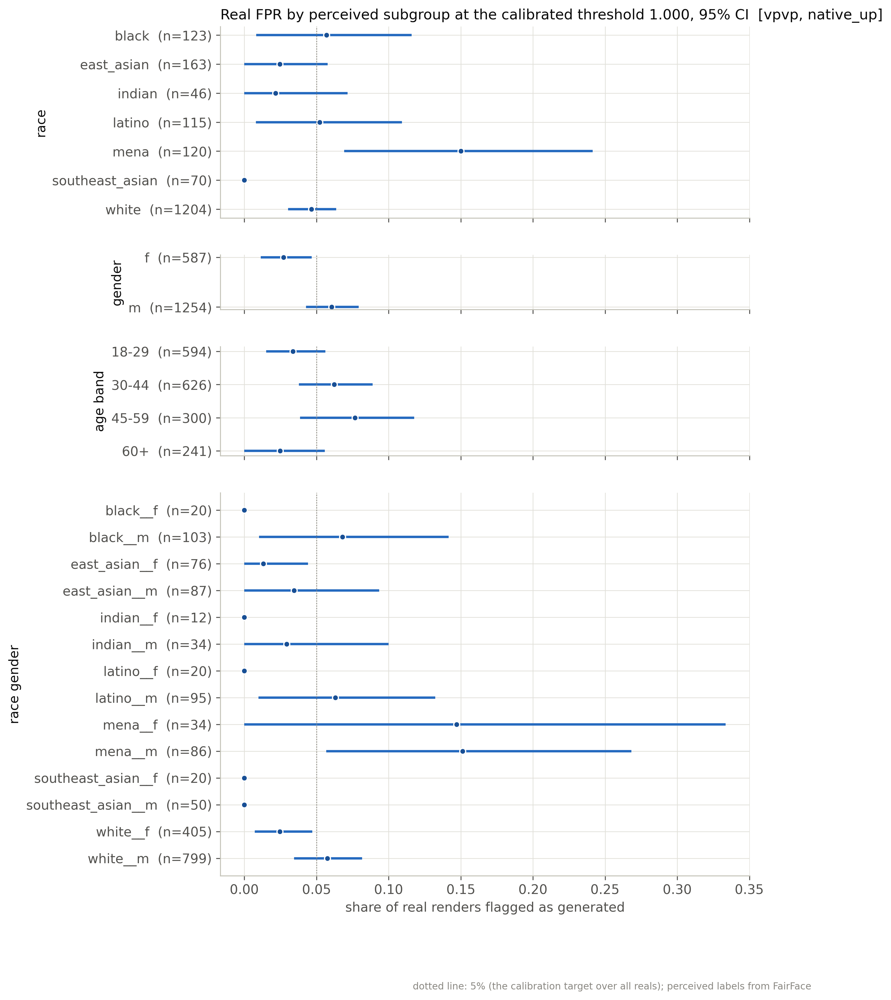

**AUC by subgroup: each subgroup's fakes vs same-subgroup reals.** (`figures/subgroup_auc.pdf`)

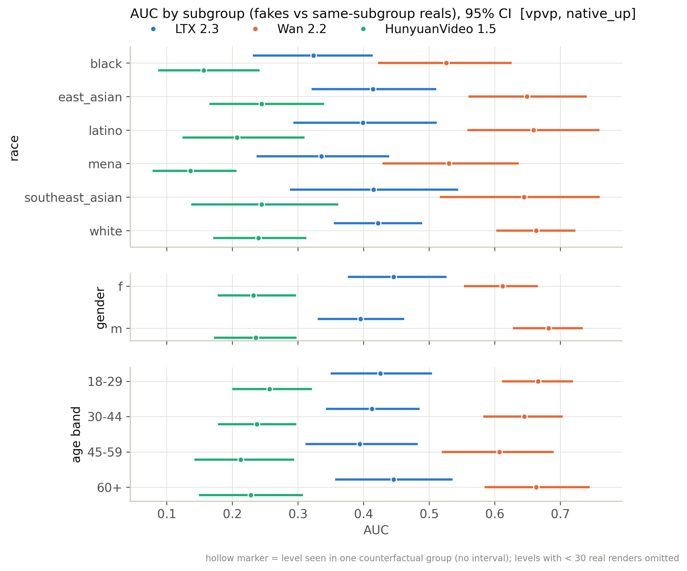

## Files

`manifest_used.csv` (every clip of the active batches with render/score/inclusion flags), `scores.csv` (score per scored clip), `tables/*.csv`, `figures/*`, `snapshot_meta.json`.

