# vpvp / native_up_2s: snapshot 20261023-0248

> **Detector training data.** V-PVP head trained by the authors on AIGVDBench Real + Open-Sora + CogVideoX1.5 + EasyAnimate with a frozen Kinetics-400 VideoMAE-B/16; none of our generators is in its training set.

> **Provisional threshold.** Every detection rate and flip rate below uses the detector's default threshold (0.5; official: sigmoid(logit) > 0.5 (eval_opensource.py --threshold default)). They will be replaced by the 5%-real-FPR threshold once reals exist (section 6.3).

## Settings

| setting           | value                                                                                  |
|:------------------|:---------------------------------------------------------------------------------------|
| detector          | vpvp 1+c6ec2331                                                                        |
| checkpoint_sha256 | 33581d50452bcf19373a3e5db1204e44b456cb216ac21a3b889ee6970ba6f93b                       |
| view              | native_up_2s (view_hash f48f13e3eb9c049d)                                              |
| ffmpeg            | ffmpeg version 7.1.1 Copyright (c) 2000-2025 the FFmpeg developers                     |
| batches           | fake_b1, fake_b2, fake_b3, real_all                                                    |
| inclusion set     | primary (technical QC pass AND face QC pass)                                           |
| bootstrap         | 1000 resamples of whole counterfactual groups, seed 20261020, 95% percentile intervals |
| git commit        | 2949de581861-dirty                                                                     |
| created           | 2026-10-23T02:48:43Z                                                                   |

Detector preprocessing on top of the view:

| field       | value                                                                                                                                                |
|:------------|:-----------------------------------------------------------------------------------------------------------------------------------------------------|
| source      | manic-cui/Rethinking-the-readout@6ca3b1195c4b842c593638055bbcc9c8eaa6781d src/dataset.py + eval_opensource.py; AIGVDBench section 7 frame extraction |
| extraction  | 32 of the first 128 frames, np.linspace(0, n-1, 32); centre square; 256x256 PIL bilinear                                                             |
| frames_used | np.linspace(0, 31, 16, dtype=int) of the 32                                                                                                          |
| resize      | [224, 224, 'PIL BICUBIC']                                                                                                                            |
| normalize   | {'mean': [0.485, 0.456, 0.406], 'std': [0.229, 0.224, 0.225]}                                                                                        |
| backbone    | MCG-NJU/videomae-base-finetuned-kinetics@488eb9a0565f257b32866000305c8178965eb9f6, frozen, last block, fp16 autocast                                 |
| head        | PVPHead('velocity_gated', D=768), videomae_k400_vpvp.pt (sha 33581d50452b), fp32                                                                     |
| score       | sigmoid(logit) in float64                                                                                                                            |

## Coverage

| batch    | generator   |   clips |   primary |   rendered |   view_excluded |   render_failed |   scored |   score_failed |   included |
|:---------|:------------|--------:|----------:|-----------:|----------------:|----------------:|---------:|---------------:|-----------:|
| fake_b1  | hunyuan15   |     504 |       492 |        504 |               0 |               0 |      504 |              0 |        492 |
| fake_b1  | ltx23       |    2016 |      1878 |       2016 |               0 |               0 |     2016 |              0 |       1878 |
| fake_b1  | wan22       |    2016 |      1566 |       2016 |               0 |               0 |     2016 |              0 |       1566 |
| fake_b2  | hunyuan15   |     504 |       497 |        504 |               0 |               0 |      504 |              0 |        497 |
| fake_b3  | ltx25       |    2016 |      2002 |       2016 |               0 |               0 |     2016 |              0 |       2002 |
| real_all | real        |    2221 |      2221 |       2221 |               0 |               0 |     2221 |              0 |       2221 |

Reals scored: 4442. Fakes included: 6435 of 11498 scored (0 scoring failures).

## Observations

- LTX 2.3: mean score 0.840 [0.773, 0.903], median 0.998, n = 1878.
- Wan 2.2: mean score 0.976 [0.962, 0.987], median 1.000, n = 1566.
- HunyuanVideo 1.5: mean score 0.647 [0.530, 0.760], median 0.887, n = 989.
- LTX 2.5: mean score 0.619 [0.539, 0.711], median 0.847, n = 2002.
- Provisional detection rate (score >= 0.5), LTX 2.3: 85.1% [77.7, 91.8].
- Provisional detection rate (score >= 0.5), Wan 2.2: 98.5% [97.3, 99.5].
- Provisional detection rate (score >= 0.5), HunyuanVideo 1.5: 65.6% [52.8, 77.8].
- Provisional detection rate (score >= 0.5), LTX 2.5: 62.5% [54.1, 72.2].
- Provisional detection rate (score >= 0.5), all: 78.3% [72.1, 84.4].
- Largest race score gap: LTX 2.5 0.131 [0.079, 0.204] (black 0.700 vs white 0.570).
- Largest gender score gap: LTX 2.5 0.052 [0.005, 0.103] (m 0.644 vs f 0.593).
- Largest age band score gap: HunyuanVideo 1.5 0.197 [0.136, 0.287] (18-29 0.742 vs 60+ 0.545).
- Largest cell score gap: HunyuanVideo 1.5 0.486 [0.439, 0.733] (black__f__30-44 0.892 vs white__f__60+ 0.407).
- Largest scene-factor gap (all generators): lighting 0.345 [0.206, 0.503] (lowlight vs harsh).
- Largest partial eta squared: generator 0.197, behavior 0.089, lighting 0.061; residual holds 61.5% of total SS.
- CF spread, LTX 2.3: 0.194 [0.146, 0.234] over 36 groups (max 0.428).
- CF spread, Wan 2.2: 0.064 [0.038, 0.092] over 36 groups (max 0.297).
- CF spread, HunyuanVideo 1.5: 0.302 [0.262, 0.339] over 18 groups (max 0.423).
- CF spread, LTX 2.5: 0.296 [0.263, 0.326] over 36 groups (max 0.408).
- Provisional flip rate, LTX 2.3: 69.4% of 36 groups [52.8, 83.3].
- Provisional flip rate, Wan 2.2: 22.2% of 36 groups [8.3, 36.1].
- Provisional flip rate, HunyuanVideo 1.5: 100.0% of 18 groups [100.0, 100.0].
- Provisional flip rate, LTX 2.5: 94.4% of 36 groups [86.1, 100.0].

## 6.1 Fakes only, no threshold

### Mean score by generator

| generator   |    n |   n_groups |   estimate |   ci_lo |   ci_hi |    sd |   median |   q05 |   q95 |
|:------------|-----:|-----------:|-----------:|--------:|--------:|------:|---------:|------:|------:|
| ltx23       | 1878 |         36 |      0.84  |   0.773 |   0.903 | 0.308 |    0.998 | 0.036 |     1 |
| wan22       | 1566 |         36 |      0.976 |   0.962 |   0.987 | 0.108 |    1     | 0.9   |     1 |
| hunyuan15   |  989 |         18 |      0.647 |   0.53  |   0.76  | 0.402 |    0.887 | 0.003 |     1 |
| ltx25       | 2002 |         36 |      0.619 |   0.539 |   0.711 | 0.411 |    0.847 | 0.002 |     1 |
| all         | 6435 |         36 |      0.774 |   0.716 |   0.833 | 0.359 |    0.994 | 0.007 |     1 |

### Mean score by race

| generator   | level           |   n |   estimate |   ci_lo |   ci_hi |   median |
|:------------|:----------------|----:|-----------:|--------:|--------:|---------:|
| ltx23       | black           | 273 |      0.85  |   0.771 |   0.921 |    0.999 |
| ltx23       | east_asian      | 270 |      0.825 |   0.76  |   0.888 |    0.997 |
| ltx23       | indian          | 277 |      0.871 |   0.8   |   0.931 |    0.998 |
| ltx23       | latino          | 262 |      0.816 |   0.733 |   0.892 |    0.996 |
| ltx23       | mena            | 267 |      0.867 |   0.798 |   0.929 |    0.999 |
| ltx23       | southeast_asian | 271 |      0.817 |   0.74  |   0.889 |    0.999 |
| ltx23       | white           | 258 |      0.832 |   0.754 |   0.902 |    0.998 |
| wan22       | black           | 217 |      0.982 |   0.97  |   0.993 |    1     |
| wan22       | east_asian      | 226 |      0.964 |   0.936 |   0.987 |    1     |
| wan22       | indian          | 230 |      0.971 |   0.944 |   0.992 |    1     |
| wan22       | latino          | 219 |      0.984 |   0.971 |   0.993 |    1     |
| wan22       | mena            | 225 |      0.987 |   0.976 |   0.995 |    1     |
| wan22       | southeast_asian | 229 |      0.974 |   0.957 |   0.989 |    1     |
| wan22       | white           | 220 |      0.967 |   0.945 |   0.987 |    1     |
| hunyuan15   | black           | 141 |      0.71  |   0.599 |   0.807 |    0.944 |
| hunyuan15   | east_asian      | 141 |      0.67  |   0.559 |   0.789 |    0.877 |
| hunyuan15   | indian          | 142 |      0.648 |   0.523 |   0.775 |    0.908 |
| hunyuan15   | latino          | 142 |      0.641 |   0.505 |   0.769 |    0.878 |
| hunyuan15   | mena            | 139 |      0.653 |   0.529 |   0.763 |    0.896 |
| hunyuan15   | southeast_asian | 143 |      0.622 |   0.478 |   0.758 |    0.855 |
| hunyuan15   | white           | 141 |      0.584 |   0.449 |   0.71  |    0.849 |
| ltx25       | black           | 287 |      0.7   |   0.623 |   0.784 |    0.949 |
| ltx25       | east_asian      | 286 |      0.574 |   0.478 |   0.677 |    0.768 |
| ltx25       | indian          | 284 |      0.622 |   0.529 |   0.72  |    0.821 |
| ltx25       | latino          | 286 |      0.622 |   0.526 |   0.722 |    0.862 |
| ltx25       | mena            | 286 |      0.653 |   0.57  |   0.739 |    0.917 |
| ltx25       | southeast_asian | 286 |      0.59  |   0.501 |   0.689 |    0.803 |
| ltx25       | white           | 287 |      0.57  |   0.476 |   0.676 |    0.739 |
| all         | black           | 918 |      0.813 |   0.756 |   0.867 |    0.997 |
| all         | east_asian      | 923 |      0.758 |   0.701 |   0.819 |    0.992 |
| all         | indian          | 933 |      0.786 |   0.728 |   0.845 |    0.994 |
| all         | latino          | 909 |      0.768 |   0.701 |   0.832 |    0.991 |
| all         | mena            | 917 |      0.797 |   0.744 |   0.848 |    0.996 |
| all         | southeast_asian | 929 |      0.756 |   0.691 |   0.819 |    0.991 |
| all         | white           | 906 |      0.743 |   0.677 |   0.81  |    0.988 |

### Mean score by gender

| generator   | level   |    n |   estimate |   ci_lo |   ci_hi |   median |
|:------------|:--------|-----:|-----------:|--------:|--------:|---------:|
| ltx23       | f       |  931 |      0.848 |   0.775 |   0.911 |    0.998 |
| ltx23       | m       |  947 |      0.831 |   0.76  |   0.901 |    0.998 |
| wan22       | f       |  785 |      0.966 |   0.948 |   0.981 |    1     |
| wan22       | m       |  781 |      0.985 |   0.97  |   0.996 |    1     |
| hunyuan15   | f       |  495 |      0.627 |   0.505 |   0.737 |    0.844 |
| hunyuan15   | m       |  494 |      0.667 |   0.539 |   0.789 |    0.905 |
| ltx25       | f       |  999 |      0.593 |   0.502 |   0.691 |    0.796 |
| ltx25       | m       | 1003 |      0.644 |   0.565 |   0.737 |    0.882 |
| all         | f       | 3210 |      0.763 |   0.701 |   0.822 |    0.991 |
| all         | m       | 3225 |      0.785 |   0.726 |   0.845 |    0.996 |

### Mean score by age band

| generator   | level   |    n |   estimate |   ci_lo |   ci_hi |   median |
|:------------|:--------|-----:|-----------:|--------:|--------:|---------:|
| ltx23       | 18-29   |  469 |      0.872 |   0.821 |   0.924 |    0.999 |
| ltx23       | 30-44   |  471 |      0.847 |   0.775 |   0.912 |    0.999 |
| ltx23       | 45-59   |  478 |      0.816 |   0.733 |   0.892 |    0.996 |
| ltx23       | 60+     |  460 |      0.825 |   0.736 |   0.903 |    0.997 |
| wan22       | 18-29   |  388 |      0.983 |   0.967 |   0.995 |    1     |
| wan22       | 30-44   |  377 |      0.986 |   0.975 |   0.995 |    1     |
| wan22       | 45-59   |  398 |      0.969 |   0.949 |   0.986 |    1     |
| wan22       | 60+     |  403 |      0.965 |   0.947 |   0.981 |    1     |
| hunyuan15   | 18-29   |  242 |      0.742 |   0.639 |   0.847 |    0.978 |
| hunyuan15   | 30-44   |  248 |      0.721 |   0.593 |   0.837 |    0.963 |
| hunyuan15   | 45-59   |  250 |      0.582 |   0.454 |   0.71  |    0.77  |
| hunyuan15   | 60+     |  249 |      0.545 |   0.399 |   0.691 |    0.69  |
| ltx25       | 18-29   |  500 |      0.656 |   0.568 |   0.742 |    0.916 |
| ltx25       | 30-44   |  497 |      0.649 |   0.563 |   0.742 |    0.891 |
| ltx25       | 45-59   |  501 |      0.574 |   0.485 |   0.67  |    0.759 |
| ltx25       | 60+     |  504 |      0.596 |   0.506 |   0.698 |    0.79  |
| all         | 18-29   | 1599 |      0.812 |   0.764 |   0.86  |    0.998 |
| all         | 30-44   | 1593 |      0.799 |   0.741 |   0.856 |    0.997 |
| all         | 45-59   | 1627 |      0.743 |   0.678 |   0.808 |    0.986 |
| all         | 60+     | 1616 |      0.745 |   0.676 |   0.812 |    0.986 |

### Mean score by scene factor (all generators pooled)

| factor           | level      |    n |   estimate |   ci_lo |   ci_hi |
|:-----------------|:-----------|-----:|-----------:|--------:|--------:|
| setting          | cafe       |  593 |      0.687 |   0.384 |   0.925 |
| setting          | classroom  |  541 |      0.61  |   0.515 |   0.786 |
| setting          | corridor   |  716 |      0.723 |   0.572 |   0.901 |
| setting          | kitchen    |  605 |      0.647 |   0.383 |   0.829 |
| setting          | library    |  757 |      0.855 |   0.842 |   0.885 |
| setting          | livingroom |  754 |      0.857 |   0.771 |   0.941 |
| setting          | lobby      |  513 |      0.792 |   0.636 |   0.959 |
| setting          | office     |  580 |      0.655 |   0.382 |   0.985 |
| setting          | plainwall  |  777 |      0.893 |   0.771 |   0.977 |
| setting          | studio     |  599 |      0.94  |   0.904 |   0.989 |
| lighting         | backlit    | 1126 |      0.863 |   0.806 |   0.907 |
| lighting         | harsh      |  967 |      0.554 |   0.423 |   0.728 |
| lighting         | lowlight   | 1116 |      0.899 |   0.832 |   0.956 |
| lighting         | overcast   | 1022 |      0.791 |   0.673 |   0.896 |
| lighting         | softwindow | 1157 |      0.778 |   0.595 |   0.925 |
| lighting         | warmlamp   | 1047 |      0.729 |   0.556 |   0.872 |
| behavior         | laugh      |  723 |      0.792 |   0.602 |   0.901 |
| behavior         | listen     |  960 |      0.889 |   0.839 |   0.93  |
| behavior         | pause      |  744 |      0.845 |   0.771 |   0.917 |
| behavior         | read       |  796 |      0.649 |   0.383 |   0.977 |
| behavior         | smile      |  817 |      0.895 |   0.804 |   0.985 |
| behavior         | speak      |  806 |      0.64  |   0.531 |   0.794 |
| behavior         | think      |  733 |      0.849 |   0.73  |   0.959 |
| behavior         | turn       |  856 |      0.634 |   0.477 |   0.761 |
| camera           | slowsway   | 3224 |      0.709 |   0.613 |   0.812 |
| camera           | static     | 3211 |      0.84  |   0.791 |   0.885 |
| duration_nominal | 5.0        | 3226 |      0.77  |   0.681 |   0.853 |
| duration_nominal | 6.0        | 3209 |      0.778 |   0.692 |   0.849 |

Per-generator scene-factor and 56-cell rows: `tables/score_by_breakdown.csv`.

### Subgroup gap (max - min of level means)

A gap is max - min, so it is never negative and its interval cannot include 0; it is a size, not a test of a difference. Over many levels with few clips each (56 cells; HunyuanVideo has 9 groups per cell) the gap also grows with noise, so compare it with the per-level intervals in `tables/score_by_breakdown.csv`. Levels seen in a single counterfactual group have no interval.

| generator   | attribute        |   n_levels |   gap |   ci_lo |   ci_hi | max_level            | min_level            |
|:------------|:-----------------|-----------:|------:|--------:|--------:|:---------------------|:---------------------|
| ltx23       | race             |          7 | 0.055 |   0.038 |   0.103 | indian               | latino               |
| ltx23       | gender           |          2 | 0.017 |   0.001 |   0.05  | f                    | m                    |
| ltx23       | age_band         |          4 | 0.056 |   0.018 |   0.116 | 18-29                | 45-59                |
| ltx23       | cell             |         56 | 0.221 |   0.194 |   0.379 | east_asian__f__18-29 | black__m__45-59      |
| ltx23       | setting          |         10 | 0.332 |   0.271 |   0.692 | studio               | corridor             |
| ltx23       | lighting         |          6 | 0.336 |   0.209 |   0.578 | lowlight             | harsh                |
| ltx23       | behavior         |          8 | 0.315 |   0.224 |   0.677 | smile                | read                 |
| ltx23       | camera           |          2 | 0.082 |   0.004 |   0.222 | static               | slowsway             |
| ltx23       | duration_nominal |          2 | 0.05  |   0.003 |   0.191 | 5.0                  | 6.0                  |
| wan22       | race             |          7 | 0.024 |   0.012 |   0.051 | mena                 | east_asian           |
| wan22       | gender           |          2 | 0.019 |   0.003 |   0.036 | m                    | f                    |
| wan22       | age_band         |          4 | 0.022 |   0.012 |   0.039 | 30-44                | 60+                  |
| wan22       | cell             |         56 | 0.119 |   0.073 |   0.219 | white__m__30-44      | east_asian__f__60+   |
| wan22       | setting          |         10 | 0.082 |   0.04  |   0.162 | livingroom           | office               |
| wan22       | lighting         |          6 | 0.05  |   0.028 |   0.104 | softwindow           | harsh                |
| wan22       | behavior         |          8 | 0.065 |   0.047 |   0.128 | smile                | read                 |
| wan22       | camera           |          2 | 0.027 |   0.005 |   0.051 | static               | slowsway             |
| wan22       | duration_nominal |          2 | 0.011 |   0.001 |   0.035 | 5.0                  | 6.0                  |
| hunyuan15   | race             |          7 | 0.126 |   0.064 |   0.211 | black                | white                |
| hunyuan15   | gender           |          2 | 0.04  |   0.002 |   0.115 | m                    | f                    |
| hunyuan15   | age_band         |          4 | 0.197 |   0.136 |   0.287 | 18-29                | 60+                  |
| hunyuan15   | cell             |         56 | 0.486 |   0.439 |   0.733 | black__f__30-44      | white__f__60+        |
| hunyuan15   | setting          |         10 | 0.521 |   0.412 |   0.819 | lobby                | office               |
| hunyuan15   | lighting         |          6 | 0.563 |   0.301 |   0.796 | lowlight             | harsh                |
| hunyuan15   | behavior         |          8 | 0.572 |   0.371 |   0.807 | think                | turn                 |
| hunyuan15   | camera           |          2 | 0.27  |   0.054 |   0.469 | static               | slowsway             |
| hunyuan15   | duration_nominal |          2 | 0.026 |   0.004 |   0.284 | 6.0                  | 5.0                  |
| ltx25       | race             |          7 | 0.131 |   0.079 |   0.204 | black                | white                |
| ltx25       | gender           |          2 | 0.052 |   0.005 |   0.103 | m                    | f                    |
| ltx25       | age_band         |          4 | 0.082 |   0.041 |   0.143 | 18-29                | 45-59                |
| ltx25       | cell             |         56 | 0.392 |   0.333 |   0.578 | mena__m__45-59       | east_asian__f__45-59 |
| ltx25       | setting          |         10 | 0.515 |   0.398 |   0.908 | studio               | classroom            |
| ltx25       | lighting         |          6 | 0.377 |   0.225 |   0.681 | lowlight             | harsh                |
| ltx25       | behavior         |          8 | 0.411 |   0.315 |   0.797 | smile                | speak                |
| ltx25       | camera           |          2 | 0.194 |   0.034 |   0.353 | static               | slowsway             |
| ltx25       | duration_nominal |          2 | 0.088 |   0.004 |   0.247 | 6.0                  | 5.0                  |
| all         | race             |          7 | 0.07  |   0.046 |   0.097 | black                | white                |
| all         | gender           |          2 | 0.022 |   0.002 |   0.045 | m                    | f                    |
| all         | age_band         |          4 | 0.069 |   0.045 |   0.106 | 18-29                | 45-59                |
| all         | cell             |         56 | 0.218 |   0.189 |   0.316 | black__f__30-44      | latino__f__45-59     |
| all         | setting          |         10 | 0.331 |   0.265 |   0.591 | studio               | classroom            |
| all         | lighting         |          6 | 0.345 |   0.206 |   0.503 | lowlight             | harsh                |
| all         | behavior         |          8 | 0.261 |   0.228 |   0.557 | smile                | turn                 |
| all         | camera           |          2 | 0.13  |   0.019 |   0.232 | static               | slowsway             |
| all         | duration_nominal |          2 | 0.008 |   0.001 |   0.127 | 6.0                  | 5.0                  |

### CF spread (mean over groups of the std of score across the group's cells)

| generator   |   n_groups |   cf_spread |   ci_lo |   ci_hi |   median |   max |
|:------------|-----------:|------------:|--------:|--------:|---------:|------:|
| ltx23       |         36 |       0.194 |   0.146 |   0.234 |    0.187 | 0.428 |
| wan22       |         36 |       0.064 |   0.038 |   0.092 |    0.015 | 0.297 |
| hunyuan15   |         18 |       0.302 |   0.262 |   0.339 |    0.33  | 0.423 |
| ltx25       |         36 |       0.296 |   0.263 |   0.326 |    0.331 | 0.408 |

### Factor attribution

OLS with every factor as a fixed effect, type-II ANOVA. `ss_share` is the factor's type-II sum of squares over the total sum of squares (type-II shares need not add to 1). Scene factors are constant within a counterfactual group, so their effects are estimated from between-group differences only. The OLS F tests treat clips as independent although clips are clustered in counterfactual groups, so their p values are optimistic; use the group-bootstrap intervals above for inference.

| factor           |   df |   sum_sq | F     | p          | partial_eta2   |   ss_share |
|:-----------------|-----:|---------:|:------|:-----------|:---------------|-----------:|
| race             |    6 |   3.461  | 7.23  | 1.041e-07  | 0.006735       |   0.004172 |
| gender           |    1 |   0.6504 | 8.153 | 0.004313   | 0.001273       |   0.000784 |
| age_band         |    3 |   6.217  | 25.98 | 1.067e-16  | 0.01204        |   0.007495 |
| setting          |    9 |  16.02   | 22.32 | 9.211e-38  | 0.03044        |   0.01931  |
| lighting         |    5 |  32.92   | 82.53 | 2.984e-84  | 0.06059        |   0.03968  |
| behavior         |    7 |  49.91   | 89.39 | 9.574e-125 | 0.08909        |   0.06017  |
| camera           |    1 |   9.65   | 121   | 6.864e-28  | 0.01856        |   0.01163  |
| duration_nominal |    1 |   0.6819 | 8.549 | 0.00347    | 0.001334       |   0.000822 |
| generator        |    3 | 125.5    | 524.3 | 1.122e-304 | 0.1973         |   0.1513   |
| Residual         | 6398 | 510.4    |       |            |                |   0.6152   |

Lighting x race interaction (added to the same OLS):

| term            |   df |   sum_sq |     F |      p |   partial_eta2 |
|:----------------|-----:|---------:|------:|-------:|---------------:|
| lighting x race |   30 |    3.051 | 1.277 | 0.1429 |       0.005979 |

Mixed model `score ~ factors + (1 | counterfactual_group)` (REML) variance components (fixed effects: `tables/factor_mixed_fixed.csv`):

| component                               |   variance | converged   |
|:----------------------------------------|-----------:|:------------|
| counterfactual_group (random intercept) |    0       | True        |
| residual                                |    0.07768 | True        |
| ICC (group share of random variance)    |    0       | True        |

A group variance at or near 0 is a boundary estimate: setting, lighting, behavior, camera and duration are fixed per group and absorb most between-group variation, leaving little for the random intercept. It does not mean scenes do not matter.

## 6.2 Provisional (threshold 0.5, provisional)

### Detection rate by generator (provisional)

| generator   |    n |   estimate |   ci_lo |   ci_hi |
|:------------|-----:|-----------:|--------:|--------:|
| ltx23       | 1878 |      0.851 |   0.777 |   0.918 |
| wan22       | 1566 |      0.985 |   0.973 |   0.995 |
| hunyuan15   |  989 |      0.656 |   0.528 |   0.778 |
| ltx25       | 2002 |      0.625 |   0.541 |   0.722 |
| all         | 6435 |      0.783 |   0.721 |   0.844 |

### Detection rate by race (provisional)

| generator   | level           |   n |   estimate |   ci_lo |   ci_hi |
|:------------|:----------------|----:|-----------:|--------:|--------:|
| ltx23       | black           | 273 |      0.853 |   0.772 |   0.929 |
| ltx23       | east_asian      | 270 |      0.841 |   0.776 |   0.9   |
| ltx23       | indian          | 277 |      0.884 |   0.812 |   0.949 |
| ltx23       | latino          | 262 |      0.828 |   0.735 |   0.911 |
| ltx23       | mena            | 267 |      0.876 |   0.797 |   0.947 |
| ltx23       | southeast_asian | 271 |      0.827 |   0.746 |   0.901 |
| ltx23       | white           | 258 |      0.845 |   0.767 |   0.918 |
| wan22       | black           | 217 |      0.991 |   0.977 |   1     |
| wan22       | east_asian      | 226 |      0.969 |   0.94  |   0.995 |
| wan22       | indian          | 230 |      0.987 |   0.963 |   1     |
| wan22       | latino          | 219 |      0.995 |   0.985 |   1     |
| wan22       | mena            | 225 |      0.996 |   0.985 |   1     |
| wan22       | southeast_asian | 229 |      0.983 |   0.961 |   1     |
| wan22       | white           | 220 |      0.977 |   0.954 |   0.996 |
| hunyuan15   | black           | 141 |      0.709 |   0.594 |   0.816 |
| hunyuan15   | east_asian      | 141 |      0.688 |   0.547 |   0.828 |
| hunyuan15   | indian          | 142 |      0.655 |   0.513 |   0.796 |
| hunyuan15   | latino          | 142 |      0.655 |   0.504 |   0.795 |
| hunyuan15   | mena            | 139 |      0.655 |   0.522 |   0.778 |
| hunyuan15   | southeast_asian | 143 |      0.636 |   0.473 |   0.786 |
| hunyuan15   | white           | 141 |      0.596 |   0.449 |   0.74  |
| ltx25       | black           | 287 |      0.707 |   0.62  |   0.795 |
| ltx25       | east_asian      | 286 |      0.577 |   0.472 |   0.688 |
| ltx25       | indian          | 284 |      0.637 |   0.538 |   0.743 |
| ltx25       | latino          | 286 |      0.622 |   0.517 |   0.732 |
| ltx25       | mena            | 286 |      0.664 |   0.575 |   0.76  |
| ltx25       | southeast_asian | 286 |      0.577 |   0.479 |   0.683 |
| ltx25       | white           | 287 |      0.589 |   0.484 |   0.708 |
| all         | black           | 918 |      0.818 |   0.761 |   0.875 |
| all         | east_asian      | 923 |      0.767 |   0.707 |   0.832 |
| all         | indian          | 933 |      0.8   |   0.738 |   0.86  |
| all         | latino          | 909 |      0.777 |   0.703 |   0.845 |
| all         | mena            | 917 |      0.806 |   0.75  |   0.859 |
| all         | southeast_asian | 929 |      0.759 |   0.687 |   0.829 |
| all         | white           | 906 |      0.757 |   0.687 |   0.829 |

### Detection rate by gender (provisional)

| generator   | level   |    n |   estimate |   ci_lo |   ci_hi |
|:------------|:--------|-----:|-----------:|--------:|--------:|
| ltx23       | f       |  931 |      0.863 |   0.784 |   0.929 |
| ltx23       | m       |  947 |      0.839 |   0.766 |   0.911 |
| wan22       | f       |  785 |      0.977 |   0.959 |   0.993 |
| wan22       | m       |  781 |      0.994 |   0.983 |   1     |
| hunyuan15   | f       |  495 |      0.634 |   0.504 |   0.76  |
| hunyuan15   | m       |  494 |      0.678 |   0.542 |   0.813 |
| ltx25       | f       |  999 |      0.598 |   0.501 |   0.701 |
| ltx25       | m       | 1003 |      0.652 |   0.565 |   0.754 |
| all         | f       | 3210 |      0.773 |   0.708 |   0.835 |
| all         | m       | 3225 |      0.794 |   0.732 |   0.857 |

### Detection rate by age band (provisional)

| generator   | level   |    n |   estimate |   ci_lo |   ci_hi |
|:------------|:--------|-----:|-----------:|--------:|--------:|
| ltx23       | 18-29   |  469 |      0.885 |   0.833 |   0.937 |
| ltx23       | 30-44   |  471 |      0.858 |   0.784 |   0.926 |
| ltx23       | 45-59   |  478 |      0.826 |   0.738 |   0.91  |
| ltx23       | 60+     |  460 |      0.835 |   0.734 |   0.92  |
| wan22       | 18-29   |  388 |      0.987 |   0.971 |   1     |
| wan22       | 30-44   |  377 |      0.992 |   0.978 |   1     |
| wan22       | 45-59   |  398 |      0.987 |   0.973 |   0.998 |
| wan22       | 60+     |  403 |      0.975 |   0.957 |   0.992 |
| hunyuan15   | 18-29   |  242 |      0.736 |   0.613 |   0.852 |
| hunyuan15   | 30-44   |  248 |      0.746 |   0.601 |   0.879 |
| hunyuan15   | 45-59   |  250 |      0.592 |   0.451 |   0.733 |
| hunyuan15   | 60+     |  249 |      0.554 |   0.389 |   0.713 |
| ltx25       | 18-29   |  500 |      0.656 |   0.562 |   0.754 |
| ltx25       | 30-44   |  497 |      0.662 |   0.569 |   0.76  |
| ltx25       | 45-59   |  501 |      0.577 |   0.48  |   0.683 |
| ltx25       | 60+     |  504 |      0.605 |   0.5   |   0.716 |
| all         | 18-29   | 1599 |      0.816 |   0.764 |   0.868 |
| all         | 30-44   | 1593 |      0.811 |   0.749 |   0.871 |
| all         | 45-59   | 1627 |      0.753 |   0.686 |   0.821 |
| all         | 60+     | 1616 |      0.755 |   0.679 |   0.828 |

### Detection-rate gap (provisional)

| generator   | attribute        |   gap |   ci_lo |   ci_hi | max_level            | min_level            |
|:------------|:-----------------|------:|--------:|--------:|:---------------------|:---------------------|
| ltx23       | race             | 0.058 |   0.037 |   0.112 | indian               | southeast_asian      |
| ltx23       | gender           | 0.023 |   0.001 |   0.058 | f                    | m                    |
| ltx23       | age_band         | 0.059 |   0.022 |   0.13  | 18-29                | 45-59                |
| ltx23       | cell             | 0.263 |   0.226 |   0.455 | east_asian__f__18-29 | black__m__45-59      |
| ltx23       | setting          | 0.344 |   0.262 |   0.714 | studio               | corridor             |
| ltx23       | lighting         | 0.316 |   0.193 |   0.597 | lowlight             | harsh                |
| ltx23       | behavior         | 0.324 |   0.221 |   0.7   | smile                | read                 |
| ltx23       | camera           | 0.077 |   0.004 |   0.225 | static               | slowsway             |
| ltx23       | duration_nominal | 0.049 |   0.004 |   0.192 | 5.0                  | 6.0                  |
| wan22       | race             | 0.027 |   0.009 |   0.058 | mena                 | east_asian           |
| wan22       | gender           | 0.017 |   0.002 |   0.033 | m                    | f                    |
| wan22       | age_band         | 0.017 |   0.005 |   0.036 | 30-44                | 60+                  |
| wan22       | cell             | 0.111 |   0.069 |   0.24  | black__f__18-29      | east_asian__f__60+   |
| wan22       | setting          | 0.1   |   0.022 |   0.2   | cafe                 | office               |
| wan22       | lighting         | 0.056 |   0.022 |   0.113 | softwindow           | harsh                |
| wan22       | behavior         | 0.045 |   0.019 |   0.118 | pause                | turn                 |
| wan22       | camera           | 0.024 |   0.005 |   0.046 | static               | slowsway             |
| wan22       | duration_nominal | 0.001 |   0     |   0.026 | 5.0                  | 6.0                  |
| hunyuan15   | race             | 0.113 |   0.06  |   0.209 | black                | white                |
| hunyuan15   | gender           | 0.044 |   0.002 |   0.122 | m                    | f                    |
| hunyuan15   | age_band         | 0.192 |   0.125 |   0.308 | 30-44                | 60+                  |
| hunyuan15   | cell             | 0.5   |   0.493 |   0.818 | black__f__30-44      | black__f__60+        |
| hunyuan15   | setting          | 0.593 |   0.446 |   0.909 | lobby                | office               |
| hunyuan15   | lighting         | 0.62  |   0.325 |   0.882 | lowlight             | harsh                |
| hunyuan15   | behavior         | 0.614 |   0.377 |   0.892 | think                | read                 |
| hunyuan15   | camera           | 0.28  |   0.05  |   0.509 | static               | slowsway             |
| hunyuan15   | duration_nominal | 0.022 |   0.003 |   0.315 | 6.0                  | 5.0                  |
| ltx25       | race             | 0.13  |   0.081 |   0.213 | black                | east_asian           |
| ltx25       | gender           | 0.054 |   0.003 |   0.111 | m                    | f                    |
| ltx25       | age_band         | 0.085 |   0.042 |   0.156 | 30-44                | 45-59                |
| ltx25       | cell             | 0.444 |   0.389 |   0.667 | black__m__18-29      | east_asian__f__45-59 |
| ltx25       | setting          | 0.548 |   0.42  |   0.928 | studio               | classroom            |
| ltx25       | lighting         | 0.416 |   0.258 |   0.729 | lowlight             | harsh                |
| ltx25       | behavior         | 0.444 |   0.34  |   0.832 | smile                | speak                |
| ltx25       | camera           | 0.216 |   0.042 |   0.387 | static               | slowsway             |
| ltx25       | duration_nominal | 0.102 |   0.004 |   0.273 | 6.0                  | 5.0                  |
| all         | race             | 0.061 |   0.041 |   0.097 | black                | white                |
| all         | gender           | 0.021 |   0.002 |   0.046 | m                    | f                    |
| all         | age_band         | 0.063 |   0.043 |   0.105 | 18-29                | 45-59                |
| all         | cell             | 0.213 |   0.197 |   0.331 | black__f__30-44      | mena__f__45-59       |
| all         | setting          | 0.329 |   0.269 |   0.618 | studio               | classroom            |
| all         | lighting         | 0.364 |   0.213 |   0.532 | lowlight             | harsh                |
| all         | behavior         | 0.263 |   0.233 |   0.585 | smile                | turn                 |
| all         | camera           | 0.136 |   0.02  |   0.245 | static               | slowsway             |
| all         | duration_nominal | 0.014 |   0.002 |   0.139 | 6.0                  | 5.0                  |

### Flip rate (provisional): share of groups whose clips get different decisions

| generator   |   n_groups |   flip_rate |   ci_lo |   ci_hi |   median |   max |
|:------------|-----------:|------------:|--------:|--------:|---------:|------:|
| ltx23       |         36 |       0.694 |   0.528 |   0.833 |        1 |     1 |
| wan22       |         36 |       0.222 |   0.083 |   0.361 |        0 |     1 |
| hunyuan15   |         18 |       1     |   1     |   1     |        1 |     1 |
| ltx25       |         36 |       0.944 |   0.861 |   1     |        1 |     1 |

### Sensitivity: inclusion set

| set     | generator   |    n |   mean_score |   provisional_detection_rate |
|:--------|:------------|-----:|-------------:|-----------------------------:|
| all     | hunyuan15   | 1008 |        0.645 |                        0.654 |
| all     | ltx23       | 2016 |        0.837 |                        0.847 |
| all     | ltx25       | 2016 |        0.617 |                        0.623 |
| all     | wan22       | 2016 |        0.976 |                        0.986 |
| primary | hunyuan15   |  989 |        0.647 |                        0.656 |
| primary | ltx23       | 1878 |        0.84  |                        0.851 |
| primary | ltx25       | 2002 |        0.619 |                        0.625 |
| primary | wan22       | 1566 |        0.976 |                        0.985 |

## 6.3 Real vs generated (calibrated threshold 1.0000)

The threshold is the score at which 5% of primary real renders (24 and 16 fps pooled) are flagged; one per detector and view, never per subgroup. Each generator is compared with reals rendered at its own fps. Intervals: fakes resample counterfactual groups, reals resample identity clusters (source video). Real labels are perceived (FairFace), not self-reported.

### Calibration

| scope            |   n_renders |   n_sources |   n_identities |   threshold |    fpr |
|:-----------------|------------:|------------:|---------------:|------------:|-------:|
| all real renders |        4442 |        2221 |           1822 |           1 | 0.0502 |
| 16 fps renders   |        2221 |        2221 |           1822 |           1 | 0.0504 |
| 24 fps renders   |        2221 |        2221 |           1822 |           1 | 0.05   |

### AUC, AP, EER, TPR at 5% FPR

| generator   | real_fps   |   n_fake |   n_real |   auc |   auc_ci_lo |   auc_ci_hi |    ap |   eer |   tpr_at_5fpr |   detection_rate_global_thr |   det_ci_lo |   det_ci_hi |
|:------------|:-----------|---------:|---------:|------:|------------:|------------:|------:|------:|--------------:|----------------------------:|------------:|------------:|
| ltx23       | 24         |     1878 |     2221 | 0.503 |       0.435 |       0.572 | 0.443 | 0.488 |         0.02  |                       0.02  |       0.006 |       0.038 |
| wan22       | 16         |     1566 |     2221 | 0.656 |       0.607 |       0.701 | 0.488 | 0.383 |         0.025 |                       0.025 |       0.01  |       0.046 |
| hunyuan15   | 24         |      989 |     2221 | 0.303 |       0.237 |       0.37  | 0.216 | 0.636 |         0     |                       0     |       0     |       0     |
| ltx25       | 24         |     2002 |     2221 | 0.294 |       0.24  |       0.353 | 0.349 | 0.646 |         0.001 |                       0.001 |       0     |       0.004 |
| all         | 24+16      |     6435 |     4442 | 0.444 |       0.395 |       0.494 | 0.54  | 0.529 |         0.012 |                       0.012 |       0.006 |       0.021 |

### Real FPR by perceived subgroup

| attribute   | level              |   n_renders |   n_identities |   fpr |   ci_lo |   ci_hi |
|:------------|:-------------------|------------:|---------------:|------:|--------:|--------:|
| race        | black              |         378 |            173 | 0.071 |   0.036 |   0.114 |
| race        | east_asian         |         382 |            170 | 0.029 |   0.008 |   0.054 |
| race        | indian             |         112 |             54 | 0.027 |   0     |   0.065 |
| race        | latino             |         254 |            119 | 0.031 |   0.008 |   0.059 |
| race        | mena               |         258 |            124 | 0.128 |   0.071 |   0.18  |
| race        | southeast_asian    |         184 |             85 | 0.043 |   0.01  |   0.092 |
| race        | white              |        2836 |           1179 | 0.043 |   0.033 |   0.054 |
| gender      | f                  |        1380 |            605 | 0.028 |   0.017 |   0.039 |
| gender      | m                  |        3024 |           1263 | 0.058 |   0.045 |   0.07  |
| age_band    | 18-29              |        1382 |            625 | 0.041 |   0.028 |   0.055 |
| age_band    | 30-44              |        1518 |            679 | 0.061 |   0.044 |   0.078 |
| age_band    | 45-59              |         644 |            274 | 0.062 |   0.033 |   0.098 |
| age_band    | 60+                |         624 |            268 | 0.034 |   0.014 |   0.054 |
| race_gender | black__f           |          64 |             30 | 0     |   0     |   0     |
| race_gender | black__m           |         314 |            144 | 0.086 |   0.044 |   0.138 |
| race_gender | east_asian__f      |         138 |             63 | 0.029 |   0     |   0.077 |
| race_gender | east_asian__m      |         244 |            110 | 0.029 |   0.004 |   0.061 |
| race_gender | indian__f          |          32 |             16 | 0     |   0     |   0     |
| race_gender | indian__m          |          80 |             38 | 0.037 |   0     |   0.092 |
| race_gender | latino__f          |          62 |             30 | 0.032 |   0     |   0.103 |
| race_gender | latino__m          |         192 |             89 | 0.031 |   0.004 |   0.068 |
| race_gender | mena__f            |          60 |             30 | 0.083 |   0     |   0.184 |
| race_gender | mena__m            |         198 |             94 | 0.141 |   0.072 |   0.207 |
| race_gender | southeast_asian__f |          64 |             30 | 0.031 |   0     |   0.111 |
| race_gender | southeast_asian__m |         120 |             56 | 0.05  |   0     |   0.113 |
| race_gender | white__f           |         960 |            425 | 0.026 |   0.014 |   0.038 |
| race_gender | white__m           |        1876 |            789 | 0.052 |   0.037 |   0.067 |

### Real FPR gap (max - min across levels; non-negative by construction)

| attribute   |   n_levels |   fpr_gap |   ci_lo |   ci_hi | max_level   |   max_fpr | min_level   |   min_fpr |
|:------------|-----------:|----------:|--------:|--------:|:------------|----------:|:------------|----------:|
| race        |          7 |     0.101 |   0.057 |   0.168 | mena        |     0.128 | indian      |     0.027 |
| gender      |          2 |     0.03  |   0.013 |   0.046 | m           |     0.058 | f           |     0.028 |
| age_band    |          4 |     0.028 |   0.015 |   0.068 | 45-59       |     0.062 | 60+         |     0.034 |
| race_gender |         14 |     0.141 |   0.092 |   0.217 | mena__m     |     0.141 | black__f    |     0     |

### Worst-subgroup AUC and AUC gap

| generator   | attribute   |   n_levels | worst_level   |   worst_auc |   worst_ci_lo |   worst_ci_hi | best_level    |   best_auc |   auc_gap |   gap_ci_lo |   gap_ci_hi |
|:------------|:------------|-----------:|:--------------|------------:|--------------:|--------------:|:--------------|-----------:|----------:|------------:|------------:|
| ltx23       | race        |          7 | mena          |       0.442 |         0.358 |         0.515 | indian        |      0.556 |     0.114 |       0.075 |       0.222 |
| ltx23       | gender      |          2 | m             |       0.493 |         0.424 |         0.565 | f             |      0.529 |     0.036 |       0.003 |       0.077 |
| ltx23       | age_band    |          4 | 45-59         |       0.488 |         0.408 |         0.557 | 60+           |      0.535 |     0.047 |       0.025 |       0.122 |
| ltx23       | race_gender |         13 | mena__m       |       0.455 |         0.321 |         0.496 | black__f      |      0.624 |     0.169 |       0.147 |       0.35  |
| wan22       | race        |          7 | mena          |       0.571 |         0.497 |         0.641 | east_asian    |      0.715 |     0.144 |       0.092 |       0.241 |
| wan22       | gender      |          2 | f             |       0.632 |         0.582 |         0.682 | m             |      0.699 |     0.068 |       0.023 |       0.112 |
| wan22       | age_band    |          4 | 45-59         |       0.619 |         0.549 |         0.68  | 18-29         |      0.698 |     0.079 |       0.033 |       0.146 |
| wan22       | race_gender |         13 | mena__f       |       0.544 |         0.4   |         0.618 | east_asian__m |      0.789 |     0.245 |       0.177 |       0.398 |
| hunyuan15   | race        |          7 | mena          |       0.225 |         0.156 |         0.293 | east_asian    |      0.364 |     0.139 |       0.094 |       0.242 |
| hunyuan15   | gender      |          2 | f             |       0.306 |         0.232 |         0.362 | m             |      0.311 |     0.005 |       0.001 |       0.061 |
| hunyuan15   | age_band    |          4 | 60+           |       0.264 |         0.187 |         0.329 | 18-29         |      0.383 |     0.118 |       0.077 |       0.177 |
| hunyuan15   | race_gender |         13 | mena__f       |       0.221 |         0.114 |         0.274 | black__f      |      0.453 |     0.232 |       0.161 |       0.402 |
| ltx25       | race        |          7 | mena          |       0.232 |         0.168 |         0.295 | indian        |      0.333 |     0.101 |       0.066 |       0.194 |
| ltx25       | gender      |          2 | f             |       0.291 |         0.232 |         0.35  | m             |      0.306 |     0.015 |       0.001 |       0.054 |
| ltx25       | age_band    |          4 | 45-59         |       0.289 |         0.222 |         0.34  | 18-29         |      0.321 |     0.032 |       0.014 |       0.092 |
| ltx25       | race_gender |         13 | mena__f       |       0.242 |         0.139 |         0.288 | black__f      |      0.426 |     0.184 |       0.125 |       0.34  |
| all         | race        |          7 | mena          |       0.376 |         0.314 |         0.436 | east_asian    |      0.49  |     0.114 |       0.077 |       0.21  |
| all         | gender      |          2 | f             |       0.445 |         0.391 |         0.495 | m             |      0.457 |     0.012 |       0.001 |       0.044 |
| all         | age_band    |          4 | 45-59         |       0.425 |         0.362 |         0.481 | 18-29         |      0.483 |     0.058 |       0.024 |       0.107 |
| all         | race_gender |         14 | mena__f       |       0.375 |         0.265 |         0.431 | indian__f     |      0.58  |     0.205 |       0.149 |       0.371 |

### Detection rate at the calibrated threshold

| generator   |    n |   estimate |   ci_lo |   ci_hi |
|:------------|-----:|-----------:|--------:|--------:|
| ltx23       | 1878 |      0.02  |   0.006 |   0.038 |
| wan22       | 1566 |      0.025 |   0.01  |   0.046 |
| hunyuan15   |  989 |      0     |   0     |   0     |
| ltx25       | 2002 |      0.001 |   0     |   0.004 |
| all         | 6435 |      0.012 |   0.006 |   0.021 |

#### by race

| generator   | level           |   n |   estimate |   ci_lo |   ci_hi |
|:------------|:----------------|----:|-----------:|--------:|--------:|
| ltx23       | black           | 273 |      0.022 |   0.007 |   0.043 |
| ltx23       | east_asian      | 270 |      0.026 |   0     |   0.058 |
| ltx23       | indian          | 277 |      0.014 |   0     |   0.032 |
| ltx23       | latino          | 262 |      0.019 |   0     |   0.047 |
| ltx23       | mena            | 267 |      0.034 |   0.011 |   0.06  |
| ltx23       | southeast_asian | 271 |      0.004 |   0     |   0.011 |
| ltx23       | white           | 258 |      0.019 |   0.004 |   0.04  |
| wan22       | black           | 217 |      0.028 |   0     |   0.071 |
| wan22       | east_asian      | 226 |      0.013 |   0     |   0.029 |
| wan22       | indian          | 230 |      0.035 |   0.008 |   0.07  |
| wan22       | latino          | 219 |      0.009 |   0     |   0.024 |
| wan22       | mena            | 225 |      0.049 |   0.017 |   0.086 |
| wan22       | southeast_asian | 229 |      0.004 |   0     |   0.014 |
| wan22       | white           | 220 |      0.036 |   0.008 |   0.081 |
| hunyuan15   | black           | 141 |      0     |   0     |   0     |
| hunyuan15   | east_asian      | 141 |      0     |   0     |   0     |
| hunyuan15   | indian          | 142 |      0     |   0     |   0     |
| hunyuan15   | latino          | 142 |      0     |   0     |   0     |
| hunyuan15   | mena            | 139 |      0     |   0     |   0     |
| hunyuan15   | southeast_asian | 143 |      0     |   0     |   0     |
| hunyuan15   | white           | 141 |      0     |   0     |   0     |
| ltx25       | black           | 287 |      0     |   0     |   0     |
| ltx25       | east_asian      | 286 |      0.003 |   0     |   0.011 |
| ltx25       | indian          | 284 |      0     |   0     |   0     |
| ltx25       | latino          | 286 |      0     |   0     |   0     |
| ltx25       | mena            | 286 |      0.007 |   0     |   0.018 |
| ltx25       | southeast_asian | 286 |      0     |   0     |   0     |
| ltx25       | white           | 287 |      0     |   0     |   0     |
| all         | black           | 918 |      0.013 |   0.003 |   0.026 |
| all         | east_asian      | 923 |      0.012 |   0.003 |   0.023 |
| all         | indian          | 933 |      0.013 |   0.003 |   0.025 |
| all         | latino          | 909 |      0.008 |   0.002 |   0.016 |
| all         | mena            | 917 |      0.024 |   0.012 |   0.039 |
| all         | southeast_asian | 929 |      0.002 |   0     |   0.005 |
| all         | white           | 906 |      0.014 |   0.004 |   0.027 |

#### by gender

| generator   | level   |    n |   estimate |   ci_lo |   ci_hi |
|:------------|:--------|-----:|-----------:|--------:|--------:|
| ltx23       | f       |  931 |      0.013 |   0.003 |   0.026 |
| ltx23       | m       |  947 |      0.026 |   0.008 |   0.054 |
| wan22       | f       |  785 |      0.009 |   0.001 |   0.018 |
| wan22       | m       |  781 |      0.041 |   0.015 |   0.078 |
| hunyuan15   | f       |  495 |      0     |   0     |   0     |
| hunyuan15   | m       |  494 |      0     |   0     |   0     |
| ltx25       | f       |  999 |      0     |   0     |   0     |
| ltx25       | m       | 1003 |      0.003 |   0     |   0.008 |
| all         | f       | 3210 |      0.006 |   0.002 |   0.01  |
| all         | m       | 3225 |      0.019 |   0.008 |   0.032 |

#### by age band

| generator   | level   |    n |   estimate |   ci_lo |   ci_hi |
|:------------|:--------|-----:|-----------:|--------:|--------:|
| ltx23       | 18-29   |  469 |      0.026 |   0.006 |   0.051 |
| ltx23       | 30-44   |  471 |      0.023 |   0.004 |   0.051 |
| ltx23       | 45-59   |  478 |      0.023 |   0.008 |   0.041 |
| ltx23       | 60+     |  460 |      0.007 |   0     |   0.018 |
| wan22       | 18-29   |  388 |      0.034 |   0.01  |   0.064 |
| wan22       | 30-44   |  377 |      0.037 |   0.015 |   0.064 |
| wan22       | 45-59   |  398 |      0.008 |   0     |   0.017 |
| wan22       | 60+     |  403 |      0.022 |   0     |   0.059 |
| hunyuan15   | 18-29   |  242 |      0     |   0     |   0     |
| hunyuan15   | 30-44   |  248 |      0     |   0     |   0     |
| hunyuan15   | 45-59   |  250 |      0     |   0     |   0     |
| hunyuan15   | 60+     |  249 |      0     |   0     |   0     |
| ltx25       | 18-29   |  500 |      0     |   0     |   0     |
| ltx25       | 30-44   |  497 |      0.004 |   0     |   0.01  |
| ltx25       | 45-59   |  501 |      0.002 |   0     |   0.006 |
| ltx25       | 60+     |  504 |      0     |   0     |   0     |
| all         | 18-29   | 1599 |      0.016 |   0.005 |   0.028 |
| all         | 30-44   | 1593 |      0.017 |   0.007 |   0.031 |
| all         | 45-59   | 1627 |      0.009 |   0.004 |   0.016 |
| all         | 60+     | 1616 |      0.007 |   0.002 |   0.017 |

### Detection-rate gap at the calibrated threshold

| generator   | attribute        |   gap |   ci_lo |   ci_hi | max_level       | min_level       |
|:------------|:-----------------|------:|--------:|--------:|:----------------|:----------------|
| ltx23       | race             | 0.03  |   0.015 |   0.057 | mena            | southeast_asian |
| ltx23       | gender           | 0.014 |   0.001 |   0.033 | m               | f               |
| ltx23       | age_band         | 0.019 |   0.007 |   0.045 | 18-29           | 60+             |
| ltx23       | cell             | 0.114 |   0.062 |   0.229 | mena__m__45-59  | black__f__18-29 |
| ltx23       | setting          | 0.09  |   0.036 |   0.226 | studio          | corridor        |
| ltx23       | lighting         | 0.046 |   0.014 |   0.146 | warmlamp        | harsh           |
| ltx23       | behavior         | 0.102 |   0.021 |   0.213 | smile           | laugh           |
| ltx23       | camera           | 0.027 |   0.001 |   0.063 | static          | slowsway        |
| ltx23       | duration_nominal | 0.027 |   0.002 |   0.065 | 5.0             | 6.0             |
| wan22       | race             | 0.045 |   0.021 |   0.086 | mena            | southeast_asian |
| wan22       | gender           | 0.032 |   0.008 |   0.063 | m               | f               |
| wan22       | age_band         | 0.03  |   0.014 |   0.058 | 30-44           | 45-59           |
| wan22       | cell             | 0.179 |   0.103 |   0.344 | mena__m__18-29  | black__f__18-29 |
| wan22       | setting          | 0.145 |   0.041 |   0.25  | studio          | cafe            |
| wan22       | lighting         | 0.05  |   0.024 |   0.143 | lowlight        | overcast        |
| wan22       | behavior         | 0.075 |   0.038 |   0.189 | listen          | read            |
| wan22       | camera           | 0.006 |   0.001 |   0.048 | slowsway        | static          |
| wan22       | duration_nominal | 0.033 |   0.005 |   0.069 | 5.0             | 6.0             |
| hunyuan15   | race             | 0     |   0     |   0     | black           | black           |
| hunyuan15   | gender           | 0     |   0     |   0     | f               | f               |
| hunyuan15   | age_band         | 0     |   0     |   0     | 18-29           | 18-29           |
| hunyuan15   | cell             | 0     |   0     |   0     | black__f__18-29 | black__f__18-29 |
| hunyuan15   | setting          | 0     |   0     |   0     | cafe            | cafe            |
| hunyuan15   | lighting         | 0     |   0     |   0     | backlit         | backlit         |
| hunyuan15   | behavior         | 0     |   0     |   0     | laugh           | laugh           |
| hunyuan15   | camera           | 0     |   0     |   0     | slowsway        | slowsway        |
| hunyuan15   | duration_nominal | 0     |   0     |   0     | 5.0             | 5.0             |
| ltx25       | race             | 0.007 |   0     |   0.018 | mena            | black           |
| ltx25       | gender           | 0.003 |   0     |   0.008 | m               | f               |
| ltx25       | age_band         | 0.004 |   0     |   0.01  | 30-44           | 18-29           |
| ltx25       | cell             | 0.057 |   0     |   0.143 | mena__m__30-44  | black__f__18-29 |
| ltx25       | setting          | 0.009 |   0     |   0.036 | plainwall       | cafe            |
| ltx25       | lighting         | 0.006 |   0     |   0.022 | overcast        | backlit         |
| ltx25       | behavior         | 0.009 |   0     |   0.036 | read            | laugh           |
| ltx25       | camera           | 0.003 |   0     |   0.008 | static          | slowsway        |
| ltx25       | duration_nominal | 0.001 |   0     |   0.006 | 6.0             | 5.0             |
| all         | race             | 0.022 |   0.011 |   0.037 | mena            | southeast_asian |
| all         | gender           | 0.013 |   0.005 |   0.023 | m               | f               |
| all         | age_band         | 0.01  |   0.004 |   0.024 | 30-44           | 60+             |
| all         | cell             | 0.053 |   0.036 |   0.123 | mena__m__30-44  | black__f__18-29 |
| all         | setting          | 0.062 |   0.03  |   0.103 | studio          | corridor        |
| all         | lighting         | 0.017 |   0.01  |   0.061 | warmlamp        | harsh           |
| all         | behavior         | 0.043 |   0.015 |   0.097 | smile           | speak           |
| all         | camera           | 0.007 |   0     |   0.023 | static          | slowsway        |
| all         | duration_nominal | 0.016 |   0.002 |   0.032 | 5.0             | 6.0             |

### Flip rate at the calibrated threshold

| generator   |   n_groups |   flip_rate |   ci_lo |   ci_hi |   median |   max |
|:------------|-----------:|------------:|--------:|--------:|---------:|------:|
| ltx23       |         36 |       0.306 |   0.167 |   0.472 |        0 |     1 |
| wan22       |         36 |       0.361 |   0.222 |   0.528 |        0 |     1 |
| hunyuan15   |         18 |       0     |   0     |   0     |        0 |     0 |
| ltx25       |         36 |       0.056 |   0     |   0.139 |        0 |     1 |

## Figures

**Score distribution by generator.** (`figures/score_distribution_by_generator.pdf`)

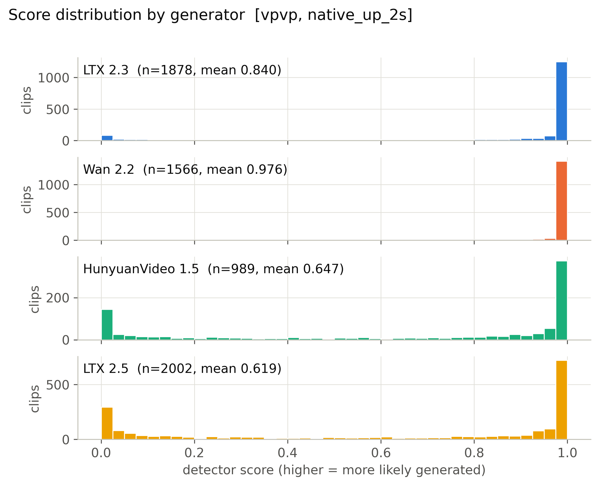

**Mean score, 56 cells x generator.** (`figures/heatmap_mean_score_cells.pdf`)

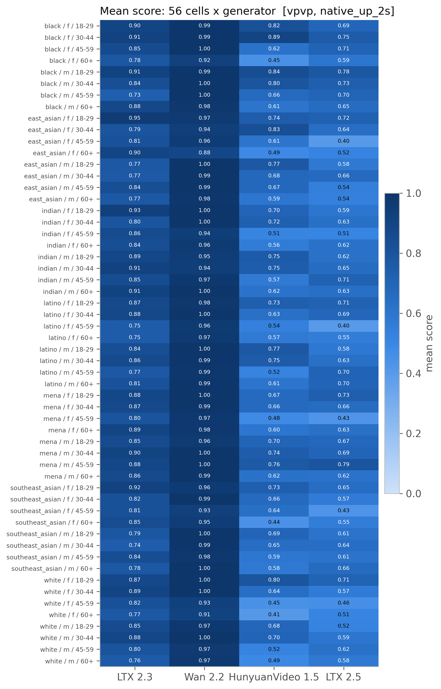

**Detection rate, 56 cells x generator (provisional threshold).** (`figures/heatmap_detection_rate_cells_provisional.pdf`)

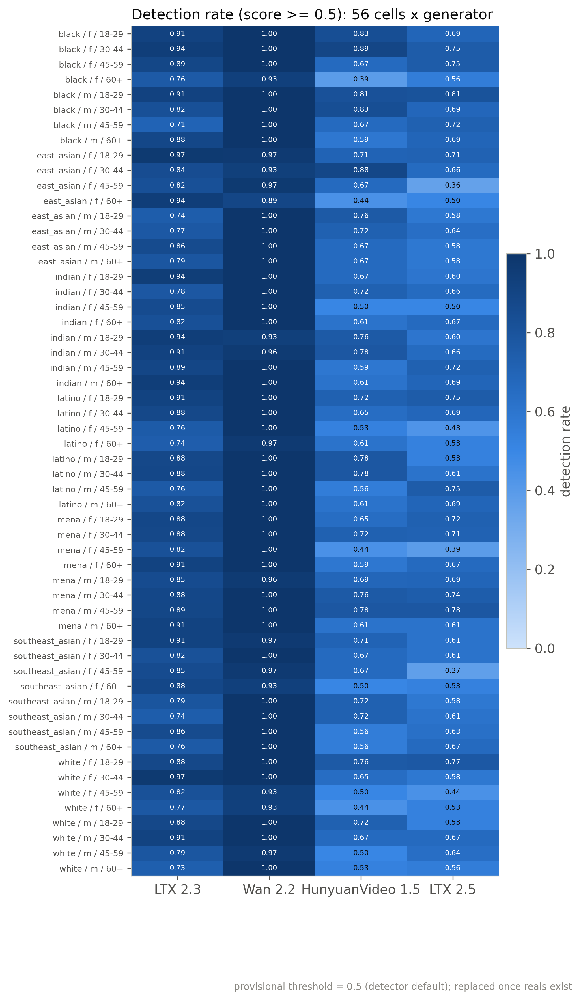

**Mean score by race, gender, age band with 95% CI.** (`figures/subgroup_mean_score.pdf`)

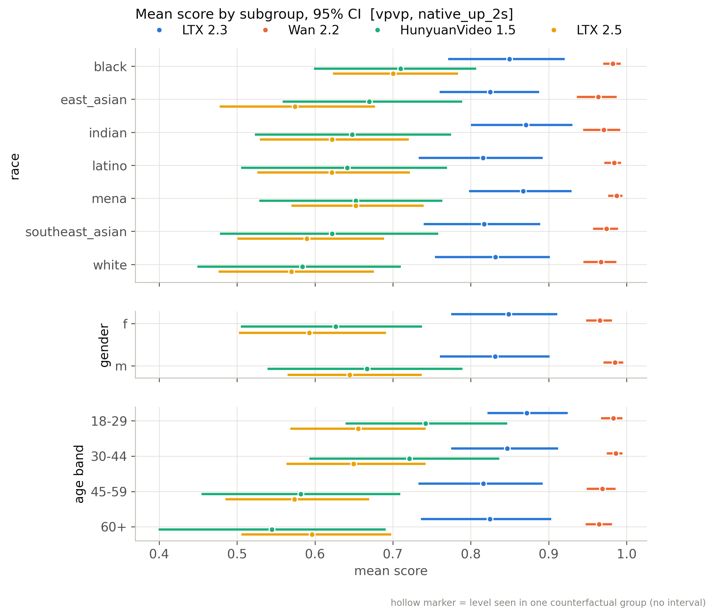

**Mean score by scene factor with 95% CI.** (`figures/scene_factor_mean_score.pdf`)

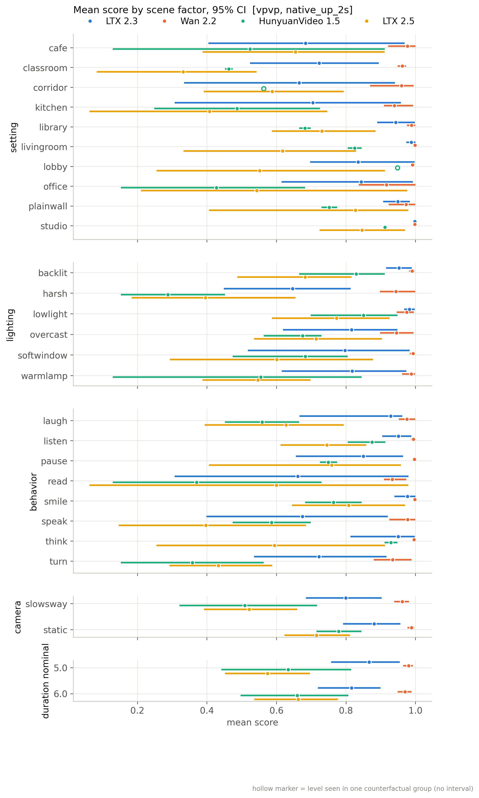

**Detection rate by subgroup (provisional threshold).** (`figures/subgroup_detection_rate_provisional.pdf`)

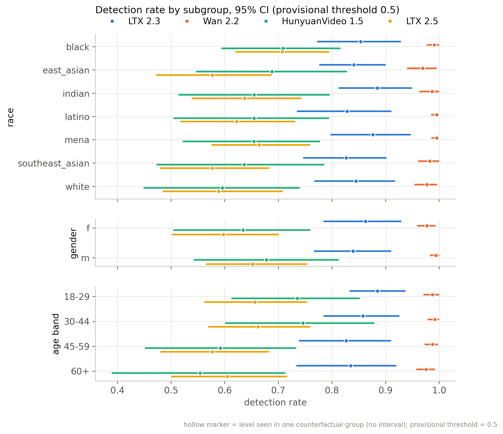

**Distribution of per-group CF spread.** (`figures/cf_spread_distribution.pdf`)

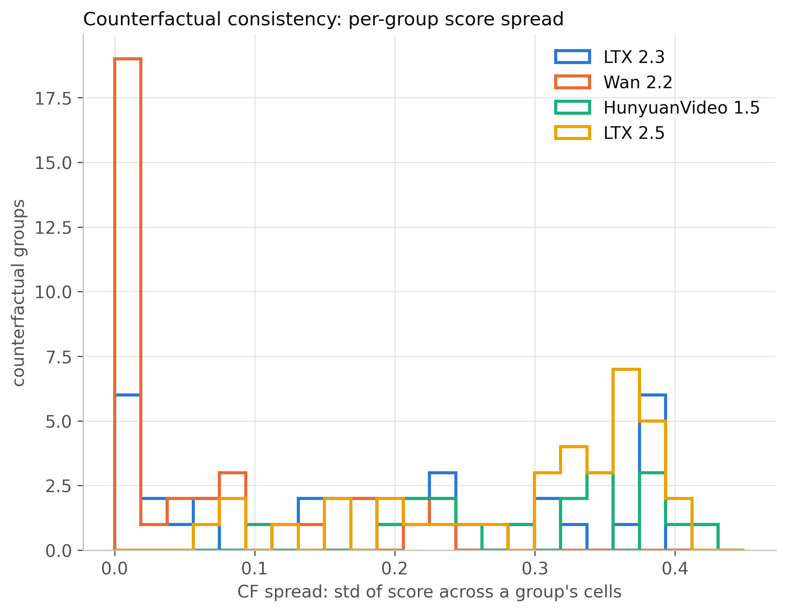

**Flip rate by generator (provisional threshold).** (`figures/flip_rate_by_generator_provisional.pdf`)

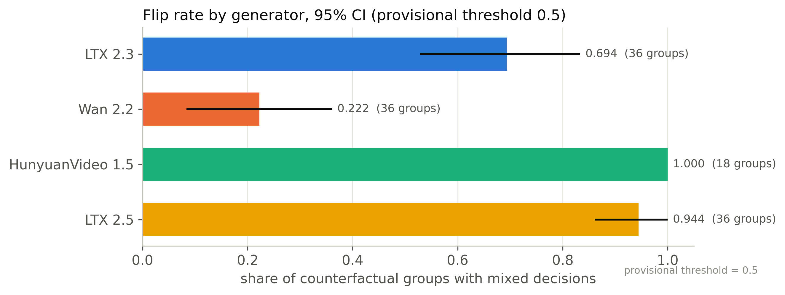

**Partial eta squared by factor.** (`figures/factor_attribution_variance_share.pdf`)

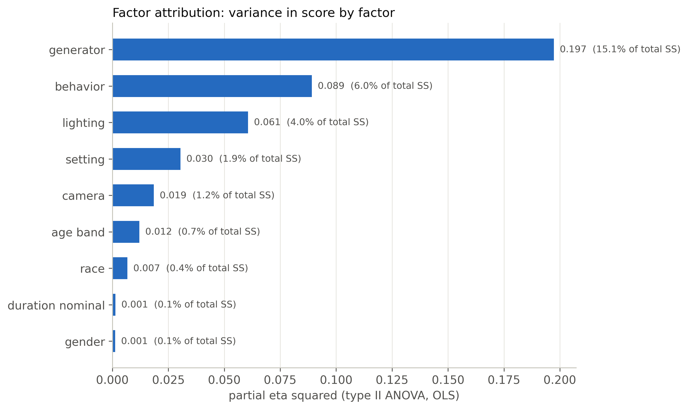

**Highest- and lowest-scoring included clips.** (`figures/example_strip.pdf`)

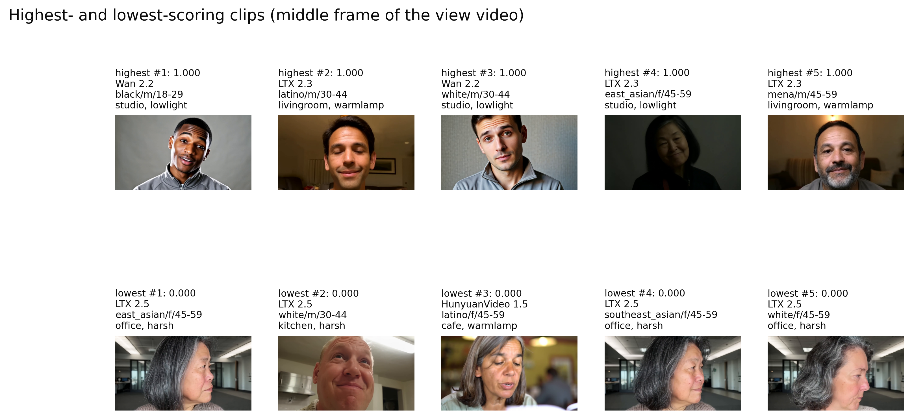

**ROC per generator against fps-matched reals.** (`figures/roc_per_generator.pdf`)

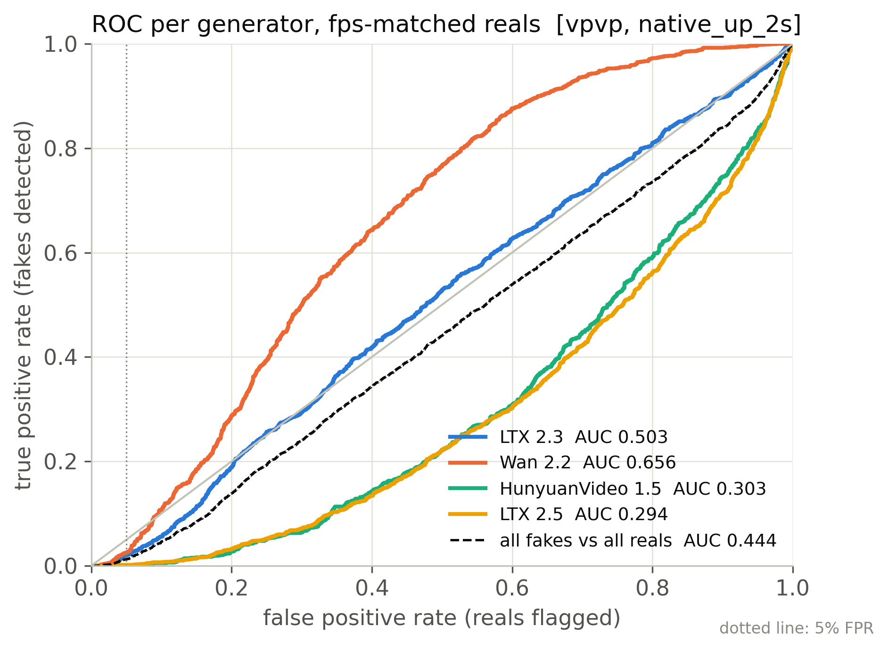

**Real FPR by perceived subgroup at the calibrated threshold.** (`figures/real_fpr_by_subgroup.pdf`)

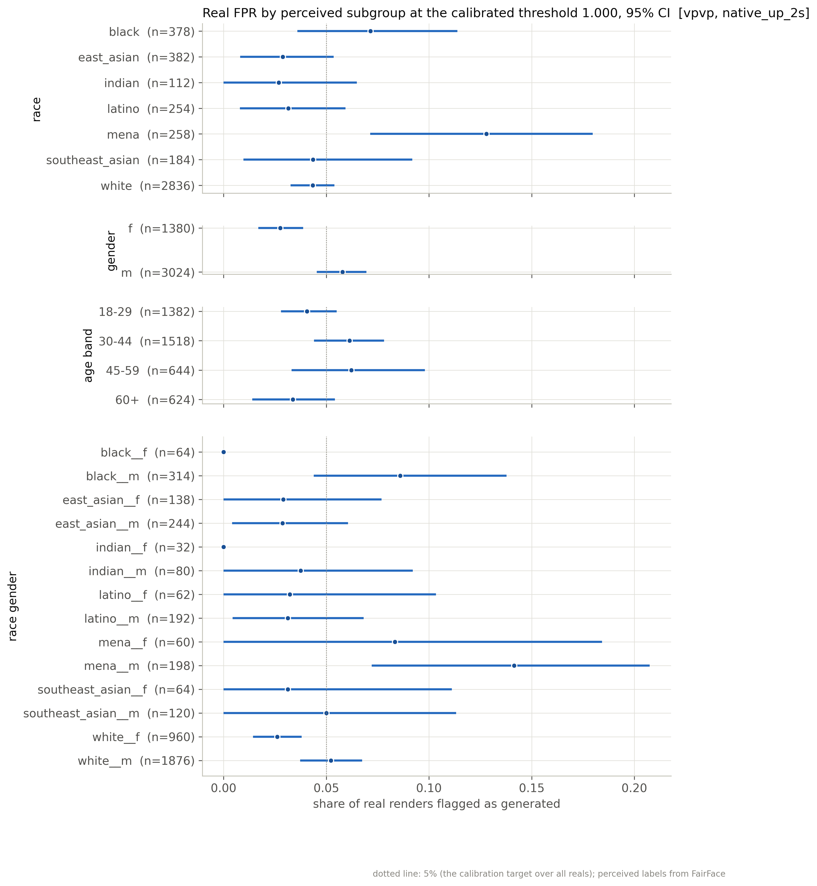

**AUC by subgroup: each subgroup's fakes vs same-subgroup reals.** (`figures/subgroup_auc.pdf`)

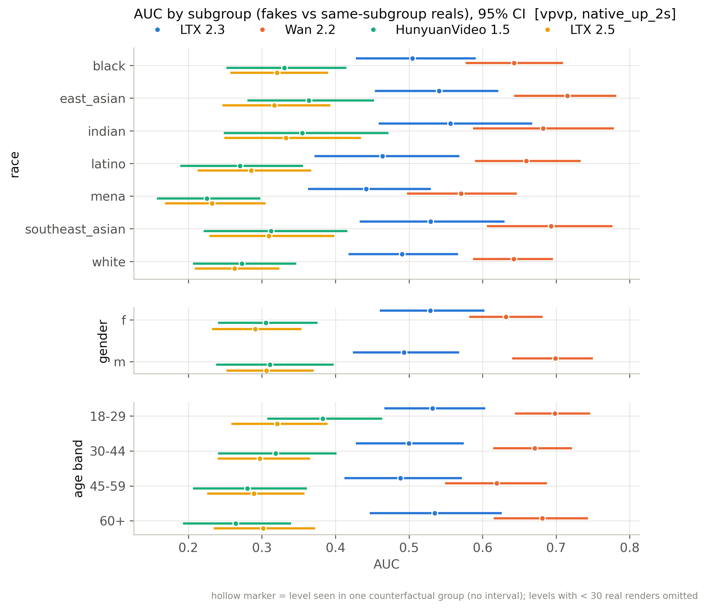

## Files

`manifest_used.csv` (every clip of the active batches with render/score/inclusion flags), `scores.csv` (score per scored clip), `tables/*.csv`, `figures/*`, `snapshot_meta.json`.

